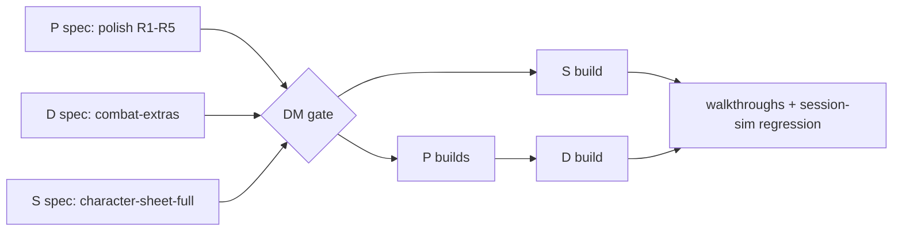

# Sprint 1 (post-MVP): polish, combat depth, player-owned sheets

DM decision #177 (2026-10-14). The MVP works (#176); players join only once the product is more complete. Three tracks run **in parallel**; code that overlaps is sequenced by the orchestrator. Process: [orchestrator prompt](orchestrator-prompt.md) and [continue-session §3](continue-session.md#3-herdr-how-to-run-agents-learned-the-hard-way).

## Track P: polish (from the session-sim-3 regression, #176)

Evidence: `%TEMP%\pocket-plane\verify-session-sim-3\report.md` (glitch list, screenshots). One spec agent revises the owning specs; then small `fix/*` builds.

| # | Glitch | Owning spec(s) | Needs the DM? |
|---|---|---|---|
| R1 | Default windows cover tokens on the battlemap (Initiative over the Elite at 1440×900; Goblins at 1280×720; a player's own Game log over his token). Windows fit, the map is never fitted to the free area | scenes-map (camera / fit to the uncovered work area), play-shell | Yes: auto-fit the map vs a "fit to free area" control vs window defaults |
| R2 | With no targets the attack popup opens on the left, over the PCs (the common monster-attacks-PC case) | combat-tracker FR-CBT-55 | No (spec agent picks) |
| R3 | DM Game log history shows ~3 lines; multi-line outcome lines cut | dice-roll-log, play-shell FR-SHELL-28 | No |
| R4 | Natural 1 / 20 invisible on the attack card and at apply time; players then see "1 + 4 = 5 — hit!" after a DM override, which reads like a bug | combat-tracker, dice-roll-log | Yes: may players see that the DM ruled (G8 kept it DM-only)? |
| R5 | A pending card outlives End encounter (toast + bell badge stay) | combat-tracker, notifications | Yes: auto-resolve / dismiss on End vs keep |

Not in this sprint (log only): Undo tooltip copy, DM fiat damage public in logs, fixture clock "02:00", empty Initiative window stays open. A spec agent may fold any of these in if it touches the same FR anyway.

## Track D: combat depth → spec `combat-extras` (prefix CBTX)

Expand [post-mvp/combat-extras](../specs/post-mvp/combat-extras.md) from the template into a full spec (move it to `docs/specs/combat-extras.md`, front matter `phase: post-mvp-1`). Proposed scope (DM confirms at the gate):

- Conditions (5e list) with expiry in rounds; condition icons on tokens (token overlays registry, FR-MAP-34/43).
- HP ring / bar on tokens (players: health band only, #138).
- Concentration: reminder with DC on damage, click-to-roll save (notification with action).
- Round-based effect durations ("Bless: 8 rounds").
- Temp HP (absorbs damage first; undo-safe).
- Death saves for PCs at 0 HP (successes / failures, nat 1 / nat 20 rules, stabilise).
- **Add combatants mid-fight** (summons, reinforcements): roll rule already in FR-CBT-46/47 (#172).
- Out unless the DM adds them: custom NPC actions vs targets, AoE / multi-target saves, drag-reorder initiative, legendary / lair / reactions.

## Track S: player-owned sheets → spec `character-sheet-full` (prefix CHARX)

Expand [post-mvp/character-sheet-full](../specs/post-mvp/character-sheet-full.md) into a full spec (`docs/specs/character-sheet-full.md`, `phase: post-mvp-1`). Proposed scope:

- Players **create and edit their own character** (manual entry; no compendium, no class data): abilities, proficiencies, skills, saves, AC, HP max, speed, hit dice, attacks, spells as hand-entered rows (slots tracked), features, inventory, notes.
- DM edits any PC and NPC (full editing, #154 design-for-later becomes real); DM can lock a sheet.
- Roll from any number on the sheet (skills, saves, checks, attacks, spells with to-hit / save DC).
- Derived vs stored per [ADR-0012](../architecture/adr/0012-character-derived-values.md) / ADR-0032 (derive what MVP derives; overrides).
- Other players see a summary only (carried-over OQ pick).
- Out: guided character builder and level-up (need class data → [levelling](../specs/post-mvp/levelling.md) after the compendium); spell / item lookup (compendium).

## Boundaries and hotspots (orchestrator: sequence these)

| Overlap | Rule |
|---|---|
| D ↔ S: temp HP, death saves, conditions on a PC | **D owns** the data, rules and events; **S owns** the sheet layout and shows them through a sheet section seam S defines (each spec raises an OQ naming the other; the orchestrator settles it before the gate) |
| D ↔ S: DB schema (`src/server/db/`), entity stats | Shared file: schema changes land by **shared branch first** or a sequenced lock; never both builds at once |
| P ↔ D: combat-tracker code (R2, R4, R5) | **P combat fixes merge before the D build starts** |
| P ↔ everything: play-shell frame, `overlays.tsx` | Locks per AGENTS §9.9, recorded in status.md |
| D: token overlays (icons, HP ring) | scenes-map registry lines (append-only); no scenes-map frame changes without a lock |

## Gates

1. **Spec gate (DM):** all three specs (P revisions, CBTX, CHARX) reviewed by a review agent, then one DM pass: scope, picks, the R1 / R4 / R5 questions.
2. Builds in parallel per the hotspot rules. Each feature: walkthrough PASS by a test agent; full `bun run check` **and full `bun run e2e`** before every merge.
3. **Sprint gate (DM):** session-sim regression on final `main` (now incl. conditions, death saves, a player-created character), then recap and pick sprint 2 (candidates: battlemap props + structure + **fog of war**, party board + handouts, table flavour, compendium).
