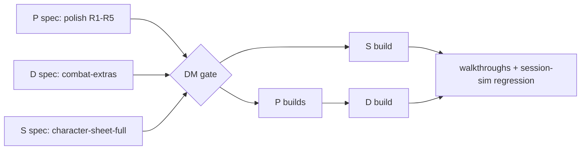

# Sprint 1 (post-MVP): polish, combat depth, player-owned sheets

DM decision #177 (2026-10-14). The MVP works (#176); players join only once the product is more complete. Three tracks run **in parallel**; code that overlaps is sequenced by the orchestrator. Process: [orchestrator prompt](orchestrator-prompt.md) and [continue-session §3](continue-session.md#3-herdr-how-to-run-agents-learned-the-hard-way).



## Track P: polish (from the session-sim-3 regression, #176)

Evidence: `%TEMP%\pocket-plane\verify-session-sim-3\report.md` (glitch list, screenshots). One spec agent revises the owning specs; then small `fix/*` builds.

| # | Glitch | Owning spec(s) | Needs the DM? |
|---|---|---|---|
| R1 | Default windows cover tokens on the battlemap (Initiative over the Elite at 1440×900; Goblins at 1280×720; a player's own Game log over his token). Windows fit, the map is never fitted to the free area | scenes-map (camera / fit to the uncovered work area), play-shell | Yes: auto-fit the map vs a "fit to free area" control vs window defaults |
| R2 | With no targets the attack popup opens on the left, over the PCs (the common monster-attacks-PC case) | combat-tracker FR-CBT-55 | No (spec agent picks) |
| R3 | DM Game log history shows ~3 lines; multi-line outcome lines cut | dice-roll-log, play-shell FR-SHELL-28 | No |
| R4 | Natural 1 / 20 invisible on the attack card and at apply time; players then see "1 + 4 = 5 — hit!" after a DM override, which reads like a bug | combat-tracker, dice-roll-log | Yes: may players see that the DM ruled (G8 kept it DM-only)? |
| R5 | A pending card outlives End encounter (toast + bell badge stay) | combat-tracker, notifications | Yes: auto-resolve / dismiss on End vs keep |

Not in this sprint (log only): Undo tooltip copy, DM fiat damage public in logs, fixture clock "02:00", empty Initiative window stays open. A spec agent may fold any of these in if it touches the same FR anyway.

## Track D: combat depth → spec `combat-extras` (prefix CBTX)

Expand [combat-extras](../specs/combat-extras.md) from the template into a full spec (move it to `docs/specs/combat-extras.md`, front matter `phase: post-mvp-1`). Proposed scope (DM confirms at the gate):

- Conditions (5e list) with expiry in rounds; condition icons on tokens (token overlays registry, FR-MAP-34/43).
- HP ring / bar on tokens (players: health band only, #138).
- Concentration: reminder with DC on damage, click-to-roll save (notification with action).
- Round-based effect durations ("Bless: 8 rounds").
- Temp HP (absorbs damage first; undo-safe).
- Death saves for PCs at 0 HP (successes / failures, nat 1 / nat 20 rules, stabilise).
- **Add combatants mid-fight** (summons, reinforcements): roll rule already in FR-CBT-46/47 (#172).
- Out unless the DM adds them: custom NPC actions vs targets, AoE / multi-target saves, drag-reorder initiative, legendary / lair / reactions.

## Track S: player-owned sheets → spec `character-sheet-full` (prefix CHARX)

Expand [character-sheet-full](../specs/character-sheet-full.md) into a full spec (`docs/specs/character-sheet-full.md`, `phase: post-mvp-1`). Proposed scope:

- Players **create and edit their own character** (manual entry; no compendium, no class data): abilities, proficiencies, skills, saves, AC, HP max, speed, hit dice, attacks, spells as hand-entered rows (slots tracked), features, inventory, notes.
- DM edits any PC and NPC (full editing, #154 design-for-later becomes real); DM can lock a sheet.
- Roll from any number on the sheet (skills, saves, checks, attacks, spells with to-hit / save DC).
- Derived vs stored per [ADR-0012](../architecture/adr/0012-character-derived-values.md) / ADR-0032 (derive what MVP derives; overrides).
- Other players see a summary only (carried-over OQ pick).
- Out: guided character builder and level-up (need class data → [levelling](../specs/post-mvp/levelling.md) after the compendium); spell / item lookup (compendium).

## Boundaries and hotspots (orchestrator: sequence these)

| Overlap | Rule |
|---|---|
| D ↔ S: temp HP, death saves, conditions on a PC | **D owns** the data, rules and events; **S owns** the sheet layout and shows them through a sheet section seam S defines (each spec raises an OQ naming the other; the orchestrator settles it before the gate) |
| D ↔ S: DB schema (`src/server/db/`), entity stats | Shared file: schema changes land by **shared branch first** or a sequenced lock; never both builds at once |
| P ↔ D: combat-tracker code (R2, R4, R5) | **P combat fixes merge before the D build starts** |
| P ↔ everything: play-shell frame, `overlays.tsx` | Locks per AGENTS §9.9, recorded in status.md |
| D: token overlays (icons, HP ring) | scenes-map registry lines (append-only); no scenes-map frame changes without a lock |

## Gates

1. **Spec gate (DM):** all three specs (P revisions, CBTX, CHARX) reviewed by a review agent, then one DM pass: scope, picks, the R1 / R4 / R5 questions.
2. Builds in parallel per the hotspot rules. Each feature: walkthrough PASS by a test agent; full `bun run check` **and full `bun run e2e`** before every merge.
3. **Sprint gate (DM):** session-sim regression on final `main` (now incl. conditions, death saves, a player-created character), then recap and pick sprint 2 (candidates: battlemap props + structure + **fog of war**, party board + handouts, table flavour, compendium).

## Playtest: sprint 1 features

Run from `C:\Repos\pocket-plane` on `main` (PowerShell). ~45 minutes for part 1, ~15 each for parts 2 and 3. **DM** (normal browser) + **Player 1** (incognito) + **Player 2** (another browser). Regression run: [session-sim-4 report](../../.verify/20261014-194223-session-sim-4/report.md) (local, gitignored), all steps PASS, #186.

### Setup

```powershell
bun install
bun run build
bun run fixtures:reset-load session-sim --profile verify
bun run start --profile verify
```

The load prints the **DM URL**, **DM secret** and the **player links** (`http://127.0.0.1:4112/…`). Open the DM URL and paste the secret; open each player link in its own browser. Player 1 plays Mira, Player 2 plays Thorn.

To switch bundles (parts 2 and 3): `Ctrl+C` the server, then

```powershell
bun run fixtures:reset-load <bundle> --profile verify
bun run start --profile verify
```

Player links change with every load: reopen them from the printed output.

### Part 1: full session (`session-sim`)

| # | You do | Expect |
|---|---|---|
| 1 | Players open their links; Player 2: Sheets → **New character** → "Sela", a few fields (class, WIS 16, Medicine), roll Medicine | Sela shows a **Draft** badge, rolls work; Player 1 sees only a summary card for Sela |
| 2 | DM: Sheets → Sela → **Approve** | Draft badge goes for everyone (≤ 1 s). Known: no DM cue that a draft is waiting |
| 3 | Player 1: Mira's sheet, click every tab (Main, Actions, Features, Inventory, Notes); roll Athletics (Shift = advantage) and a save; hover Passive Perception | Tabs by mouse; log lines with the right bonus; "Derived 13 · Override: Alert (test)" |
| 4 | DM: Scenes → Goblin Ambush → **Show to players** | Every client frames the tokens in the free area: no token under a default window (R1). Pan away, click **Fit** on the tool rail → framed again |
| 5 | Encounters → "Ambush at the Ford" → **Start** | Initiative opens in front, Encounters minimises, the map refits. Roll monsters; players roll initiative from the sheet |
| 6 | DM: token menu on an unbound token, or Initiative **Add…** → add a reinforcement | New row without initiative; its Roll button, or type a number |
| 7 | Player 1: Mira's Actions → **Light crossbow** (her 2nd attack) Attack | Damage card "Mira — Light crossbow"; DM picks targets, Apply (every sheet attack routes now, not just the first) |
| 8 | DM: a monster's row **Attack** with nothing selected | The popup opens where it covers no PC token (R2). The Elite has two attacks: a picker appears |
| 9 | Game log → Physical dice on; a monster attack, enter d20 **1**, DM sets **Hit**, Apply | Card and popup show "natural 1"; players read "(natural 1) — DM ruled hit". A ruling on a non-natural roll stays DM-only (R4) |
| 10 | DM: Initiative row menu → **Conditions ▸ Prone** on a Goblin; **Effect…** "Bless", 2 rounds, on Mira; **Temp HP** 5 on Thorn | Chips in the rows, icons on the tokens; players never see a monster's hidden effects or numbers |
| 11 | Player 1: Mira's effects chip menu → **Concentrate…** "Bless"; DM hits Mira for 6 | Player 1 gets a sticky "concentration save DC 10" card → **Roll save**; fail ends Bless and its linked effects |
| 12 | DM hits Thorn for 3 | Temp HP absorbs first ("3 absorbed by temp HP" on the DM's line only); Thorn's HP unchanged |
| 13 | Next until Bless runs out | It ends at the start of Mira's turn with a DM toast "Ended: Bless"; **Prev** brings it back |
| 14 | DM: drop Thorn to 0 HP; Player 2 rolls death saves from the sheet (vitals section) | Dying badge on token and row; 3 successes = Stable, nat 20 = 1 HP, damage at 0 = a failure; Player 1 sees only Dying / Stable / Dead |
| 15 | Apply damage that ends someone's concentration, then **Undo** | HP, temp HP, death counters and the ended concentration come back |
| 16 | With a concentration card pending: stop the server (`Ctrl+C`), start it again | Everyone reconnects; card still pending, effects, timers, bars intact |
| 17 | Game log at its default size | ≥ 6 lines of history above a one-row roll bar; Options chevron holds category / actor / label (R3) |
| 18 | Initiative header → **End encounter** with a damage card still pending | Confirm says "N pending cards will be dismissed"; after End the toast and bell clear, cards show "Dismissed" in History (R5); Initiative minimises |
| 19 | Loot: add coins, move some to Mira and back | Pot and wallets match on every screen |

### Part 2: combat depth up close (`combat-extras`)

Starts mid-fight: round 1, Wolf's turn, Mira concentrating on Bless (linked on Mira and Thorn), Goblin prone, hidden Elite poisoned, a **secret** "Hex" on Goblin 2, Thorn "Marked" (no duration), temp HP on Thorn (5) and a Goblin (3), unbound "Goblin 3" and hidden "Wolf 2" on the map.

| # | You do | Expect |
|---|---|---|
| 1 | Look at the map and Initiative as DM and as each player | DM: real HP bars on every token, all icons. Players: own PC's real bar, monsters a band-colour bar, no Hex, nothing from the Elite |
| 2 | Add Goblin 3 and Wolf 2 mid-fight | Wolf 2 stays hidden from players |
| 3 | End the encounter | Thorn's "Marked" stays on his sheet; timed and monster effects end |

### Part 3: player-owned sheets (`character-sheet-full`)

No map. Player 1 owns Mira (**locked**) and Pip; Player 2 owns Sela (**draft**, Cleric with spells) and Thorn. An NPC sheet exists for the Elite Goblin Warrior.

| # | You do | Expect |
|---|---|---|
| 1 | Player 1: Mira | Locked badge, no Edit; rolls, HP and counters still work |
| 2 | Player 2: Sela → Actions: Guiding Bolt Attack, Sacred Flame Damage; tick a slot pip | "+5" with 4d6 radiant; "DC 13 DEX" in the label; slot 1/2 used |
| 3 | Player 2: Edit → change WIS; add an override on a skill, then Clear | Every WIS number follows; override marker and tooltip |
| 4 | DM: Creatures → Elite Goblin Warrior → **Sheet**; edit an attack; then a SRD Goblin's sheet | Custom NPC editable, DM-only rolls; SRD Goblin read-only with "Derive to customise" |
| 5 | DM: New character "Kell" for Player 2, then reassign to Player 1 | Kell appears for Player 2, then moves to Player 1; Player 2 keeps only a summary |

### Known glitches (session-sim-4, to fix at the start of sprint 2)

Effect chips collapse to "+N" in the default Initiative window; fitted battlemap tokens are small (~29 px at 1440×900); resizing the window doesn't refit; Initiative doesn't grow for added rows; the popup's damage preview ignores temp HP; physical-dice crit with empty boxes does nothing silently; death-save counters show in the public log; no DM cue for drafts awaiting approval; no bell badge for a pending concentration card; Undo tooltip copy; duplicate card toast while its popup is open; "physical" twice in a player's outcome line; the player sheet picker jumps after reload; a dead PC has no map cue after End; monster initiative rolls are public log lines; the sheet window is cramped for creating a character; the encounter rating silently counts a token-less approved PC.

### Teardown

`Ctrl+C` the server, then:

```powershell
bun run fixtures:reset --profile verify
```
