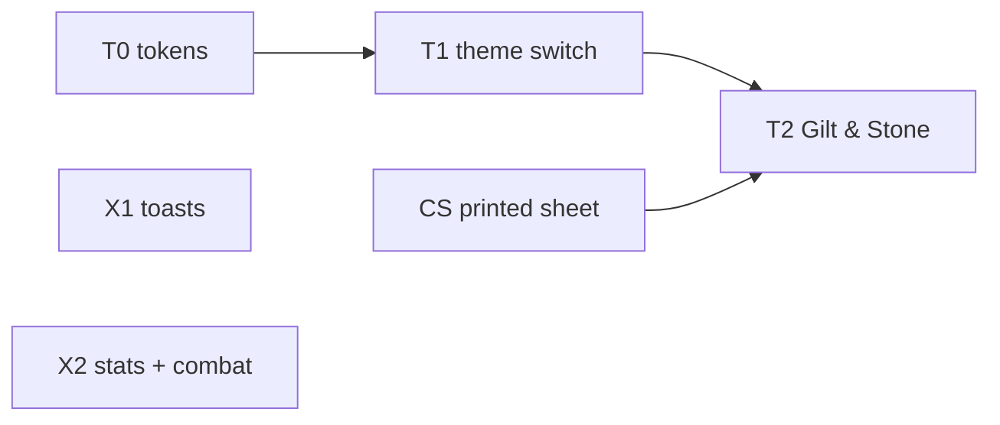

# Sprint 12: art build (Gilt & Stone) + fix lane

DM decision #353 (sprint-11 recap): the **art build** from [theme-system](../specs/post-mvp/theme-system.md) §13–14 and [character-sheet-full](../specs/character-sheet-full.md) §6.2 / §13 (specs complete, #351–#352, [ADR-0069](../architecture/adr/0069-theme-switch.md)), plus a small **fix lane** from session-sim-15 in the idle slots. Run like sprint 11: no spec phase, no DM gate unless something truly blocks; the orchestrator rules and logs in status.md. Process: [orchestrator prompt](orchestrator-prompt.md), [continue-session §3](continue-session.md#3-herdr-how-to-run-agents-learned-the-hard-way), the faster test loop (#345).

Look: the kit page [gilt-stone.html](../design/art/kit/gilt-stone.html) (source of truth). Evidence for the fix lane: the [session-sim-15 report](../../.verify/20261024-234809-session-sim-15/report.md) (local, gitignored; copied into each fix worktree).

## Slices

| Slice | Branch | Does | Starts |
|---|---|---|---|
| **T0** theme tokens | `fix/theme-tokens` | Raw colour classes → tokens in 13 files (not the two sheet files, CS owns them); `data-slot` on every `components/ui/` part; Launcher measures a button's computed font (FR-THEME-07). **No visible change in Default** (FR-THEME-19) | now |
| **CS** printed sheet | `build/charx-print-sheet` | FR-CHARX-105–120: boxes, shield AC, ability blocks with saves, Skills box, passives, wide layout at 560 px, breakdown Tooltips, tab strip arrows, `sheet-*` slots; raw colours → tokens in `MainTab.tsx` / `SummaryCard.tsx`. Walkthrough PS1–PS6 in Default (Gilt & Stone part in T2) | now |
| **X1** toasts | `fix/x1-toasts` | BL-118 (stack + roll popup flicker on each new card, sim-15 FAIL c), BL-119 (older Roll requests card under the stack), BL-120 (pending counts don't add up) | now |
| **X2** stats + combat | `fix/x2-stats-combat` | BL-121 (DM #353: for players, withhold **every** award a hidden fact could change, as BL-111 did for "Most damage dealt"), BL-122 (a new turn's skip toast replaces the previous one), BL-116 (two load-only flakes) | now |
| **T1** theme switch | `build/theme-switch` | FR-THEME-01–04, -06, -08, -09, -16, -18, -20: `data-theme`, boot script, `pp.theme.v1`, both themes' token blocks (Default values reproduce today), Preferences **Appearance** section (both clients), bundled fonts (Latin woff2 + OFL) | after T0 merges |
| **T3** default theme (DM #355) | `fix/theme-default` | Gilt & Stone is the default for a browser with no choice; the original look is renamed **Simple Dark** (stored `default` keeps meaning it) | after T2 merges |
| **T2** Gilt & Stone | `build/theme-gilt` | FR-THEME-05, -10–15, -17, -19: `themes/gilt.css` (frame, controls, scrollbars, toasts, scroll tooltip, the sheet's `sheet-*` slots), bundle `theme-gilt`, `theme-geometry.e2e.ts`, walkthrough D1–D4, P1–P2 + CS's PS1–PS6 under Gilt & Stone | after T1 and CS merge |



## Boundaries and hotspots

| Overlap | Rule |
|---|---|
| `src/client/common/components/ui/*`, `styles.css`, `Launcher.tsx` and the 13 colour files | **T0**, then **T1** (shared files, sequenced: lock in status.md) |
| `src/client/common/features/character-sheet/` (+ dm / player sheet folders) | **CS** all sprint; T2 only adds CSS for its slots |
| Notifications toast runtime, dice-extras popup keep-out, pending counts | **X1** |
| Stats awards read model, combat-tracker skip toast, the two flaky tests | **X2** |
| `src/client/common/themes/`, `index.html` boot script, fonts | **T1**, then **T2** |
| `docs/design/` | read-only for every slice |
| Schema | none expected (themes are browser-only, 0 B) |

## Orchestrator: how to run this sprint

1. Briefs via `mkbuild.py` (keys `th0`, `cs`, `x1`, `x2`; later `th1`, `th2`), inputs `.verify/sprint12/`, sim-15 evidence copied into X1 / X2. Start T0, CS, X1, X2.
2. Builders: tests near the change + `bun run check` + their area's e2e specs (#345). Walkthrough per slice (T0: a Default screenshot diff against `main`, no visible change). Then `merge main` + `gates.sh` in the branch → merge.
3. Sprint gate: T2's walkthrough (both themes) + **session-sim-16** on final `main` in a detached gates worktree (bundle `session-sim-13`, Default theme; the fix-lane items, sim-15 glitches, full regression, leak scan, hard kill). Then "Playtest: sprint 12" here, pause, recap. The DM decides the default theme after T2 (OQ-THEME-03).

## Progress

| Date | What |
|---|---|
| 2026-10-25 | Planned (DM #353): art build T0 → T1 → T2 with CS in parallel, fix lane X1 / X2 |
| 2026-10-25 | **T0 merged** (Default pixel-identical). **CS merged** (printed sheet; DM sheet crash in a fight fixed; re-test 24 / 24). **X2 merged** (awards withheld for players when a hidden fact could change them; skip toast replaced; two flaky tests steadied; 4 / 4). **X1 merged** (toast flicker gone, popups move only on real changes, one pending count; re-test 5 / 5) |
| 2026-10-25 | Machine ran out of memory under parallel test runs: DM #354 (one heavy run at a time now; new test strategy after this sprint). **T1 walkthrough PASS** (theme switch). T2 built. **Paused overnight** at this milestone |
| 2026-10-26 | **T1 merged** (theme switch). T2 walkthrough 11 / 12 (hue slider; kit deviations) → fixes → re-test. DM #355: the goal is the kit **mockup**: T2 merges as the paint layer, **Gilt & Stone becomes the default** (T3), the old look is **Simple Dark**, then a **kit-parity layout track** (spec `kit-parity` started) until the look matches |
| 2026-10-27 | **T2, T3 merged** (Gilt & Stone skin; Gilt & Stone default, old look "Simple Dark"). **session-sim-16 12 / 13 PASS** (leak scan clean, hard kill identical); FAIL reloads → BL-129; glitches → BL-130–BL-133. Decision #357. Kit parity continues in [sprint-13](sprint-13.md) |

## Playtest: sprint 12

Run from the repo root on `main` (PowerShell). About 10 minutes. **DM** (normal browser) + **Player 1** (incognito: Mira and Brakka) + **Player 2** (another browser: Thorn). Regression run: [session-sim-16 report](../../.verify/20261026-234022-session-sim-16/report.md) (local): **12 / 13 PASS**.

```powershell
git pull; bun install
bun run build
bun run fixtures:reset-load session-sim-13 --profile verify
bun run start --profile verify
```

Hard-reload tabs that were open before (Ctrl+Shift+R).

| # | What | You do | Expect |
|---|---|---|---|
| 1 | **Gilt & Stone by default** | Open the DM URL and a player link in fresh browsers | Dark stone, gold rules, small-caps titles, red gem close buttons; no flash of the old look |
| 2 | **Simple Dark** | Preferences → Appearance → Simple Dark, then back | The whole app switches at once, nothing moves; each browser keeps its own pick after a reload |
| 3 | **Parchment tooltips** | Hover a Game log result, a skill on the sheet, a condition chip | A parchment strip unrolls after a moment |
| 4 | **Printed sheet** | Player 1: open Mira's sheet; widen it past 560 px; click DEX, then Save; hover Stealth | Labelled boxes, shield AC, ability blocks with saves; two columns when wide; check / save lines in the log; the breakdown tooltip |
| 5 | **Calmer toasts** | Players: several Attack + damage while a roll popup shows | Each card appears in place, no flicker; the popup moves at most once |
| 6 | **Fair awards** | Kill a creature hidden from players, open Stats → Session on a player | Players don't see an award the hidden kill could change; the DM sees all |
| 7 | **Skip toast** | Next past a downed goblin, then Prev | The old "Skipped …" toast is replaced, not stacked |

### Known gaps

- **Not the mockup yet:** Game log rows, Initiative rows, the top bar and the launcher still have the old layout in gold paint. That's the kit-parity work now running ([sprint-13](sprint-13.md)).
- An open Party Manager can come back minimised after a player reload at 1280 (BL-129); toast and popup placement nits (BL-130–BL-132).
