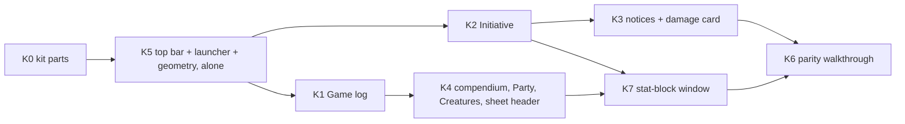

# Sprint 13: kit parity (the Gilt & Stone mockup)

DM decisions #355–#356: the goal is the kit page's mockup ([gilt-stone.html](../design/art/kit/gilt-stone.html)), not a repaint; Gilt & Stone is the default theme, the old look is Simple Dark; "keep working until we have parity for the look". Spec: [kit-parity](../specs/post-mvp/kit-parity.md) (66 FRs, slices §14), [ADR-0070](../architecture/adr/0070-launcher-in-top-bar.md) (launcher in the top bar). Test load: DM #354 (one heavy run at a time, `PP_TEST_SHARDS=3`, one thin e2e + one kit-pairs walkthrough per slice, no session-sim per slice). Starts while sprint 12 finishes (T3 default theme, then session-sim-16).

## Slices (at most two builders at once)

Each slice: build → kit-vs-app walkthrough → gates → merge. K6 compares every kit section with the app; gaps become new slices until parity.

## Progress

| Date | What |
|---|---|
| 2026-10-26 | Spec merged (complete, #356), ADR-0070 accepted. K0 started |
