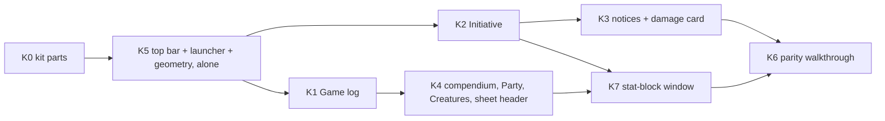

# Sprint 13: kit parity (the Gilt & Stone mockup)

DM decisions #355–#356: the goal is the kit page's mockup ([gilt-stone.html](../design/art/kit/gilt-stone.html)), not a repaint; Gilt & Stone is the default theme, the old look is Simple Dark; "keep working until we have parity for the look". Spec: [kit-parity](../specs/post-mvp/kit-parity.md) (66 FRs, slices §14), [ADR-0070](../architecture/adr/0070-launcher-in-top-bar.md) (launcher in the top bar). Test load: DM #354 (one heavy run at a time, `PP_TEST_SHARDS=3`, one thin e2e + one kit-pairs walkthrough per slice, no session-sim per slice). Starts while sprint 12 finishes (T3 default theme, then session-sim-16).

## Slices (at most two builders at once)

Each slice: build → kit-vs-app walkthrough → gates → merge. K6 compares every kit section with the app; gaps become new slices until parity.

## Progress

| Date | What |
|---|---|
| 2026-10-26 | Spec merged (complete, #356), ADR-0070 accepted. K0 started |
| 2026-10-27 | **K0 merged**: kit parts (Medallion, Result box, HP bar), variants as data, every dialog with a title bar and centred close gem (walkthrough 3/5 → re-test 4/5 → fixed). K5 building |
| 2026-10-27 | **K5 merged**: launcher in the top bar (DM #358: all window buttons as icons), kit top-bar zones, work area to the bottom edge, taller Game log, layouts regenerated once (walkthrough 7/8, pre-existing grip issue BL-133; 13 e2e expectations updated to the new geometry; BL-134 Fit follow-up). K1 + K2 started |
| 2026-10-27 | **K1 merged**: Game log as the kit's rows (medallion, name · action, time, result box), copy keeps today's lines, roll popup medallion (walkthrough 8/8). K2 walkthrough; K4 started |
| 2026-10-27 | **K2 merged**: Initiative as the kit card (walkthrough 5/6 → re-test PASS: companions in the owner's turn no longer widen the column). K4 walkthrough; K3 started |
| 2026-10-27 | **K4 merged**: compendium table + stat block card, Party status cards, Creatures medallions, sheet header (walkthrough 5/7 → re-test 7/7). K7 started |
| 2026-10-27 | **K3 merged**: notices as kit cards, DM turn card, damage card as a kit window (walkthrough 6/7; the alert fallback is the same on main, BL-130). Only K7 and K6 left |
| 2026-10-27 | **K7 merged**: the DM stat-block window (kit Goblin card; opened from Initiative, tokens, the compendium and a palette command; out-of-fight rolls always DM-only after a walkthrough leak, #359). All build slices on main. **K6 parity walkthrough** started |
| 2026-10-27 | **K6 parity walkthrough**: every kit area >= 2 (7 at 3: buttons, menus, dialogs, more pieces, type, palette, Party card; 9 at 2), screens 2 / 3 (#360). Polish round K8 (log + damage card), K9 (Initiative + notices), K10 (chrome + controls) started |
| 2026-10-27 | **K8 merged** (combat log rows as kit rows with result boxes, damage card polish: Game log and damage card now 3 / 3). K9 walkthrough: toasts, Notifications window, stat block, medallions 3 / 3; Initiative bars still per row → fixing. K10 started |
| 2026-10-27 | Polish round merged: **K10** (titles, Pause icon, selects, rail, Players / Preferences / Creatures, popovers above toasts), **K9** (Initiative 3 / 3 after three re-tests; medallions, toasts, Notifications window, stat-block labels 3 / 3), **K11** (DM #361: the character sheet in every viewer state; the DM viewing a PC mid-fight 3 / 3; gem block restored). K6 round 2 started |
