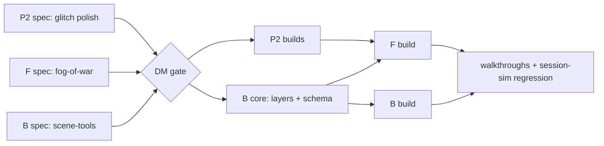

# Sprint 2: battlemap polish, fog of war, props and structure

DM decision #187 (2026-10-15), after the sprint-1 recap (#186). Three tracks **in parallel**; overlapping code is sequenced by the orchestrator. Process: [orchestrator prompt](orchestrator-prompt.md), [continue-session §3](continue-session.md#3-herdr-how-to-run-agents-learned-the-hard-way) and its sprint-1 lessons. Sprint 1 for reference: [sprint-1](sprint-1.md).

## Orchestrator: how to run this sprint

1. Spec phase, all three at once: one spec agent per track (`spec/polish-2`, `spec/fog-of-war`, `spec/scene-tools`). P2 revises the owning specs; F writes a **new** spec `docs/specs/fog-of-war.md` from `_template.md` (prefix **FOG**, `phase: post-mvp-2`); B expands the stub [post-mvp/scene-tools](../specs/post-mvp/scene-tools.md) into `docs/specs/scene-tools.md` (prefix SCN, `phase: post-mvp-2`) without fog. Claim → draft → in-review per AGENTS §4.
2. Settle the **F ↔ B seam** (layer stack, what fog hides, props / walls under fog) yourself before the review, as with sprint 1's D/S seam: read both drafts, write a short settlement file, have each author apply it to their own spec.
3. One review agent across all three (inputs copied into the main checkout's `.verify/review-sprint2/`; agents can't read outside their working dir). Authors apply the findings.
4. **One DM spec gate**: F and B scope, every pick, the P2 questions that need the DM. Then number ADRs, fix moved links, spec index, glossary, AGENTS §9.9 registries, decisions log; merge the spec branches.
5. Builds per the hotspot rules below. Each feature: walkthrough PASS by a test agent; `check` + full `e2e` in the branch **and again on `main` after the merge**.
6. Session-sim regression on final `main` (now incl. fog reveal, a wall blocking a move, an AoE template), then **pause and recap with the DM** before sprint 3.

Work autonomously between gates; come back to the DM only for product decisions, gates, ADR acceptance, new dependencies, anything destructive.

## Track P2: polish (from the session-sim-4 regression, #186)

Evidence: `.verify/20261014-194223-session-sim-4/report.md` in the main checkout (glitches 1–17, screenshots alongside). Copy it into the spec agent's worktree. One spec agent revises the owning specs; then small `fix/*` builds.

| # | Glitch | Owning spec(s) | Needs the DM? |
|---|---|---|---|
| G1 | Effect chips always collapse to "+N" in the default Initiative window, even with room | combat-extras, combat-tracker | No |
| G2 | Fitted battlemap tokens are tiny (~29 px at 1440×900, ~15 px at 1280×720); bars, icons, names unreadable | scenes-map (FR-MAP-44 fit, zoom floor) | Yes: minimum token size when fitting vs fit as now + zoom hint vs per-scene default zoom |
| G3 | Resizing the window leaves tokens under windows until Fit | scenes-map, play-shell | No (spec agent picks; e.g. refit on viewport resize while the camera is still "fitted") |
| G4 | Initiative window doesn't grow; added rows below the fold | combat-tracker, play-shell | No |
| G5 | Attack popup's damage preview ignores temp HP; HP dialog shows no temp HP | combat-tracker, combat-extras | No |
| G6 | Physical dice crit: 4d6 → 8d6 with empty boxes; Roll does nothing silently | dice-roll-log | No |
| G7 | Death-save counters in the public log line contradict #178 G6 (others see the state only) | combat-extras FR-CBTX-39 | No: fix to match #178 |
| G8 | No DM cue for a draft awaiting approval; no player cue on approval | character-sheet-full, notifications | No |
| G9 | Pending concentration card: no DM bell badge, no Initiative "Pending" row; after End "Resolved by DM" | combat-extras, notifications | No |
| G10 | Undo tooltip copy ("Sela → Goblin 2, 0"; "DM → Mira, 4" after 99) | combat-tracker | No |

Fold in if the same FR is touched anyway: 11–17 of the report (duplicate card toast, "physical" twice, sheet picker jumps after reload, dead PC no map cue after End, monster initiative rolls public, cramped sheet for creation, encounter rating counts a token-less approved PC), plus sprint-1 leftovers: pending toast over Initiative's Undo, Notifications window opens ~250 px tall vs 360×480, setting a monster's temp HP sends players an empty update.

## Track F: fog of war → new spec `fog-of-war` (prefix FOG)

The first post-MVP item since ADR-0014. Proposed scope (DM confirms at the gate):

- DM-only fog per scene: rectangle and polygon tools to reveal / hide areas (no brush); reveal all / fog all; **new scenes fully fogged** (carried pick).
- DM sees fog as a translucent overlay; players see it opaque. Live: a reveal reaches players ≤ 1 s.
- **Tokens (and props) under fog are hidden from players, filtered server-side** (carried pick), through the visibility filter, never by the client; a token walking out of fog appears; own PC tokens always visible to their owner.
- Undo for fog edits (DM); fog survives reload, reconnect and a hard kill.
- Snapshot cost stated: fog geometry must fit the CON-44 ceilings (heavy DM snapshot is ~731 KiB of 768 KiB: a real constraint; propose compaction or windowing).
- Out: vision, dynamic lighting, line of sight (ADR-0007), player-side exploration memory, fog by walls.

## Track B: props and structure → spec `scene-tools` (prefix SCN, without fog)

Expand the stub. Proposed scope (DM confirms):

- **Layers**: map / objects / tokens / DM-only, a layer model scenes-map renders in order; DM-only layer ≈ hidden tokens (reconcile with MVP's hidden flag, don't duplicate it).
- **Structure**: walls and doors drawn on the grid (segments), **block token movement only** (no vision, ADR-0007); doors open / closed / locked by the DM; a blocked move is refused server-side with a clear cue; DM can always move through.
- **AoE templates**: cone, sphere, cube, line, cylinder; **DM and players place** (carried pick); snap to grid; show affected squares; ephemeral vs persistent (pick); who can delete.
- **Props**: image objects on the objects layer (barrels, tables), DM-placed, from the asset pipeline.
- Diagonal rule as a campaign setting (carried OQ; pick).
- Out unless the DM adds them: map pins (tier B), vision, lighting, freehand drawing (#21), automatic AoE damage / saves (that's combat-extras' out-of-scope multi-target).

## Boundaries and hotspots (orchestrator: sequence these)

| Overlap | Rule |
|---|---|
| F ↔ B: layer stack | **B owns** the layer model and its client registry; F registers the fog layer through it. Each spec raises an OQ naming the other; settle before the review |
| F ↔ B: what fog hides | **F owns** the rule (tokens, props, AoE templates under fog); B's records expose what F's filter needs (position, footprint) |
| F ↔ visibility filter / record registry | Server-side fog filtering touches scenes-map's token visibility fn: a shared seam. Prefer a scenes-map visibility hook registry (append-only) over editing the fn twice |
| F, B ↔ DB schema | Shared file: core branches (`fix/scn-core`, `fix/fog-core`) one after the other, never at the same time |
| P2 ↔ F, B: scenes-map camera / canvas (G2, G3) | **P2's scenes-map fixes merge before** the F and B builds start canvas work |
| P2 ↔ combat-extras / combat-tracker (G1, G4, G5, G7, G9, G10) | Independent of F and B; build in parallel with them |
| Everything ↔ snapshot ceilings | Every new record type re-checks CON-44; never raise a ceiling without the DM |
| play-shell frame, `overlays.tsx`, `MapCanvas.tsx` | Locks per AGENTS §9.9, recorded in status.md |

## Gates

1. **Spec gate (DM):** all three specs reviewed by one review agent, then one DM pass: F and B scope, every pick, the P2 questions (at least G2).
2. Builds in parallel per the hotspot rules. Each feature: walkthrough PASS; full `check` and full `e2e` before every merge and on `main` after it.
3. **Sprint gate (DM):** session-sim regression on final `main` (incl. fog, a wall, an AoE template), a "Playtest: sprint 2 features" section appended here (like [sprint-1](sprint-1.md#playtest-sprint-1-features)), then recap and pick sprint 3 (candidates: party board + handouts, table flavour, compendium).
