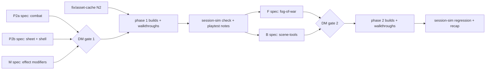

# Sprint 2: DM playtest fixes first, then fog of war, props and structure

DM decisions #187 (sprint 2 chosen) and #188 (the DM's sprint-1 playtest notes come first). Process: [orchestrator prompt](orchestrator-prompt.md), [continue-session §3](continue-session.md#3-herdr-how-to-run-agents-learned-the-hard-way) and its sprint-1 lessons. Sprint 1 for reference: [sprint-1](sprint-1.md).

Two phases. **Phase 1** fixes what the DM found playtesting sprint 1 (N1–N11) plus the session-sim-4 glitches (G1–G10). **Phase 2** (tracks F and B) starts only after phase 1 is merged and verified. Inside each phase, tracks run **in parallel**; overlapping code is sequenced by the orchestrator.



## Orchestrator: how to run this sprint

**Phase 1**
1. At once: `fix/asset-cache` (N2, a bug: no spec; root cause first) and three spec agents: `spec/polish-2a` (P2a combat), `spec/polish-2b` (P2b sheet + shell), `spec/effect-modifiers` (M). P2a / P2b revise the owning specs (one agent per group so cross-spec items get one design); M writes a new spec `docs/specs/effect-modifiers.md` from `_template.md` (prefix **MOD**, `phase: post-mvp-2`) plus a proposed ADR. Copy the inputs (this file, the session-sim-4 report) into each agent's worktree.
2. Settle the seams between P2a, P2b and M yourself (N7's sheet buttons vs combat routing; M's modifiers vs CBTX effects and the sheet), then one review agent across all three; authors apply the findings.
3. **DM gate 1**: every pick that needs the DM (column below), M's scope and whether M builds in phase 1 or later. Then integrate (ADRs, links, index, glossary, registries, log) and merge the spec branches.
4. Builds per the hotspot table; walkthroughs per feature; `check` + full `e2e` in the branch and on `main` after every merge. Then a session-sim run on `main` and a **"Playtest: phase 1 fixes"** section appended here (setup commands + steps, like [sprint-1](sprint-1.md#playtest-sprint-1-features)); tell the DM it's ready. Continue to phase 2 without waiting; DM feedback joins at gate 2.

**Phase 2**
5. Spec agents `spec/fog-of-war` (F, new spec FOG, `docs/specs/fog-of-war.md` from `_template.md`, `phase: post-mvp-2`) and `spec/scene-tools` (B, expand the stub [post-mvp/scene-tools](../specs/scene-tools.md) into `docs/specs/scene-tools.md` without fog, prefix SCN). Settle the F ↔ B seam (layer stack, what fog hides) before one review agent.
6. **DM gate 2**: F and B scope, every pick, any phase-1 playtest feedback. Integrate and merge.
7. Builds, walkthroughs, `check` + full `e2e` on `main` after each merge, session-sim regression on final `main` (incl. fog, a wall, an AoE template), a "Playtest: sprint 2 features" section here, then **pause and recap with the DM** before sprint 3.

Work autonomously between gates; come back to the DM only for product decisions, gates, ADR acceptance, new dependencies, anything destructive.

## Phase 1: DM playtest notes (sprint 1, 2026-10-15)

| # | DM note (short) | Track | Owning spec(s) | Needs the DM? |
|---|---|---|---|---|
| N1 | Minimise vs close look the same; what does minimised mean for a player (the launcher line suggests "open")? | P2b | play-shell | Yes: what minimise is for (keeps state / alerts / badges?) vs dropping it |
| N2 | Thorn's new token art loaded; Mira's (and the goblins', wolf's) only after empty cache + hard reload | Q | assets-pipeline (cache headers, seeded asset IDs across fixture reloads) | No: bug |
| N3 | DM view, under each player: passive Perception, Investigation, Insight, current HP, AC, temp HP, level | P2b | character-sheet-full, campaign-management (players panel) | No (placement is the spec agent's pick) |
| N4 | Why is there an Attack on both the Main and the Actions tab? | P2b | character-sheet, character-sheet-full | No |
| N5 | Adding creatures to an encounter: roll initiative before adding; tickbox "create tokens" (checked; placed in the middle of the screen); tickbox "add hidden" (checked); per row after creature + number: HP **average** (standard) or **rolled**, in both the encounter builder and the mid-fight add dialog; creature lookup becomes an **autocomplete** instead of a dropdown | P2a | combat-tracker (builder), combat-extras (add dialog), entities (HP formula on definitions) | No: DM specified it |
| N6 | Creatures added mid-encounter get no movement-tracker value in the Initiative window | P2a | combat-extras, combat-tracker | No: bug |
| N6.1 | Added creatures: no red crosshair when selected as targets (stays white); the popup says the selection "is not in combat"; multi-select doesn't list them (the targets dropdown does) | P2a | combat-extras, combat-tracker (FR-CBT-33 selection rows, binding) | No: bug |
| N7 | Attack / Damage buttons confuse: Main's Attack also rolls damage; Actions' Attack / Damage differ in and out of combat. Add a **third button: Attack + damage**, and make the three behave the same everywhere | P2b (sheet) with P2a (routing) | character-sheet-full, combat-tracker routes | No: DM specified the third button; the spec states each button in and out of combat |
| N8 | The targets popup (opened from a player's apply notification) can't be moved: make it movable like any window, open it over the apply notification, and that notification goes away | P2a | combat-tracker (amends FR-CBT-55 "not draggable"), notifications | No: DM decided |
| N9 | Bless adds to attack rolls: the sheet needs a place for temporary effects; and the plan for toggling effects like a barbarian's **Rage** | M | new effect-modifiers spec; combat-extras (effects), character-sheet-full (sheet section), ADR-0009 modifiers (design-for-later becomes real) | Yes: scope (modifier kinds, presets, toggles with uses) and whether it builds in phase 1 |
| N10 | Dice notation anywhere in free text becomes clickable ("1d12+5", whitespace-tolerant) and puts the dice in a **3D dice tray** to adjust and roll; doesn't feed attack / apply. Every roll eventually goes through the 3D roller | — | backlog: [feature-tiers](../feature-tiers.md#3-character-sheet-and-dice), [dice-extras](../specs/post-mvp/dice-extras.md) | Done (#188): 3D dice tray tier **S**, dice notation shortcut tier **A** (flagged very important). Not built in sprint 2 |
| N11 | When a player gets a notification (e.g. roll for concentration), the DM sees a few-second cue over that player's token | P2a | combat-extras, notifications, scenes-map (transient token cue) | No |

## Phase 1: glitches from the session-sim-4 regression (#186)

Evidence: `.verify/20261014-194223-session-sim-4/report.md` in the main checkout (glitches 1–17, screenshots alongside). G2, G3, G6, G8 → P2b; G1, G4, G5, G7, G9, G10 → P2a.

| # | Glitch | Owning spec(s) | Needs the DM? |
|---|---|---|---|
| G1 | Effect chips always collapse to "+N" in the default Initiative window, even with room | combat-extras, combat-tracker | No |
| G2 | Fitted battlemap tokens are tiny (~29 px at 1440×900, ~15 px at 1280×720); bars, icons, names unreadable | scenes-map (FR-MAP-44 fit, zoom floor) | Yes: minimum token size when fitting vs fit as now + zoom hint vs per-scene default zoom |
| G3 | Resizing the window leaves tokens under windows until Fit | scenes-map, play-shell | No (spec agent picks; e.g. refit on viewport resize while the camera is still "fitted") |
| G4 | Initiative window doesn't grow; added rows below the fold | combat-tracker, play-shell | No |
| G5 | Attack popup's damage preview ignores temp HP; HP dialog shows no temp HP | combat-tracker, combat-extras | No |
| G6 | Physical dice crit: 4d6 → 8d6 with empty boxes; Roll does nothing silently | dice-roll-log | No |
| G7 | Death-save counters in the public log line contradict #178 G6 (others see the state only) | combat-extras FR-CBTX-39 | No: fix to match #178 |
| G8 | No DM cue for a draft awaiting approval; no player cue on approval | character-sheet-full, notifications | No |
| G9 | Pending concentration card: no DM bell badge, no Initiative "Pending" row; after End "Resolved by DM" | combat-extras, notifications | No |
| G10 | Undo tooltip copy ("Sela → Goblin 2, 0"; "DM → Mira, 4" after 99) | combat-tracker | No |

Fold in if the same FR is touched anyway (P2a or P2b, whichever owns it): 11–17 of the report (duplicate card toast, "physical" twice, sheet picker jumps after reload, dead PC no map cue after End, monster initiative rolls public, cramped sheet for creation, encounter rating counts a token-less approved PC), plus sprint-1 leftovers: pending toast over Initiative's Undo, Notifications window opens ~250 px tall vs 360×480, setting a monster's temp HP sends players an empty update.

## Phase 1: track M, effect modifiers (N9)

Design first; build if the DM says so at gate 1. Proposed scope for the spec agent to refine:
- Effects (CBTX) gain optional **modifiers**: roll bonus dice (Bless +1d4 to attack rolls and saves), flat bonuses (+2 damage), advantage / disadvantage on a roll kind, resistance to damage types; applied server-side when a matching roll is made, shown on the roll line ("+1d4 Bless").
- **Presets** for common effects (Bless, Bane, Rage, Hunter's Mark, Shield of Faith…) as data, hand-editable; the DM and the owning player **toggle** an effect on / off; optional uses (Rage 2 / long rest).
- A sheet section "Active effects" (through CHARX's sheet sections) listing what currently modifies this character.
- Reconcile with ADR-0009's design-for-later modifier list, CBTX's out-of-scope "adv / dis automation", ADR-0036 overrides (an override still wins).
- Out: a full rules engine, spell / class data (compendium), automatic concentration from spells.

## Phase 2 (after phase 1): fog of war and props + structure

## Track F: fog of war → new spec `fog-of-war` (prefix FOG)

The first post-MVP item since ADR-0014. Proposed scope (DM confirms at the gate):

- DM-only fog per scene: rectangle and polygon tools to reveal / hide areas (no brush); reveal all / fog all; **new scenes fully fogged** (carried pick).
- DM sees fog as a translucent overlay; players see it opaque. Live: a reveal reaches players ≤ 1 s.
- **Tokens (and props) under fog are hidden from players, filtered server-side** (carried pick), through the visibility filter, never by the client; a token walking out of fog appears; own PC tokens always visible to their owner.
- Undo for fog edits (DM); fog survives reload, reconnect and a hard kill.
- Snapshot cost stated: fog geometry must fit the CON-44 ceilings (heavy DM snapshot is ~731 KiB of 768 KiB: a real constraint; propose compaction or windowing).
- Out: vision, dynamic lighting, line of sight (ADR-0007), player-side exploration memory, fog by walls.

## Track B: props and structure → spec `scene-tools` (prefix SCN, without fog)

Expand the stub. Proposed scope (DM confirms):

- **Layers**: map / objects / tokens / DM-only, a layer model scenes-map renders in order; DM-only layer ≈ hidden tokens (reconcile with MVP's hidden flag, don't duplicate it).
- **Structure**: walls and doors drawn on the grid (segments), **block token movement only** (no vision, ADR-0007); doors open / closed / locked by the DM; a blocked move is refused server-side with a clear cue; DM can always move through.
- **AoE templates**: cone, sphere, cube, line, cylinder; **DM and players place** (carried pick); snap to grid; show affected squares; ephemeral vs persistent (pick); who can delete.
- **Props**: image objects on the objects layer (barrels, tables), DM-placed, from the asset pipeline.
- Diagonal rule as a campaign setting (carried OQ; pick).
- Out unless the DM adds them: map pins (tier B), vision, lighting, freehand drawing (#21), automatic AoE damage / saves (that's combat-extras' out-of-scope multi-target).

## Boundaries and hotspots (orchestrator: sequence these)

**Phase 1**

| Overlap | Rule |
|---|---|
| P2a ↔ P2b: N7 sheet buttons vs combat routing | P2b owns the sheet buttons, P2a the combat route semantics; one seam settled before the review |
| P2a ↔ M: CBTX effects | **M owns** modifiers and their application; P2a doesn't change the effect record shape |
| P2b ↔ M: sheet section for active effects | M registers through CHARX's `sheetSections`; P2b doesn't add an effects block |
| P2a ↔ P2b: combat-tracker vs character-sheet files | Disjoint by default; any shared file → lock in status.md |
| Schema (`src/server/db/`) | P2a (HP formula, add options) and M (modifier rows) core changes one at a time, never both |
| Everything ↔ snapshot ceilings | Re-check CON-44 (heavy DM snapshot ~731 KiB of 768 KiB) |

**Phase 2**

| Overlap | Rule |
|---|---|
| F ↔ B: layer stack | **B owns** the layer model and its client registry; F registers the fog layer through it. Each spec raises an OQ naming the other; settle before the review |
| F ↔ B: what fog hides | **F owns** the rule (tokens, props, AoE templates under fog); B's records expose what F's filter needs (position, footprint) |
| F ↔ visibility filter / record registry | Server-side fog filtering touches scenes-map's token visibility fn: a shared seam. Prefer a scenes-map visibility hook registry (append-only) over editing the fn twice |
| F, B ↔ DB schema | Shared file: core branches (`fix/scn-core`, `fix/fog-core`) one after the other, never at the same time |
| P2 ↔ F, B: scenes-map camera / canvas (G2, G3) | **P2's scenes-map fixes merge before** the F and B builds start canvas work |
| P2 ↔ combat-extras / combat-tracker (G1, G4, G5, G7, G9, G10) | Independent of F and B; build in parallel with them |
| Everything ↔ snapshot ceilings | Every new record type re-checks CON-44; never raise a ceiling without the DM |
| play-shell frame, `overlays.tsx`, `MapCanvas.tsx` | Locks per AGENTS §9.9, recorded in status.md |

## Gates

1. **DM gate 1 (phase 1 specs):** P2a, P2b, M reviewed by one review agent; one DM pass: the "Needs the DM" picks (N1, N9, G2 at least), M's scope and timing.
2. Phase 1 builds: walkthrough PASS per feature; full `check` + full `e2e` before each merge and on `main` after it; "Playtest: phase 1 fixes" section here.
3. **DM gate 2 (phase 2 specs):** F and B reviewed by one review agent; one DM pass: scope, picks, any phase-1 playtest feedback.
4. **Sprint gate (DM):** session-sim regression on final `main` (incl. fog, a wall, an AoE template, an effect modifier if built), "Playtest: sprint 2 features" section here, then recap and pick sprint 3 (candidates: party board + handouts, table flavour, compendium, 3D dice tray).

## Playtest: phase 1 fixes

Run from `C:\Repos\pocket-plane` on `main` (PowerShell). ~40 minutes for part 1, ~15 for part 2. **DM** (normal browser) + **Player 1** (incognito) + **Player 2** (another browser). Regression run: [session-sim-5 report](../../.verify/20261015-162659-session-sim-5/report.md) (local, gitignored): 13 / 13 PASS, leak scan clean, digest identical across a hard kill (#194). Each step names the note (N) or glitch (G) it checks.

### Setup

```powershell
bun install
bun run build
bun run fixtures:reset-load session-sim --profile verify
bun run start --profile verify
```

The load prints the **DM URL**, **DM secret** and the **player links** (`http://127.0.0.1:4112/…`). Player 1 plays Mira, Player 2 plays Thorn. To switch bundles: `Ctrl+C`, `bun run fixtures:reset-load <bundle> --profile verify`, `bun run start --profile verify`; reopen the new player links.

**Token art (N2)** is fixed at the source: changed fixture art gets a new URL, so a normal reload shows it. No hard reload or cache clearing needed any more.

### Part 1: a session with the fixes (`session-sim`)

| # | You do | Expect |
|---|---|---|
| 1 | Player 2: Sheets → **New character** "Sela", a few fields | DM gets a pending card "Draft awaiting approval" (bell +1); **Review** opens the sheet (G8) |
| 2 | DM: **Approve** | The card resolves; Player 2 gets "Sela was approved" (G8) |
| 3 | DM: Players window | Under each player, one line per character: passive Perception / Investigation / Insight, HP, temp HP, AC, level; click opens the sheet (N3) |
| 4 | Player 2: pick Thorn in the sheet picker, reload | Still on Thorn (13). Sheet header (name, tabs) stays put while the tab content scrolls (16) |
| 5 | Player 1: Mira's sheet | Main has no attack row; Actions has **Attack**, **Damage**, **Attack + damage** per attack (N4, N7). Out of combat each is a plain roll |
| 6 | Anyone: Game log → type something, **minimise** it, roll something from another window, restore it | Minimised launcher button = hollow ring; a dot appears when a new line arrives; restored window kept its input and scroll. **Close** then reopen = fresh window (N1) |
| 7 | DM: Goblin Ambush → **Show to players**, at 1440×900 then 1280×720 | Tokens readable (cell ≥ 48 px); PCs in the open, edge monsters may sit under a window (G2). Resizing the browser refits while you haven't panned (G3) |
| 8 | Encounters → "Ambush at the Ford": in the builder add a creature with the **autocomplete**, count 2, **Rolled** HP; leave "Create tokens" and "Add hidden" ticked | Options are saved with the encounter (N5) |
| 9 | **Start** | A PC with no token on the map is listed "Not on this map", unticked. Monster initiative is rolled at Start, ranked at once; players see no monster initiative numbers in the log (15) |
| 10 | Round 1 → Initiative **Add…** → Goblin ×2 | Hidden tokens appear near the centre of your view; rows ranked at once. The new goblins have a movement value, get the red crosshair when targeted, appear in multi-select (N5, N6, N6.1). Initiative grows; "↓ N more" when rows are below the fold (G4) |
| 11 | Look at the Initiative rows with effects | Chips readable when there's room, "+N" only when there isn't (G1) |
| 12 | Player 1, in combat: Mira's **Attack** (Shortsword) | DM toast "Mira: N to hit (Shortsword)"; popup shows "Waiting for damage" (N7) |
| 13 | Player 1: **Damage** on the same attack | Same toast/card gains the damage (no second card). With physical dice after a natural 20, the crit dice appear as their own group (G6) |
| 14 | DM: open the card from its toast | Popup opens over the toast, the toast goes away; drag the popup anywhere (N8). Preview counts temp HP (G5). Apply; hover Undo: "Undo: Mira → Goblin, 6 damage" (G10) |
| 15 | Player 1: Damage on another attack with no pending to-hit | A damage-only card (rows preset Hit, no "vs AC") |
| 16 | DM: Initiative row **Attack ▸** on a monster | Same three actions as the sheet |
| 17 | DM: hit a concentrating PC | The player gets the concentration card; for ~4 s a cue pulses over that player's token on your map (N11); your bell counts it and Initiative shows "Waiting for Mira: …" (G9) |
| 18 | DM: drop Thorn to 0; Player 2 rolls death saves | Public lines show the state only, no counters (G7) |
| 19 | **End encounter** | Thorn keeps his X / Dying badge on the map for everyone (14). Notifications window opens 360×480 (may overlap at 1280×720) |

### Part 2: effect modifiers (`effect-modifiers`, N9 tier 1)

Starts in combat (round 1, Wolf's turn): Bless on Mira and Thorn (Mira concentrating), Bane on a Goblin, Rage available to Thorn's player.

| # | You do | Expect |
|---|---|---|
| 1 | Players: sheet → **Active effects** tab | Every effect on the character with its parts in words ("+1d4 to attack rolls and saves") |
| 2 | Player 1: Mira's Attack, then Damage | Line "… + N Bless"; the DM popup names the Bless part |
| 3 | Player 1: physical dice on, a CON save | The server rolls the Bless d4 "(rolled for you)" |
| 4 | DM: a Goblin attack on Mira | DM line "− N Bane"; players see the part values, never a hidden effect's name |
| 5 | Player 2: Active effects → **Rage** on, Dagger Damage | Rage chip for everyone; line "+ 2 Rage" (advantage and resistance come with tier 2) |
| 6 | DM: select tokens → token menu **Apply effect ▸ Bless** (or another preset); **Edit presets…** → change one, then **Reset** | Applied to all selected; customised mark appears / goes |
| 7 | End encounter | Timed effects end; untimed stay; Rage reads off |

### Known gaps / later

- Effect modifiers tiers 2–3 (advantage / disadvantage, resistances in the popup, Shield of Faith AC, a box per bonus die, Rage uses per rest) are designed but not built.
- Snapshot headroom: the heavy DM snapshot is 781,923 B of the 786,432 B ceiling. Fog of war needs room: options come to gate 2.
- Fixed after session-sim-5 (`fix/sim5-glitches`, #195): the attack popup no longer carries targets over from a dismissed popup; tokens created by Start / Add take the creature's art (the image of its latest token on the scene).
- Known glitches from session-sim-5 (for gate 2): the targets popup and card toasts often cover the monster tokens; with the 48 px floor, monsters can sit under the empty Initiative window before Start; the Players window (400×220) needs scrolling with two players; the player Initiative (280 px) still collapses chips to "+N"; the builder's encounter rating counts a token-less PC that Start then unticks; a duplicate "1 pending action" toast after rejoin; copy nits (Apply effect without a source, End confirm, concentration dialog doesn't mention the Bless die); name truncation in Initiative and map labels; new windows (Scenes, Notifications) open over others.

### Teardown

`Ctrl+C` the server, then:

```powershell
bun run fixtures:reset --profile verify
```

## Playtest: sprint 2 features

Run from `C:\Repos\pocket-plane` on `main` (PowerShell). ~20 minutes per part. **DM** (normal browser) + **Player 1** (incognito, Mira) + **Player 2** (another browser, Thorn). Regression run: [session-sim-6 report](../../.verify/20261015-232530-session-sim-6/report.md) (local, gitignored): 17 / 18 PASS, leak scan clean with fog, walls, props and templates in play; the one FAIL is fixed in `fix/sim6-popup` (#200, popup over its toast; also the concentration row first in Pending and toasts clear of open windows). Phase-1 fixes: see [Playtest: phase 1 fixes](#playtest-phase-1-fixes) above.

### Setup

```powershell
bun install
bun run build
bun run fixtures:reset-load fog --profile verify
bun run start --profile verify
```

Open the printed DM URL (paste the secret) and each player link in its own browser. To switch bundles: `Ctrl+C`, `bun run fixtures:reset-load <bundle> --profile verify`, `bun run start --profile verify`; player links change on every load.

### Part 1: fog of war (`fog`)

Goblin Ambush starts fully fogged (Goblin Lurker hidden in a corner); Town has no fog.

| # | You do | Expect |
|---|---|---|
| 1 | View Goblin Ambush, **Show to players** | You see the map under 50 % fog with a "Fog" badge on Goblin, Goblin 2, Lurker; players see opaque fog with only Mira, Thorn and the Cave Ogre |
| 2 | Tool rail → **Fog** → Reveal, Rectangle; drag over the Goblin | The Goblin appears for players within a second |
| 3 | Polygon: click corners around the Lurker, then the first corner | The Lurker appears; **Undo** ("Undo: reveal polygon") hides it again |
| 4 | Hold **Space** and drag | The map pans; nothing is drawn |
| 5 | Drag a revealed Goblin into fog, and Goblin 2 out of fog | Players: the first vanishes on the drop, the second appears on the drop; never shown inside fog |
| 6 | Hide a rectangle over the party; Player 1 moves Mira inside it | Players still see Mira and Thorn (own tokens stay visible to everyone) |
| 7 | Start "Ambush at the Ford"; **Fog all** (confirm), then **Reveal all**, then Undo | A fog-hidden monster has no Initiative row for players; reveal adds row and token together |
| 8 | Scenes → **New scene** | It starts fully fogged; Town still has no fog |
| 9 | Stop the server (`Ctrl+C`) and start it again | Fog, undo depth and what players see are unchanged |

### Part 2: walls, doors, props, templates (`scene-tools`)

Goblin Ambush has walls, two doors (d1 closed, d2 locked), a barrel and a chest; the battlemap is the active scene.

| # | You do | Expect |
|---|---|---|
| 1 | Player 1 drags Mira through a wall | Refused: she snaps back, the cell flashes, "Blocked by a wall or door" |
| 2 | You drag a Goblin through the same wall | Allowed, with a "through wall" hint while dragging |
| 3 | Double-click door d1; lock / unlock d2 from its menu | d1 opens for everyone; Mira can now walk through; a locked door looks closed to players |
| 4 | **Structure** tool: draw a 3-segment wall, add a door, erase it; **Undo** a few times | Each Undo reverts the last edit (walls and props share one undo stack per scene) |
| 5 | **Props** tool: place a barrel, resize 2 × 2, rotate, hide it; lock the chest and try to drag it | The hidden barrel disappears for players; the locked chest doesn't move |
| 6 | Player 2: **AoE** tool → cone 15 ft, drag its direction, **Keep**; Player 1: a sphere, then closes the tab | Everyone sees the cone's squares live; the kept cone stays; the sphere vanishes when its player leaves |
| 7 | Ruler panel → **Diagonals 5 ft**; Player 1 measures a diagonal | Distances follow the campaign rule (5/10/5 vs 5 ft), also the combat "Moved" value |
| 8 | **Layers** popover: Walls & doors off, DM-only items off | Hidden on your screen only (incl. hidden tokens); players unaffected; remembered after reload |
| 9 | View another scene (e.g. Cellar) | "Loading scene…", then its tokens and walls (your snapshot carries only the active scene now) |

### Part 3: fog over scene tools (`fog-scn`)

| # | You do | Expect |
|---|---|---|
| 1 | Reveal a rectangle over the fogged room in the north-east | The barrel, the DM template "Trap" and the door there appear for players only on the reveal |
| 2 | Player 2 places a template inside fog | Everyone sees it (players' own templates are never hidden by fog) |

### Known gaps / later

- Fog: no brush, stepped diagonal edges, no vision / lighting / line of sight; the map image itself still reaches players whole.
- Scene tools: "Select creatures inside a template" was left out (#196); map pins, freehand drawing and AoE automation are later tiers.
- Session-sim-6 glitches for the recap: Fit with the Game log open cuts the top rows of Goblin Ambush and leaves space below (Town crops on the right); "Start round 1" does nothing silently while PCs lack initiative; round-0 movement counts toward round 1; a Dying badge can cover a neighbour's name label; chips still collapse to "+N" in narrow Initiative rows; "Clear templates" has no confirm and removes players' kept templates; the New scene dialog shows "Map:" with no name after choosing a map; Konva warns about 9 canvas layers on load.

### Teardown

`Ctrl+C` the server, then:

```powershell
bun run fixtures:reset --profile verify
```
