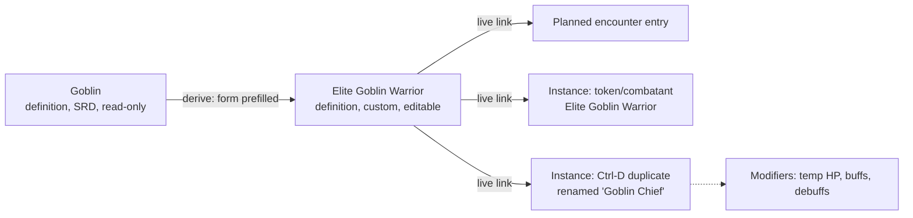

# 0009 — Entity content model

- Status: **accepted in part** (2026-10-11) — definition / instance model decided; storage option and open rows below still pending
- Date: 2026-10-10
- Affects: entities, character-sheet, combat-tracker, scenes-map, fixtures-adapters, post-mvp/compendium, post-mvp/combat-extras, post-mvp/world-builder, post-mvp/agent-api, post-mvp/obsidian-importer
- MVP: **blocking** — characters and monsters are entities ([ADR-0014](0014-mvp-scope.md)). World-builder kinds can follow later but the model must accommodate them.

## Context

- Entity kinds: NPC, monster, item, location, faction, quest, character.
- Freeform markdown + wikilinks suits brainstorming, not imported structured data (5etools).
- Fully relational modelling of every relation explodes table count.
- Must support: search, cross-references, external import, future agent/API access.
- Must fit [ADR-0006](0006-persistence.md): relational, JSON only for document-shaped leaves.
- Definitions must tolerate **partial data**: an imported item may be only name + description until its mechanics are filled in ([ADR-0010](0010-compendium-design.md) DM workflow).
- **One shared interface for creatures**: an SRD goblin and a custom Elite Goblin Warrior are treated the same by the encounter builder. Provenance is metadata.
- Monster/NPC definitions need **custom actions** that auto-roll against selected target(s) ([combat-extras](../../specs/post-mvp/combat-extras.md)).

## Decision — creature model (accepted)

Two concepts, kept strictly separate:

**1. Definitions** — the creature database
- **Imported definitions (SRD, Open5e, …) are read-only.**
- **Custom definitions** are made by **deriving**: the creature form opens prefilled from a base (SRD monster or another custom), DM edits, saves a new definition. Also creatable from scratch.
- Editing a custom definition **updates everything that uses it**: planned encounters and placed instances (live link).

**2. Instances** — a creature placed on a map / in combat
- Always point at exactly one definition. **No inline stat editing on instances.**
- Per-instance, only: **display name** (e.g. "Goblin Chief"), **play state** (current HP, initiative, position, hidden), and **modifiers** (temp HP, buffs/debuffs).
- **Ctrl-D** duplicates an instance (same definition); rename freely.
- **Effective stats = definition + instance modifiers.** Definition changes flow through; modifiers stay applied on top.
- Want a genuinely different creature? Derive a new definition.

**Storage (suggested, pending confirmation):** option A below — common `entity` table; definition stat block as a per-kind JSON column validated by one shared zod creature schema; play state and modifiers as relational columns/rows on token / combatant.

## Options (storage)

| Option | Pros | Cons |
|---|---|---|
| **A. Hybrid typed records** (suggested): `entity` table + per-kind zod/JSON schema + optional markdown notes | Structured where it matters; import maps cleanly | Querying inside JSON is weaker |
| B. Generic entity + typed attribute blocks | Composable; agent-friendly | More indirection |
| C. Pure relational: table per kind and relation | Strongest integrity | Table explosion; import mapping heavy |

## Open

| Question | Options (suggested in bold) |
|---|---|
| Derived definition: snapshot of the base at creation, or keeps inheriting base changes? | **Snapshot (fork) + "derived from" provenance.** SRD bases rarely change; inheritance chains get confusing / inherits unchanged fields from base |
| Delete a custom definition that has instances or encounter entries | **Block with "used in N places"** / cascade / archive |
| Modifier model (MVP needs none; temp HP and buffs are tier A) | **Design for later: instance → list of modifiers (field, op, value, source, duration)**; feeds conditions/durations ([ADR-0016](0016-domain-events-pending-actions.md)) |
| Do characters (PCs) follow the same definition/instance split? | **Yes: character = definition owned by a player; its token/combatant = instance. PC HP lives on the character** ([OQ-CHAR-02](../../specs/character-sheet.md#15-open-questions)) / separate model |
| Where does character sheet data sit? | See [ADR-0012](0012-character-derived-values.md) |
| Full-text search indexing | Deferred (search tier A) |

## Consequences

- Encounter builder, tokens and combat depend only on the **creature definition contract** + instance state.
- [ADR-0010](0010-compendium-design.md): imported entries immutable, edits only via derived customs → re-import never clobbers DM work.
- Combat log records the **effective** values used at the time (stats stay correct after later definition edits).
- No per-instance stat overrides to build, sync or explain.
