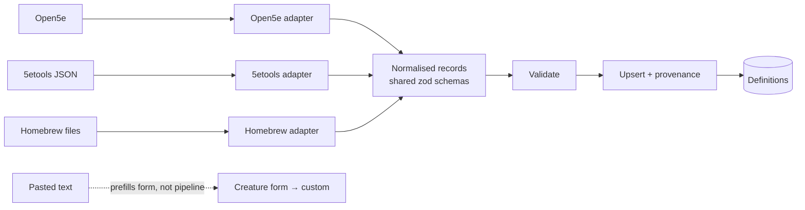

# 0015 — Import pipeline and source adapters

- Status: accepted (2026-10-11); open rows below
- Date: 2026-10-10
- Affects: fixtures-adapters, entities, post-mvp/compendium, post-mvp/compendium-expansion, post-mvp/obsidian-importer
- Related: [ADR-0009](0009-entity-content-model.md) (definitions), [ADR-0010](0010-compendium-design.md) (compendium), [ADR-0017](0017-agent-verification-fixture-library.md) (test fixtures)

## Context

- Reference material will come from many sources; we don't yet know all their shapes.
- "Don't know what we don't know" → no generic adapter framework up front.

## Decision

**Three origins of data, three paths**

| Origin | Examples | Path |
|---|---|---|
| **Imported reference content** | Open5e SRD, 5etools, homebrew files | **Import pipeline** (this ADR) |
| **Test fixtures** | Campaign, player, scenes, placed/hidden tokens, encounters | [ADR-0017](0017-agent-verification-fixture-library.md) |
| **App-generated content** | DM creates an NPC (optionally AI-prefilled from pasted text); player creates a character (post-MVP; MVP characters are fixtures) | UI → server commands ([overview](../overview.md#cross-cutting-rules)) |

**Import pipeline: fixed core, bespoke adapters**

- **Adapters are bespoke, one per source.** Each is its own code; the only contract is its output: normalised records + provenance. No plugin system, no generic mapping DSL.
- **Pipeline core is fixed:** validate against the same schemas as [ADR-0009](0009-entity-content-model.md) → upsert by `(source, sourceKey)` → record provenance (source, licence, imported at).
- **Partial data allowed** (e.g. Griffon's Saddlebag items: name + description now, mechanics later).
- Imported definitions are **read-only**; DM changes them by deriving a custom ([ADR-0009](0009-entity-content-model.md)).

**Known adapters**

| Adapter | When | Notes |
|---|---|---|
| Open5e SRD | First after MVP (tier A) | Known need |
| AI paste ("bits and bobs found online") | Post-MVP | **Not a pipeline adapter**: prefills the form, DM saves a custom. Time-saver only |
| Homebrew files | Post-MVP (tier A) | Formats TBD |
| Griffon's Saddlebag items | Post-MVP (tier B) | Partial mechanics |
| 5etools | Separate project (tier C) | User-supplied files only; nothing non-SRD bundled |
| Existing characters | Way post-MVP | Once-off scripts, not an adapter |

## Open

| Question | Options (suggested in bold) |
|---|---|
| ~~Is the pipeline core in MVP?~~ **Decided: yes, minimal.** Fixture SRD monsters (goblin, wolf) load through it as source `fixture`, so read-only imported vs custom is testable in MVP. | — |
| ~~AI paste output~~ **Decided: a form-filling time-saver.** Pasted text prefills the creature (or item) form; DM reviews and saves as a custom. Not an import: no read-only records, no provenance beyond an optional note. | — |
| Re-import of a changed source entry | **Update the read-only definition; customs derived from it are unaffected (independent copies)** / version it |

## Consequences

- Adding a source = writing one adapter; core and consumers unchanged.
- The creature form is the single entry point for custom content, whether typed, derived from a base, or AI-prefilled.
- Test fixtures are **not** an adapter concern ([ADR-0017](0017-agent-verification-fixture-library.md)).
