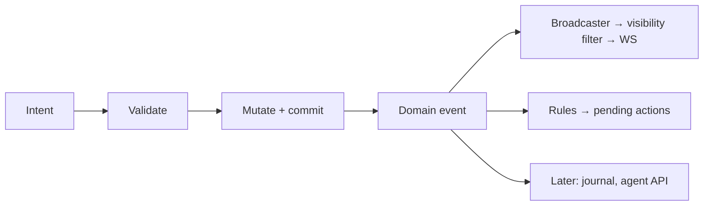

# 0016 — Domain events and pending actions

- Status: accepted (core); details open below
- Decided 2026-10-11: damage cards, reminders and prompts are **one concept** (notification, optional action).
- Date: 2026-10-11
- Affects: live-sync, combat-tracker, dice-roll-log, party-loot, post-mvp/combat-extras, post-mvp/campaign-manager, post-mvp/agent-api

## Context

- Upcoming needs: concentration reminders, effect durations, turn-start triggers, damage cards, later a journal and agent API.
- [ADR-0005](0005-server-authoritative-sync.md) already requires every mutation to produce a per-record event for broadcast.
- Bolting reactions onto individual handlers later means touching every feature.

## Decision

**Domain events**
- Every committed mutation emits a typed, zod-validated **domain event** (e.g. `DamageApplied`, `TurnStarted`).
- An **in-process** bus dispatches it to listeners. No queue, broker or distributed bus.
- The WS broadcaster ([live-sync](../../specs/live-sync.md)) is one listener; rules, journal, agent API are others.

**Notifications and pending actions** — one concept
- Like toasts, but persisted with a **history** feed. Spec: [notifications](../../specs/notifications.md).
- A **notification** has a `kind`, an audience (DM, a player, all), and **optionally an action** (button) for the DM or a player.
  - No action → reminder/info (e.g. "Concentration: Mira", "Party received 50 gp").
  - With action → **pending action** until resolved or dismissed (e.g. damage card "Apply", "Roll CON save, DC 12").
- Rules don't silently change state; they create notifications.
- Resolving may need a roll: automated or manual ([dice-roll-log](../../specs/dice-roll-log.md)).
- Persisted; survive a crash ([ADR-0006](0006-persistence.md)).

**Time**
- Game-time only: durations and triggers are listeners on round/turn events. **No wall-clock scheduler.**

**Guardrails**
- Listeners run after commit; a failing listener never rolls back the mutation.
- Cascades bounded: rules may create pending actions; whether they may emit further mutations is open (below).

**Event log and combat undo** (tier S, so the log is **MVP**)
- Every domain event is appended to a persisted **event log** (decided). Same transaction as the state change.
- **Undo is basic and combat-only (decided):** the DM can undo combat log entries such as "Player X did 4 damage to creature Y". Not rolls (an Animal Handling roll is just a fact), not token moves, not scene edits.
- Undoable events carry what's needed to reverse them (e.g. `DamageApplied {target, amount, hpBefore, hpAfter}`).
- **Undo = append a compensating event** that reverses an earlier one and marks it `undone`. The log stays append-only; state tables stay the truth for play.
- Stats ([stats](../../specs/post-mvp/stats.md)) ignore undone events.

| Undo option | Pros | Cons |
|---|---|---|
| **A. Compensating events** (suggested) | Fits "state tables are truth"; log stays append-only; undo is visible in history | Each event type needs an inverse; some events can't be cleanly reversed |
| B. Snapshot/restore to a point | Simple per-step | Coarse; loses unrelated concurrent changes (a player's move) |
| C. Full event sourcing (state = replay of log) | Undo is trivial; time travel | Rewrites [ADR-0006](0006-persistence.md) model; heavy for MVP |

## MVP use
- Listeners: broadcaster, event log, damage cards (first notification kind with an action).
- Concentration, durations, conditions plug in post-MVP ([combat-extras](../../specs/post-mvp/combat-extras.md)) without rework.

## Open

| Question | Options (suggested in bold) |
|---|---|
| May rules mutate state directly? | **No; only create pending actions** / yes with depth cap |
| ~~Persist domain events as an append-only log?~~ **Decided: yes, in MVP** — required by undo; stats computed from it retroactively | — |
| Undo mechanism | See table above — **A** |
| ~~Undo scope~~ **Decided: DM only.** Players don't undo; they just redo the action (e.g. move the token back). | — |
| ~~Which events are undoable?~~ **Decided: combat log entries only** — damage/healing applied. Candidates to confirm: initiative changes, next/previous turn (turn already has "previous"). | — |
| ~~Undo order~~ **Decided: strict LIFO, one step at a time** (to undo step 3 of 5, undo 5, 4, then 3). No cherry-picking. | — |
| Redo? | **Yes, as re-applying the original event** / no |
| Listener execution | **Synchronous, same process, after commit** / async microtask |
| Can an action be resolved by "anyone in audience" or only a named actor? | **Named actor (DM or one player); audience may be wider** / anyone in audience |

## Consequences

- Specs list the domain events they emit and any listeners they add.
- Notification shape is shared; owned by [notifications](../../specs/notifications.md). Features add kinds.
- Tests can assert on emitted events without a WS client.
- Only combat-log events (damage/healing applied) need inverses in MVP; everything else is non-undoable.
