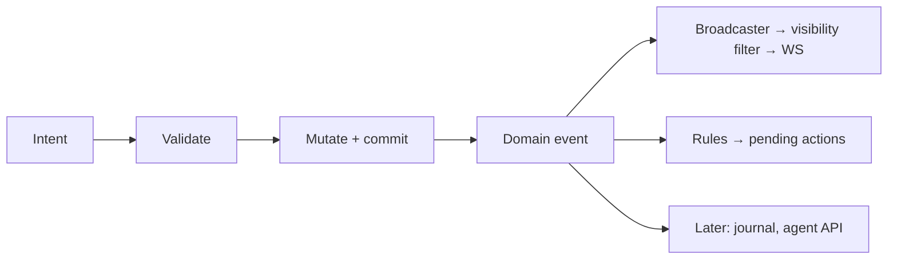

# 0016 — Domain events and pending actions

- Status: accepted (core); details open below
- Date: 2026-10-11
- Affects: live-sync, combat-tracker, dice-roll-log, party-loot, post-mvp/combat-extras, post-mvp/campaign-manager, post-mvp/agent-api

## Context

- Upcoming needs: concentration reminders, effect durations, turn-start triggers, damage cards, later a journal and agent API.
- [ADR-0005](0005-server-authoritative-sync.md) already requires every mutation to produce a per-record event for broadcast.
- Bolting reactions onto individual handlers later means touching every feature.

## Decision

**Domain events**
- Every committed mutation emits a typed, zod-validated **domain event** (e.g. `DamageApplied`, `TurnStarted`).
- An **in-process** bus dispatches it to listeners. No queue, broker or distributed bus.
- The WS broadcaster ([live-sync](../../specs/live-sync.md)) is one listener; rules, journal, agent API are others.

**Pending actions**
- Rules don't silently change state. They create a **pending action**: a persisted prompt someone resolves (e.g. "Roll CON save, DC 12").
- Resolution may need a roll: automated or manual ([dice-roll-log](../../specs/dice-roll-log.md)).
- Pending actions survive a crash ([ADR-0006](0006-persistence.md)).

**Time**
- Game-time only: durations and triggers are listeners on round/turn events. **No wall-clock scheduler.**

**Guardrails**
- Listeners run after commit; a failing listener never rolls back the mutation.
- Cascades bounded: rules may create pending actions; whether they may emit further mutations is open (below).

## MVP use

- Listeners: broadcaster, damage cards.
- Concentration, durations, conditions plug in post-MVP ([combat-extras](../../specs/post-mvp/combat-extras.md)) without rework.

## Open

| Question | Options (suggested in bold) |
|---|---|
| Is a damage card a kind of pending action? | **Yes — one concept, `kind` field (damage, save prompt, reminder…)** / separate features |
| May rules mutate state directly? | **No; only create pending actions** / yes with depth cap |
| Are domain events persisted as a log? | **No in MVP (state tables are the truth); revisit for journal** / yes, append-only event log |
| Listener execution | **Synchronous, same process, after commit** / async microtask |
| Who sees a pending action? | **Per-action visibility (DM, a player, or all) via the visibility filter** / DM only |

## Consequences

- Specs list the domain events they emit and any listeners they add.
- Pending-action shape is shared; owned by [combat-tracker](../../specs/combat-tracker.md) in MVP.
- Tests can assert on emitted events without a WS client.
