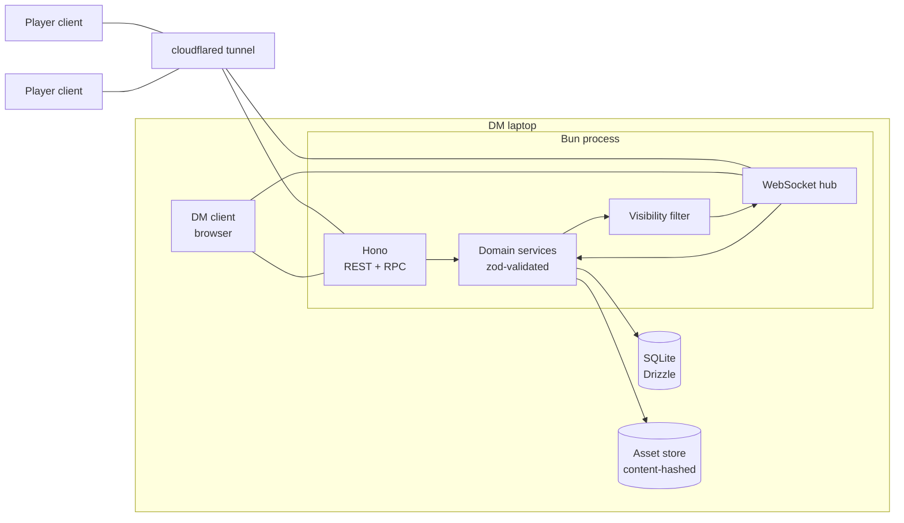
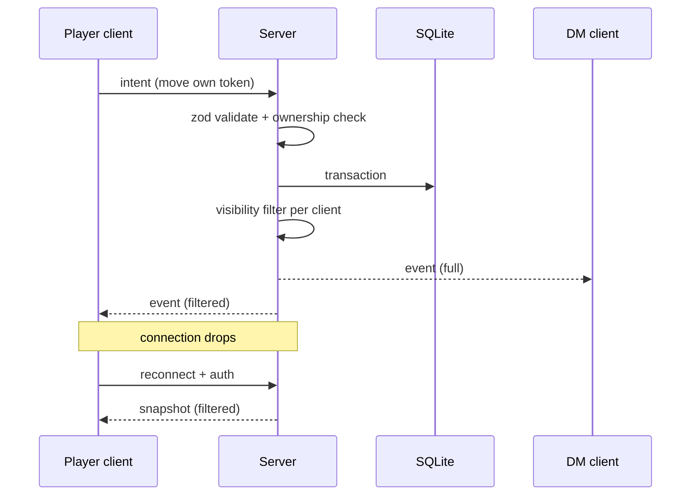

# Architecture overview

Settled architecture only. Open questions live in proposed ADRs ([index](adr/README.md)).

## Shape

- One Bun process on the DM's laptop, started at game time ([ADR-0003](adr/0003-local-hosting.md)).
- Hono serves REST (Hono RPC) for CRUD, a native WebSocket for live events, and the built client bundles ([ADR-0001](adr/0001-tech-stack.md)).
- Two clients from one package: **DM client** and **player client** ([ADR-0002](adr/0002-single-package.md), [ADR-0004](adr/0004-tenancy-auth-permissions.md)).
- SQLite via Drizzle holds all state, including runtime session state ([ADR-0006](adr/0006-persistence.md)).
- Assets on local disk, content-hashed, derivatives via `sharp` ([assets spec](../specs/assets-pipeline.md)).
- Players reach the server through a cloudflared tunnel.

## Sync model

Server-authoritative ([ADR-0005](adr/0005-server-authoritative-sync.md)):

1. Client sends an **intent** (REST or WS).
2. Server validates with zod, checks auth/ownership, mutates in a DB transaction.
3. Server emits a per-record **event**.
4. **Visibility filter** decides, per connected client, whether to send it and which fields.
5. On (re)connect, client requests a **snapshot** (filtered full state), then applies events.

Internally, step 3 is a typed **domain event** on an in-process bus; the broadcaster is one listener, rules (creating **pending actions**) are others ([ADR-0016](adr/0016-domain-events-pending-actions.md)).

## Cross-cutting rules

- Every record has a `campaignId` ([ADR-0004](adr/0004-tenancy-auth-permissions.md)).
- zod schemas at every boundary: HTTP, WS, DB JSON columns, imports.
- Relational tables; JSON only for document-shaped leaves ([ADR-0006](adr/0006-persistence.md)).
- All config (ports, DB path, asset path) from env; everything isolatable per worktree ([ADR-0008](adr/0008-parallel-dev-isolation.md)).
- **Every capability is a server command** (validated intent → domain event). UI, fixtures, importers and future agents are all just callers of the same commands. No feature logic in clients. This is what keeps future agent features ([agent-api](../specs/post-mvp/agent-api.md)) cheap.

## Open (see proposed ADRs)

- Entity content model — [ADR-0009](adr/0009-entity-content-model.md)
- Compendium design — [ADR-0010](adr/0010-compendium-design.md)
- Cross-references — [ADR-0011](adr/0011-cross-references.md)
- Character derived values — [ADR-0012](adr/0012-character-derived-values.md)
- Source adapters and fixtures — [ADR-0015](adr/0015-source-adapters-fixtures.md)

> TODO (spec phase): add module boundaries once specs and [data model](../data-model/README.md) converge.
