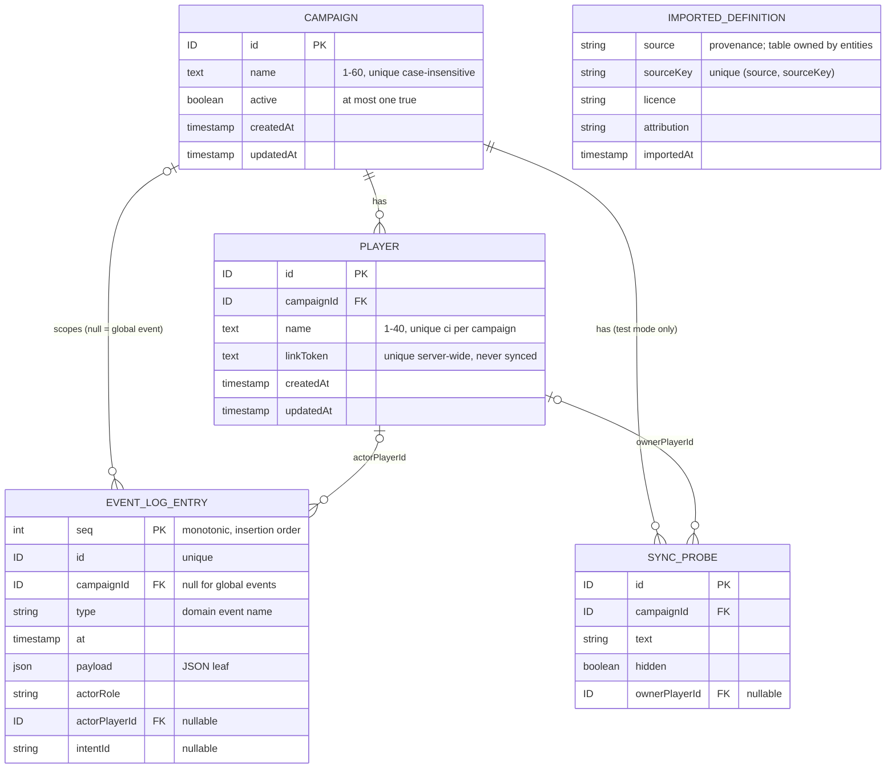
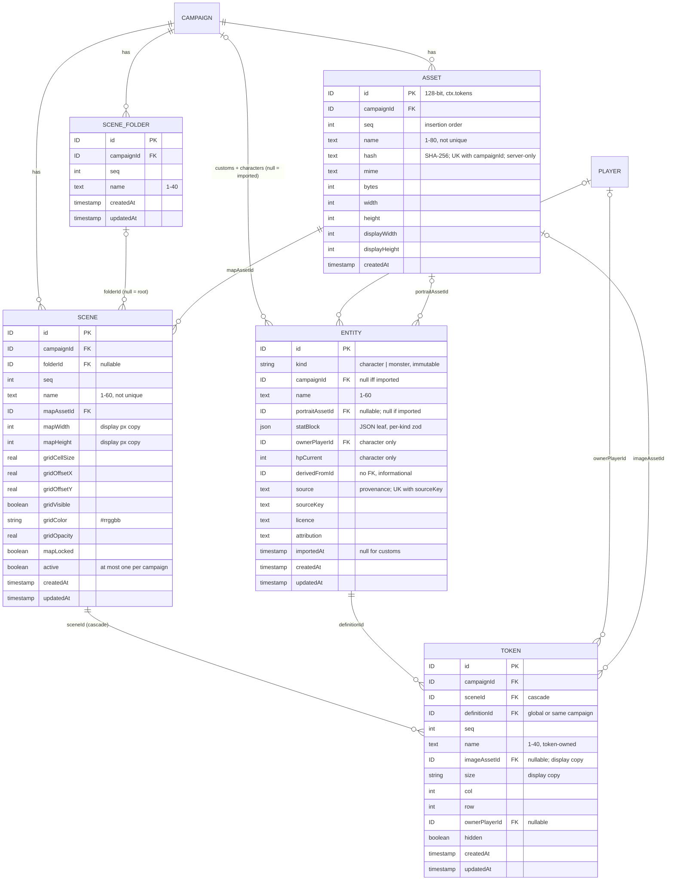

# Data model

Consolidated domain model. Entities and relationships, **not SQL**. **Living doc**: the integrator extends it after each build phase's specs reach `complete` ([process](../process.md#stages), [roadmap](../roadmap.md#build-order-mvp)). Don't edit from a feature worktree; it is a shared file ([AGENTS §9.9](../../AGENTS.md#99-shared-files)).

| Phase | Specs consolidated | Status |
|---|---|---|
| Foundation | [live-sync](../specs/live-sync.md), [campaign-management](../specs/campaign-management.md), [fixtures-adapters](../specs/fixtures-adapters.md) | done (2026-10-12); CON-01–04 resolved (#118) and built in the skeleton (`src/server/db/schema.ts`) |
| Scenes | assets-pipeline, entities, play-shell, scenes-map | > Later phase |
| Combat | character-sheet, dice-roll-log, notifications, combat-tracker | > Later phase |
| Reward | party-loot | > Later phase |

Every fact links its source. Protocol side (record types, intents, events): [protocol](../protocol/README.md).

## 1. Rules for every table

| Rule | Source |
|---|---|
| Relational SQLite. JSON columns only for document-shaped **leaf** data, zod-validated on read/write. No whole-campaign/scene blobs | [ADR-0006](../architecture/adr/0006-persistence.md) |
| Runtime/session state lives in the DB and survives a crash. In-memory state must not matter to play; caches rebuild from the DB | [ADR-0006](../architecture/adr/0006-persistence.md), [FR-SYNC-25](../specs/live-sync.md#6-functional-requirements) |
| Every record has a `campaignId`, except: `Campaign` itself, **imported definitions** (global), event-log entries of global events (`campaignId` null) | [ADR-0004](../architecture/adr/0004-tenancy-auth-permissions.md), [ADR-0018](../architecture/adr/0018-global-imported-content.md), [live-sync §8](../specs/live-sync.md#8-data-model) |
| Records in a campaign may point at a global definition or a custom of the **same** campaign, never another campaign's custom | [ADR-0018](../architecture/adr/0018-global-imported-content.md) |
| Every mutation is a server command: row change + event-log entry in **one transaction** (unless the spec marks the event non-logged) | [FR-CAMP-20](../specs/campaign-management.md#6-functional-requirements), [FR-SYNC-16](../specs/live-sync.md#6-functional-requirements), [ADR-0016](../architecture/adr/0016-domain-events-pending-actions.md) |
| IDs, tokens and timestamps come only from the command context (`ctx.ids`, `ctx.tokens`, `ctx.clock`). Seeded values have the same format as real ones | [ADR-0022](../architecture/adr/0022-deterministic-seams.md), [AGENTS §9.3](../../AGENTS.md#93-fixtures) |
| Time-ordered views: order by timestamp, then insertion order (event log: `seq`; other tables: row order). Never by ID or randomness | [ADR-0022](../architecture/adr/0022-deterministic-seams.md), CON-04 |
| Timestamps are ISO-8601 UTC strings from `ctx.clock` | skeleton |
| No per-record versions | [live-sync §8](../specs/live-sync.md#8-data-model) |

## 2. ER diagram (Foundation)

`IMPORTED_DEFINITION` is global (no campaign link). Only its provenance fields are Foundation facts; the table is owned by [entities](../specs/entities.md) (Scenes phase).

## 3. Persisted entities

### Campaign — owner [campaign-management](../specs/campaign-management.md#8-data-model)

| Field | Type | Rule | Source |
|---|---|---|---|
| id | ID | The scope itself; no `campaignId` | CAMP §8 |
| name | text | Trimmed, 1–60 chars, unique case-insensitive, control chars rejected | [FR-CAMP-06](../specs/campaign-management.md#6-functional-requirements), CAMP §11 |
| active | boolean | At most one `true`, DB-enforced (partial unique index). Survives restart | [FR-CAMP-08](../specs/campaign-management.md#6-functional-requirements), [ADR-0020](../architecture/adr/0020-single-active-campaign.md) |
| createdAt, updatedAt | timestamp | From `ctx.clock` | CAMP §8, [ADR-0022](../architecture/adr/0022-deterministic-seams.md) |

- Created while none is active → active, and the create also emits `CampaignActivated {previousCampaignId: null}` (CON-10); otherwise inactive ([FR-CAMP-06](../specs/campaign-management.md#6-functional-requirements)). Switch flips both flags in one transaction ([FR-CAMP-09](../specs/campaign-management.md#6-functional-requirements)).
- No delete or archive ([CAMP §4](../specs/campaign-management.md#4-non-goals)). No JSON leaves.

### Player — owner [campaign-management](../specs/campaign-management.md#8-data-model)

| Field | Type | Rule | Source |
|---|---|---|---|
| id | ID | Referenced by owned records (characters, tokens) | CAMP §8 |
| campaignId | ID → Campaign | Players are added to the active campaign only | [FR-CAMP-12](../specs/campaign-management.md#6-functional-requirements) |
| name | text | Trimmed, 1–40 chars, unique case-insensitive per campaign | FR-CAMP-12 |
| linkToken | text | 128 bits from `ctx.tokens`, base64url, unique server-wide. Plain text (DM re-copies). **Never** in a sync record, event or log entry. Unchanged on rename | [FR-CAMP-13](../specs/campaign-management.md#6-functional-requirements), [FR-CAMP-15](../specs/campaign-management.md#6-functional-requirements), [ADR-0019](../architecture/adr/0019-auth-credentials.md) |
| createdAt, updatedAt | timestamp | From `ctx.clock` | CAMP §8 |

- No player removal → no dangling owners ([CAMP §8](../specs/campaign-management.md#8-data-model)). No revocation/rotation ([ADR-0019](../architecture/adr/0019-auth-credentials.md)).

### Event log entry — owner [live-sync](../specs/live-sync.md#8-data-model)

| Field | Type | Rule | Source |
|---|---|---|---|
| seq | integer | Monotonic insertion order (autoincrement); the time-order tiebreak | CON-04, [ADR-0022](../architecture/adr/0022-deterministic-seams.md) |
| id | ID | From `ctx.ids`; unique | SYNC §8 |
| campaignId | ID \| null | Null for global events (imported definitions) | SYNC §8, [FR-FIX-23](../specs/fixtures-adapters.md#6-functional-requirements) |
| type | string | Domain event name | SYNC §8 |
| at | timestamp | From `ctx.clock` | SYNC §8 |
| payload | JSON leaf | Domain event payload | SYNC §8 |
| actorRole, actorPlayerId | `dm` \| `player` \| `system`, ID \| null | Who caused it (fixture loads: `dm`) | SYNC §8 |
| intentId | string | WS intent that caused it (REST and loader calls have none: [FR-SYNC-15](../specs/live-sync.md#6-functional-requirements), [FR-FIX-13](../specs/fixtures-adapters.md#6-functional-requirements)) | SYNC §8 |

- **Append-only**. Appended in the commit's transaction; rollback → no entry ([FR-SYNC-16](../specs/live-sync.md#6-functional-requirements)). Never holds the DM secret or a link token ([FR-CAMP-03](../specs/campaign-management.md#6-functional-requirements), CAMP §8).
- Not every domain event is logged: token moves are not ([ADR-0016](../architecture/adr/0016-domain-events-pending-actions.md)); others only if their spec says so.
- > Later phase (Combat, [combat-tracker](../specs/combat-tracker.md)): undo fields (compensating event, `undone` marker) per [ADR-0016](../architecture/adr/0016-domain-events-pending-actions.md). Don't add them in the skeleton.

### Sync probe — owner [live-sync](../specs/live-sync.md#8-data-model), test mode only

| Field | Type | Rule | Source |
|---|---|---|---|
| id, campaignId | ID, ID → Campaign | | SYNC §8 |
| text | string | | SYNC §8 |
| hidden | boolean | Visibility flag | SYNC §8 |
| ownerPlayerId | ID → Player \| null | Must be a player of `ctx.campaignId` | SYNC §8, [§9](../specs/live-sync.md#9-api--events) |

- Exists only with `PP_TEST_MODE=1` ([FR-SYNC-27](../specs/live-sync.md#6-functional-requirements), [AGENTS §9.2](../../AGENTS.md#92-env-ports-and-data)).

### Imported definition (provenance only) — fields from [fixtures-adapters](../specs/fixtures-adapters.md#8-data-model), table owned by [entities](../specs/entities.md)

| Field | Type | Rule | Source |
|---|---|---|---|
| source, sourceKey | string | Unique `(source, sourceKey)` globally. `source` null = custom | [FR-FIX-20](../specs/fixtures-adapters.md#6-functional-requirements), FIX §8 |
| licence, attribution | string | | [FR-FIX-21](../specs/fixtures-adapters.md#6-functional-requirements) |
| importedAt | timestamp | `ctx.clock` | FR-FIX-21 |

- Global, no campaign; read-only. Derived `readOnly = source != null` ([FIX §8](../specs/fixtures-adapters.md#8-data-model), [ADR-0018](../architecture/adr/0018-global-imported-content.md)). Existing key → `existing`, nothing written ([FR-FIX-20](../specs/fixtures-adapters.md#6-functional-requirements)).
- **No definition table in the skeleton** (CON-03): the pipeline core writes through a definition-store interface + kind registry (`ImportRegistry`); the skeleton tests it with a test-only kind. Entities adds the table, kinds and definition event in Scenes.
- > Later phase (Scenes, [entities](../specs/entities.md)): table name, definition fields, per-kind stat-block JSON ([ADR-0009](../architecture/adr/0009-entity-content-model.md) option A), custom definitions per campaign, inline vs separate provenance ([OQ-FIX-15](../specs/fixtures-adapters.md#15-open-questions), pick inline).

## 4. Constraints the DB enforces

| Constraint | Source |
|---|---|
| `Campaign.active`: at most one `true` (partial unique index) | [FR-CAMP-08](../specs/campaign-management.md#6-functional-requirements) |
| `Campaign.name` unique, case-insensitive (unique index on `lower(name)`; commands also compare Unicode-folded names) | [FR-CAMP-06](../specs/campaign-management.md#6-functional-requirements), CAMP §11 (racing creates → one error) |
| `(Player.campaignId, Player.name)` unique, case-insensitive | [FR-CAMP-12](../specs/campaign-management.md#6-functional-requirements) |
| `Player.linkToken` unique server-wide | [FR-CAMP-13](../specs/campaign-management.md#6-functional-requirements) |
| Definition `(source, sourceKey)` unique globally | [FR-FIX-20](../specs/fixtures-adapters.md#6-functional-requirements) |

## 5. Not in the DB

| Thing | Where | Fields | Source |
|---|---|---|---|
| DM secret | env `PP_DM_SECRET` only; never stored, logged or sent | ≥ 12 chars | [FR-CAMP-01/03](../specs/campaign-management.md#6-functional-requirements), [ADR-0019](../architecture/adr/0019-auth-credentials.md) |
| Connection | server memory | connId, campaignId, role `dm`\|`player`, playerId \| null (immutable); phase `awaiting-hello`\|`snapshotting`\|`live`, seq, lastInboundAt | [SYNC §8](../specs/live-sync.md#8-data-model) |
| Presence | server memory, derived from live connections | id (= playerId), playerId, campaignId, online | SYNC §8, [FR-SYNC-23](../specs/live-sync.md#6-functional-requirements), CON-07 |
| DM login throttle counter | server memory, cleared on restart | — | [FR-CAMP-05](../specs/campaign-management.md#6-functional-requirements) *(proposed)* |
| Active campaign / active scene id | cache, rebuilt at boot | — | SYNC §8 |
| Load manifest | `$PP_DATA_DIR/load-manifest.json` (written atomically) | bundle, fixtures, status `resetting`\|`empty`\|`loading`\|`complete`, records (fixture key → record type → IDs), dmUrl, playerLinks `{player, campaign, url}[]`, startedAt, durationMs. **No DM secret** | [FIX §8](../specs/fixtures-adapters.md#8-data-model), [FR-FIX-09](../specs/fixtures-adapters.md#6-functional-requirements), [FR-FIX-28](../specs/fixtures-adapters.md#6-functional-requirements) |
| Data-dir lock | `$PP_DATA_DIR/server.lock` (JSON, created exclusively) | owner `server`\|`loader`, pid, port (server only, written once bound), startedAt | FIX §8, [FR-FIX-27](../specs/fixtures-adapters.md#6-functional-requirements), [AGENTS §9.2](../../AGENTS.md#92-env-ports-and-data) |
| Fixture, bundle, import batch, registrations | code | See [FIX §8](../specs/fixtures-adapters.md#8-data-model); registrations: [protocol §5](../protocol/README.md#5-record-type-registry) | FIX §8, SYNC §8 |

## 6. Derived values

| Value | From | Source |
|---|---|---|
| Player link URL | public base URL + `/p/` + `linkToken` (path *proposed*, [OQ-CAMP-15](../specs/campaign-management.md#15-open-questions)); base from `PP_PUBLIC_BASE_URL`, unset → DM client's origin + warning (pick, [OQ-CAMP-07](../specs/campaign-management.md#15-open-questions)) | [CAMP §8](../specs/campaign-management.md#8-data-model), [FR-CAMP-14](../specs/campaign-management.md#6-functional-requirements) |
| Player online state | presence | CAMP §8, [FR-SYNC-23](../specs/live-sync.md#6-functional-requirements) |
| Definition `readOnly` | `source != null` | [FIX §8](../specs/fixtures-adapters.md#8-data-model) |
| Each connection's visible view | records through the type's visibility fn | [SYNC §8](../specs/live-sync.md#8-data-model) |

## 7. Visibility-relevant fields

What each visibility fn reads (record + connection context only, [ADR-0021](../architecture/adr/0021-sync-protocol-conventions.md)). Full rules: [protocol §5](../protocol/README.md#5-record-type-registry).

| Record | Fields the filter reads | Never leaves the server |
|---|---|---|
| Campaign | `id` vs `ctx.campaignId` | — |
| Player | `campaignId` vs `ctx.campaignId` | `linkToken` (no field in the record type) |
| Sync probe | `hidden`, `ownerPlayerId` vs `ctx.playerId` | — |
| Presence | (DM only: `audience: dm`) | — |

> Later phase: Scenes (asset, derivative, definition, scene, token, active scene), Combat (character, encounter, combatant, roll / game log, notification, undo fields), Reward (party loot). Add rows here when their specs are `complete`.

## 8. Conflicts log

Found at Foundation consolidation; resolved by the integrator ([decisions-log](../decisions-log.md) #118) and folded into the sections above. Protocol conflicts CON-05–17: [protocol §11](../protocol/README.md#11-conflicts-log).

| ID | Topic | Resolution | Now in |
|---|---|---|---|
| CON-01 | Campaign scoping vs global definitions | Every record has a campaign except imported definitions (ADR-0018); glossary wording is the integrator's | §1 |
| CON-02 | Event log `campaignId` | Null for global events | §3 Event log entry |
| CON-03 | Definition table | Pipeline core against a test-only kind behind an insert interface; entities adds the table in Scenes | §3 Imported definition |
| CON-04 | Event log ordering | Monotonic integer `seq` column (insertion order) | §1, §2, §3 Event log entry |

Scenes consolidation (CON-18+, integrator):

| ID | Entity / field | Specs in conflict | Suggested fix | Resolution |
|---|---|---|---|---|
| CON-18 | Imported definition table (§2 ER `IMPORTED_DEFINITION`, §3 "Imported definition", §4 last row, §6 `readOnly`) | This doc lines 68–77, 132–141 model a separate global table; [entities](../specs/entities.md) lines 13, 72–81 use **one** `entity` table, imported rows = `campaignId` null, provenance inline (OQ-FIX-15 pick) | Replace the Foundation `IMPORTED_DEFINITION` block and §3 subsection with a pointer to [§11](#11-scenes-entity) (edit after the skeleton merge; not edited here) | open |
| CON-19 | Asset `id` source vs §9.3 seam table | [assets-pipeline](../specs/assets-pipeline.md) line 49 and [ADR-0023](../architecture/adr/0023-asset-access-by-capability-id.md) line 30: asset ID from `ctx.tokens`; [AGENTS §9.3](../../AGENTS.md#93-fixtures) seam table: `ctx.ids` = record IDs, `ctx.tokens` = "secret tokens (player links)" | AGENTS §9.3 `ctx.tokens` row: "secret tokens (player links) and asset IDs (ADR-0023)". Builders: asset IDs from `ctx.tokens` now | open |
| CON-20 | `seq` columns "from `ctx`" | [scenes-map](../specs/scenes-map.md) line 67 (FR-MAP-27: "IDs, `seq` and time only from `ctx`") and line 80; [assets-pipeline](../specs/assets-pipeline.md) line 49. `ctx` has no seq seam ([AGENTS §9.3](../../AGENTS.md#93-fixtures): ids, tokens, clock) | Same rule as event-log `seq` (CON-04): `seq` = monotonic integer assigned by the DB at insert (insertion order); deterministic because fixture steps run in order. Amend FR-MAP-27 wording to "IDs and time from `ctx`; `seq` by the DB" | open |
| CON-21 | Campaign for DM REST creates | [entities](../specs/entities.md) line 43 (FR-ENT-04: "active campaign **at commit**") vs [assets-pipeline](../specs/assets-pipeline.md) line 50 (FR-ASSET-09: "resolved when the request is authenticated") and [scenes-map](../specs/scenes-map.md) line 94 ("fixed at authentication"); FR-ENT-04 says "as FR-ASSET-09" | FR-ENT-04: "`ctx.campaignId` resolved at request authentication (as FR-ASSET-09); none → `conflict`". One rule in the REST middleware | open |

## 9. Scenes: ER diagram

Consolidated 2026-10-12 from the `complete` specs [assets-pipeline](../specs/assets-pipeline.md) (ASSET), [entities](../specs/entities.md) (ENT), [play-shell](../specs/play-shell.md) (SHELL), [scenes-map](../specs/scenes-map.md) (MAP). Appended only; Foundation sections above are unchanged (phase table flips at merge). Protocol side: [protocol §12–§19](../protocol/README.md#12-scenes-record-types).

- Play-shell adds **no** table, record type or migration: the layout lives in browser `localStorage` ([SHELL §8](../specs/play-shell.md#8-data-model), [ADR-0025](../architecture/adr/0025-play-shell-windows.md), #121).
- `seq` columns: insertion order, tiebreak for time-ordered and name-ordered views ([ADR-0022](../architecture/adr/0022-deterministic-seams.md)); source: [CON-20](#8-conflicts-log).

## 10. Scenes: asset

### Asset — owner [assets-pipeline](../specs/assets-pipeline.md#8-data-model)

| Field | Type | Rule | Source |
|---|---|---|---|
| id | ID | 128 bits from **`ctx.tokens`**, base64url; it is the capability | [FR-ASSET-08](../specs/assets-pipeline.md#6-functional-requirements), [ADR-0023](../architecture/adr/0023-asset-access-by-capability-id.md), [CON-19](#8-conflicts-log) |
| campaignId | ID → Campaign | `ctx.campaignId` at request authentication | [FR-ASSET-09](../specs/assets-pipeline.md#6-functional-requirements) |
| seq | int | Insertion order; picker tiebreak (`createdAt` desc, then `seq` desc) | FR-ASSET-08, [FR-ASSET-10](../specs/assets-pipeline.md#6-functional-requirements) |
| name | text | Given `name` or filename minus extension; trimmed, control chars removed, 1–80; not unique; second upload's name ignored | FR-ASSET-08, [FR-ASSET-03](../specs/assets-pipeline.md#6-functional-requirements) |
| hash | text | SHA-256 hex of the stored original. Unique `(campaignId, hash)`. **Server-only**: not in the `asset` record | FR-ASSET-03, ASSET §8 |
| mime, bytes, width, height | text, int ×3 | Stored original (SVG stored as PNG) | [FR-ASSET-02](../specs/assets-pipeline.md#6-functional-requirements), ASSET §8 |
| displayWidth, displayHeight | int ×2 | `display` derivative size; grid calibration space | [FR-ASSET-05](../specs/assets-pipeline.md#6-functional-requirements), [OQ-ASSET-07](../specs/assets-pipeline.md#15-open-questions) |
| createdAt | timestamp | `ctx.clock` | FR-ASSET-08 |

- **Files (disk, not records):** `PP_ASSET_DIR/<hash>/{original, display.webp, thumb.webp}`, one set per hash, shared by every campaign's row with that hash. Temp dir + rename; existing hash dir reused ([FR-ASSET-04](../specs/assets-pipeline.md#6-functional-requirements); layout *proposed*). `thumb` ≤ 512 px, `display` ≤ 4096 px, WebP, never upscaled (FR-ASSET-05).
- **Write order:** all files on disk → row + event-log entry in one transaction ([FR-ASSET-06](../specs/assets-pipeline.md#6-functional-requirements)). Server start: delete temp dir and unreferenced hash dirs; missing files → error log, 404 ([FR-ASSET-07](../specs/assets-pipeline.md#6-functional-requirements)).
- No delete, rename, replace or revoke in MVP ([OQ-ASSET-05](../specs/assets-pipeline.md#15-open-questions)). No JSON leaves.
- **Asset references** (fields holding an asset ID): `Scene.mapAssetId`, `Token.imageAssetId`, `Entity.portraitAssetId`. Set only via `assets.require(ctx, id)` → same campaign or `not_found`, including propagated copies in the same transaction ([FR-ASSET-15](../specs/assets-pipeline.md#6-functional-requirements)). Imported definitions carry no asset in MVP.

## 11. Scenes: entity

### Entity — owner [entities](../specs/entities.md#8-data-model)

One table for imported, custom and character definitions ([ADR-0009](../architecture/adr/0009-entity-content-model.md) storage A, #124). Supersedes the Foundation "Imported definition" block ([CON-18](#8-conflicts-log)).

| Field | Type | Rule | Source |
|---|---|---|---|
| id | ID | `ctx.ids` | [FR-ENT-17](../specs/entities.md#6-functional-requirements) |
| kind | `character` \| `monster` | Immutable; kind registry in `@shared/entities` | [FR-ENT-01](../specs/entities.md#6-functional-requirements), [FR-ENT-11](../specs/entities.md#6-functional-requirements) |
| campaignId | ID → Campaign \| null | **Null iff imported** (global); customs + characters = `ctx.campaignId`; no request field sets it | [FR-ENT-04](../specs/entities.md#6-functional-requirements), [ADR-0018](../architecture/adr/0018-global-imported-content.md) |
| name | text 1–60 | Trimmed, no control chars; unique ci per (campaign, kind) for non-null campaign; may equal an imported name | [FR-ENT-08](../specs/entities.md#6-functional-requirements) |
| portraitAssetId | ID → Asset \| null | Asset reference via `assets.require`; null for imported | FR-ENT-08, [FR-ASSET-15](../specs/assets-pipeline.md#6-functional-requirements) |
| statBlock | **JSON leaf** | Strict per-kind zod: shared creature core `size, ac, hpMax, initBonus, attacks[0..1]` + monster `cr` / character `level, className`. New fields only optional | [FR-ENT-02](../specs/entities.md#6-functional-requirements), ENT §8, [ADR-0006](../architecture/adr/0006-persistence.md) |
| ownerPlayerId | ID → Player \| null | Required for character (player of `ctx.campaignId`, else `invalid`); null for monster | [FR-ENT-10](../specs/entities.md#6-functional-requirements) |
| hpCurrent | int \| null | Character only; `= hpMax` at create; clamped on update. PC HP lives on the character | FR-ENT-10, FR-ENT-11, [ADR-0009](../architecture/adr/0009-entity-content-model.md), [OQ-ENT-08](../specs/entities.md#15-open-questions) |
| derivedFromId | ID \| null | Plain id, **no FK**; immutable; informational only | [FR-ENT-09](../specs/entities.md#6-functional-requirements) |
| source, sourceKey, licence, attribution | text \| null | Provenance **inline** (OQ-FIX-15 pick); unique `(source, sourceKey)`; all null for customs; only `entities.import` writes them | [FR-ENT-05](../specs/entities.md#6-functional-requirements), [FR-ENT-06](../specs/entities.md#6-functional-requirements), [FR-FIX-20/21](../specs/fixtures-adapters.md#6-functional-requirements) |
| importedAt, createdAt, updatedAt | timestamp | `ctx.clock`; `importedAt` null for customs | FR-ENT-05, ENT §8 |

- Imported rows are read-only (update → `forbidden`) ([FR-ENT-07](../specs/entities.md#6-functional-requirements)). No delete in MVP ([FR-ENT-14](../specs/entities.md#6-functional-requirements), *proposed* OQ-ENT-07).
- References into `entity` (token, later combatant, encounter entry) resolve via `resolveDefinition(ctx, id)`: global or same campaign, else `not_found` ([FR-ENT-12](../specs/entities.md#6-functional-requirements), [ADR-0018](../architecture/adr/0018-global-imported-content.md)).
- Reads re-validate the JSON leaf: invalid stored row omitted from the snapshot + error log; a command on it → `internal` ([FR-ENT-01](../specs/entities.md#6-functional-requirements)).

## 12. Scenes: scene, scene folder, token

All rows per campaign; no JSON leaves; timestamps `ctx.clock` ([MAP §8](../specs/scenes-map.md#8-data-model)).

### Scene — owner [scenes-map](../specs/scenes-map.md#8-data-model)

| Field | Type | Rule | Source |
|---|---|---|---|
| id, campaignId | ID, ID → Campaign | `ctx.ids`; `ctx.campaignId` at authentication | [FR-MAP-27](../specs/scenes-map.md#6-functional-requirements), MAP §9 |
| folderId | ID → SceneFolder \| null | Null = root; folder delete → root in the same transaction | [FR-MAP-02](../specs/scenes-map.md#6-functional-requirements), [FR-MAP-03](../specs/scenes-map.md#6-functional-requirements) |
| seq | int | Insertion order; list tiebreak | FR-MAP-02, [CON-20](#8-conflicts-log) |
| name | text 1–60 | Trimmed, no control chars, **not** unique | [FR-MAP-01](../specs/scenes-map.md#6-functional-requirements) |
| mapAssetId | ID → Asset | Asset reference (`assets.require`) | FR-MAP-01, [FR-MAP-09](../specs/scenes-map.md#6-functional-requirements) |
| mapWidth, mapHeight | int | Copy of the asset's `display` size, written when the map is set | FR-MAP-01, FR-MAP-09 |
| gridCellSize, gridOffsetX, gridOffsetY | real | Display px; cell 8–512 (2 dp), 0 ≤ offset < cell; default 70, 0, 0 *(proposed)* | [FR-MAP-10](../specs/scenes-map.md#6-functional-requirements), FR-MAP-01 |
| gridVisible, gridColor, gridOpacity | bool, `#rrggbb`, real | Opacity 0.1–1; default visible, `#000000`, 0.5 *(proposed)* | FR-MAP-10, FR-MAP-01 |
| mapLocked | bool | Locked → map + grid commands `conflict` | [FR-MAP-11](../specs/scenes-map.md#6-functional-requirements) |
| active | bool | ≤ 1 per campaign, partial unique index *(proposed, OQ-MAP-18)*; new scenes inactive | [FR-MAP-06](../specs/scenes-map.md#6-functional-requirements), [FR-MAP-07](../specs/scenes-map.md#6-functional-requirements) |
| createdAt, updatedAt | timestamp | `ctx.clock` | MAP §8 |

- Duplicate copies the scene (inactive, "‹name› (copy)") and every token with new IDs and `seq` ([FR-MAP-04](../specs/scenes-map.md#6-functional-requirements)). Delete only when not active; tokens cascade ([FR-MAP-05](../specs/scenes-map.md#6-functional-requirements), *proposed*).

### Scene folder — owner [scenes-map](../specs/scenes-map.md#8-data-model)

| Field | Type | Rule | Source |
|---|---|---|---|
| id, campaignId, seq | ID, ID → Campaign, int | One level, no parent | [FR-MAP-02](../specs/scenes-map.md#6-functional-requirements) *(proposed, OQ-MAP-19)* |
| name | text 1–40 | | FR-MAP-02 |
| createdAt, updatedAt | timestamp | | MAP §8 |

### Token — owner [scenes-map](../specs/scenes-map.md#8-data-model)

An instance of a creature definition: own name, read-only display copies, play state ([ADR-0024](../architecture/adr/0024-definition-visibility.md), #120, #126).

| Field | Type | Rule | Source |
|---|---|---|---|
| id, campaignId, seq | ID, ID → Campaign, int | | [FR-MAP-27](../specs/scenes-map.md#6-functional-requirements) |
| sceneId | ID → Scene | Tokens per scene (#124); cascade on scene delete | MAP §8, [FR-MAP-05](../specs/scenes-map.md#6-functional-requirements) |
| definitionId | ID → Entity | Via `resolveDefinition`: global or same campaign. **Never sent to players** | [FR-MAP-13](../specs/scenes-map.md#6-functional-requirements), [FR-MAP-26](../specs/scenes-map.md#6-functional-requirements) |
| name | text 1–40 | **Token-owned** instance state; numbered `B <N>` on place/duplicate; never changed by a definition edit | [FR-MAP-16](../specs/scenes-map.md#6-functional-requirements), #126 |
| imageAssetId | ID → Asset \| null | **Display copy**: portrait at place; refreshed by the hook only while it equals the old portrait (#127); DM may set custom art | FR-MAP-13, [FR-MAP-18](../specs/scenes-map.md#6-functional-requirements), [FR-MAP-20](../specs/scenes-map.md#6-functional-requirements) |
| size | `tiny`…`gargantuan` | **Display copy** of `statBlock.size`; never per-token editable; refreshed by the hook | FR-MAP-13, FR-MAP-20, #120 |
| col, row | int | Top-left cell; footprint must overlap the map | [FR-MAP-14](../specs/scenes-map.md#6-functional-requirements) |
| ownerPlayerId | ID → Player \| null | One owner; defaults from the character's owner; DM reassigns | FR-MAP-13, FR-MAP-18, #124 |
| hidden | bool | Visibility flag on the record | [FR-MAP-19](../specs/scenes-map.md#6-functional-requirements) |
| createdAt, updatedAt | timestamp | | MAP §8 |

- Only `map.placeToken`, `map.duplicateToken`, scene duplicate and the definition-changed hook write `imageAssetId` / `size` copies; `map.updateToken` may set `imageAssetId` (custom art), never `size` ([ADR-0024](../architecture/adr/0024-definition-visibility.md), FR-MAP-18).
- Caps *(proposed, OQ-MAP-20)*: ≤ 200 tokens per scene, ≤ 1,000 per campaign → `conflict` (FR-MAP-14).
- Combatant → token FK and the token-delete rule: [combat-tracker](../specs/combat-tracker.md) (Combat phase).

## 13. Scenes: constraints, not in DB, derived, visibility fields

**Constraints the DB enforces**

| Constraint | Source |
|---|---|
| `Asset (campaignId, hash)` unique | [FR-ASSET-03](../specs/assets-pipeline.md#6-functional-requirements) |
| `Entity (campaignId, kind, lower(name))` unique where `campaignId` not null | [FR-ENT-08](../specs/entities.md#6-functional-requirements) |
| `Entity (source, sourceKey)` unique (globally; nulls for customs) | [FR-ENT-05](../specs/entities.md#6-functional-requirements), [FR-FIX-20](../specs/fixtures-adapters.md#6-functional-requirements) |
| `Scene.active`: ≤ 1 `true` per campaign (partial unique index) *(proposed, OQ-MAP-18)* | [FR-MAP-06](../specs/scenes-map.md#6-functional-requirements) |
| `Token.sceneId` → Scene, `ON DELETE CASCADE` | [MAP §8](../specs/scenes-map.md#8-data-model) |
| `Scene.folderId` → SceneFolder (folder delete moves scenes to root first, same transaction) | [FR-MAP-02](../specs/scenes-map.md#6-functional-requirements) |
| `Entity.derivedFromId`: **no** FK | [ENT §8](../specs/entities.md#8-data-model) |

**Not in the DB**

| Thing | Where | Source |
|---|---|---|
| Asset files | `PP_ASSET_DIR/<hash>/…` | [FR-ASSET-04](../specs/assets-pipeline.md#6-functional-requirements) |
| Active scene id cache | server memory, rebuilt at boot; updated after `SceneActivated` commit, before listeners ([CON-23](../protocol/README.md#11-conflicts-log)) | [FR-MAP-06](../specs/scenes-map.md#6-functional-requirements), [SYNC §8](../specs/live-sync.md#8-data-model) |
| Layout (windows, geometry, z-order) | browser `localStorage` key `pp.layout.v1.<campaignId>.<dm \| playerId>`, zod-parsed, ≤ 40 windows | [FR-SHELL-15/17](../specs/play-shell.md#6-functional-requirements), [ADR-0025](../architecture/adr/0025-play-shell-windows.md) |
| Window types, canvas layers, token menu entries, `creatureActions`, definition-changed hooks, kind registry | code registries | [FR-SHELL-07](../specs/play-shell.md#6-functional-requirements), [FR-MAP-29](../specs/scenes-map.md#6-functional-requirements), [FR-ENT-19/20](../specs/entities.md#6-functional-requirements), [FR-ENT-01](../specs/entities.md#6-functional-requirements) |
| Viewed scene, camera, selection, ruler, move overlay | client memory | [FR-MAP-08](../specs/scenes-map.md#6-functional-requirements), [FR-MAP-12](../specs/scenes-map.md#6-functional-requirements), MAP §8 |

**Derived values** (computed, never stored or sent)

| Value | From | Source |
|---|---|---|
| Asset URL | `assetUrl(id, file)` → `/api/assets/:id/:file` | [FR-ASSET-16](../specs/assets-pipeline.md#6-functional-requirements) |
| Entity `readOnly` | `source != null` | [FR-ENT-05](../specs/entities.md#6-functional-requirements) |
| XP | SRD CR table in `@shared/entities` (CR 0 → 10 *proposed*) | [FR-ENT-03](../specs/entities.md#6-functional-requirements) |
| `effectiveStats(def, inst)` | `def.statBlock` in MVP (modifiers hook later) | [FR-ENT-13](../specs/entities.md#6-functional-requirements) |
| Token footprint | size → 1/1/1/2/3/4 cells | [FR-MAP-14](../specs/scenes-map.md#6-functional-requirements) |
| Cell → px | `offset + index × cellSize` (display px) | [MAP §8](../specs/scenes-map.md#8-data-model) |
| Ruler distance | `max(abs Δcol, abs Δrow) × 5 ft` | [FR-MAP-22](../specs/scenes-map.md#6-functional-requirements) |
| Rendered window geometry | clamp(stored, viewport), render-only | [FR-SHELL-12](../specs/play-shell.md#6-functional-requirements) |

**Visibility-relevant fields** (full rules: [protocol §12](../protocol/README.md#12-scenes-record-types))

| Record | Fields the filter reads | Never leaves the server / never to players |
|---|---|---|
| Asset | — (players: always hidden) | `hash` (no field in the record type) |
| Entity | `kind`, `ownerPlayerId` vs `ctx.playerId` | Players: monster rows; other characters' stat block + `hpCurrent` |
| Imported entity | — (players: always hidden) | — |
| Scene | `id` vs active scene (scope gate) | Players: `name`, `folderId`, `mapLocked`, `seq` |
| Scene folder | — (players: always hidden) | — |
| Token | `hidden`; `sceneId` vs active scene (scope gate) | Players: `definitionId` |
