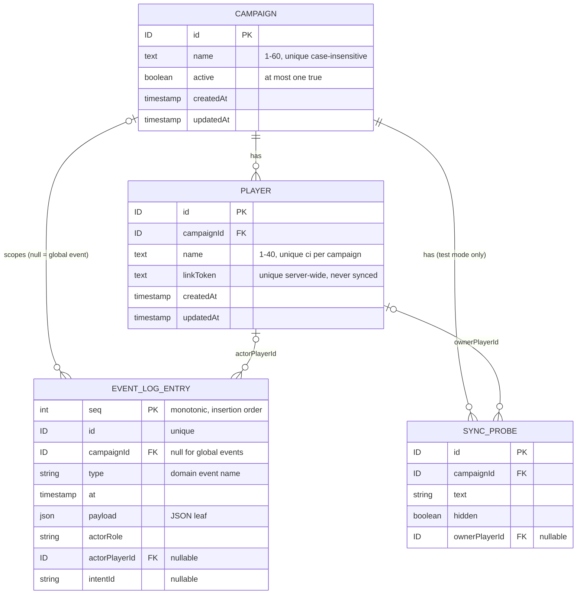
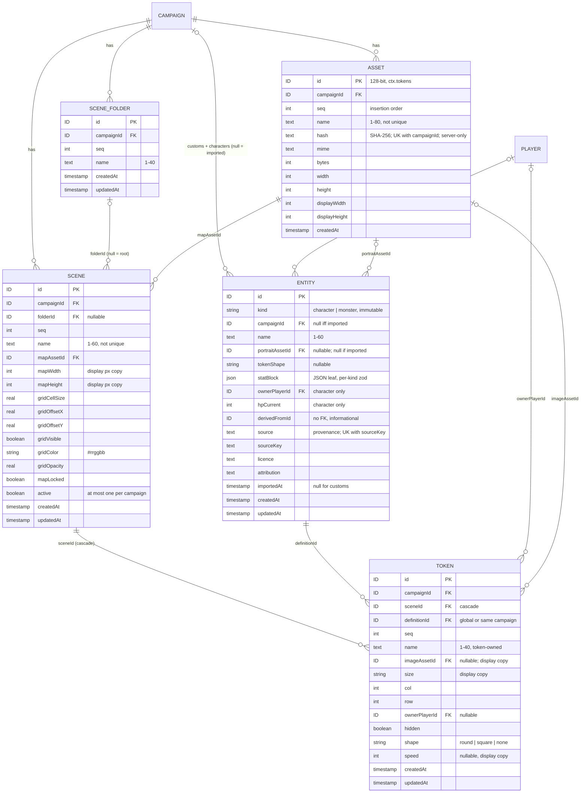
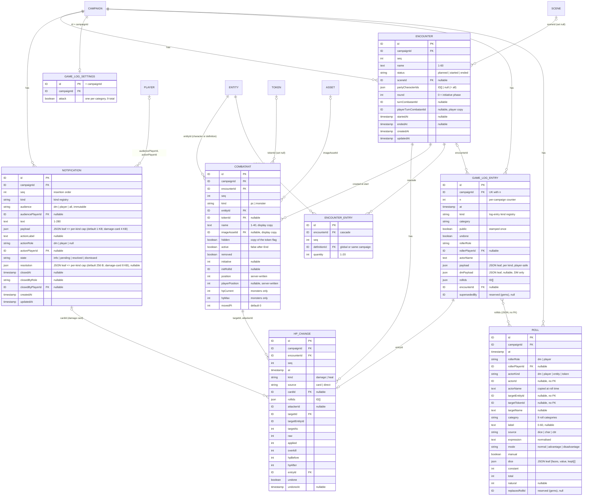

# Data model

Consolidated domain model. Entities and relationships, **not SQL**. **Living doc**: the integrator extends it after each build phase's specs reach `complete` ([process](../process.md#stages), [roadmap](../roadmap.md#build-order-mvp)). Don't edit from a feature worktree; it is a shared file ([AGENTS §9.9](../../AGENTS.md#99-shared-files)).

| Phase | Specs consolidated | Status |
|---|---|---|
| Foundation | [live-sync](../specs/live-sync.md), [campaign-management](../specs/campaign-management.md), [fixtures-adapters](../specs/fixtures-adapters.md) | done (2026-10-12); CON-01–04 resolved (#118) and built in the skeleton (`src/server/db/schema.ts`) |
| Scenes | assets-pipeline, entities, play-shell, scenes-map | consolidated (2026-10-12): [§9–§13](#9-scenes-er-diagram); CON-18–21 resolved (fix/scenes-core) |
| Combat | character-sheet, dice-roll-log, notifications, combat-tracker | consolidated (2026-10-12, #142): [§14–§18](#14-combat-er-diagram); CON-34–37 resolved; all Combat tables built as shared definitions in `src/server/db/schema.ts` (fix/combat-core) |
| Reward | [party-loot](../specs/party-loot.md) | built (build/party-loot): [§19](#19-reward-loot-entry-party-pot-wallet) |
| Sprint 1 | [character-sheet-full](../specs/character-sheet-full.md) (CHARX, #178) | core built (fix/charx-core): [§20](#20-sprint-1-creature-sheet), stat-block additions in [§11](#11-scenes-entity); record type, commands, hook, fixtures **built** (build/character-sheet-full); combat routes **built** (fix/charx-combat-routes, slice 4) |
| Sprint 1 | [combat-extras](../specs/combat-extras.md) (CBTX, #178) | core built (fix/cbtx-core): [§21](#21-sprint-1-effect-and-combat-play-state), play-state columns in [§11](#11-scenes-entity) and [§17](#17-combat-encounter-combatant-combat-log-entry); commands, rules, record-type registration, fixtures built (build/combat-extras) |
| Sprint 2 | [effect-modifiers](../specs/effect-modifiers.md) (MOD tier 1, #190) | core built (fix/mod-core): [§23](#23-sprint-2-effect-modifiers-tier-1), `effect` columns in [§21](#21-sprint-1-effect-and-combat-play-state); commands, hook, record-type registration, fixtures: build/effect-modifiers |
| Sprint 2 phase 2 | [fog-of-war](../specs/fog-of-war.md) (FOG, #196) | core built (fix/fog-core): [§24](#24-sprint-2-fog-of-war), `token.fogged` in [§12](#12-scenes-scene-scene-folder-token); commands, undo, fixtures: build/fog-server |
| Sprint 2 phase 2 | [scene-tools](../specs/scene-tools.md) (SCN, #196) | core built (fix/scn-core): [§25](#25-sprint-2-scene-tools), record types + visibility, scene hooks; commands, guard, fixtures: build/scene-tools-structure / -props / -templates / -settings |

Every fact links its source. Protocol side (record types, intents, events): [protocol](../protocol/README.md).

## 1. Rules for every table

| Rule | Source |
|---|---|
| Relational SQLite. JSON columns only for document-shaped **leaf** data, zod-validated on read/write. No whole-campaign/scene blobs | [ADR-0006](../architecture/adr/0006-persistence.md) |
| Runtime/session state lives in the DB and survives a crash. In-memory state must not matter to play; caches rebuild from the DB | [ADR-0006](../architecture/adr/0006-persistence.md), [FR-SYNC-25](../specs/live-sync.md#6-functional-requirements) |
| Every record has a `campaignId`, except: `Campaign` itself, **imported definitions** (global), event-log entries of global events (`campaignId` null) | [ADR-0004](../architecture/adr/0004-tenancy-auth-permissions.md), [ADR-0018](../architecture/adr/0018-global-imported-content.md), [live-sync §8](../specs/live-sync.md#8-data-model) |
| Records in a campaign may point at a global definition or a custom of the **same** campaign, never another campaign's custom | [ADR-0018](../architecture/adr/0018-global-imported-content.md) |
| Every mutation is a server command: row change + event-log entry in **one transaction** (unless the spec marks the event non-logged) | [FR-CAMP-20](../specs/campaign-management.md#6-functional-requirements), [FR-SYNC-16](../specs/live-sync.md#6-functional-requirements), [ADR-0016](../architecture/adr/0016-domain-events-pending-actions.md) |
| IDs, tokens, timestamps and dice come only from the command context (`ctx.ids`, `ctx.tokens`, `ctx.clock`, `ctx.dice`). Seeded values have the same format as real ones (CON-36) | [ADR-0022](../architecture/adr/0022-deterministic-seams.md), [FR-DICE-03](../specs/dice-roll-log.md#6-functional-requirements), [AGENTS §9.3](../../AGENTS.md#93-fixtures) |
| Time-ordered views: order by timestamp, then insertion order (event log: `seq`; other tables: row order). Never by ID or randomness | [ADR-0022](../architecture/adr/0022-deterministic-seams.md), CON-04 |
| Timestamps are ISO-8601 UTC strings from `ctx.clock` | skeleton |
| No per-record versions | [live-sync §8](../specs/live-sync.md#8-data-model) |

## 2. ER diagram (Foundation)

Imported definitions are rows of the Scenes `entity` table with `campaignId` null and inline provenance: [§9](#9-scenes-er-diagram), [§11](#11-scenes-entity) (CON-18).

## 3. Persisted entities

### Campaign — owner [campaign-management](../specs/campaign-management.md#8-data-model)

| Field | Type | Rule | Source |
|---|---|---|---|
| id | ID | The scope itself; no `campaignId` | CAMP §8 |
| name | text | Trimmed, 1–60 chars, unique case-insensitive, control chars rejected | [FR-CAMP-06](../specs/campaign-management.md#6-functional-requirements), CAMP §11 |
| active | boolean | At most one `true`, DB-enforced (partial unique index). Survives restart | [FR-CAMP-08](../specs/campaign-management.md#6-functional-requirements), [ADR-0020](../architecture/adr/0020-single-active-campaign.md) |
| createdAt, updatedAt | timestamp | From `ctx.clock` | CAMP §8, [ADR-0022](../architecture/adr/0022-deterministic-seams.md) |

- Created while none is active → active, and the create also emits `CampaignActivated {previousCampaignId: null}` (CON-10); otherwise inactive ([FR-CAMP-06](../specs/campaign-management.md#6-functional-requirements)). Switch flips both flags in one transaction ([FR-CAMP-09](../specs/campaign-management.md#6-functional-requirements)).
- No delete or archive ([CAMP §4](../specs/campaign-management.md#4-non-goals)). No JSON leaves.

### Player — owner [campaign-management](../specs/campaign-management.md#8-data-model)

| Field | Type | Rule | Source |
|---|---|---|---|
| id | ID | Referenced by owned records (characters, tokens) | CAMP §8 |
| campaignId | ID → Campaign | Players are added to the active campaign only | [FR-CAMP-12](../specs/campaign-management.md#6-functional-requirements) |
| name | text | Trimmed, 1–40 chars, unique case-insensitive per campaign | FR-CAMP-12 |
| linkToken | text | 128 bits from `ctx.tokens`, base64url, unique server-wide. Plain text (DM re-copies). **Never** in a sync record, event or log entry. Unchanged on rename | [FR-CAMP-13](../specs/campaign-management.md#6-functional-requirements), [FR-CAMP-15](../specs/campaign-management.md#6-functional-requirements), [ADR-0019](../architecture/adr/0019-auth-credentials.md) |
| createdAt, updatedAt | timestamp | From `ctx.clock` | CAMP §8 |

- No player removal → no dangling owners ([CAMP §8](../specs/campaign-management.md#8-data-model)). No revocation/rotation ([ADR-0019](../architecture/adr/0019-auth-credentials.md)).

### Event log entry — owner [live-sync](../specs/live-sync.md#8-data-model)

| Field | Type | Rule | Source |
|---|---|---|---|
| seq | integer | Monotonic insertion order (autoincrement); the time-order tiebreak | CON-04, [ADR-0022](../architecture/adr/0022-deterministic-seams.md) |
| id | ID | From `ctx.ids`; unique | SYNC §8 |
| campaignId | ID \| null | Null for global events (imported definitions) | SYNC §8, [FR-FIX-23](../specs/fixtures-adapters.md#6-functional-requirements) |
| type | string | Domain event name | SYNC §8 |
| at | timestamp | From `ctx.clock` | SYNC §8 |
| payload | JSON leaf | Domain event payload | SYNC §8 |
| actorRole, actorPlayerId | `dm` \| `player` \| `system`, ID \| null | Who caused it (fixture loads: `dm`) | SYNC §8 |
| intentId | string | WS intent that caused it (REST and loader calls have none: [FR-SYNC-15](../specs/live-sync.md#6-functional-requirements), [FR-FIX-13](../specs/fixtures-adapters.md#6-functional-requirements)) | SYNC §8 |

- **Append-only**. Appended in the commit's transaction; rollback → no entry ([FR-SYNC-16](../specs/live-sync.md#6-functional-requirements)). Never holds the DM secret or a link token ([FR-CAMP-03](../specs/campaign-management.md#6-functional-requirements), CAMP §8).
- Not every domain event is logged: token moves are not ([ADR-0016](../architecture/adr/0016-domain-events-pending-actions.md)); others only if their spec says so.
- Undo (CON-34): the marker lives on combat's own `hp_change` table (`undone`, `undoneAt`; the combat log entry, [§17](#17-combat-encounter-combatant-combat-log-entry)) plus the compensating event `CombatEntryUndone`, per [ADR-0016](../architecture/adr/0016-domain-events-pending-actions.md). The event log has no undo fields.

### Sync probe — owner [live-sync](../specs/live-sync.md#8-data-model), test mode only

| Field | Type | Rule | Source |
|---|---|---|---|
| id, campaignId | ID, ID → Campaign | | SYNC §8 |
| text | string | | SYNC §8 |
| hidden | boolean | Visibility flag | SYNC §8 |
| ownerPlayerId | ID → Player \| null | Must be a player of `ctx.campaignId` | SYNC §8, [§9](../specs/live-sync.md#9-api--events) |

- Exists only with `PP_TEST_MODE=1` ([FR-SYNC-27](../specs/live-sync.md#6-functional-requirements), [AGENTS §9.2](../../AGENTS.md#92-env-ports-and-data)).

### DB meta — infrastructure (#163), not a record type

| Field | Type | Rule | Source |
|---|---|---|---|
| key | text PK | `db-id` only | #163 |
| value | text | `db-id`: random UUID, created on first read (`dbId(db)`, `src/server/db/meta.ts`); the asset-dir marker | #163 |

- Not campaign data: no `campaignId`, no event log, never sent.

### Imported definition — see [§11 Entity](#11-scenes-entity)

- One `entity` table holds imported, custom and character definitions; imported rows have `campaignId` null and inline provenance (`source, sourceKey, licence, attribution, importedAt`), read-only (CON-18, [OQ-FIX-15](../specs/fixtures-adapters.md#15-open-questions)). Existing `(source, sourceKey)` → `existing`, nothing written ([FR-FIX-20](../specs/fixtures-adapters.md#6-functional-requirements)).
- The skeleton's pipeline core writes through a definition-store interface + kind registry (`ImportRegistry`), tested with a test-only kind (CON-03); entities plugs the table in.

## 4. Constraints the DB enforces

| Constraint | Source |
|---|---|
| `Campaign.active`: at most one `true` (partial unique index) | [FR-CAMP-08](../specs/campaign-management.md#6-functional-requirements) |
| `Campaign.name` unique, case-insensitive (unique index on `lower(name)`; commands also compare Unicode-folded names) | [FR-CAMP-06](../specs/campaign-management.md#6-functional-requirements), CAMP §11 (racing creates → one error) |
| `(Player.campaignId, Player.name)` unique, case-insensitive | [FR-CAMP-12](../specs/campaign-management.md#6-functional-requirements) |
| `Player.linkToken` unique server-wide | [FR-CAMP-13](../specs/campaign-management.md#6-functional-requirements) |
| Definition `(source, sourceKey)` unique globally: `Entity` constraint, [§13](#13-scenes-constraints-not-in-db-derived-visibility-fields) (CON-18) | [FR-FIX-20](../specs/fixtures-adapters.md#6-functional-requirements) |

## 5. Not in the DB

| Thing | Where | Fields | Source |
|---|---|---|---|
| DM secret | env `PP_DM_SECRET` only; never stored, logged or sent | ≥ 12 chars | [FR-CAMP-01/03](../specs/campaign-management.md#6-functional-requirements), [ADR-0019](../architecture/adr/0019-auth-credentials.md) |
| Connection | server memory | connId, campaignId, role `dm`\|`player`, playerId \| null (immutable); phase `awaiting-hello`\|`snapshotting`\|`live`, seq, lastInboundAt | [SYNC §8](../specs/live-sync.md#8-data-model) |
| Presence | server memory, derived from live connections | id (= playerId), playerId, campaignId, online | SYNC §8, [FR-SYNC-23](../specs/live-sync.md#6-functional-requirements), CON-07 |
| DM login throttle counter | server memory, cleared on restart | — | [FR-CAMP-05](../specs/campaign-management.md#6-functional-requirements) *(proposed)* |
| Active campaign / active scene id | cache, rebuilt at boot | — | SYNC §8 |
| Load manifest | `$PP_DATA_DIR/load-manifest.json` (written atomically) | bundle, fixtures, status `resetting`\|`empty`\|`loading`\|`complete`, records (fixture key → record type → IDs), dmUrl, playerLinks `{player, campaign, url}[]`, startedAt, durationMs. **No DM secret** | [FIX §8](../specs/fixtures-adapters.md#8-data-model), [FR-FIX-09](../specs/fixtures-adapters.md#6-functional-requirements), [FR-FIX-28](../specs/fixtures-adapters.md#6-functional-requirements) |
| Data-dir lock | `$PP_DATA_DIR/server.lock` (JSON, created exclusively) | owner `server`\|`loader`, pid, port (server only, written once bound), startedAt | FIX §8, [FR-FIX-27](../specs/fixtures-adapters.md#6-functional-requirements), [AGENTS §9.2](../../AGENTS.md#92-env-ports-and-data) |
| Fixture, bundle, import batch, registrations | code | See [FIX §8](../specs/fixtures-adapters.md#8-data-model); registrations: [protocol §5](../protocol/README.md#5-record-type-registry) | FIX §8, SYNC §8 |

## 6. Derived values

| Value | From | Source |
|---|---|---|
| Player link URL | public base URL + `/p/` + `linkToken` (path *proposed*, [OQ-CAMP-15](../specs/campaign-management.md#15-open-questions)); base from `PP_PUBLIC_BASE_URL`, unset → DM client's origin + warning (pick, [OQ-CAMP-07](../specs/campaign-management.md#15-open-questions)) | [CAMP §8](../specs/campaign-management.md#8-data-model), [FR-CAMP-14](../specs/campaign-management.md#6-functional-requirements) |
| Player online state | presence | CAMP §8, [FR-SYNC-23](../specs/live-sync.md#6-functional-requirements) |
| Definition `readOnly` | `source != null`: Entity `readOnly`, [§13](#13-scenes-constraints-not-in-db-derived-visibility-fields) (CON-18) | [FIX §8](../specs/fixtures-adapters.md#8-data-model) |
| Each connection's visible view | records through the type's visibility fn | [SYNC §8](../specs/live-sync.md#8-data-model) |

## 7. Visibility-relevant fields

What each visibility fn reads (record + connection context only, [ADR-0021](../architecture/adr/0021-sync-protocol-conventions.md)). Full rules: [protocol §5](../protocol/README.md#5-record-type-registry).

| Record | Fields the filter reads | Never leaves the server |
|---|---|---|
| Campaign | `id` vs `ctx.campaignId` | — |
| Player | `campaignId` vs `ctx.campaignId` | `linkToken` (no field in the record type) |
| Sync probe | `hidden`, `ownerPlayerId` vs `ctx.playerId` | — |
| Presence | (DM only: `audience: dm`) | — |

Scenes: [§13](#13-scenes-constraints-not-in-db-derived-visibility-fields). Combat: [§18](#18-combat-constraints-not-in-db-derived-visibility-fields) (CON-37). Reward: [§19](#19-reward-loot-entry-party-pot-wallet).

## 8. Conflicts log

Found at Foundation consolidation; resolved by the integrator ([decisions-log](../decisions-log.md) #118) and folded into the sections above. Protocol conflicts CON-05–17: [protocol §11](../protocol/README.md#11-conflicts-log).

| ID | Topic | Resolution | Now in |
|---|---|---|---|
| CON-01 | Campaign scoping vs global definitions | Every record has a campaign except imported definitions (ADR-0018); glossary wording is the integrator's | §1 |
| CON-02 | Event log `campaignId` | Null for global events | §3 Event log entry |
| CON-03 | Definition table | Pipeline core against a test-only kind behind an insert interface; entities adds the table in Scenes | §3 Imported definition, §11 |
| CON-04 | Event log ordering | Monotonic integer `seq` column (insertion order) | §1, §2, §3 Event log entry |

Scenes consolidation (CON-18+, integrator):

| ID | Entity / field | Specs in conflict | Suggested fix | Resolution |
|---|---|---|---|---|
| CON-18 | Imported definition table (§2 ER `IMPORTED_DEFINITION`, §3 "Imported definition", §4 last row, §6 `readOnly`) | This doc lines 68–77, 132–141 model a separate global table; [entities](../specs/entities.md) lines 13, 72–81 use **one** `entity` table, imported rows = `campaignId` null, provenance inline (OQ-FIX-15 pick) | Replace the Foundation `IMPORTED_DEFINITION` block and §3 subsection with a pointer to [§11](#11-scenes-entity) (edit after the skeleton merge; not edited here) | resolved (fix/scenes-core): §2, §3, §4, §6 point to §11 / §13 |
| CON-19 | Asset `id` source vs §9.3 seam table | [assets-pipeline](../specs/assets-pipeline.md) line 49 and [ADR-0023](../architecture/adr/0023-asset-access-by-capability-id.md) line 30: asset ID from `ctx.tokens`; [AGENTS §9.3](../../AGENTS.md#93-fixtures) seam table: `ctx.ids` = record IDs, `ctx.tokens` = "secret tokens (player links)" | AGENTS §9.3 `ctx.tokens` row: "secret tokens (player links) and asset IDs (ADR-0023)". Builders: asset IDs from `ctx.tokens` now | resolved (fix/scenes-core): AGENTS §9.3 row amended |
| CON-20 | `seq` columns "from `ctx`" | [scenes-map](../specs/scenes-map.md) line 67 (FR-MAP-27: "IDs, `seq` and time only from `ctx`") and line 80; [assets-pipeline](../specs/assets-pipeline.md) line 49. `ctx` has no seq seam ([AGENTS §9.3](../../AGENTS.md#93-fixtures): ids, tokens, clock) | Same rule as event-log `seq` (CON-04): `seq` = monotonic integer assigned by the DB at insert (insertion order); deterministic because fixture steps run in order. Amend FR-MAP-27 wording to "IDs and time from `ctx`; `seq` by the DB" | resolved (fix/scenes-core): FR-MAP-27, MAP §8, FR-ASSET-08 amended |
| CON-21 | Campaign for DM REST creates | [entities](../specs/entities.md) line 43 (FR-ENT-04: "active campaign **at commit**") vs [assets-pipeline](../specs/assets-pipeline.md) line 50 (FR-ASSET-09: "resolved when the request is authenticated") and [scenes-map](../specs/scenes-map.md) line 94 ("fixed at authentication"); FR-ENT-04 says "as FR-ASSET-09" | FR-ENT-04: "`ctx.campaignId` resolved at request authentication (as FR-ASSET-09); none → `conflict`". One rule in the REST middleware | resolved (fix/scenes-core): FR-ENT-04 amended (middleware rule: first Scenes REST builder) |

Combat consolidation (CON-34+, integrator). Applied by fix/combat-core after `build/entities` merged; line numbers as on `main` @ c579ac1. Protocol side: [protocol §11](../protocol/README.md#11-conflicts-log) (CON-38+).

| ID | Entity / field | Specs in conflict | Suggested fix | Resolution |
|---|---|---|---|---|
| CON-34 | Undo fields (§3 Event log entry, line 115) | This doc plans undo fields (compensating event, `undone` marker) on the event log; [combat-tracker §8](../specs/combat-tracker.md#8-data-model) puts the marker on its own `hp_change` table (gate I9, [§17](#17-combat-encounter-combatant-combat-log-entry)) | Line 115 → "undo marker on combat's own `hp_change` table (`undone`, `undoneAt`; the combat log entry) plus compensating event `CombatEntryUndone`, per [ADR-0016](../architecture/adr/0016-domain-events-pending-actions.md)". The event log stays as is | resolved (fix/combat-core): §3 Event log entry |
| CON-35 | `resolveDefinition(ctx, id)` (§11, line 339) | [entities](../specs/entities.md) FR-ENT-12 now `resolveDefinition(env, id)`, campaign = `env.actor.campaignId` (gate I14; code: `CommandContext` has no `campaignId`, `CommandEnv.actor` does) | Line 339 → `resolveDefinition(env, id)`. Builders: helpers take `env: CommandEnv` | resolved (fix/combat-core): §11 |
| CON-36 | Seam rule (§1, line 23) | §1 lists `ctx.ids`, `ctx.tokens`, `ctx.clock` only; #137 adds `ctx.dice` ([FR-DICE-03](../specs/dice-roll-log.md#6-functional-requirements), [AGENTS §9.3](../../AGENTS.md#93-fixtures)) | Line 23 → "IDs, tokens, timestamps and dice come only from the command context (`ctx.ids`, `ctx.tokens`, `ctx.clock`, `ctx.dice`)…" | resolved (fix/combat-core): §1; seam built in `src/server/commands/context.ts` |
| CON-37 | Stale pointers | Line 9 phase table ("Combat: > Later phase"); §7 line 176 "Later phase" note; §12 line 391 ("Combatant → token FK … Combat phase"); §11 `hpCurrent` row (line 333) names only entities' writers; §13 line 415 code registries lack the token-changed hooks ([ADR-0028](../architecture/adr/0028-token-changed-hooks.md)) | Line 9 → done (at merge); line 176 → pointer to [§18](#18-combat-constraints-not-in-db-derived-visibility-fields); line 391 → pointer to [§17](#17-combat-encounter-combatant-combat-log-entry); line 333 + "and `characters.adjustHp` ([FR-CHAR-13](../specs/character-sheet.md#6-functional-requirements))"; line 415 + "token-changed hooks (FR-MAP-30)" | resolved (fix/combat-core): phase table, §7, §11, §12, §13 |

## 9. Scenes: ER diagram

Consolidated 2026-10-12 from the `complete` specs [assets-pipeline](../specs/assets-pipeline.md) (ASSET), [entities](../specs/entities.md) (ENT), [play-shell](../specs/play-shell.md) (SHELL), [scenes-map](../specs/scenes-map.md) (MAP). Foundation sections above amended per CON-18 (fix/scenes-core); phase table flips at merge. Protocol side: [protocol §12–§19](../protocol/README.md#12-scenes-record-types).

- Play-shell adds **no** table, record type or migration: the layout lives in browser `localStorage` ([SHELL §8](../specs/play-shell.md#8-data-model), [ADR-0025](../architecture/adr/0025-play-shell-windows.md), #121).
- `seq` columns: insertion order, tiebreak for time-ordered and name-ordered views ([ADR-0022](../architecture/adr/0022-deterministic-seams.md)); source: [CON-20](#8-conflicts-log).

## 10. Scenes: asset

### Asset — owner [assets-pipeline](../specs/assets-pipeline.md#8-data-model)

| Field | Type | Rule | Source |
|---|---|---|---|
| id | ID | 128 bits from **`ctx.tokens`**, base64url; it is the capability | [FR-ASSET-08](../specs/assets-pipeline.md#6-functional-requirements), [ADR-0023](../architecture/adr/0023-asset-access-by-capability-id.md), [CON-19](#8-conflicts-log) |
| campaignId | ID → Campaign | `ctx.campaignId` at request authentication | [FR-ASSET-09](../specs/assets-pipeline.md#6-functional-requirements) |
| seq | int | Insertion order; picker tiebreak (`createdAt` desc, then `seq` desc). Assigned by the DB inside the insert: `(select coalesce(max(seq), 0) + 1 from asset)` (`assetSeqNext` in `schema.ts`); unique index `asset_seq`. Text `id` PK, so no autoincrement | FR-ASSET-08, [FR-ASSET-10](../specs/assets-pipeline.md#6-functional-requirements), [CON-20](#8-conflicts-log) |
| name | text | Given `name` or filename minus extension; trimmed, control chars removed, 1–80; not unique; second upload's name ignored | FR-ASSET-08, [FR-ASSET-03](../specs/assets-pipeline.md#6-functional-requirements) |
| hash | text | SHA-256 hex of the stored original. Unique `(campaignId, hash)`. **Server-only**: not in the `asset` record | FR-ASSET-03, ASSET §8 |
| mime, bytes, width, height | text, int ×3 | Stored original (SVG stored as PNG) | [FR-ASSET-02](../specs/assets-pipeline.md#6-functional-requirements), ASSET §8 |
| displayWidth, displayHeight | int ×2 | `display` derivative size; grid calibration space | [FR-ASSET-05](../specs/assets-pipeline.md#6-functional-requirements), [OQ-ASSET-07](../specs/assets-pipeline.md#15-open-questions) |
| createdAt | timestamp | `ctx.clock` | FR-ASSET-08 |
| listed *(S5)* | bool, default true | false = **attachment** (attach-control upload / paste): not in the `asset` record type (snapshot and changes); **server-only**, not on the wire. Existing rows true. See [§65](#65-sprint-5-party-core-p0) | [FR-ASSET-24](../specs/assets-pipeline.md#61-sprint-5-image-attach-control-and-attachments) |
| tags *(S6)* | **JSON leaf**, null or 0–8 strings (1–24 chars) | Fold-unique per asset, campaign spelling; null only on pre-IM-1 rows (backfilled once at start). On the wire as `tags` (null → `[]`), listed assets only, DM only. See [§86](#86-sprint-6-image-tags-core-im-1) | [FR-ASSET-39](../specs/assets-pipeline.md#63-sprint-6-image-search-and-tags-track-im), FR-ASSET-49 |

- **Files (disk, not records):** `PP_ASSET_DIR/<hash>/{original, display.webp, thumb.webp}`, one set per hash, shared by every campaign's row with that hash. Temp dir + rename; existing hash dir reused ([FR-ASSET-04](../specs/assets-pipeline.md#6-functional-requirements); layout *proposed*). `thumb` ≤ 512 px, `display` ≤ 4096 px, WebP, never upscaled (FR-ASSET-05).
- **Write order:** image processing (sniff, rasterise, derivatives) runs async with no disk writes; then the synchronous `assets.ingest` command writes the files (`PP_ASSET_DIR/.tmp/<hash>` → rename to `<hash>`, retried on transient Windows locks) and the row + event-log entry in one transaction ([FR-ASSET-06](../specs/assets-pipeline.md#6-functional-requirements)). Server start (`r.onStart`, [protocol §19](../protocol/README.md#19-scenes-build-notes)): delete `.tmp` and every 64-hex dir no row references (other files untouched); missing files → error log (hash, never the ID), 404 ([FR-ASSET-07](../specs/assets-pipeline.md#6-functional-requirements)). **Durability (#163):** each file is fsynced, then the hash dir and the asset dir, before the row insert (SQLite runs `synchronous = FULL`). The asset dir holds `.pocket-plane-db` = the DB's `db_meta.db-id` (written at the first sweep); a different id → the sweep is skipped with an error (two DBs sharing one `PP_ASSET_DIR` never delete each other's files). A re-upload whose hash dir is incomplete rewrites the files and answers `existing`.
- **Indexes:** unique `asset_campaign_hash (campaign_id, hash)`, unique `asset_seq (seq)`, `asset_campaign (campaign_id)`.
- No delete, rename, replace or revoke in MVP ([OQ-ASSET-05](../specs/assets-pipeline.md#15-open-questions)). No JSON leaves *(S6: except `tags`, [§86](#86-sprint-6-image-tags-core-im-1))*.
- **Asset references** (fields holding an asset ID): `Scene.mapAssetId`, `Token.imageAssetId`, `Entity.portraitAssetId`. Set only via `assets.require(ctx, id)` → same campaign or `not_found`, including propagated copies in the same transaction ([FR-ASSET-15](../specs/assets-pipeline.md#6-functional-requirements)). Imported definitions carry no asset in MVP.

## 11. Scenes: entity

### Entity — owner [entities](../specs/entities.md#8-data-model)

One table for imported, custom and character definitions ([ADR-0009](../architecture/adr/0009-entity-content-model.md) storage A, #124). Supersedes the Foundation "Imported definition" block ([CON-18](#8-conflicts-log)).

| Field | Type | Rule | Source |
|---|---|---|---|
| id | ID | `ctx.ids` | [FR-ENT-17](../specs/entities.md#6-functional-requirements) |
| kind | `character` \| `monster` | Immutable; kind registry in `@shared/entities` | [FR-ENT-01](../specs/entities.md#6-functional-requirements), [FR-ENT-11](../specs/entities.md#6-functional-requirements) |
| campaignId | ID → Campaign \| null | **Null iff imported** (global); customs + characters = `ctx.campaignId`; no request field sets it | [FR-ENT-04](../specs/entities.md#6-functional-requirements), [ADR-0018](../architecture/adr/0018-global-imported-content.md) |
| name | text 1–60 | Trimmed, no control chars; unique ci per (campaign, kind) for non-null campaign; may equal an imported name | [FR-ENT-08](../specs/entities.md#6-functional-requirements) |
| portraitAssetId | ID → Asset \| null | Asset reference via `assets.require`; null for imported | FR-ENT-08, [FR-ASSET-15](../specs/assets-pipeline.md#6-functional-requirements) |
| tokenShape *(feedback pass, built)* | `round` \| `square` \| `none` \| null | Column `token_shape` text, nullable (zod checks values); default shape for **new** tokens only; null = round; imported rows null. Whole-replace `PUT` without it → null | [FR-ENT-22](../specs/entities.md#6-functional-requirements), OQ-ENT-17 |
| statBlock | **JSON leaf** | Strict per-kind zod: shared creature core `size, ac, hpMax, initBonus, attacks[0..1]` + monster `cr` / character `level, className`. New fields only optional. *(feedback pass, built)*: optional `speed` (int 0–200, multiple of 5), `abilities {str, dex, con, int, wis, cha}` (int 1–30, all six or none), `saveProficiencies` (unique subset; needs `abilities`), both kinds; zod only, no column, no backfill ([FR-ENT-21](../specs/entities.md#6-functional-requirements), [FR-ENT-23](../specs/entities.md#6-functional-requirements)). *(sprint 1, built, fix/charx-core)*: `attacks` 0–**20** rows, each with an optional unique `id`; optional `skills` (18 SRD skills → `proficient` \| `expertise`), `overrides` (fixed key list → `{value −20…40, note? ≤ 60}`), `spellcasting {ability, slots {1…9: 0–9}}` (both kinds; `skills` / `spellcasting` need `abilities`); character `classes` (1–4 × `{name, level, hitDie, subclass?}`, Σ levels ≤ 20, names joined "/" ≤ 40; every entities write sets `level` / `className` from them) and `species` (≤ 40); whole block ≤ 12 KB, else "Sheet is full" ([CHARX §8.1](../specs/character-sheet-full.md#81-stat-block-additions-entities-json-leaf-zod-only-no-column), [FR-CHARX-01/03/04](../specs/character-sheet-full.md#6-functional-requirements)). *(sprint 2, built, fix/combat2-core)*: optional `hpFormula` (`NdM±K`: N 1–50, M ∈ 4/6/8/10/12/20, K 0–999; stored normalised, e.g. `2d8+2`), both kinds; zod only, no column, no backfill; Average HP stays `hpMax` ([FR-ENT-25](../specs/entities.md#6-functional-requirements)). *(sprint 4, built, fix/cmp-art-core)*: monster-only optional `type` (one of the 14 SRD creature types, `CREATURE_TYPES`; characters `invalid`), zod only ([§59](#59-sprint-4-token-creature-type-c-art-core), [FR-ENT-26](../specs/entities.md#6-functional-requirements)) | [FR-ENT-02](../specs/entities.md#6-functional-requirements), ENT §8, [ADR-0006](../architecture/adr/0006-persistence.md) |
| ownerPlayerId | ID → Player \| null | Required for character (player of `ctx.campaignId`, else `invalid`); null for monster | [FR-ENT-10](../specs/entities.md#6-functional-requirements) |
| hpCurrent | int \| null | Character only; `= hpMax` at create; clamped on update. PC HP lives on the character. Written only by entities' create / update and `characters.adjustHp` ([FR-CHAR-13](../specs/character-sheet.md#6-functional-requirements), CON-37) | FR-ENT-10, FR-ENT-11, [ADR-0009](../architecture/adr/0009-entity-content-model.md), [OQ-ENT-08](../specs/entities.md#15-open-questions) |
| tempHp, deathSuccesses, deathFailures *(sprint 1, built, fix/cbtx-core)* | int 0–999, int 0–3 ×2 | Columns `temp_hp`, `death_successes`, `death_failures` int not null default 0 (push-safe on old DBs). Character play state, like `hpCurrent`: DM + owner only (the monster / imported records omit them; their rows keep 0); never in `statBlock`; `PUT /api/entities` never writes them. Writers: CBTX's `hpRules` and `cbtx.*` commands (built, build/combat-extras) | [FR-CBTX-14/19](../specs/combat-extras.md#6-functional-requirements), [CBTX §8](../specs/combat-extras.md#8-data-model) |
| derivedFromId | ID \| null | Plain id, **no FK**; immutable; informational only | [FR-ENT-09](../specs/entities.md#6-functional-requirements) |
| source, sourceKey, licence, attribution | text \| null | Provenance **inline** (OQ-FIX-15 pick); unique `(source, sourceKey)`; all null for customs; only `entities.import` writes them | [FR-ENT-05](../specs/entities.md#6-functional-requirements), [FR-ENT-06](../specs/entities.md#6-functional-requirements), [FR-FIX-20/21](../specs/fixtures-adapters.md#6-functional-requirements) |
| importedAt, createdAt, updatedAt | timestamp | `ctx.clock`; `importedAt` null for customs | FR-ENT-05, ENT §8 |

- Imported rows are read-only (update → `forbidden`) ([FR-ENT-07](../specs/entities.md#6-functional-requirements)). No delete in MVP ([FR-ENT-14](../specs/entities.md#6-functional-requirements), *proposed* OQ-ENT-07).
- References into `entity` (token, combatant, encounter entry) resolve via `resolveDefinition(env, id)` (campaign = `env.actor.campaignId`, CON-35): global or same campaign, else `not_found` ([FR-ENT-12](../specs/entities.md#6-functional-requirements), [ADR-0018](../architecture/adr/0018-global-imported-content.md)).
- Reads re-validate the JSON leaf: invalid stored row omitted from the snapshot + error log; a command on it → `internal` ([FR-ENT-01](../specs/entities.md#6-functional-requirements)).
- *(feedback pass, built)* Character speed, scores and saves come from fixtures / `PUT /api/entities/:id` in MVP; no character edit UI (#154). Redacted characters carry a derived `down` (= `hpCurrent = 0`), computed in the visibility fn, not stored ([FR-ENT-15](../specs/entities.md#6-functional-requirements), #154).
- *(sprint 1, built, fix/charx-core)* Other players get a character redacted to **one whitelist** (`RedactedCharacter` / `REDACTED_CHARACTER_KEYS` in `@shared/entities`, built by `redactCharacter`): `id, kind, name, portraitAssetId, ownerPlayerId, down, level, className, species` (null when unset) + `deathState` (*built, fix/cbtx-core*: `deathStateOf(hpCurrent, deathSuccesses, deathFailures)` in `@shared/combat-extras/rules`: `dead` at 3 failures, else `stable` at 0 HP with 3 successes, else `dying` at 0 HP, else null; never the counters or temp HP, [FR-CBTX-19/32](../specs/combat-extras.md#6-functional-requirements)) ([ADR-0036](../architecture/adr/0036-full-sheet-derivation.md), [FR-CHARX-35](../specs/character-sheet-full.md#6-functional-requirements)).
- *(sprint 1, built)* Internal `createIn` / `updateIn` (entities' `POST` / `PUT` path minus HTTP and event) let CHARX write the row; `updateIn` takes an optional `hpCurrent` (FR-CHARX-15, `followHpMax`), still clamped. `PUT` keeps FR-ENT-11's clamp ([protocol §31](../protocol/README.md#31-sprint-1-character-sheet-full)).

## 12. Scenes: scene, scene folder, token

All rows per campaign; no JSON leaves; timestamps `ctx.clock` ([MAP §8](../specs/scenes-map.md#8-data-model)).

### Scene — owner [scenes-map](../specs/scenes-map.md#8-data-model)

| Field | Type | Rule | Source |
|---|---|---|---|
| id, campaignId | ID, ID → Campaign | `ctx.ids`; `ctx.campaignId` at authentication | [FR-MAP-27](../specs/scenes-map.md#6-functional-requirements), MAP §9 |
| folderId | ID → SceneFolder \| null | Null = root; folder delete → root in the same transaction | [FR-MAP-02](../specs/scenes-map.md#6-functional-requirements), [FR-MAP-03](../specs/scenes-map.md#6-functional-requirements) |
| seq | int | Insertion order; list tiebreak | FR-MAP-02, [CON-20](#8-conflicts-log) |
| name | text 1–60 | Trimmed, no control chars, **not** unique | [FR-MAP-01](../specs/scenes-map.md#6-functional-requirements) |
| mapAssetId | ID → Asset | Asset reference (`assets.require`) | FR-MAP-01, [FR-MAP-09](../specs/scenes-map.md#6-functional-requirements) |
| mapWidth, mapHeight | int | Copy of the asset's `display` size, written when the map is set | FR-MAP-01, FR-MAP-09 |
| gridCellSize, gridOffsetX, gridOffsetY | real | Display px; cell 8–512 (2 dp), 0 ≤ offset < cell; default 70, 0, 0 *(proposed)* | [FR-MAP-10](../specs/scenes-map.md#6-functional-requirements), FR-MAP-01 |
| gridVisible, gridColor, gridOpacity | bool, `#rrggbb`, real | Opacity 0.1–1; default visible, `#000000`, 0.5 *(proposed)* | FR-MAP-10, FR-MAP-01 |
| mapLocked | bool | Locked → map + grid commands `conflict` | [FR-MAP-11](../specs/scenes-map.md#6-functional-requirements) |
| active | bool | ≤ 1 per campaign, partial unique index *(proposed, OQ-MAP-18)*; new scenes inactive | [FR-MAP-06](../specs/scenes-map.md#6-functional-requirements), [FR-MAP-07](../specs/scenes-map.md#6-functional-requirements) |
| createdAt, updatedAt | timestamp | `ctx.clock` | MAP §8 |

- Duplicate copies the scene (inactive, "‹name› (copy)") and every token with new IDs and `seq` ([FR-MAP-04](../specs/scenes-map.md#6-functional-requirements)). Delete only when not active; tokens cascade ([FR-MAP-05](../specs/scenes-map.md#6-functional-requirements), *proposed*).

### Scene folder — owner [scenes-map](../specs/scenes-map.md#8-data-model)

| Field | Type | Rule | Source |
|---|---|---|---|
| id, campaignId, seq | ID, ID → Campaign, int | One level, no parent | [FR-MAP-02](../specs/scenes-map.md#6-functional-requirements) *(proposed, OQ-MAP-19)* |
| name | text 1–40 | | FR-MAP-02 |
| createdAt, updatedAt | timestamp | | MAP §8 |

### Token — owner [scenes-map](../specs/scenes-map.md#8-data-model)

An instance of a creature definition: own name, read-only display copies, play state ([ADR-0024](../architecture/adr/0024-definition-visibility.md), #120, #126).

| Field | Type | Rule | Source |
|---|---|---|---|
| id, campaignId, seq | ID, ID → Campaign, int | | [FR-MAP-27](../specs/scenes-map.md#6-functional-requirements) |
| sceneId | ID → Scene | Tokens per scene (#124); cascade on scene delete | MAP §8, [FR-MAP-05](../specs/scenes-map.md#6-functional-requirements) |
| definitionId | ID → Entity | Via `resolveDefinition`: global or same campaign. **Never sent to players** | [FR-MAP-13](../specs/scenes-map.md#6-functional-requirements), [FR-MAP-26](../specs/scenes-map.md#6-functional-requirements) |
| name | text 1–40 | **Token-owned** instance state; numbered `B <N>` on place/duplicate; never changed by a definition edit | [FR-MAP-16](../specs/scenes-map.md#6-functional-requirements), #126 |
| imageAssetId | ID → Asset \| null | **Display copy**: portrait at place; refreshed by the hook only while it equals the old portrait (#127); DM may set custom art | FR-MAP-13, [FR-MAP-18](../specs/scenes-map.md#6-functional-requirements), [FR-MAP-20](../specs/scenes-map.md#6-functional-requirements) |
| size | `tiny`…`gargantuan` | **Display copy** of `statBlock.size`; never per-token editable; refreshed by the hook | FR-MAP-13, FR-MAP-20, #120 |
| col, row | int | Top-left cell; footprint must overlap the map | [FR-MAP-14](../specs/scenes-map.md#6-functional-requirements) |
| ownerPlayerId | ID → Player \| null | One owner; defaults from the character's owner; DM reassigns | FR-MAP-13, FR-MAP-18, #124 |
| hidden | bool | Visibility flag on the record | [FR-MAP-19](../specs/scenes-map.md#6-functional-requirements) |
| shape *(feedback pass, built)* | `round` \| `square` \| `none` | Column `shape` text not null default `round`. **Token-owned** instance state: from the definition's `tokenShape` at place, copied by duplicate, set by `map.updateToken {shape}`; never changed by a definition edit | [FR-MAP-35](../specs/scenes-map.md#6-functional-requirements), #148 |
| speed *(feedback pass, built)* | int \| null | Column `speed` int, nullable. **Display copy** of `statBlock.speed`, written at place / duplicate and by the definition-changed hook; never per-token editable. Players: own tokens only | [FR-MAP-36](../specs/scenes-map.md#6-functional-requirements), OQ-MAP-24 |
| creatureType *(sprint 4, built, fix/cmp-art-core)* | one of the 14 SRD types \| `initials` \| null | Column `creature_type` text, nullable (zod checks values). **Display copy** of the monster's `statBlock.type` at place, token-owned after (like `shape`); set by `map.updateToken {creatureType}`; filled once by the definition-changed hook (null tokens only). Players: every token they receive ([§59](#59-sprint-4-token-creature-type-c-art-core)) | [FR-ENT-27](../specs/entities.md#6-functional-requirements), [ADR-0050](../architecture/adr/0050-token-creature-type.md) |
| characterId *(sprint 2, built, fix/combat2-core)* | ID \| null | Column `character_id` text, nullable, no FK. **Display copy**: `definitionId` when the definition is a `character`, else null; written at place / `placeTokenIn` / duplicate / scene copy, re-asserted by the definition-changed hook; idempotent boot backfill for older rows. Never in an intent. **Sent to every player who sees the token** (unlike `definitionId`) | [FR-MAP-50](../specs/scenes-map.md#6-functional-requirements), FR-MAP-26 (ruling P2b-1) |
| fogged *(sprint 2 phase 2, built, fix/fog-core)* | bool | Column `fogged` int bool not null default false. **Server copy**: every footprint cell fogged; written in the same transaction by every write of the token's scene, cell or size (via `deriveSceneObject`) and by fog commands; never in an intent. Wire: only when true. [§24](#24-sprint-2-fog-of-war) | [FR-FOG-10](../specs/fog-of-war.md#6-functional-requirements), [ADR-0039](../architecture/adr/0039-fog-visibility.md) |
| createdAt, updatedAt | timestamp | | MAP §8 |

- Only `map.placeToken`, `map.duplicateToken`, scene duplicate and the definition-changed hook write `imageAssetId` / `size` / `speed` copies; `map.updateToken` may set `imageAssetId` (custom art), never `size` ([ADR-0024](../architecture/adr/0024-definition-visibility.md), FR-MAP-18).
- Caps *(proposed, OQ-MAP-20)*: ≤ 200 tokens per scene, ≤ 1,000 per campaign → `conflict` (FR-MAP-14).
- Combatant → token FK and the token-delete rule: [§17](#17-combat-encounter-combatant-combat-log-entry) (CON-37).
- **Built** (build/scenes-map), tables `scene_folder`, `scene`, `token` in `src/server/db/schema.ts`: `seq` DB-assigned at insert via `sceneFolderSeqNext` / `sceneSeqNext` / `tokenSeqNext` (CON-20), unique indexes `scene_folder_seq`, `scene_seq`, `token_seq`; indexes `scene_folder_campaign`, `scene_campaign`, `token_scene`, `token_campaign`, `token_definition`; `scene_one_active` = unique `(campaign_id) where active = 1`. Grid columns `real`; `token.size` text enum. Rows map 1:1 to the DM wire records ([protocol §12](../protocol/README.md#12-scenes-record-types)).
- Token deletes (token or scene) run the token-changed hooks first and delete tokens explicitly; the `token.sceneId` cascade is a backstop ([protocol §25](../protocol/README.md#25-combat-token-changed-hooks)).

## 13. Scenes: constraints, not in DB, derived, visibility fields

**Constraints the DB enforces**

| Constraint | Source |
|---|---|
| `Asset (campaignId, hash)` unique | [FR-ASSET-03](../specs/assets-pipeline.md#6-functional-requirements) |
| `Asset.seq` unique; DB-assigned at insert (CON-20) | [FR-ASSET-08](../specs/assets-pipeline.md#6-functional-requirements) |
| `Entity (campaignId, kind, lower(name))` unique where `campaignId` not null | [FR-ENT-08](../specs/entities.md#6-functional-requirements) |
| `Entity (source, sourceKey)` unique (globally; nulls for customs) | [FR-ENT-05](../specs/entities.md#6-functional-requirements), [FR-FIX-20](../specs/fixtures-adapters.md#6-functional-requirements) |
| `Scene.active`: ≤ 1 `true` per campaign (partial unique index `scene_one_active`) *(proposed, OQ-MAP-18)* | [FR-MAP-06](../specs/scenes-map.md#6-functional-requirements) |
| `SceneFolder.seq`, `Scene.seq`, `Token.seq` unique; DB-assigned at insert (CON-20) | [FR-MAP-27](../specs/scenes-map.md#6-functional-requirements) |
| `Token.sceneId` → Scene, `ON DELETE CASCADE` | [MAP §8](../specs/scenes-map.md#8-data-model) |
| `Scene.folderId` → SceneFolder (folder delete moves scenes to root first, same transaction) | [FR-MAP-02](../specs/scenes-map.md#6-functional-requirements) |
| `Entity.derivedFromId`: **no** FK | [ENT §8](../specs/entities.md#8-data-model) |

**Not in the DB**

| Thing | Where | Source |
|---|---|---|
| Asset files | `PP_ASSET_DIR/<hash>/{original, display.webp, thumb.webp}`; temp `PP_ASSET_DIR/.tmp/` | [FR-ASSET-04](../specs/assets-pipeline.md#6-functional-requirements) |
| Active scene id cache | server memory, rebuilt at boot; updated by a commit hook (`r.afterCommit`) after `SceneActivated` commits, before listeners ([CON-23](../protocol/README.md#11-conflicts-log)); read by the scene gate via `r.activeScene` ([CON-22](../protocol/README.md#11-conflicts-log)) | [FR-MAP-06](../specs/scenes-map.md#6-functional-requirements), [SYNC §8](../specs/live-sync.md#8-data-model) |
| Layout (windows, geometry, z-order) | browser `localStorage` key `pp.layout.v1.<campaignId>.<dm \| playerId>`, zod-parsed, ≤ 40 windows; *(playtest pass, built)* each window `area? {w, h}` (work area when its geometry was last set, FR-SHELL-29) | [FR-SHELL-15/17](../specs/play-shell.md#6-functional-requirements), [ADR-0025](../architecture/adr/0025-play-shell-windows.md) |
| Window types, canvas layers, token menu entries, `creatureActions`, definition-changed hooks, token-changed hooks ([FR-MAP-30](../specs/scenes-map.md#6-functional-requirements), CON-37), kind registry | code registries | [FR-SHELL-07](../specs/play-shell.md#6-functional-requirements), [FR-MAP-29](../specs/scenes-map.md#6-functional-requirements), [FR-ENT-19/20](../specs/entities.md#6-functional-requirements), [FR-ENT-01](../specs/entities.md#6-functional-requirements) |
| Viewed scene, camera, selection, ruler, move overlay | client memory | [FR-MAP-08](../specs/scenes-map.md#6-functional-requirements), [FR-MAP-12](../specs/scenes-map.md#6-functional-requirements), MAP §8 |
| *(built, fix/active-scene-window)* DM loaded-scene set `{loaded, loading}` (scenes whose `dmWindow` rows the store holds in full); reset to the active scene by every snapshot | client memory (`SyncConnection.snapshot.scenes`) | [ADR-0041](../architecture/adr/0041-active-scene-window.md) |
| *(built, fix/lazy-records)* Lazy loaded set `{generation, loaded, loading, failed}` (`loaded` = whole-type loads + loaded ids per type); reset by every snapshot, which also drops every lazy-type row from the store | client memory (`SyncConnection.snapshot.lazy`) | [ADR-0045](../architecture/adr/0045-lazy-record-types.md), [FR-SYNC-35/37](../specs/live-sync.md) |
| *(feedback pass, built)* DM selection set + targeting flag (`src/client/dm/features/scenes-map/selection.ts`); token overlay registry `tokenOverlays` (`src/client/common/features/scenes-map/token-overlays.ts`, append-only; drawn by `TokensLayer`) | client memory; code registry | [FR-MAP-31–34](../specs/scenes-map.md#6-functional-requirements) |
| Sound settings `{muted, volume}` (**built**) | browser `localStorage` `pp.sound.v1.<campaignId>.<playerId>`, zod-parsed; never sent; *(sprint 6, built, build/prefs-window)* edited in the players' Preferences Sound section (the speaker retired), same key and defaults | [FR-SHELL-24](../specs/play-shell.md#6-functional-requirements), [FR-SHELL-73](../specs/play-shell.md#6-functional-requirements) |
| *(sprint 6, built, build/prefs-window)* Preference sections `{id, title, order, available?, Component}` (`src/client/{dm,player}/pref-sections.ts`, append-only; `PrefSection` in `@ui/features/play-shell/PreferencesWindow`) | code registry; no new storage: each section keeps its setting where it lives (FR-SHELL-76) | [FR-SHELL-72](../specs/play-shell.md#6-functional-requirements) |

**Derived values** (computed, never stored or sent)

| Value | From | Source |
|---|---|---|
| Asset URL | `assetUrl(id, file)` → `/api/assets/:id/:file` | [FR-ASSET-16](../specs/assets-pipeline.md#6-functional-requirements) |
| Entity `readOnly` | `source != null` | [FR-ENT-05](../specs/entities.md#6-functional-requirements) |
| XP | SRD CR table in `@shared/entities` (CR 0 → 10 *proposed*) | [FR-ENT-03](../specs/entities.md#6-functional-requirements) |
| `effectiveStats(def, inst)` | `def.statBlock` in MVP (modifiers hook later) | [FR-ENT-13](../specs/entities.md#6-functional-requirements) |
| Token footprint | size → 1/1/1/2/3/4 cells | [FR-MAP-14](../specs/scenes-map.md#6-functional-requirements) |
| Cell → px | `offset + index × cellSize` (display px) | [MAP §8](../specs/scenes-map.md#8-data-model) |
| Ruler distance | `5 × (max(dx, dy) + floor(min(dx, dy) / 2))` ft, `dx = abs Δcol`, `dy = abs Δrow` (5/10/5, #145) | [FR-MAP-22](../specs/scenes-map.md#6-functional-requirements) |
| Rendered window geometry | clamp(stored, viewport), render-only | [FR-SHELL-12](../specs/play-shell.md#6-functional-requirements) |
| *(feedback pass, built)* Movement indicator | move = ruler distance; used = first non-null overlay `movedFt` (combat), else 0; tone vs `speed` (≤ speed normal, ≤ 2× dash, > 2× over) | [FR-MAP-37](../specs/scenes-map.md#6-functional-requirements) |
| *(feedback pass, built)* Ability helpers | `abilityMod`, `proficiencyBonus(stats)` (level / CR), `checkBonus`, `saveBonus` in `@shared/entities`; take the stat block ([ADR-0032](../architecture/adr/0032-ability-derivation.md)) | [FR-ENT-24](../specs/entities.md#6-functional-requirements) |
| *(sprint 1, built)* Full-sheet values with overrides | `skillBonus` (mod + PB × 0/1/2), `passiveScore` (10 + skill), `spellAttackBonus` (PB + mod), `spellSaveDc` (8 + PB + mod), `hitDice` (Σ class levels per die), `concentrationSaveBonus` (= `saveBonus(stats, "con")`), `sheetValue(stats, key)`; `overrides[key]` replaces the derived value in every helper, the four above included (`proficiency` feeds the others; a leaf without scores / spellcasting stays null); `isOverridden`, `withoutOverride` ([ADR-0036](../architecture/adr/0036-full-sheet-derivation.md)) | [FR-CHARX-05–07](../specs/character-sheet-full.md#6-functional-requirements) |
| *(feedback pass, built)* Redacted character `down` | `hpCurrent = 0`, in the `entity` visibility fn | [FR-ENT-15](../specs/entities.md#6-functional-requirements), #154 |

**Visibility-relevant fields** (full rules: [protocol §12](../protocol/README.md#12-scenes-record-types))

| Record | Fields the filter reads | Never leaves the server / never to players |
|---|---|---|
| Asset | — (players: always hidden) | `hash` (no field in the record type) |
| Entity | `kind`, `ownerPlayerId` vs `ctx.playerId`; `hpCurrent` (→ `down`) | Players: monster rows; other characters' stat block + `hpCurrent` (only derived `down`; *(sprint 1, built)* plus `level`, `className`, `species` from the whitelist) |
| Imported entity | — (players: always hidden) | — |
| Scene | `id` vs active scene (scope gate) | Players: `name`, `folderId`, `mapLocked`, `seq` |
| Scene folder | — (players: always hidden) | — |
| Token | `hidden`; `sceneId` vs active scene (scope gate; *(built)* also the DM snapshot window, [ADR-0041](../architecture/adr/0041-active-scene-window.md)); `ownerPlayerId` vs `ctx.playerId` (→ `speed`) | Players: `definitionId`; `speed` unless they own the token |

## 14. Combat: ER diagram

Consolidated 2026-10-12 from the Combat specs [character-sheet](../specs/character-sheet.md) (CHAR), [dice-roll-log](../specs/dice-roll-log.md) (DICE), [notifications](../specs/notifications.md) (NOTE), [combat-tracker](../specs/combat-tracker.md) (CBT), after review-combat-3 and decisions #134–#140; specs `complete` (#142). Earlier sections amended per [CON-34–37](#8-conflicts-log) (fix/combat-core). Protocol side: [protocol §20–§27](../protocol/README.md#20-combat-record-types).

**Built** (fix/combat-core): every table below is a shared definition in `src/server/db/schema.ts` (`roll`, `gameLogEntry`, `gameLogSettings`, `notification`, `encounter`, `encounterEntry`, `combatant`, `hpChange`); the owning features write the rows. `seq` inserts use `notificationSeqNext`, `encounterSeqNext`, `encounterEntrySeqNext`, `combatantSeqNext`, `hpChangeSeqNext` (CON-20). Enum values: roll categories `attack`, `damage`, `saving-throw`, `ability-check`, `skill-check`, `contested`, `initiative`, `healing`, `other` (`ROLL_CATEGORIES`, `@shared/events/dice-roll-log`; settings columns are their camelCase forms); modes `ROLL_MODES`; multipliers `DAMAGE_MULTIPLIERS` (`@shared/events/combat-tracker`).

- `HP_CHANGE` shows the keys and HP fields only; every column is in [§17](#17-combat-encounter-combatant-combat-log-entry).
- character-sheet adds **no** table, field or record type: it reads the `entity` row and writes `hpCurrent` only via `characters.adjustHp` ([FR-CHAR-01](../specs/character-sheet.md#6-functional-requirements), [FR-CHAR-13](../specs/character-sheet.md#6-functional-requirements)).
- `seq` columns: DB-assigned insertion order ([CON-20](#8-conflicts-log)). `n` on game-log entries is the command's own counter (max + 1 in the transaction, [FR-DICE-17](../specs/dice-roll-log.md#6-functional-requirements)).
- No migrations during build: schema via drizzle-kit push ([AGENTS §9.4](../../AGENTS.md#94-commands-and-scripts)). Boot-time push on an existing file DB (#163): refuses leftover `__new_*` tables (interrupted rebuild), backs up first with `VACUUM INTO '<db>.pre-push-<timestamp>.bak'`, then runs all statements in one transaction (`foreign_keys` off around it, `foreign_key_check` before commit); lossy changes still refused (`src/server/db/push.ts`).

## 15. Combat: roll, game log entry, public log settings

### Roll — owner [dice-roll-log](../specs/dice-roll-log.md#8-data-model) (server table, **not** a record type)

| Field | Type | Rule | Source |
|---|---|---|---|
| id, campaignId, at | ID, ID → Campaign, timestamp | `ctx.ids`, `env.actor.campaignId`, `ctx.clock` | [FR-DICE-08](../specs/dice-roll-log.md#6-functional-requirements), DICE §8 |
| rollerRole, rollerPlayerId | `dm` \| `player`, ID → Player \| null | From `env.actor` | DICE §8 |
| actorKind, actorId, actorName | `dm` \| `player` \| `entity` \| `token`, ID \| null (no FK), text | Caller resolves the actor; name copied at roll time (combat passes the combatant's name; *(sprint 2)* `dice.roll` as a combatant → `entity` + combatant name, FR-DICE-34) | [FR-DICE-10](../specs/dice-roll-log.md#6-functional-requirements), [FR-DICE-19](../specs/dice-roll-log.md#6-functional-requirements) |
| targetEntityId, targetTokenId, targetName | ID \| null ×2, text \| null | Set by callers only | DICE §8 |
| category | enum | attack, damage, saving throw, ability check, skill check, contested, initiative, healing, other | [FR-DICE-11](../specs/dice-roll-log.md#6-functional-requirements) |
| label, source | text ≤ 60 \| null, `dice` \| `char` \| `cbt` | Label trimmed, no control chars | FR-DICE-11 |
| expression, mode, manual | text (normalised), `normal` \| `advantage` \| `disadvantage`, bool | Grammar + limits; adv/dis rewrites the first `1d20` | [FR-DICE-01](../specs/dice-roll-log.md#6-functional-requirements), [FR-DICE-04](../specs/dice-roll-log.md#6-functional-requirements), [FR-DICE-06](../specs/dice-roll-log.md#6-functional-requirements) |
| dice | **JSON leaf** `{faces, value: int \| null, kept}[]` | Every die incl. dropped; `null` only for a manual total of several dice | FR-DICE-06, FR-DICE-08, #140 |
| constant, total, natural | int, int, int \| null | `natural` = the single kept d20 | DICE §8 |
| replacesRollId | ID \| null | Reserved for gems; null in MVP | #140 |

- **Immutable**: written in the calling command's transaction, never updated or deleted (FR-DICE-08). No `entryId`: entries point at rolls via `rollIds` (gate I24). A roll no entry references was never logged → hidden for stats.
- Numbers only from `ctx.dice` ([FR-DICE-03](../specs/dice-roll-log.md#6-functional-requirements), #137). Same seed + same commands → identical rolls, entries, `n` ([FR-DICE-25](../specs/dice-roll-log.md#6-functional-requirements)).

### Game log entry (`game-log-entry`) — owner [dice-roll-log](../specs/dice-roll-log.md#8-data-model)

| Field | Type | Rule | Source |
|---|---|---|---|
| id, campaignId, at | ID, ID → Campaign, timestamp | `ctx` | DICE §8 |
| n | int | Per-campaign counter, max + 1 in the transaction; unique `(campaignId, n)`; the [ADR-0022](../architecture/adr/0022-deterministic-seams.md) tiebreak and the window's `orderBy` | [FR-DICE-17](../specs/dice-roll-log.md#6-functional-requirements) |
| kind | text | Registered in `src/shared/dice-roll-log/kinds.ts`: DICE `roll`; CBT `cbt.attack`, `cbt.hp`. Unregistered on write → `internal` | [FR-DICE-18](../specs/dice-roll-log.md#6-functional-requirements), [FR-CBT-24](../specs/combat-tracker.md#6-functional-requirements) |
| category | enum | One category per entry; a multi-roll action uses the action's (attack) | [FR-DICE-26](../specs/dice-roll-log.md#6-functional-requirements), gate I4 |
| public | bool | **Stamped once** at creation by who rolls: player → true; DM → override, else the category setting at commit; combat: false if attacker or target hidden; *(built, build/combat-playtest)* a DM-sent `cbt.attack`'s roll entry always false ([FR-CBT-52](../specs/combat-tracker.md#6-functional-requirements)). Never changed in MVP | [FR-DICE-13](../specs/dice-roll-log.md#6-functional-requirements), FR-CBT-24, #73, #139 P8 |
| undone | bool | Set only by `gameLog.markUndone` (combat undo) | FR-DICE-19, [FR-CBT-25](../specs/combat-tracker.md#6-functional-requirements) |
| rollerRole, rollerPlayerId, actorName | as Roll | | DICE §8 |
| payload | **JSON leaf** per kind | Player-safe. `roll`: `{rollId, expression, mode, manual, dice, constant, total, natural, label}[]` (1–20); *(sprint 2, built, fix/mod-core)* + optional `mods`, `modes`, [§23](#23-sprint-2-effect-modifiers-tier-1) | DICE §8 |
| dmPayload | **JSON leaf** \| null | DM-only extras (target AC, computed hit, overrides; *(built, build/combat-playtest)* `cbt.attack` `rolls`, see §17 note); stripped for players. Only facts the kind declares DM-only ([FR-DICE-28](../specs/dice-roll-log.md#6-functional-requirements)) | [FR-DICE-15](../specs/dice-roll-log.md#6-functional-requirements), #139 P6 |
| rollIds | **JSON leaf** ID[] | The action's rolls; an attack = one entry, two rolls | FR-DICE-26, [FR-CHAR-08](../specs/character-sheet.md#6-functional-requirements) |
| encounterId | ID → Encounter \| null | Set by combat-tracker | FR-CBT-24 |
| supersededBy | ID \| null | Reserved for gem rerolls; null in MVP | #140 |

- Rows kept forever (~1 KB/roll); snapshots bounded by the window ([§18](#18-combat-constraints-not-in-db-derived-visibility-fields)). No edit or delete command ([DICE §10](../specs/dice-roll-log.md#10-permissions)).

### Public log settings (`game-log-settings`) — owner [dice-roll-log](../specs/dice-roll-log.md#8-data-model)

| Field | Type | Rule | Source |
|---|---|---|---|
| id, campaignId | ID (= campaignId), ID → Campaign | One row per campaign, created on first change | [FR-DICE-12](../specs/dice-roll-log.md#6-functional-requirements) |
| attack … other | bool × 9 | One per category. No row = **all false** (all hidden). Not retroactive | FR-DICE-12, #139 P8, P23 |

## 16. Combat: notification

### Notification (`notification`) — owner [notifications](../specs/notifications.md#8-data-model)

| Field | Type | Rule | Source |
|---|---|---|---|
| id, campaignId | ID, ID → Campaign | `env.ctx.ids`; `env.actor.campaignId` | [FR-NOTE-02](../specs/notifications.md#6-functional-requirements) |
| seq | int | DB insertion order ([CON-20](#8-conflicts-log)); order and window key (not the WS frame `seq`) | [FR-NOTE-01](../specs/notifications.md#6-functional-requirements) |
| kind | text `^[a-z][a-z0-9-]{0,31}$` | Registered server kind (`src/server/features/notifications/kinds.ts`). MVP: `damage-card` (CBT), `test` (test mode) | [FR-NOTE-03](../specs/notifications.md#6-functional-requirements), [FR-NOTE-22](../specs/notifications.md#6-functional-requirements) |
| audience, audiencePlayerId | `dm` \| `player` \| `all`, ID → Player \| null | **Immutable**; player must be in the campaign | [FR-NOTE-04](../specs/notifications.md#6-functional-requirements) |
| text | text 1–280 | Plain text, trimmed, control chars removed; composed by the kind owner | [FR-NOTE-21](../specs/notifications.md#6-functional-requirements) |
| payload | **JSON leaf** ≤ the kind's `payloadMaxBytes` (default 1 KB; `damage-card` 4 KB, #163) | Per-kind zod; plain IDs, no FKs; player-safe for player audiences | FR-NOTE-03, [FR-NOTE-06](../specs/notifications.md#6-functional-requirements) |
| actionLabel, actionRole, actionPlayerId | text 1–24 \| null, `dm` \| `player` \| null, ID \| null | The **action owner**; all null = info. A player owner must be in the audience | [FR-NOTE-05](../specs/notifications.md#6-functional-requirements) |
| state | `info` \| `pending` \| `resolved` \| `dismissed` | `info` final; `pending` → `resolved` \| `dismissed`; `resolved` → `pending` only via reopen | [FR-NOTE-07](../specs/notifications.md#6-functional-requirements) |
| resolution | **JSON leaf** ≤ 256 B \| null | Per-kind zod; visible to the audience; cleared on reopen | FR-NOTE-07, FR-NOTE-06 |
| closedAt, closedByRole, closedByPlayerId | timestamp, `dm` \| `player` \| null, ID \| null | Set on each state change from the command's clock and `env.actor`; cleared on reopen | FR-NOTE-07 |
| createdAt, updatedAt | timestamp | `env.ctx.clock` | NOTE §8 |

- **Indexes:** `(campaignId, seq)`, `(campaignId, state)` (NOTE §14).
- Created and resolved **inside the causing command's transaction** ([ADR-0027](../architecture/adr/0027-notification-creation.md), #135). No delete or edit.
- **Damage card** = kind `damage-card` (owner CBT, gate I7): audience = the rolling player (DM attacks: `dm`); action "Apply", owner `dm` (#136).
  - `payload`: `{encounterId, attackerId, attackerName, attackName, damageType, mode, crit, toHit {rollId, dice, constant, total, natural, manual}, damage {rollId, dice, constant, total, manual}}`; `dice` = compact `[value, kept]` pairs; ≤ 4 KB (`payloadMaxBytes`, #163: a crit card with 3-/4-byte names ≈ 1.2 KB) ([CBT §8](../specs/combat-tracker.md#8-data-model), #140).
  - `resolution`: `{targetName | null (null if hidden), hit, multiplier, applied}`; seen by the rolling player (#138). `hp_change.cardId` links back.
  - *(feedback pass, built)* `resolution` → `{targets: [{targetName | null, hit, multiplier, applied}]}` (1–20, apply order; `DamageCardTargetsResolution`); readers still accept the single-target shape (`DamageCardResolutionRead`). *(fix, #315)* `applied` = the target's `raw` (the `cbt.attack` line's damage after multipliers and DM overrides, FR-CBT-84), never HP lost (`hp_change.applied`), so a killing blow shows no HP; rows stored before keep their value. Kind registry takes an optional `resolutionMaxBytes` (default 256 B, FR-NOTE-03); `damage-card` declares 8 KB (#157) ([OQ-CBT-39](../specs/combat-tracker.md#15-open-questions), #155).
  - *(sprint 2, built, fix/combat2-core)* `payload.toHit` \| null and `payload.damage` \| null (never both); optional `attackId`, `spellId`, `saveDc {dc, ability}`; old rows parse ([FR-CBT-70/71](../specs/combat-tracker.md#6-functional-requirements), [ADR-0037](../architecture/adr/0037-split-attack-damage.md)).
- *(sprint 2, built, fix/combat2-core)* **Pending rows may be updated by their kind owner** (`updateNotification`, [FR-NOTE-25](../specs/notifications.md#6-functional-requirements)): `text`, `payload`, `updatedAt` only, in the owner's transaction; audience, action, `seq`, `createdAt` never change. Users still can't edit. Rule closures (`byRule`) leave `closedByRole` / `closedByPlayerId` null ([FR-NOTE-28](../specs/notifications.md#6-functional-requirements)).

## 17. Combat: encounter, combatant, combat log entry

All rows per campaign; `seq` by the DB; timestamps `ctx.clock` ([CBT §8](../specs/combat-tracker.md#8-data-model)).

### Encounter (`encounter`) — owner [combat-tracker](../specs/combat-tracker.md#8-data-model)

| Field | Type | Rule | Source |
|---|---|---|---|
| id, campaignId, seq | ID, ID → Campaign, int | | CBT §8 |
| name | text 1–60 | Trimmed, no control chars; not unique | [FR-CBT-01](../specs/combat-tracker.md#6-functional-requirements) |
| status | `planned` \| `started` \| `ended` | ≤ 1 `started` per campaign (partial unique). Update / delete only while `planned`; ≤ 30 non-ended per campaign | FR-CBT-01, [FR-CBT-07](../specs/combat-tracker.md#6-functional-requirements), [FR-CBT-10](../specs/combat-tracker.md#6-functional-requirements), #78, #139 P15 |
| sceneId | ID → Scene \| null | Set at start; `ON DELETE SET NULL` | FR-CBT-07, CBT §8 |
| partyCharacterIds | **JSON leaf** ID[] \| null | `null` = every character of the campaign at read time (*(sprint 1, built, fix/charx-combat-routes)* drafts left out, FR-CHARX-11 / OQ-CBT-46); list = characters of the campaign (drafts allowed) | [FR-CBT-02](../specs/combat-tracker.md#6-functional-requirements), #139 P12 |
| round, turnCombatantId | int ≥ 0, ID \| null | Round 0 = initiative phase | [FR-CBT-14](../specs/combat-tracker.md#6-functional-requirements) |
| playerTurnCombatantId | ID \| null | Turn combatant if not hidden or removed, else null; written with the turn, by `setRemoved` and by the token hook | [FR-CBT-31](../specs/combat-tracker.md#6-functional-requirements), gate I20 |
| startedAt, endedAt, createdAt, updatedAt | timestamp \| null ×2, timestamp ×2 | | CBT §8 |
| createTokens, addHidden *(sprint 2, built, fix/combat2-core)* | bool ×2 | Columns `create_tokens`, `add_hidden` int (bool) not null default 1 (push-safe). Builder options: Start creates missing monster tokens, hidden (applied at Start, built fix/combat2-add). DM only | [FR-CBT-62](../specs/combat-tracker.md#6-functional-requirements), FR-CBT-64 |

### Encounter entry (`encounter-entry`) — owner combat-tracker

| Field | Type | Rule | Source |
|---|---|---|---|
| id, encounterId, seq | ID, ID → Encounter (`ON DELETE CASCADE`), int | Whole replace on update | FR-CBT-01 |
| definitionId | ID → Entity | Via `resolveDefinition`, kind `monster` (else `invalid`); duplicates merged; live link to the definition | FR-CBT-01, [FR-ENT-12](../specs/entities.md#6-functional-requirements) |
| quantity | int 1–20 | 0–20 entries, total ≤ 50 | FR-CBT-01 |
| hpMode *(sprint 2, built, fix/combat2-core)* | `average` \| `rolled` | Column `hp_mode` text not null default `average` (push-safe). `rolled` needs the definition's `hpFormula` (else `invalid`, built fix/combat2-add) | [FR-CBT-62](../specs/combat-tracker.md#6-functional-requirements), [FR-ENT-25](../specs/entities.md#6-functional-requirements) |

- **Wire record** (built, build/combat-tracker): the full row **plus the encounter's `campaignId`** (no such column; stamped from the encounter) so the record-type registry's campaign scope gate can place live changes. DM only (`audience: dm`).

### Combatant (`combatant`) — owner combat-tracker

An instance ([ADR-0009](../architecture/adr/0009-entity-content-model.md)); created only by `cbt.start` (no add mid-fight).

| Field | Type | Rule | Source |
|---|---|---|---|
| id, campaignId, encounterId, seq, kind | ID, ID, ID → Encounter, int, `pc` \| `monster` | Party characters first, then entries in order × quantity | [FR-CBT-08](../specs/combat-tracker.md#6-functional-requirements) |
| entityId | ID → Entity | Character, or the monster definition | CBT §8 |
| tokenId | ID → Token \| null | Next unbound token on the scene with that `definitionId` (token `seq` order); `ON DELETE SET NULL`; deleting a token bound to an **active** combatant → `conflict` (hook) | FR-CBT-08, [FR-CBT-09](../specs/combat-tracker.md#6-functional-requirements), [ADR-0028](../architecture/adr/0028-token-changed-hooks.md), #134 |
| name, imageAssetId, hidden | text 1–40, **asset ref** \| null, bool | **Display copies** of the token at start and on every token rename / image / hide / reveal (hook); token-less: numbered name (FR-MAP-16 rule), portrait, visible. Portrait copies follow a definition edit while equal to the old portrait | FR-CBT-08, FR-CBT-09, [FR-CBT-06](../specs/combat-tracker.md#6-functional-requirements), gate I23 |
| active, removed | bool ×2 | `active` false after End; `removed` skips turns; redacted to players with `removed: true` (no rank, band or initiative; [FR-CBT-37](../specs/combat-tracker.md#6-functional-requirements), feedback pass, built) | FR-CBT-10, [FR-CBT-15](../specs/combat-tracker.md#6-functional-requirements) |
| initiative, initRollId | int \| null (−10…50), ID \| null | Roll or set; a player sets own PC's once | [FR-CBT-11](../specs/combat-tracker.md#6-functional-requirements), [FR-CBT-12](../specs/combat-tracker.md#6-functional-requirements), gate I25 |
| position, playerPosition | int, int \| null | **Server-written** in the commanding transaction for every row whose value changed: `position` 1…n over all; `playerPosition` 1…k over active, non-removed, non-hidden, else null | [FR-CBT-13](../specs/combat-tracker.md#6-functional-requirements), #139 P3 |
| hpCurrent, hpMax | int \| null ×2 | **Monsters only**: `effectiveStats.hpMax` at start; clamped 0…hpMax; definition edit: new max, current follows if it equalled the old max, else clamped. PC HP lives on the character | FR-CBT-08, FR-CBT-06, [FR-CBT-22](../specs/combat-tracker.md#6-functional-requirements), #92, gate I10 |
| tempHp *(sprint 1, built, fix/cbtx-core)* | int 0–999 | Column `temp_hp` int not null default 0. Monsters only (PCs' lives on the character, §11); never in a player redaction ([FR-CBTX-14/32](../specs/combat-extras.md#6-functional-requirements)). Absorbs damage first via `hpRules` (built, build/combat-extras) | [CBTX §8](../specs/combat-extras.md#8-data-model) |
| movedFt *(feedback pass, built)* | int 0–9,999 | Column `moved_ft` int not null default 0. Movement used this turn: + each move's 5/10/5 distance via the token-changed hook on `map.moveToken` ([ADR-0031](../architecture/adr/0031-token-move-hooks.md)), any mover, active non-removed only; 0 on `cbt.nextTurn` for the new turn combatant, and for every combatant on Start round 1 (round-0 movement never counts; BL-03, built in fix/combat-glitches); `prevTurn` keeps it | [FR-CBT-39](../specs/combat-tracker.md#6-functional-requirements), [FR-CBT-40](../specs/combat-tracker.md#6-functional-requirements), #154 |

### Combat log entry (`hp_change`, record type `hp-change`) — owner combat-tracker

One applied HP change to one target: the stats unit (#54, gate I9). Written by `cbt.applyCard` and `cbt.applyHp`. *(feedback pass, built)*: one row per target of a multi-target apply; rows sharing a non-null `cardId` and not undone = one apply = one undo step ([FR-CBT-34/35](../specs/combat-tracker.md#6-functional-requirements), #154); no new column.

| Field | Type | Rule | Source |
|---|---|---|---|
| id, campaignId, encounterId, seq, at | ID, ID, ID → Encounter, int, timestamp | LIFO order by `seq` | [FR-CBT-25](../specs/combat-tracker.md#6-functional-requirements) |
| kind, source | `damage` \| `heal`, `card` \| `direct` | | [FR-CBT-34](../specs/combat-tracker.md#6-functional-requirements) (was FR-CBT-20), [FR-CBT-21](../specs/combat-tracker.md#6-functional-requirements) |
| cardId, rollIds | ID → Notification \| null, **JSON leaf** ID[] | Card and its rolls; rolled values come from the roll rows, never the client | FR-CBT-20 |
| attackerId, attackerName, attackName, damageType | ID \| null, text \| null ×3 | Copies at the time (gate I18) | CBT §8 |
| targetId, targetEntityId, targetName, targetAc | ID → Combatant, ID → Entity, text, int | Effective values ([ADR-0009](../architecture/adr/0009-entity-content-model.md)) | CBT §8 |
| toHitRolled, toHitTotal, natural, hitComputed, hit | int \| null ×3, bool \| null ×2 | Override = rolled ≠ final | [FR-CBT-23](../specs/combat-tracker.md#6-functional-requirements) |
| damageRolled, damageTotal, multiplier | int \| null, int, `normal` \| `half` \| `none` \| `double` \| null | `raw = hit ? floor(damageTotal × {1, ½, 0, 2}) : 0` | FR-CBT-20, #53 |
| raw, applied, overkill, hpBefore, hpAfter | int ×5 | `applied = \|hpBefore − hpAfter\|`; `overkill = max(0, raw − hpBefore)` | FR-CBT-22, #139 P11 |
| tempBefore, tempAfter *(sprint 1, built, fix/cbtx-core)* | int ×2, default 0 | Target's temp HP around the change; undo adds `tempBefore − tempAfter` back (clamped 0–999) | [FR-CBTX-21/22](../specs/combat-extras.md#6-functional-requirements) |
| deathBefore, deathAfter *(sprint 1, built)* | **JSON leaf** `{successes, failures}` \| null ×2 | Null when the change left the counters unchanged; undo reverts by delta | FR-CBTX-21/22 |
| noteIds *(sprint 1, built)* | **JSON leaf** ID[], default `[]` | `cbtx-concentration` cards this change created; undo resolves the pending ones `{outcome: "undone"}` | FR-CBTX-17/22 |
| entryId | ID → Game log entry | The `cbt.attack` / `cbt.hp` line | FR-CBT-24 |
| undone, undoneAt | bool, timestamp \| null | **Undo marker** (not on the event log). Undo applies the inverse delta, clamped; marks the row and the game-log entry; reopens the card | FR-CBT-25, gate I2, I9, I28, [ADR-0016](../architecture/adr/0016-domain-events-pending-actions.md) |

- **PC HP** changes go through `characters.adjustHp(env, characterId, delta)` in the caller's transaction (FR-CHAR-13); sheet changes (`char.adjustHp`) are not combat log entries and not undoable ([FR-CHAR-10](../specs/character-sheet.md#6-functional-requirements), #139 P5).
- Kept after End for stats; Undo after End → "Nothing to undo" (CBT §11).
- *(built, build/combat-playtest)* **`cbt.attack` outcome line** (game-log-entry JSON leaves, §15; no column change; old rows parse without the new fields): payload gains `manual? {toHit: bool, damage: bool}` (player-safe, shown as "physical"); dmPayload gains `rolls? {toHit {expression, mode, dice [value, kept][], constant}, damage {expression, dice, constant, crit}}` copied from the card's roll rows (≤ 50 dice each, ≈ 0.5 KB). A DM-sent attack also writes one DM-only `roll` entry in `cbt.attack`'s transaction ([FR-CBT-52/53](../specs/combat-tracker.md#6-functional-requirements)). *(sprint 2, built, fix/combat2-split-attack)* payload `toHit` \| null (damage-only card); dmPayload `hitComputed`, `toHitRolled`, `damageRolled` \| null and `rolls.toHit` / `rolls.damage` each optional (partial cards); `hp_change` rows of a damage-only apply have null to-hit fields, an all-miss to-hit-only apply without a total stores `damageTotal` 0, `damageRolled` null ([FR-CBT-72/73](../specs/combat-tracker.md#6-functional-requirements)).
- *(built, build/combat-playtest)* **Initiative from round 1:** no column; `cbt.rollInitiative` refuses combatants whose `initiative` is not null ([FR-CBT-47](../specs/combat-tracker.md#6-functional-requirements)).

## 18. Combat: constraints, not in DB, derived, visibility fields

**Constraints the DB enforces**

| Constraint | Source |
|---|---|
| `GameLogEntry (campaignId, n)` unique | [FR-DICE-17](../specs/dice-roll-log.md#6-functional-requirements) |
| `GameLogSettings.id` = `campaignId` (one row per campaign) | [FR-DICE-12](../specs/dice-roll-log.md#6-functional-requirements) |
| `Encounter`: ≤ 1 `status = started` per campaign (partial unique index) | [FR-CBT-07](../specs/combat-tracker.md#6-functional-requirements), #139 P15 |
| `EncounterEntry.encounterId` → Encounter `ON DELETE CASCADE` | [CBT §8](../specs/combat-tracker.md#8-data-model) |
| `Encounter.sceneId` → Scene, `Combatant.tokenId` → Token: `ON DELETE SET NULL` (bound active combatant: the hook answers `conflict` first). Both FKs **built** (build/scenes-map) | CBT §8, [FR-CBT-09](../specs/combat-tracker.md#6-functional-requirements) |
| `seq` columns (`notification`, `encounter`, `encounter_entry`, `combatant`, `hp_change`) DB-assigned at insert | [CON-20](#8-conflicts-log) |
| Indexes `notification (campaignId, seq)`, `(campaignId, state)` | [NOTE §14](../specs/notifications.md#14-dependencies) |
| `Roll`: no FK on actor / target ids (names copied) | [DICE §8](../specs/dice-roll-log.md#8-data-model) |

**Snapshot windows** ([ADR-0029](../architecture/adr/0029-windowed-record-types.md); cut before the visibility filter, floor identical for every viewer). `orderBy` is the name of a numeric field; `size` counts **unpinned** rows only (pinned rows come on top), so "pending + newest 100 closed". Built: `window` on the record-type registration, `cutWindow` in `@shared/protocol/window` (fix/combat-core). Providers of `game-log-entry`, `hp-change` and `notification` cut the window in SQL (#163), so snapshot build time doesn't grow with history; the registry's cut over their rows is a no-op.

| Record type | `orderBy` | `size` | `pin` | Provider | Source |
|---|---|---|---|---|---|
| `game-log-entry` | `n` | 100 | — | the newest 100 by `n` (SQL `ORDER BY n DESC LIMIT`, #163) | FR-DICE-17, #137 |
| `notification` | `seq` | 100 | `state = pending` | every pending row + the newest 100 closed (SQL) | [FR-NOTE-12](../specs/notifications.md#6-functional-requirements), #137 |
| `encounter` | `seq` | 20 | `status ≠ ended` | campaign's encounters | [CBT §9](../specs/combat-tracker.md#9-api--events), gate I26 |
| `hp-change` | `seq` | 50 | — | the started encounter's newest 50 (SQL; index `hp_change_encounter (encounter_id, seq)`, #163) | CBT §9, gate I22 |
| `encounter-entry` | not windowed | | | entries of encounters in the `encounter` snapshot | CBT §9 |
| `combatant` | not windowed | | | combatants of the started encounter | CBT §9 |

**Not in the DB**

| Thing | Where | Source |
|---|---|---|
| Dice engine | `ctx.dice` on the command context: CSPRNG real; seeded per fixture key / test, disposable data only | [FR-DICE-03](../specs/dice-roll-log.md#6-functional-requirements), #137, [ADR-0022](../architecture/adr/0022-deterministic-seams.md) |
| Physical-dice mode | browser storage `pp.dice.v1.<campaignId>.<dm \| playerId>` | [FR-DICE-07](../specs/dice-roll-log.md#6-functional-requirements), gate I5 |
| Notification seen marker | `localStorage` `pp.note.seen.v1.<campaignId>.<dm \| playerId>`; never sent | [FR-NOTE-18](../specs/notifications.md#6-functional-requirements), #139 P27 |
| *(sprint 4, build/dice-screen)* Dice display settings v2 | browser storage `pp.dicex.v2.<campaignId>.<dm \| playerId>` = `{display: screen \| zone \| flat \| off, others: bool, popup: bool}`, zod-parsed; invalid / unavailable → defaults (`screen`, on, on) in memory; never sent. A v1 entry (`{render: 3d \| flat \| off, others}`, sprint 3, FR-DICEX-21 retired) migrates once on read (`3d` → `screen`) and is written as v2. Reduced motion or no 3D → shown `flat` (stored value kept) | [FR-DICEX-36](../specs/dice-extras.md#6-functional-requirements), -32 |
| *(sprint 3, built, build/dicex-3d; sprint 4 build/dice-screen)* 3D throw | client only: lazy chunk `dice-extras/dice3d/` (`three` + `cannon-es`), preloaded at idle when the display draws 3D; motion seeded by FNV-1a of the throw's first **public** entry id (cosmetic, never `ctx.dice`); headless settle in the throw's arena (viewport or zone, [§48](#48-sprint-4-full-screen-dice-layer-d6)) ≤ 150 steps, faces relabelled to the server values; nothing stored or sent. 3D only with WebGL and a chunk that loaded (failure → `flat` for the session); median frame > 33 ms → settings `display` written `flat` once that throw has gone | [FR-DICEX-15](../specs/dice-extras.md#6-functional-requirements), -22, -23, -34, -37 |
| *(sprint 3, built, build/dicex-tray)* Dice tray request, pending throw, tray result, running throw | client memory (`free {expression, mode, category, label?, actor?}` or `control {options, mode, previewMode?}`, options verbatim); a reload starts `idle`. Throws are derived from live `roll` entries (`throwDice`, payload only), never stored or sent. *(Sprint 4)* The running and the leaving throw carry `{plan, phase, looks}` ([§48](#48-sprint-4-full-screen-dice-layer-d6)) | [FR-DICEX-02](../specs/dice-extras.md#6-functional-requirements), -09, -11, -13, -35 |
| Toasts, timers; sheet picker selection; attack popup edits and targets | client memory (popup edits lost on reload; the card stays) | [FR-NOTE-14](../specs/notifications.md#6-functional-requirements), [FR-CHAR-02](../specs/character-sheet.md#6-functional-requirements), CBT §8 |
| Log-entry kinds; notification kinds + views; `difficultyMethods`; roll routes; token-changed hooks; token menu entries | code registries ([protocol §26](../protocol/README.md#26-combat-registries-and-seams)) | FR-DICE-18, FR-NOTE-03/19, [FR-CBT-03](../specs/combat-tracker.md#6-functional-requirements), [FR-CHAR-16](../specs/character-sheet.md#6-functional-requirements), [FR-MAP-29/30](../specs/scenes-map.md#6-functional-requirements) |

**Derived values** (computed, never stored)

| Value | From | Source |
|---|---|---|
| Log line text | `formatLine(entry)` per kind, pure, `@shared` | [FR-DICE-20](../specs/dice-roll-log.md#6-functional-requirements) |
| Effective public settings | settings row, else all false | FR-DICE-12 |
| Difficulty rating, base / adjusted XP, thresholds, total CR | `difficultyMethods` (`dmg-2014`): party levels + monster CRs (XP table, CR 0 = 10) | FR-CBT-03, #136, gate I27 |
| Party | `partyCharacterIds`, `null` = all characters at read time (*(sprint 1, built, fix/charx-combat-routes)* but drafts, a `creature-sheet` with `status: draft`) | FR-CBT-02 |
| Health band | `down` if hp = 0; `bloodied` if 2 × hp ≤ hpMax; else `healthy`; computed in the visibility fn | [FR-CBT-26](../specs/combat-tracker.md#6-functional-requirements), #139 P9 |
| Eligible turns; hit hint | not removed and not a monster at 0 HP; nat 20 hit, nat 1 miss, else total ≥ AC (per target) | FR-CBT-14, [FR-CBT-33](../specs/combat-tracker.md#6-functional-requirements) |
| Sheet values | signed bonuses, "Down", roll specs `characterRolls(statBlock, kind, ability?)` (`@shared/character-sheet`; `check` / `save` kinds and `char.roll` built, #149) | [FR-CHAR-05](../specs/character-sheet.md#6-functional-requirements), CHAR §8 |
| Pending for me, unread count | notifications × seen marker | FR-NOTE-18 |

Server-written, stored copies (not derived on read): `position`, `playerPosition`, `playerTurnCombatantId`, combatant display copies and `hidden` (§17).

**Visibility-relevant fields** (full rules: [protocol §20](../protocol/README.md#20-combat-record-types))

| Record | Fields the filter reads | Never to players |
|---|---|---|
| Roll | — (not a record type) | the whole row; players get payload copies on visible entries |
| Game log entry | `public` | hidden entries entirely (no placeholder); `dmPayload` |
| Public log settings | — (`audience: dm`) | all |
| Notification | `audience`, `audiencePlayerId` vs `ctx.playerId` | other audiences' rows; no redacted form ([FR-NOTE-06](../specs/notifications.md#6-functional-requirements)) |
| Encounter | `status` | non-started encounters; `name`, `sceneId`, `partyCharacterIds`, `turnCombatantId`, timestamps |
| Encounter entry, combat log entry | — (`audience: dm`) | all |
| Combatant | `active`, `removed`, `hidden`, `kind`, `hpCurrent` / `hpMax` (→ band) | hidden / inactive rows (removed: redacted with `removed: true`); `position`, `seq`, `initRollId`; monsters' `entityId`, `initiative`, HP numbers |
| Entity (character) | [FR-ENT-15](../specs/entities.md#6-functional-requirements); derived `down` (#154) | other characters' stat block and `hpCurrent` |

## 19. Reward: loot entry, party pot, wallet

Built by `build/party-loot` from [party-loot](../specs/party-loot.md) (LOOT, `complete`, #146, #150, #152). Protocol side: [protocol §29](../protocol/README.md#29-reward-party-loot).

### Loot entry (`loot_entry`, record type `loot-entry`) — owner [party-loot](../specs/party-loot.md#8-data-model)

| Field | Type | Rule | Source |
|---|---|---|---|
| id, campaignId | ID, ID → Campaign | `env.ctx.ids`; `env.actor.campaignId` | LOOT §8 |
| seq | int | DB insertion order ([CON-20](#8-conflicts-log), `lootEntrySeqNext`); order and window key | [FR-LOOT-01](../specs/party-loot.md#6-functional-requirements) |
| kind | `loot` \| `move` | `loot` = DM loot or spend, stored `world → party`; `move` = a coin move | FR-LOOT-01 |
| fromKind, fromCharacterId, toKind, toCharacterId | `party` \| `world` \| `character`, ID \| null (plain id, no FK) | `characterId` set iff kind `character`. On the wire: endpoints `from`, `to` `{kind, characterId?}` | [FR-LOOT-06](../specs/party-loot.md#6-functional-requirements) |
| text | text 0–200 (move 0–100) | Trimmed, control chars removed; rendered as text | [FR-LOOT-02](../specs/party-loot.md#6-functional-requirements) |
| cp, sp, ep, gp, pp | int columns (summed, not JSON) | `loot` ±999 999 (text or a non-zero coin); `move` 0…999 999, at least one > 0 | FR-LOOT-02, FR-LOOT-06 |
| createdAt, editedAt | timestamp, timestamp \| null | `env.ctx.clock`; `editedAt` set by `loot.edit` (`loot` only) | [FR-LOOT-04](../specs/party-loot.md#6-functional-requirements) |

- **Indexes:** unique `seq`; `(campaignId, seq)`.
- Rows kept forever; no delete or void command. Moves are not editable (corrected by a reverse move). The event log keeps each edit's before / after.

### Party pot (`party-pot`) and wallet (`wallet`) — derived, **not stored**

| Type | Fields | Value | Source |
|---|---|---|---|
| `party-pot` | id (= campaignId), campaignId, cp…pp | Per coin Σ `to = party` − Σ `from = party` over **all** the campaign's entries; zeros when none | [FR-LOOT-09](../specs/party-loot.md#6-functional-requirements) |
| `wallet` | id (= characterId), campaignId, characterId, cp…pp | Σ `to = character` − Σ `from = character`; one row per character with ≥ 1 move; a missing wallet = zeros | FR-LOOT-09 |

- Coins are **unbounded signed** safe integers; no below-zero guard (#150). Conservation by construction: pot + Σ wallets = Σ loot coins + net `world` moves.
- Computed by grouped `SUM`s per command and per snapshot (`src/server/features/party-loot/rows.ts`); nothing can drift after an edit or a crash.

**Derived (client / `@shared/party-loot`):** `formatCoins` (pp → cp, "−" for negatives), `gpValue`, the `loot-received` text, the "(edited)" suffix, newest-first order, wallet rows (own first).

**Visibility:** no DM-only field; DM and players **full** for their own campaign (scope gate), other PCs' wallets included ([FR-LOOT-10](../specs/party-loot.md#6-functional-requirements), OQ-LOOT-13).

**Snapshot window** ([ADR-0029](../architecture/adr/0029-windowed-record-types.md)): `loot-entry` `window {orderBy: seq, size: 100}`, no pin. `party-pot`, `wallet`: not windowed (they count entries below the floor).

**Fixtures** (`fixtures/units/party-loot/`; bundle `party-loot` = `base` + `player-2` + `char-mira` + `char-thorn` + `campaign-second` + `loot-1` + `loot-wallets` + `loot-second`; [FR-LOOT-20](../specs/party-loot.md#6-functional-requirements))

| Key | Requires | Contents | Side effects |
|---|---|---|---|
| `loot-1` | `campaign` | e1 "Goblin chief's pouch" 12 gp 30 sp; e2 "Potion of healing ×2"; e3 "Silver idol" 500 gp, edited to 50 gp; e4 5 pp; e5 "Paid the ferryman" −2 gp. Pot 5 pp, 60 gp, 30 sp | 4 `loot-received` notifications (e1–e4); e3's text still says 500 gp |
| `loot-wallets` | `loot-1`, `char-mira`, `char-thorn` | m1 pot → Mira 20 gp; m2 pot → Thorn 10 gp 30 sp; m3 Thorn → Mira 2 gp "Rations"; m4 Mira → outside 1 gp "Rope". Pot 5 pp, 30 gp; Mira 21 gp; Thorn 8 gp 30 sp | none |
| `loot-second` | `campaign-second` | Activates Second Campaign, adds "SECOND-CAMPAIGN-LOOT" 1 gp, re-activates Fixture Campaign | 1 notification in the Second Campaign |

## 20. Sprint 1: creature sheet

From [character-sheet-full](../specs/character-sheet-full.md) (CHARX, `complete`, #178; [ADR-0036](../architecture/adr/0036-full-sheet-derivation.md) C + 1). **Built (fix/charx-core):** the table (`creatureSheet` in `src/server/db/schema.ts`, drizzle push, no migration). **Built (build/character-sheet-full):** the zod record (`CreatureSheetRecord` in `@shared/character-sheet/sheet`), the `creature-sheet` record type (registered in `src/server/features/character-sheet/index.ts`), every writer (`writeSheet` in `src/server/features/character-sheet/sheet-rows.ts`) and the definition-changed hook line. Protocol side: [protocol §31](../protocol/README.md#31-sprint-1-character-sheet-full).

### Creature sheet (`creature_sheet`, record type `creature-sheet`) — owner [character-sheet-full](../specs/character-sheet-full.md#82-creature-sheet-new-table-creature_sheet-charx)

| Field | Type | Rule | Source |
|---|---|---|---|
| entityId | ID → Entity, **PK** | 1:1 with a campaign entity (character or custom monster; never imported). Missing row = defaults (`ready`, unlocked, empty) | [FR-CHARX-02](../specs/character-sheet-full.md#6-functional-requirements) |
| campaignId | ID → Campaign | Scope; index `creature_sheet_campaign` | CHARX §8.2 |
| ownerPlayerId | ID → Player \| null | Copy of the entity's; null for monsters; written only with the entity's owner (CHARX definition-changed hook) | [FR-CHARX-13](../specs/character-sheet-full.md#6-functional-requirements) |
| status | `draft` \| `ready` | Characters; monsters `ready` | [FR-CHARX-08/10](../specs/character-sheet-full.md#6-functional-requirements) |
| locked | bool, default false | DM only | [FR-CHARX-12](../specs/character-sheet-full.md#6-functional-requirements) |
| background, alignment | text 0–40, default "" | | CHARX §8.2 |
| proficiencyNotes | **JSON leaf** `{armor, weapons, tools, languages}` ≤ 200 each | Display only | CHARX §8.2 |
| spells | **JSON leaf** 0–40 rows `{id, name, level 0–9, prepared, concentration, ritual, roll none\|attack\|save, saveAbility?, damage?, effect damage\|healing, damageType?, notes}` | `saveAbility` iff `roll: save`; `roll: attack` ⇒ `effect: damage` | CHARX §8.2 |
| features | **JSON leaf** 0–30 rows `{id, name, source, text ≤ 600, usesMax? 1–20, used, reset? short\|long}` | `reset` is a label | CHARX §8.2 |
| items | **JSON leaf** 0–80 rows `{id, name, qty 0–9999, equipped, notes ≤ 120}` | No weight | CHARX §8.2 |
| notes | text ≤ 4000, default "" | Rendered as text | CHARX §8.2 |
| slotsUsed, hitDiceUsed | **JSON leaf** `{1…9: int}`, `{d6…d12: int}` | ≤ slot max / levels with that die; lowering a max clamps `used` in the same tx | [FR-CHARX-17](../specs/character-sheet-full.md#6-functional-requirements) |
| createdAt, updatedAt | timestamp | `ctx.clock` | CHARX §8.2 |

- **Caps:** row ≤ 48 KB, stat block ≤ 12 KB, else `invalid` "Sheet is full" ([FR-CHARX-03](../specs/character-sheet-full.md#6-functional-requirements)). Typical 5–15 KB.
- **Visibility** ([FR-CHARX-36](../specs/character-sheet-full.md#6-functional-requirements)): DM full; player full iff `ownerPlayerId = ctx.playerId` (the row's copy); otherwise hidden (other players' sheets, every NPC sheet).
- **Migration:** none. New table via push; MVP characters (`char-mira` etc.) have no row and load unchanged; legacy attacks get ids on their first CHARX write ([CHARX §8](../specs/character-sheet-full.md#8-data-model)).
- **Snapshot size** (CON-44): the heavy scenario carries 16 typical sheets (6 PCs + 10 NPC sheets, ≈ 12.6 KB each) + session-sim's 2 (`char-mira-full`, `npc-elite-sheet`), through the registered record type: DM 748,879 B ≈ 731 KiB with CBTX's effects (ceiling 768 KiB), each player ≈ 263–266 KiB (512 KiB).
- **Wire record** *(built)*: the row + `id` (= `entityId`; wire records are keyed by `id`, like `wallet`). Rows that fail the zod record are omitted from snapshots and logged.
- **Derived** (`@shared/entities`, never stored): [§13](#13-scenes-constraints-not-in-db-derived-visibility-fields) "Full-sheet values with overrides". *(built)* Roll specs `characterRolls(stats, sheet, kind, ref)` (`@shared/character-sheet/logic`), counters (`@shared/character-sheet/counters`: `clampCounters`, `counterOf`); Draft / Locked display and the summary card: CHARX client.

## 21. Sprint 1: effect and combat play state

From [combat-extras](../specs/combat-extras.md) (CBTX, `complete`, #178; [ADR-0035](../architecture/adr/0035-combat-rule-hooks.md) "Refines ADR-0009"). **Built (fix/cbtx-core):** the `effect` table (`effect` in `src/server/db/schema.ts`, drizzle push), the play-state columns ([§11](#11-scenes-entity) entity, [§17](#17-combat-encounter-combatant-combat-log-entry) combatant + combat log entry), the zod record + player redaction (`@shared/combat-extras/schemas`), conditions (`@shared/combat-extras/conditions`), `deathStateOf` (`@shared/combat-extras/rules`). **Built (build/combat-extras):** the `effect` record type (`src/server/features/combat-extras/records.ts`, registered in CBTX's own `index.ts`) and every writer (`cbtx.*` commands, `hpRules`, the combat rule hooks, the token-changed hook). Protocol side: [protocol §32](../protocol/README.md#32-sprint-1-combat-extras).

### Effect (`effect`, record type `effect`) — owner [combat-extras](../specs/combat-extras.md#8-data-model)

| Field | Type | Rule | Source |
|---|---|---|---|
| id, campaignId, seq | ID, ID → Campaign, int | `seq` DB-assigned (`effectSeqNext`, CON-20) | CBTX §8 |
| kind | `condition` \| `custom` \| `concentration` | | [FR-CBTX-03](../specs/combat-extras.md#6-functional-requirements) |
| condition, level | key \| null, int 1–6 \| null | Condition iff kind `condition` (15 keys, `CONDITIONS`); level iff `exhaustion` | FR-CBTX-03/04 |
| label | text 1–40 \| null | Kinds `custom` / `concentration` (trimmed, no control chars); null for conditions | FR-CBTX-04/09 |
| targetCombatantId, targetCharacterId | ID → Combatant (`ON DELETE SET NULL`) \| null, ID → Entity \| null | **Exactly one**: monsters → combatant, PCs → character. Checked by zod (`EffectRecord`) and the commands; no CHECK constraint (it makes drizzle-kit push rebuild every table) | CBTX §8 |
| encounterId, sourceCombatantId, sourceName | ID → Encounter \| null, ID \| null, text \| null | Copies at the time; source a plain id | FR-CBTX-05 |
| concentrationId | ID → Effect (`ON DELETE SET NULL`) \| null | Linked effects end with it | [FR-CBTX-10](../specs/combat-extras.md#6-functional-requirements) |
| durationRounds, endsRound, anchorCombatantId | int 1–100 \| null, int \| null, ID \| null | `endsRound = max(round, 1) + durationRounds`; ends at the start of the anchor's turn in `endsRound` | [FR-CBTX-05](../specs/combat-extras.md#6-functional-requirements) |
| secret, hidden | bool ×2, default false | `hidden` = copy of the target's bound combatant `hidden` | FR-CBTX-13, FR-CBTX-31 |
| endedAt, endedReason, endedRound, endedTurnId, endedByHpChangeId | timestamp \| null, `removed` \| `expired` \| `replaced` \| `concentration` \| `incapacitated` \| `save-failed` \| `down` \| `encounter-ended` \| null, int \| null, ID \| null ×2 (plain ids) | **Soft end** (Prev and undo restore); `endedAt` iff `endedReason` | FR-CBTX-06/07/22 |
| createdAt, updatedAt | timestamp | `ctx.clock` | CBTX §8 |
| *(sprint 2, built, fix/mod-core)* modifiers, presetKey | JSON leaf Modifier[] 0–6 (default `[]`), text ≤ 40 \| null | `custom` effects only; players get them on PC effects only, `presetKey` built-in keys only ([§23](#23-sprint-2-effect-modifiers-tier-1)) | [FR-MOD-03/21](../specs/effect-modifiers.md#6-functional-requirements) |

- **Constraints the DB enforces:** partial unique indexes on rows with `ended_at is null`: one `concentration` per target (`effect_one_concentration_combatant`, `…_character`), one `condition` per (target, key) (`effect_one_condition_combatant`, `…_character`); one index per target side because SQLite treats nulls as distinct. Indexes on campaign, encounter, each target, concentration; `seq` unique.
- **Visibility** ([FR-CBTX-31](../specs/combat-extras.md#6-functional-requirements)): DM full; players **hidden** if `secret`, `hidden` or ended, else **redacted** `{id, kind, condition, level, label, targetCombatantId, targetCharacterId, encounterId, endsRound}` (`PlayerEffectRecord`, `redactEffect`, `effectVisibleToPlayers`). Snapshot: active effects only, not windowed (capped by FR-CBTX-04: ≤ 20 per target, ≤ 300 per campaign).
- **Play state** ([§11](#11-scenes-entity), [§17](#17-combat-encounter-combatant-combat-log-entry)): `combatant.tempHp` (monsters; never to players), `entity.tempHp`, `deathSuccesses`, `deathFailures` (characters; DM + owner; others get the derived `deathState` only), `hp_change.tempBefore` / `tempAfter` / `deathBefore` / `deathAfter` / `noteIds`.
- **Derived** (never stored): `deathState` (FR-CBTX-19), rounds left (`endsRound − round`), bar fraction / tone, concentration DC, whether a PC is skipped (dead).
- **Snapshot size** (CON-44): the heavy scenario carries 40 active effects (6 concentrations + 6 linked on PCs, 20 monster conditions, 4 secret, 4 hidden) + 20 soft-ended, max-length labels and UUID ids: ≈ 700 B per effect DM, ≈ 280 B player (CBTX §12 estimated 300 / 200 B with short strings). DM 746 KB (ceiling 768 KiB; effects 28 KB), each player ≈ 270 KB (512 KiB). At ≈ 700 B the 300-effect cap alone would add ≈ 210 KB to the DM frame. With the record type registered (build/combat-extras): DM 745,846 B (728.4 KiB; effects 40 rows, 28 KB), each player ≈ 263 KiB (effects 32 rows, 9 KB); only active effects are state (ended ones are history).

## 22. Sprint 2: combat (P2a)

From the sprint-2 "Shared changes" of [combat-tracker](../specs/combat-tracker.md#14-dependencies), [combat-extras](../specs/combat-extras.md#14-dependencies), [entities](../specs/entities.md#14-dependencies), [notifications](../specs/notifications.md#14-dependencies), [scenes-map](../specs/scenes-map.md#14-dependencies) (DM gate 1, #190). **Built by `fix/combat2-core`**; behaviour in the P2a feature branches ([protocol §33](../protocol/README.md#33-sprint-2-phase-1-combat-p2a)).

| Table / leaf | Change | Default (push-safe) | Visibility | Source |
|---|---|---|---|---|
| `encounter` | + `create_tokens`, `add_hidden` (bool) | 1, 1 | DM only | [FR-CBT-62](../specs/combat-tracker.md#6-functional-requirements) |
| `encounter_entry` | + `hp_mode` (`average` \| `rolled`) | `average` | DM only | FR-CBT-62 |
| `token` | + `character_id` (text, nullable, no FK): display copy, [§12](#12-scenes-scene-scene-folder-token) | null; boot backfill fills character tokens | DM + every player who sees the token | [FR-MAP-50](../specs/scenes-map.md#6-functional-requirements) |
| `entity.stat_block` (JSON leaf) | + optional `hpFormula` | absent | as the stat block | [FR-ENT-25](../specs/entities.md#6-functional-requirements) |
| `notification.payload` (`damage-card`) | `toHit` / `damage` nullable, + `attackId?`, `spellId?`, `saveDc?` | old rows parse | per FR-NOTE-06 | [FR-CBT-70/71](../specs/combat-tracker.md#6-functional-requirements) |

- *(fix/combat2-split-attack, built)* the card stores its row: `attackId` = the named attack, else the first attack's id when it has one; `spellId` for spells. `cbt.rollDamage` matches pending to-hit-only cards on (`encounterId`, `attackerId`, `attackId`, `spellId`). `game_log_entry` `cbt.attack` leaves: see §17.
- `combatant`, `hp_change`: no change. No new record type or visibility fn; `encounter` / `encounter-entry` stay DM-only for the new fields.
- *(fix/combat2-polish, no column change)* `game_log_entry.payload[].note` of a death save: state words only, "success" / "failure" / "success — stable" / "failure — dead" / "natural 20, conscious" (that item's `natural` null, so the line names it once) (FR-CBTX-47); rows written before keep "(n / n)" (no backfill). `notification` resolved with `closed_by_role` null = closed by a rule: History badge "Closed" (FR-NOTE-28). Client memory only: hidden toasts (FR-NOTE-26), the 4 s action cue (FR-NOTE-30), the popup's dragged position (FR-CBT-76).
- **Derived** (never stored): `hpAverage(hpFormula)` (form hint; Average HP stays `statBlock.hpMax`).
- **Snapshot size** (CON-44, after fix/combat2-core, heavy scenario): DM 757,283 B (739.5 KiB, ceiling 768 KiB); players 270,045–273,055 B (ceiling 512 KiB). `characterId` adds ≈ 20 B per token to every viewer. *(After fix/combat2-add: DM 757,394 B; players 270,155–273,165 B: Start's DM-only monster initiative entries; the heavy scenario's placed tokens bind every monster, so Start creates none.)*
- *(fix/combat2-add, built)* Start and `cbtx.addCombatants` add no column: created tokens are ordinary `token` rows (they stay after End); rolled HP lands in `combatant.hp_max` / `hp_current`; HP and monster initiative rolls are `roll` rows plus DM-only `game_log_entry` rows (`other` / `initiative`). `cbtx.bindToken` writes `combatant.token_id` and the name / image / hidden copies.

## 23. Sprint 2: effect modifiers (tier 1)

From [effect-modifiers](../specs/effect-modifiers.md#8-data-model) (MOD, `complete`; DM gate 1, #190: tier 1; [ADR-0038](../architecture/adr/0038-effect-modifiers.md), refines ADR-0009's modifier row). **Built by `fix/mod-core`**: the columns and table below (drizzle push), the zod shapes (`@shared/effect-modifiers/schemas`), the `effect` record + redaction amendments (`@shared/combat-extras/schemas`), the `roll` payload `mods` / `modes`. Commands that write them: **built** by build/effect-modifiers slice 2 (`mod.*`, fixtures `mod-presets`, `mod-bless`, `mod-bane`, `mod-rage`, bundle `effect-modifiers`). Protocol side: [protocol §34](../protocol/README.md#34-sprint-2-phase-1-effect-modifiers-tier-1).

| Table / leaf | Change | Default (push-safe) | Visibility | Source |
|---|---|---|---|---|
| `effect` | + `modifiers` (**JSON leaf** Modifier[] 0–6), `preset_key` (text ≤ 40 \| null: built-in key or preset id, soft) | `[]`, null | DM full; players iff PC effect (`targetCharacterId` set), `presetKey` built-in keys only | [FR-MOD-03](../specs/effect-modifiers.md#6-functional-requirements), [FR-MOD-21](../specs/effect-modifiers.md#6-functional-requirements) |
| `effect_preset` (new, record type `effect-preset`) | see below | — | DM full; player own rows (`ownerPlayerId`) | [FR-MOD-22](../specs/effect-modifiers.md#6-functional-requirements) |
| `game_log_entry.payload` (`roll` items) | + optional `mods [{label \| null, value, expression?, auto?, rollId?}]`, `modes [label \| null]`; `total` includes the parts | absent; old rows parse | as the payload (labels null for effects players don't receive) | [FR-MOD-19](../specs/effect-modifiers.md#6-functional-requirements) |
| `game_log_entry.dmPayload` (`roll`) | new: `{items: [{mods: [{effectId, label}], modes?}]}` | null (no parts) | DM only | FR-MOD-19, [FR-DICE-28](../specs/dice-roll-log.md#6-functional-requirements) |
| damage card payload (`damage-card`) | `toHit` / `damage` + optional `mods [RollModPart]` (≤ 6 each, `CARD_MODS_MAX`); `total` includes them (slice 3) | absent; old cards parse | as the card | FR-MOD-16, -19 |
| `game_log_entry.payload` / `dmPayload` (`cbt.attack`) | `payload.toHit.mods` (player-safe); `dmPayload.mods {toHit?, damage?}` (slice 3) | absent | DM names in `dmPayload` only | FR-MOD-20 |
| `hp_change` | `toHitRolled` / `damageRolled` = base roll + the card part's `mods` (slice 3) | — | as today | FR-MOD-16 |
| `roll` | no change: a bonus die is its own row (`label` = effect label, same category / source / actor as the base) | — | server table | MOD §8.2 |

### Effect preset (`effect_preset`, record type `effect-preset`) — owner [effect-modifiers](../specs/effect-modifiers.md#82-records)

| Field | Type | Rule | Source |
|---|---|---|---|
| id, campaignId, seq | ID, ID → Campaign, int | `seq` DB-assigned (`effectPresetSeqNext`, CON-20), unique | MOD §8.2 |
| key | text ≤ 40 \| null | Campaign presets only: the built-in key it customises; **unique (`campaign_id`, `key`) where not null** (`effect_preset_campaign_key`) | [FR-MOD-06](../specs/effect-modifiers.md#6-functional-requirements) |
| characterId, ownerPlayerId | ID → Entity (`ON DELETE CASCADE`) \| null, ID → Player \| null | null = campaign preset; owner = copy of the character's owner | [FR-MOD-07](../specs/effect-modifiers.md#6-functional-requirements) |
| name | text 1–40 | Becomes the effect label | FR-MOD-09 |
| modifiers | **JSON leaf** Modifier[] 1–6 | Built tiers only (zod) | FR-MOD-01 |
| durationRounds, concentration | int 1–100 \| null, bool (default false) | Defaults for apply / toggle | FR-MOD-09/10 |
| activeEffectId | ID → Effect (`ON DELETE SET NULL`) \| null | Character presets: the effect the last toggle-on made (toggle state) | [FR-MOD-11](../specs/effect-modifiers.md#6-functional-requirements) |
| usesFeatureId | text \| null | Character presets; soft id of a sheet `features` row (tier 3) | FR-MOD-12 |
| note | text ≤ 200, default "" | Own words | MOD §8.2 |
| createdAt, updatedAt | timestamp | `ctx.clock` | MOD §8.2 |

- **Constraints the DB enforces:** the partial unique key index, FKs (campaign, character cascade, owner player, active effect set null), `seq` unique. Caps (40 campaign, 6 per character) and "key / owner / toggle / uses on the right kind of preset" are zod / command checks (`EffectPresetRecord`).
- **Modifier** (JSON leaf, MOD §8.1): `dice {on: RollSel, dice, sign}`, `flat {on: RollSel, value}` (tier 1); `mode`, `defense`, `flat` on AC (tier 2) are `invalid` until built (`BUILT_TIER`). `RollSel = {roll: attack | damage | save | check | initiative, abilities?, via?}`.
- **Derived** (never stored): active modifiers of a creature, parts per roll, toggle state (`activeEffectId` names an active effect), built-ins at the built tier.
- **Snapshot size** (CON-44, heavy scenario after fix/mod-core): + 16 effect presets at max length (10 campaign, 5 of them customising a built-in; 1 per PC; 6 longest modifiers, 200-char notes, UUID ids: ≈ 1.15 KB each, 18.5 KB) and 12 custom effects with 2 longest modifiers (6 on PCs, 4 secret + 2 Bane on monsters; effects 42 rows, 33 KB). DM 780,950 B (762.6 KiB; ceiling 768 KiB = 786,432 B, headroom ≈ 5.4 KiB); players 273,478–276,488 B (own preset ≈ 1.2 KB, PC effect modifiers). MOD §12 estimated ≈ 13 KB at ≈ 744 KiB; max-length modifiers are larger than its compact-key estimate. After slice 2 registers `effect-preset` the snapshot carries the same rows: DM 780,918 B (preset rows 18,461 B, unchanged).

## 24. Sprint 2: fog of war

From [fog-of-war](../specs/fog-of-war.md#8-data-model) (FOG, `complete`; DM gate 2, #196; [ADR-0039](../architecture/adr/0039-fog-visibility.md)). **Built by `fix/fog-core`**: the tables and column below (drizzle push), the zod shapes and pure mask code (`@shared/fog-of-war`: `schemas`, `mask` codec / box / re-base / footprint, `raster`, `visibility` `fogHidden`). Commands that write them *(built, build/fog-server)*: `fog.edit` / `fog.setAll` / `fog.undo` and fog's `derive` / `duplicated` / `deleting` registry lines; *(built, build/fog-visibility)* the `created` line (new scenes fully fogged) and the fog commands' re-derive of SCN subjects and door flags ([protocol §35](../protocol/README.md#35-sprint-2-phase-2-fog-of-war)). Protocol side: [protocol §35](../protocol/README.md#35-sprint-2-phase-2-fog-of-war).

| Table / leaf | Change | Default (push-safe) | Visibility | Source |
|---|---|---|---|---|
| `token` | + `fogged` (bool): server copy, [§12](#12-scenes-scene-scene-folder-token) | false | wire only when true; DM + players who see the token | [FR-FOG-10](../specs/fog-of-war.md#6-functional-requirements) |
| `scene_fog` (new, record type `fog`) | see below | no row = every cell clear (scenes before this build stay clear); *(build/fog-visibility)* `map.createScene` writes `{fill: fog, box: fogBox(scene), runs: ""}` (FR-FOG-02) | DM full; players redacted, active scene only | [FR-FOG-01](../specs/fog-of-war.md#6-functional-requirements) |
| `scene_fog_edit` (new, server table, **not** a record type) | see below | — | DM sees depth + latest entry on the `fog` record | [FR-FOG-07](../specs/fog-of-war.md#6-functional-requirements) |
| prop, AoE template (SCN) | + `fogged` | created with their tables by `fix/scn-core` ([§25](#25-sprint-2-scene-tools)) | DM wire only when true; fog-hidden rows never reach players; *(build/fog-visibility)* an exempt player-placed template reaches players without it | ADR-0039 |
| `scene_structure.doors[i][6]` (`f`, SCN) | door fog flag 0 \| 1 | written by `scn.addDoor` and *(build/fog-visibility)* by every fog command (`rev` + 1 when a flag flips) | players never receive `f = 1` doors | [FR-SCN-36](../specs/scene-tools.md#6-functional-requirements), OQ-SCN-06 |

### Fog (`scene_fog`, record type `fog`) — owner [fog-of-war](../specs/fog-of-war.md#8-data-model)

| Field | Type | Rule | Source |
|---|---|---|---|
| sceneId (PK), campaignId | ID → Scene (`ON DELETE CASCADE`), ID → Campaign | One row per scene; wire `id` = `sceneId` | FOG §8 |
| fill | `fog` \| `clear` | Value of every cell outside the box, and of every box cell when `runs` = "" | FR-FOG-01 |
| col0, row0, cols, rows | int ×4 | The **box** at the last edit: every cell overlapping the map rectangle at the then grid (≤ 513 × 513); wire `box [col0, row0, cols, rows]` | [FR-FOG-03](../specs/fog-of-war.md#6-functional-requirements) |
| runs | text ≤ 10 KB | Row-major runs over the box, alternating from **fogged**, base 36, comma-separated; ≤ 2,000 runs; sum ≠ `cols × rows` on read → fully fogged + `error` log (fail closed) | [FR-FOG-04](../specs/fog-of-war.md#6-functional-requirements) |
| updatedAt | timestamp | `ctx.clock` | FOG §8 |

### Fog edit (`scene_fog_edit`, undo stack) — owner fog-of-war

| Field | Type | Rule | Source |
|---|---|---|---|
| id, campaignId, sceneId, seq | ID, ID → Campaign, ID → Scene (`ON DELETE CASCADE`), int | `seq` DB-assigned (`sceneFogEditSeqNext`, CON-20), unique; LIFO per scene by `seq`; ≤ 20 per scene (oldest dropped in the edit's transaction) | FR-FOG-07 |
| kind | `reveal-rect` \| `reveal-polygon` \| `hide-rect` \| `hide-polygon` \| `reveal-all` \| `fog-all` | Undo Tooltip | FR-FOG-17 |
| prevFill, prevCol0, prevRow0, prevCols, prevRows, prevRuns | the mask before the edit | Undo restores it. *(build/fog-server)* The row as stored; a scene without a row → `clear`, box 0 × 0, `""` (undo writes that clear row back); a corrupt row → its fail-closed fully fogged mask | FR-FOG-07 |
| createdAt | timestamp | `ctx.clock` | FOG §8 |

- **Constraints the DB enforces:** `scene_fog` PK = scene (one row per scene); both tables cascade with their scene (FR-FOG-23); FKs to campaign; `scene_fog_edit.seq` unique; indexes `scene_fog_campaign`, `scene_fog_edit_scene (scene_id, seq)`, `scene_fog_edit_campaign`. Runs cap, box size and undo depth are command checks.
- **Derived** (never stored): box (`fogBox(scene)`), mask ↔ runs (`maskOf`, `rowOf`), re-base (`rebase`), `footprintFogged` (every cell fogged; off-box cells take `fill`), fog-hidden (`fogHidden(type, record)`: `fogged` and not exempt: owned token, player-placed template), undo depth and latest edit (DM wire).
- **Persisted runtime state:** fog rows, undo stacks, `fogged` copies (tokens, props, templates) and door flags, committed together in one transaction per fog command (survive reload and a hard kill). *(build/fog-visibility)* Combat copies: `combatant.hidden` / `effect.hidden` = `hidden` or fog-hidden of the bound token (FR-FOG-14), rewritten in the same transaction when a fog edit, move or size refresh flips it.
- **Duplicate / delete** *(build/fog-server)*: `map.duplicateScene` copies the `scene_fog` row (not `scene_fog_edit`) before the copy's tokens, which derive `fogged` against it; `map.deleteScene` lists the `fog` delete, then the FK cascade removes row and stack.

## 25. Sprint 2: scene tools

From [scene-tools](../specs/scene-tools.md#8-data-model) (SCN, `complete`; DM gate 2, #196; [ADR-0039](../architecture/adr/0039-fog-visibility.md), [ADR-0040](../architecture/adr/0040-token-move-guards.md), [ADR-0041](../architecture/adr/0041-active-scene-window.md)). **Built by `fix/scn-core`**: the tables below (drizzle push), the zod shapes and pure geometry (`@shared/scene-tools`: `schemas`, `geometry`), the four record types and their visibility, the scene-hook rows. Commands that write them: build/scene-tools-structure, -props, -templates, -settings. Protocol side: [protocol §36](../protocol/README.md#36-sprint-2-phase-2-scene-tools).

| Table | Record type | Default (push-safe) | Visibility | Source |
|---|---|---|---|---|
| `scene_structure` (new) | `scene-structure` | no row = no walls, no doors | DM full; players redacted (doors only) | [FR-SCN-07](../specs/scene-tools.md#6-functional-requirements) |
| `prop` (new) | `scene-prop` | — | `hidden` / fog-hidden → hidden; else redacted | [FR-SCN-16](../specs/scene-tools.md#6-functional-requirements) |
| `aoe_template` (new) | `aoe-template` | — (ephemeral templates are signals, never rows) | `hidden` / fog-hidden (DM-placed) → hidden; else full | [FR-SCN-25](../specs/scene-tools.md#6-functional-requirements) |
| `map_settings` (new) | `map-settings` | no row = `5-10-5` | everyone | [FR-SCN-29](../specs/scene-tools.md#6-functional-requirements) |

### Structure (`scene_structure`) — owner [scene-tools](../specs/scene-tools.md#8-data-model)

| Field | Type | Rule | Source |
|---|---|---|---|
| sceneId (PK), campaignId | ID → Scene (`ON DELETE CASCADE`), ID → Campaign | One row per scene, created on the first edit; wire `id` = `sceneId` | SCN §8 |
| rev, nextN | int, int | `rev` +1 per edit; `n` taken from `nextN`, unique per scene, never reused after a remove; an edit that changes nothing writes nothing *(built, build/scene-tools-structure)* | FR-SCN-07 |
| walls | **JSON** `[n, x1, y1, x2, y2][]` | Vertex to vertex, length > 0, endpoints in the vertex range ± 1, deduped (either direction, against walls and doors); walls + doors ≤ 2,000 per scene | FR-SCN-07 |
| doors | **JSON** `[n, x1, y1, x2, y2, state, f][]` | `state` 0 open / 1 closed / 2 locked; `f` server-written fog flag: set by `scn.addDoor` (via `deriveSceneObject`, before the write), kept by `scn.setDoor`, re-derived by FOG; a door on an existing segment → `conflict` | FR-SCN-07, [FR-SCN-36](../specs/scene-tools.md#6-functional-requirements) |
| updatedAt | timestamp | `ctx.clock` | SCN §8 |

- **Written by** `scn.addWalls` / `addDoor` / `setDoor` / `removeSegments` (by `n`, never a whole-list replace) and the scene hooks *(built, build/scene-tools-structure; protocol §36)*. Read by the wall move guard (cached per scene by the row head). Fixture `scn-walls`.
- **Client only, never stored:** the DM's drawing undo stack (one per scene for structure and prop edits, 50 entries, inverse intents with `n` / prop id remap; lost on reload, FR-SCN-15), a polyline or door in progress, the erase box.

### Prop (`prop`) — owner scene-tools

| Field | Type | Rule | Source |
|---|---|---|---|
| id, campaignId, sceneId, seq | ID, ID → Campaign, ID → Scene (`ON DELETE CASCADE`), int | `seq` DB-assigned (`propSeqNext`, CON-20), unique | SCN §8 |
| assetId | ID → Asset | **Asset reference** (`assets.require`) | FR-SCN-16 |
| col, row, w, h, rotation, z | int ×4 (w, h 1–20), 0 / 90 / 180 / 270, int | Footprint = `w × h` cells (`propCells`); rotation swaps only the drawn sides | FR-SCN-17, -18 |
| hidden, locked, fogged | bool ×3 | `fogged` = server copy via `deriveSceneObject`, never in an intent; wire only when true | FR-SCN-19, -35 |
| createdAt, updatedAt | timestamp | | SCN §8 |

### AoE template (`aoe_template`) — owner scene-tools

| Field | Type | Rule | Source |
|---|---|---|---|
| id, campaignId, sceneId, seq | ID, ID → Campaign, ID → Scene (`ON DELETE CASCADE`), int | `seq` DB-assigned (`aoeTemplateSeqNext`), unique; kept templates only | SCN §8 |
| shape, x, y, size, width, angle | cone \| sphere \| cylinder \| cube \| line; ~~int ×2 (origin vertex)~~ **real ×2** (any point, ≤ 2 decimals; *sprint 4*, [§52](#52-sprint-4-map-tools-core-mc)); int ×2 (size, width); ~~int~~ **real** angle (0 ≤ a < 360, ≤ 1 decimal; *sprint 4*) | `width` null unless line; ranges FR-SCN-20; cells = `templateCells` (uncut for `fogged`; *sprint 4:* > 50 % covered, FR-SCN-41) | FR-SCN-20, -21 |
| label | text 0–40 | default "" | FR-SCN-22 |
| placedByPlayerId | ID → Player \| null | null = DM-placed (fog subject) | FR-SCN-25, -27 |
| hidden, fogged | bool ×2 | as on Prop | FR-SCN-27, -35 |
| createdAt, updatedAt | timestamp | | SCN §8 |

### Map settings (`map_settings`) — owner scene-tools

| Field | Type | Rule | Source |
|---|---|---|---|
| campaignId (PK) | ID → Campaign | Wire `id` = `campaignId`; row created on the first set | FR-SCN-29 |
| diagonalRule | `5-10-5` \| `5` | No row = `5-10-5` | FR-SCN-29, -30 |
| updatedAt | timestamp | | SCN §8 |

- **Written by** `scn.setDiagonalRule` (DM; upsert on `campaignId`; the rule already in effect writes nothing) *(built, build/scene-tools-settings; protocol §36)*. Read by the client's ruler and movement indicator (the store row) and server-side by `diagonalRuleOf` (combat `movedFt`, FR-CBT-39).
- **Client only, never stored server-side:** the DM's Layers popover switches (FR-SCN-05), per campaign in browser storage `pp.layers.v1.<campaignId>` = `{off: string[], on?: string[]}`; on by default, except FOG's `show` switch "Fog" (sprint 4, V7: off by default; `on` lists it once switched on).

- **Constraints the DB enforces:** one structure row per scene, one settings row per campaign (PKs); scene tables cascade with their scene; FKs to campaign, asset (prop), player (template); `prop.seq`, `aoe_template.seq` unique; indexes `scene_structure_campaign`, `prop_scene`, `prop_campaign`, `aoe_template_scene`, `aoe_template_campaign`. Segment, prop and template caps are command checks.
- **Wire** (compact): no `seq` (except on props: draw order, FR-SCN-18), no timestamps; `campaignId` on the DM wire only (the registry's scope gate reads it from the record).
- **Derived** (never stored): `propCells`, `templateCells(t, scene, {cut})`, `doorCells`, blocking segments (`blockingSegments`, FR-SCN-10), `distanceFt(a, b, rule)`.
- **Persisted runtime state:** walls, door states and `f`, props, kept templates, `fogged` copies, the diagonal rule; each command commits rows + one event-log entry together.
- **Snapshot size** (CON-44, heavy scenario after fix/scn-core): one typical prepped active scene (150 walls, 10 doors, 15 props, 3 kept templates with 40-char labels, `map-settings`) = 7,592 B DM, 3,418 B per player; heavy DM 671,291 B (115,141 B left of 786,432 B); players 277,041–280,101 B.

## 26. Sprint 3: vision core (V0)

From [fog-of-war](../specs/fog-of-war.md#8-data-model) v2 (FOG, `complete`; sprint-3 gate 1 #207, #208, #210; [ADR-0042](../architecture/adr/0042-dynamic-vision.md)), [scene-tools](../specs/scene-tools.md#8-data-model) (SCN sprint 3) and [character-sheet-full](../specs/character-sheet-full.md#81-stat-block-additions-entities-json-leaf-zod-only-no-column) (senses). **Built by `fix/vision-core`** (V0): every column, table and zod below (drizzle push, push-safe defaults) plus the per-player copies' derive (static only: no vision source exists before V2) and the boot backfill. Nothing new reaches players: with no senses set, every player view and the DM's equal sprint 2's (migration test, FR-FOG-40). Protocol side: [protocol §37](../protocol/README.md#37-sprint-3-vision-core-v0).

| Table / leaf | Change | Default (push-safe) | Visibility | Source |
|---|---|---|---|---|
| `scene_fog` | + `shapes` (JSON `{op, rect \| polygon \| circle}[]` ≤ 100), `darkness` (JSON `{id, rect \| polygon \| circle, seenBy?}[]` ≤ 20), `explored` (bool), `rev` (int, + 1 per fog write), `visionStale` (bool) | `[]`, `[]`, false, 0, false | DM: shapes, darkness **without** `seenBy`, `explored`; players: shapes, darkness with the viewer in `seenBy`, `explored`; `rev`, `visionStale` server only | [FR-FOG-26–29](../specs/fog-of-war.md#6-functional-requirements), -35, -38, -44 |
| `scene_fog_edit` | + `prevShapes`, `prevDarkness` (JSON, nullable); `kind` + `reveal-shape`, `fog-shape`, `explored-shape`, `darkness-place`, `darkness-move`, `darkness-remove`, `darkness-clear` | null (pre-v2 rows: undo → shapes `[]`, darkness unchanged) | DM: depth + latest kind on `fog` | FR-FOG-07 |
| `fog_explored` (new, record type `fog-explored`) | see below | no row = nothing explored | the row's player only; DM on demand (View as) | [FR-FOG-37](../specs/fog-of-war.md#6-functional-requirements), -43 |
| `token`, `prop`, `aoe_template` | + `seen_by` (JSON player ids, nullable) | null = pre-v2: **hidden for every player** until the boot backfill (fail closed) | **server only**: no wire carries it (`dmRedact` / `redact` strip it) | [FR-FOG-10](../specs/fog-of-war.md#6-functional-requirements), -40 |
| `token` | + `invisible` (bool, #210) | false | DM wire only when true; players never get the key | [FR-FOG-45](../specs/fog-of-war.md#6-functional-requirements) |
| `scene_structure` | + `door_seen` (JSON `{<n>: playerId[]}`, nullable) | null = pre-v2: no door for any player until the backfill | server only | [FR-SCN-36](../specs/scene-tools.md#6-functional-requirements) |
| `scene_structure.walls` / `doors` (JSON leaves) | coordinates are numbers with ≤ 2 decimals (more → `invalid`); integers stay valid; length ≥ 0.05 | no migration | as before | [FR-SCN-07](../specs/scene-tools.md#6-functional-requirements) |
| `entity.statBlock.senses` (JSON leaf, both kinds) | `{visionFt, darkvisionFt: int 0–120 step 5, seesMagicalDarkness: bool, seesInvisible?: bool}` (zod in V0; `char.edit` key **built** in V5, [protocol §39](../protocol/README.md#39-sprint-3-sheet-senses-v5); `seesInvisible` stored only when true) | absent = 0, 0, false, false | not on the other-players whitelist (DM + owner only) | [FR-CHARX-49 / -53](../specs/character-sheet-full.md#6-functional-requirements) |
| `vision` (record type, **derived**, no table) | `{id = sceneId:playerId, sceneId, playerId, blind, see, dark, inv?}` | none in V0 (no source) | that player only; DM on demand (View as) | [FR-FOG-39](../specs/fog-of-war.md#6-functional-requirements) |

### Explored memory (`fog_explored`, record type `fog-explored`) — owner [fog-of-war](../specs/fog-of-war.md#8-data-model)

| Field | Type | Rule | Source |
|---|---|---|---|
| sceneId + playerId (PK), campaignId | ID → Scene (`ON DELETE CASCADE`), ID → Player (`ON DELETE CASCADE`), ID → Campaign | One row per (scene, player); wire `id` = `sceneId:playerId` | FOG §8 |
| col0, row0, cols, rows; runs | int ×4; text | FR-FOG-04 codec; never shrinks; > 2,000 runs → stops growing (V2 writes it) | FR-FOG-37 |
| updatedAt | timestamp | `ctx.clock` | FOG §8 |

- **Per-player copies** (FR-FOG-10 / -34, V0 static): a subject's sample points (token / prop / template: footprint cell centres, templates uncut; door: FR-SCN-36's points = `doorCells` centres on integer doors, 2 per cell-length piece on freeform ones) are tested once against the static state (base mask, then shapes in order; boundary-inclusive) and darkness. `seenBy` = every player of the campaign iff a point is statically clear and outside darkness, else `[]`; owned token = every player (owner + party); unowned **invisible** token = `[]`; a player-placed template is no fog subject (every player). `fogged` = seen by nobody (players exist) or statically hidden (no players); an owned token's `fogged` = statically hidden (sprint 2's value). Doors: `doorSeen[n]` likewise, `f = 1` iff seen by nobody.
- **Who writes them:** `derive` before every subject write (place, `placeTokenIn`, duplicate, move, owner change, size refresh, SCN prop / template writes, `scn.addDoor`); a scene re-derive (`rederiveScene`) after fog commands, on a new player (active scene; other scenes → `visionStale`) and on activating a stale scene; the **boot backfill** (`fog-of-war.seen-by-backfill` start hook, before listen, one transaction per scene with a null copy, no event, `updatedAt` untouched, idempotent). `updatedAt` moves only with a wire-visible field (`fogged`, `f`), so a `seenBy`-only change is dropped from every frame.
- **Derived** (never stored): static state, darkness containment, sight polygons (`@shared/fog-of-war/vision`, V2 on), `blind`, `vision`. The vision cache (FR-FOG-38) is memory only (V2).
- **Persisted runtime state:** fog rows (+ shapes, darkness, setting, `rev`, `visionStale`), undo stacks, explored memory, `seen_by` / `door_seen` / `fogged` / `invisible`, committed with their command.
- **Snapshot size** (CON-44, #208: DM ceiling 1 MiB, players 512 KiB, no headroom guard): heavy harness + FOG v2 rows on the active scene (12 typical shapes, 2 darkness shapes, each player's explored memory): DM 672,677 B (375,899 B left), `fog` 1 row 1,355 B (windowed), no `view-as` rows; players 278,468–281,528 B (`fog-explored` 297 B each); the View-as ack with memory at the run cap 6,255 B. `vision` at 4 sources ≤ 22,430 B at caps (benchmark, [protocol §37](../protocol/README.md#37-sprint-3-vision-core-v0)).

## 27. Sprint 3: rule triggers core (R0)

From [effect-modifiers](../specs/effect-modifiers.md#82-records) sprint 3 (MOD, `complete`; gate 1 #207–#209; [ADR-0043](../architecture/adr/0043-rule-triggers.md)). **Built by `fix/rt-core`** (R0, schema lock 2nd after V0): the tables, columns and zod below (drizzle push, push-safe defaults). No command writes the trigger tables yet (R4), and `rule-trigger` is not registered (R4 registers it lazy), so **nothing new reaches any wire**. Protocol side: [protocol §40](../protocol/README.md#40-sprint-3-rule-triggers-core-r0).

| Table / leaf | Change | Default (push-safe) | Visibility | Source |
|---|---|---|---|---|
| `rule_trigger` (new; record type `rule-trigger`, lazy) | see below | — | DM full; owner player their characters' rows, campaign preset ids redacted to `{name}`; definition rows DM only | [FR-MOD-32, -47](../specs/effect-modifiers.md#6-functional-requirements) |
| `trigger_use` (new; **server-only**, no record type) | see below | — | never sent | FR-MOD-37, -38, -42 |
| `effect_preset` | + `origin_key` (text ≤ 40 \| null, soft → built-in key). `mod.putPreset` accepts only a built-in key; absent on a replace = kept; never with `key` | null | as the row (`effect-preset`) | [FR-MOD-36](../specs/effect-modifiers.md#6-functional-requirements) |
| `hp_change` | + `trigger_parts` (**JSON leaf** ≤ 4 `{triggerId, name ≤ 40, value ≥ 0, multiplier, type \| null, forced}`) | `[]` | DM only (`hp-change` is `audience: dm`) | FR-MOD-38, -48 |
| damage card payload (`damage-card`) | `damage.triggers?` ≤ 4 `{triggerId, label ≤ 40, value, expression ≤ 20, rollId, type \| null, auto?, ask? ≤ 60, marked? ≤ 40, hurt?, untick?}` (`CardTriggerPart`); not in `total`; the to-hit part takes none | absent; old cards parse | as the card | FR-MOD-19, -37 |
| `game_log_entry.payload` (`roll` items) | `mods[]` + `dice?` (≤ 20 ints, expression order), `type?`; item + `offered?` ≤ 4 `{label \| null, value, expression ≤ 20, rollId, type \| null, auto?, dice?}` (`RollOfferedPart`), not in `total` *(S7: an untyped part takes the attack's type, FR-MOD-69, §96)* | absent | label null for a non-`public` trigger | FR-MOD-19 |
| `game_log_entry.dmPayload` (`roll`) | items + `offered? [{triggerId, label}]`; `mods[]` names an effect **or** a trigger (`{effectId \| triggerId, label}`); entry + `notes?` ≤ 4 × 80 | absent | DM only | FR-MOD-19, -34, -37 |
| `game_log_entry.payload` / `dmPayload` (`cbt.attack`) | `payload.parts?` ≤ 4 `{label \| null, value, type \| null}` (inside `damage`); `dmPayload.parts? [{triggerId, label, rolled, forced?}]`, `acMods? [{effectId, label, value}]`, `defense? {level, label}` | absent | DM facts in `dmPayload` only | FR-MOD-20, -24, -25, -48 |

### Rule trigger (`rule_trigger`, record type `rule-trigger`) — owner [effect-modifiers](../specs/effect-modifiers.md#82-records)

| Field | Type | Rule | Source |
|---|---|---|---|
| id, campaignId, seq | ID, ID → Campaign, int | `seq` DB-assigned (`ruleTriggerSeqNext`), unique | MOD §8.2 |
| characterId, definitionId | ID → Entity (`ON DELETE CASCADE`) \| null, ×2 | Exactly one set: zod (`RuleTriggerRecord`) + commands, **no CHECK** (a CHECK makes drizzle-kit push rebuild the table, as `effect`) | FR-MOD-32 |
| ownerPlayerId | ID → Player \| null | Copy of the character's owner; null on definition triggers | FR-MOD-47 |
| name | text 1–40 | Part label | FR-MOD-32 |
| enabled, public | bool (default true), bool | `public` default: character on, definition off (commands) | FR-MOD-47 |
| rule | **JSON leaf** `TriggerRule` (MOD §8.4) | `@shared/effect-modifiers/triggers` | FR-MOD-33 |
| updatedAt | timestamp | `ctx.clock`; no `createdAt` | MOD §12 |

Indexes `rule_trigger_character` (`campaign_id`, `character_id`), `rule_trigger_definition` (`campaign_id`, `definition_id`). Caps 6 / character, 4 / definition, 40 / campaign: commands (R4).

### Trigger use (`trigger_use`, server-only) — owner effect-modifiers

| Field | Type | Rule | Source |
|---|---|---|---|
| id, campaignId, encounterId, seq | ID, ID → Campaign, ID → Encounter, int | `seq` DB-assigned (`triggerUseSeqNext`) | MOD §8.2 |
| triggerId, ownerCombatantId | ID → Rule trigger (`ON DELETE CASCADE`), ID → Combatant | The owner's combatant in that encounter | FR-MOD-42 |
| window | text ≤ 48 | `t:<round>:<turnCombatantId>` \| `r:<round>` \| `e` \| `f` | FR-MOD-42 |
| state | `offered` \| `used` (`TRIGGER_USE_STATES`) | zod / commands (text enum, no CHECK) | FR-MOD-37, -38 |
| cardId, rollId, part | soft ID ×2, int \| null | Offer: card + index in `damage.triggers`; `roll` event: its roll | FR-MOD-37, -43 |
| targetId, hpChangeId, value, multiplier, forced | soft ID ×2, int \| null, text \| null, bool (default false) | Set while `used` from an apply | FR-MOD-38, -40 |
| featureId | text \| null | `every.feature` spent (refunded on undo) | FR-MOD-41 |
| createdAt, updatedAt | timestamp | `ctx.clock` | MOD §8.2 |

Indexes `trigger_use_charge` (`trigger_id`, `owner_combatant_id`, `encounter_id`, `window`, `state`), `trigger_use_card` (`card_id`), `trigger_use_hp_change` (`hp_change_id`).

- **Redaction (FR-MOD-47, fail closed):** the registry record carries server-only `presetRefs` (built with the row: per non-built-in preset ref of the rule, `{own: true}` for the trigger's own character's preset, else `{name}` of the campaign preset); `dmRedact` strips it. A player's copy keeps built-in keys and own preset ids; every other ref (incl. a deleted preset) becomes `{name}` ("Missing preset" if gone).
- **Snapshot size** (CON-44, #208; MOD's `con44.test.ts`): heavy harness + every MOD §12 R row at max length (tier-2 modifiers on 16 presets and 12 effects, `originKey` on every preset, 1 max offer with settle facts on 20 pending cards, `offered` (20 dice) + DM name on 30 attack roll entries, a typed part on the outcome lines): DM 672,416 → 710,459 B (**+38,043**; 338,117 B left of 1 MiB; bound ≤ 40 KiB), players max 293,985 B (+13,408…+13,794; bound ≤ 20 KiB). Not in MOD §12's table: `hp_change.triggerParts` with 1 max part on every applied row, DM **+5,040** (players 0). `rule-trigger` at the campaign cap (40 rows, 1 `row` filter each): in no snapshot; DM load ack 41,615 B (1,040 B/row; bound ≤ 48 KiB), a player's own rows ≤ 10,004 B. Worst card (6 max mods on both rolls, 4 max offers, 50 dice): 4,353 B > the kind's 4 KB cap; 3 offers 3,975 B (R10 drops offers from the last).

## 28. Sprint 3: effect modifiers tier 2 (R1)

From [effect-modifiers](../specs/effect-modifiers.md#81-modifier-json-leaf-zod-only) tier 2 (MOD, `complete`). **Built by `build/mod-tier2`** (R1): no table, column or record type change; existing JSON leaves accept and carry more. Protocol side: [protocol §41](../protocol/README.md#41-sprint-3-effect-modifiers-tier-2-r1).

| Table / leaf | Change | Visibility | Source |
|---|---|---|---|
| `effect.modifiers`, `effect_preset.modifiers` (**JSON leaf** `Modifier[]`) | Tier-2 kinds valid (`BUILT_TIER = 2`): `mode {on: RollSel, mode}`, `defense {types 1–13, level}`, `flat {on: {roll: "ac"}, value}`. Built-ins' copies carry their tier-2 parts | as the row (FR-MOD-21, -22) | [FR-MOD-01, -05](../specs/effect-modifiers.md#6-functional-requirements) |
| `roll.mode` | The **final** mode of a subject roll (roller's mode combined with effects' hints, FR-MOD-17); `roll.expression` the rewritten one (`2d20kh1+…`) | as the roll | FR-MOD-17 |
| `roll.manual` (part rows) | `true` for a bonus / offered die entered as a `manualParts` group | as the roll | FR-MOD-18 |
| `game_log_entry.payload` (`roll` items) | `modes` = labels of the agreeing hints; `mods[].dice` / `offered[].dice` filled (≤ 20); `mods[].type`; `offered` written when a hook offers | label null for non-visible effects / non-public triggers | FR-MOD-19 |
| `game_log_entry.dmPayload` (`roll`) | `items[].modes` names hints; `{triggerId, label}` for trigger parts / hints; `offered` names; `notes` | DM only | FR-MOD-19 |
| `hp_change.target_ac`, attack line `dmPayload.targetAc` | The **effective** AC (stored + AC parts) | DM only | FR-MOD-24 |
| attack line `dmPayload.acMods`, `defense` | Written by MOD's apply-hook line: AC parts (≤ 6); defense preset on Hit rows (`resistance` \| `vulnerability` \| `immunity` \| `both`, label) | DM only | FR-MOD-24, -25 |

- **Derived** (pure, `@shared/effect-modifiers/rules`): `modeHints`, `combineModes`, `bonusDieGroups` / `bonusDieKey`, `effectiveAc`, `defenseFor`, `DEFENSE_MULTIPLIER` (immunity → none, resistance → half, vulnerability → double, both → normal).
- **Fixture** `mod-tier2` (requires `combat-1`, `mod-presets`, `mod-bane`): campaign preset "Frost Ward" (`defense` resistance cold, 10 rounds); built-in `shield-of-faith` applied to the hidden Elite. R5 stacks it into `rule-triggers`.
- **Snapshot size** (CON-44): no new rows beyond the fixture's 1 preset + 1 effect; the tier-2 modifier rows were measured at max in R0 (§27, MOD `con44.test.ts`: 16 presets × 6 max tier-2 modifiers, 12 effects × 2); per-die `dice` stays off cards (worst card unchanged).

## 29. Sprint 3: freeform fog + darkness (V1)

From [fog-of-war](../specs/fog-of-war.md#8-data-model) v2 (FOG §14 slice V1). **Built by `build/fog-shapes`**: no new table or column; the commands that write [§26](#26-sprint-3-vision-core-v0)'s v2 fields. Protocol side: [protocol §38](../protocol/README.md#42-sprint-3-freeform-fog--darkness-v1).

| Field | Written by (V1) | Rule | Source |
|---|---|---|---|
| `scene_fog.shapes` | `fog.edit` (append), `fog.setAll` (`[]`), `fog.undo` (restore) | ≤ 100 (`conflict` past it); legacy `fog.edit` forms stored as their v2 shapes; the base mask is never re-rastered by an edit (box changes only with `fog.setAll`, FR-FOG-03) | FR-FOG-01, -05, -26, -27 |
| `scene_fog.darkness` | darkness intents, `fog.undo`; `seenBy` by every scene re-derive | ≤ 20; ids from `ctx.ids`; serialized DM row ≤ 16 KiB; `seenBy` (V1, static) = every player when some cell centre inside the shape's bounding box is statically clear or explored, plus each player with an explored-memory cell there; else `[]`. Sight polygons join in V2. A scene duplicate re-derives the copy's `seenBy` (no memory there) | FR-FOG-28, -30, -44 |
| `scene_fog.explored` | `fog.setExplored` | default false; not in the undo stack | FR-FOG-29 |
| `scene_fog_edit` | every undoable fog command | kinds per protocol §42; `prevShapes` / `prevDarkness` = the row before (darkness with its `seenBy`, re-derived on restore) | FR-FOG-07 |
| `fog_explored` | `fog.forgetExplored` (delete all rows of the scene) | runs decode as "1 = explored" (`@shared/fog-of-war/explored`, corrupt → nothing explored); growth lands in V2 | FR-FOG-31, -37 |

- **Derived (V1):** static state with shapes (`samplePoint` on a prepared layer, once per point per re-derive), darkness containment, darkness `seenBy` (static part). Client: draft, Ctrl "free" flag, darkness selection and drag offset.
- **CON-44:** unchanged (no new record type or field; V0's measured `fog` row at 12 typical shapes + 2 darkness shapes stands, §26).

## 30. Sprint 3: rule-trigger engine (R4)

From [effect-modifiers](../specs/effect-modifiers.md#82-records) sprint 3. **Built by `build/rule-triggers`** (R4): no schema change; who writes §27's rows now. Protocol side: [protocol §43](../protocol/README.md#43-sprint-3-rule-trigger-engine-r4).

| Row / leaf | Written by | Notes | Source |
|---|---|---|---|
| `rule_trigger` | `mod.putTrigger` (insert / replace), `mod.deleteTrigger`, `addTriggerFromPreset` (caller's transaction), the owner-change hook (`owner_player_id`) | Caps by command; `public` default character on / definition off; `updated_at` from `ctx.clock` | FR-MOD-32, -45–47 |
| `trigger_use` (hit) | `cbt.attack` / `cbt.rollDamage` after the card exists: one `offered` row per card part (`card_id`, `roll_id`, `part`, `window` = the trigger's key at the roll, `owner_combatant_id` = the card's attacker); `cbt.applyCard` (MOD apply hook) → `used` + `target_id`, `hp_change_id`, `value` (after multiplier), `multiplier`, `forced`, `feature_id` (spent); `cbt.undo` → back to `offered`, those fields cleared | Two cards in one window both carry the offer; the first apply spends the charge. Unassigned offers stay `offered`. A dropped offer (card cap) has no row | FR-MOD-37, -38, -41, -42 |
| `trigger_use` (roll) | the roll hook: `used` at once, `roll_id`, windowed frequencies in combat only | Never undone (rolls are facts) | FR-MOD-43 |
| `creature_sheet.features[].used` | apply (`every.feature`, +1) and its undo (−1), via CHARX's counter helpers + `writeSheet` (MOD's interim `feature-uses.ts` until R3's `spendFeatureUse` / `refundFeatureUse`) | Not on `force` | FR-MOD-38, -41 |
| `hp_change.trigger_parts` | `cbt.applyCard` (apply hooks' `triggerParts`) | `{triggerId, name, value, multiplier, type, forced}` | FR-MOD-38, -48 |
| `notification` kind `mod-trigger` | the reminders line on Next | payload `{triggerName, creatureName, encounterId, text}`; info rows (History) | FR-MOD-44 |
| damage card `mode` | `cbt.attack` | Now the to-hit roll's final mode (was the requested one) | FR-MOD-37 |

- **CON-44:** no new record type or snapshot field (R0 measured every R row: [§27](#27-sprint-3-rule-triggers-core-r0)). `mod-trigger` reminders are small info rows (≈ 0.4 KB each) in the notifications window like any info card.

## 31. Sprint 3: party board core (P core)

From [party-board](../specs/party-board.md#8-data-model) (PARTY, `complete`; gate 1 #207, #208; seams S8, S10; build rulings #221). **Built by `build/party-core`** (schema lock 3rd, after R0): two tables, one `loot_entry` column + kind (drizzle push, push-safe). Three **lazy** record types ([ADR-0045](../architecture/adr/0045-lazy-record-types.md)): in no snapshot, loaded with `sync.load`. Protocol side: [protocol §44](../protocol/README.md#44-sprint-3-party-board-core-p-core).

| Table / leaf | Change | Default (push-safe) | Visibility | Source |
|---|---|---|---|---|
| `handout` (new; record types `handout` + `handout-body`, both lazy) | see below | — | DM full; a player only if `sharedWith.mode = all` or they are listed: header redacted (`sharedWith → {mode}`), body without `sharedWith`; else hidden | [FR-PARTY-01, -07](../specs/party-board.md#61-handouts) |
| `party_item` (new; record type `party-item`, lazy) | see below | — | DM + every player of the campaign, full (scope gate) | [FR-PARTY-17](../specs/party-board.md#63-party-inventory) |
| `loot_entry` | kind + `item` (`LOOT_ENTRY_KINDS`, `@shared/events/party-loot`); + `qty` (int 1–9 999 \| null; item rows only). On the wire `qty` only when set | null; old rows parse | as the row (`loot-entry`) | [FR-PARTY-25](../specs/party-board.md#64-gold-ledger-party-loot-evolved) |

### Handout (`handout`, record types `handout`, `handout-body`) — owner [party-board](../specs/party-board.md#8-data-model)

| Field | Type | Rule | Source |
|---|---|---|---|
| id, campaignId, seq | ID, ID → Campaign, int | `env.ctx.ids`; `seq` DB-assigned (`handoutSeqNext`), unique. ≤ 200 per campaign (command) | FR-PARTY-01 |
| title | text 1–80 | Clean text | FR-PARTY-02 |
| body | text 0–10 000 | Clean text keeping `\n` / `\t`; only in `handout-body` | FR-PARTY-02 |
| imageAssetIds | **JSON leaf**, 0–10 unique asset IDs | Each via `assets.require` (no FK) | FR-PARTY-02 |
| sharedWith | **JSON leaf** `{mode: none \| all \| players, playerIds ≤ 20}` (`SharedWith`) | The only visibility input; `none` = unshared; ids are players of the campaign at share time | FR-PARTY-05, -07 |
| rev | int ≥ 1 | 1 at create; + 1 per content update (`party.updateHandout`); a share doesn't bump it | FR-PARTY-04 |
| bodyRev | int ≥ 1 | **Build detail:** the `rev` at which the body last changed = `handout-body.rev`, so a title / image update sends no body change (FR-PARTY-04) and a fresh load still equals the store | FR-PARTY-04 |
| createdAt, updatedAt, sharedAt | timestamp ×2, timestamp \| null | `sharedAt` = now iff some player newly gains access | FR-PARTY-05 |

Indexes unique `handout_seq`, `handout_campaign_seq` (`campaign_id`, `seq`). Header record = every field but `body` / `bodyRev`; body record = `{id, campaignId, body, rev (= bodyRev), sharedWith}`.

### Party item (`party_item`, record type `party-item`) — owner party-board

| Field | Type | Rule | Source |
|---|---|---|---|
| id, campaignId, seq | ID, ID → Campaign, int | `seq` DB-assigned (`partyItemSeqNext`); ≤ 60 rows per campaign (command) | FR-PARTY-17 |
| name, qty, notes | text 1–60, int 1–9 999, text 0–120 | Merge key (name trimmed, case-insensitive; notes exact): `party.addItem` merges into the matching row | FR-PARTY-18, -19 |
| createdAt, updatedAt | timestamp ×2 | `ctx.clock` | PARTY §8 |

Indexes unique `party_item_seq`, `party_item_campaign_seq` (`campaign_id`, `seq`).

- **Item rows in the gold ledger:** `party.addItem` writes `loot_entry {kind: item, world → party, text = name, qty, coins 0}` and a `loot-received` notification; pot and wallets unaffected (coins 0). Moves (`party ↔ character`) come with P4.
- **Snapshot size** (CON-44, #208; PARTY's `con44.test.ts`): heavy harness on `session-sim` + PARTY's units + the §12 board at max length (30 handouts, 10 with 3 images, 20 shared all / 5 player-1 / 5 unshared; 60 party items; every one of the 100 window loot rows an item row with `qty` 9 999): DM 672,902 → 674,002 B (**+1,100**, all `loot-entry.qty`; 374,574 B left of 1 MiB), every player **+1,100** (max 281,281 B of 512 KiB). `handout`, `handout-body`, `party-item` in no snapshot. Load acks (`lazyLoadSizes`): 30 headers DM 12,009 B (player max 8,658 B); worst body chunk (30 bodies at 10,000 chars) 255,340 B; 60 items 23,400 B.

## 32. Sprint 3: freeform walls + wall hint (V4)

From [scene-tools](../specs/scene-tools.md#8-data-model) (SCN §14 slice V4). **Built by `build/walls-freeform`**: no new table, column or record type; `scene_structure.walls` / `doors` take the ≤ 2-decimal points [§26](#26-sprint-3-vision-core-v0) allows, written by the freeform Structure tool. Protocol side: [protocol §45](../protocol/README.md#45-sprint-3-freeform-walls--wall-hint-v4).

- **Client only:** the polyline in progress may hold free points (0.01 cell); the player's current wall hint pieces (from the latest `map.checkMove` ack, cleared on cell change, drag end, snapshot, leaving live); the Ctrl state for the "Free" chip.
- **CON-44:** unchanged (no new record or field; decimal coordinates per SCN §12, ≤ 3 B per freeform number).

## 33. Sprint 3: effect modifiers tier 3 (R3)

From [effect-modifiers](../specs/effect-modifiers.md#82-records) tier 3 (MOD, `complete`). **Built by `build/mod-tier3`** (R3): no table, column or record type change; the R0 column is now written. Protocol side: [protocol §46](../protocol/README.md#46-sprint-3-effect-modifiers-tier-3-r3).

| Table / leaf | Change | Visibility | Source |
|---|---|---|---|
| `effect_preset.uses_feature_id` | Set by `mod.putPreset` (character presets): soft id of a `creature_sheet.features` row with `usesMax`; kept when the row is later deleted or its uses cleared (broken link, toggles without uses) | as the row (owner + DM, FR-MOD-22) | [FR-MOD-12](../specs/effect-modifiers.md#6-functional-requirements) |
| `effect_preset.origin_key` | Written by the sheet's "Start from ▸" create (built-in key) | as the row | FR-MOD-36 |
| `creature_sheet.features[].used` (**JSON leaf**) | +1 per `mod.toggle` on with a live link (not with `force`); −1 by `refundFeatureUse` (R4's undo); reset only by the Features tab's Reset (`char.useResource`) | as the sheet (owner + DM) | FR-MOD-12, -41 |

- **Derived** (pure, `@shared/effect-modifiers/rules`): `presetUses(preset, features)` → `null` (no link) \| `{state: "broken"}` \| `{state: "ok", featureId, name, left, max}`; `hasUses(row)`.
- **Fixtures**: none added (Brakka's "Rage" feature row + linked preset are R5's `char-brakka` / `trg-brakka`). **Snapshot size** (CON-44): no new rows or fields; `uses_feature_id` was already in every preset row (R0 measured at max).

## 34. Sprint 3: compendium core (C1)

From [compendium](../specs/compendium.md#8-data-model) (CMP, `complete`; gate 1 #207, #208, #213; [ADR-0046](../architecture/adr/0046-compendium-scope.md)). **Built by `fix/cmp-core`** (schema lock 4th, after P core): two tables (drizzle push, push-safe). **Not record types**: nothing here is in a snapshot or on the WS; C2 reads entries over REST. Global imported rows are ADR-0004's second exception (ADR-0046). Protocol side: [protocol §47](../protocol/README.md#47-sprint-3-compendium-core-c1).

### Compendium source (`compendium_source`, global) — owner [compendium](../specs/compendium.md#8-data-model)

| Field | Type | Rule | Source |
|---|---|---|---|
| key | text PK | e.g. `srd-5.1` | FR-CMP-04 |
| name, licence, attribution, url | text ×3, text \| null | Attribution stored once here; entries carry the source key | FR-CMP-04 |
| version | text | SHA-256 of the bundled files + `ADAPTER_VERSION`; fixtures may use a label (`mini`) | FR-CMP-04 |
| importedAt | timestamp | `ctx.clock`; the last import that wrote something | FR-CMP-04 |
| counts | **JSON leaf** `{<kind>: int}` | Entries per kind of that import | FR-CMP-04 |

### Compendium entry (`compendium_entry`) — owner compendium

| Field | Type | Rule | Source |
|---|---|---|---|
| id | ID | `ctx.ids` | CMP §8 |
| campaignId | ID → Campaign \| null | null = imported (global, read-only); else homebrew | FR-CMP-02 |
| kind | `monster` \| `spell` \| `item` \| `condition` \| `feature` | Immutable; homebrew never `monster` | FR-CMP-01, -02 |
| source, sourceKey | text → `compendium_source.key` \| null, text \| null | Both or neither; `sourceKey` `<kind>/<slug>[/…]` | FR-CMP-02 |
| name, nameKey | text 1–80, text | `nameKey` = trimmed lower-case NFC | FR-CMP-02 |
| line | text ≤ 80 | `entryLine`, derived at write | CMP §8 |
| facets, body | **JSON leaves** | Per kind (`kindRegistry`, `@shared/compendium/schemas`); facets + body ≤ 32 KB | FR-CMP-01 |
| searchText | text | Lower-case name + line + body strings (not `preset` / `presetKey`), `*` / `\|` dropped | FR-CMP-10 |
| dataHash | text | SHA-256 of the sorted-key JSON of the entry draft: upsert change detection | FR-CMP-07 |
| definitionId | ID → Entity \| null | Monster entries: the imported creature definition with the same `(source, sourceKey)` | FR-CMP-03 |
| shared | bool, default false | Homebrew only | FR-CMP-24 |
| derivedFromId | ID \| null | Informational, no FK | CMP §8 |
| imageAssetIds *(S5, [§68](#68-sprint-5-compendium-entry-images-c5-core))* | **JSON leaf** 0–4 asset IDs, default `[]` | Homebrew only; unique; slot order, first = main | FR-CMP-45 |
| createdAt, updatedAt, importedAt | timestamp ×2, timestamp \| null | `importedAt` on imported rows only | CMP §8 |

Indexes: unique `compendium_entry_source_key` (`source`, `source_key`); unique `compendium_entry_campaign_kind_name` (`campaign_id`, `kind`, `name_key`) where `campaign_id is not null`; `compendium_entry_kind_name`, `compendium_entry_campaign`.

- **Imported definitions** (`entity`, no column change): a changed one is now **updated in place** (same id) on re-import and its instances refreshed by the definition-changed hooks (FR-CMP-08); derived customs, homebrew, clones and NPC sheets never change (FR-CMP-09). Entries missing from a newer source stay.
- **Snapshot size** (CON-44): compendium rows are in no snapshot (asserted on the `compendium` bundle: no entry text in any DM or player frame). Until C2 makes `imported-entity` lazy, the mini set's 5 SRD definitions are in the DM snapshot: `compendium` bundle DM 15,869 B, `imported-entity` 7 rows / 7,788 B (2 fixture + 5 SRD); players 0 rows (max 2,696 B). C1 has no route, so a full import (322 definitions, +341 KB) can't reach a real DM snapshot before C2.
- **Import timing** (FR-CMP-31, `import.test.ts`, Windows dev box): full `srd-5.1` (1,150 entries + 322 definitions) 0.7–1.1 s; unchanged re-import 0.3–0.5 s with no writes (`total_changes()` unchanged).

## 35. Sprint 3: trigger presets + fixtures (R5)

From [effect-modifiers](../specs/effect-modifiers.md#82-records) sprint 3. **Built by `build/trigger-presets`** (R5): no schema change, no new record type. Protocol side: [protocol §48](../protocol/README.md#48-sprint-3-trigger-presets--fixtures-r5).

| Row / leaf | Change | Source |
|---|---|---|
| `effect_preset.modifiers` | 1–6 for character presets; **0–6 for campaign presets** (0 = a mark, named by a `targetMarked` filter); zod `EffectPresetRecord` refines it | FR-MOD-05 (#209) |
| `effect.modifiers` of a `hunters-mark` effect | `[]` for new applies (the built-in is a mark); rows applied before keep their +1d6 | FR-MOD-05, OQ-MOD-27 |
| `rule_trigger.rule` | `on: roll` with `every: {feature}` no longer parses (`TriggerRule`); hit triggers unchanged | #223 |
| `trigger_use` (roll) | unchanged; the part's `roll_id` is a manual row when a `t:` group was sent | FR-MOD-18, #224 |

- **Fixtures:** `trg-thorn` writes Thorn's `classes` (derived `level` 5, `className` Rogue) and one `rule_trigger`; `trg-monsters` two definition `rule_trigger` rows (the Wolf's on an imported definition, keyed per campaign).
- **CON-44:** unchanged (no new record or field; `rule-trigger` is lazy, [§30](#30-sprint-3-rule-trigger-engine-r4)).

## 36. Sprint 3: dynamic vision server + Invisible (V2)

From [fog-of-war](../specs/fog-of-war.md#8-data-model) v2 (FOG §14 slice V2). **Built by `build/vision-server`**: no new table or column; V2 writes [§26](#26-sprint-3-vision-core-v0)'s per-player fields by sight. Protocol side: [protocol §49](../protocol/README.md#49-sprint-3-dynamic-vision-server--invisible-v2).

| Field | Written by (V2) | Rule | Source |
|---|---|---|---|
| `token.seenBy`, `prop.seenBy`, `aoe_template.seenBy`, `scene_structure.doorSeen` | `derive` before every subject write; every re-derive (protocol §46 triggers) | P ∈ `seenBy` iff P is not blind and a sample point is statically clear outside darkness, or inside one of P's sight polygons (a polygon without see-through never counts in darkness). Owned token: owner + every non-blind player. Unowned **invisible** token: only players with a Sees-invisible polygon over a sample point (static clear, Explored and memory never count). Player-placed template: every player. A player without sources: the static rule (sprint 2) | FR-FOG-10, -34, -36, -46 |
| `fogged` (same rows), door `f` | as above | Unowned: seen by nobody (statically hidden while the campaign has no players; an unowned invisible token: true then). Owned: statically hidden | FR-FOG-10 |
| `token.invisible` | `fog.setInvisible` (DM); `map.duplicateToken` copies it; placement false | bool; DM wire only, never a player's | FR-FOG-45 |
| `scene_fog.darkness[].seenBy` | every re-derive | + the players whose sight polygons meet the shape's bounding box (V1's static part kept) | FR-FOG-44 |
| `scene_fog.visionStale` | senses edit / player add → true on non-active scenes with a fog row; the activation re-derive and any full scene re-derive → false | — | FR-FOG-35 |
| `fog_explored` (one row per scene × player) | every re-derive on the **active** scene with `explored` on, for the players it lists | the stored cells OR the cells whose centre lies in one of P's polygons (`see` or `dark`); box = the scene's fog box (rebased); never shrinks; > 2,000 runs → not written (`warn`) | FR-FOG-37 |

- **Sources** (FR-FOG-32): tokens with `ownerPlayerId` of a campaign player, not `hidden`; per player oldest `seq` first, ≤ 4 (more → `warn`, ignored); senses = the definition's `statBlock.senses` (absent = 0); origin = footprint centre.
- **Derived** (not stored): each player's sight (`see` / `dark` polygons, `blind`, `inv`), the `vision` record; the vision cache (server memory, per connection, LRU 256, written after commit).
- **CON-44** (#208, `con44.test.ts`, measured): with no senses, V0's heavy figures stand (DM 673,475 B; players 278,689–281,749 B). With real sight at caps on the heavy battle scene (one player at 4 sources, see r 12 / dark r 24, 300 walls): DM 681,447 B (the 300-wall structure row and 4 tokens; 367,129 B left of 1 MiB), players ≤ 283,929 B of 512 KiB, that player's `vision` 7,789 B (≤ 48 KiB), the View-as ack with memory at the run cap 14,033 B (≤ 48 KiB). A source move at those caps (server: derive, write, re-derive, memory, log): median ≈ 7–8 ms.

## 37. Sprint 3: party board handouts (P2)

From [party-board](../specs/party-board.md#8-data-model) (PARTY slice 2). **Built by `build/party-handouts`**: no new table, column or record type. Protocol side: [protocol §50](../protocol/README.md#50-sprint-3-party-board-handouts-p2).

- **Notification rows:** kind `handout-shared` in `notification` (payload `{handoutId}`, state `info`, audience `all` or `player`; FR-PARTY-06). The row and its handout id stay after an unshare or delete (OQ-PARTY-15); the handout's records still leave the player.
- **Browser-only state (never sent):** seen revs `localStorage` `pp.party.v1.<campaignId>.<playerId>` = `{seen: {handoutId: rev}}` (zod `SeenMap`, ≤ 500 entries, oldest dropped; invalid → empty + warning, overwritten by the next mark; unavailable → memory only, one warning; FR-PARTY-13); tab choice `pp.party.tab.v1.<campaignId>.<dm | playerId>` = `{tab: handouts | inventory}` (FR-PARTY-11); the viewer's selected handout + mode (page memory).
- **Derived (client, `@ui/features/party-board/logic`):** DM order newest `seq`, player order newest `sharedAt`; mark New (never opened) / Updated (`rev` > seen rev); share label (`@shared/party-board/format`); launcher activity.
- **Fixtures:** `handouts-1` now also writes 3 `handout-shared` rows through its shares: h1 `all`, h2 `player` player-1, h4 `all` (kept after h4's unshare); `party-second` 1 (`all`, Second Campaign).
- **CON-44:** no new snapshot bytes in the worst case: notifications stay within NOTE's 100-row window, and a `handout-shared` row (text ≤ 93 chars, payload ≈ 51 B) is smaller than the heavy harness's damage-card rows that fill it; PARTY's CON-44 test unchanged (+1,100 B, DM 673,998 B).

## 38. Sprint 3: dice looks (D2)

From [dice-extras](../specs/dice-extras.md#8-data-model) (DICEX, `complete`; #207 G17). **Built by `fix/dicex-look-core`** (schema lock 5th, after C1): one table (drizzle push, push-safe). Protocol side: [protocol §54](../protocol/README.md#52-sprint-3-dice-looks-d2).

### Dice look (`dice_look`, record type `dice-look`) — owner [dice-extras](../specs/dice-extras.md#8-data-model)

| Field | Type | Rule | Source |
|---|---|---|---|
| id | ID | `ctx.ids`; kept when the look changes | DICEX §8 |
| campaignId | ID → Campaign | | DICEX §8 |
| ownerKey | text | `"dm"` or the player id; unique with `campaignId` | FR-DICEX-24 |
| ownerPlayerId | ID \| null | null = the DM; plain id, no FK (as DICE §8) | DICEX §8 |
| style | `ivory` \| `obsidian` \| `crimson` \| `sapphire` \| `emerald` \| `amethyst` \| `gold` \| `bone` | Named style | FR-DICEX-24 |
| body, pips | text `#rrggbb` | zod `HexColour` | FR-DICEX-24 |
| material | `plastic` \| `metal` \| `glass` \| `stone` | | FR-DICEX-24 |
| updatedAt | timestamp | `ctx.clock` | DICEX §8 |

Index: unique `dice_look_campaign_owner` (`campaign_id`, `owner_key`).

- **Derived:** no row → the default look (DM Obsidian; players by sorted player `id`: Crimson, Sapphire, Emerald, Amethyst, Gold, Bone, Ivory, …), never stored. `lookOf(owner, rows, playerIds)` in `@shared/dice-extras/looks`.
- **Fixtures:** `dicex-looks` writes only `dice-look` rows (DM, player-1).
- **Snapshot size** (CON-44): every snapshot carries the campaign's rows (not lazy): 7 max-length rows = 2,157 B DM, the same bytes in each player frame; heavy DM 674,580 B ([protocol §54](../protocol/README.md#52-sprint-3-dice-looks-d2)).

## 39. Sprint 3: effect modifiers tier 2 client (R2)

From [effect-modifiers](../specs/effect-modifiers.md#6-functional-requirements) tier 2 + T (MOD, `complete`). **Built by `fix/mod-roll-preview`** (R2): no table, column or record type change. Protocol side: [protocol §58](../protocol/README.md#53-sprint-3-effect-modifiers-tier-2-client-r2).

| Table / leaf | Change | Visibility | Source |
|---|---|---|---|
| `roll` (part rows) | `manual: true` now written from real clients: a bonus die (`e:`) or offered trigger die (`t:`) entered as a `manualParts` group on any of the seven roll intents | as the roll | FR-MOD-18 |
| `roll.dice` (JSON leaf) | a die may carry `auto: true`: a physical roll's second d20, rolled by the server when only effects the player can't see give adv / dis (R2 ruling); the line says "(rolled for you)", the reason "(DM)"; old rows parse | as the roll (payload `dice` copies it) | FR-MOD-17 |
| roll intents (wire only, not stored) | `manualParts` (one list; `char.roll` / `cbt.attack`: one list per `manual` entry) | — | FR-MOD-18 |

- **Derived (client, pure):** preview mode, physical groups and parts line per roll (`@shared/effect-modifiers/preview`); a sheet roll's subjects (`sheetRollSubjects`); popup effective AC with parts and defense multiplier presets (`@shared/effect-modifiers/target-facts`).
- **Client memory:** typed group inputs (lost on cancel / reload); the loaded `rule-trigger` set, now also loaded by a physical form or the tray (FR-MOD-47).
- **Snapshot size** (CON-44): unchanged; nothing new is stored or sent besides the intents' groups.

## 40. Sprint 3: vision client (V3)

From [fog-of-war](../specs/fog-of-war.md#8-data-model) v2 (FOG §14 slice V3). **Built by `build/vision-client`**: no schema change, no new record type or field. Protocol side: [protocol §54](../protocol/README.md#54-sprint-3-vision-client-v3).

- **Client only** (FOG §8 "Derived"): the DM's View as pick (`fog-of-war/view-as.ts`, null = "DM") and the loaded `(sceneId, playerId)` pair it draws (mirrored from the sync connection's `viewAs`); the player's blind state (read from the own `vision` row).
- **CON-44:** unchanged (no new record or field; View-as rows load on demand, [§26](#26-sprint-3-vision-core-v0)).

## 41. Sprint 3: party board gold (P3)

From [party-board](../specs/party-board.md#64-gold-ledger-party-loot-evolved) (PARTY slice 3, on [party-loot](../specs/party-loot.md)). **Built by `build/party-gold`**: no new table, column or record type. Protocol side: [protocol §55](../protocol/README.md#55-sprint-3-party-board-gold-p3).

- **Split rows:** `loot.split` writes one `loot_entry` per chosen character: `kind = move`, `party → character`, `text` "Split" (`SPLIT_TEXT`), coins = the share (⌊coin / n⌋ per denomination), `qty` null, `editedAt` null. The remainder is simply not moved, so it stays in the derived `party-pot` (FR-LOOT-09 sums, conservation unchanged). Split rows are ordinary moves: not editable, corrected by a reverse move.
- **Item rows** (`kind = item`, from P core): read-only in `loot.log` *(S5: the Party window's Loot tab, FR-LOOT-21; no data change)*; `loot.edit` refuses them (`conflict`).
- **Derived (client, `@ui/features/party-loot/logic`):** item-row line `itemLine` ("‹from› → ‹to›: ‹name› ׋qty›"), Split… prefill (the pot's positive coins), default ticks (characters whose `creature-sheet.status` ≠ `draft`; no sheet = ready), preview (`splitPreview`, `@shared/party-board/format`).
- **CON-44:** no new record shape; a split adds n ordinary move rows inside LOOT's 100-row window (≤ 471 B each, protocol §29 budget unchanged).

## 42. Sprint 3: party inventory (P4)

From [party-board](../specs/party-board.md#63-party-inventory) (PARTY slice 4). **Built by `build/party-inventory`**: no new table, column or record type. Protocol side: [protocol §56](../protocol/README.md#56-sprint-3-party-inventory-p4).

- **Writes:** `party_item` rows are edited (full replacement), reduced and deleted at 0 by `party.removeItem` / `party.moveItem`, inserted or merged by a move into the party (merge key as `addItem`). A move's sheet side writes only `creature_sheet.items` (CHARX `sheet-items.ts`): the source row's `qty` reduced (row removed at 0, also when equipped), the target row merged (`qty`) or appended `{id, name, qty, equipped: false, notes}`; a missing sheet row is created with CHARX defaults. One transaction with the `loot_entry`.
- **Item rows in the gold ledger:** remove → `loot_entry {kind: item, party → world}`; move → `{kind: item, from, to}` with character ends in `fromCharacterId` / `toCharacterId`. `text` = item name, `qty`, coins 0: pot and wallets unaffected.
- **Conservation** (tested): per item key, Σ `party_item.qty` + Σ sheet `items.qty` = Σ `qty` of `world → party` rows − Σ `qty` of `party → world` rows + the sheets' starting qty.
- **Fixtures:** `party-items-1` now ends with Torch ×2 party → Thorn (`party.moveItem`): Torch 10 → 8 in the party, one `items` row on Thorn's sheet (created if missing; no other sheet field), a fourth item log row.
- **CON-44:** no new record shape. A max-length move party → a sheet adds one `items` row to that sheet: +272 B to the DM's and the owner's snapshot (inside CHARX's 80-row budget); heavy DM 674,818 B, players max 281,715 B, under the #208 ceilings. PARTY's lazy types stay off every snapshot.

## 43. Sprint 3: rule-trigger combat parts (R7)

From [effect-modifiers](../specs/effect-modifiers.md#8-data-model) (MOD slice R7). **Built by `build/mod-combat-parts`**: no new table, column or record type. Protocol side: [protocol §57](../protocol/README.md#57-sprint-3-rule-trigger-combat-parts-r7).

- **Damage card payload** (`damage-card` notification): `damage.triggers[].marked` = a built-in key or the campaign mark's **name** (≤ 40; was the preset id). Cards stored before keep an id; the popup then finds no mark (the DM ticks by hand).
- **Damage card text**: + the offers suffix (≤ 280 chars total, count fallback).
- **`cbt.attack` log line**: payload `parts[].multiplier?` (`half` \| `none` \| `double`; absent = normal); `dmPayload.parts[].set?: true` (the DM edited the value). Old rows parse.
- **Fixtures:** `trg-brakka`'s "Rage" preset now has `usesFeatureId` → Brakka's "Rage" feature row (3 uses, tier 3).
- **Derived (client):** popup defaults `settleTriggers` (default target, tick, hint).
- **CON-44:** no new rows; a line part grows ≤ 21 B (`"multiplier":"double"`) and a DM part ≤ 11 B (`"set":true`), inside R's measured +5,730 B line bound; card `marked` ≤ 40 either way.

- **Snapshot size** (CON-44): every snapshot carries the campaign's rows (not lazy): 7 max-length rows = 2,157 B DM, the same bytes in each player frame; heavy DM 674,580 B ([protocol §52](../protocol/README.md#52-sprint-3-dice-looks-d2)).

## 44. Sprint 3: compendium read (C2)

From [compendium](../specs/compendium.md#8-data-model) (CMP, `complete`; #207, #208). **Built by `build/compendium-read`**: no table or column change. Protocol side: [protocol §58](../protocol/README.md#58-sprint-3-compendium-read-c2).

- **`imported-entity`** (entities' record type over `entity` rows with `campaign_id` null): now **lazy by ids** (FR-CMP-15, ADR-0045): in no snapshot; the DM loads rows by id. Players never.
- **Derived at read** (never stored): `sourceLabel` (imported: `compendium_source.name`; homebrew: "Homebrew"), the search rank (name prefix / word start / substring / text, FR-CMP-10), the entry `ETag` (entry `updatedAt` + source `version` + monster definition `updatedAt`).
- **Filters** (FR-CMP-11) read `facets` (JSON leaf) after a SQL pre-filter on campaign, kind and `instr` over `name_key` / `search_text`; no index added (≤ ~1,200 rows, OQ-CMP-09).

## 45. Sprint 3: compendium window (C3)

From [compendium](../specs/compendium.md) (CMP). **Built by `build/compendium-window`**: no new table, column or record type. Protocol side: [protocol §59](../protocol/README.md#59-sprint-3-compendium-window-c3).

- **Writes:** only through `cmp.import` (C1), now routed: `POST /api/compendium/import` writes `compendium_source`, `compendium_entry` and imported definitions as [§34](#34-sprint-3-compendium-core-c1); nothing else.
- **Derived (server):** `bundledVersion` per bundled source (`GET /api/compendium/sources`), never stored; compared with `compendium_source.version` for **Update**.
- **Derived (client, `@ui/features/compendium/logic`):** tabs per role, search params, source Badge, footer label, CR + XP, ability mods, a monster expression's roll category, the Stat block route (campaign definition → sheet, else the entry linking the imported definition).
- **Persisted runtime state:** none. Window query / tab / filters / view live in the page's memory only (not `localStorage`, not the server).
- **CON-44:** no record shape; 0 B in every snapshot (entries and sources are read over REST).

## 46. Sprint 3: compendium homebrew (C4)

From [compendium](../specs/compendium.md#8-data-model) (CMP, `complete`; #209). **Built by `build/compendium-homebrew`**: no table, column or record type change. Protocol side: [protocol §60](../protocol/README.md#60-sprint-3-compendium-homebrew-c4).

- **`compendium_entry` writes (homebrew):** `cmp.putEntry` (create / whole replace; `campaign_id` = the DM's active campaign, `source` / `source_key` / `definition_id` null; `name_key` unique per campaign and kind) and `cmp.deleteEntry` (homebrew rows only; imported rows are never deleted). `derived_from_id` = Clone's base (informational, no FK; a player reads it as null).
- **`body.preset`** of a feature: MOD's `TriggerRule` (validated on write since C4); `presetKey` a MOD built-in trigger key; at most one.
- **Derive** (`cmp.deriveMonster`): a campaign `entity` (monster, `derived_from_id` = the entry's imported definition) and, with copy text, its `creature_sheet` row with `features` copied from the entry body (≤ 30 rows). Copies: re-import and later entry edits never touch them (FR-CMP-09).
- **Add to sheet** (`cmp.addToSheet`): one `creature_sheet` row-list append (`spells` / `items` / `features`) and, when FR-CMP-29 resolves, one `rule_trigger` row (character owner) in the same transaction, unless the character already has that trigger (same preset name or rule; inline: same name, case-insensitive; #241). Copies, never linked to the entry.
- **Derived (never stored):** `featureKey` (`<source>:<sourceKey>`, homebrew `campaign:<id>`), the resolved preset name ("Preset: ‹name›"), the row source label (source name / "Homebrew").
- **CON-44:** no new record shape; snapshots change only by the sheet rows / triggers a DM or player adds (as CHARX / MOD rows).

## 47. Sprint 4: die shapes and log dice (D5)

From [dice-roll-log](../specs/dice-roll-log.md#8-data-model) (FR-DICE-35–37) and [dice-extras](../specs/dice-extras.md#8-data-model) (FR-DICEX-42). **Built by `build/dice-shapes`**: no table, column, record type or payload change. Protocol side: [protocol §62](../protocol/README.md#62-sprint-4-die-shapes-and-log-dice-d5).

- **Derived (never stored):** a log line's `die` segments (`{faces, value, kept, offered?, label?}`, one per die) from the entry's `payload` (every viewer) or `dmPayload` (DM client only), on render; rows written before sprint 4 render chips too. Faces: `roll` items from their `DieResult.faces`; other kinds' `RollBreakdown` dice from the expression's term order (else unknown → round chip).
- **Client memory only:** the focused log entry (`focusLogEntry`, 2 s).
- **CON-44:** 0 B; no new record shape.

## 48. Sprint 4: vision core (V6)

From [fog-of-war](../specs/fog-of-war.md#8-data-model) (FOG sprint 4; #245) and [character-sheet-full](../specs/character-sheet-full.md#81-stat-block-additions-entities-json-leaf-zod-only-no-column) (FR-CHARX-49). **Built by `fix/vision-s4-core`** (schema lock first this sprint; drizzle push, push-safe: one new table, nullable columns). Protocol side: [protocol §63](../protocol/README.md#63-sprint-4-vision-core-v6).

### Fog settings (`fog_settings`, record type `fog-settings`) — owner [fog-of-war](../specs/fog-of-war.md#8-data-model)

| Field | Type | Rule | Source |
|---|---|---|---|
| campaignId (PK) | ID → Campaign | one row per campaign; no row = party vision off | FR-FOG-49 |
| partyVision | bool, default false | `fog.setPartyVision` | FR-FOG-49 |
| updatedAt | timestamp | `ctx.clock` | — |

### Changed

| Table / field | Change | Rule | Source |
|---|---|---|---|
| `scene_fog_edit.undoneAt` | + timestamp \| null | set by `fog.undo` (the entry joins the redo list), cleared by `fog.redo`; undone entries are deleted by any new edit | FR-FOG-56 |
| `scene_fog_edit.nextBase`, `nextShapes`, `nextDarkness` | + JSON \| null (`{fill, box, runs}`, shapes, darkness) | the state the undo replaced; null while not undone | FR-FOG-56 |
| `scene_fog_edit` depth | ≤ 50 per scene (was 20) | the oldest dropped past 50 | FR-FOG-07 |
| `scene_fog.shapes` | + `{op, stroke: [r, x0, y0, …]}`, `{op, cells: {box, runs}}` | fog shapes only, never darkness; containment `@shared/fog-of-war/brush` | FR-FOG-26 |
| `entity.statBlock.senses.visionFt` | optional, 0–995 step 5 (JSON leaf, zod) | absent = Normal 999 ft (never stored); a stored value, 0 included, kept; no row rewrite | FR-CHARX-49 |
| `db_meta` key `fog-vision-model` | "2" | the vision-model version; a DB created from scratch is stamped 2; a DB without it (sprint 3) gets the one-time boot re-derive | FR-FOG-40 |

- **Derived (not stored):** the `vision` record's `src` (source token id per polygon) and server-only `shared` (party vision on at compute time); party sight and party-blind (FR-FOG-50); the 12-source party set (FR-FOG-52, round robin); redo depth.
- **Written differently** (no new column): with party vision on, every subject's `seenBy` = every player iff any player sees it (owned tokens: the owner always, the rest unless party-blind); darkness `seenBy` by the party's polygons; each player's `fog_explored` row grows from the party's polygons (kept when switched off). Senses absent = Normal: sources see 999 ft bounded by walls, closed doors and the map rectangle's edges (FR-FOG-32 / -33).
- **Fixtures:** units `vision-legacy` (Mira, Thorn senses 0 / 0; first in bundle `fog`), `vision-invisible` (Goblin 2 Invisible; Thorn Sees invisible), `vision-brakka` (for session-sim-8); bundle `vision-party` = `vision` + `vision-invisible`. `session-sim-7`: Brakka (no senses) is one of player-1's Normal sources.
- **CON-44** (#208, `con44-s4.test.ts`, measured on the realistic-heavy harness; PCs at Normal 999 ft): DM 670,513 B (party on 670,512 B; 378,064 B left of 1 MiB); players party off 277,670–280,900 B (own `vision` ≤ 659 B), party on 280,730–283,790 B (+2,890 B; `vision` type ≤ 3,513 B; 240,498 B left of 512 KiB). Caps (2,000 random walls on 120 × 120, own origins), party on: 12 sources 324,284–327,344 B, 24 on the scene (12 count) 330,069–333,129 B, `vision` type ≤ 68,953 B (≤ 192 KiB); own `vision` at 4 sources ≤ 22,451 B (≤ 48 KiB); View as Party ack 94,958 B (≤ 192 KiB); DM ≤ 710,432 B (the 2,000-wall structure row).

## 49. Sprint 4: compendium search (C-search)

From [compendium](../specs/compendium.md#8-data-model) (CMP, `complete`; #245). **Built by `build/cmp-search`**: no table, column or record type change. Protocol side: [protocol §64](../protocol/README.md#64-sprint-4-compendium-search-c-search).

- **Search index (derived, server-only, never persisted or sent):** one row per `compendium_entry` and per imported monster `entity` without an entry (FR-CMP-17): id, kind, campaign, shared, source + `sourceRank`, facets (entry-less: `{cr}`), line, folded name + its words, sorted unique folded words of `search_text` (entry-less: none), group key (kind + folded name + source, homebrew: `campaign:<id>`). Built from `compendium_entry` and `entity` at the first search after start, dropped on the five compendium / imported-definition events (FR-CMP-34). Replaces the `instr` scan and the entry-less `LEFT JOIN`.
- **Derived at read:** tier (FR-CMP-33), source rank (FR-CMP-38), group `{count}` and group line (FR-CMP-35); `name_key` and `search_text` stay as stored (folding happens in the index).
- **Fixtures:** `cmp-srd-full` (the bundled `srd-5.1` at its bundled version via `cmp.importRecorded`: 1,150 entries, 322 definitions), `cmp-search-homebrew` (Fixture Campaign items "Potion of Healing", DM only, text marker `CMP-HB-POTION`; "Healing Draught", shared); bundle `compendium-full` = `compendium` + both.
- **CON-44:** no record added to any snapshot (entries are REST only; the full import's definitions stay lazy, §44).

## 50. Sprint 4: full-screen dice layer (D6)

From [dice-extras](../specs/dice-extras.md#8-data-model) (FR-DICEX-15, -17, -32–38, -43–45; [ADR-0048](../architecture/adr/0048-dice-display.md)). **Built by `build/dice-screen`**: no table, column, record type, event, intent or payload change. Protocol side: [protocol §65](../protocol/README.md#65-sprint-4-full-screen-dice-layer-d6).

- **Browser storage:** `pp.dicex.v2.<campaignId>.<dm | playerId>` = `{display, others, popup}` (Not in the DB table above; v1 migrated once on read).
- **Client memory only:** the running / leaving throw `{t, seq, plan {arena: screen | zone, draw: 3d | flat, caption, handoff}, phase: moving | rest | handoff | fading, looks}`; timeline constants in `dice-extras/timing.ts` (settle ≤ 2.5 s, rest 1 s / 1.5 s with popups off, hand-off 0.4 s, fade 0.3 s). Gone on reload.
- **Derived (never stored):** the big throw = the frame's `public` entries (and only own ones with "Show others' rolls" off); `seedId` = first public entry id (else the first); arena from the rect rounded to 50 px (`dice-extras/arena.ts`: die size 7 % of the viewport's short side, 40–96 px); effective display (reduced motion / no WebGL → `flat`).
- **CON-44:** 0 B; no new record shape, no wire field (throws read the `roll` entries already sent).

## 51. Sprint 4: rules core (S4-0)

From [effect-modifiers](../specs/effect-modifiers.md#82-records) sprint 4 (MOD §8.2, FR-MOD-53, -55), [combat-tracker](../specs/combat-tracker.md#8-data-model) (FR-CBT-81, -84) and [character-sheet-full](../specs/character-sheet-full.md) (FR-CHARX-54, -58); [ADR-0049](../architecture/adr/0049-trigger-state.md). **Built by `fix/rules4-core`** (schema lock 2nd this sprint, after V6; drizzle push, push-safe: one new table, one nullable column). No command writes the new table or fields yet (S4-1a / S4-1b / S4-2 / S4-3). Protocol side: [protocol §66](../protocol/README.md#66-sprint-4-rules-core-s4-0).

### Trigger state (`trigger_state`, record type `trigger-state`) — owner [effect-modifiers](../specs/effect-modifiers.md#82-records)

| Field | Type | Rule | Source |
|---|---|---|---|
| id, campaignId, encounterId | ID, ID → Campaign, ID → Encounter | rows only while the encounter is `started`; deleted at End (S4-3) | FR-MOD-53 |
| combatantId, triggerId | ID → Combatant, ID → Rule trigger (`ON DELETE CASCADE`) | unique (`encounter_id`, `combatant_id`, `trigger_id`): one row per (enabled trigger, owner combatant) | FR-MOD-53 |
| characterId, ownerPlayerId | text \| null ×2 (copies, no FK) | visibility copies: null / null for a monster (definition) trigger; owner rewritten on reassignment | FR-MOD-54, -55 |
| name, on | text 1–40, `hit` \| `roll` \| `turnStart` | copies of the trigger | FR-MOD-53 |
| armed, charge, featureId | bool, `ready` \| `used` \| `waiting` (`TRIGGER_CHARGES`, text enum), soft ID \| null | derived display copy; `trigger_use` stays the truth; no server rule reads it | FR-MOD-53 |
| updatedAt | timestamp | `ctx.clock` | — |

Indexes `trigger_state_owner` (unique, above), `trigger_state_campaign` (`campaign_id`; the snapshot read).

### Changed

| Table / leaf | Change | Default (push-safe) | Visibility | Source |
|---|---|---|---|---|
| `hp_change` | + `damage_parts` (**JSON leaf** ≤ 2 `{type, rolled, total 0–999, multiplier, raw}` \| null; extra weapon parts only, the base part keeps `damage_type` / `damage_rolled` / `damage_total` / `multiplier`; `raw` stays the whole amount) | null | DM only | FR-CBT-84 |
| `entity.statBlock.attacks[]` (JSON leaf, zod) | + `bonus?` 0–3; + `extraDamage?` ≤ 2 `{damage: NdM[+K] N 1–6 M 4–12 K 0–10, type}` (type required); stored `toHit` / `damage` stay the weapon's own numbers | absent | as the stat block (DM + owner; definitions DM only) | FR-CHARX-54, -57 |
| `creature_sheet.features[].used` (JSON leaf, zod) | range 0 … `usesMax + 9` (was 0 … `usesMax`). *Built (S4-2):* written past `usesMax` by `char.useResource`, `mod.toggle {overspend}` and a forced `feature` trigger part; derived uses left = `usesMax − used` (shown "−1 / 3", `featureLeft`); slots / hit dice leaves keep 0 … max. 0 B snapshot growth (same field) | unchanged | as the sheet | FR-CHARX-58, FR-MOD-59 |
| damage card payload (`damage-card`) | `damage.extra?` ≤ 2 `{type, rollId, dice ≤ 12, constant, total, manual}` | absent; old cards parse | as the card | FR-CBT-81 |
| `game_log_entry.payload` (`cbt.attack`) | + `damageParts?` ≤ 2 `{type, value, multiplier?}`; `parts[]` + `expression?` ≤ 20, `dice?` ≤ 20 ints | absent | public (public character-trigger dice only) | FR-CBT-84, FR-MOD-57 |
| `game_log_entry.dmPayload` (`cbt.attack`) | `parts[]` + `expression?`, `dice?`; + `rollIds?` 1–4 ids (trigger rolls whose dice players don't get) | absent | DM only | FR-MOD-57 |
| `game_log_entry.roll_ids` (`cbt.attack`) | + the rolls of public character-trigger parts (S4-5) | — | as the entry | FR-MOD-57 |

- **Relations:** Trigger state → encounter, combatant, rule trigger (cascade). **Derived:** `armed`, `charge` (S4-3 writes them in the causing transaction). **Persisted runtime state:** `trigger_state` rows.
- **Fixtures** (`fixtures/units/effect-modifiers/`, MOD §13.1): `weapon-flame-tongue` (Brakka's Flame Tongue greatsword row: `2d6+4` slashing, `bonus` 1, `extraDamage` [`2d6` fire]), `mod-fire-ward` (campaign preset "Fire Ward", resistance fire, on Goblin), `uses-rage-spent` (Rage 0 / 3 left via `char.useResource`), `trg-mira-uses` (Mira's "Searing Strike" feature 1 / 2 left + its `every: {feature}` trigger, 1d8 fire, public). Bundle `rules-effects` (= `rule-triggers` + those four + `char-mira-full`) is registered in `fixtures/bundles/index.ts` *(built, build/trigger-badges)*; `loadRulesEffects` in the unit folder loads it for tests.
- **CON-44** (#208; MOD's `con44.test.ts` + `con44-rules-effects.test.ts`, measured, max-length ASCII unless noted; realistic-heavy harness base DM 671,112 B, players max 280,928 B): attack rows (71, `bonus` 3 + 2 max parts), 20 cards with 2 extra parts at 12 dice, 30 damage roll entries with 2 extra part rolls (12 dice), 30 outcome lines with 2 `damageParts` + 1 trigger part with 20 dice (public and DM), 30 `hp_change.damageParts`: DM **+79,224 B** (game-log-entry +57,540, notification +9,720, entity +7,314, hp-change +4,650), players +51,712…+52,410 (game-log-entry +49,830). `trigger-state` realistic (52 rows, PC 2 + monster 1): DM 26,053 B, a player's own 2 rows 1,123 B; worst (196 rows, PC 6 + monster 4): DM 97,525 B, own 6 rows 3,335 B; worst with 40-char CJK names: DM 113,205 B, own 3,815 B. **Track R sprint 4:** realistic DM +105,259 → 776,371 B; worst +176,731 → 847,843 B; worst CJK +192,411 → **863,523 B** (185,053 B left of 1 MiB); players max **337,135 B** (+56,207; 187,153 B left of 512 KiB). MOD §12's proposed bounds (136 KiB / 32 KiB, from estimates) don't hold: the extra part roll items carry per-die objects (≈ 600 B per 12-dice part); the test bounds are the measurement (192 KiB DM / 60 KiB per player) pending a ruling. Worst card + 2 extra parts (12 dice): ASCII 3 offers 4,466 B, 2 offers 4,088 B (fits), 0 offers 3,319 B; CJK 0 offers 4,439 B (> 4 KB), + mod labels cut to 12 chars 3,467 B (fits). `rules-effects` vs `rule-triggers` end to end with CJK names (5 `trigger-state` rows): DM +4,280 B, player-1 +1,904 B, player-2 +749 B. **S4-5:** + the trigger part's roll id on each of the 30 outcome lines (entry `rollIds`): DM and players +1,170 B → worst CJK DM **864,673 B**, players max **338,287 B**.

## 52. Sprint 4: map-tools core (Mc)

From [scene-tools](../specs/scene-tools.md#8-data-model) sprint 4 (FR-SCN-20, -21, -41, -44, -46; #243 [8], #245). **Built by `fix/maptools-core`** (schema lock 3rd this sprint, after R0; drizzle push). Protocol side: [protocol §68](../protocol/README.md#68-sprint-4-map-tools-core-mc).

### Changed

| Table | Change | Default (push-safe) | Visibility | Source |
|---|---|---|---|---|
| `aoe_template` | `x`, `y`: `integer` → `real` (any point, ≤ 2 decimals); `angle`: `integer` → `real` (0 ≤ a < 360, ≤ 1 decimal). `size`, `width` stay int (5-ft steps) | push rebuilds the table and copies every row unchanged: integer origins and 15° angles stay valid and draw the same shapes (no data migration) | unchanged (FR-SCN-27) | FR-SCN-20, -46 |

- **Push:** drizzle-kit 0.31 emits a rebuilt table's `CREATE INDEX` statements twice; `pushSchema` drops the repeats (`dropDuplicateIndexCreates`, `src/server/db/push.ts`), else an old dev DB refuses to boot ("index … already exists").
- **Derived (never stored or sent):** affected squares = `templateCells` = `cells(templateArea(t), "half")` from `@shared/scenes-map/area` (> 50 % covered, exact, one-side ties; FR-SCN-41). Uncut cells (fog `derive`, the DM ephemeral audience, FOG's re-derive) = the same, or the cell holding the origin when none is covered (FR-SCN-46).
- **FR-SCN-46 boot re-derive** (start hook `scene-tools.template-rederive`, after fog's boot steps, before listen): one transaction re-derives `fogged` / `seenBy` of every DM-placed kept template over the new cells and writes only rows that change; no event, no log row, no `updatedAt`; rerun = no-op. Player-placed templates are never fog subjects.
- **Persisted runtime state:** unchanged (kept templates, their copies).
- **CON-44** (#208; `src/server/features/scene-tools/con44.test.ts`, measured): realistic-heavy DM 671,095 B; the active battle scene filled to the cap (20 kept templates, 40-char labels) 676,425 B with integer fields → **676,555 B freeform** (+130 B over 17 freeform rows, 7.6 B per row; **372,021 B left of 1 MiB**). Players 282,260–285,490 B (19 visible templates; **238,798 B left of 512 KiB**). Battle scene load ack 43,249 B.

## 53. Sprint 4: weapon damage parts in combat (S4-1b)

From [combat-tracker](../specs/combat-tracker.md#8-data-model) FR-CBT-81–84 and [effect-modifiers](../specs/effect-modifiers.md) FR-MOD-58. **Built by `build/weapon-combat`**; no table or column change (all fields from [§51](#51-sprint-4-rules-core-s4-0) are now written).

| Leaf | Change | Visibility | Source |
|---|---|---|---|
| damage card payload | `damage.extra` written by `cbt.attack` / `cbt.rollDamage` (one per extra weapon part, row order); fit order to the 4 KB cap: offers, mod labels (12 chars), names (20 chars); parts never drop | as the card | FR-CBT-81 |
| `game_log_entry.dmPayload` (`cbt.attack`) | + `rolls.extra?` ≤ 2 `{type, expression, dice ≤ 51 [value, kept], constant, rolled, set?}`; + `extraDefense?` ≤ 2 `{type, level, label ≤ 60}` | DM only | FR-CBT-84, FR-MOD-58 |
| `game_log_entry.payload` (`cbt.attack`) | `damageParts` written on Hit lines with parts | public | FR-CBT-84 |
| `hp_change.damage_parts` | written per target of a card with parts (`raw` 0 on a miss); null otherwise | DM only | FR-CBT-84 |

- **Derived:** each extra part's popup preset (`extraPartPresets`: the target's defenses for the part's type). **CON-44:** no new record type; the worst card with 2 extra parts is measured in MOD's `con44.test.ts` (§51) and fitted by `fitCardPayload` (`card-fit.test.ts`).

## 54. Sprint 4: magic weapon rows (S4-1a)

From [character-sheet-full](../specs/character-sheet-full.md) FR-CHARX-54–57, [combat-tracker](../specs/combat-tracker.md) FR-CBT-86. **Built by `build/weapon-rows`**. No table or column; the `Attack` fields are S4-0's ([§51](#51-sprint-4-rules-core-s4-0)). Protocol side: [protocol §71](../protocol/README.md#71-sprint-4-magic-weapon-rows-on-the-sheet-s4-1a).

| Table / leaf | Change | Default | Visibility | Source |
|---|---|---|---|---|
| `game_log_entry.payload` (`roll` kind, JSON leaf) | item + `part? {type \| null, extra}` on each damage item of an attack row with extra parts (`char.roll`) | absent; old rows parse | as the entry | FR-CHARX-55 |
| `roll` rows | one row per extra part (category `damage`, label "‹name› damage (‹type›)") in the same entry | — | as today | FR-CHARX-55 |

- **Derived (never stored):** rolled numbers = stored `toHit` / `damage` + `bonus` (`attackRollSpecs`, `attackNumbers`); the line's merged run.
- **Fixtures:** `weapon-flame-tongue` (S4-0) reused; no new unit or bundle. **CON-44:** `part` markers +3,780 B per viewer on 30 heavy entries.

## 55. Sprint 4: trigger state (S4-3)

From [effect-modifiers](../specs/effect-modifiers.md#6-functional-requirements) (FR-MOD-53, -54); [ADR-0049](../architecture/adr/0049-trigger-state.md). **Built by `build/trigger-state`**: MOD now writes the `trigger_state` rows of [§51](#51-sprint-4-rules-core-s4-0); no schema change. Protocol side: [protocol §72](../protocol/README.md#72-sprint-4-trigger-state-s4-3).

- **Rows:** one per (enabled trigger, owner combatant) of the started encounter: every active combatant (a removed one keeps its rows), a PC → its character's triggers, a monster → its definition's triggers, one row per combatant. `characterId` / `ownerPlayerId` copy the trigger's (null / null for monsters), `name` / `on` the trigger's.
- **Derived:** `armed` = `requires` met by the owner's active effects (origin match, FR-MOD-36); `charge` = `waiting` while an `ownTurn` filter fails, else `used` iff a `used` `trigger_use` row holds the current window key of a `turn` / `round` / `encounter` trigger, else `ready`; `featureId` = `every.feature`.
- **Written** only by `triggerStates` in the causing transaction (paths: protocol §70); `updatedAt` from `ctx.clock`, ids from `ctx.ids`. Deleted at End, with their trigger (listed before the FK cascade), never on combatant remove. Crash: rows commit with the use row / effect / turn they follow, or not at all.
- **CON-44:** no new bytes beyond §51's measured rows (≤ 428 B/row). `rules-effects` vs `rule-triggers` with CJK names, every state row counted: DM +4,290 B (trigger-state 2,555), player-1 +1,920 B (1,234), player-2 +765 B (499); within MOD's bounds (192 KiB DM / 60 KiB per player).

## 56. Sprint 4: freeform AoE tool (M1)

From [scene-tools](../specs/scene-tools.md#8-data-model) sprint 4 (FR-SCN-43–45). **Built by `build/aoe-freeform`**; no table, column or record type. Protocol side: [protocol §73](../protocol/README.md#73-sprint-4-freeform-aoe-tool-m1).

- **Client only (never stored or sent):** each drawn template's covered cells (memoised per geometry), the Free chip state, the gesture in progress (`place` from the raw press point, `move` of a kept origin, `end` handle preview).
- **Fixtures:** `mt-templates` (`fixtures/units/scene-tools/`): **Thunderwave** kept cube 15 ft at (1.5, 10.5), angle 300, `placedByPlayerId` player-2 (8 golden squares); **Web** kept DM cube 20 ft at (0, 6), angle 0 (seen by both players). `mt-crowd` (`fixtures/units/scenes-map/`): Goblin Sneak (4, 9), Goblin Sneak 2 (5, 9) (`enemy-1`), Crypt Ogre (4, 10) (`scenes-extras`' Cave Ogre, large); all visible, seen by both players. Bundle **`map-tools`** = `vision` + `scn-templates` + `mt-templates` + `mt-crowd` (Goblin Ambush inactive at load).
- **CON-44:** no new record type and no new field; the heavy harness is unchanged (template cap with decimals measured in §52).

## 57. Sprint 4: sight while dragging (V8)

From [fog-of-war](../specs/fog-of-war.md) FR-FOG-53 / -54, [scenes-map](../specs/scenes-map.md) FR-MAP-39. **Built by `build/vision-drag`**. No table, column, record type or snapshot change (CON-44: 0 B); nothing is written while dragging. Protocol side: [protocol §74](../protocol/README.md#74-sprint-4-sight-while-dragging-v8).

| Piece | Kind | Contents | Visibility | Source |
|---|---|---|---|---|
| `map.checkMove` ack hint `fog-sight` | wire (ack) | `{guard, tokenId, see, dark}` | the sender only (player: own token; DM: owned tokens, from cells the owner's guards allow) | FR-FOG-53 |
| Preview cache | server memory | `(connection, scene sight base, tokenId@col,row,size:senses)` → `{see, dark}`, LRU 64, separate from the vision cache (256) | never on a wire; restart → empty | FR-FOG-53, -38 |
| Drag state | client memory | `DragState {tokenId, size, from, to}` (`pointers.drag`) + `previews.local {tokenId, x, y}` | — | FR-MAP-39 (seams S1) |
| Sight preview store | client memory, per canvas | `local {tokenId, see, dark} \| null`, `remote: tokenId → {see, dark}` | — | FR-FOG-54 |

- **Derived (never stored):** the drawn sight = the owner's `vision` with the previewed token's polygons swapped (`previewVision`).

## 58. Sprint 4: roll popup (D7)

From [dice-extras](../specs/dice-extras.md#8-data-model) (FR-DICEX-09, -38–41; [ADR-0048](../architecture/adr/0048-dice-display.md)). **Built by `build/roll-popup`**: no table, column, record type, event, intent or payload change. Protocol side: [protocol §75](../protocol/README.md#75-sprint-4-roll-popup-d7).

- **Client memory only** (`dice-extras/popups.ts`): roll popups `{id (first entry id), seq, entries (the frame's received roll entries), t (throwDice of them), looks, hidden, bigId, parts {handoff?, play? : {ids, state: moving | rest, chips}}, stills {handoff?, play? : 2D canvas}, state: rolling | rest | closing, hovered}`, ≤ 3; timers (6 s after rest, hover pauses). Never stored or sent; gone on reload (a reload, reconnect or snapshot pops nothing).
- **Derived (never stored):** rows (`popupRows`: one per entry, `payload` only), PiP mode (`handoff` / `play` / `chips`), the miniature's arena and clip, the stack's place in the toast region.
- **Browser storage:** unchanged (`pp.dicex.v2.*`, `popup` switch). *(#247)* The effective display no longer turns `flat` under the OS reduced-motion preference (ignored); only no WebGL / a failed chunk does.
- **CON-44:** 0 B.

## 59. Sprint 4: token creature type (C-art core)

From [entities](../specs/entities.md#8-data-model) FR-ENT-26, -27, -30 and [compendium](../specs/compendium.md#6-functional-requirements) FR-CMP-39, OQ-CMP-33; [ADR-0050](../architecture/adr/0050-token-creature-type.md) (refines ADR-0024). **Built by `fix/cmp-art-core`** (schema lock, last core this sprint; drizzle push). Protocol side: [protocol §76](../protocol/README.md#76-sprint-4-token-creature-type-c-art-core).

| Table / leaf | Change | Default (push-safe) | Visibility | Source |
|---|---|---|---|---|
| `token` | + `creature_type` text, nullable: one of `CREATURE_TYPES` (14) or `initials` (`TokenCreatureType`) | null (= not known yet; old rows parse) | as the token: players only on tokens they receive (never hidden, fogged-out or invisible ones) | FR-ENT-27, -30 |
| `entity.statBlock` (monster, JSON leaf) | + optional `type` (14 SRD types, lower-case); characters `invalid` | absent (stored rows stay valid) | DM only for monsters (unchanged) | FR-ENT-26 |
| `entity.statBlock.attacks[]` (imported, Open5e adapter) | SRD second damage dice → `extraDamage [{damage, type}]` (S4-0's shape); a part that doesn't fit stays text with a warning (Djinni's "lightning or thunder") | absent until the Update | as the stat block | OQ-CMP-33 |

- **Written:** at placement (`map.placeToken`, `placeTokenIn`: the monster's `statBlock.type`, characters null), by `map.duplicateToken` and scene duplicate (copied), by `map.updateToken {creatureType}` (DM), and by the definition-changed hook line `scenes-map.creature-type-fill` (`src/server/features/entities/creature-type-fill.ts`): an update whose definition goes from no `type` to a `type` sets it on that definition's tokens whose `creatureType` is null, in the update's transaction (imported definitions: every campaign's tokens), listed in `EntityUpdated` / `ImportedEntityUpdated` `changes` after the copies hook's rows (a token whose size changes in the same edit is listed twice; the last row is final). `initials` is never filled. Later type changes don't propagate. `updatedAt` from `ctx.clock`.
- **Adapter:** `ADAPTER_VERSION` 3 (the bundled `version` changes → **Update**): Open5e `type` ("Humanoid") → `type` (`humanoid`); outside the 14 → dropped + warning; absent → no type (the entry's type facet reads `unknown`). 322 / 322 bundled monsters typed; 43 / 44 second damage dice mapped.
- **Derived (client, C-art):** the art drawn = image > type > initials (`initials` and null both draw initials). Glyphs and colours are never stored.
- **Fixtures:** `enemy-1` humanoid, `enemy-2` beast, `enemy-custom` humanoid, `enemy-custom-second` giant; units `ent-art-tokens` (joins `compendium-full`), `cmp-srd-mini-s3`, `art-update-tokens`; bundle `token-art-update`.
- **CON-44** (realistic heavy, `src/server/ws/snapshot-size.test.ts`, measured): `"creatureType":null` = +20 B per token received (+1,200 B for the 60 active-scene tokens per viewer); worst case `monstrosity` on every token, +9 B more each: DM 637,357 → 637,897 B (410,679 B left of 1 MiB); players ≤ 258,017 B (512 KiB); largest scene load 39,529 B. FOG / CMP `con44` heavy DM 672,310–681,445 B, players ≤ 283,518 B. Monster `type` lives in `imported-entity` / `entity` rows (DM only; `imported-entity` lazy).

## 60. Sprint 4: fog brush and Ctrl+Z / redo (V9)

From [fog-of-war](../specs/fog-of-war.md#8-data-model) (FR-FOG-26, -55–57). **Built by `build/fog-brush`**: no table, column, record type or event change. Protocol side: [protocol §77](../protocol/README.md#77-sprint-4-fog-brush-and-ctrlz--redo-v9).

| Piece | Kind | Contents | Source |
|---|---|---|---|
| `scene_fog.shapes` (merge) | JSON, existing | a same-op `cells` stroke after a `cells` last shape is stored as their union in that one entry (≤ 128 × 128, ≤ 500 runs), else appended; `prevShapes` of the stroke's undo entry = the list before it | FR-FOG-57 |
| Brush radius | browser storage | `localStorage` `pp.fog.brush-ft` = ft (0–50, step 5; default 10) | FR-FOG-55 |
| Brush draft | client memory | `BrushDraft {free, ft, rule, cells \| points, last}`; sent strokes until their event / reject; the pointer's grid point (cursor) | FR-FOG-55 |

- **Derived (never stored):** the snapped stamp (`area.ts` `distance` mode with the campaign's diagonal rule), the free stroke's simplified points, the redo depth (`fog.redo.n`).
- **CON-44:** no record or field added. A merged stroke grows the DM `fog` row by its runs only (≤ 16 KiB row cap, FR-FOG-27, unchanged); players get the same `shapes` as before.

## 61. Sprint 4: drag path and combat trail (M2)

From [scenes-map](../specs/scenes-map.md#8-data-model) FR-MAP-52–55. **Built by `build/drag-path`**. No table, column, record type or snapshot change (CON-44: 0 B); nothing stored or sent. Protocol side: [protocol §78](../protocol/README.md#78-sprint-4-drag-path-and-combat-trail-m2).

| Piece | Kind | Contents | Visibility | Source |
|---|---|---|---|---|
| Drag path | derived per render | `dragPath(from, to)` from the drag state (dragger) or the preview (receivers) | `pathShown`: DM every token's; players player tokens they hold | FR-MAP-52, -53 |
| Trails *(Sprint 5: removed, [§81](#81-sprint-5-combat-trails-drawn-from-the-token-r3))* | client memory, per canvas (`previews.trails`) | `TrailState {key: "encounter:round:turn" \| null, byToken: tokenId → Cell[][]}` | as the path | FR-MAP-54 |
| Known cells | client memory, per canvas | tokenId → the stored cell before the next frame (the move's start) | — | FR-MAP-54 |

- **Lost on reload or reconnect** (snapshot) mid-turn: accepted (FR-MAP-54).
- **Fixtures:** none new; `map-tools` (§56) has every token the walkthrough drags (Mira, Thorn, Goblin Sneak, the fog-hidden Goblin).

## 62. Sprint 4: label collisions, icon chips, best-rectangle Fit (M5)

From [scenes-map](../specs/scenes-map.md#8-data-model) FR-MAP-56–58. **Built by `fix/map-labels-fit`**. No table, column, record type or snapshot change (CON-44: 0 B); nothing stored or sent. Protocol side: [protocol §79](../protocol/README.md#79-sprint-4-label-collisions-icon-chips-best-rectangle-fit-m5).

| Piece | Kind | Contents | Visibility | Source |
|---|---|---|---|---|
| Label layout | derived per render | `layoutLabels` widths + cut flags from the drawn tokens' shown positions | each client its own tokens (players never lay out tokens they don't hold) | FR-MAP-56 |
| Hovered label | client memory, per canvas | the token id under the pointer (label pill, else footprint) | — | FR-MAP-56 |
| Fit rectangle | derived per fit | `bestFreeRect` over `useFreeArea().areas`, ranked by the V7 fit priority, then scale | — | FR-MAP-58 |
| `TokenIcon.muted` | overlay result field (client) | optional boolean | as the overlay line (MOD: DM + owner) | FR-MAP-57 |

- **Fixtures:** none new; `map-tools` (`mt-crowd`: Goblin Sneak + Goblin Sneak 2 adjacent, Crypt Ogre Large) covers the collision, hover and icon-chip steps; `session-sim` / registry layouts cover the fit (unit tests).

## 63. Sprint 4: party vision client, View as Party, Blinded (V10)

From [fog-of-war](../specs/fog-of-war.md) FR-FOG-48, -20, -21, -43, -49–51. **Built by `build/party-vision`**: no table or column. Protocol side: [protocol §80](../protocol/README.md#80-sprint-4-party-vision-client-view-as-party-blinded-v10).

| Piece | Kind | Contents | Visibility | Source |
|---|---|---|---|---|
| `vision.reason` | derived wire field | `blinded` \| `unknown` (optional) | own row and the DM's View-as load; never another player's copy | FR-FOG-48, OQ-FOG-61 |
| `vision.secret` | derived, server only | `true` while blind with a secret Blinded among the causes | never on a wire; makes other players' copies a non-source | FR-FOG-48 |
| Source Blinded bit | server memory (sight cache key) | `-` / `open` / `secret` per source | never on a wire | FR-FOG-38, -48 |

| View-as Party set | client memory (DM) | the loaded pair `(sceneId, "party")` | — | FR-FOG-43 |
| Greyscale map copy | client memory | one offscreen canvas per map image (`WeakMap`) | — | FR-FOG-21 |

- **Derived (client, never stored):** the drawn union (`party-view.ts`): every drawn record's polygons (each through its owner's sight previews), party-blind, the chip reason, the union of drawn memory rows.
- **Read, not stored:** a source's Blinded state = an active `blinded` condition `effect` row on the token's definition (the character); one per character (CBTX §8 partial unique index).
- **CON-44:** `reason` adds ≤ 20 B to a blind player's own `vision` row; nothing else.

## 64. Sprint 4: token art (C-art)

From [entities](../specs/entities.md#8-data-model) FR-ENT-28, -29. **Built by `build/cmp-token-art`**. No table, column, record type or snapshot change (CON-44: 0 B); nothing stored or sent beyond [§59](#59-sprint-4-token-creature-type-c-art-core)'s `token.creatureType`. Protocol side: [protocol §81](../protocol/README.md#81-sprint-4-token-art-c-art).

| Piece | Kind | Contents | Visibility | Source |
|---|---|---|---|---|
| Token art | derived per render | `tokenArtOf(token)` = `image` if `imageAssetId`, else the `creatureType` type, else `initials` (`"initials"` and null) | each client its own tokens (players: only tokens they receive, FR-ENT-30) | FR-ENT-27, -28 |
| Glyphs, credits | client bundle (both clients) | 14 path strings + `{icon, author, url}`; `creature-art/ATTRIBUTION.md` | not secret | FR-ENT-28, -29 |
| Type colours | canvas colour tokens | `creature.<type>` (`--creature-<type>`, fallback visual-direction's values), white glyph | — | OQ-ENT-30 |
| Credits sources | read on demand (dialog open) | attributions of the imported sources (search page + one entry per source) | as the compendium's REST reads | FR-CMP-19 |

- **Fixtures:** none new; `compendium-full` (`ent-art-tokens`) and `token-art-update` (`art-update-tokens`, from C-art core) cover the walkthroughs T1–T7, U1–U3.

## 65. Sprint 5: party core (P0)

From [party-board](../specs/party-board.md#8-data-model) FR-PARTY-31–35, -40 and [assets-pipeline](../specs/assets-pipeline.md#8-data-model) FR-ASSET-24–26 (DM gate #256; seams S1, S5, S10, S14; rulings P #23, #26). **Built by `build/party-s5-core`** (schema lane 1, first): one table, one column (drizzle push, push-safe). Protocol side: [protocol §82](../protocol/README.md#82-sprint-5-party-core-p0).

| Table / column | Change | Default (push-safe) | Visibility | Source |
|---|---|---|---|---|
| `handout_present` (new; record type `handout-present`, **in the snapshot**) | see below | — | DM full; a player only their own row (`playerId` = theirs), else hidden | [FR-PARTY-31](../specs/party-board.md#66-sprint-5-loot-tab-present-uploads) |
| `asset.listed` | bool; false = attachment | true (old rows listed) | server-only; an attachment has no `asset` record (DM included) | [FR-ASSET-24](../specs/assets-pipeline.md#61-sprint-5-image-attach-control-and-attachments) |

### Handout present (`handout_present`, record type `handout-present`) — owner [party-board](../specs/party-board.md#8-data-model)

| Field | Type | Rule | Source |
|---|---|---|---|
| id | ID | `env.ctx.ids`, new per present (a re-present gives a new row) | FR-PARTY-32 |
| campaignId | ID → Campaign | the handout's campaign | FR-PARTY-31 |
| handoutId | ID → Handout, **cascade delete** | a handout the player can see (FR-PARTY-35, kept by the commands; cascade = backstop) | FR-PARTY-35 |
| playerId | ID → Player | **unique `(campaignId, playerId)`**: one open present per player (≤ 20 per campaign) | FR-PARTY-31 |
| presentedAt | timestamp | `env.ctx.clock` | FR-PARTY-32 |

Indexes unique `handout_present_campaign_player` (`campaign_id`, `player_id`), `handout_present_handout` (`handout_id`). Record = every column.

- **Invariant (FR-PARTY-35, tested after every command):** a row exists only for a player of its campaign who can see its handout (`sharedWith`). `party.shareHandout` deletes the losers' rows of that handout, `party.deleteHandout` every row of it, in the same transaction.
- **Persisted runtime state:** rows stay until closed (player, DM or access loss); a crash keeps committed rows (the next snapshot reopens the popup).
- **Attachments:** handouts (and, from C5, compendium entries) reference attachments like any asset; `assets.require` ignores `listed`. A re-upload of an attachment's bytes with `listed: true` sets `listed` (FR-ASSET-26); `listed: false` never unlists. Unreferenced attachments stay (no delete, OQ-ASSET-05).
- **Fixtures:** `handout-attachment` (`ransom-note.svg` as an attachment + h6 "Ransom Note", unshared; its asset id from `r.id(key, "asset")`: since C5 core the loader records an attachment's `AssetIngested` id, [§68](#68-sprint-5-compendium-entry-images-c5-core)), `handout-present-1` (h2 → player-1); bundle `party-s5` = `party-board` + `cmp-srd-mini` + both; both units also in `session-sim-9`.
- **Snapshot size** (CON-44, #256; `con44-s5.test.ts`, `snapshot-size.test.ts` worst case): heavy harness + party-s5 units, a present for every player: `handout-present` DM **1,459 B** at 6 rows (heavy DM 674,871 B, 897,993 B left of 1.5 MiB), **259 B** in each player frame (players max 282,383 B); at the 20-row cap (20 players) DM **4,819 B** (bound 5,100). 50 attachments: every snapshot byte-identical.

## 66. Sprint 5: combat core (R0)

From [combat-tracker](../specs/combat-tracker.md#8-data-model) (FR-CBT-88, -91, -92, -94, -97–100; [ADR-0053](../architecture/adr/0053-apply-hit.md); #252) and [scenes-map](../specs/scenes-map.md#8-data-model) (FR-MAP-65, -66). **Built by `fix/s5-combat-core`** (schema lane 2, seams S1; drizzle push, push-safe: one new table, nullable / defaulted columns, no backfill). Protocol side: [protocol §83](../protocol/README.md#83-sprint-5-combat-core-r0).

### Hit ruling (`hit_ruling`, record type `hit-ruling`) — owner [combat-tracker](../specs/combat-tracker.md#8-data-model)

| Field | Type | Rule | Source |
|---|---|---|---|
| id, campaignId | ID, ID → Campaign | `ctx.ids` | — |
| encounterId | ID → Encounter, `ON DELETE CASCADE` | the card's encounter | FR-CBT-88 |
| cardId | ID → Notification, **unique** | one ruling per damage card; a second `cbt.applyHit` → `conflict` "Hit already applied" | FR-CBT-88 |
| toHitTotal, toHitSet | int −20…99, bool | the DM's to-hit; `toHitSet` = it differs from the rolled total (base + mods) | FR-CBT-23, -88 |
| targets | **JSON leaf** 1–20 × `{targetId, hit, multiplier}` | ruling order, unique target ids | FR-CBT-88 |
| createdAt | timestamp | `ctx.clock`; never edited | — |

- **Lifecycle:** written only by `cbt.applyHit`; the row stays after its card resolves (Undo reopens into the damage step) and goes with its encounter. On the wire it leaves with its card: Apply sends its delete, a dismissal (`note.dismiss`, End) sends it through the `damage-card` kind's `onClose` ([protocol §26](../protocol/README.md#26-combat-registries-and-seams)), Undo's reopen its upsert (FR-CBT-91).

### Changed

| Table / field | Change | Rule | Source |
|---|---|---|---|
| `combatant.side`, `combatant.public_side` | + `ally` \| `enemy` \| null ×2 | null = the kind's default (PC ally, monster enemy; `sideOf` / `publicSideOf`, `@shared/combat-tracker/rules.ts`); `publicSide` = the side players were last openly shown, written only by a non-secret `cbt.setSide` and by Start (a friendly entry's instances: `ally` / `ally`); DM only | FR-CBT-98, -99 |
| `encounter_entry.side` | + `ally` \| `enemy`, not null, default `enemy` | the builder's "Friendly"; REST entries `side?`; one definition's friendly and enemy entries stay apart (merged per definition + side) | FR-CBT-98 |
| `token.trail` | + **JSON leaf** `{cells: [[col, row]]}` (2–21) \| null | this turn's combat trail, oldest first; written only by scenes-map's `appendTrail` / `resetTrail` / `clearTrails` (combat calls them); null outside combat, on other scenes and on a duplicated scene's copies | FR-MAP-65, FR-CBT-97 |
| Damage card payload | + `unusedRolls?` ≤ 3 × `{rollId, total}` (zod only; written by R1) | the owner's later damage rolls | FR-CBT-92 |
| Damage card resolution | + `targets[].dropped?` `true` (zod only; written by R1) | a ruled hit dropped from the damage step | FR-CBT-91 |
| `cbt.attack` line payload | + `awaitingDamage?` `true` | an Apply hit line: no damage segments | FR-CBT-88 |
| Log-entry kind `cbt.side` *(new)* | payload `{targetName, side}`, dmPayload `{secret}` | players read it iff the combatant is visible to them and their side changed (`public`) | FR-CBT-99 |

- **Derived (not stored):** `sideOf`, `publicSideOf`; the players' combatant `side` (= `publicSideOf`).
- **Fixtures:** bundle `late-damage` = `rules-effects` (R1 / R3 / R4 append their units).
- **CON-44** (`src/server/ws/snapshot-size.test.ts`, realistic-heavy harness, every row at its worst): DM 640,788 → 697,783 B (20 rulings × 20 targets +39,659 B; 3 unused rolls on every damage card +4,040 B; 60 active-scene trails at the 20-segment cap +13,020 B; `side` + `publicSide` set on every combatant +276 B over the null baseline); 875,081 B left of 1.5 MiB. Players 256,904–260,336 B (trails +1,302 B each, player tokens only; rulings 0 B).

## 67. Sprint 5: kept-template right-click menu (K1)

From [scene-tools](../specs/scene-tools.md#8-data-model) sprint 5 (FR-SCN-48–51) and [scenes-map](../specs/scenes-map.md#8-data-model) FR-MAP-71. **Built by `fix/tpl-menu`**; no table, column, record type or field. Protocol side: [protocol §84](../protocol/README.md#84-sprint-5-kept-template-right-click-menu-k1).

- **Client only (never stored or sent):** the open template menu `{templateId, sceneId, at}` (one per page, `aoe-store.ts`); the deferred right press `{screen, p, laser, menu}` (`MapCanvas.tsx`, FR-MAP-71 step 4: dropped on release, a ≥ 4 px drag, leaving live).
- **Derived:** the menu's template = `templateAt` over the shown scene's kept templates in draw order (FR-SCN-49); its items from the role and `hidden` (Delete, Edit…, DM Hide / Reveal), disabled while not live.
- **Fixtures:** no new unit; bundle **`tpl-menu`** = `map-tools` (Spirit Guardians `player-1`, Thunderwave `player-2`, Web DM, hidden Glyph), its own server for the e2e (which deletes templates). The K8 / K9 walkthrough runs on `map-tools` until `player-colours` is on `main`.
- **CON-44:** no new bytes (no record or field).

## 68. Sprint 5: compendium entry images (C5 core)

From [compendium](../specs/compendium.md#8-data-model) FR-CMP-45–49, -53 and [assets-pipeline](../specs/assets-pipeline.md#8-data-model) FR-ASSET-35–38 ([ADR-0054](../architecture/adr/0054-compendium-rest-asset-ids.md); DM gate #256; seams S1, S5, S14). **Built by `fix/cmpimg-core`** (schema lane 1, after P0): one column (drizzle push, push-safe, no backfill). Server only; the form slots and gallery are C5 UI. Protocol side: [protocol §86](../protocol/README.md#86-sprint-5-compendium-entry-images-c5-core).

| Table / column | Change | Default (push-safe) | Visibility | Source |
|---|---|---|---|---|
| `compendium_entry.image_asset_ids` | **JSON leaf** 0–4 unique asset IDs, slot order, first = main | `[]` (old rows: none) | the entry's (FR-CMP-14): only in the REST body of a readable entry, stale IDs dropped; never on the WS, never in search summaries | [FR-CMP-45](../specs/compendium.md#6-functional-requirements), -47, -48 |

- **Writes:** only `cmp.putEntry` (whole replace, default `[]`); each ID through `assets.require` in the entry's campaign before any write (listed assets and attachments alike), else `not_found` "Image not found". Imported rows are always `[]` (zod refuses images on an entry with a `source`). Not in `body`: `dataHash`, `searchText` and the per-kind zod are untouched.
- **Relations:** homebrew entry *—* Asset (same campaign; many entries may share one). No FK: a missing asset row is dropped at read (FR-CMP-47, FR-ASSET-37); no asset delete exists (OQ-ASSET-05), a future one must count entry images as references (OQ-ASSET-19). Deleting an entry never touches its assets.
- **Derived:** main image = `imageAssetIds[0]`; the delivered list = stored IDs with an asset row in the entry's campaign; the entry `ETag` hashes it (never the raw IDs).
- **Fixture loader:** an attachment's `AssetIngested` (no record change) is recorded under type `asset`, so `r.id(key, "asset", i)` and the load manifest's `records` list attachments and listed assets in ingest order (P0's `fixtureAttachmentId` removed).
- **Fixtures:** `cmp-images` (`fixtures/assets/items/{lantern, lantern-lit, relic}.svg`, 256 × 256, as attachments; "Moonlit Lantern" shared `[lantern, lantern-lit]`, "CMP-IMG-SECRET" DM only `[relic]`); bundle `cmp-images` = `compendium` + `cmp-images`; the unit also in `session-sim-9`.
- **Snapshot size** (CON-44, `snapshot-size.test.ts`): heavy harness + 20 homebrew entries × 4 attachment images (half shared): every viewer **+0 B** (DM 642,270 B, 930,594 B left of 1.5 MiB; players max 258,498 B).

## 69. Sprint 5: late damage (R1)

From [combat-tracker](../specs/combat-tracker.md#8-data-model) (FR-CBT-89–94) and [effect-modifiers](../specs/effect-modifiers.md#6-functional-requirements) (FR-MOD-63). **Built by `build/late-damage`**; no schema change (R0's [§66](#66-sprint-5-combat-core-r0) fields, now written). Protocol side: [protocol §88](../protocol/README.md#88-sprint-5-late-damage-r1).

| Table / field | Written by | Rule | Source |
|---|---|---|---|
| Damage card payload `unusedRolls` | `cbt.rollDamage` (owner's second roll on a completed pending card) | ≤ 3, oldest dropped; `total` = the base part with its mods + extra parts; first to go in the 4 KB fit order | FR-CBT-92 |
| Damage card resolution `targets[].dropped` | `cbt.applyCard` on a ruled card | a ruled hit the DM dropped: `{hit: true, applied: 0, dropped: true}`; ruled misses `{hit: false, applied: 0}`; ruling order | FR-CBT-91 |
| `hp_change` of a ruled card | `cbt.applyCard` | to-hit facts from the hit ruling (`toHitTotal`, `toHitRolled`, `natural`, `hitComputed`); a ruled miss still active → a `raw 0` row whose entry is a DM-only miss line | FR-CBT-91 |
| `cbt.attack` line of a ruled card | `cbt.applyCard` | damage-only payload (`toHit: null`), as FR-CBT-73 | FR-CBT-91 |

- **Derived (DM client, not stored):** popup step (`damage` iff a `hit-ruling` row for the card); per-card drafts and per-field typed / focused state (`popup-store`, until reload); the late note's resolved cards (client memory, this turn).
- **Fixtures:** `late-hit-ruled` (bundles `late-damage`, `session-sim-9`).
- **CON-44:** no new bytes (R0 measured `unusedRolls` and rulings).

## 70. Sprint 5: dice landing (D8)

From [dice-extras](../specs/dice-extras.md#8-data-model) FR-DICEX-49, -50 and [dice-roll-log](../specs/dice-roll-log.md#8-data-model) FR-DICE-40. **Built by `build/dice-landing`**: no table, column, record type or payload change. Protocol side: [protocol §90](../protocol/README.md#90-sprint-5-dice-landing-d8).

| State | Where | Rule | Source |
|---|---|---|---|
| Holding map | client memory (`dice-extras/landing.ts`) | held entry id → deadline (arrival + 6 s); filled only by the live-throw path; never stored or sent; a reload starts empty, so every snapshot entry is shown | [FR-DICEX-49](../specs/dice-extras.md#6-functional-requirements) |
| Staged tray request after a result | client memory (`diceExtras.request`) | an edit after a result replaces it with a fresh `free` request (expression only, `other`, no label / actor) | [FR-DICEX-50](../specs/dice-extras.md#6-functional-requirements) |

- **Fixtures:** no new unit. Bundle `dice-polish` = `dice-display` + `char-brakka` + `weapon-flame-tongue` (Brakka, `player-1`, Flame Tongue `1d20+8`, `2d6+5` slashing + `2d6` fire); `session-sim-9` needs nothing extra (sim-8 has both units).
- **Snapshot size** (CON-44): 0 B added; `dice-polish` DM 21,098 B, players ≤ 13,882 B.

## 71. Sprint 5: player colours core (K0)

From [campaign-management](../specs/campaign-management.md#8-data-model) FR-CAMP-23–26, -28, -29 and [notifications](../specs/notifications.md#8-data-model) FR-NOTE-38 ([ADR-0055](../architecture/adr/0055-player-colour.md): stored once, derived everywhere; DM gate #256; seams S1, S14, S15). **Built by `fix/colours-core`** (schema lane 2, after R0): drizzle push, push-safe (nullable or defaulted columns, one boot, no table rebuild). Protocol side: [protocol §91](../protocol/README.md#91-sprint-5-player-colours-core-k0).

| Table / column | Change | Default (push-safe) | Visibility | Source |
|---|---|---|---|---|
| `player.color` | palette key (`PLAYER_COLOR_KEYS`, `@shared/campaign-management/colors.ts`) | **null** (a NOT NULL add without a default can't be pushed onto a populated table); filled by the boot backfill before the server listens | every connection of the campaign (`player` record, non-null on the wire) | [FR-CAMP-23](../specs/campaign-management.md#6-functional-requirements) |
| `campaign.dm_color` | palette key, not null | `amber` (old rows and new campaigns) | every connection of the campaign (`campaign` record) | FR-CAMP-24 |
| `notification.by_role`, `notification.by_player_id` | `dm` \| `player` \| null, ID \| null: who **caused** the row | null (old rows: no stripe, no backfill) | the row's (FR-NOTE-06 unchanged) | [FR-NOTE-38](../specs/notifications.md#6-functional-requirements) |

- **Palette** (code data; only the key is stored): `amber`, `jade`, `sky`, `rose`, `yellow`, `blue`, `vermillion`, `bronze` (default order); hex values in [CAMP §7](../specs/campaign-management.md#7-uiux-notes) and visual-direction `player.<key>`.
- **Writes:** `player.color` at `player.add` (the default, same transaction) and by `camp.setColor`; `campaign.dm_color` only by `camp.setColor {playerId: null}`; the backfill (system: no event, no log row). `by_role` / `by_player_id` only by `notify`, from `env.actor` (DM → `dm` / null; player → `player` / id; system → null / null); immutable after (update, resolve, dismiss, reopen never touch them).
- **Rules:** a **pick** must be free among the DM colour and the other players' colours of the campaign (checked in the command's transaction, FR-CAMP-26); defaults may repeat once all 8 are taken, so there is **no unique index**. `by_player_id` has **no FK**: drizzle push adds one to an existing table only through a second-boot table rebuild; the value is server-written (a player of the row's campaign). A system-actor close (`resolveNotification`, dismiss) leaves `closed_by_role` / `closed_by_player_id` null.
- **Derived (client only, never stored elsewhere):** a person's hex = `colorOf(store, {role, playerId})` (`src/client/common/features/campaign-management/colors.ts`): the key's `--player-<key>` token (fallback: the palette hex); unknown player or key → role accent; system → none. Default = `defaultColor(taken)`: first free key in palette order; all 8 taken → least used, ties in palette order.
- **Boot backfill** (start hook `campaign-management.color-backfill`, one transaction): per campaign, null colours in `createdAt`, then `rowid` order, each seeing the defaults before it; rerun = no-op.
- **Fixtures:** `pc-colours` (as DM, `player-2` picks blue; `player-1` keeps jade, the DM amber; no ids or tokens); bundle **`player-colours`** = `map-tools` + `pc-colours`; the unit also in `session-sim-9`.
- **Snapshot size** (CON-44, `snapshot-size.test.ts` worst case: `vermillion` on every player + the DM, every notification stamped by a player with the longest id): colours **+149 B** in every frame (DM and each of 6 players); stamp **+8,400 B** DM (120 rows), **+7,210–7,280 B** per player. Heavy DM 650,809 B with K's rows; 707,804 B with R's worst case on top (865,060 B left of 1.5 MiB); players max 268,034 B.

## 72. Sprint 5: Add to party from the compendium (P4)

From [compendium](../specs/compendium.md#6-functional-requirements) FR-CMP-40–42 (DM gate #256). **Built by `build/cmp-add-to-party`**: DM client only; no table, column or record type. Protocol side: [protocol §92](../protocol/README.md#92-sprint-5-add-to-party-from-the-compendium-p4).

- **Writes:** the existing `party.addItem` ([§31](#31-sprint-3-party-board-core-p-core)): one `party_item` insert or merge, one `loot_entry {kind: item, world → party}`, one `loot-received` notification, one transaction. The party row keeps a name copy only (no link back to the entry, OQ-PARTY-13; Add to party copies no images, FR-CMP-49).
- **Fixtures:** bundle `party-cmp` = `party-board` + `cmp-srd-mini` (existing units; SRD "Potion of Healing" merges into `party-items-1`'s "Potion of healing" ×2 → ×4).
- **Snapshot size** (CON-44): no new record type or field, so +0 B per viewer at a given state; an add writes the same rows as the Inventory tab's Add (`party-item` lazy; the `loot-entry` row as PARTY §12 already budgets).

## 73. Sprint 5: compendium entry images client (C5 UI)

From [compendium](../specs/compendium.md#6-functional-requirements) FR-CMP-49–52 (DM gate #256). **Built by `build/cmpimg-ui`**: client only; no table, column or record type (writes and reads §68's `compendium_entry.image_asset_ids` through the existing REST routes). Protocol side: [protocol §94](../protocol/README.md#94-sprint-5-compendium-entry-images-client-c5-ui).

- **Client draft:** the homebrew form holds `images: string[]` (slot order, first = main) and sends it as `imageAssetIds` in the whole replace; uploads and pastes become attachments (`asset.listed = false`) at once, whether or not the entry is saved (P's "Never saved" case).
- **Derived:** the view's main image = `imageAssetIds[0]`; the lightbox index is local UI state.
- **Fixtures:** none new (`cmp-images`, §68). **Snapshot size** (CON-44): +0 B per viewer (no record; attachments are outside the `asset` record type).

## 74. Sprint 5: Initiative trigger chips, Effect… source, one Invisible (W4)

From [combat-extras](../specs/combat-extras.md#8-data-model) FR-CBTX-54–56 and [fog-of-war](../specs/fog-of-war.md) FR-FOG-59. **Built by `fix/init-chips-effect`**. No table, column, record type or snapshot change (CON-44: 0 B); nothing stored or sent. Protocol side: [protocol §95](../protocol/README.md#95-sprint-5-initiative-trigger-chips-effect-source-one-invisible-w4).

| Piece | Kind | Contents | Visibility | Source |
|---|---|---|---|---|
| Chip row fit | derived per render | `fitChipRow` → effect chips shown, tier, icon-only triggers, second line | each client its own rows (players: what FR-MOD-55 sends) | FR-CBTX-54 |
| Second-line hold | client memory, per row | the name line's width when the row wrapped | — | FR-CBTX-54 |
| Effect… default source | derived on open | `defaultEffectSource(rows, turnCombatantId, targets)` → id + `turn` \| `target` \| `none` | DM only | FR-CBTX-55 |

## 75. Sprint 5: combat log wording (R2)

From [combat-tracker](../specs/combat-tracker.md#6-functional-requirements) FR-CBT-95, -96 and [effect-modifiers](../specs/effect-modifiers.md#6-functional-requirements) FR-MOD-62. **Built by `fix/combat-lines`**: no table, column, record type or payload change; `cbt.attack` lines render differently from the same stored `payload` / `dmPayload` (old rows included). Protocol side: [protocol §96](../protocol/README.md#96-sprint-5-combat-log-wording-r2).

- **Derived (line text):** the ruling's full stop; the DM's damage parts (`dmPayload.mods.damage`) inside the base part's muted run; a trigger part's type word = `parts[].type` ?? `damageType`.
- **Fixtures:** none new (`rules-effects` holds every unit L12–L14 needs).
- **Snapshot size** (CON-44): 0 B stored; rendered text grows by ≤ 12 B per trigger part (MOD §12).

## 76. Sprint 5: Fit keeps every token visible (W2)

From [scenes-map](../specs/scenes-map.md#8-data-model) FR-MAP-59, -61. **Built by `fix/map-fit-visible`**: no table, column, record type or payload change. Protocol side: [protocol §97](../protocol/README.md#97-sprint-5-fit-keeps-every-token-visible-w2).

| State | Where | Rule | Source |
|---|---|---|---|
| Fit obstacles | derived per render (`MapCanvas`) | rendered open windows + this client's toast box (`fitObstacles`); tool bars never count | [FR-MAP-59](../specs/scenes-map.md#6-functional-requirements) |
| Fit outcome | client memory, per canvas | `all` \| `pcs` of the last fit (`data-fit-visible`); never stored or sent | FR-MAP-59 |
| Pending appearance refit | client memory, per canvas | one animation-frame handle + wait count (≤ 10) | [FR-MAP-61](../specs/scenes-map.md#6-functional-requirements) |

- **Fixtures:** no new unit. `windows-s5` (`session-sim-8` + `win-layout`) has every token the W5 / W10 steps fit; `session-sim-9` needs nothing extra (sim-8's tokens; sim-9 creates "Crypt" live).
- **Snapshot size** (CON-44): 0 B.

## 77. Sprint 5: compressed + cached built client (D12)

From [dice-extras](../specs/dice-extras.md#6-functional-requirements) FR-DICEX-52 and [ADR-0052](../architecture/adr/0052-static-serving.md). **Built by `fix/static-compress`**: no table, column, record type or snapshot change (CON-44: 0 B). Protocol side: [protocol §99](../protocol/README.md#99-sprint-5-compressed--cached-built-client-d12).

| Piece | Kind | Contents | Visibility | Source |
|---|---|---|---|---|
| `dist/client/assets/*.{js,css}.br`, `.gz` | build output (gitignored, rewritten per build) | brotli q11 / gzip -9 of each JS / CSS file ≥ 1 KB | public, same for DM and players | FR-DICEX-52 |

## 78. Sprint 5: popup line (D11)

From [dice-extras](../specs/dice-extras.md#8-data-model) FR-DICEX-46, -47. **Built by `build/popup-line`**: client only; no table, column, record type, event, intent or payload change. Protocol side: [protocol §100](../protocol/README.md#100-sprint-5-popup-line-d11).

- **Client memory** (`dice-extras/popups.ts`): a popup's `stills` are now per die key (`{[dieKey]: 2D canvas}`, the hand-off's upright copies; was per part). The cell registry (`registerPopupCell`) maps popup id → die key / "+N" → element. Never stored or sent.
- **Derived (never stored):** the line (`popupLine`: cells, lines, "+N" with its entry), the card height (`popupHeight`), how many popups fit (`popupsThatFit`), each die's upright turn (`uprightTurn`).
- **Fixtures:** none new (no record type; DICEX §13 walks on `dice-polish`). **Snapshot size** (CON-44): +0 B.

## 79. Sprint 5: ally side client (R4)

From [combat-tracker](../specs/combat-tracker.md#8-data-model) FR-CBT-98–104 (#252). **Built by `build/combat-sides`**: no table, column or record type (R0's `combatant.side` / `public_side` and `encounter_entry.side`, [§66](#66-sprint-5-combat-core-r0)). Protocol side: [protocol §101](../protocol/README.md#101-sprint-5-ally-side-client-r4).

| Piece | Kind | Contents | Visibility | Source |
|---|---|---|---|---|
| Side chip / token badge | derived per render (`sideChip`) | DM: true side, shown when ≠ the kind's default or secret (`sideOf ≠ publicSideOf`, dashed); players: their redacted `side` when ≠ the kind's default | each client what it holds | FR-CBT-104 |
| Encounter rating | derived (`rateEncounter`) | enemy entries' CRs → rating, XP, total CR; friendly entries listed; all friendly → "—" | DM only | FR-CBT-102 |
| Builder draft entry | client memory until the debounced PUT | `{definitionId, quantity, hpMode, side}`, keyed per definition + side | DM only | FR-CBT-98 |
| "Secret" tick | client memory per open menu | default off | DM only | FR-CBT-104 |

- **Fixtures:** `enc-friendly` (bundles `late-damage`, `session-sim-9`). **Snapshot size** (CON-44): +0 B (no new field; §66 measured `side` + `publicSide` on every combatant and entry).

## 80. Sprint 5: tray preview (D10)

From [dice-extras](../specs/dice-extras.md#8-data-model) FR-DICEX-48. **Built by `build/dice-tray-3d`**: no table, column, record type or payload change. Protocol side: [protocol §102](../protocol/README.md#102-sprint-5-tray-preview-d10).

| State | Where | Rule | Source |
|---|---|---|---|
| Tray preview still | client memory: the tray's own 2D canvas (`dicex-tray-preview`) | redrawn from the staged request and the viewer's look on every change; never stored or sent | [FR-DICEX-48](../specs/dice-extras.md#6-functional-requirements) |
| Waiting still | client memory (`renderer.ts` stage `stills`, keyed by tray canvas) | at most one per tray, only while a throw's loop runs; emptied by the loop's next frame or the tray's unmount | FR-DICEX-48 |

- **Fixtures:** no new unit. Walkthrough step 29 walks on `dice-polish` (player-1 Crimson metal, `dicex-looks`); `session-sim-9` needs nothing extra.
- **Snapshot size** (CON-44): 0 B added.

## 81. Sprint 5: combat trails drawn from the token (R3)

From [scenes-map](../specs/scenes-map.md#8-data-model) FR-MAP-65–67 and [combat-tracker](../specs/combat-tracker.md#8-data-model) FR-CBT-97. **Built by `fix/combat-trails`**: no table, column, record type or payload change (R0 added `token.trail`, §66). Protocol side: [protocol §103](../protocol/README.md#103-sprint-5-combat-trails-drawn-from-the-token-r3).

- **Removed:** the client trail state (§61's `previews.trails`); each client draws `token.trail` from its store.
- **Derived (not stored):** a trail's segments (`dragPath` per cell pair) and its colour (the owner's `colorOf` at draw time, K3, §82).
- **Fixtures:** unit `trail-moves` (Mira ×2, Thorn ×1, Goblin ×1 this turn), appended to `late-damage` and `session-sim-9`.
- **Snapshot size** (CON-44): 0 B beyond R0's worst-case trail rows (§66); the fixture's three trails are 5 cells in all.

## 82. Sprint 5: tool bars at home, windows pushed right (W3)

From [scenes-map](../specs/scenes-map.md#8-data-model) FR-MAP-60, [fog-of-war](../specs/fog-of-war.md#8-data-model) FR-FOG-58 and [play-shell](../specs/play-shell.md#8-data-model) FR-SHELL-55. **Built by `fix/tool-bar-spot`**: no table, column, record type or payload change. Protocol side: [protocol §104](../protocol/README.md#104-sprint-5-tool-bars-at-home-windows-pushed-right-w3).

| State | Where | Rule | Source |
|---|---|---|---|
| Tool bar keep-out `map.toolbar` | client memory (`reportKeepOut`) | the shown tool panel's rect (incl. the fog bar's "No vision set" hint); null when no panel | [FR-MAP-60](../specs/scenes-map.md#6-functional-requirements) |
| Pushed window rect | browser layout entry (`localStorage`, #121) | written with `area` like an auto placement; never restored when the tool closes | [FR-SHELL-55](../specs/play-shell.md#6-functional-requirements) |
| `data-placed="pushed"` | client memory (`placed`) | set by a push, replaced by the next move / placement; a reload reads it as `stored` | FR-SHELL-55 |
| Last push | client memory, per tool panel | the rect last pushed for (tool, layout key): the same rect never pushes twice | FR-MAP-60 |

- **Live viewport follow:** a never-resized window at one of its type's default sizes takes the new viewport's default on a live resize (same rule as applying the entry, FR-SHELL-53), written with `area`.
- **Fixtures:** no new unit. `windows-s5` has the running encounter (player Initiative) and Goblin Ambush the W4 / W11 steps use; `session-sim-9` needs nothing extra.
- **Snapshot size** (CON-44): 0 B.

## 83. Sprint 5: roll-button hints and slot labels (D9)

From [dice-extras](../specs/dice-extras.md#8-data-model) FR-DICEX-51 and [dice-roll-log](../specs/dice-roll-log.md#8-data-model) FR-DICE-41. **Built by `fix/dice-roll-buttons`**: no table, column, record type or payload change. Protocol side: [protocol §105](../protocol/README.md#105-sprint-5-roll-button-hints-and-slot-labels-d9).

| State | Where | Rule | Source |
|---|---|---|---|
| Slot labels | caller props (`RollControlOptions.slotLabels`), derived from `CharacterRollSpec` (`slotLabelsOf`) | client only, never sent; staged verbatim with the control in the tray | [FR-DICE-41](../specs/dice-roll-log.md#6-functional-requirements) |

- **Fixtures:** no new unit. Walkthrough steps 34 and 36 walk on `dice-polish` (Brakka's Flame Tongue, "Ambush at the Ford"); `session-sim-9` needs nothing extra.

## 84. Sprint 5: player colours on the map (K3)

From [scenes-map](../specs/scenes-map.md#8-data-model) FR-MAP-68–73, [scene-tools](../specs/scene-tools.md#8-data-model) FR-SCN-47 and [notifications](../specs/notifications.md#8-data-model) FR-NOTE-40 ([ADR-0055](../architecture/adr/0055-player-colour.md)). **Built by `build/map-colours`**: no table, column, record type or payload change. Protocol side: [protocol §106](../protocol/README.md#106-sprint-5-player-colours-on-the-map-k3).

| State | Where | Rule | Source |
|---|---|---|---|
| Ping / trail sender | client memory (`pointers.ts`: `Ping.from`, `Trail.from`, `{role, playerId}`) | from the frame's server-stamped `from` (own: the own person); dropped with the mark (2 s / 1 s fade) | FR-MAP-69 |
| Ephemeral template sender | client memory (`templates.ts` `EphemeralTemplate.from`) | from the `scn.template` frame's `from`; dropped with the template | FR-SCN-47 |

- **Derived (not stored):** every mark's hex = `colorOf(store, person)` at draw time (person: the sender, the token's `ownerPlayerId` → else the DM, the template's `placedByPlayerId` → else the DM, the notification's `actionPlayerId`); the name on chips and template labels = the `player` record's name or "DM".
- **Fixtures:** none new (`player-colours`, `pc-colours` from K0).
- **Snapshot size** (CON-44): 0 B added.

## 85. Sprint 5: player colours in the Game log, roll popup and notifications (K4)

From [dice-roll-log](../specs/dice-roll-log.md#8-data-model) FR-DICE-60, -61 and [notifications](../specs/notifications.md#8-data-model) FR-NOTE-39–41. **Built by `build/log-note-colours`**: no table, column, record type or payload change. Protocol side: [protocol §107](../protocol/README.md#107-sprint-5-player-colours-in-the-game-log-roll-popup-and-notifications-k4).

| Derived (not stored) | From | Rule | Source |
|---|---|---|---|
| A log line's name colour | `game_log_entry.kind`, `roller_role`, `roller_player_id` + `player.color` / `campaign.dm_color` | `roll` kind only; other kinds, unknown player / key → default text colour | [FR-DICE-60](../specs/dice-roll-log.md#6-functional-requirements), -61 |
| A notification's stripe | `notification.by_role`, `by_player_id` + the colours | `by_role` null (pre-sprint-5, system) or unknown player → none | [FR-NOTE-39](../specs/notifications.md#6-functional-requirements), -41 |
| "Resolved by" name colour | `notification.closed_by_role`, `closed_by_player_id` | "Closed" (null closer) → no name | [FR-NOTE-40](../specs/notifications.md#6-functional-requirements) |

- **Fixtures:** units `log-colours` (3 `roll` entries) and `note-colours` (3 notifications, test mode); bundle `log-note-colours`; `session-sim-9` + `log-colours`.
- **Snapshot size** (CON-44): 0 B on the heavy harness (no field); bundle `log-note-colours` measured DM 15,121 B, P1 7,458 B, P2 6,681 B.

## 86. Sprint 6: image tags core (IM-1)

From [assets-pipeline](../specs/assets-pipeline.md#63-sprint-6-image-search-and-tags-track-im) FR-ASSET-39–43, -49, -50 (OQ-ASSET-21–26, DM gate #288; seams S1, S12; rulings IM #10, #23, #25, #28). **Built by `fix/im-core`** (schema lane, first): one nullable column (drizzle push, push-safe), no table. Protocol side: [protocol §108](../protocol/README.md#108-sprint-6-image-tags-core-im-1).

| Table / column | Change | Default (push-safe) | Visibility | Source |
|---|---|---|---|---|
| `asset.tags` | **JSON leaf** `string[]` \| null | null (old rows = pre-IM-1; every ingest since writes an array, `[]` when none sent) | `asset` record field `tags` (null → `[]`): DM `full`, players `hidden`; attachments have no record | [FR-ASSET-39](../specs/assets-pipeline.md#63-sprint-6-image-search-and-tags-track-im), -41, -50 |
| `db_meta` `asset-tags-backfill` | key / value row (no schema change) | absent; written once with the backfill (value = `ctx.clock` ISO time) | server-only (`state:digest` skips `db_meta`) | FR-ASSET-49 |

- **Tag rules** (`ImageTag` / `ImageTags` in `@shared/assets-pipeline/tags.ts`): control characters removed, whitespace runs → one space, trimmed, 1–24 code points, `fold(tag)` non-empty; 0–8 per asset, fold-equal duplicates dropped (first kept, order as given). **Identity = `fold`** (`tagKey`). A tag fold-equal to one already in the campaign (any asset, either kind, or a built-in) is stored in that spelling; only `assets.renameTag` respells.
- **Built-ins** `IMAGE_TAGS` = Tokens, Portraits, Maps, Handouts, Props, Items (chip order); never renamed, may be deleted from assets. **Campaign set** = built-ins ∪ distinct folded tags over all its rows (listed + attachments), ≤ 50 (so 44 DM tags). No tag table; derived per command by a scan of the campaign's rows (`campaignTagSpellings`, seq order).
- **Context tags** `IMAGE_CONTEXT_TAG` (`ImageContext`): token → Tokens, portrait → Portraits, map → Maps, prop → Props, handout → Handouts, compendium-item → Items, compendium → none (IM-2 / IM-3 send them).
- **Written** by `assets.ingest` (new row: the sent tags or `[]`; `existing`: union, a tag past 8 on the image or a new DM tag past 50 dropped), `assets.setTags` (replace), `assets.renameTag` / `assets.deleteTag` (every holder, one transaction), and the start backfill (null rows only).
- **Backfill** (`backfill.ts`, start hook `assets-pipeline.tags-backfill`, before listening): skipped if the marker exists; else one transaction: every null row gets the built-ins its uses suggest (`scene.map_asset_id` → Maps, `token.image_asset_id` → Tokens, `entity.portrait_asset_id` → Portraits, `prop.asset_id` → Props, `handout.image_asset_ids` → Handouts, item `compendium_entry.image_asset_ids` → Items; built-in order; none → `[]`) + the marker; no null row → no write, no marker. No event, no log row. A crash commits nothing; the next start reruns it.
- **Persisted runtime state:** none beyond the column and the marker. Crash: each tag command is one transaction (all holders or none).
- **Fixtures:** `image-tags` (requires `images`): 24 listed SVGs under `fixtures/assets/library/` with tags (Ruined Keep + DM tag `zz-lair-secret`, Misc Sketch `[]`) + 2 attachments tagged Handouts; `upload-ogre.svg` committed, not ingested. The `images` unit's steps carry tags (maps → Maps, token art → Tokens; IDs unchanged). Bundles `image-search` = `session-sim-9` + `image-tags`; **`session-sim-10`** = `session-sim-9` + `image-tags` (seams S12; later sprint-6 slices append). No fixture row is null.
- **Snapshot size** (CON-44, `snapshot-size.test.ts` `FR-ASSET-39 CON-44 tags`): heavy harness + 500 library images (80-char names) → DM **817,909 B** no tags, **827,909 B** typical (Tokens + Portraits, +20 B per image), **925,409 B** worst (8 × 24 chars, +215 B per image; 647,455 B left of 1.5 MiB); every player frame byte-identical. `session-sim-10`: DM +6,498 B over `session-sim-9` (24 listed assets), players unchanged.

## 87. Sprint 6: free player colour core (PF0)

From [campaign-management](../specs/campaign-management.md#8-data-model) FR-CAMP-30–34, -36, -37 ([ADR-0057](../architecture/adr/0057-free-player-colour.md) amends [ADR-0055](../architecture/adr/0055-player-colour.md) bullet 1; DM gate #288, OQ-CAMP-29 B + danger (a), OQ-CAMP-30 A). **Built by `fix/colour-free-core`**: **no DDL** (both columns were already `text`); `schema.ts` only drops the `enum: PLAYER_COLOR_KEYS` typing on `player.color` and `campaign.dm_color` (rulings-b 7). Protocol side: [protocol §110](../protocol/README.md#110-sprint-6-free-player-colour-core-pf0).

| Column | Value | Default / backfill | Visibility | Source |
|---|---|---|---|---|
| `player.color` | lowercase `#rrggbb` (a palette key only in pre-sprint-6 rows, migrated at boot) | written at `player.add` (the default, below); null / invalid → the default at boot | unchanged (every connection of the campaign) | [FR-CAMP-30](../specs/campaign-management.md#6-functional-requirements), -34 |
| `campaign.dm_color` | lowercase `#rrggbb` | DB default stays `'amber'` but is **never relied on**: `campaign.create` writes `#e69f00`; a still-invalid value → `#e69f00` at boot | unchanged | FR-CAMP-24, -34 |

- **Rules** (pure, `@shared/campaign-management/colors.ts`; server and picker share them): `colorProblem(hex)` = `too-dark` (WCAG < 4.5 : 1 on `#171717`) / `too-grey` (CIELAB C\* < 25) / `too-red` (ΔE2000 < 15 from `#ef4444` in normal vision, or < 5 from `#ef4444` or `#ff6467` in the worst of normal / deuteranopia / protanopia) / null. `colorDistance(a, b)` = min ΔE2000 over normal, deuteranopia, protanopia (Machado 2009, severity 1.0). A **pick** must be ≥ 9 from the DM colour and every other player's (`colorClash`). Thresholds in the spec only.
- **Default** (`defaultColor(taken)`, deterministic): the first palette colour (`PLAYER_COLORS`, order unchanged) at distance ≥ 9 from every colour of the campaign; none → the palette colour whose smallest distance is largest, ties in palette order. Only defaults may break the rule (no unique index, as before).
- **Boot migration** (start hook `campaign-management.color-backfill`, `migratePlayerColors`, one transaction, before the server listens; no event, no log row): **pass 1** palette key → its hex, uppercase hex → lowercase, on both columns; **pass 2** invalid `dm_color` → `#e69f00`, then per campaign the null / invalid `player.color` rows get defaults against the pass-1 colours in `createdAt`, `rowid` order, each seeing the ones before it. Rerun = no-op (`state:digest` equal).
- **Derived (never stored):** a colour's validity and distances; its palette name (`colorName`: a palette hex → "Rose", else the hex); the client's CSS colour = `colorOf` (a hex as is; an old key → its palette hex via `--player-<key>`; else the role accent; system → null).
- **Event log:** old `PlayerColorSet` rows keep their key (history); the payload schema reads a key or a lowercase hex.
- **Fixtures:** `pc-colours` now picks Blue's hex `#5b8ff0`; new `pc-colour-free` (as DM, `player-2` → lavender `#b388ff`; requires `pc-colours`; also loads on top of `session-sim-9`); bundles **`prefs-s6`** = `player-colours` + `pc-colour-free` + `loot-1`, **`prefs-s6-e2e`** = `prefs-s6`. `session-sim-10` gains `pc-colour-free` once IM-1 creates it (seams S12).
- **Snapshot size** (CON-44, `colours-size.test.ts` on the realistic heavy harness): every colour field a hex → **+128 B** DM over no colour fields (≤ 160 B per viewer); **−21 B** vs all-`vermillion` (the sprint-5 worst case, kept in `snapshot-size.test.ts` as the larger bound), **+14 B** vs all-`amber` (−3 / +2 B per field, 7 fields). Heavy DM 681,934 B (890,930 B left of 1.5 MiB); players max 286,731 B of 512 KiB.

## 88. Sprint 6: Initiative rows (WF4)

From [combat-extras](../specs/combat-extras.md#8-data-model) FR-CBTX-57, -58 and [combat-tracker](../specs/combat-tracker.md#8-data-model) FR-CBT-125. **Built by `fix/init-rows-s6`**. No table, column, record type or snapshot change (CON-44: 0 B); nothing stored or sent. Protocol side: [protocol §111](../protocol/README.md#111-sprint-6-initiative-rows--whole-names-whole-trigger-chips-nothing-below--n-more-wf4).

| Derived (not stored) | Where | Rule | Audience | Source |
|---|---|---|---|---|
| Name-line fit | per render, per row | `fitNameLine` → chips' room, side chip + chips on a second line, name wraps | each client its own rows | FR-CBTX-57 |
| Initiative body cap | per render | `listClip(natural, avail)`, `avail` from `windowRect` for the uncapped content | each client | FR-CBT-125 |

- **Fixtures:** none new (session-sim-9: Goblin Ambush running, "Escort to the Ford" planned, Mira's Searing trigger).

## 89. Sprint 6: companions core (CP0)

From [combat-tracker](../specs/combat-tracker.md#8-data-model) FR-CBT-105–124 and [entities](../specs/entities.md#8-data-model) FR-ENT-31–38 (#252, #288; [ADR-0056](../architecture/adr/0056-companion-visibility.md)). **Built by `fix/cp-core`** (schema lane after IM-1, seams S1; drizzle push, push-safe: plain `ADD COLUMN`s only, nullable or defaulted, no FK on an added column (drizzle-kit would rebuild the table at the next push), no backfill). Protocol side: [protocol §112](../protocol/README.md#112-sprint-6-companions-core-cp0).

### Changed

| Table / field | Change | Rule | Source |
|---|---|---|---|
| `entity.companion_of` | + ID (character of the campaign) \| null, plain id (no FK) | a pet's owner PC; null = not a pet; set by `POST /api/pets` or `PUT` (`companionOf`), cleared by release | FR-ENT-31, -33 |
| `entity.turn_mode` | + `after-owner` \| `in-owner-turn` \| `own` \| null | a pet's default mode (default `after-owner`), copied to its combatant at join; a mode change in a fight never writes it back | FR-ENT-31, FR-CBT-106 |
| `entity.pet_present` | + bool, default false; DM only | the pet has an active combatant or an unhidden token on the active scene; server-written in the causing command's transaction | FR-ENT-37 |
| `entity.owner_player_id`, `entity.hp_current` | now also set on pets | owner copy of `companion_of`'s player (rewritten with it, FR-ENT-34); kept HP 0…`hpMax` (written back at End) | FR-ENT-31, FR-CBT-113 |
| `combatant.owner_character_id`, `owner_player_id` | + ID \| null ×2, plain ids | both set or both null; `owner_player_id` = the owner PC's player, rewritten with it | FR-CBT-105, FR-ENT-34 |
| `combatant.turn_mode` | + mode \| null | null iff not a companion; a release clears it (ranks as `own` with the owner's number) | FR-CBT-106, -111 |
| `combatant.pet`, `combatant.owner_hidden` | + bool ×2, default false | `pet` = HP written back at End; `owner_hidden` = copy of the owner combatant's `hidden` (DM only), written by every rerank | FR-CBT-105, -116 |
| `combatant.concentration_effect_id` | + ID \| null, plain id; DM only | the owner's concentration a summon is linked to (CP3 writes it) | FR-CBT-110, -120 |
| `combatant.card` | + **JSON leaf** `companionCard(statBlock)` \| null | `{size, type?, ac, hpMax, speed?, attacks ≤ 8 [{id, name, toHit, bonus?, damage, damageType?, extraDamage?}], more?}`; stable row ids (the row's own, else `ctx.ids` at copy, kept while the row at that index keeps its name); written at join / `setCompanion`, refreshed by the definition hook, cleared on release; ≤ 2,038 B | FR-CBT-117, FR-CHARX-60 |
| `combatant.position` | 0 = **no rank** (record: null) | an `in-owner-turn` companion while its owner is eligible acts inside the owner's turn (the column stays NOT NULL: a nullable change makes push rebuild and empty the table) | FR-CBT-107 |
| `combatant` owner view (wire) *(CP4, build/cp-card)* | + `entityId` on a **pet** companion's owner view | the owner's own pet row id (the owner has the row in full), so the companion card lists a pet in a fight once (FR-CHARX-61); a summon's owner view and other players' views never carry it; no column change | FR-CHARX-61, FR-CBT-116 |
| `cbt.attack` line `dmPayload.toHitNatural` *(CP4 walkthrough 7, build/cp-card)* | + int \| null, optional | a companion attacker's d20 face; its `payload.toHit.natural` is null and its outcome entry's `rollIds` hold none of the card's rolls (players get totals only) | FR-CBT-114, ADR-0056 |
| `game_log_entry.audience_player_id` | + ID \| null, plain id | a non-public entry also reaches this player: a companion's roll lines (DM + owner) | FR-CBT-114, ADR-0056 |
| Log-entry kind `cbt.companion` *(new)* | payload `{action: summon \| dismiss \| follows \| release \| hostile, name, ownerName?, count?}`, dmPayload `{turnMode?}` | `public` iff the combatant is visible to players; DM text adds the mode | FR-CBT-122 |
| `cbt.attack` line payload (companion attacker) | `toHit` = `{dice: null, constant: 0, total, natural}` | the "N + M" split, bonus and effect parts only in `dmPayload` | FR-CBT-114 |

- **Derived (not stored):** `isPet` (`companionOf ≠ null`); `isSummon` (`ownerPlayerId ≠ null ∧ ¬pet`); ranks per mode and owner state (`ranks`, `inTurnCompanionsOf`, `@shared/combat-tracker/rules.ts`); a pet's redacted `band` (FR-CBT-26 on `hpCurrent` / `statBlock.hpMax`).
- **Persisted runtime state:** companion fields and HP on the combatant; a pet's kept HP and presence on its entity. No new table or record type.
- **Fixtures:** units `cp-srd` (SRD Owlbear, Fire Elemental), `pet-owlbear`, `pet-drake`, `cp-pet-thorn`, `cp-ally`; bundles `companions-prep`, `companions`, `companions-e2e`, `companions-start`, `companions-ally`.
- **CON-44** (`src/server/ws/snapshot-size.test.ts`, realistic-heavy harness): 24 owned combatants with 8-attack max cards + 18 present pets (3 per player, max names and blocks): DM 691,105 → 796,753 B (owned combatants +54,816 B, pets +50,832 B; 776,111 B left of 1.5 MiB); players 310,614–313,914 B (+24,779 B each; 210,374 B left of 512 KiB).

## 90. Sprint 6: companion turns client (CP2)

From [combat-tracker](../specs/combat-tracker.md#8-data-model) FR-CBT-107–109, -115, -118, -119. **Built by `build/cp-turns`**. No table, column, record type or snapshot change (CON-44: 0 B); nothing stored or sent beyond CP0's fields. Protocol side: [protocol §118](../protocol/README.md#117-sprint-6-companion-turns-client-cp2).

| Derived (not stored) | Where | Rule | Audience | Source |
|---|---|---|---|---|
| Row layout | per render | `companionLayout`: lines = `in-owner-turn` without a rank, in the owner PC's row; indent = ranked by the owner | each client its own rows | FR-CBT-107 |
| Owner name | per render | the owner PC's combatant name, else its character's | each client | FR-CBT-118, -119 |
| Own companion | per render | `ownerPlayerId = you` (players only receive HP / `card` on these) | player | FR-CBT-119 |
| Pet offers | Start dialog | joining PCs' pets; ticked iff a token of the pet is on the scene (DM ticks override, reset on open) | DM | FR-CBT-109 |
| Card request | client memory | `{id, n}`, lost on reload | player (DM when CP4 opens it there) | FR-CBT-119 |

## 91. Sprint 6: Fit without the empty box, pcs keeps the top row, players' reveal refit (WF3)

From [scenes-map](../specs/scenes-map.md#8-data-model) FR-MAP-80–82, [play-shell](../specs/play-shell.md#8-data-model) FR-SHELL-59, -60 and [dice-extras](../specs/dice-extras.md#8-data-model) FR-DICEX-55. **Built by `fix/fit-s6`**: no table, column, record type or payload change. Protocol side: [protocol §118](../protocol/README.md#118-sprint-6-fit-without-the-empty-box-pcs-keeps-the-top-row-players-reveal-refit-wf3).

| State | Where | Rule | Source |
|---|---|---|---|
| Shown stack report `dicex.popups` | client memory (`reportShownStack`) | the DM roll-popup stack's rendered rect while it draws; null when empty or unmounted; starts empty on reload | [FR-SHELL-59](../specs/play-shell.md#6-functional-requirements) |
| Drawn token ids | client memory (`MapCanvas`, per shown scene) | the ids of the last token list; a scene switch resets them without a reveal | [FR-MAP-82](../specs/scenes-map.md#6-functional-requirements) |
| Pending reveal refit | client memory (`createRevealRefit`) | armed ≤ 1 s, or deferred to a pointer release; dropped on a gesture, unmount or scene change | FR-MAP-82 |
| `data-fit-reason` | client memory | the last fit's cause | FR-MAP-82 |

- **Fixtures:** no new unit (Fit, the `pcs` pan and the reveal refit walk on `session-sim-9`'s Goblin Ambush, door (8, 5), party vision, the hidden Elite and Wolf); `session-sim-10` gets a WF3 comment line only.
- **Snapshot size** (CON-44): 0 B.

## 92. Sprint 6: colour picker and Dice section (PF2)

From [campaign-management](../specs/campaign-management.md#8-data-model) FR-CAMP-35 and [dice-extras](../specs/dice-extras.md#6-functional-requirements) FR-DICEX-57, -58. **Built by `build/colour-picker-2`**: client only. Protocol side: [protocol §119](../protocol/README.md#119-sprint-6-colour-picker-and-dice-section-pf2).

| Item | Where | Rule | Source |
|---|---|---|---|
| Picker draft (HSV marker + exact hex, hex-field text, hovered swatch, the refused target while a drag is held) | picker component state only | never stored or sent; Apply sends `camp.setColor` with the draft hex; a reject or a matching store value resets it | FR-CAMP-35 |
| "No allowed colour at this hue" cache | picker memory, per (hue, the others' colours) | search memo only | FR-CAMP-35 |
| Preference sections `camp.color` (10), `dicex.dice` (30) | both clients' `pref-sections.ts` (append) | no new storage: `player.color` / `campaign.dmColor` (server), `pp.dicex.v2.*` (browser) and the `dice-look` record, as before | FR-SHELL-72, -76 |

- **Derived (not stored):** a colour's verdict (FR-CAMP-31 / -32), the palette row's blocks, the shading mask.
- **Fixtures:** none new (the walkthrough and e2e use `prefs-s6` / `prefs-s6-e2e`; `session-sim-10` already holds `pc-colour-free`).
- **CON-44:** 0 B.

## 93. Sprint 6: pets (CP1)

From [entities](../specs/entities.md#8-data-model) FR-ENT-36, -39 and [party-board](../specs/party-board.md#67-sprint-6-companions-tab) FR-PARTY-41–46 (#252). **Built by `build/cp-pets`**. **No schema change**: CP0's columns ([§89](#89-sprint-6-companions-core-cp0)). Protocol side: [protocol §121](../protocol/README.md#121-sprint-6-pets--new-pet-pet-hp-companions-tab-cp1).

| Table / field | Change | Rule | Source |
|---|---|---|---|
| `entity.hp_current` (pets) | now also written by `pet.adjustHp` | clamped 0…`statBlock.hpMax`; refused while the pet is an active combatant (its HP lives on the combatant) | FR-ENT-36 |
| `event_log` | + `PetHpAdjusted {petId, before, after}` rows | logged, not undoable | FR-ENT-36 |

- **Derived (client, not stored):** the Companions tab's groups and rows (`companionGroups`, `src/client/common/features/party-board/logic.ts`): owner PC, HP for the DM / owner (combatant in a fight, else the pet row), band for others, "In combat"; the Creatures row's `pet` (owner PC + player) and "Pet of ‹PC›" badge.
- **Fixtures:** `pet-owlbear` gains `pet.adjustHp −14` (45 / 59); `session-sim-10` gains `pet-owlbear`, `pet-drake`; bundle `cp-pets-e2e`.

## 94. Sprint 6: layout test cells at the new Fit (WF follow-up)

From [play-shell](../specs/play-shell.md#8-data-model) FR-SHELL-62. **Built by `fix/placement-s6`**: tests only; no table, column, record type, payload or browser state. Protocol side: [protocol §122](../protocol/README.md#122-sprint-6-layout-test-cells-at-the-new-fit-the-oracle-ranks-the-pc-cut-wf-follow-up).

- **Fixtures:** no new unit (pure tests on `session-sim-9`'s Goblin Ambush cells); `session-sim-10` gets a comment line only.
- **CON-44:** 0 B.

## 95. Sprint 6: summons (CP3)

From [combat-tracker](../specs/combat-tracker.md#8-data-model) FR-CBT-110, -112, -113, -120 (#252, #288, #295). **Built by `build/cp-summon`**. Protocol side: [protocol §124](../protocol/README.md#124-sprint-6-summons-cp3).

| Field / record | Change | Rule | Source |
|---|---|---|---|
| `combatant.summoned` | + bool, NOT NULL default false (push-safe `ADD COLUMN`, like `pet`); DM only | made by `cbt.summon`; its bound token is deleted at Dismiss / End. A companion made with `cbt.setCompanion` (charmed goblin) keeps its token, owner cleared | FR-CBT-110, -112, -113 |
| `combatant.concentration_effect_id` | now written | `cbt.summon {linkConcentration}` = the owner's active concentration; cleared (null) by the effect hook when that effect ends | FR-CBT-110, -120 |
| Notification kind `cbt-summon-concentration` *(new)* | payload `{encounterId, ownerCharacterId, effectId, combatantIds}`, resolution `{outcome}` | one per owner + ended concentration; resolved `dismissed` (its action), `hostile` / `gone` (none of its summons left active with the owner); dismissed at End | FR-CBT-120 |
| `cbt.attack` line payload (companion attacker) | `attackName` absent; `dmPayload.attackName` set | other players get totals only, never the attack's name | FR-CBT-114 |
| Log-entry kind `cbt.companion` | + action `mode`, payload `turnMode?` | a mode change with the same owner | FR-CBT-122 |

- **Derived (not stored):** a card's summons left = its `combatantIds` still active with `ownerCharacterId` = the card's owner.
- **Persisted runtime state:** none new beyond the column and the notification rows.
- **Fixtures:** unit `cp-combat` (pets join through Add; Thorn's Conjure Elemental; Fire Elemental for Mira after-owner, Brakka in-owner-turn, Thorn own 9 + linked), appended to `companions` and `session-sim-10` (loads on `session-sim-9`'s running fight).
- **CON-44** (`snapshot-size.test.ts` heavy harness, measured with a throwaway probe): `summoned` on every combatant row → DM 765,752 → 766,523 B (+771 B; 806,341 B left of 1.5 MiB); players unchanged (the flag is never redacted in). `session-sim-10` with `cp-combat`: DM 64,264 B, players 32,243 / 24,394 B (+6,384 / +4,493 B over sim-9).

## 96. Sprint 7: gems core and campaign feature switches (GM0)

From [campaign-management](../specs/campaign-management.md#8-data-model) FR-CAMP-38 and [gems](../specs/gems.md#8-data-model) FR-GEM-04, -06 (#140, #312, #315; [ADR-0058](../architecture/adr/0058-feature-switches.md)). **Built by `fix/gems-core`**. Protocol side: [protocol §125](../protocol/README.md#125-sprint-7-gems-core-and-campaign-feature-switches-gm0).

| Field / table | Change | Rule | Source |
|---|---|---|---|
| `campaign.features` | + JSON leaf `string[]`, NOT NULL default `[]` (push-safe `ADD COLUMN`) | enabled keys of the feature registry, in registry order; written only by `camp.setFeature`. Wire: `CampaignRecord.features` only when non-empty. The campaign's first JSON leaf | FR-CAMP-38, -39 |
| `character_gems` *(new table, record type `character-gems`)* | `id` PK = FK `entity.id` (a character), `campaign_id` FK, `inspiration`, `fortune`, `combat`, `divine`, `action` int NOT NULL default 0, `updated_at`; index `character_gems_campaign` | one row per character, created on the first award; counts 0–99 (commands); kept while gems are off (OQ-GEM-04 A); no owner copy (OQ-GEM-01 A: `gem.spend` reads `entity.ownerPlayerId`); `updated_at` server-only (not on the wire) | FR-GEM-04, -06, -11 |
| `game_log_entry.superseded_by`, `roll.replaces_roll_id` | unchanged (exist since MVP) | still never written in GM0; GM1's reroll writes them (FR-DICE-62, -63) | FR-DICE-62–67 |
| Log kinds `gem.award`, `gem.spend` | new payload kinds (`kinds.ts`), tagged `gems` | `rollIds: []`, category `other`, `public: true`; removals write no line | FR-GEM-09, -12 |

- **Derived (not stored):** a viewer's `features` (read from `campaign.features` when its snapshot is built).
- **Persisted runtime state:** none beyond the column and the table.
- **Fixtures:** `gems-on`, `gems-awarded` (Mira Inspiration 2, Combat 1, Fortune 1; Brakka Combat 2, Action 3, Divine 1, Fortune 6; Thorn Inspiration 1), `gems-hidden`; bundles `gems`, `gems-hidden`, `gems-e2e`.
- **CON-44:** off 0 B (8 rows at 99 in the DB, frames byte-identical); on +20 B per viewer + 1,754 B for 8 rows at 99 (heavy harness).

## 97. Sprint 7: combat follow-ups (FU-combat)

From [combat-tracker](../specs/combat-tracker.md#8-data-model) FR-CBT-141, -145 and [scenes-map](../specs/scenes-map.md#6-functional-requirements) FR-MAP-88 (#315: OQ-CBT-92 A; seams S7, S8). **Built by `fix/fu-combat`**. Protocol side: [protocol §125](../protocol/README.md#125-sprint-7-combat-follow-ups-fu-combat). **No new entity, field or column.**

| Field / record | Change | Rule | Source |
|---|---|---|---|
| `combatant.hp_current` / `hp_max` (monster, bound) | written from the token's **last combatant** at `cbt.start` / `cbtx.addCombatants` | the latest-ended inactive monster row of the campaign with that `token_id` and the same `entity_id` (ties → higher `seq`): its `hp_max` / `hp_current` (0 → Down). An average row whose max no longer matches the definition's follows FR-CBT-06 / -67 (full → new max, else clamped); "rolled" = a fight that max came through (consecutive rows of the token with that max) logged the DM-only "HP (…)" roll. No row → today's `hpMode` HP. Not an `hp_change` (no fact, S8) | FR-CBT-141 |
| Binding order (Start / Add) | tokens kept at 0 bind after the living ones, then `seq` | a fresh goblin is taken before one left at 0 | FR-CBT-141 |
| `token` of a summoned combatant | deleted at End whatever its owner now (released, turned hostile, removed mid-fight) | only `summoned` rows; combatant rows and facts stay (S7) | FR-CBT-145 |
| `token.owner_player_id` of a pet | kept through End; Start / Add re-assert it only where it differs (safety net) | every token of a pet = the pet's `ownerPlayerId` | FR-MAP-88 |

- **Derived (not stored):** kept HP (one pass over the campaign's monster `combatant` rows joined to ended encounters; no index needed at ≤ a few thousand rows).
- **Fixtures:** unit `fu-hurt-goblins` (Goblin −7 → 0 / 7, Goblin 2 −3 → 4 / 7 in the running ambush); bundles `fu-s7` (= `session-sim-10` + `cp-ally` + `fu-hurt-goblins`), `fu-s7-e2e`; both units appended to `session-sim-11` (FU group).
- **CON-44: 0 B** (no field or record; kept HP fills existing columns).

## 98. Sprint 7: small copy (FU4)

From [play-shell §14](../specs/play-shell.md#14-dependencies) slice FU4 (BL-48 + sim-10 extras). **Built by `fix/fu-small-copy`**. Protocol side: [protocol §125](../protocol/README.md#125-sprint-7-small-copy-fu4). No schema change.

| Field / record | Change | Rule | Source |
|---|---|---|---|
| `notification.text` (`loot-received` from `party.addItem`) | "Party inventory: ‹name› ׋qty›" (was "Party loot: …"); old rows keep their text | add-time text, as before | FR-PARTY-49 |
| `game_log_entry.payload` (`roll` items) `offered[].type` | an untyped part's `type` = the attack's damage type when it is a part type (else null, as before) | written in the attack / damage roll's transaction | FR-MOD-69 |
| Compendium index `line` (entryless definitions) | derived: `monsterLine({cr, size, type?})` | not stored | FR-CMP-58 |

- **Browser storage:** the roll bar's Options entry may hold `{"open", "actor"}` (FR-DICE-77, per browser).
- **Fixtures:** unit `cmp-goblin-untyped` (an imported `fixture` monster without a creature type), bundles `fu-small-copy`, `session-sim-11`.
- **CON-44:** no new snapshot record. `offered[].type` null → a type: the heavy harness already writes every max offered part typed ("lightning", `con44.test.ts`); the longest type ("bludgeoning") adds ≤ 2 B per offered part. The fixture definition is a global `entity` row (loaded on demand, not in a campaign snapshot). DM ceiling 1.5 MiB and players' 512 KiB unchanged.

## 99. Sprint 7: gems sheet block, counts and Campaign options (GM3)

From [gems](../specs/gems.md#8-data-model) FR-GEM-17, [character-sheet-full](../specs/character-sheet-full.md#6-functional-requirements) FR-CHARX-71–76 and [campaign-management](../specs/campaign-management.md#8-data-model) FR-CAMP-42, -43. **Built by `build/gems-sheet`**: client only. Protocol side: [protocol §127](../protocol/README.md#127-sprint-7-gems-sheet-block-counts-and-campaign-options-gm3).

| Item | Where | Rule | Source |
|---|---|---|---|
| Spend confirm (the picked choice), the DM chip Popover, the inline reject text | `GemBlock` component state | never stored or sent; the confirm resets after 4 s or when not `live` | FR-GEM-17, FR-CHARX-76 |
| Off-confirm in Campaign options | `FeatureRow` state | never stored; "Turn off" sends `camp.setFeature {on: false}` | FR-CAMP-42 |
| Sheet section `gem.counts` | `sheet-sections.ts` (append) | reads `character-gems` and `campaign.features` (GM0); no new storage | FR-CHARX-71 |

- **Derived (not stored):** counts of a character without a `character-gems` row = 0; who may spend (DM, or the entity's `ownerPlayerId`).
- **Fixtures:** bundle `gems-ui-e2e` (= `gems-hidden`, for `e2e/gems-ui.e2e.ts`); no new unit. `session-sim-11` gains none (gems off there; seams S13).

## 100. Sprint 7: window frame (FU1)

From [play-shell](../specs/play-shell.md#8-data-model) FR-SHELL-56 (OQ-SHELL-55 B), -77–81, -85–88 and [notifications](../specs/notifications.md#8-data-model) FR-NOTE-44. **Built by `fix/fu-frame`**: no table, column, record type or payload change. Protocol side: [protocol §126](../protocol/README.md#126-sprint-7-window-frame--auto-minimise-instead-of-covering-pcs-useful-sizes-pushed-windows-return-space--focus-tooltips-fu1).

| Data | Where | Rule | Source |
|---|---|---|---|
| `WindowState.userSpot` | browser layout entry (`localStorage`, #121) | `true`, optional: set at a user move / resize end; dropped when the shell places the window; restored with a returned pre-push rect; older entries parse as absent | [FR-SHELL-56](../specs/play-shell.md#6-functional-requirements) |
| Pre-push rects | client memory (`ShellState.prePush`) | per pushed window: its rect and `userSpot` before the first push of a tool use, and the rect the push wrote; dropped on move, resize, close, minimise, reset, return, reload | [FR-SHELL-81](../specs/play-shell.md#6-functional-requirements) |
| Auto-minimised for, auto-minimise log | client memory (`autoMinimisedFor`, `autoMinimiseLog`) | the newcomer each auto-minimised window made room for; the last placement's moves | [FR-SHELL-88](../specs/play-shell.md#6-functional-requirements) |
| `WindowDef.usefulSize`, band, size table | code (registry; `size-table.ts` test data) | not sent or stored | [FR-SHELL-79](../specs/play-shell.md#6-functional-requirements), [FR-SHELL-85](../specs/play-shell.md#6-functional-requirements) |
| Fit requests | client memory (`free-area.ts` counter) | one per Reset layout on this page | [FR-SHELL-80](../specs/play-shell.md#6-functional-requirements) |
| First content rows | client memory (`content-heights.ts` `reportFirstRow`) | per open window: its rendered top-left and its first record row's bottom; dropped when it closes or unmounts | [FR-NOTE-44](../specs/notifications.md#6-functional-requirements) |

- **Derived:** a PC for auto placement = a token with `characterId` and `ownerPlayerId` (a player character); pets and summons are not (orchestrator ruling, sprint 7).
- **Fixtures:** no new unit (pure tests on `session-sim-10`'s Goblin Ambush cells in `test-cells.ts`, pets and summons marked `companion`; the e2e reads `session-sim-10`); `session-sim-11` gets a comment line only.
- **Persisted runtime state:** only `userSpot` in the layout entry.
- **CON-44:** 0 B.

## 101. Sprint 7: Inspiration reroll (GM1)

From [gems](../specs/gems.md#8-data-model) FR-GEM-13, -19, [dice-roll-log](../specs/dice-roll-log.md#8-data-model) FR-DICE-62–64, -67 and [combat-tracker](../specs/combat-tracker.md#8-data-model) FR-CBT-126, -127 (#140, #315). **Built by `build/gems-reroll`**. Protocol side: [protocol §127](../protocol/README.md#127-sprint-7-inspiration-reroll-gm1). **No table or column change.**

| Field | Change | Rule | Source |
|---|---|---|---|
| `roll.replaces_roll_id` | now written | a reroll's new row names the row it replaced (only the d20 term's dice differ); rows stay immutable | FR-DICE-62 |
| `game_log_entry.superseded_by` | now written | set once (`null` → the reroll's new entry); the old entry is kept | FR-DICE-63 |
| `roll` payload item `replaces?` | new optional `{entryId, total}` | on the reroll's item: the old entry and its item's total ("(reroll, was 7)") | FR-DICE-64 |
| `gem.spend` payload `target?`, `dmPayload` | new optional `target {kind: "entry", id, label ≤ 60, from, to?}` (`null` = a DM-only target); new `dmPayload {target}` | the target's detail takes its audience | FR-GEM-13, -19 |
| `damage-card` payload | + optional `ruled: true` (set by `cbt.applyHit`, +13 B per ruled card) | a reroll replaces `toHit`, sets `crit`; a crit flip moves `damage` to `unusedRolls` (`damage: null`); `ruled` tells the owner a ruling exists (no targets, no outcome) | FR-CBT-88, -126, -127 |

- **Derived (not stored):** `critChanged(card)` (a to-hit card with unused rolls and no damage); `countedRollIds` (stats: entries neither undone nor superseded).
- **Deleted on a crit flip:** the card's `offered` `trigger_use` rows (server-only; the new damage roll offers again).
- **Fixtures:** `gems-rolls` in bundle `gems`; alias `gems-reroll-e2e`.
- **CON-44:** 33 superseded + 33 `replaces` in the 100-entry window → +3,564 B per viewer; 0 B with no reroll.

## 102. Sprint 7: map follow-ups (FU3)

From [scenes-map](../specs/scenes-map.md#6-functional-requirements) FR-MAP-88 (client part), -89–92 and [combat-tracker](../specs/combat-tracker.md#6-functional-requirements) FR-CBT-150 (#315: OQ-MAP-61 A). **Built by `fix/fu-map`**: no table, column, record type or payload change. Protocol side: [protocol §131](../protocol/README.md#131-sprint-7-map-follow-ups-fu3).

| Data | Where | Rule | Source |
|---|---|---|---|
| Reveal baseline | client memory (`MapCanvas` `drawn`) | the token ids the last fit framed on its scene; set by every fit, then by each token-list change on that scene; none before the scene's first fit | FR-MAP-89 (3) |
| Load fit done | client memory (`MapCanvas` module flag) | the first scene-open fit on this page is the load fit (`data-fit-reason="load"`) | FR-MAP-89 (2) |
| Strip-only room | derived per render (`useFreeArea().stripOnly`) | the DM's fit obstacles without the shown stack (windows + summary strip) and their candidate rectangles; players: the same as `obstacles` | FR-MAP-91 |

- **Derived:** the no-jump check (`appearanceKeeps`) and Fit past toasts (`fitPastToasts`) read the canvas's current camera, tokens and obstacles; nothing kept.
- **Fixtures:** no new unit; bundle `fu-map-e2e` (= `session-sim-10`, for `e2e/map-followups.e2e.ts`, which shows Goblin Ambush and reveals its fog); `session-sim-11` gets a comment line only.
- **Persisted runtime state:** none.
- **CON-44:** 0 B.

## 103. Sprint 7: stats core (ST-core)

From [stats](../specs/stats.md#8-data-model) and [combat-tracker](../specs/combat-tracker.md#65-sprint-7-stats-facts) FR-CBT-136–138 (#311, #315; [ADR-0059](../architecture/adr/0059-stats-read-models.md)). **Built by `fix/st-core`**. Protocol side: [protocol §132](../protocol/README.md#132-sprint-7-stats-core--statsquery-show-awards-from-on-heals-overkill-line-callout-st-core). **No table, column or record type.**

| Field / table | Change | Rule | Source |
|---|---|---|---|
| `hp_change.attacker_id` / `attacker_name` | unchanged columns, now also written by `cbt.applyHp` from `sourceId` | null = the DM, as before | FR-CBT-136 |
| `game_log_entry.payload` (`cbt.attack`, `cbt.hp`) | + `callout?: "overkill"`; `cbt.hp` + `sourced?: true` | stamped at apply; old rows parse | FR-CBT-136, -137 |
| `game_log_entry.dm_payload` (`cbt.hp`) | + `overkill?` int (callout lines) | `cbt.attack` keeps its existing `overkill` int (the spec's `{amount, hpBefore}` leaf would clash with it; "over M HP" = damage − overkill) | FR-CBT-137 |
| `notification` (kind `stats-awards`) | new kind, payload `{fromN, toN, from, to, label}` | made only by `stats.showAwards` | FR-NOTE-48 |

- **Facts contract** (FR-CBT-138, FR-DICE-72): `hp_change` rows, combatants and started / ended encounters are never deleted; rows change only by the undo marker; `raw`, `applied`, `overkill`, `hpBefore`, `hpAfter`, temp fields, `entryId`, and the log's `natural`, `category`, `rollIds`, `encounterId`, `public` keep their meaning (a change needs a stats review).
- **Derived (not stored):** every stat, sessions (a ≥ 6 h gap between consecutive entries; key = first `n`; a fact belongs to its line's session by `n`, never by `at`), fight labels.
- **Persisted runtime state:** none. Server memory only: the session boundary cache and the query memo / rate gate.
- **Fixtures:** `st-past-crypt` (ended "Old Crypt": Thorn vs 2 Skeletons, one callout, Mira downed and healed back, a public nat 20), `st-ambush-facts` (4 Goblin Scouts + 13 facts on sim-10's Goblin Ambush; expected numbers in `fixtures/units/stats/stats.fixtures.test.ts`).

## 104. Sprint 7: Stats window (ST2)

From [stats](../specs/stats.md#8-data-model) FR-STATS-17–20, -22, -24 and [play-shell](../specs/play-shell.md#6-functional-requirements) FR-SHELL-93, -94. **Built by `build/st-window`**. Protocol side: [protocol §133](../protocol/README.md#133-sprint-7-stats-window--fight-leaderboard-session-awards-live-refresh-overkill-toast-show-awards-st2). **No table, column, record type or wire field.**

- **Derived (client, not stored):** nothing aggregated; the window shows the `stats.query` ack as is. Picker labels ("Tue 20 Oct · 19:02–23:41 · 3 fights", "Today") from the ack's `from` / `to` / `fights` in browser local time.
- **Client view state (page memory, never sent or stored):** per viewer (`<campaignId>.<dm | playerId>`) `{tab: "fight" | "session", fightKey: string | null, sessionFromN: number | null}` (null = the server's default fight / the newest session); the overkill toast's toasted line ids (≤ 200).
- **Persisted runtime state:** none; the layout entry of `stats.board` follows play-shell's per-browser layout (FR-SHELL-17).

## 105. Sprint 7: Combat gem (GM2)

From [gems](../specs/gems.md#8-data-model) FR-GEM-25–31 and [combat-tracker](../specs/combat-tracker.md#8-data-model) FR-CBT-128, -131, -133, -135 (#140, #315). **Built by `build/gems-combat`**. Protocol side: [protocol §134](../protocol/README.md#134-sprint-7-combat-gem-gm2). **No table or column change.**

| Field | Change | Rule | Source |
|---|---|---|---|
| `roll.replaces_roll_id` | also written by a Combat gem | the maxed part's new row names the row it replaced (picked dice at their faces, every other die and the constant copied) | FR-CBT-128 |
| `damage-card` payload `damage.maxed?`, `damage.extra[i].maxed?` | new optional int[] 1–3 | indices into that part's `dice`, ascending; a gems trace | FR-CBT-128, -131 |
| `damage-card` payload `diceMaxed?` | new optional `true` | the damage was maxed once; a crit flip clears it with the moved damage (FR-CBT-127) | FR-CBT-128 |
| `cbt.attack` `dmPayload.rolls.damage.maxed?`, `rolls.extra[i].maxed?` | new optional int[] 1–3 | copied from the card at apply; the DM's chips read `max`; a gems trace | FR-CBT-131 |
| `gem.spend` payload `target?`, `dice?`, `dmPayload` | `target.kind` + `"card"` (`label` = attack name, `from` / `to` = the card's damage before / after); new `dice? [{part?, faces, from, to}]` ≤ 3; `dmPayload {target, dice?}` | the card's audience (owner's card → payload; DM-made card or hidden attacker → `dmPayload`) | FR-GEM-13, -30 |
| `hp_change.roll_ids` | lists the maxed parts' new rows | apply reads the card's current rows | FR-CBT-133 |

- **Derived (not stored):** the picker's dice faces (from the roll's log line); the level limit (`statBlock.level`: 1 / 2 / 3 dice at 1–5 / 6–11 / 12+).
- **Fixtures:** no new unit; e2e alias `gems-combat-e2e` on `gems`.
- **CON-44:** 29 B a maxed card (33 B with 3 dice); 20 pending maxed → DM +580 B, players +87…+116 B (own cards only); 0 B without a Combat gem.

## 106. Sprint 8: table-tools core (TT0)

From [dice-extras](../specs/dice-extras.md#8-data-model) §8 sprint 8, [assets-pipeline](../specs/assets-pipeline.md#64-sprint-8-audio-assets-track-tt) FR-ASSET-54 and [campaign-management](../specs/campaign-management.md#6-functional-requirements) FR-CAMP-46, -48 (#334, #335; [ADR-0061](../architecture/adr/0061-roll-requests.md)). **Built by `fix/tt-core`** (schema lane first, seams S7). Protocol side: [protocol §135](../protocol/README.md#135-sprint-8-table-tools-core--macros-roll-requests-audio-assets-pause-and-sound-fields-tt0).

| Field / table | Change | Rule | Source |
|---|---|---|---|
| `roll_macro` *(new table, record type `roll-macro`)* | `id` PK, `campaign_id` FK, `player_id` FK null (= DM only), `creature_id` (no FK; null = "Me" / "DM"), `name`, `expression`, `category`, `sort_order` (TS `order`), `created_by` FK player null (= the DM), `updated_at`; index `roll_macro_list (campaign_id, player_id, creature_id, sort_order)` | name 1–40, expression canonical FR-DICE-01; ≤ 24 per (`player_id`, `creature_id`), ≤ 200 per campaign (commands); a gone creature's rows stay (shown under "General"); `updated_at` server-only | FR-DICEX-64 |
| `roll_request` *(new table, record type `roll-request`)* | `id` PK, `campaign_id` FK, `seq` (unique, CON-20), `roll` (JSON leaf `{kind, key, expression}`), `label`, `dc` null, `dc_shown`, `mode`, `results` (`public` \| `hidden`), `state` (`open` \| `closed`), `targets` (JSON leaf, 1–12), `created_at`, `closed_at` null; index `roll_request_campaign_state (campaign_id, state, seq)` | target `{characterId, playerId, name (copied at send), notificationId, state (open \| rolled \| declined \| missed), entryId, total, natural, success, at}`; ≤ 5 open per campaign; no timer; never undone | FR-DICEX-73 |
| `asset.kind`, `asset.duration_ms` | + `kind` text NOT NULL default `image` (`image` \| `audio`), + `duration_ms` int null (push-safe) | old rows are images; a sound: image sizes 0, `listed` true, tags `[]`, mime `audio/mpeg` \| `audio/ogg` \| `audio/wav`, ≤ 512 KB, ≤ 5,000 ms (TT3's probe) | FR-ASSET-54 |
| `campaign.pause`, `campaign.alert_sounds` | + JSON leaves: `pause` null (= running), `alert_sounds` NOT NULL default `{}` | on the wire only when set; picks are audio asset IDs or `none`; an absent key = the default sound | FR-CAMP-46, -48 |
| `game_log_entry` (kind `roll`) | no column; payload items may carry `answer: true` | a request answer, never rerollable | FR-DICE-80 |

- **Relations:** a target → its `notification` (kind `roll-request`) and answer `game_log_entry` by id; a macro → player / creature by id. **Derived:** macro lists, "All PCs", `success` (= total ≥ dc).
- **Persisted runtime state:** the two tables and four columns.
- **Fixtures:** bundle `session-sim-12` (empty sprint-8 section); TT units `dicex-macros` (TT1), `audio-chime`, `camp-alert-sounds` (TT3) join it later.
- **CON-44:** see [protocol §135](../protocol/README.md#135-sprint-8-table-tools-core--macros-roll-requests-audio-assets-pause-and-sound-fields-tt0) (DM +203,534 B at the caps; players ≤ +39,461 B).

## 107. Sprint 8: combat polish core (CB0)

From [combat-extras](../specs/combat-extras.md#8-data-model) FR-CBTX-65–67 and [combat-tracker](../specs/combat-tracker.md#8-data-model) FR-CBT-162–163, -168 (#334, #335). **Built by `fix/cb-core`** (schema lane: after TT0). Protocol side: [protocol §136](../protocol/README.md#136-sprint-8-combat-polish-core--cbtxmovecombatant-tie-order-cb0).

| Field | Change | Rule | Source |
|---|---|---|---|
| `combatant.tie_order` / `tieOrder` | + int ≥ 1, **nullable, no default** (push-safe `ADD COLUMN`); DM only (every player redaction omits it, as `position`) | the DM's order inside a group of equal initiative, 1…k (gaps allowed); written only by `cbtx.moveCombatant`; null on a row whose number changes otherwise (`cbt.setInitiative`, `cbt.rollInitiative`) and on rows riding their owner; kept by remove / restore, hide / reveal, death; End leaves it on the inactive rows; a new fight starts null | FR-CBTX-66, FR-CBT-163 |
| `combatant.initiative` | also written by `cbtx.moveCombatant` (`initRollId` → null on a change) | the A′ rule: a private row takes the anchor's number; a PC (hidden too) only another PC's | FR-CBTX-65 |

- **Derived (not stored):** the order (`compareOrder`: initiative desc → `tieOrder` asc, null after numbers → init bonus → PC → `seq`); the DM's number hint (`planMove`, CB1).
- **Persisted runtime state:** `tieOrder` and the adopted numbers; positions as before. The drag is client memory (CB1).
- **CON-44:** DM +736 B worst (46 rows, `tieOrder` null), players 0 B.

## 108. Sprint 8: alert sounds (TT3)

From [assets-pipeline](../specs/assets-pipeline.md#64-sprint-8-audio-assets-track-tt) FR-ASSET-52–60 and [campaign-management](../specs/campaign-management.md#6-functional-requirements) FR-CAMP-48 (#334, #335). **Built by `build/tt-sounds`**; no schema change (TT0's columns). Protocol side: [protocol §137](../protocol/README.md#137-sprint-8-alert-sounds--audio-upload--probe-sound-picks-shell-playback-tt3).

| Field / store | Rule | Source |
|---|---|---|
| `asset` row, `kind = audio` | written by `assets.ingest` with a probed sound: `mime` sniffed, `bytes` ≤ 512 KB, `duration_ms` 1–5,000 (the probe's length, cross-checked against bytes ÷ bitrate / the pages, the larger counts beyond 20 %), `width` / `height` / `display_*` 0, `listed` true, `tags` `[]`; dedupe by (`campaign_id`, `hash`) as images; ≤ 50 per campaign, no delete | FR-ASSET-52–55, -58, -60 |
| Asset dir `<hash>/original` | a sound's only file (no derivatives); same temp-dir write, fsync, rename and start-up sweep as images (the sweep checks the files of each row's kind) | FR-ASSET-54 |
| `campaign.alert_sounds` | written only by `camp.setAlertSound`: `default` removes the key; values are audio asset IDs of the campaign or `none` | FR-CAMP-48 |
| Client decode cache | per page, per asset ID (`AudioBuffer`), filled at idle from the picks; never persisted | FR-SHELL-131 |

- **Derived:** what a key plays (pick, else turn / request ping, pause / resume silent).
- **Fixtures:** `audio-chime` (asset "Chime", 17,684 B, 400 ms), `camp-alert-sounds` (`request`, `pause` → Chime); both in `session-sim-12`.

## 109. Sprint 8: one window placer (WF1)

From [play-shell](../specs/play-shell.md#8-data-model) FR-SHELL-95–119 ([ADR-0060](../architecture/adr/0060-one-window-placer.md)). **Built by `fix/placer-core`.** Browser-only; nothing on the wire.

| Data | Where | Rule | Source |
|---|---|---|---|
| `WindowState.userSize` | browser layout entry (`localStorage`, #121) | `true`, optional: set at a user resize end; the placer's target size, never shrunk or grown by it (render-only fit); kept when a displacement or zone keeps that size; cleared by Reset layout. Older entries infer it at load iff `userSpot` and the size is neither a known default nor the min | [FR-SHELL-100](../specs/play-shell.md#6-functional-requirements) |
| Displacement memory | client memory (`ShellState.memory`) | per window the placer moved, shrank or put away for a transient cause (`toolbar:<id>`, `viewport:<w>×<h>`, `window:<kind>`): its first prior rect, `userSpot`, `userSize` and the rect it wrote (null = put away); replaces sprint 7's pre-push rects; dropped when the cause ends, on a user move / resize / close / minimise, reload, reset | [FR-SHELL-102](../specs/play-shell.md#6-functional-requirements) |
| Settled viewport, put-away causes, settle log | client memory (`settledAt`, `autoMinimisedCause`, `settleLog`) | the viewport of the last `viewport` / reset settle; why each auto-minimised window went; the last settle's `trigger:kind>rung` steps | [FR-SHELL-103](../specs/play-shell.md#6-functional-requirements), [FR-SHELL-110](../specs/play-shell.md#6-functional-requirements) |
| `WindowDef.usefulSize` (★ kinds), size table criteria, pending rows | code (registry; `size-table.ts` test data, append-only) | DM Initiative 400×380, Game logs 460×160, player Initiative 280×320, player sheet 320×338; `dicex.requests`, `party.summary` pending | [FR-SHELL-100](../specs/play-shell.md#6-functional-requirements), [FR-SHELL-112](../specs/play-shell.md#6-functional-requirements) |
| Overlays, top-bar items, chrome keep-outs | code (append-only registries `overlays.ts`, `top-bar-items.ts`, `chrome-keep-outs.ts`, created empty) | not stored or sent | [FR-SHELL-112](../specs/play-shell.md#6-functional-requirements), [FR-SHELL-113](../specs/play-shell.md#6-functional-requirements) |

- **Derived:** zones = this viewport's named default layout (§7 sprint-5 table); target size = `userSize` ? stored : fitted default; a PC = a player character's token (#318).
- **Fixtures:** no new unit; bundles `wf-frame`, `wf-frame-e2e` (= `session-sim-11`). Harness cells `replay-cells.generated.ts` (from `session-sim-11`, `UPDATE_CELLS=1`).
- **Persisted runtime state:** `userSize` in the layout entry (0 B on the wire).
- **CON-44:** 0 B.

## 110. Sprint 8: tool-bar pushes through the ladder, rail inset (WF2)

From [play-shell](../specs/play-shell.md#8-data-model) FR-SHELL-104–106, -109. **Built by `fix/wf-push-rail`.** Browser-only; nothing on the wire.

| Data | Where | Rule | Source |
|---|---|---|---|
| Displacement memory, cause `toolbar:<id>` | client memory (`ShellState.memory`) | `<id>` = the hard keep-out that pushed (a tool bar, a chrome keep-out); a push keeps the first pre-push rect across re-selects and tool swaps; a drag-end push keeps the dropped rect with `userSpot` (it returns there) | [FR-SHELL-104](../specs/play-shell.md#6-functional-requirements), [FR-SHELL-105](../specs/play-shell.md#6-functional-requirements) |
| Rendered x | derived (render clamp) | ≥ 68 unless parked (stored x < 0); never written back | [FR-SHELL-109](../specs/play-shell.md#6-functional-requirements) |

- **Fixtures:** no new unit; e2e on `wf-frame-e2e`.
- **CON-44:** 0 B.
