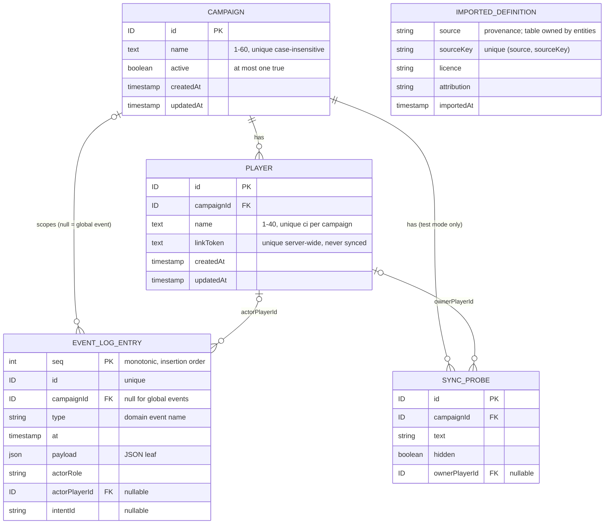

# Data model

Consolidated domain model. Entities and relationships, **not SQL**. **Living doc**: the integrator extends it after each build phase's specs reach `complete` ([process](../process.md#stages), [roadmap](../roadmap.md#build-order-mvp)). Don't edit from a feature worktree; it is a shared file ([AGENTS §9.9](../../AGENTS.md#99-shared-files)).

| Phase | Specs consolidated | Status |
|---|---|---|
| Foundation | [live-sync](../specs/live-sync.md), [campaign-management](../specs/campaign-management.md), [fixtures-adapters](../specs/fixtures-adapters.md) | done (2026-10-12); CON-01–04 resolved (#118) and built in the skeleton (`src/server/db/schema.ts`) |
| Scenes | assets-pipeline, entities, play-shell, scenes-map | > Later phase |
| Combat | character-sheet, dice-roll-log, notifications, combat-tracker | > Later phase |
| Reward | party-loot | > Later phase |

Every fact links its source. Protocol side (record types, intents, events): [protocol](../protocol/README.md).

## 1. Rules for every table

| Rule | Source |
|---|---|
| Relational SQLite. JSON columns only for document-shaped **leaf** data, zod-validated on read/write. No whole-campaign/scene blobs | [ADR-0006](../architecture/adr/0006-persistence.md) |
| Runtime/session state lives in the DB and survives a crash. In-memory state must not matter to play; caches rebuild from the DB | [ADR-0006](../architecture/adr/0006-persistence.md), [FR-SYNC-25](../specs/live-sync.md#6-functional-requirements) |
| Every record has a `campaignId`, except: `Campaign` itself, **imported definitions** (global), event-log entries of global events (`campaignId` null) | [ADR-0004](../architecture/adr/0004-tenancy-auth-permissions.md), [ADR-0018](../architecture/adr/0018-global-imported-content.md), [live-sync §8](../specs/live-sync.md#8-data-model) |
| Records in a campaign may point at a global definition or a custom of the **same** campaign, never another campaign's custom | [ADR-0018](../architecture/adr/0018-global-imported-content.md) |
| Every mutation is a server command: row change + event-log entry in **one transaction** (unless the spec marks the event non-logged) | [FR-CAMP-20](../specs/campaign-management.md#6-functional-requirements), [FR-SYNC-16](../specs/live-sync.md#6-functional-requirements), [ADR-0016](../architecture/adr/0016-domain-events-pending-actions.md) |
| IDs, tokens and timestamps come only from the command context (`ctx.ids`, `ctx.tokens`, `ctx.clock`). Seeded values have the same format as real ones | [ADR-0022](../architecture/adr/0022-deterministic-seams.md), [AGENTS §9.3](../../AGENTS.md#93-fixtures) |
| Time-ordered views: order by timestamp, then insertion order (event log: `seq`; other tables: row order). Never by ID or randomness | [ADR-0022](../architecture/adr/0022-deterministic-seams.md), CON-04 |
| Timestamps are ISO-8601 UTC strings from `ctx.clock` | skeleton |
| No per-record versions | [live-sync §8](../specs/live-sync.md#8-data-model) |

## 2. ER diagram (Foundation)

`IMPORTED_DEFINITION` is global (no campaign link). Only its provenance fields are Foundation facts; the table is owned by [entities](../specs/entities.md) (Scenes phase).

## 3. Persisted entities

### Campaign — owner [campaign-management](../specs/campaign-management.md#8-data-model)

| Field | Type | Rule | Source |
|---|---|---|---|
| id | ID | The scope itself; no `campaignId` | CAMP §8 |
| name | text | Trimmed, 1–60 chars, unique case-insensitive, control chars rejected | [FR-CAMP-06](../specs/campaign-management.md#6-functional-requirements), CAMP §11 |
| active | boolean | At most one `true`, DB-enforced (partial unique index). Survives restart | [FR-CAMP-08](../specs/campaign-management.md#6-functional-requirements), [ADR-0020](../architecture/adr/0020-single-active-campaign.md) |
| createdAt, updatedAt | timestamp | From `ctx.clock` | CAMP §8, [ADR-0022](../architecture/adr/0022-deterministic-seams.md) |

- Created while none is active → active, and the create also emits `CampaignActivated {previousCampaignId: null}` (CON-10); otherwise inactive ([FR-CAMP-06](../specs/campaign-management.md#6-functional-requirements)). Switch flips both flags in one transaction ([FR-CAMP-09](../specs/campaign-management.md#6-functional-requirements)).
- No delete or archive ([CAMP §4](../specs/campaign-management.md#4-non-goals)). No JSON leaves.

### Player — owner [campaign-management](../specs/campaign-management.md#8-data-model)

| Field | Type | Rule | Source |
|---|---|---|---|
| id | ID | Referenced by owned records (characters, tokens) | CAMP §8 |
| campaignId | ID → Campaign | Players are added to the active campaign only | [FR-CAMP-12](../specs/campaign-management.md#6-functional-requirements) |
| name | text | Trimmed, 1–40 chars, unique case-insensitive per campaign | FR-CAMP-12 |
| linkToken | text | 128 bits from `ctx.tokens`, base64url, unique server-wide. Plain text (DM re-copies). **Never** in a sync record, event or log entry. Unchanged on rename | [FR-CAMP-13](../specs/campaign-management.md#6-functional-requirements), [FR-CAMP-15](../specs/campaign-management.md#6-functional-requirements), [ADR-0019](../architecture/adr/0019-auth-credentials.md) |
| createdAt, updatedAt | timestamp | From `ctx.clock` | CAMP §8 |

- No player removal → no dangling owners ([CAMP §8](../specs/campaign-management.md#8-data-model)). No revocation/rotation ([ADR-0019](../architecture/adr/0019-auth-credentials.md)).

### Event log entry — owner [live-sync](../specs/live-sync.md#8-data-model)

| Field | Type | Rule | Source |
|---|---|---|---|
| seq | integer | Monotonic insertion order (autoincrement); the time-order tiebreak | CON-04, [ADR-0022](../architecture/adr/0022-deterministic-seams.md) |
| id | ID | From `ctx.ids`; unique | SYNC §8 |
| campaignId | ID \| null | Null for global events (imported definitions) | SYNC §8, [FR-FIX-23](../specs/fixtures-adapters.md#6-functional-requirements) |
| type | string | Domain event name | SYNC §8 |
| at | timestamp | From `ctx.clock` | SYNC §8 |
| payload | JSON leaf | Domain event payload | SYNC §8 |
| actorRole, actorPlayerId | `dm` \| `player` \| `system`, ID \| null | Who caused it (fixture loads: `dm`) | SYNC §8 |
| intentId | string | WS intent that caused it (REST and loader calls have none: [FR-SYNC-15](../specs/live-sync.md#6-functional-requirements), [FR-FIX-13](../specs/fixtures-adapters.md#6-functional-requirements)) | SYNC §8 |

- **Append-only**. Appended in the commit's transaction; rollback → no entry ([FR-SYNC-16](../specs/live-sync.md#6-functional-requirements)). Never holds the DM secret or a link token ([FR-CAMP-03](../specs/campaign-management.md#6-functional-requirements), CAMP §8).
- Not every domain event is logged: token moves are not ([ADR-0016](../architecture/adr/0016-domain-events-pending-actions.md)); others only if their spec says so.
- > Later phase (Combat, [combat-tracker](../specs/combat-tracker.md)): undo fields (compensating event, `undone` marker) per [ADR-0016](../architecture/adr/0016-domain-events-pending-actions.md). Don't add them in the skeleton.

### Sync probe — owner [live-sync](../specs/live-sync.md#8-data-model), test mode only

| Field | Type | Rule | Source |
|---|---|---|---|
| id, campaignId | ID, ID → Campaign | | SYNC §8 |
| text | string | | SYNC §8 |
| hidden | boolean | Visibility flag | SYNC §8 |
| ownerPlayerId | ID → Player \| null | Must be a player of `ctx.campaignId` | SYNC §8, [§9](../specs/live-sync.md#9-api--events) |

- Exists only with `PP_TEST_MODE=1` ([FR-SYNC-27](../specs/live-sync.md#6-functional-requirements), [AGENTS §9.2](../../AGENTS.md#92-env-ports-and-data)).

### Imported definition (provenance only) — fields from [fixtures-adapters](../specs/fixtures-adapters.md#8-data-model), table owned by [entities](../specs/entities.md)

| Field | Type | Rule | Source |
|---|---|---|---|
| source, sourceKey | string | Unique `(source, sourceKey)` globally. `source` null = custom | [FR-FIX-20](../specs/fixtures-adapters.md#6-functional-requirements), FIX §8 |
| licence, attribution | string | | [FR-FIX-21](../specs/fixtures-adapters.md#6-functional-requirements) |
| importedAt | timestamp | `ctx.clock` | FR-FIX-21 |

- Global, no campaign; read-only. Derived `readOnly = source != null` ([FIX §8](../specs/fixtures-adapters.md#8-data-model), [ADR-0018](../architecture/adr/0018-global-imported-content.md)). Existing key → `existing`, nothing written ([FR-FIX-20](../specs/fixtures-adapters.md#6-functional-requirements)).
- **No definition table in the skeleton** (CON-03): the pipeline core writes through a definition-store interface + kind registry (`ImportRegistry`); the skeleton tests it with a test-only kind. Entities adds the table, kinds and definition event in Scenes.
- > Later phase (Scenes, [entities](../specs/entities.md)): table name, definition fields, per-kind stat-block JSON ([ADR-0009](../architecture/adr/0009-entity-content-model.md) option A), custom definitions per campaign, inline vs separate provenance ([OQ-FIX-15](../specs/fixtures-adapters.md#15-open-questions), pick inline).

## 4. Constraints the DB enforces

| Constraint | Source |
|---|---|
| `Campaign.active`: at most one `true` (partial unique index) | [FR-CAMP-08](../specs/campaign-management.md#6-functional-requirements) |
| `Campaign.name` unique, case-insensitive (unique index on `lower(name)`; commands also compare Unicode-folded names) | [FR-CAMP-06](../specs/campaign-management.md#6-functional-requirements), CAMP §11 (racing creates → one error) |
| `(Player.campaignId, Player.name)` unique, case-insensitive | [FR-CAMP-12](../specs/campaign-management.md#6-functional-requirements) |
| `Player.linkToken` unique server-wide | [FR-CAMP-13](../specs/campaign-management.md#6-functional-requirements) |
| Definition `(source, sourceKey)` unique globally | [FR-FIX-20](../specs/fixtures-adapters.md#6-functional-requirements) |

## 5. Not in the DB

| Thing | Where | Fields | Source |
|---|---|---|---|
| DM secret | env `PP_DM_SECRET` only; never stored, logged or sent | ≥ 12 chars | [FR-CAMP-01/03](../specs/campaign-management.md#6-functional-requirements), [ADR-0019](../architecture/adr/0019-auth-credentials.md) |
| Connection | server memory | connId, campaignId, role `dm`\|`player`, playerId \| null (immutable); phase `awaiting-hello`\|`snapshotting`\|`live`, seq, lastInboundAt | [SYNC §8](../specs/live-sync.md#8-data-model) |
| Presence | server memory, derived from live connections | id (= playerId), playerId, campaignId, online | SYNC §8, [FR-SYNC-23](../specs/live-sync.md#6-functional-requirements), CON-07 |
| DM login throttle counter | server memory, cleared on restart | — | [FR-CAMP-05](../specs/campaign-management.md#6-functional-requirements) *(proposed)* |
| Active campaign / active scene id | cache, rebuilt at boot | — | SYNC §8 |
| Load manifest | `$PP_DATA_DIR/load-manifest.json` (written atomically) | bundle, fixtures, status `resetting`\|`empty`\|`loading`\|`complete`, records (fixture key → record type → IDs), dmUrl, playerLinks `{player, campaign, url}[]`, startedAt, durationMs. **No DM secret** | [FIX §8](../specs/fixtures-adapters.md#8-data-model), [FR-FIX-09](../specs/fixtures-adapters.md#6-functional-requirements), [FR-FIX-28](../specs/fixtures-adapters.md#6-functional-requirements) |
| Data-dir lock | `$PP_DATA_DIR/server.lock` (JSON, created exclusively) | owner `server`\|`loader`, pid, port (server only, written once bound), startedAt | FIX §8, [FR-FIX-27](../specs/fixtures-adapters.md#6-functional-requirements), [AGENTS §9.2](../../AGENTS.md#92-env-ports-and-data) |
| Fixture, bundle, import batch, registrations | code | See [FIX §8](../specs/fixtures-adapters.md#8-data-model); registrations: [protocol §5](../protocol/README.md#5-record-type-registry) | FIX §8, SYNC §8 |

## 6. Derived values

| Value | From | Source |
|---|---|---|
| Player link URL | public base URL + `/p/` + `linkToken` (path *proposed*, [OQ-CAMP-15](../specs/campaign-management.md#15-open-questions)); base from `PP_PUBLIC_BASE_URL`, unset → DM client's origin + warning (pick, [OQ-CAMP-07](../specs/campaign-management.md#15-open-questions)) | [CAMP §8](../specs/campaign-management.md#8-data-model), [FR-CAMP-14](../specs/campaign-management.md#6-functional-requirements) |
| Player online state | presence | CAMP §8, [FR-SYNC-23](../specs/live-sync.md#6-functional-requirements) |
| Definition `readOnly` | `source != null` | [FIX §8](../specs/fixtures-adapters.md#8-data-model) |
| Each connection's visible view | records through the type's visibility fn | [SYNC §8](../specs/live-sync.md#8-data-model) |

## 7. Visibility-relevant fields

What each visibility fn reads (record + connection context only, [ADR-0021](../architecture/adr/0021-sync-protocol-conventions.md)). Full rules: [protocol §5](../protocol/README.md#5-record-type-registry).

| Record | Fields the filter reads | Never leaves the server |
|---|---|---|
| Campaign | `id` vs `ctx.campaignId` | — |
| Player | `campaignId` vs `ctx.campaignId` | `linkToken` (no field in the record type) |
| Sync probe | `hidden`, `ownerPlayerId` vs `ctx.playerId` | — |
| Presence | (DM only: `audience: dm`) | — |

> Later phase: Scenes (asset, derivative, definition, scene, token, active scene), Combat (character, encounter, combatant, roll / game log, notification, undo fields), Reward (party loot). Add rows here when their specs are `complete`.

## 8. Conflicts log

Found at Foundation consolidation; resolved by the integrator ([decisions-log](../decisions-log.md) #118) and folded into the sections above. Protocol conflicts CON-05–17: [protocol §11](../protocol/README.md#11-conflicts-log).

| ID | Topic | Resolution | Now in |
|---|---|---|---|
| CON-01 | Campaign scoping vs global definitions | Every record has a campaign except imported definitions (ADR-0018); glossary wording is the integrator's | §1 |
| CON-02 | Event log `campaignId` | Null for global events | §3 Event log entry |
| CON-03 | Definition table | Pipeline core against a test-only kind behind an insert interface; entities adds the table in Scenes | §3 Imported definition |
| CON-04 | Event log ordering | Monotonic integer `seq` column (insertion order) | §1, §2, §3 Event log entry |