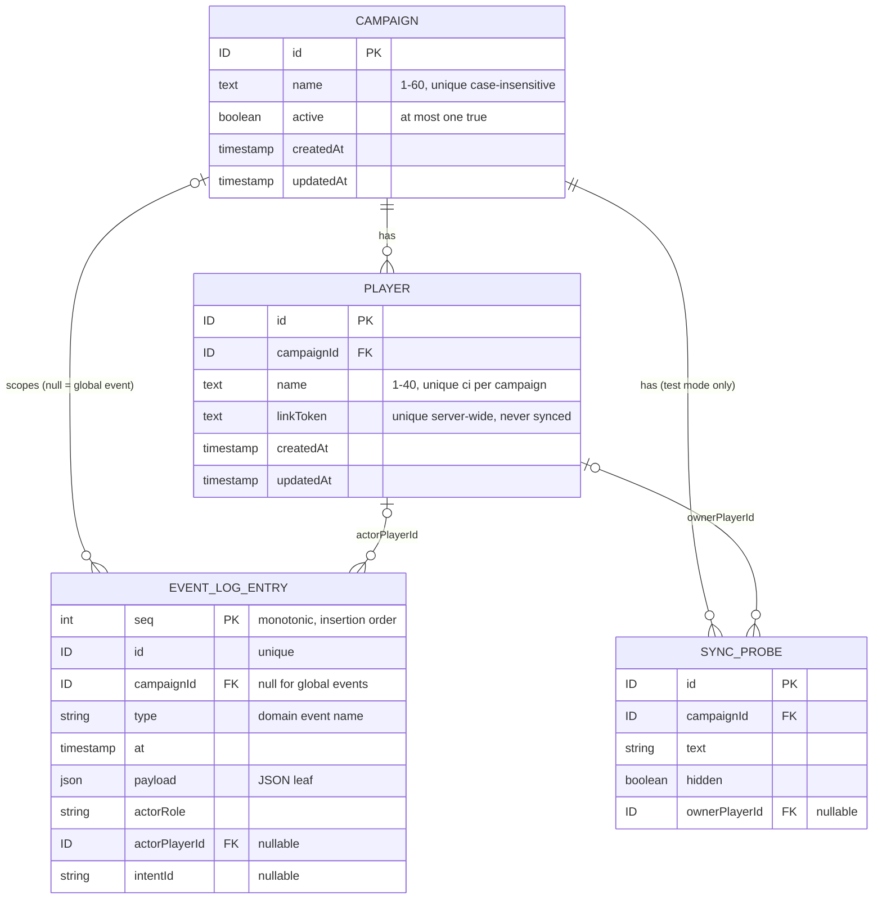
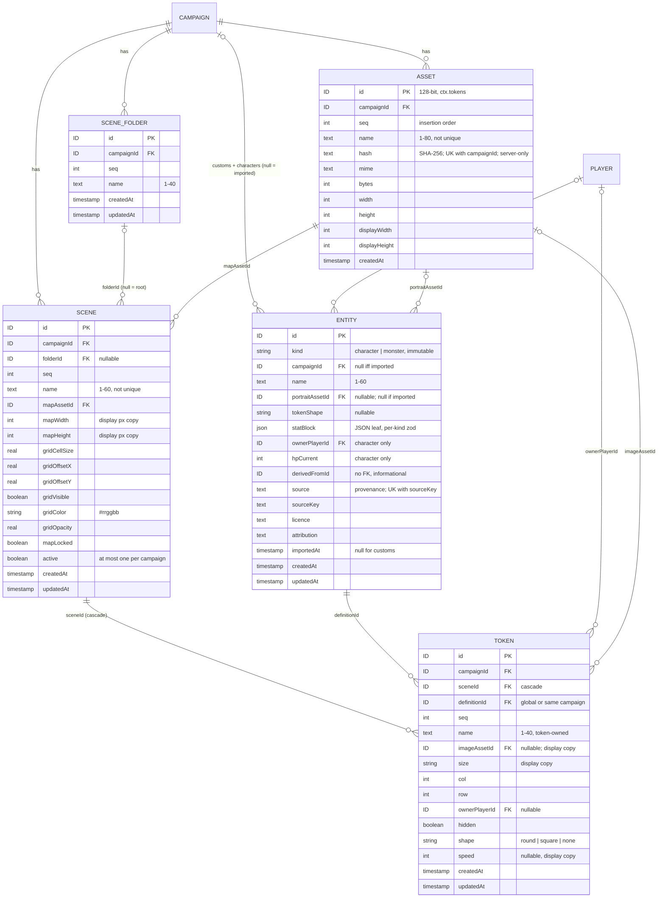

# Data model

Consolidated domain model. Entities and relationships, **not SQL**. **Living doc**: the integrator extends it after each build phase's specs reach `complete` ([process](../process.md#stages), [roadmap](../roadmap.md#build-order-mvp)). Don't edit from a feature worktree; it is a shared file ([AGENTS §9.9](../../AGENTS.md#99-shared-files)).

| Phase | Specs consolidated | Status |
|---|---|---|
| Foundation | [live-sync](../specs/live-sync.md), [campaign-management](../specs/campaign-management.md), [fixtures-adapters](../specs/fixtures-adapters.md) | done (2026-10-12); CON-01–04 resolved (#118) and built in the skeleton (`src/server/db/schema.ts`) |
| Scenes | assets-pipeline, entities, play-shell, scenes-map | consolidated (2026-10-12): [§9–§13](#9-scenes-er-diagram); CON-18–21 resolved (fix/scenes-core) |
| Combat | character-sheet, dice-roll-log, notifications, combat-tracker | consolidated (2026-10-12, #142): [§14–§18](#14-combat-er-diagram); CON-34–37 resolved; all Combat tables built as shared definitions in `src/server/db/schema.ts` (fix/combat-core) |
| Reward | [party-loot](../specs/party-loot.md) | built (build/party-loot): [§19](#19-reward-loot-entry-party-pot-wallet) |

Every fact links its source. Protocol side (record types, intents, events): [protocol](../protocol/README.md).

## 1. Rules for every table

| Rule | Source |
|---|---|
| Relational SQLite. JSON columns only for document-shaped **leaf** data, zod-validated on read/write. No whole-campaign/scene blobs | [ADR-0006](../architecture/adr/0006-persistence.md) |
| Runtime/session state lives in the DB and survives a crash. In-memory state must not matter to play; caches rebuild from the DB | [ADR-0006](../architecture/adr/0006-persistence.md), [FR-SYNC-25](../specs/live-sync.md#6-functional-requirements) |
| Every record has a `campaignId`, except: `Campaign` itself, **imported definitions** (global), event-log entries of global events (`campaignId` null) | [ADR-0004](../architecture/adr/0004-tenancy-auth-permissions.md), [ADR-0018](../architecture/adr/0018-global-imported-content.md), [live-sync §8](../specs/live-sync.md#8-data-model) |
| Records in a campaign may point at a global definition or a custom of the **same** campaign, never another campaign's custom | [ADR-0018](../architecture/adr/0018-global-imported-content.md) |
| Every mutation is a server command: row change + event-log entry in **one transaction** (unless the spec marks the event non-logged) | [FR-CAMP-20](../specs/campaign-management.md#6-functional-requirements), [FR-SYNC-16](../specs/live-sync.md#6-functional-requirements), [ADR-0016](../architecture/adr/0016-domain-events-pending-actions.md) |
| IDs, tokens, timestamps and dice come only from the command context (`ctx.ids`, `ctx.tokens`, `ctx.clock`, `ctx.dice`). Seeded values have the same format as real ones (CON-36) | [ADR-0022](../architecture/adr/0022-deterministic-seams.md), [FR-DICE-03](../specs/dice-roll-log.md#6-functional-requirements), [AGENTS §9.3](../../AGENTS.md#93-fixtures) |
| Time-ordered views: order by timestamp, then insertion order (event log: `seq`; other tables: row order). Never by ID or randomness | [ADR-0022](../architecture/adr/0022-deterministic-seams.md), CON-04 |
| Timestamps are ISO-8601 UTC strings from `ctx.clock` | skeleton |
| No per-record versions | [live-sync §8](../specs/live-sync.md#8-data-model) |

## 2. ER diagram (Foundation)

Imported definitions are rows of the Scenes `entity` table with `campaignId` null and inline provenance: [§9](#9-scenes-er-diagram), [§11](#11-scenes-entity) (CON-18).

## 3. Persisted entities

### Campaign — owner [campaign-management](../specs/campaign-management.md#8-data-model)

| Field | Type | Rule | Source |
|---|---|---|---|
| id | ID | The scope itself; no `campaignId` | CAMP §8 |
| name | text | Trimmed, 1–60 chars, unique case-insensitive, control chars rejected | [FR-CAMP-06](../specs/campaign-management.md#6-functional-requirements), CAMP §11 |
| active | boolean | At most one `true`, DB-enforced (partial unique index). Survives restart | [FR-CAMP-08](../specs/campaign-management.md#6-functional-requirements), [ADR-0020](../architecture/adr/0020-single-active-campaign.md) |
| createdAt, updatedAt | timestamp | From `ctx.clock` | CAMP §8, [ADR-0022](../architecture/adr/0022-deterministic-seams.md) |

- Created while none is active → active, and the create also emits `CampaignActivated {previousCampaignId: null}` (CON-10); otherwise inactive ([FR-CAMP-06](../specs/campaign-management.md#6-functional-requirements)). Switch flips both flags in one transaction ([FR-CAMP-09](../specs/campaign-management.md#6-functional-requirements)).
- No delete or archive ([CAMP §4](../specs/campaign-management.md#4-non-goals)). No JSON leaves.

### Player — owner [campaign-management](../specs/campaign-management.md#8-data-model)

| Field | Type | Rule | Source |
|---|---|---|---|
| id | ID | Referenced by owned records (characters, tokens) | CAMP §8 |
| campaignId | ID → Campaign | Players are added to the active campaign only | [FR-CAMP-12](../specs/campaign-management.md#6-functional-requirements) |
| name | text | Trimmed, 1–40 chars, unique case-insensitive per campaign | FR-CAMP-12 |
| linkToken | text | 128 bits from `ctx.tokens`, base64url, unique server-wide. Plain text (DM re-copies). **Never** in a sync record, event or log entry. Unchanged on rename | [FR-CAMP-13](../specs/campaign-management.md#6-functional-requirements), [FR-CAMP-15](../specs/campaign-management.md#6-functional-requirements), [ADR-0019](../architecture/adr/0019-auth-credentials.md) |
| createdAt, updatedAt | timestamp | From `ctx.clock` | CAMP §8 |

- No player removal → no dangling owners ([CAMP §8](../specs/campaign-management.md#8-data-model)). No revocation/rotation ([ADR-0019](../architecture/adr/0019-auth-credentials.md)).

### Event log entry — owner [live-sync](../specs/live-sync.md#8-data-model)

| Field | Type | Rule | Source |
|---|---|---|---|
| seq | integer | Monotonic insertion order (autoincrement); the time-order tiebreak | CON-04, [ADR-0022](../architecture/adr/0022-deterministic-seams.md) |
| id | ID | From `ctx.ids`; unique | SYNC §8 |
| campaignId | ID \| null | Null for global events (imported definitions) | SYNC §8, [FR-FIX-23](../specs/fixtures-adapters.md#6-functional-requirements) |
| type | string | Domain event name | SYNC §8 |
| at | timestamp | From `ctx.clock` | SYNC §8 |
| payload | JSON leaf | Domain event payload | SYNC §8 |
| actorRole, actorPlayerId | `dm` \| `player` \| `system`, ID \| null | Who caused it (fixture loads: `dm`) | SYNC §8 |
| intentId | string | WS intent that caused it (REST and loader calls have none: [FR-SYNC-15](../specs/live-sync.md#6-functional-requirements), [FR-FIX-13](../specs/fixtures-adapters.md#6-functional-requirements)) | SYNC §8 |

- **Append-only**. Appended in the commit's transaction; rollback → no entry ([FR-SYNC-16](../specs/live-sync.md#6-functional-requirements)). Never holds the DM secret or a link token ([FR-CAMP-03](../specs/campaign-management.md#6-functional-requirements), CAMP §8).
- Not every domain event is logged: token moves are not ([ADR-0016](../architecture/adr/0016-domain-events-pending-actions.md)); others only if their spec says so.
- Undo (CON-34): the marker lives on combat's own `hp_change` table (`undone`, `undoneAt`; the combat log entry, [§17](#17-combat-encounter-combatant-combat-log-entry)) plus the compensating event `CombatEntryUndone`, per [ADR-0016](../architecture/adr/0016-domain-events-pending-actions.md). The event log has no undo fields.

### Sync probe — owner [live-sync](../specs/live-sync.md#8-data-model), test mode only

| Field | Type | Rule | Source |
|---|---|---|---|
| id, campaignId | ID, ID → Campaign | | SYNC §8 |
| text | string | | SYNC §8 |
| hidden | boolean | Visibility flag | SYNC §8 |
| ownerPlayerId | ID → Player \| null | Must be a player of `ctx.campaignId` | SYNC §8, [§9](../specs/live-sync.md#9-api--events) |

- Exists only with `PP_TEST_MODE=1` ([FR-SYNC-27](../specs/live-sync.md#6-functional-requirements), [AGENTS §9.2](../../AGENTS.md#92-env-ports-and-data)).

### DB meta — infrastructure (#163), not a record type

| Field | Type | Rule | Source |
|---|---|---|---|
| key | text PK | `db-id` only | #163 |
| value | text | `db-id`: random UUID, created on first read (`dbId(db)`, `src/server/db/meta.ts`); the asset-dir marker | #163 |

- Not campaign data: no `campaignId`, no event log, never sent.

### Imported definition — see [§11 Entity](#11-scenes-entity)

- One `entity` table holds imported, custom and character definitions; imported rows have `campaignId` null and inline provenance (`source, sourceKey, licence, attribution, importedAt`), read-only (CON-18, [OQ-FIX-15](../specs/fixtures-adapters.md#15-open-questions)). Existing `(source, sourceKey)` → `existing`, nothing written ([FR-FIX-20](../specs/fixtures-adapters.md#6-functional-requirements)).
- The skeleton's pipeline core writes through a definition-store interface + kind registry (`ImportRegistry`), tested with a test-only kind (CON-03); entities plugs the table in.

## 4. Constraints the DB enforces

| Constraint | Source |
|---|---|
| `Campaign.active`: at most one `true` (partial unique index) | [FR-CAMP-08](../specs/campaign-management.md#6-functional-requirements) |
| `Campaign.name` unique, case-insensitive (unique index on `lower(name)`; commands also compare Unicode-folded names) | [FR-CAMP-06](../specs/campaign-management.md#6-functional-requirements), CAMP §11 (racing creates → one error) |
| `(Player.campaignId, Player.name)` unique, case-insensitive | [FR-CAMP-12](../specs/campaign-management.md#6-functional-requirements) |
| `Player.linkToken` unique server-wide | [FR-CAMP-13](../specs/campaign-management.md#6-functional-requirements) |
| Definition `(source, sourceKey)` unique globally: `Entity` constraint, [§13](#13-scenes-constraints-not-in-db-derived-visibility-fields) (CON-18) | [FR-FIX-20](../specs/fixtures-adapters.md#6-functional-requirements) |

## 5. Not in the DB

| Thing | Where | Fields | Source |
|---|---|---|---|
| DM secret | env `PP_DM_SECRET` only; never stored, logged or sent | ≥ 12 chars | [FR-CAMP-01/03](../specs/campaign-management.md#6-functional-requirements), [ADR-0019](../architecture/adr/0019-auth-credentials.md) |
| Connection | server memory | connId, campaignId, role `dm`\|`player`, playerId \| null (immutable); phase `awaiting-hello`\|`snapshotting`\|`live`, seq, lastInboundAt | [SYNC §8](../specs/live-sync.md#8-data-model) |
| Presence | server memory, derived from live connections | id (= playerId), playerId, campaignId, online | SYNC §8, [FR-SYNC-23](../specs/live-sync.md#6-functional-requirements), CON-07 |
| DM login throttle counter | server memory, cleared on restart | — | [FR-CAMP-05](../specs/campaign-management.md#6-functional-requirements) *(proposed)* |
| Active campaign / active scene id | cache, rebuilt at boot | — | SYNC §8 |
| Load manifest | `$PP_DATA_DIR/load-manifest.json` (written atomically) | bundle, fixtures, status `resetting`\|`empty`\|`loading`\|`complete`, records (fixture key → record type → IDs), dmUrl, playerLinks `{player, campaign, url}[]`, startedAt, durationMs. **No DM secret** | [FIX §8](../specs/fixtures-adapters.md#8-data-model), [FR-FIX-09](../specs/fixtures-adapters.md#6-functional-requirements), [FR-FIX-28](../specs/fixtures-adapters.md#6-functional-requirements) |
| Data-dir lock | `$PP_DATA_DIR/server.lock` (JSON, created exclusively) | owner `server`\|`loader`, pid, port (server only, written once bound), startedAt | FIX §8, [FR-FIX-27](../specs/fixtures-adapters.md#6-functional-requirements), [AGENTS §9.2](../../AGENTS.md#92-env-ports-and-data) |
| Fixture, bundle, import batch, registrations | code | See [FIX §8](../specs/fixtures-adapters.md#8-data-model); registrations: [protocol §5](../protocol/README.md#5-record-type-registry) | FIX §8, SYNC §8 |

## 6. Derived values

| Value | From | Source |
|---|---|---|
| Player link URL | public base URL + `/p/` + `linkToken` (path *proposed*, [OQ-CAMP-15](../specs/campaign-management.md#15-open-questions)); base from `PP_PUBLIC_BASE_URL`, unset → DM client's origin + warning (pick, [OQ-CAMP-07](../specs/campaign-management.md#15-open-questions)) | [CAMP §8](../specs/campaign-management.md#8-data-model), [FR-CAMP-14](../specs/campaign-management.md#6-functional-requirements) |
| Player online state | presence | CAMP §8, [FR-SYNC-23](../specs/live-sync.md#6-functional-requirements) |
| Definition `readOnly` | `source != null`: Entity `readOnly`, [§13](#13-scenes-constraints-not-in-db-derived-visibility-fields) (CON-18) | [FIX §8](../specs/fixtures-adapters.md#8-data-model) |
| Each connection's visible view | records through the type's visibility fn | [SYNC §8](../specs/live-sync.md#8-data-model) |

## 7. Visibility-relevant fields

What each visibility fn reads (record + connection context only, [ADR-0021](../architecture/adr/0021-sync-protocol-conventions.md)). Full rules: [protocol §5](../protocol/README.md#5-record-type-registry).

| Record | Fields the filter reads | Never leaves the server |
|---|---|---|
| Campaign | `id` vs `ctx.campaignId` | — |
| Player | `campaignId` vs `ctx.campaignId` | `linkToken` (no field in the record type) |
| Sync probe | `hidden`, `ownerPlayerId` vs `ctx.playerId` | — |
| Presence | (DM only: `audience: dm`) | — |

Scenes: [§13](#13-scenes-constraints-not-in-db-derived-visibility-fields). Combat: [§18](#18-combat-constraints-not-in-db-derived-visibility-fields) (CON-37). Reward: [§19](#19-reward-loot-entry-party-pot-wallet).

## 8. Conflicts log

Found at Foundation consolidation; resolved by the integrator ([decisions-log](../decisions-log.md) #118) and folded into the sections above. Protocol conflicts CON-05–17: [protocol §11](../protocol/README.md#11-conflicts-log).

| ID | Topic | Resolution | Now in |
|---|---|---|---|
| CON-01 | Campaign scoping vs global definitions | Every record has a campaign except imported definitions (ADR-0018); glossary wording is the integrator's | §1 |
| CON-02 | Event log `campaignId` | Null for global events | §3 Event log entry |
| CON-03 | Definition table | Pipeline core against a test-only kind behind an insert interface; entities adds the table in Scenes | §3 Imported definition, §11 |
| CON-04 | Event log ordering | Monotonic integer `seq` column (insertion order) | §1, §2, §3 Event log entry |

Scenes consolidation (CON-18+, integrator):

| ID | Entity / field | Specs in conflict | Suggested fix | Resolution |
|---|---|---|---|---|
| CON-18 | Imported definition table (§2 ER `IMPORTED_DEFINITION`, §3 "Imported definition", §4 last row, §6 `readOnly`) | This doc lines 68–77, 132–141 model a separate global table; [entities](../specs/entities.md) lines 13, 72–81 use **one** `entity` table, imported rows = `campaignId` null, provenance inline (OQ-FIX-15 pick) | Replace the Foundation `IMPORTED_DEFINITION` block and §3 subsection with a pointer to [§11](#11-scenes-entity) (edit after the skeleton merge; not edited here) | resolved (fix/scenes-core): §2, §3, §4, §6 point to §11 / §13 |
| CON-19 | Asset `id` source vs §9.3 seam table | [assets-pipeline](../specs/assets-pipeline.md) line 49 and [ADR-0023](../architecture/adr/0023-asset-access-by-capability-id.md) line 30: asset ID from `ctx.tokens`; [AGENTS §9.3](../../AGENTS.md#93-fixtures) seam table: `ctx.ids` = record IDs, `ctx.tokens` = "secret tokens (player links)" | AGENTS §9.3 `ctx.tokens` row: "secret tokens (player links) and asset IDs (ADR-0023)". Builders: asset IDs from `ctx.tokens` now | resolved (fix/scenes-core): AGENTS §9.3 row amended |
| CON-20 | `seq` columns "from `ctx`" | [scenes-map](../specs/scenes-map.md) line 67 (FR-MAP-27: "IDs, `seq` and time only from `ctx`") and line 80; [assets-pipeline](../specs/assets-pipeline.md) line 49. `ctx` has no seq seam ([AGENTS §9.3](../../AGENTS.md#93-fixtures): ids, tokens, clock) | Same rule as event-log `seq` (CON-04): `seq` = monotonic integer assigned by the DB at insert (insertion order); deterministic because fixture steps run in order. Amend FR-MAP-27 wording to "IDs and time from `ctx`; `seq` by the DB" | resolved (fix/scenes-core): FR-MAP-27, MAP §8, FR-ASSET-08 amended |
| CON-21 | Campaign for DM REST creates | [entities](../specs/entities.md) line 43 (FR-ENT-04: "active campaign **at commit**") vs [assets-pipeline](../specs/assets-pipeline.md) line 50 (FR-ASSET-09: "resolved when the request is authenticated") and [scenes-map](../specs/scenes-map.md) line 94 ("fixed at authentication"); FR-ENT-04 says "as FR-ASSET-09" | FR-ENT-04: "`ctx.campaignId` resolved at request authentication (as FR-ASSET-09); none → `conflict`". One rule in the REST middleware | resolved (fix/scenes-core): FR-ENT-04 amended (middleware rule: first Scenes REST builder) |

Combat consolidation (CON-34+, integrator). Applied by fix/combat-core after `build/entities` merged; line numbers as on `main` @ c579ac1. Protocol side: [protocol §11](../protocol/README.md#11-conflicts-log) (CON-38+).

| ID | Entity / field | Specs in conflict | Suggested fix | Resolution |
|---|---|---|---|---|
| CON-34 | Undo fields (§3 Event log entry, line 115) | This doc plans undo fields (compensating event, `undone` marker) on the event log; [combat-tracker §8](../specs/combat-tracker.md#8-data-model) puts the marker on its own `hp_change` table (gate I9, [§17](#17-combat-encounter-combatant-combat-log-entry)) | Line 115 → "undo marker on combat's own `hp_change` table (`undone`, `undoneAt`; the combat log entry) plus compensating event `CombatEntryUndone`, per [ADR-0016](../architecture/adr/0016-domain-events-pending-actions.md)". The event log stays as is | resolved (fix/combat-core): §3 Event log entry |
| CON-35 | `resolveDefinition(ctx, id)` (§11, line 339) | [entities](../specs/entities.md) FR-ENT-12 now `resolveDefinition(env, id)`, campaign = `env.actor.campaignId` (gate I14; code: `CommandContext` has no `campaignId`, `CommandEnv.actor` does) | Line 339 → `resolveDefinition(env, id)`. Builders: helpers take `env: CommandEnv` | resolved (fix/combat-core): §11 |
| CON-36 | Seam rule (§1, line 23) | §1 lists `ctx.ids`, `ctx.tokens`, `ctx.clock` only; #137 adds `ctx.dice` ([FR-DICE-03](../specs/dice-roll-log.md#6-functional-requirements), [AGENTS §9.3](../../AGENTS.md#93-fixtures)) | Line 23 → "IDs, tokens, timestamps and dice come only from the command context (`ctx.ids`, `ctx.tokens`, `ctx.clock`, `ctx.dice`)…" | resolved (fix/combat-core): §1; seam built in `src/server/commands/context.ts` |
| CON-37 | Stale pointers | Line 9 phase table ("Combat: > Later phase"); §7 line 176 "Later phase" note; §12 line 391 ("Combatant → token FK … Combat phase"); §11 `hpCurrent` row (line 333) names only entities' writers; §13 line 415 code registries lack the token-changed hooks ([ADR-0028](../architecture/adr/0028-token-changed-hooks.md)) | Line 9 → done (at merge); line 176 → pointer to [§18](#18-combat-constraints-not-in-db-derived-visibility-fields); line 391 → pointer to [§17](#17-combat-encounter-combatant-combat-log-entry); line 333 + "and `characters.adjustHp` ([FR-CHAR-13](../specs/character-sheet.md#6-functional-requirements))"; line 415 + "token-changed hooks (FR-MAP-30)" | resolved (fix/combat-core): phase table, §7, §11, §12, §13 |

## 9. Scenes: ER diagram

Consolidated 2026-10-12 from the `complete` specs [assets-pipeline](../specs/assets-pipeline.md) (ASSET), [entities](../specs/entities.md) (ENT), [play-shell](../specs/play-shell.md) (SHELL), [scenes-map](../specs/scenes-map.md) (MAP). Foundation sections above amended per CON-18 (fix/scenes-core); phase table flips at merge. Protocol side: [protocol §12–§19](../protocol/README.md#12-scenes-record-types).

- Play-shell adds **no** table, record type or migration: the layout lives in browser `localStorage` ([SHELL §8](../specs/play-shell.md#8-data-model), [ADR-0025](../architecture/adr/0025-play-shell-windows.md), #121).
- `seq` columns: insertion order, tiebreak for time-ordered and name-ordered views ([ADR-0022](../architecture/adr/0022-deterministic-seams.md)); source: [CON-20](#8-conflicts-log).

## 10. Scenes: asset

### Asset — owner [assets-pipeline](../specs/assets-pipeline.md#8-data-model)

| Field | Type | Rule | Source |
|---|---|---|---|
| id | ID | 128 bits from **`ctx.tokens`**, base64url; it is the capability | [FR-ASSET-08](../specs/assets-pipeline.md#6-functional-requirements), [ADR-0023](../architecture/adr/0023-asset-access-by-capability-id.md), [CON-19](#8-conflicts-log) |
| campaignId | ID → Campaign | `ctx.campaignId` at request authentication | [FR-ASSET-09](../specs/assets-pipeline.md#6-functional-requirements) |
| seq | int | Insertion order; picker tiebreak (`createdAt` desc, then `seq` desc). Assigned by the DB inside the insert: `(select coalesce(max(seq), 0) + 1 from asset)` (`assetSeqNext` in `schema.ts`); unique index `asset_seq`. Text `id` PK, so no autoincrement | FR-ASSET-08, [FR-ASSET-10](../specs/assets-pipeline.md#6-functional-requirements), [CON-20](#8-conflicts-log) |
| name | text | Given `name` or filename minus extension; trimmed, control chars removed, 1–80; not unique; second upload's name ignored | FR-ASSET-08, [FR-ASSET-03](../specs/assets-pipeline.md#6-functional-requirements) |
| hash | text | SHA-256 hex of the stored original. Unique `(campaignId, hash)`. **Server-only**: not in the `asset` record | FR-ASSET-03, ASSET §8 |
| mime, bytes, width, height | text, int ×3 | Stored original (SVG stored as PNG) | [FR-ASSET-02](../specs/assets-pipeline.md#6-functional-requirements), ASSET §8 |
| displayWidth, displayHeight | int ×2 | `display` derivative size; grid calibration space | [FR-ASSET-05](../specs/assets-pipeline.md#6-functional-requirements), [OQ-ASSET-07](../specs/assets-pipeline.md#15-open-questions) |
| createdAt | timestamp | `ctx.clock` | FR-ASSET-08 |

- **Files (disk, not records):** `PP_ASSET_DIR/<hash>/{original, display.webp, thumb.webp}`, one set per hash, shared by every campaign's row with that hash. Temp dir + rename; existing hash dir reused ([FR-ASSET-04](../specs/assets-pipeline.md#6-functional-requirements); layout *proposed*). `thumb` ≤ 512 px, `display` ≤ 4096 px, WebP, never upscaled (FR-ASSET-05).
- **Write order:** image processing (sniff, rasterise, derivatives) runs async with no disk writes; then the synchronous `assets.ingest` command writes the files (`PP_ASSET_DIR/.tmp/<hash>` → rename to `<hash>`, retried on transient Windows locks) and the row + event-log entry in one transaction ([FR-ASSET-06](../specs/assets-pipeline.md#6-functional-requirements)). Server start (`r.onStart`, [protocol §19](../protocol/README.md#19-scenes-build-notes)): delete `.tmp` and every 64-hex dir no row references (other files untouched); missing files → error log (hash, never the ID), 404 ([FR-ASSET-07](../specs/assets-pipeline.md#6-functional-requirements)). **Durability (#163):** each file is fsynced, then the hash dir and the asset dir, before the row insert (SQLite runs `synchronous = FULL`). The asset dir holds `.pocket-plane-db` = the DB's `db_meta.db-id` (written at the first sweep); a different id → the sweep is skipped with an error (two DBs sharing one `PP_ASSET_DIR` never delete each other's files). A re-upload whose hash dir is incomplete rewrites the files and answers `existing`.
- **Indexes:** unique `asset_campaign_hash (campaign_id, hash)`, unique `asset_seq (seq)`, `asset_campaign (campaign_id)`.
- No delete, rename, replace or revoke in MVP ([OQ-ASSET-05](../specs/assets-pipeline.md#15-open-questions)). No JSON leaves.
- **Asset references** (fields holding an asset ID): `Scene.mapAssetId`, `Token.imageAssetId`, `Entity.portraitAssetId`. Set only via `assets.require(ctx, id)` → same campaign or `not_found`, including propagated copies in the same transaction ([FR-ASSET-15](../specs/assets-pipeline.md#6-functional-requirements)). Imported definitions carry no asset in MVP.

## 11. Scenes: entity

### Entity — owner [entities](../specs/entities.md#8-data-model)

One table for imported, custom and character definitions ([ADR-0009](../architecture/adr/0009-entity-content-model.md) storage A, #124). Supersedes the Foundation "Imported definition" block ([CON-18](#8-conflicts-log)).

| Field | Type | Rule | Source |
|---|---|---|---|
| id | ID | `ctx.ids` | [FR-ENT-17](../specs/entities.md#6-functional-requirements) |
| kind | `character` \| `monster` | Immutable; kind registry in `@shared/entities` | [FR-ENT-01](../specs/entities.md#6-functional-requirements), [FR-ENT-11](../specs/entities.md#6-functional-requirements) |
| campaignId | ID → Campaign \| null | **Null iff imported** (global); customs + characters = `ctx.campaignId`; no request field sets it | [FR-ENT-04](../specs/entities.md#6-functional-requirements), [ADR-0018](../architecture/adr/0018-global-imported-content.md) |
| name | text 1–60 | Trimmed, no control chars; unique ci per (campaign, kind) for non-null campaign; may equal an imported name | [FR-ENT-08](../specs/entities.md#6-functional-requirements) |
| portraitAssetId | ID → Asset \| null | Asset reference via `assets.require`; null for imported | FR-ENT-08, [FR-ASSET-15](../specs/assets-pipeline.md#6-functional-requirements) |
| tokenShape *(feedback pass, built)* | `round` \| `square` \| `none` \| null | Column `token_shape` text, nullable (zod checks values); default shape for **new** tokens only; null = round; imported rows null. Whole-replace `PUT` without it → null | [FR-ENT-22](../specs/entities.md#6-functional-requirements), OQ-ENT-17 |
| statBlock | **JSON leaf** | Strict per-kind zod: shared creature core `size, ac, hpMax, initBonus, attacks[0..1]` + monster `cr` / character `level, className`. New fields only optional. *(feedback pass, built)*: optional `speed` (int 0–200, multiple of 5), `abilities {str, dex, con, int, wis, cha}` (int 1–30, all six or none), `saveProficiencies` (unique subset; needs `abilities`), both kinds; zod only, no column, no backfill ([FR-ENT-21](../specs/entities.md#6-functional-requirements), [FR-ENT-23](../specs/entities.md#6-functional-requirements)) | [FR-ENT-02](../specs/entities.md#6-functional-requirements), ENT §8, [ADR-0006](../architecture/adr/0006-persistence.md) |
| ownerPlayerId | ID → Player \| null | Required for character (player of `ctx.campaignId`, else `invalid`); null for monster | [FR-ENT-10](../specs/entities.md#6-functional-requirements) |
| hpCurrent | int \| null | Character only; `= hpMax` at create; clamped on update. PC HP lives on the character. Written only by entities' create / update and `characters.adjustHp` ([FR-CHAR-13](../specs/character-sheet.md#6-functional-requirements), CON-37) | FR-ENT-10, FR-ENT-11, [ADR-0009](../architecture/adr/0009-entity-content-model.md), [OQ-ENT-08](../specs/entities.md#15-open-questions) |
| derivedFromId | ID \| null | Plain id, **no FK**; immutable; informational only | [FR-ENT-09](../specs/entities.md#6-functional-requirements) |
| source, sourceKey, licence, attribution | text \| null | Provenance **inline** (OQ-FIX-15 pick); unique `(source, sourceKey)`; all null for customs; only `entities.import` writes them | [FR-ENT-05](../specs/entities.md#6-functional-requirements), [FR-ENT-06](../specs/entities.md#6-functional-requirements), [FR-FIX-20/21](../specs/fixtures-adapters.md#6-functional-requirements) |
| importedAt, createdAt, updatedAt | timestamp | `ctx.clock`; `importedAt` null for customs | FR-ENT-05, ENT §8 |

- Imported rows are read-only (update → `forbidden`) ([FR-ENT-07](../specs/entities.md#6-functional-requirements)). No delete in MVP ([FR-ENT-14](../specs/entities.md#6-functional-requirements), *proposed* OQ-ENT-07).
- References into `entity` (token, combatant, encounter entry) resolve via `resolveDefinition(env, id)` (campaign = `env.actor.campaignId`, CON-35): global or same campaign, else `not_found` ([FR-ENT-12](../specs/entities.md#6-functional-requirements), [ADR-0018](../architecture/adr/0018-global-imported-content.md)).
- Reads re-validate the JSON leaf: invalid stored row omitted from the snapshot + error log; a command on it → `internal` ([FR-ENT-01](../specs/entities.md#6-functional-requirements)).
- *(feedback pass, built)* Character speed, scores and saves come from fixtures / `PUT /api/entities/:id` in MVP; no character edit UI (#154). Redacted characters carry a derived `down` (= `hpCurrent = 0`), computed in the visibility fn, not stored ([FR-ENT-15](../specs/entities.md#6-functional-requirements), #154).

## 12. Scenes: scene, scene folder, token

All rows per campaign; no JSON leaves; timestamps `ctx.clock` ([MAP §8](../specs/scenes-map.md#8-data-model)).

### Scene — owner [scenes-map](../specs/scenes-map.md#8-data-model)

| Field | Type | Rule | Source |
|---|---|---|---|
| id, campaignId | ID, ID → Campaign | `ctx.ids`; `ctx.campaignId` at authentication | [FR-MAP-27](../specs/scenes-map.md#6-functional-requirements), MAP §9 |
| folderId | ID → SceneFolder \| null | Null = root; folder delete → root in the same transaction | [FR-MAP-02](../specs/scenes-map.md#6-functional-requirements), [FR-MAP-03](../specs/scenes-map.md#6-functional-requirements) |
| seq | int | Insertion order; list tiebreak | FR-MAP-02, [CON-20](#8-conflicts-log) |
| name | text 1–60 | Trimmed, no control chars, **not** unique | [FR-MAP-01](../specs/scenes-map.md#6-functional-requirements) |
| mapAssetId | ID → Asset | Asset reference (`assets.require`) | FR-MAP-01, [FR-MAP-09](../specs/scenes-map.md#6-functional-requirements) |
| mapWidth, mapHeight | int | Copy of the asset's `display` size, written when the map is set | FR-MAP-01, FR-MAP-09 |
| gridCellSize, gridOffsetX, gridOffsetY | real | Display px; cell 8–512 (2 dp), 0 ≤ offset < cell; default 70, 0, 0 *(proposed)* | [FR-MAP-10](../specs/scenes-map.md#6-functional-requirements), FR-MAP-01 |
| gridVisible, gridColor, gridOpacity | bool, `#rrggbb`, real | Opacity 0.1–1; default visible, `#000000`, 0.5 *(proposed)* | FR-MAP-10, FR-MAP-01 |
| mapLocked | bool | Locked → map + grid commands `conflict` | [FR-MAP-11](../specs/scenes-map.md#6-functional-requirements) |
| active | bool | ≤ 1 per campaign, partial unique index *(proposed, OQ-MAP-18)*; new scenes inactive | [FR-MAP-06](../specs/scenes-map.md#6-functional-requirements), [FR-MAP-07](../specs/scenes-map.md#6-functional-requirements) |
| createdAt, updatedAt | timestamp | `ctx.clock` | MAP §8 |

- Duplicate copies the scene (inactive, "‹name› (copy)") and every token with new IDs and `seq` ([FR-MAP-04](../specs/scenes-map.md#6-functional-requirements)). Delete only when not active; tokens cascade ([FR-MAP-05](../specs/scenes-map.md#6-functional-requirements), *proposed*).

### Scene folder — owner [scenes-map](../specs/scenes-map.md#8-data-model)

| Field | Type | Rule | Source |
|---|---|---|---|
| id, campaignId, seq | ID, ID → Campaign, int | One level, no parent | [FR-MAP-02](../specs/scenes-map.md#6-functional-requirements) *(proposed, OQ-MAP-19)* |
| name | text 1–40 | | FR-MAP-02 |
| createdAt, updatedAt | timestamp | | MAP §8 |

### Token — owner [scenes-map](../specs/scenes-map.md#8-data-model)

An instance of a creature definition: own name, read-only display copies, play state ([ADR-0024](../architecture/adr/0024-definition-visibility.md), #120, #126).

| Field | Type | Rule | Source |
|---|---|---|---|
| id, campaignId, seq | ID, ID → Campaign, int | | [FR-MAP-27](../specs/scenes-map.md#6-functional-requirements) |
| sceneId | ID → Scene | Tokens per scene (#124); cascade on scene delete | MAP §8, [FR-MAP-05](../specs/scenes-map.md#6-functional-requirements) |
| definitionId | ID → Entity | Via `resolveDefinition`: global or same campaign. **Never sent to players** | [FR-MAP-13](../specs/scenes-map.md#6-functional-requirements), [FR-MAP-26](../specs/scenes-map.md#6-functional-requirements) |
| name | text 1–40 | **Token-owned** instance state; numbered `B <N>` on place/duplicate; never changed by a definition edit | [FR-MAP-16](../specs/scenes-map.md#6-functional-requirements), #126 |
| imageAssetId | ID → Asset \| null | **Display copy**: portrait at place; refreshed by the hook only while it equals the old portrait (#127); DM may set custom art | FR-MAP-13, [FR-MAP-18](../specs/scenes-map.md#6-functional-requirements), [FR-MAP-20](../specs/scenes-map.md#6-functional-requirements) |
| size | `tiny`…`gargantuan` | **Display copy** of `statBlock.size`; never per-token editable; refreshed by the hook | FR-MAP-13, FR-MAP-20, #120 |
| col, row | int | Top-left cell; footprint must overlap the map | [FR-MAP-14](../specs/scenes-map.md#6-functional-requirements) |
| ownerPlayerId | ID → Player \| null | One owner; defaults from the character's owner; DM reassigns | FR-MAP-13, FR-MAP-18, #124 |
| hidden | bool | Visibility flag on the record | [FR-MAP-19](../specs/scenes-map.md#6-functional-requirements) |
| shape *(feedback pass, built)* | `round` \| `square` \| `none` | Column `shape` text not null default `round`. **Token-owned** instance state: from the definition's `tokenShape` at place, copied by duplicate, set by `map.updateToken {shape}`; never changed by a definition edit | [FR-MAP-35](../specs/scenes-map.md#6-functional-requirements), #148 |
| speed *(feedback pass, built)* | int \| null | Column `speed` int, nullable. **Display copy** of `statBlock.speed`, written at place / duplicate and by the definition-changed hook; never per-token editable. Players: own tokens only | [FR-MAP-36](../specs/scenes-map.md#6-functional-requirements), OQ-MAP-24 |
| createdAt, updatedAt | timestamp | | MAP §8 |

- Only `map.placeToken`, `map.duplicateToken`, scene duplicate and the definition-changed hook write `imageAssetId` / `size` / `speed` copies; `map.updateToken` may set `imageAssetId` (custom art), never `size` ([ADR-0024](../architecture/adr/0024-definition-visibility.md), FR-MAP-18).
- Caps *(proposed, OQ-MAP-20)*: ≤ 200 tokens per scene, ≤ 1,000 per campaign → `conflict` (FR-MAP-14).
- Combatant → token FK and the token-delete rule: [§17](#17-combat-encounter-combatant-combat-log-entry) (CON-37).
- **Built** (build/scenes-map), tables `scene_folder`, `scene`, `token` in `src/server/db/schema.ts`: `seq` DB-assigned at insert via `sceneFolderSeqNext` / `sceneSeqNext` / `tokenSeqNext` (CON-20), unique indexes `scene_folder_seq`, `scene_seq`, `token_seq`; indexes `scene_folder_campaign`, `scene_campaign`, `token_scene`, `token_campaign`, `token_definition`; `scene_one_active` = unique `(campaign_id) where active = 1`. Grid columns `real`; `token.size` text enum. Rows map 1:1 to the DM wire records ([protocol §12](../protocol/README.md#12-scenes-record-types)).
- Token deletes (token or scene) run the token-changed hooks first and delete tokens explicitly; the `token.sceneId` cascade is a backstop ([protocol §25](../protocol/README.md#25-combat-token-changed-hooks)).

## 13. Scenes: constraints, not in DB, derived, visibility fields

**Constraints the DB enforces**

| Constraint | Source |
|---|---|
| `Asset (campaignId, hash)` unique | [FR-ASSET-03](../specs/assets-pipeline.md#6-functional-requirements) |
| `Asset.seq` unique; DB-assigned at insert (CON-20) | [FR-ASSET-08](../specs/assets-pipeline.md#6-functional-requirements) |
| `Entity (campaignId, kind, lower(name))` unique where `campaignId` not null | [FR-ENT-08](../specs/entities.md#6-functional-requirements) |
| `Entity (source, sourceKey)` unique (globally; nulls for customs) | [FR-ENT-05](../specs/entities.md#6-functional-requirements), [FR-FIX-20](../specs/fixtures-adapters.md#6-functional-requirements) |
| `Scene.active`: ≤ 1 `true` per campaign (partial unique index `scene_one_active`) *(proposed, OQ-MAP-18)* | [FR-MAP-06](../specs/scenes-map.md#6-functional-requirements) |
| `SceneFolder.seq`, `Scene.seq`, `Token.seq` unique; DB-assigned at insert (CON-20) | [FR-MAP-27](../specs/scenes-map.md#6-functional-requirements) |
| `Token.sceneId` → Scene, `ON DELETE CASCADE` | [MAP §8](../specs/scenes-map.md#8-data-model) |
| `Scene.folderId` → SceneFolder (folder delete moves scenes to root first, same transaction) | [FR-MAP-02](../specs/scenes-map.md#6-functional-requirements) |
| `Entity.derivedFromId`: **no** FK | [ENT §8](../specs/entities.md#8-data-model) |

**Not in the DB**

| Thing | Where | Source |
|---|---|---|
| Asset files | `PP_ASSET_DIR/<hash>/{original, display.webp, thumb.webp}`; temp `PP_ASSET_DIR/.tmp/` | [FR-ASSET-04](../specs/assets-pipeline.md#6-functional-requirements) |
| Active scene id cache | server memory, rebuilt at boot; updated by a commit hook (`r.afterCommit`) after `SceneActivated` commits, before listeners ([CON-23](../protocol/README.md#11-conflicts-log)); read by the scene gate via `r.activeScene` ([CON-22](../protocol/README.md#11-conflicts-log)) | [FR-MAP-06](../specs/scenes-map.md#6-functional-requirements), [SYNC §8](../specs/live-sync.md#8-data-model) |
| Layout (windows, geometry, z-order) | browser `localStorage` key `pp.layout.v1.<campaignId>.<dm \| playerId>`, zod-parsed, ≤ 40 windows; *(playtest pass, to build)* each window `area? {w, h}` (work area when its geometry was last set, FR-SHELL-29) | [FR-SHELL-15/17](../specs/play-shell.md#6-functional-requirements), [ADR-0025](../architecture/adr/0025-play-shell-windows.md) |
| Window types, canvas layers, token menu entries, `creatureActions`, definition-changed hooks, token-changed hooks ([FR-MAP-30](../specs/scenes-map.md#6-functional-requirements), CON-37), kind registry | code registries | [FR-SHELL-07](../specs/play-shell.md#6-functional-requirements), [FR-MAP-29](../specs/scenes-map.md#6-functional-requirements), [FR-ENT-19/20](../specs/entities.md#6-functional-requirements), [FR-ENT-01](../specs/entities.md#6-functional-requirements) |
| Viewed scene, camera, selection, ruler, move overlay | client memory | [FR-MAP-08](../specs/scenes-map.md#6-functional-requirements), [FR-MAP-12](../specs/scenes-map.md#6-functional-requirements), MAP §8 |
| *(feedback pass, built)* DM selection set + targeting flag (`src/client/dm/features/scenes-map/selection.ts`); token overlay registry `tokenOverlays` (`src/client/common/features/scenes-map/token-overlays.ts`, append-only; drawn by `TokensLayer`) | client memory; code registry | [FR-MAP-31–34](../specs/scenes-map.md#6-functional-requirements) |
| Sound settings `{muted, volume}` (**built**) | browser `localStorage` `pp.sound.v1.<campaignId>.<playerId>`, zod-parsed; never sent | [FR-SHELL-24](../specs/play-shell.md#6-functional-requirements) |

**Derived values** (computed, never stored or sent)

| Value | From | Source |
|---|---|---|
| Asset URL | `assetUrl(id, file)` → `/api/assets/:id/:file` | [FR-ASSET-16](../specs/assets-pipeline.md#6-functional-requirements) |
| Entity `readOnly` | `source != null` | [FR-ENT-05](../specs/entities.md#6-functional-requirements) |
| XP | SRD CR table in `@shared/entities` (CR 0 → 10 *proposed*) | [FR-ENT-03](../specs/entities.md#6-functional-requirements) |
| `effectiveStats(def, inst)` | `def.statBlock` in MVP (modifiers hook later) | [FR-ENT-13](../specs/entities.md#6-functional-requirements) |
| Token footprint | size → 1/1/1/2/3/4 cells | [FR-MAP-14](../specs/scenes-map.md#6-functional-requirements) |
| Cell → px | `offset + index × cellSize` (display px) | [MAP §8](../specs/scenes-map.md#8-data-model) |
| Ruler distance | `5 × (max(dx, dy) + floor(min(dx, dy) / 2))` ft, `dx = abs Δcol`, `dy = abs Δrow` (5/10/5, #145) | [FR-MAP-22](../specs/scenes-map.md#6-functional-requirements) |
| Rendered window geometry | clamp(stored, viewport), render-only | [FR-SHELL-12](../specs/play-shell.md#6-functional-requirements) |
| *(feedback pass, built)* Movement indicator | move = ruler distance; used = first non-null overlay `movedFt` (combat), else 0; tone vs `speed` (≤ speed normal, ≤ 2× dash, > 2× over) | [FR-MAP-37](../specs/scenes-map.md#6-functional-requirements) |
| *(feedback pass, built)* Ability helpers | `abilityMod`, `proficiencyBonus(stats)` (level / CR), `checkBonus`, `saveBonus` in `@shared/entities`; take the stat block ([ADR-0032](../architecture/adr/0032-ability-derivation.md)) | [FR-ENT-24](../specs/entities.md#6-functional-requirements) |
| *(feedback pass, built)* Redacted character `down` | `hpCurrent = 0`, in the `entity` visibility fn | [FR-ENT-15](../specs/entities.md#6-functional-requirements), #154 |

**Visibility-relevant fields** (full rules: [protocol §12](../protocol/README.md#12-scenes-record-types))

| Record | Fields the filter reads | Never leaves the server / never to players |
|---|---|---|
| Asset | — (players: always hidden) | `hash` (no field in the record type) |
| Entity | `kind`, `ownerPlayerId` vs `ctx.playerId`; `hpCurrent` (→ `down`) | Players: monster rows; other characters' stat block + `hpCurrent` (only derived `down`) |
| Imported entity | — (players: always hidden) | — |
| Scene | `id` vs active scene (scope gate) | Players: `name`, `folderId`, `mapLocked`, `seq` |
| Scene folder | — (players: always hidden) | — |
| Token | `hidden`; `sceneId` vs active scene (scope gate); `ownerPlayerId` vs `ctx.playerId` (→ `speed`) | Players: `definitionId`; `speed` unless they own the token |

## 14. Combat: ER diagram

Consolidated 2026-10-12 from the Combat specs [character-sheet](../specs/character-sheet.md) (CHAR), [dice-roll-log](../specs/dice-roll-log.md) (DICE), [notifications](../specs/notifications.md) (NOTE), [combat-tracker](../specs/combat-tracker.md) (CBT), after review-combat-3 and decisions #134–#140; specs `complete` (#142). Earlier sections amended per [CON-34–37](#8-conflicts-log) (fix/combat-core). Protocol side: [protocol §20–§27](../protocol/README.md#20-combat-record-types).

**Built** (fix/combat-core): every table below is a shared definition in `src/server/db/schema.ts` (`roll`, `gameLogEntry`, `gameLogSettings`, `notification`, `encounter`, `encounterEntry`, `combatant`, `hpChange`); the owning features write the rows. `seq` inserts use `notificationSeqNext`, `encounterSeqNext`, `encounterEntrySeqNext`, `combatantSeqNext`, `hpChangeSeqNext` (CON-20). Enum values: roll categories `attack`, `damage`, `saving-throw`, `ability-check`, `skill-check`, `contested`, `initiative`, `healing`, `other` (`ROLL_CATEGORIES`, `@shared/events/dice-roll-log`; settings columns are their camelCase forms); modes `ROLL_MODES`; multipliers `DAMAGE_MULTIPLIERS` (`@shared/events/combat-tracker`).

- `HP_CHANGE` shows the keys and HP fields only; every column is in [§17](#17-combat-encounter-combatant-combat-log-entry).
- character-sheet adds **no** table, field or record type: it reads the `entity` row and writes `hpCurrent` only via `characters.adjustHp` ([FR-CHAR-01](../specs/character-sheet.md#6-functional-requirements), [FR-CHAR-13](../specs/character-sheet.md#6-functional-requirements)).
- `seq` columns: DB-assigned insertion order ([CON-20](#8-conflicts-log)). `n` on game-log entries is the command's own counter (max + 1 in the transaction, [FR-DICE-17](../specs/dice-roll-log.md#6-functional-requirements)).
- No migrations during build: schema via drizzle-kit push ([AGENTS §9.4](../../AGENTS.md#94-commands-and-scripts)). Boot-time push on an existing file DB (#163): refuses leftover `__new_*` tables (interrupted rebuild), backs up first with `VACUUM INTO '<db>.pre-push-<timestamp>.bak'`, then runs all statements in one transaction (`foreign_keys` off around it, `foreign_key_check` before commit); lossy changes still refused (`src/server/db/push.ts`).

## 15. Combat: roll, game log entry, public log settings

### Roll — owner [dice-roll-log](../specs/dice-roll-log.md#8-data-model) (server table, **not** a record type)

| Field | Type | Rule | Source |
|---|---|---|---|
| id, campaignId, at | ID, ID → Campaign, timestamp | `ctx.ids`, `env.actor.campaignId`, `ctx.clock` | [FR-DICE-08](../specs/dice-roll-log.md#6-functional-requirements), DICE §8 |
| rollerRole, rollerPlayerId | `dm` \| `player`, ID → Player \| null | From `env.actor` | DICE §8 |
| actorKind, actorId, actorName | `dm` \| `player` \| `entity` \| `token`, ID \| null (no FK), text | Caller resolves the actor; name copied at roll time (combat passes the combatant's name) | [FR-DICE-10](../specs/dice-roll-log.md#6-functional-requirements), [FR-DICE-19](../specs/dice-roll-log.md#6-functional-requirements) |
| targetEntityId, targetTokenId, targetName | ID \| null ×2, text \| null | Set by callers only | DICE §8 |
| category | enum | attack, damage, saving throw, ability check, skill check, contested, initiative, healing, other | [FR-DICE-11](../specs/dice-roll-log.md#6-functional-requirements) |
| label, source | text ≤ 60 \| null, `dice` \| `char` \| `cbt` | Label trimmed, no control chars | FR-DICE-11 |
| expression, mode, manual | text (normalised), `normal` \| `advantage` \| `disadvantage`, bool | Grammar + limits; adv/dis rewrites the first `1d20` | [FR-DICE-01](../specs/dice-roll-log.md#6-functional-requirements), [FR-DICE-04](../specs/dice-roll-log.md#6-functional-requirements), [FR-DICE-06](../specs/dice-roll-log.md#6-functional-requirements) |
| dice | **JSON leaf** `{faces, value: int \| null, kept}[]` | Every die incl. dropped; `null` only for a manual total of several dice | FR-DICE-06, FR-DICE-08, #140 |
| constant, total, natural | int, int, int \| null | `natural` = the single kept d20 | DICE §8 |
| replacesRollId | ID \| null | Reserved for gems; null in MVP | #140 |

- **Immutable**: written in the calling command's transaction, never updated or deleted (FR-DICE-08). No `entryId`: entries point at rolls via `rollIds` (gate I24). A roll no entry references was never logged → hidden for stats.
- Numbers only from `ctx.dice` ([FR-DICE-03](../specs/dice-roll-log.md#6-functional-requirements), #137). Same seed + same commands → identical rolls, entries, `n` ([FR-DICE-25](../specs/dice-roll-log.md#6-functional-requirements)).

### Game log entry (`game-log-entry`) — owner [dice-roll-log](../specs/dice-roll-log.md#8-data-model)

| Field | Type | Rule | Source |
|---|---|---|---|
| id, campaignId, at | ID, ID → Campaign, timestamp | `ctx` | DICE §8 |
| n | int | Per-campaign counter, max + 1 in the transaction; unique `(campaignId, n)`; the [ADR-0022](../architecture/adr/0022-deterministic-seams.md) tiebreak and the window's `orderBy` | [FR-DICE-17](../specs/dice-roll-log.md#6-functional-requirements) |
| kind | text | Registered in `src/shared/dice-roll-log/kinds.ts`: DICE `roll`; CBT `cbt.attack`, `cbt.hp`. Unregistered on write → `internal` | [FR-DICE-18](../specs/dice-roll-log.md#6-functional-requirements), [FR-CBT-24](../specs/combat-tracker.md#6-functional-requirements) |
| category | enum | One category per entry; a multi-roll action uses the action's (attack) | [FR-DICE-26](../specs/dice-roll-log.md#6-functional-requirements), gate I4 |
| public | bool | **Stamped once** at creation by who rolls: player → true; DM → override, else the category setting at commit; combat: false if attacker or target hidden; *(playtest pass, to build)* a DM-sent `cbt.attack`'s roll entry always false ([FR-CBT-52](../specs/combat-tracker.md#6-functional-requirements)). Never changed in MVP | [FR-DICE-13](../specs/dice-roll-log.md#6-functional-requirements), FR-CBT-24, #73, #139 P8 |
| undone | bool | Set only by `gameLog.markUndone` (combat undo) | FR-DICE-19, [FR-CBT-25](../specs/combat-tracker.md#6-functional-requirements) |
| rollerRole, rollerPlayerId, actorName | as Roll | | DICE §8 |
| payload | **JSON leaf** per kind | Player-safe. `roll`: `{rollId, expression, mode, manual, dice, constant, total, natural, label}[]` (1–20) | DICE §8 |
| dmPayload | **JSON leaf** \| null | DM-only extras (target AC, computed hit, overrides; *(playtest pass, to build)* `cbt.attack` `rolls`, see §17 note); stripped for players. Only facts the kind declares DM-only ([FR-DICE-28](../specs/dice-roll-log.md#6-functional-requirements)) | [FR-DICE-15](../specs/dice-roll-log.md#6-functional-requirements), #139 P6 |
| rollIds | **JSON leaf** ID[] | The action's rolls; an attack = one entry, two rolls | FR-DICE-26, [FR-CHAR-08](../specs/character-sheet.md#6-functional-requirements) |
| encounterId | ID → Encounter \| null | Set by combat-tracker | FR-CBT-24 |
| supersededBy | ID \| null | Reserved for gem rerolls; null in MVP | #140 |

- Rows kept forever (~1 KB/roll); snapshots bounded by the window ([§18](#18-combat-constraints-not-in-db-derived-visibility-fields)). No edit or delete command ([DICE §10](../specs/dice-roll-log.md#10-permissions)).

### Public log settings (`game-log-settings`) — owner [dice-roll-log](../specs/dice-roll-log.md#8-data-model)

| Field | Type | Rule | Source |
|---|---|---|---|
| id, campaignId | ID (= campaignId), ID → Campaign | One row per campaign, created on first change | [FR-DICE-12](../specs/dice-roll-log.md#6-functional-requirements) |
| attack … other | bool × 9 | One per category. No row = **all false** (all hidden). Not retroactive | FR-DICE-12, #139 P8, P23 |

## 16. Combat: notification

### Notification (`notification`) — owner [notifications](../specs/notifications.md#8-data-model)

| Field | Type | Rule | Source |
|---|---|---|---|
| id, campaignId | ID, ID → Campaign | `env.ctx.ids`; `env.actor.campaignId` | [FR-NOTE-02](../specs/notifications.md#6-functional-requirements) |
| seq | int | DB insertion order ([CON-20](#8-conflicts-log)); order and window key (not the WS frame `seq`) | [FR-NOTE-01](../specs/notifications.md#6-functional-requirements) |
| kind | text `^[a-z][a-z0-9-]{0,31}$` | Registered server kind (`src/server/features/notifications/kinds.ts`). MVP: `damage-card` (CBT), `test` (test mode) | [FR-NOTE-03](../specs/notifications.md#6-functional-requirements), [FR-NOTE-22](../specs/notifications.md#6-functional-requirements) |
| audience, audiencePlayerId | `dm` \| `player` \| `all`, ID → Player \| null | **Immutable**; player must be in the campaign | [FR-NOTE-04](../specs/notifications.md#6-functional-requirements) |
| text | text 1–280 | Plain text, trimmed, control chars removed; composed by the kind owner | [FR-NOTE-21](../specs/notifications.md#6-functional-requirements) |
| payload | **JSON leaf** ≤ the kind's `payloadMaxBytes` (default 1 KB; `damage-card` 4 KB, #163) | Per-kind zod; plain IDs, no FKs; player-safe for player audiences | FR-NOTE-03, [FR-NOTE-06](../specs/notifications.md#6-functional-requirements) |
| actionLabel, actionRole, actionPlayerId | text 1–24 \| null, `dm` \| `player` \| null, ID \| null | The **action owner**; all null = info. A player owner must be in the audience | [FR-NOTE-05](../specs/notifications.md#6-functional-requirements) |
| state | `info` \| `pending` \| `resolved` \| `dismissed` | `info` final; `pending` → `resolved` \| `dismissed`; `resolved` → `pending` only via reopen | [FR-NOTE-07](../specs/notifications.md#6-functional-requirements) |
| resolution | **JSON leaf** ≤ 256 B \| null | Per-kind zod; visible to the audience; cleared on reopen | FR-NOTE-07, FR-NOTE-06 |
| closedAt, closedByRole, closedByPlayerId | timestamp, `dm` \| `player` \| null, ID \| null | Set on each state change from the command's clock and `env.actor`; cleared on reopen | FR-NOTE-07 |
| createdAt, updatedAt | timestamp | `env.ctx.clock` | NOTE §8 |

- **Indexes:** `(campaignId, seq)`, `(campaignId, state)` (NOTE §14).
- Created and resolved **inside the causing command's transaction** ([ADR-0027](../architecture/adr/0027-notification-creation.md), #135). No delete or edit.
- **Damage card** = kind `damage-card` (owner CBT, gate I7): audience = the rolling player (DM attacks: `dm`); action "Apply", owner `dm` (#136).
  - `payload`: `{encounterId, attackerId, attackerName, attackName, damageType, mode, crit, toHit {rollId, dice, constant, total, natural, manual}, damage {rollId, dice, constant, total, manual}}`; `dice` = compact `[value, kept]` pairs; ≤ 4 KB (`payloadMaxBytes`, #163: a crit card with 3-/4-byte names ≈ 1.2 KB) ([CBT §8](../specs/combat-tracker.md#8-data-model), #140).
  - `resolution`: `{targetName | null (null if hidden), hit, multiplier, applied}`; seen by the rolling player (#138). `hp_change.cardId` links back.
  - *(feedback pass, built)* `resolution` → `{targets: [{targetName | null, hit, multiplier, applied}]}` (1–20, apply order; `DamageCardTargetsResolution`); readers still accept the single-target shape (`DamageCardResolutionRead`). Kind registry takes an optional `resolutionMaxBytes` (default 256 B, FR-NOTE-03); `damage-card` declares 8 KB (#157) ([OQ-CBT-39](../specs/combat-tracker.md#15-open-questions), #155).

## 17. Combat: encounter, combatant, combat log entry

All rows per campaign; `seq` by the DB; timestamps `ctx.clock` ([CBT §8](../specs/combat-tracker.md#8-data-model)).

### Encounter (`encounter`) — owner [combat-tracker](../specs/combat-tracker.md#8-data-model)

| Field | Type | Rule | Source |
|---|---|---|---|
| id, campaignId, seq | ID, ID → Campaign, int | | CBT §8 |
| name | text 1–60 | Trimmed, no control chars; not unique | [FR-CBT-01](../specs/combat-tracker.md#6-functional-requirements) |
| status | `planned` \| `started` \| `ended` | ≤ 1 `started` per campaign (partial unique). Update / delete only while `planned`; ≤ 30 non-ended per campaign | FR-CBT-01, [FR-CBT-07](../specs/combat-tracker.md#6-functional-requirements), [FR-CBT-10](../specs/combat-tracker.md#6-functional-requirements), #78, #139 P15 |
| sceneId | ID → Scene \| null | Set at start; `ON DELETE SET NULL` | FR-CBT-07, CBT §8 |
| partyCharacterIds | **JSON leaf** ID[] \| null | `null` = every character of the campaign at read time; list = characters of the campaign | [FR-CBT-02](../specs/combat-tracker.md#6-functional-requirements), #139 P12 |
| round, turnCombatantId | int ≥ 0, ID \| null | Round 0 = initiative phase | [FR-CBT-14](../specs/combat-tracker.md#6-functional-requirements) |
| playerTurnCombatantId | ID \| null | Turn combatant if not hidden or removed, else null; written with the turn, by `setRemoved` and by the token hook | [FR-CBT-31](../specs/combat-tracker.md#6-functional-requirements), gate I20 |
| startedAt, endedAt, createdAt, updatedAt | timestamp \| null ×2, timestamp ×2 | | CBT §8 |

### Encounter entry (`encounter-entry`) — owner combat-tracker

| Field | Type | Rule | Source |
|---|---|---|---|
| id, encounterId, seq | ID, ID → Encounter (`ON DELETE CASCADE`), int | Whole replace on update | FR-CBT-01 |
| definitionId | ID → Entity | Via `resolveDefinition`, kind `monster` (else `invalid`); duplicates merged; live link to the definition | FR-CBT-01, [FR-ENT-12](../specs/entities.md#6-functional-requirements) |
| quantity | int 1–20 | 0–20 entries, total ≤ 50 | FR-CBT-01 |

- **Wire record** (built, build/combat-tracker): the full row **plus the encounter's `campaignId`** (no such column; stamped from the encounter) so the record-type registry's campaign scope gate can place live changes. DM only (`audience: dm`).

### Combatant (`combatant`) — owner combat-tracker

An instance ([ADR-0009](../architecture/adr/0009-entity-content-model.md)); created only by `cbt.start` (no add mid-fight).

| Field | Type | Rule | Source |
|---|---|---|---|
| id, campaignId, encounterId, seq, kind | ID, ID, ID → Encounter, int, `pc` \| `monster` | Party characters first, then entries in order × quantity | [FR-CBT-08](../specs/combat-tracker.md#6-functional-requirements) |
| entityId | ID → Entity | Character, or the monster definition | CBT §8 |
| tokenId | ID → Token \| null | Next unbound token on the scene with that `definitionId` (token `seq` order); `ON DELETE SET NULL`; deleting a token bound to an **active** combatant → `conflict` (hook) | FR-CBT-08, [FR-CBT-09](../specs/combat-tracker.md#6-functional-requirements), [ADR-0028](../architecture/adr/0028-token-changed-hooks.md), #134 |
| name, imageAssetId, hidden | text 1–40, **asset ref** \| null, bool | **Display copies** of the token at start and on every token rename / image / hide / reveal (hook); token-less: numbered name (FR-MAP-16 rule), portrait, visible. Portrait copies follow a definition edit while equal to the old portrait | FR-CBT-08, FR-CBT-09, [FR-CBT-06](../specs/combat-tracker.md#6-functional-requirements), gate I23 |
| active, removed | bool ×2 | `active` false after End; `removed` skips turns; redacted to players with `removed: true` (no rank, band or initiative; [FR-CBT-37](../specs/combat-tracker.md#6-functional-requirements), feedback pass, built) | FR-CBT-10, [FR-CBT-15](../specs/combat-tracker.md#6-functional-requirements) |
| initiative, initRollId | int \| null (−10…50), ID \| null | Roll or set; a player sets own PC's once | [FR-CBT-11](../specs/combat-tracker.md#6-functional-requirements), [FR-CBT-12](../specs/combat-tracker.md#6-functional-requirements), gate I25 |
| position, playerPosition | int, int \| null | **Server-written** in the commanding transaction for every row whose value changed: `position` 1…n over all; `playerPosition` 1…k over active, non-removed, non-hidden, else null | [FR-CBT-13](../specs/combat-tracker.md#6-functional-requirements), #139 P3 |
| hpCurrent, hpMax | int \| null ×2 | **Monsters only**: `effectiveStats.hpMax` at start; clamped 0…hpMax; definition edit: new max, current follows if it equalled the old max, else clamped. PC HP lives on the character | FR-CBT-08, FR-CBT-06, [FR-CBT-22](../specs/combat-tracker.md#6-functional-requirements), #92, gate I10 |
| movedFt *(feedback pass, built)* | int 0–9,999 | Column `moved_ft` int not null default 0. Movement used this turn: + each move's 5/10/5 distance via the token-changed hook on `map.moveToken` ([ADR-0031](../architecture/adr/0031-token-move-hooks.md)), any mover, active non-removed only; 0 on `cbt.nextTurn` for the new turn combatant; `prevTurn` keeps it | [FR-CBT-39](../specs/combat-tracker.md#6-functional-requirements), [FR-CBT-40](../specs/combat-tracker.md#6-functional-requirements), #154 |

### Combat log entry (`hp_change`, record type `hp-change`) — owner combat-tracker

One applied HP change to one target: the stats unit (#54, gate I9). Written by `cbt.applyCard` and `cbt.applyHp`. *(feedback pass, built)*: one row per target of a multi-target apply; rows sharing a non-null `cardId` and not undone = one apply = one undo step ([FR-CBT-34/35](../specs/combat-tracker.md#6-functional-requirements), #154); no new column.

| Field | Type | Rule | Source |
|---|---|---|---|
| id, campaignId, encounterId, seq, at | ID, ID, ID → Encounter, int, timestamp | LIFO order by `seq` | [FR-CBT-25](../specs/combat-tracker.md#6-functional-requirements) |
| kind, source | `damage` \| `heal`, `card` \| `direct` | | [FR-CBT-34](../specs/combat-tracker.md#6-functional-requirements) (was FR-CBT-20), [FR-CBT-21](../specs/combat-tracker.md#6-functional-requirements) |
| cardId, rollIds | ID → Notification \| null, **JSON leaf** ID[] | Card and its rolls; rolled values come from the roll rows, never the client | FR-CBT-20 |
| attackerId, attackerName, attackName, damageType | ID \| null, text \| null ×3 | Copies at the time (gate I18) | CBT §8 |
| targetId, targetEntityId, targetName, targetAc | ID → Combatant, ID → Entity, text, int | Effective values ([ADR-0009](../architecture/adr/0009-entity-content-model.md)) | CBT §8 |
| toHitRolled, toHitTotal, natural, hitComputed, hit | int \| null ×3, bool \| null ×2 | Override = rolled ≠ final | [FR-CBT-23](../specs/combat-tracker.md#6-functional-requirements) |
| damageRolled, damageTotal, multiplier | int \| null, int, `normal` \| `half` \| `none` \| `double` \| null | `raw = hit ? floor(damageTotal × {1, ½, 0, 2}) : 0` | FR-CBT-20, #53 |
| raw, applied, overkill, hpBefore, hpAfter | int ×5 | `applied = \|hpBefore − hpAfter\|`; `overkill = max(0, raw − hpBefore)` | FR-CBT-22, #139 P11 |
| entryId | ID → Game log entry | The `cbt.attack` / `cbt.hp` line | FR-CBT-24 |
| undone, undoneAt | bool, timestamp \| null | **Undo marker** (not on the event log). Undo applies the inverse delta, clamped; marks the row and the game-log entry; reopens the card | FR-CBT-25, gate I2, I9, I28, [ADR-0016](../architecture/adr/0016-domain-events-pending-actions.md) |

- **PC HP** changes go through `characters.adjustHp(env, characterId, delta)` in the caller's transaction (FR-CHAR-13); sheet changes (`char.adjustHp`) are not combat log entries and not undoable ([FR-CHAR-10](../specs/character-sheet.md#6-functional-requirements), #139 P5).
- Kept after End for stats; Undo after End → "Nothing to undo" (CBT §11).
- *(playtest pass, to build)* **`cbt.attack` outcome line** (game-log-entry JSON leaves, §15; no column change; old rows parse without the new fields): payload gains `manual? {toHit: bool, damage: bool}` (player-safe, shown as "physical"); dmPayload gains `rolls? {toHit {expression, mode, dice [value, kept][], constant}, damage {expression, dice, constant, crit}}` copied from the card's roll rows (≤ 50 dice each, ≈ 0.5 KB). A DM-sent attack also writes one DM-only `roll` entry in `cbt.attack`'s transaction ([FR-CBT-52/53](../specs/combat-tracker.md#6-functional-requirements)).
- *(playtest pass, to build)* **Initiative from round 1:** no column; `cbt.rollInitiative` refuses combatants whose `initiative` is not null ([FR-CBT-47](../specs/combat-tracker.md#6-functional-requirements)).

## 18. Combat: constraints, not in DB, derived, visibility fields

**Constraints the DB enforces**

| Constraint | Source |
|---|---|
| `GameLogEntry (campaignId, n)` unique | [FR-DICE-17](../specs/dice-roll-log.md#6-functional-requirements) |
| `GameLogSettings.id` = `campaignId` (one row per campaign) | [FR-DICE-12](../specs/dice-roll-log.md#6-functional-requirements) |
| `Encounter`: ≤ 1 `status = started` per campaign (partial unique index) | [FR-CBT-07](../specs/combat-tracker.md#6-functional-requirements), #139 P15 |
| `EncounterEntry.encounterId` → Encounter `ON DELETE CASCADE` | [CBT §8](../specs/combat-tracker.md#8-data-model) |
| `Encounter.sceneId` → Scene, `Combatant.tokenId` → Token: `ON DELETE SET NULL` (bound active combatant: the hook answers `conflict` first). Both FKs **built** (build/scenes-map) | CBT §8, [FR-CBT-09](../specs/combat-tracker.md#6-functional-requirements) |
| `seq` columns (`notification`, `encounter`, `encounter_entry`, `combatant`, `hp_change`) DB-assigned at insert | [CON-20](#8-conflicts-log) |
| Indexes `notification (campaignId, seq)`, `(campaignId, state)` | [NOTE §14](../specs/notifications.md#14-dependencies) |
| `Roll`: no FK on actor / target ids (names copied) | [DICE §8](../specs/dice-roll-log.md#8-data-model) |

**Snapshot windows** ([ADR-0029](../architecture/adr/0029-windowed-record-types.md); cut before the visibility filter, floor identical for every viewer). `orderBy` is the name of a numeric field; `size` counts **unpinned** rows only (pinned rows come on top), so "pending + newest 100 closed". Built: `window` on the record-type registration, `cutWindow` in `@shared/protocol/window` (fix/combat-core). Providers of `game-log-entry`, `hp-change` and `notification` cut the window in SQL (#163), so snapshot build time doesn't grow with history; the registry's cut over their rows is a no-op.

| Record type | `orderBy` | `size` | `pin` | Provider | Source |
|---|---|---|---|---|---|
| `game-log-entry` | `n` | 100 | — | the newest 100 by `n` (SQL `ORDER BY n DESC LIMIT`, #163) | FR-DICE-17, #137 |
| `notification` | `seq` | 100 | `state = pending` | every pending row + the newest 100 closed (SQL) | [FR-NOTE-12](../specs/notifications.md#6-functional-requirements), #137 |
| `encounter` | `seq` | 20 | `status ≠ ended` | campaign's encounters | [CBT §9](../specs/combat-tracker.md#9-api--events), gate I26 |
| `hp-change` | `seq` | 50 | — | the started encounter's newest 50 (SQL; index `hp_change_encounter (encounter_id, seq)`, #163) | CBT §9, gate I22 |
| `encounter-entry` | not windowed | | | entries of encounters in the `encounter` snapshot | CBT §9 |
| `combatant` | not windowed | | | combatants of the started encounter | CBT §9 |

**Not in the DB**

| Thing | Where | Source |
|---|---|---|
| Dice engine | `ctx.dice` on the command context: CSPRNG real; seeded per fixture key / test, disposable data only | [FR-DICE-03](../specs/dice-roll-log.md#6-functional-requirements), #137, [ADR-0022](../architecture/adr/0022-deterministic-seams.md) |
| Physical-dice mode | browser storage `pp.dice.v1.<campaignId>.<dm \| playerId>` | [FR-DICE-07](../specs/dice-roll-log.md#6-functional-requirements), gate I5 |
| Notification seen marker | `localStorage` `pp.note.seen.v1.<campaignId>.<dm \| playerId>`; never sent | [FR-NOTE-18](../specs/notifications.md#6-functional-requirements), #139 P27 |
| Toasts, timers; sheet picker selection; attack popup edits and targets | client memory (popup edits lost on reload; the card stays) | [FR-NOTE-14](../specs/notifications.md#6-functional-requirements), [FR-CHAR-02](../specs/character-sheet.md#6-functional-requirements), CBT §8 |
| Log-entry kinds; notification kinds + views; `difficultyMethods`; roll routes; token-changed hooks; token menu entries | code registries ([protocol §26](../protocol/README.md#26-combat-registries-and-seams)) | FR-DICE-18, FR-NOTE-03/19, [FR-CBT-03](../specs/combat-tracker.md#6-functional-requirements), [FR-CHAR-16](../specs/character-sheet.md#6-functional-requirements), [FR-MAP-29/30](../specs/scenes-map.md#6-functional-requirements) |

**Derived values** (computed, never stored)

| Value | From | Source |
|---|---|---|
| Log line text | `formatLine(entry)` per kind, pure, `@shared` | [FR-DICE-20](../specs/dice-roll-log.md#6-functional-requirements) |
| Effective public settings | settings row, else all false | FR-DICE-12 |
| Difficulty rating, base / adjusted XP, thresholds, total CR | `difficultyMethods` (`dmg-2014`): party levels + monster CRs (XP table, CR 0 = 10) | FR-CBT-03, #136, gate I27 |
| Party | `partyCharacterIds`, `null` = all characters at read time | FR-CBT-02 |
| Health band | `down` if hp = 0; `bloodied` if 2 × hp ≤ hpMax; else `healthy`; computed in the visibility fn | [FR-CBT-26](../specs/combat-tracker.md#6-functional-requirements), #139 P9 |
| Eligible turns; hit hint | not removed and not a monster at 0 HP; nat 20 hit, nat 1 miss, else total ≥ AC (per target) | FR-CBT-14, [FR-CBT-33](../specs/combat-tracker.md#6-functional-requirements) |
| Sheet values | signed bonuses, "Down", roll specs `characterRolls(statBlock, kind, ability?)` (`@shared/character-sheet`; `check` / `save` kinds and `char.roll` built, #149) | [FR-CHAR-05](../specs/character-sheet.md#6-functional-requirements), CHAR §8 |
| Pending for me, unread count | notifications × seen marker | FR-NOTE-18 |

Server-written, stored copies (not derived on read): `position`, `playerPosition`, `playerTurnCombatantId`, combatant display copies and `hidden` (§17).

**Visibility-relevant fields** (full rules: [protocol §20](../protocol/README.md#20-combat-record-types))

| Record | Fields the filter reads | Never to players |
|---|---|---|
| Roll | — (not a record type) | the whole row; players get payload copies on visible entries |
| Game log entry | `public` | hidden entries entirely (no placeholder); `dmPayload` |
| Public log settings | — (`audience: dm`) | all |
| Notification | `audience`, `audiencePlayerId` vs `ctx.playerId` | other audiences' rows; no redacted form ([FR-NOTE-06](../specs/notifications.md#6-functional-requirements)) |
| Encounter | `status` | non-started encounters; `name`, `sceneId`, `partyCharacterIds`, `turnCombatantId`, timestamps |
| Encounter entry, combat log entry | — (`audience: dm`) | all |
| Combatant | `active`, `removed`, `hidden`, `kind`, `hpCurrent` / `hpMax` (→ band) | hidden / inactive rows (removed: redacted with `removed: true`); `position`, `seq`, `initRollId`; monsters' `entityId`, `initiative`, HP numbers |
| Entity (character) | [FR-ENT-15](../specs/entities.md#6-functional-requirements); derived `down` (#154) | other characters' stat block and `hpCurrent` |

## 19. Reward: loot entry, party pot, wallet

Built by `build/party-loot` from [party-loot](../specs/party-loot.md) (LOOT, `complete`, #146, #150, #152). Protocol side: [protocol §29](../protocol/README.md#29-reward-party-loot).

### Loot entry (`loot_entry`, record type `loot-entry`) — owner [party-loot](../specs/party-loot.md#8-data-model)

| Field | Type | Rule | Source |
|---|---|---|---|
| id, campaignId | ID, ID → Campaign | `env.ctx.ids`; `env.actor.campaignId` | LOOT §8 |
| seq | int | DB insertion order ([CON-20](#8-conflicts-log), `lootEntrySeqNext`); order and window key | [FR-LOOT-01](../specs/party-loot.md#6-functional-requirements) |
| kind | `loot` \| `move` | `loot` = DM loot or spend, stored `world → party`; `move` = a coin move | FR-LOOT-01 |
| fromKind, fromCharacterId, toKind, toCharacterId | `party` \| `world` \| `character`, ID \| null (plain id, no FK) | `characterId` set iff kind `character`. On the wire: endpoints `from`, `to` `{kind, characterId?}` | [FR-LOOT-06](../specs/party-loot.md#6-functional-requirements) |
| text | text 0–200 (move 0–100) | Trimmed, control chars removed; rendered as text | [FR-LOOT-02](../specs/party-loot.md#6-functional-requirements) |
| cp, sp, ep, gp, pp | int columns (summed, not JSON) | `loot` ±999 999 (text or a non-zero coin); `move` 0…999 999, at least one > 0 | FR-LOOT-02, FR-LOOT-06 |
| createdAt, editedAt | timestamp, timestamp \| null | `env.ctx.clock`; `editedAt` set by `loot.edit` (`loot` only) | [FR-LOOT-04](../specs/party-loot.md#6-functional-requirements) |

- **Indexes:** unique `seq`; `(campaignId, seq)`.
- Rows kept forever; no delete or void command. Moves are not editable (corrected by a reverse move). The event log keeps each edit's before / after.

### Party pot (`party-pot`) and wallet (`wallet`) — derived, **not stored**

| Type | Fields | Value | Source |
|---|---|---|---|
| `party-pot` | id (= campaignId), campaignId, cp…pp | Per coin Σ `to = party` − Σ `from = party` over **all** the campaign's entries; zeros when none | [FR-LOOT-09](../specs/party-loot.md#6-functional-requirements) |
| `wallet` | id (= characterId), campaignId, characterId, cp…pp | Σ `to = character` − Σ `from = character`; one row per character with ≥ 1 move; a missing wallet = zeros | FR-LOOT-09 |

- Coins are **unbounded signed** safe integers; no below-zero guard (#150). Conservation by construction: pot + Σ wallets = Σ loot coins + net `world` moves.
- Computed by grouped `SUM`s per command and per snapshot (`src/server/features/party-loot/rows.ts`); nothing can drift after an edit or a crash.

**Derived (client / `@shared/party-loot`):** `formatCoins` (pp → cp, "−" for negatives), `gpValue`, the `loot-received` text, the "(edited)" suffix, newest-first order, wallet rows (own first).

**Visibility:** no DM-only field; DM and players **full** for their own campaign (scope gate), other PCs' wallets included ([FR-LOOT-10](../specs/party-loot.md#6-functional-requirements), OQ-LOOT-13).

**Snapshot window** ([ADR-0029](../architecture/adr/0029-windowed-record-types.md)): `loot-entry` `window {orderBy: seq, size: 100}`, no pin. `party-pot`, `wallet`: not windowed (they count entries below the floor).

**Fixtures** (`fixtures/units/party-loot/`; bundle `party-loot` = `base` + `player-2` + `char-mira` + `char-thorn` + `campaign-second` + `loot-1` + `loot-wallets` + `loot-second`; [FR-LOOT-20](../specs/party-loot.md#6-functional-requirements))

| Key | Requires | Contents | Side effects |
|---|---|---|---|
| `loot-1` | `campaign` | e1 "Goblin chief's pouch" 12 gp 30 sp; e2 "Potion of healing ×2"; e3 "Silver idol" 500 gp, edited to 50 gp; e4 5 pp; e5 "Paid the ferryman" −2 gp. Pot 5 pp, 60 gp, 30 sp | 4 `loot-received` notifications (e1–e4); e3's text still says 500 gp |
| `loot-wallets` | `loot-1`, `char-mira`, `char-thorn` | m1 pot → Mira 20 gp; m2 pot → Thorn 10 gp 30 sp; m3 Thorn → Mira 2 gp "Rations"; m4 Mira → outside 1 gp "Rope". Pot 5 pp, 30 gp; Mira 21 gp; Thorn 8 gp 30 sp | none |
| `loot-second` | `campaign-second` | Activates Second Campaign, adds "SECOND-CAMPAIGN-LOOT" 1 gp, re-activates Fixture Campaign | 1 notification in the Second Campaign |
