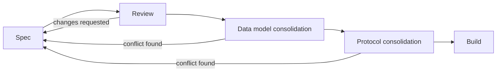

# Process

Waterfall-style: specs first, build later.

## Stages

| Stage | Who | Input | Output | Done when |
|---|---|---|---|---|
| Spec | One agent per feature, own worktree | Template, ADRs, glossary | `docs/specs/<feature>.md` at `in-review` | Meets [spec complete](../AGENTS.md#8-definition-of-spec-complete) checklist |
| Review | Reviewer (not the author) | Spec at `in-review` | Comments or `status: complete` | Checklist ticked |
| Data model consolidation | Integrator | All `complete` specs' Data model sections | [data-model/](data-model/README.md) | One domain model, no conflicting entities/fields |
| Protocol consolidation | Integrator | All specs' API & events sections | [protocol/](protocol/README.md) | One REST + WS catalogue with visibility rules |
| Build | Build-phase agents | Consolidated docs | Code | Build-phase conventions (TBD) |

## Roles

- **Spec agent** — writes one spec in one worktree. Edits only that spec + new proposed ADRs.
- **Reviewer** — checks a spec against the checklist, ADRs, glossary. Sets `complete`.
- **Integrator** — merges worktrees, numbers proposed ADRs, updates the [spec index](specs/README.md), [glossary](glossary.md) and [decisions log](decisions-log.md).

## Avoiding conflicting decisions

- **ADRs are law.** Accepted ADRs can't be contradicted, only superseded by a new ADR.
- **Cross-cutting → ADR.** Anything that affects more than one spec goes in `adr/proposed-<slug>.md`, not in a spec.
- **Don't edit others' specs.** Raise an open question in yours naming theirs. Integrator routes it.
- **Glossary is shared vocabulary.** New terms go through open questions; integrator adds them.
- **Decisions log is append-only**, written by the integrator at merge. One line per decision, with link.
- **Front matter is the claim board.** No shared status file to conflict on.

## Merging

1. Spec agent rebases on `main`, resolves only its own files.
2. Integrator merges, then in a follow-up commit: numbers ADRs, updates index, glossary, decisions log.
3. If two proposed ADRs conflict, integrator raises it with the DM before accepting either.
