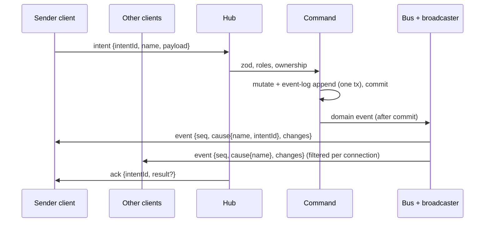

# Protocol

Consolidated REST (Hono RPC) + WebSocket catalogue. **Living doc**: the integrator extends it after each build phase's specs reach `complete`, alongside the [data model](../data-model/README.md) ([process](../process.md#stages)). Shared file: changes only via the orchestrator, in the same merge as the matching `src/shared/protocol/` code ([AGENTS §9.9](../../AGENTS.md#99-shared-files)).

| Phase | Specs consolidated | Status |
|---|---|---|
| Foundation | [live-sync](../specs/live-sync.md), [campaign-management](../specs/campaign-management.md), [fixtures-adapters](../specs/fixtures-adapters.md) | done (2026-10-12); CON-01–17 resolved ([decisions-log](../decisions-log.md) #118) and built in the skeleton |
| Scenes / Combat / Reward | see [roadmap](../roadmap.md#build-order-mvp) | > Later phase |

Spec shorthand: SYNC = live-sync, CAMP = campaign-management, FIX = fixtures-adapters. Code: zod schemas in `src/shared/protocol/` (`frames.ts`, `codes.ts`, `store.ts`).

## 1. Flow

Intent → validate → mutate + commit (with event-log entry) → domain event → listeners (synchronous, after commit) → broadcaster → visibility filter → WS ([ADR-0005](../architecture/adr/0005-server-authoritative-sync.md), [ADR-0016](../architecture/adr/0016-domain-events-pending-actions.md), [ADR-0021](../architecture/adr/0021-sync-protocol-conventions.md) F).

- REST (Hono RPC) calls run the same commands and produce the same events; the result is in the HTTP response ([FR-SYNC-15](../specs/live-sync.md#6-functional-requirements), ADR-0021 D).
- Rollback → no event, no log entry, no `ack`. A listener failure never rolls back ([FR-SYNC-16](../specs/live-sync.md#6-functional-requirements)).

## 2. Auth

| Credential | Held by | Sent | Check | Source |
|---|---|---|---|---|
| DM secret | env `PP_DM_SECRET` (≥ 12 chars); DM client localStorage | Every DM REST request as `Authorization: Bearer <secret>`; WS `hello` as `{role: "dm", secret}` | `crypto.timingSafeEqual` on SHA-256 digests. Never logged, stored or sent back | [FR-CAMP-01–04](../specs/campaign-management.md#6-functional-requirements), [ADR-0019](../architecture/adr/0019-auth-credentials.md), CON-08 |
| Link token | URL path `/p/<token>` *(proposed)* | `/api/join/:token`; WS `hello` as `{role: "player", token}` | Lookup by `Player.linkToken` (format checked first: 22 base64url chars) | [FR-CAMP-13/16/17](../specs/campaign-management.md#6-functional-requirements), ADR-0019 |

- No auth by source address, localhost included ([FR-CAMP-04](../specs/campaign-management.md#6-functional-requirements)).
- `hello.credential.role` picks the resolver, so a mangled player link never counts as a failed DM check.
- **Throttle** *(proposed, [OQ-CAMP-12](../specs/campaign-management.md#15-open-questions))*: 5 failed DM checks in 60 s, server-wide → all DM checks refused 60 s, even correct ones. REST 429; `hello` closed `4401`. Memory only ([FR-CAMP-05](../specs/campaign-management.md#6-functional-requirements)). A failed check = a secret was presented and is wrong; a DM route without `Authorization` gets 401 and doesn't count.

**Resolvers** (CAMP provides, SYNC calls; [CAMP §9](../specs/campaign-management.md#9-api--events))

| Resolver | Result | WS `hello` outcome | REST outcome |
|---|---|---|---|
| `verifyDmCredential(value)` | `{campaignId}` | live in that (active) campaign | — |
| | `invalid` | close `4401` | — |
| | `throttled` | close `4401` | — |
| | `noActiveCampaign` | close `4409` | — |
| `checkDmSecret(value)` (REST: secret only, no campaign needed, CON-15) | `ok` / `invalid` / `throttled` | — | allowed / 401 / 429 |
| `resolvePlayerLink(token)` | `{campaignId, playerId, campaignActive: true}` | live | `/api/join` 200 |
| | `{…, campaignActive: false}` | close `4409 campaign-inactive` | `/api/join` 200, `campaignActive: false` |
| | `null` | close `4401`, no other frame | 404 |

- The DM client opens its WS only once a campaign is active (CON-10); before that it stays on REST ("Create your first campaign").

Sources: [FR-SYNC-02](../specs/live-sync.md#6-functional-requirements), [FR-SYNC-06](../specs/live-sync.md#6-functional-requirements), [FR-CAMP-05/17/18](../specs/campaign-management.md#6-functional-requirements).

## 3. WebSocket

### 3.1 Lifecycle

| Step | Rule | Source |
|---|---|---|
| Endpoint | One WS endpoint, path `/ws` *(proposed, [OQ-SYNC-15](../specs/live-sync.md#15-open-questions))*, same origin as the clients | FR-SYNC-01, [AGENTS §9.2](../../AGENTS.md#92-env-ports-and-data) |
| `hello` | First frame, within 5 s of open, else close `4408`. A first frame that isn't a `hello` → `4408`; a `hello` with a malformed credential → `4401` | FR-SYNC-01 |
| Context | `{connId, campaignId, role, playerId?}`; fixed for the connection's life; ids/role in payloads never trusted. DM `campaignId` = active campaign at `hello`; player's from the link | FR-SYNC-02/03, [FR-CAMP-11](../specs/campaign-management.md#6-functional-requirements) |
| Snapshot | Exactly one `snapshot` (seq 0) before any `event` | FR-SYNC-08 |
| Heartbeat | Client `ping` every 10 s → server `pong`. Server closes a connection silent 30 s with `4408` (CON-11). Client treats 20 s without `pong` as dropped | FR-SYNC-04 |
| Reconnect | Forever; backoff 0.5 s doubling to 1.5 s (#131), immediate retry on focus/visible/online, ±20 % jitter. Stops only on `4401`. Never resends in-flight intents (their promises reject on disconnect) | FR-SYNC-05 |
| Multiple tabs | Several connections per player or DM each get the same stream | FR-SYNC-03 |

**Client connection states** ([FR-SYNC-24](../specs/live-sync.md#6-functional-requirements)): `connecting | live | reconnecting | waiting | rejected`. Intent controls disabled unless `live`. Banner "Reconnecting…" after 1 s not live; after 60 s adds "Server unreachable — check with your DM". `waiting` / `rejected` use CAMP's waiting / invalid-link screens ([CAMP §7](../specs/campaign-management.md#7-uiux-notes)); DM `rejected` → login.

### 3.2 Client → server frames

Every frame is a JSON object; field **`type`** names the frame (CON-14).

| Frame | Payload | Who | Check | Source |
|---|---|---|---|---|
| `hello` | `{credential: {role: "dm", secret} \| {role: "player", token}}` | DM, player | §2 resolvers | [SYNC §9](../specs/live-sync.md#9-api--events) |
| `intent` | `{intentId (1–64 chars), name, payload}` | DM, player | zod by `name`, roles, ownership (§6) | FR-SYNC-12/13 |
| `signal` | `{name, data}` | DM, player | Signal schema + roles (§7); unknown → `reject unknown_intent`; role not allowed → `reject forbidden`; bad `data` → `reject invalid`. Rejected signals reach nobody. No `ack` | FR-SYNC-22, [ADR-0026](../architecture/adr/0026-signal-routing.md) |
| `resync` | `{}` | DM, player | Live connection → fresh snapshot | FR-SYNC-11 |
| `ping` | `{}` | DM, player | Live connection → `pong` | FR-SYNC-04 |

- Bad JSON or payload → `reject invalid` with issues (`intentId` null if it can't be read); unknown `name` → `reject unknown_intent`; connection stays open ([FR-SYNC-12](../specs/live-sync.md#6-functional-requirements)).
- Client → server frame > 64 KB → close `1009`. Server → client frames have no such limit (snapshots may reach 512 KB, SYNC §12) (CON-13).

### 3.3 Server → client frames

| Frame | Payload | Visibility | Source |
|---|---|---|---|
| `snapshot` | `seq: 0`, `you {campaignId, role, playerId}`, `records {<type>: Record[]}` | Each type's fn; scopes per §4 | FR-SYNC-08/09, SYNC §9 |
| `event` | `seq`, `cause {name, intentId?}`, `changes[]` of `{type, id, op: upsert \| delete, data?}` | Each type's fn + transition matrix (§3.4). `intentId` on the sender connection's copy only | FR-SYNC-17/19/21, SYNC §9 |
| `signal` | `name`, `data`, `from {role, playerId?}` (server-stamped from the sender's connection context, never the payload) | Every **other** live connection of the sender's campaign; never the sender (§7) | FR-SYNC-22, [ADR-0026](../architecture/adr/0026-signal-routing.md) |
| `ack` | `intentId`, `result?` | Sender only | FR-SYNC-14 |
| `reject` | `intentId \| null`, `code`, `message`, `issues?` | Sender only | FR-SYNC-14, SYNC §9 |
| `pong` | — | Sender only | FR-SYNC-04 |

- `cause.name` = the domain event type, e.g. `PlayerRenamed` (CON-12); the intent is identified by `intentId`. Presence changes use `cause.name: "presence"` (CON-07).

### 3.4 Snapshot and event rules

| Rule | Source |
|---|---|
| Client replaces its whole store with a snapshot and drops optimistic state | FR-SYNC-08 |
| Changes committed between snapshot read and send arrive as events after it: none lost, none duplicated | FR-SYNC-10 |
| Per domain event, each connection gets **at most one** `event`, applied atomically; nothing if no change survives the filter. Upsert = whole filtered record | FR-SYNC-17 |
| Events a sender's intent caused reach it **before** its `ack` (needs synchronous listeners) | FR-SYNC-14, ADR-0021 F |
| `seq` per connection: 1, 2, … after each snapshot. Gap → client sends `resync`. Send-buffer overflow (> 1 MB buffered or a dropped send) or broadcaster error → close `4000`, never drop frames | FR-SYNC-21 |
| Snapshot and events share the filter: a player's store after live events equals a fresh snapshot | FR-SYNC-20 |
| Switching the active scene resyncs every player connection of the campaign | FR-SYNC-11 |
| No named per-feature WS events; UI effects read `cause` | SYNC §9, [ADR-0021](../architecture/adr/0021-sync-protocol-conventions.md) A |
| Every wire record has an `id` field; the client store is `type → id → record` | skeleton (`src/shared/protocol/store.ts`) |

**Transition matrix** per connection ([FR-SYNC-19](../specs/live-sync.md#6-functional-requirements)):

| Before → after | Sent |
|---|---|
| hidden → visible | `upsert` (reveal = appear) |
| visible → hidden | `delete` |
| visible → visible | `upsert` |
| hidden → hidden | nothing |

### 3.5 Close codes ([SYNC §9](../specs/live-sync.md#9-api--events))

| Code | Reason | When | Client does |
|---|---|---|---|
| `1001` | `shutdown` | Server shutting down | Reconnect (backoff) |
| `1009` | `frame-too-large` | Client frame > 64 KB (FR-SYNC-12) | Reconnect |
| `4000` | `resync-required` | Send-buffer overflow or broadcaster error (FR-SYNC-21) | Reconnect |
| `4401` | `credential-invalid` | Bad DM secret, throttled, unknown token, malformed `hello` (FR-SYNC-02, FR-CAMP-05/17) | **Stop**; `rejected` (DM: login; player: invalid-link screen) |
| `4408` | `no-hello` | No `hello` within 5 s (FR-SYNC-01); 30 s without any inbound frame (FR-SYNC-04, CON-11) | Reconnect |
| `4409` | `campaign-inactive` | Player `hello` for inactive campaign; DM `noActiveCampaign`; active campaign switched (FR-SYNC-02/06/07, FR-CAMP-09) | DM: reconnect at once (then backoff). Player: `waiting`, keep retrying, join ≤ 10 s after reactivation |

- `4401`, `4409` at `hello`: no other frame is sent first (FR-SYNC-02/06).

### 3.6 Reject codes ([SYNC §9](../specs/live-sync.md#9-api--events))

| Code | When | REST status | Source |
|---|---|---|---|
| `invalid` | Bad JSON or payload; `issues` = zod issues `{path, message}` | 400 | FR-SYNC-12 |
| `unknown_intent` | No handler for `name` (incl. REST-only commands sent as intents) | 404 | FR-SYNC-12 |
| `forbidden` | Role not allowed or ownership check fails; no change, no event | 403 | FR-SYNC-13 |
| `not_found` | Target record missing | 404 | SYNC §9 |
| `conflict` | Feature guard on non-idempotent actions; duplicate names; no active campaign | 409 | SYNC §9, [§11](../specs/live-sync.md#11-edge-cases--failure-modes) |
| `internal` | Server error | 500 | SYNC §9 |
| `unauthorized` *(REST only)* | DM route without or with a wrong secret | 401 | FR-CAMP-04 |
| `throttled` *(REST only)* | DM checks locked (FR-CAMP-05) | 429 | FR-CAMP-05 |

REST error body = `{code, message, issues?}` (CON-09).

### 3.7 Hub API (server-internal)

`resync(selector)`, `disconnect(selector, code)`, `connections(campaignId)` ([SYNC §9](../specs/live-sync.md#9-api--events)). Hub, broadcaster and presence hold no play state ([FR-SYNC-25](../specs/live-sync.md#6-functional-requirements)).

**Test seams** ([FR-SYNC-26](../specs/live-sync.md#6-functional-requirements), [ADR-0022](../architecture/adr/0022-deterministic-seams.md)): injectable clock and timers (heartbeat, backoff); test-only `beforeSnapshotSend` hook pauses a snapshot between read and send.

## 4. Scopes

| Scope | DM snapshot | Player snapshot | Source |
|---|---|---|---|
| `global` | all (imported definitions) | per the type's fn | FR-SYNC-09, [ADR-0018](../architecture/adr/0018-global-imported-content.md) |
| `campaign` | `ctx.campaignId` only | `ctx.campaignId` only, filtered | FR-SYNC-09, [ADR-0020](../architecture/adr/0020-single-active-campaign.md) |
| `scene` | all scenes of the campaign | active scene only | FR-SYNC-09, ADR-0021 C |

No WS frame carries another campaign's data, DM included (the scope gate runs before the visibility fn); the campaign list is REST only ([FR-CAMP-07](../specs/campaign-management.md#6-functional-requirements)).

## 5. Record-type registry

Registration: `type, scope, schema, idOf, campaignOf (campaign/scene scope), visibility (record, ctx) → full | redacted | hidden, redact?, snapshot provider, audience?` ([SYNC §8](../specs/live-sync.md#8-data-model), FR-SYNC-18). DM always `full` (after the scope gate). **Unregistered type → hidden** (for the DM too: it can't be scope-gated). `audience: "dm"` = never sent to players, not even as an empty snapshot list.

| Type | Owner | Scope | Wire fields | Player visibility | Snapshot provider |
|---|---|---|---|---|---|
| `campaign` | CAMP | campaign | `{id, name}` | full for own campaign | own campaign row |
| `player` | CAMP | campaign | `{id, campaignId, name}` — no token field exists | full for own campaign (*proposed*, [OQ-CAMP-13](../specs/campaign-management.md#15-open-questions)) | all players of the campaign, creation order |
| `presence` | SYNC | campaign; in-memory, not persisted; `audience: dm` | `{id, playerId, campaignId, online}` (`id` = `playerId`) | **never sent** (DM only) | DM: one per player of the campaign, `online` from live connections. Changes go in `event` frames with `cause.name: "presence"` (CON-07) |
| `probe` *(test mode only)* | SYNC | campaign (CON-06) | `{id, campaignId, text, hidden, ownerPlayerId}` | full iff `!hidden && (owner == null \|\| owner == ctx.playerId)`, else hidden | the campaign's probes, insertion order (CON-06) |
| definition *(name TBD)* | entities | global | definition + provenance | hidden until entities registers a fn (default deny) | > Later phase (Scenes) |

Sources: [CAMP §9](../specs/campaign-management.md#9-api--events), [FR-CAMP-19](../specs/campaign-management.md#6-functional-requirements), [SYNC §8–9](../specs/live-sync.md#9-api--events), [FR-SYNC-23](../specs/live-sync.md#6-functional-requirements), [FR-SYNC-27](../specs/live-sync.md#6-functional-requirements), [FIX §9](../specs/fixtures-adapters.md#9-api--events).

> Later phase: Scenes (asset, scene, token, …), Combat (character, encounter, combatant, roll, notification, …), Reward (party loot). One row per type with scope + visibility rule.

## 6. Intents and commands

Registration: `name, schema, roles (default [dm]), authorize, execute` ([SYNC §8](../specs/live-sync.md#8-data-model)). Names `<feature>.<verb>`; `probe.*` accepted as a test-only prefix (CON-16). A command is a WS intent only if registered as one.

**WS intents**

| Intent | Owner | Roles | Payload | Ownership / authorize | Result | Source |
|---|---|---|---|---|---|---|
| `probe.set` *(test mode)* | SYNC | DM | `{id?, text (≤ 500), hidden, ownerPlayerId?}`; no `id` = create | Owner is a player of `ctx.campaignId` (else `forbidden`); `id` must be in `ctx.campaignId` (else `not_found`) | `{id}` | [SYNC §9](../specs/live-sync.md#9-api--events) |
| `probe.edit` *(test mode)* | SYNC | player | `{id, text}` | Probe visible to the player and `ownerPlayerId == ctx.playerId` (else `forbidden`) | `{id}` | SYNC §9 |

CAMP has **no WS intents**; FIX has none ([FR-FIX-24](../specs/fixtures-adapters.md#6-functional-requirements)).

**Commands over REST** ([CAMP §9](../specs/campaign-management.md#9-api--events); paths *proposed*, [OQ-CAMP-15](../specs/campaign-management.md#15-open-questions); prefix `/api/*`). DM routes need `Authorization: Bearer <DM secret>` (CON-08) and check the secret only (CON-15).

| Method | Path | Who | Body → 2xx response | Errors |
|---|---|---|---|---|
| POST | `/api/dm/login` | anyone | — → 204 | 401 / 429 |
| GET | `/api/campaigns` | DM | → 200 `{campaigns: {id, name, active}[]}` (creation order) | 401 / 429 |
| POST | `/api/campaigns` | DM | `{name}` (rules [FR-CAMP-06](../specs/campaign-management.md#6-functional-requirements)) → 201 `{campaign}` | 400 / 409 duplicate |
| PATCH | `/api/campaigns/:id` | DM | `{name}` → 200 `{campaign}` | 400 / 404 / 409 |
| POST | `/api/campaigns/:id/activate` | DM | — → 200 `{campaign}` (already active: no-op, no event) | 404 |
| GET | `/api/players` | DM | → 200 `{campaignId, publicBaseUrl \| null, players: {id, name, linkToken}[]}` (**only route returning tokens**) | 409 no active campaign |
| POST | `/api/players` | DM | `{name}` → 201 `{player: {id, name, linkToken}}` | 400 / 409 duplicate or no active campaign |
| PATCH | `/api/players/:id` | DM | `{name}` → 200 `{player}` (token unchanged) | 400 / 404 / 409 |
| GET | `/api/join/:token` | token holder | → 200 `{playerName, campaignName, campaignActive}` | 404 |
| GET | `/ws` *(proposed)* | DM, player | WS upgrade (non-upgrade → 426); auth in `hello` | |

- DM routes: 401 without the DM secret or with a player token; 429 when throttled ([CAMP §13](../specs/campaign-management.md#13-test-plan), FR-CAMP-05). Error body and statuses: §3.6 (CON-09). Unknown `/api/*` → 404 `not_found`.
- Clients import only `type AppType` from `@server/app` ([AGENTS §9.1](../../AGENTS.md#91-directory-layout-and-path-aliases)).
- **No route** for reset, load or the import pipeline; a route-table test enforces it ([FR-FIX-24](../specs/fixtures-adapters.md#6-functional-requirements)).

**Internal commands** (no route, no intent)

| Command | Caller | Input → output | Source |
|---|---|---|---|
| `import.batch` | Fixture loader only (in-process, DM authority) | `{source {key, name, licence, attribution, url?}, records {kind, sourceKey, data}[]}` → per record `{sourceKey, outcome: created \| existing, id}`. All-or-nothing; errors: `invalid` with every issue, path `[sourceKey, "kind"]` or `[sourceKey, "data", …field path]` | [FIX §9](../specs/fixtures-adapters.md#9-api--events), [FR-FIX-18–21](../specs/fixtures-adapters.md#6-functional-requirements) |
| Setup fixture steps | Fixture loader | Any registered server command, DM authority (actor campaign = active campaign), same validation / events / log as UI; no `intentId` | [FR-FIX-13](../specs/fixtures-adapters.md#6-functional-requirements) |

- The pipeline writes through a definition store + kind registry that entities plugs in (Scenes); the skeleton ships the core and tests it with a test-only kind (CON-03).

## 7. Signals

Registration: `name, schema, roles` ([SYNC §8](../specs/live-sync.md#8-data-model)); `r.signal(defineSignal(…))`. Not domain events: no bus, DB, event log, snapshot or `seq` ([FR-SYNC-22](../specs/live-sync.md#6-functional-requirements)).

Routing ([ADR-0026](../architecture/adr/0026-signal-routing.md)):

- The hub checks the sender is live, the name is registered, its role is in `roles`, and `data` passes the zod schema; any failure → `reject` to the sender only, nobody receives it.
- A valid signal goes to every **other** live connection of the sender's campaign (DM and players, incl. the sender's other tabs) as `signal {name, data, from}`; never back to the sender. `from` = `{role: "dm"}` or `{role: "player", playerId}` from the connection context.
- No per-signal visibility fn, no server scene check, no rate limit. Receivers filter: act only if `data.sceneId` is the scene they show (player: active; DM: viewed).
- Client: `connection.sendSignal(name, data)` (dropped when not live, never queued), `useSignal(name, handler)`.

| Signal | Owner | Roles |
|---|---|---|
| none in Foundation | | |

Scenes signals: [§15](#15-scenes-signals).

## 8. Domain events

Each lists `changes` (before/after per record; create: before null, delete: after null), including every record whose visibility changes ([SYNC §8](../specs/live-sync.md#8-data-model), [ADR-0021](../architecture/adr/0021-sync-protocol-conventions.md)). Logged in the commit's transaction unless marked non-logged ([FR-SYNC-16](../specs/live-sync.md#6-functional-requirements)). Payloads are zod-validated (`src/shared/events/`) and never hold a link token or the DM secret.

| Domain event | Owner | Payload | Changes | Logged | Transient | Undoable | After commit |
|---|---|---|---|---|---|---|---|
| `CampaignCreated` | CAMP | `{campaignId, name}` | `campaign` upsert | yes | no | no | — (no connections yet) |
| `CampaignRenamed` | CAMP | `{campaignId, name}` | `campaign` upsert | yes | no | no | — |
| `CampaignActivated` | CAMP | `{campaignId, previousCampaignId}`; `previousCampaignId: null` when create made the first campaign active (CON-10) | none | yes (log `campaignId` = new campaign) | no | no | `disconnect(connections of any other campaign, 4409 campaign-inactive)` ≤ 1 s |
| `PlayerAdded` | CAMP | `{playerId, campaignId, name}` | `player` upsert | yes | no | no | — |
| `PlayerRenamed` | CAMP | `{playerId, campaignId, name}` | `player` upsert | yes | no | no | — |
| definition created *(name owned by entities)* | FIX → entities | store-defined | definition upsert (global) | yes, `campaignId` null | no | no (ADR-0016: combat only) | — (only for `created`; `existing` emits nothing) |
| `ProbeSet` *(test mode)* | SYNC | `{probeId, text, hidden, ownerPlayerId}` | `probe` upsert (before null on create) | yes | no | no | — (CON-05) |
| `ProbeEdited` *(test mode)* | SYNC | `{probeId, text}` | `probe` upsert | yes | no | no | — (CON-05) |

Sources: [CAMP §9](../specs/campaign-management.md#9-api--events), [FR-CAMP-09](../specs/campaign-management.md#6-functional-requirements), [FR-SYNC-07](../specs/live-sync.md#6-functional-requirements), [FR-FIX-23](../specs/fixtures-adapters.md#6-functional-requirements), [ADR-0018](../architecture/adr/0018-global-imported-content.md).

- Listeners in Foundation: broadcaster (hub), campaign-switch disconnect (CAMP); the fixture loader adds a record collector during loads. The event-log write is part of the command transaction, not a listener ([SYNC §2](../specs/live-sync.md#2-scope), [ADR-0016](../architecture/adr/0016-domain-events-pending-actions.md)).
- Known non-logged: token moves ([ADR-0016](../architecture/adr/0016-domain-events-pending-actions.md)). Undoable in MVP: combat damage/healing applied only.

> Later phase: Scenes, Combat (undoable events + compensating events, [ADR-0016](../architecture/adr/0016-domain-events-pending-actions.md)), Reward.

## 9. How a feature plugs in

From [ADR-0021](../architecture/adr/0021-sync-protocol-conventions.md) consequences, [SYNC §9](../specs/live-sync.md#9-api--events), [AGENTS §9.8](../../AGENTS.md#98-done-for-a-build-task). No changes to hub, broadcaster or client sync code ([SYNC §3](../specs/live-sync.md#3-goals)). Code: a `Feature` in `src/server/features/<feature>/index.ts`, one line in `src/server/features/index.ts`.

- [ ] **Record types**: name, scope (`global`/`campaign`/`scene`), zod schema, `id` field on the wire, visibility fn `(record, ctx) → full | redacted | hidden`, bounded snapshot provider. Fn reads record + context only; visibility flags live on the record.
- [ ] **Intents**: `<feature>.<verb>`, zod schema, roles (default DM only), ownership check for every player-writable intent ([ADR-0004](../architecture/adr/0004-tenancy-auth-permissions.md)).
- [ ] **Optimistic** intents only if the spec marks them; server wins, reject reverts (ADR-0021 E).
- [ ] **Signals**, if any: name, schema, roles; routing per §7. No DB, bus or log.
- [ ] **Domain events**: typed, zod-validated (`src/shared/events/<feature>.ts`, one line in its `index.ts`); `changes` include every record whose visibility changes; mark logged? / undoable?.
- [ ] **No named per-feature WS events.** Reveal = `upsert`, hide = `delete`; no client reducer code.
- [ ] Commands take IDs, tokens, time only from `ctx` ([AGENTS §9.3](../../AGENTS.md#93-fixtures)).
- [ ] Tests: visibility per type for DM and player; convergence (store after events = fresh snapshot); leak scan.
- [ ] Registries are append-only: add your own lines only ([AGENTS §9.9](../../AGENTS.md#99-shared-files)). Add your rows to §5–§8 here and to the [data model](../data-model/README.md) via the orchestrator.

## 10. Versioning

No protocol versioning in MVP: single package, clients served by the same server ([ADR-0002](../architecture/adr/0002-single-package.md)). Deferred (CON-17): decide before the post-MVP agent API.

## 11. Conflicts log

Found at Foundation consolidation; resolved by the integrator ([decisions-log](../decisions-log.md) #118) and folded into the sections above. Data-model conflicts CON-01–04: [data model §8](../data-model/README.md#8-conflicts-log).

| ID | Topic | Resolution | Now in |
|---|---|---|---|
| CON-05 | Probe domain events | `ProbeSet`, `ProbeEdited`: `probe` upsert, logged, not undoable | §8 |
| CON-06 | Probe scope + provider | Scope `campaign`; provider = the campaign's probes | §5 |
| CON-07 | Presence delivery | `event` frames with `cause.name: "presence"`; in DM snapshots | §3.3, §5 |
| CON-08 | DM credential on REST | `Authorization: Bearer <secret>` | §2, §6 |
| CON-09 | REST errors | Body `{code, message, issues?}`; reject codes → 400/403/404/409; plus `unauthorized` 401, `throttled` 429 | §3.6 |
| CON-10 | First campaign auto-activates | Emits `CampaignActivated {previousCampaignId: null}`; DM WS opens once a campaign is active | §2, §8 |
| CON-11 | Heartbeat-timeout close code | `4408` | §3.1, §3.5 |
| CON-12 | `cause.name` | Domain event type | §3.3 |
| CON-13 | 64 KB limit | Client → server frames only | §3.2 |
| CON-14 | Frame discriminator | Field `type` | §3.2 |
| CON-15 | `verifyDmCredential` on REST | REST checks the secret only (`checkDmSecret`); `noActiveCampaign` applies to `hello` | §2 |
| CON-16 | Intent naming | `probe.*` accepted (test-only) | §6 |
| CON-17 | Versioning | Deferred: decide before post-MVP agent API | §10 |

Scenes consolidation (CON-18+, integrator):

| ID | Message / rule | Where | Suggested fix | Resolution |
|---|---|---|---|---|
| CON-22 | `scene` scope gate (**leak risk**) | Registration (§5 line 164; [live-sync](../specs/live-sync.md) line 90) has `scope` but no way to tell a record's scene; FR-SYNC-09 (line 55) covers snapshots only. [scenes-map](../specs/scenes-map.md) lines 105, 107, 177: `scene` gated by `id`, `token` by `sceneId`. Without an event-path gate, a DM edit to a visible token on a non-active scene is sent to players | Registration gains `sceneOf(record) → sceneId`, required for scope `scene`. Snapshot **and** event path treat a scene-scoped record whose `sceneOf` ≠ the active scene as `hidden` for players (feeds the §3.4 transition matrix). Providers return all campaign rows; the gate filters. Sequenced shared change (`src/server/ws/`, `src/shared/protocol/`) after the skeleton, before scenes-map | open |
| CON-23 | Active-scene cache timing | [scenes-map](../specs/scenes-map.md) line 46 (FR-MAP-06): cache updated "after commit, **before listeners run**", then players resynced. §1 / [ADR-0021](../architecture/adr/0021-sync-protocol-conventions.md) F have only "listeners, synchronous, after commit"; no pre-listener step | Command core gets a post-commit, pre-dispatch hook (or an ordered first listener) that reloads the cache from the DB; resync of players runs as a listener. Same sequenced change as CON-22 (`src/server/commands/`, `src/server/events/`) | open |
| CON-24 | Signal frame + routing | §3.3 line 94 and §7 line 217 (`signal {name, data}`, "visibility fn"); [live-sync](../specs/live-sync.md) line 68 (FR-SYNC-22) vs accepted [ADR-0026](../architecture/adr/0026-signal-routing.md) (`from {role, playerId?}` server-stamped; forward to every **other** connection of the campaign) | Update §3.3 row, §7 rule and FR-SYNC-22 per ADR-0026 after the skeleton merges (not edited here). [§15](#15-scenes-signals) is authoritative meanwhile | resolved (fix/scenes-core): §3.2, §3.3, §7, FR-SYNC-22 updated; hub routing + `from` built |
| CON-25 | Definition record type + event names | §5 line 172 ("definition *(name TBD)*") and §8 line 236 ("definition created") vs [entities](../specs/entities.md) lines 107–118: types `entity` (campaign) + `imported-entity` (global), event `EntityImported` | Replace both Foundation rows with pointers to [§12](#12-scenes-record-types) / [§16](#16-scenes-domain-events) after the skeleton merges | open |
| CON-26 | Broken ADR links | `]($100NN-…md)` (bad regex replace) in [assets-pipeline](../specs/assets-pipeline.md) line 15; [entities](../specs/entities.md) lines 15, 52, 186; [play-shell](../specs/play-shell.md) line 16; [scenes-map](../specs/scenes-map.md) lines 109, 177, 179, 195 | Replace `$1` with `../architecture/adr/` (9 links). Spec owners or integrator; trivial | resolved (integrator)  |
| CON-27 | Stale statuses | [scenes-map](../specs/scenes-map.md) line 65 FR-MAP-25 "*(proposed, OQ-MAP-16)*", line 177 "ADR proposed", line 195 "ADR-0026 awaits acceptance" (accepted, #125). [assets-pipeline](../specs/assets-pipeline.md) line 176 "open: OQ-ASSET-10" and line 196 (entities FR-ENT-08/11 already call `assets.require`) | Drop the "proposed"/"awaits" wording; mark OQ-ASSET-10 decided. Low | open |
| CON-28 | Asset window kind | [play-shell](../specs/play-shell.md) lines 158, 172 (OQ-SHELL-06: `asset.images`, DM) vs [assets-pipeline](../specs/assets-pipeline.md) line 60 (FR-ASSET-19: `asset.test`, test mode only; OQ-ASSET-08) | play-shell OQ-SHELL-06 / §14 → `asset.test` (test mode). Builders use `asset.test` | open |
| CON-29 | "Assets are URLs" | [live-sync](../specs/live-sync.md) line 138 vs [assets-pipeline](../specs/assets-pipeline.md) line 173 (asks integrator to amend) and [ADR-0023](../architecture/adr/0023-asset-access-by-capability-id.md) | live-sync §12: "Records carry asset IDs; clients build the URL (ADR-0023)". Low | open |
| CON-30 | Command naming | §6 line 180 `<feature>.<verb>` vs `map.*` (spec prefix), `assets.*`, `entities.*` (neither slug nor prefix) | Accept as short feature names (CON-16 precedent); §6 rule → "`<short feature name>.<verb>`, unique". Low | open |
| CON-31 | Command → event mapping | [scenes-map](../specs/scenes-map.md) lines 98–101 vs 115–117: which event `map.setSceneMap` / `setGrid` / `setLocked`, REST PATCH (rename, move), `updateToken`, `setTokenHidden` emit is implied, not stated | scenes-map §9: `SceneUpdated` = PATCH + setSceneMap/setGrid/setLocked; `TokenUpdated` = updateToken; `TokenHidden`/`TokenRevealed` = setTokenHidden. [§16](#16-scenes-domain-events) assumes this | open |
| CON-32 | DM empty-state wording | [play-shell](../specs/play-shell.md) line 46 (DM: "No active scene") vs [scenes-map](../specs/scenes-map.md) line 48 (DM shows the first scene if none active; empty state only with **no scenes**) | play-shell FR-SHELL-02 DM text → "No scenes yet". Low | open |
| CON-33 | Client extension registries | [scenes-map](../specs/scenes-map.md) line 69 (FR-MAP-29: canvas layer registry; token menu + double-click registry) are extension points for Combat / post-MVP, not in [AGENTS §9.9](../../AGENTS.md#99-shared-files) append-only list | Add them to §9.9 when a second spec registers (combat-tracker). Low | open |

## 12. Scenes: record types

Consolidated 2026-10-12 from the `complete` specs. Shorthand: ASSET = [assets-pipeline](../specs/assets-pipeline.md), ENT = [entities](../specs/entities.md), SHELL = [play-shell](../specs/play-shell.md), MAP = [scenes-map](../specs/scenes-map.md). Appended only; Foundation sections above unchanged ([CON-22–25](#11-conflicts-log) list the edits they need). Data side: [data model §9–§13](../data-model/README.md#9-scenes-er-diagram).

DM always `full`. Generic record changes only ([ADR-0021](../architecture/adr/0021-sync-protocol-conventions.md) A).

| Type | Owner | Scope | Wire fields (DM) | Player visibility | Snapshot provider | Source |
|---|---|---|---|---|---|---|
| `asset` | ASSET | campaign | `{id, campaignId, seq, name, mime, bytes, width, height, displayWidth, displayHeight, createdAt}` (no `hash`) | **hidden** | all of the campaign's assets | [FR-ASSET-10](../specs/assets-pipeline.md#6-functional-requirements), ASSET §9 |
| `entity` | ENT | campaign | row minus provenance | own character (`ownerPlayerId = ctx.playerId`) **full**; other characters **redacted** `{id, kind, name, portraitAssetId, ownerPlayerId}`; monsters **hidden** | campaign's characters + customs | [FR-ENT-15](../specs/entities.md#6-functional-requirements), [ADR-0024](../architecture/adr/0024-definition-visibility.md) |
| `imported-entity` | ENT | global | row incl. provenance | **hidden** | all imported definitions | [FR-ENT-16](../specs/entities.md#6-functional-requirements), [ADR-0018](../architecture/adr/0018-global-imported-content.md) |
| `scene` | MAP | scene, `sceneOf = id` ([CON-22](#11-conflicts-log)) | full row | **redacted** `{id, mapAssetId, mapWidth, mapHeight, grid*, active}` (no name, folder, lock, `seq`) *(proposed, OQ-MAP-17)* | DM: all; player: active | [FR-MAP-26](../specs/scenes-map.md#6-functional-requirements), MAP §9 |
| `scene-folder` | MAP | campaign | full row | **hidden** | campaign's folders | FR-MAP-26 |
| `token` | MAP | scene, `sceneOf = sceneId` | full row | `hidden` → **hidden**; else **redacted**: all fields but `definitionId` | DM: all; player: active scene's | FR-MAP-26, [FR-MAP-19](../specs/scenes-map.md#6-functional-requirements) |

- **Asset IDs** reach a player only as fields of records that player receives (`scene.mapAssetId`, visible `token.imageAssetId`, `entity.portraitAssetId` of characters). Never in a REST body, error, toast, URL or log a player can read ([FR-ASSET-12](../specs/assets-pipeline.md#6-functional-requirements), [ADR-0023](../architecture/adr/0023-asset-access-by-capability-id.md)). Leak tests: ASSET §13 leak property, ENT §13 and MAP §13 leak strings.
- Activation changes token visibility for players via the resync snapshot, not via `changes` ([FR-MAP-06](../specs/scenes-map.md#6-functional-requirements), ADR-0021 C).
- No layout record type ([ADR-0025](../architecture/adr/0025-play-shell-windows.md)).

## 13. Scenes: intents, REST and internal APIs

**WS intents** (default DM only; all `map.*` canvas actions, [ADR-0021](../architecture/adr/0021-sync-protocol-conventions.md) D). ENT, ASSET, SHELL have **none**.

| Intent | Roles | Payload | Ownership / authorize | Result | Source |
|---|---|---|---|---|---|
| `map.activateScene` | DM | `{sceneId}` | Scene in `ctx.campaignId` | | [FR-MAP-06](../specs/scenes-map.md#6-functional-requirements) |
| `map.setSceneMap` | DM | `{sceneId, mapAssetId}` | `assets.require`; locked → `conflict` | | [FR-MAP-09](../specs/scenes-map.md#6-functional-requirements), [FR-MAP-11](../specs/scenes-map.md#6-functional-requirements) |
| `map.setGrid` | DM | `{sceneId, cellSize, offsetX, offsetY, visible, color, opacity}` | Bounds FR-MAP-10; locked → `conflict` | | [FR-MAP-10](../specs/scenes-map.md#6-functional-requirements) |
| `map.setLocked` | DM | `{sceneId, locked}` | Scene in campaign | | FR-MAP-11 |
| `map.placeToken` | DM | `{sceneId, definitionId, col, row, name?, imageAssetId?, ownerPlayerId?, hidden?}` (never size) | `resolveDefinition`, `assets.require`, owner ∈ campaign, footprint + caps (FR-MAP-14) | | [FR-MAP-13](../specs/scenes-map.md#6-functional-requirements) |
| `map.moveToken` | DM, **player** | `{tokenId, col, row}` | Player: owner = `ctx.playerId`, not hidden, on active scene; can't see → `not_found`, not theirs → `forbidden`. DM: any. **Optimistic** | | [FR-MAP-15](../specs/scenes-map.md#6-functional-requirements), [FR-MAP-21](../specs/scenes-map.md#6-functional-requirements) |
| `map.updateToken` | DM | `{tokenId, name?, imageAssetId?, ownerPlayerId?}` | Token in campaign; `assets.require`; no size | | [FR-MAP-18](../specs/scenes-map.md#6-functional-requirements) |
| `map.setTokenHidden` | DM | `{tokenId, hidden}` | Token in campaign | | FR-MAP-19 |
| `map.duplicateToken` | DM | `{tokenId}` | Token in campaign; placement rule FR-MAP-17 | `{tokenId}` | [FR-MAP-17](../specs/scenes-map.md#6-functional-requirements) |
| `map.deleteToken` | DM | `{tokenId}` | Token in campaign | | FR-MAP-18 |

**REST** (DM `Authorization: Bearer`, prefix `/api/*` per [OQ-CAMP-15](../specs/campaign-management.md#15-open-questions); errors `{code, message, issues?}` → 400/403/404/409, CON-09; no/invalid secret or player token → 401, throttled → 429). Campaign = `ctx.campaignId` at authentication ([CON-21](../data-model/README.md#8-conflicts-log)).

| Method | Path | Who | Command / purpose | Success | Source |
|---|---|---|---|---|---|
| POST | `/api/assets` | DM | `assets.ingest`: multipart `file`, `name?` | `201 {asset}` created / `200 {asset}` existing; 400, 401, 413, 415, 422, 429 | [FR-ASSET-01–03](../specs/assets-pipeline.md#6-functional-requirements), ASSET §9 |
| GET | `/api/assets/:id/:file` | **anyone holding the ID** (no credential) | Serve `thumb` \| `display` ([§14](#14-scenes-asset-route)) | 200 / 304 / 404 | [FR-ASSET-11](../specs/assets-pipeline.md#6-functional-requirements) |
| POST | `/api/entities` | DM | `entities.create {kind, name, portraitAssetId?, statBlock, derivedFromId?, ownerPlayerId?}` | `201 {entity}` | [FR-ENT-08–10](../specs/entities.md#6-functional-requirements) |
| PUT | `/api/entities/:id` | DM | `entities.update` (whole replace; imported → 403) | `200 {entity}` | [FR-ENT-07](../specs/entities.md#6-functional-requirements), [FR-ENT-11](../specs/entities.md#6-functional-requirements) |
| POST | `/api/scenes` | DM | Create `{name, mapAssetId, folderId?}` | `201 {scene}` | [FR-MAP-01](../specs/scenes-map.md#6-functional-requirements) |
| PATCH | `/api/scenes/:id` | DM | Rename, move to folder / root | `200` | [FR-MAP-03](../specs/scenes-map.md#6-functional-requirements) |
| DELETE | `/api/scenes/:id` | DM | Delete non-active (active → 409) *(proposed)* | `204` | [FR-MAP-05](../specs/scenes-map.md#6-functional-requirements) |
| POST | `/api/scenes/:id/duplicate` | DM | Duplicate with tokens | `201 {scene}` | [FR-MAP-04](../specs/scenes-map.md#6-functional-requirements) |
| POST | `/api/scene-folders` | DM | Create | `201 {sceneFolder}` | [FR-MAP-02](../specs/scenes-map.md#6-functional-requirements) |
| PATCH, DELETE | `/api/scene-folders/:id` | DM | Rename; delete (scenes → root) | `200`, `204` | FR-MAP-02 |

- No GET for entities, scenes or folders: the snapshot carries the records ([ENT §9](../specs/entities.md#9-api--events)). No route reaches `entities.import` ([FR-FIX-24](../specs/fixtures-adapters.md#6-functional-requirements)).

**Internal server APIs** (no route)

| API | Owner | Contract | Source |
|---|---|---|---|
| `assets.ingest {bytes, filename, name?}` | ASSET | → `{asset, outcome: created \| existing}`; called by REST upload and fixture loader (FR-FIX-17); DM authority | [FR-ASSET-01](../specs/assets-pipeline.md#6-functional-requirements) |
| `assets.require(ctx, id)` | ASSET | Asset of `ctx.campaignId` or `not_found`. Every command setting an asset-ID field, incl. propagated copies | [FR-ASSET-15](../specs/assets-pipeline.md#6-functional-requirements) |
| `entities.import` | ENT | Implements the pipeline insert interface (CON-03); `source` = descriptor key; one `EntityImported` per created row | [FR-ENT-06](../specs/entities.md#6-functional-requirements) |
| `resolveDefinition(ctx, id)` | ENT | Global or same-campaign definition, else `not_found`; every command storing a definition reference | [FR-ENT-12](../specs/entities.md#6-functional-requirements) |
| `effectiveStats(def, inst)`, XP table, kind registry | ENT (`@shared/entities`) | Pure; `def.statBlock` in MVP | [FR-ENT-01](../specs/entities.md#6-functional-requirements), [FR-ENT-03](../specs/entities.md#6-functional-requirements), [FR-ENT-13](../specs/entities.md#6-functional-requirements) |
| Definition-changed hook registry | ENT | [§17](#17-scenes-definition-changed-hooks) | [FR-ENT-19](../specs/entities.md#6-functional-requirements) |

## 14. Scenes: asset route

`GET /api/assets/:id/:file` ([ADR-0023](../architecture/adr/0023-asset-access-by-capability-id.md) C′, #123).

| Rule | Detail | Source |
|---|---|---|
| Capability | No credential; knowing the 128-bit ID is the permission. Same for DM and players | [FR-ASSET-11](../specs/assets-pipeline.md#6-functional-requirements) |
| Served iff | Asset exists **and** belongs to the active campaign; `file` ∈ `thumb \| display`. Originals never served; SVG never served | FR-ASSET-11, [FR-ASSET-02](../specs/assets-pipeline.md#6-functional-requirements) |
| Denials | Unknown ID, other / inactive campaign, invalid `file` → **identical 404 body** (no existence oracle). `id`, `file` zod-validated, never used as paths | [FR-ASSET-13](../specs/assets-pipeline.md#6-functional-requirements), ASSET §11 |
| 200 headers | Exact `Content-Type`; `Cache-Control: private, max-age=31536000, immutable`; `ETag: "<id>-<file>"`; `X-Content-Type-Options: nosniff` | [FR-ASSET-14](../specs/assets-pipeline.md#6-functional-requirements) |
| 304 | `If-None-Match` matches **and** the asset would be served | FR-ASSET-14 |
| Upload limits | > 25 MB → 413 (stop reading); format by content sniff: PNG/JPEG/WebP/SVG else 415; > 50 MP or corrupt or SVG without size → 422; nothing written on rejection *(proposed, OQ-ASSET-06)* | FR-ASSET-02 |
| Client | `assetUrl(id, file)`, `useAssetImage(id, file)` in `@ui`: one load per URL; `error` retries once after the next reconnect snapshot | [FR-ASSET-16](../specs/assets-pipeline.md#6-functional-requirements) |

## 15. Scenes: signals

Per [ADR-0026](../architecture/adr/0026-signal-routing.md) (accepted, #125); routing rules in [§7](#7-signals) ([CON-24](#11-conflicts-log), resolved). No DB, bus, log, snapshot or `seq` ([FR-SYNC-22](../specs/live-sync.md#6-functional-requirements)).

| Signal | Owner | Roles | Schema | Routing / visibility | Source |
|---|---|---|---|---|---|
| `map.ping` | MAP | DM, player | `{sceneId, x, y}`; `x, y` finite, abs ≤ 16384 | Every **other** live connection of the sender's campaign | [FR-MAP-23](../specs/scenes-map.md#6-functional-requirements), [FR-MAP-25](../specs/scenes-map.md#6-functional-requirements) |
| `map.laser` | MAP | DM, player | `{sceneId, points [x, y][] ≤ 32, end?}`; client sends ≤ 20/s | as ping | [FR-MAP-24](../specs/scenes-map.md#6-functional-requirements), FR-MAP-25 |
| `map.pull` | MAP | **DM only** (roles check drops player sends) | `{sceneId, x, y}` | as ping; players recentre camera | FR-MAP-23, FR-MAP-25 |

- Server → client frame: `signal {name, data, from {role, playerId?}}`; `from` from the connection context, never the payload (ADR-0026).
- Receivers act only if `data.sceneId` is the scene they show (player: active; DM: viewed). No server scene check, no rate limit (ADR-0026).

## 16. Scenes: domain events

All non-transient; **none undoable** ([ADR-0016](../architecture/adr/0016-domain-events-pending-actions.md): combat only). Logged in the commit's transaction unless marked.

| Domain event | Owner | Emitted by | Payload | Changes | Logged | After commit | Source |
|---|---|---|---|---|---|---|---|
| `AssetIngested` | ASSET | `assets.ingest` (`created` only; `existing` emits nothing) | `{assetId, hash, bytes}` | `asset` upsert | yes | — | [FR-ASSET-06](../specs/assets-pipeline.md#6-functional-requirements), ASSET §9 |
| `EntityImported` | ENT | `entities.import` (`created` only) | `{entityId, source, sourceKey}` | `imported-entity` upsert | yes, `campaignId` null | — | [FR-ENT-06](../specs/entities.md#6-functional-requirements), [FR-FIX-23](../specs/fixtures-adapters.md#6-functional-requirements) |
| `EntityCreated` | ENT | `entities.create` (incl. derive) | `{entityId, kind, derivedFromId?}` | `entity` upsert | yes | — | ENT §9 |
| `EntityUpdated` | ENT | `entities.update` | `{entityId}` | `entity` upsert (owner change flips full/redacted) + every hook-changed instance row ([§17](#17-scenes-definition-changed-hooks)) | yes | — | [FR-ENT-19](../specs/entities.md#6-functional-requirements), ENT §9 |
| `SceneCreated`, `SceneUpdated`, `SceneDuplicated`, `SceneDeleted` | MAP | REST scenes; `setSceneMap` / `setGrid` / `setLocked` → `SceneUpdated` ([CON-31](#11-conflicts-log)) | | `scene` upsert / delete; duplicate + delete include the scene's `token`s | yes | — | [FR-MAP-27](../specs/scenes-map.md#6-functional-requirements), MAP §9 |
| `SceneFolderCreated`, `SceneFolderRenamed`, `SceneFolderDeleted` | MAP | REST scene-folders | | `scene-folder` upsert / delete; delete includes moved `scene`s | yes | — | MAP §9 |
| `SceneActivated` | MAP | `map.activateScene` | `{sceneId, previousSceneId}` | both `scene` upserts | yes | Active-scene cache updated **before** listeners ([CON-23](#11-conflicts-log)); resync every player connection of the campaign | [FR-MAP-06](../specs/scenes-map.md#6-functional-requirements), [FR-SYNC-11](../specs/live-sync.md#6-functional-requirements) |
| `TokenPlaced`, `TokenUpdated`, `TokenDuplicated`, `TokenDeleted`, `TokenHidden`, `TokenRevealed` | MAP | `map.placeToken`, `updateToken`, `duplicateToken`, `deleteToken`, `setTokenHidden` | | `token` upsert / delete (players per transition matrix: hide = `delete`, reveal = `upsert`) | yes | — | MAP §9, [FR-MAP-19](../specs/scenes-map.md#6-functional-requirements) |
| `TokenMoved` | MAP | `map.moveToken` | `{tokenId, sceneId, col, row}` | `token` upsert | **no** | — | FR-MAP-27, [ADR-0016](../architecture/adr/0016-domain-events-pending-actions.md) |

- Listeners added in Scenes: none beyond the broadcaster, log hook and the activation resync ([ENT §9](../specs/entities.md#9-api--events): entities adds none). Listeners never mutate state; instance refreshes are hooks inside the transaction (§17).
- Players see `cause TokenHidden` on a hide (accepted, [MAP §11](../specs/scenes-map.md#11-edge-cases--failure-modes)).

## 17. Scenes: definition-changed hooks

Server registry owned by entities, **append-only** ([AGENTS §9.9](../../AGENTS.md#99-shared-files), [OQ-ENT-14](../specs/entities.md#15-open-questions)).

| Rule | Detail | Source |
|---|---|---|
| Signature | `(ctx, before, after) → RecordChange[]` | [FR-ENT-19](../specs/entities.md#6-functional-requirements) |
| When | Inside `entities.update`'s transaction; every returned row is listed in `EntityUpdated.changes`; a hook error rolls back the whole update | FR-ENT-19, [ADR-0024](../architecture/adr/0024-definition-visibility.md) |
| Not a listener | Listeners never mutate state ([ADR-0016](../architecture/adr/0016-domain-events-pending-actions.md)) | FR-ENT-19 |

| Hook | Registered by | Writes | Source |
|---|---|---|---|
| Token display copies | scenes-map | Every token of the definition: new `size` if `statBlock.size` changed; `imageAssetId` → new portrait only for tokens whose image equals the old portrait (#127). Names and cells untouched (#126) | [FR-MAP-20](../specs/scenes-map.md#6-functional-requirements) |
| Combatant copies / HP clamp | combat-tracker (Combat phase) | > Later phase | [OQ-ENT-10](../specs/entities.md#15-open-questions) |

## 18. Scenes: client registries

**Window types** ([ADR-0025](../architecture/adr/0025-play-shell-windows.md), [FR-SHELL-07](../specs/play-shell.md#6-functional-requirements)); append-only files `src/client/dm/windows.ts`, `src/client/player/windows.ts`. Kind `<prefix>.<name>`. Layout never reaches the server.

| Kind | Owner | Clients | Default open | Default geometry | Launcher | Gate | Source |
|---|---|---|---|---|---|---|---|
| `camp.players` | SHELL (CAMP content) | DM | yes | top-right | Players | — | [FR-SHELL-21](../specs/play-shell.md#6-functional-requirements) |
| `map.scenes` | MAP | DM | yes | top-left, 300×480, min 240×240 | Scenes | — | [MAP §7](../specs/scenes-map.md#7-uiux-notes) |
| `ent.creatures` | ENT | DM | no | top-left below `map.scenes`, 420×520 | Creatures | — | [ENT §7](../specs/entities.md#7-uiux-notes), [FR-ENT-18](../specs/entities.md#6-functional-requirements) |
| `asset.test` | ASSET | DM | no | — | — | test mode | [FR-ASSET-19](../specs/assets-pipeline.md#6-functional-requirements), [CON-28](#11-conflicts-log) |
| `shell.test` | SHELL | both | no | — | Test | test mode | [FR-SHELL-20](../specs/play-shell.md#6-functional-requirements) |
| `sync.probes` | SHELL (SYNC content) | both | no | — | Probes | test mode | FR-SHELL-21 |

- Player: no window open by default in Scenes ([SHELL §7](../specs/play-shell.md#7-uiux-notes)).
- **Other client registries:** `creatureActions` (Creatures toolbar / row actions; entities ships none; combat-tracker adds the form) [FR-ENT-20](../specs/entities.md#6-functional-requirements); canvas layers (map < grid < *props, fog* < tokens < pointers) and token menu / double-click entries [FR-MAP-29](../specs/scenes-map.md#6-functional-requirements) ([CON-33](#11-conflicts-log)).
- **Drag contract:** Creatures rows → canvas: HTML5 drag, MIME `application/x-pp-definition`, data `{definitionId}`; the shell delivers window-origin drops to the base layer ([FR-ENT-18](../specs/entities.md#6-functional-requirements), [FR-SHELL-13](../specs/play-shell.md#6-functional-requirements), [FR-MAP-13](../specs/scenes-map.md#6-functional-requirements)).

## 19. Scenes: build notes

From [ADR-0025](../architecture/adr/0025-play-shell-windows.md), [ADR-0026](../architecture/adr/0026-signal-routing.md), [AGENTS §9.9](../../AGENTS.md#99-shared-files) and the conflicts above. Orchestrator decides; this is the dependency order the specs imply.

| Step | Branch | Needs | Shared files touched |
|---|---|---|---|
| 0 | skeleton | — | owns all shared files |
| 1 | `fix/*` sequenced core changes (orchestrator) | skeleton | ADR-0026 signals; `sceneOf` scope gate on snapshot + events (CON-22); post-commit pre-listener hook (CON-23): `src/server/{ws,events,commands}/`, `src/shared/protocol/` |
| 2 | `build/play-shell` | skeleton | creates `src/client/{dm,player}/windows.ts` if absent; existing `src/client/common/` files only via orchestrator |
| 3 | `build/assets-pipeline` | 2 (for `asset.test`) | `src/server/db/` (asset), `src/shared/events/` (`AssetIngested`), route mount, record-type registry, `fixtures/bundles/index.ts`, `windows.ts` line; start-up sweep (FR-ASSET-07) touches `src/server/index.ts` → shared change |
| 4 | `build/entities` | 2, 3 (`assets.require`) | `src/server/db/` (`entity` table behind the pipeline insert interface, CON-03), `src/shared/events/`, route mount, record-type registry, bundles, `windows.ts` line; creates hook + `creatureActions` registries in its own folder |
| 5 | `build/scenes-map` | 1, 2, 3, 4 | `src/server/db/` (scene, scene_folder, token), `src/shared/events/`, signals + record types with scope `scene`, route mounts, hook registry line, `windows.ts` line, bundles |

- Every builder: data-model / protocol facts for its tables are already here; a deviation is a shared change, reported to the orchestrator.
