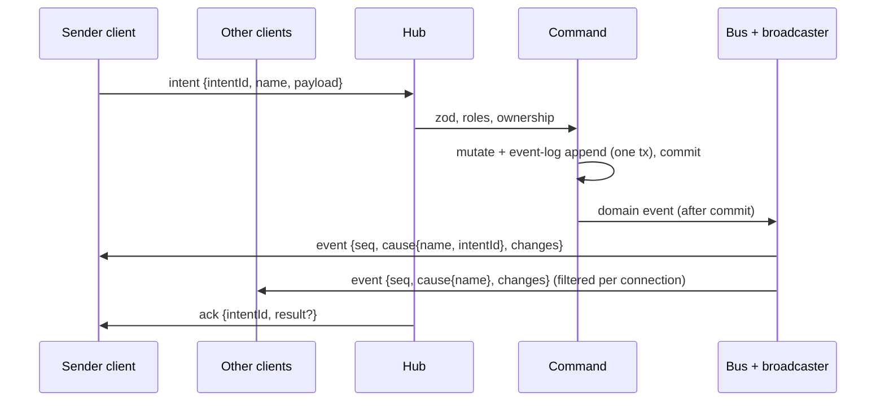

# Protocol

Consolidated REST (Hono RPC) + WebSocket catalogue. **Living doc**: the integrator extends it after each build phase's specs reach `complete`, alongside the [data model](../data-model/README.md) ([process](../process.md#stages)). Shared file: changes only via the orchestrator, in the same merge as the matching `src/shared/protocol/` code ([AGENTS §9.9](../../AGENTS.md#99-shared-files)).

| Phase | Specs consolidated | Status |
|---|---|---|
| Foundation | [live-sync](../specs/live-sync.md), [campaign-management](../specs/campaign-management.md), [fixtures-adapters](../specs/fixtures-adapters.md) | done (2026-10-12); CON-01–17 resolved ([decisions-log](../decisions-log.md) #118) and built in the skeleton |
| Scenes / Combat / Reward | see [roadmap](../roadmap.md#build-order-mvp) | > Later phase |

Spec shorthand: SYNC = live-sync, CAMP = campaign-management, FIX = fixtures-adapters. Code: zod schemas in `src/shared/protocol/` (`frames.ts`, `codes.ts`, `store.ts`).

## 1. Flow

Intent → validate → mutate + commit (with event-log entry) → commit hooks (cache refresh, CON-23) → domain event → listeners (synchronous, after commit) → broadcaster → visibility filter → WS ([ADR-0005](../architecture/adr/0005-server-authoritative-sync.md), [ADR-0016](../architecture/adr/0016-domain-events-pending-actions.md), [ADR-0021](../architecture/adr/0021-sync-protocol-conventions.md) F).

- REST (Hono RPC) calls run the same commands and produce the same events; the result is in the HTTP response ([FR-SYNC-15](../specs/live-sync.md#6-functional-requirements), ADR-0021 D).
- Rollback → no event, no log entry, no `ack`. A listener failure never rolls back ([FR-SYNC-16](../specs/live-sync.md#6-functional-requirements)).
- **Commit hooks** (CON-23, `r.afterCommit(name, fn)`): run after commit, once per event of the commit, before the bus dispatches any of them. Only for refreshing in-memory caches from the DB (e.g. the active-scene cache, [FR-MAP-06](../specs/scenes-map.md#6-functional-requirements)); never mutate state or emit. Skipped on rollback; a failure is logged and never rolls back.

## 2. Auth

| Credential | Held by | Sent | Check | Source |
|---|---|---|---|---|
| DM secret | env `PP_DM_SECRET` (≥ 12 chars); DM client localStorage | Every DM REST request as `Authorization: Bearer <secret>`; WS `hello` as `{role: "dm", secret}` | `crypto.timingSafeEqual` on SHA-256 digests. Never logged, stored or sent back | [FR-CAMP-01–04](../specs/campaign-management.md#6-functional-requirements), [ADR-0019](../architecture/adr/0019-auth-credentials.md), CON-08 |
| Link token | URL path `/p/<token>` *(proposed)* | `/api/join/:token`; WS `hello` as `{role: "player", token}` | Lookup by `Player.linkToken` (format checked first: 22 base64url chars) | [FR-CAMP-13/16/17](../specs/campaign-management.md#6-functional-requirements), ADR-0019 |

- No auth by source address, localhost included ([FR-CAMP-04](../specs/campaign-management.md#6-functional-requirements)).
- `hello.credential.role` picks the resolver, so a mangled player link never counts as a failed DM check.
- **Throttle** *(proposed, [OQ-CAMP-12](../specs/campaign-management.md#15-open-questions))*: 5 failed DM checks in 60 s, server-wide → all DM checks refused 60 s, even correct ones. REST 429; `hello` closed `4401`. Memory only ([FR-CAMP-05](../specs/campaign-management.md#6-functional-requirements)). A failed check = a secret was presented and is wrong; a DM route without `Authorization` gets 401 and doesn't count.

**Resolvers** (CAMP provides, SYNC calls; [CAMP §9](../specs/campaign-management.md#9-api--events))

| Resolver | Result | WS `hello` outcome | REST outcome |
|---|---|---|---|
| `verifyDmCredential(value)` | `{campaignId}` | live in that (active) campaign | — |
| | `invalid` | close `4401` | — |
| | `throttled` | close `4401` | — |
| | `noActiveCampaign` | close `4409` | — |
| `checkDmSecret(value)` (REST: secret only, no campaign needed, CON-15) | `ok` / `invalid` / `throttled` | — | allowed / 401 / 429 |
| `resolvePlayerLink(token)` | `{campaignId, playerId, campaignActive: true}` | live | `/api/join` 200 |
| | `{…, campaignActive: false}` | close `4409 campaign-inactive` | `/api/join` 200, `campaignActive: false` |
| | `null` | close `4401`, no other frame | 404 |

- The DM client opens its WS only once a campaign is active (CON-10); before that it stays on REST ("Create your first campaign").

Sources: [FR-SYNC-02](../specs/live-sync.md#6-functional-requirements), [FR-SYNC-06](../specs/live-sync.md#6-functional-requirements), [FR-CAMP-05/17/18](../specs/campaign-management.md#6-functional-requirements).

## 3. WebSocket

### 3.1 Lifecycle

| Step | Rule | Source |
|---|---|---|
| Endpoint | One WS endpoint, path `/ws` *(proposed, [OQ-SYNC-15](../specs/live-sync.md#15-open-questions))*, same origin as the clients | FR-SYNC-01, [AGENTS §9.2](../../AGENTS.md#92-env-ports-and-data) |
| `hello` | First frame, within 5 s of open, else close `4408`. A first frame that isn't a `hello` → `4408`; a `hello` with a malformed credential → `4401` | FR-SYNC-01 |
| Context | `{connId, campaignId, role, playerId?}`; fixed for the connection's life; ids/role in payloads never trusted. DM `campaignId` = active campaign at `hello`; player's from the link | FR-SYNC-02/03, [FR-CAMP-11](../specs/campaign-management.md#6-functional-requirements) |
| Snapshot | Exactly one `snapshot` (seq 0) before any `event` | FR-SYNC-08 |
| Heartbeat | Client `ping` every 10 s → server `pong`. Server closes a connection silent 30 s with `4408` (CON-11). Client treats 20 s without `pong` as dropped | FR-SYNC-04 |
| Reconnect | Forever; backoff 0.5 s doubling to 1.5 s (#131), immediate retry on focus/visible/online, ±20 % jitter. Stops only on `4401`. Never resends in-flight intents (their promises reject on disconnect). After a failed WS attempt the client probes `GET /ws?probe=1` (server answers `204`, no auth, no body; a plain `GET /ws` stays `426`) at each backoff step and opens a WS only once it answers: Chromium throttles new WebSockets by recent WS failures (up to +5 s each) | FR-SYNC-05 |
| Multiple tabs | Several connections per player or DM each get the same stream | FR-SYNC-03 |

**Client connection states** ([FR-SYNC-24](../specs/live-sync.md#6-functional-requirements)): `connecting | live | reconnecting | waiting | rejected`. Intent controls disabled unless `live`. Banner "Reconnecting…" after 1 s not live; after 60 s adds "Server unreachable — check with your DM". `waiting` / `rejected` use CAMP's waiting / invalid-link screens ([CAMP §7](../specs/campaign-management.md#7-uiux-notes)); DM `rejected` → login.

### 3.2 Client → server frames

Every frame is a JSON object; field **`type`** names the frame (CON-14).

| Frame | Payload | Who | Check | Source |
|---|---|---|---|---|
| `hello` | `{credential: {role: "dm", secret} \| {role: "player", token}}` | DM, player | §2 resolvers | [SYNC §9](../specs/live-sync.md#9-api--events) |
| `intent` | `{intentId (1–64 chars), name, payload}` | DM, player | zod by `name`, roles, ownership (§6) | FR-SYNC-12/13 |
| `signal` | `{name, data}` | DM, player | Signal schema + roles (§7); unknown → `reject unknown_intent`; role not allowed → `reject forbidden`; bad `data` → `reject invalid`. Rejected signals reach nobody. No `ack` | FR-SYNC-22, [ADR-0026](../architecture/adr/0026-signal-routing.md) |
| `resync` | `{}` | DM, player | Live connection → fresh snapshot | FR-SYNC-11 |
| `ping` | `{}` | DM, player | Live connection → `pong` | FR-SYNC-04 |

- Bad JSON or payload → `reject invalid` with issues (`intentId` null if it can't be read); unknown `name` → `reject unknown_intent`; connection stays open ([FR-SYNC-12](../specs/live-sync.md#6-functional-requirements)).
- Client → server frame > 64 KB → close `1009`. Server → client frames have no such limit (snapshots may reach 512 KB, SYNC §12) (CON-13); the server's send buffer and Bun `backpressureLimit` are 4 MiB (#163).

### 3.3 Server → client frames

| Frame | Payload | Visibility | Source |
|---|---|---|---|
| `snapshot` | `seq: 0`, `you {campaignId, role, playerId}`, `records {<type>: Record[]}` | Each type's fn; scopes per §4 | FR-SYNC-08/09, SYNC §9 |
| `event` | `seq`, `cause {name, intentId?}`, `changes[]` of `{type, id, op: upsert \| delete, data?}`; `changes` may be **empty** (all identical upserts, §37): the client only advances `seq` | Each type's fn + transition matrix (§3.4). `intentId` on the sender connection's copy only | FR-SYNC-17/19/21, SYNC §9 |
| `signal` | `name`, `data`, `from {role, playerId?}` (server-stamped from the sender's connection context, never the payload) | Every **other** live connection of the sender's campaign; never the sender (§7) | FR-SYNC-22, [ADR-0026](../architecture/adr/0026-signal-routing.md) |
| `ack` | `intentId`, `result?` | Sender only | FR-SYNC-14 |
| `reject` | `intentId \| null`, `code`, `message`, `issues?` | Sender only | FR-SYNC-14, SYNC §9 |
| `pong` | — | Sender only | FR-SYNC-04 |

- `cause.name` = the domain event type, e.g. `PlayerRenamed` (CON-12); the intent is identified by `intentId`. Presence changes use `cause.name: "presence"` (CON-07).

### 3.4 Snapshot and event rules

| Rule | Source |
|---|---|
| Client replaces its whole store with a snapshot and drops optimistic state | FR-SYNC-08 |
| Changes committed between snapshot read and send arrive as events after it: none lost, none duplicated | FR-SYNC-10 |
| Per domain event, each connection gets **at most one** `event`, applied atomically; nothing if no change survives the filter. Upsert = whole filtered record | FR-SYNC-17 |
| Events a sender's intent caused reach it **before** its `ack` (needs synchronous listeners) | FR-SYNC-14, ADR-0021 F |
| `seq` per connection: 1, 2, … after each snapshot. Gap → client sends `resync`. Send-buffer overflow (> 1 MB buffered or a dropped send) or broadcaster error → close `4000`, never drop frames | FR-SYNC-21 |
| Snapshot and events share the filter: a player's store after live events equals a fresh snapshot; for windowed types only pinned rows and rows at or above the window floor are compared (CON-39; helpers `convergence`, `leakScan` in `src/server/ws/testing/convergence.ts`) | FR-SYNC-20, [ADR-0029](../architecture/adr/0029-windowed-record-types.md) |
| Switching the active scene resyncs every player connection of the campaign | FR-SYNC-11 |
| **Active-scene window** *(built, fix/active-scene-window)*: `dmWindow` types reach the DM snapshot for the active scene only; the DM client loads another scene with `sync.loadScene` (§6), answered in the hub's frame order (events committed before the read are in it, later ones follow as events). Live events unchanged. Convergence for those types compares the active + loaded scenes only; `convergence(s, live, fresh, loaded?)` takes the loaded set, `leakScan` also scans `ack.records` | [ADR-0041](../architecture/adr/0041-active-scene-window.md), FR-SYNC-10/20 |
| **Lazy types** *(built, fix/lazy-records)*: `lazy` types are in **no** snapshot (DM included); clients load them with `sync.load` (§6), answered in the hub's frame order (while a `resync` snapshot is between read and send, the answer queues behind the pending events). Live events unchanged and never mark anything loaded. Every snapshot drops every lazy row from the client store and resets the loaded set. Convergence compares lazy types only for the loaded types / ids; `leakScan` scans `sync.load` acks ([§38](#38-sprint-3-lazy-record-types)) | [ADR-0045](../architecture/adr/0045-lazy-record-types.md), FR-SYNC-30–38 |
| No named per-feature WS events; UI effects read `cause` | SYNC §9, [ADR-0021](../architecture/adr/0021-sync-protocol-conventions.md) A |
| Every wire record has an `id` field; the client store is `type → id → record` | skeleton (`src/shared/protocol/store.ts`) |

**Transition matrix** per connection ([FR-SYNC-19](../specs/live-sync.md#6-functional-requirements)):

| Before → after | Sent |
|---|---|
| hidden → visible | `upsert` (reveal = appear) |
| visible → hidden | `delete` |
| visible → visible | `upsert` |
| hidden → hidden | nothing |

### 3.5 Close codes ([SYNC §9](../specs/live-sync.md#9-api--events))

| Code | Reason | When | Client does |
|---|---|---|---|
| `1001` | `shutdown` | Server shutting down | Reconnect (backoff) |
| `1009` | `frame-too-large` | Client frame > 64 KB (FR-SYNC-12) | Reconnect |
| `4000` | `resync-required` | Send-buffer overflow or broadcaster error (FR-SYNC-21) | Reconnect |
| `4401` | `credential-invalid` | Bad DM secret, throttled, unknown token, malformed `hello` (FR-SYNC-02, FR-CAMP-05/17) | **Stop**; `rejected` (DM: probes `POST /api/dm/login` with the stored secret first: 401 → wipe + login; 429 → keep the secret, CAMP §7 "Too many attempts…", fresh connection after 60 s; other → fresh connection after 1 s (#163). Player: invalid-link screen) |
| `4408` | `no-hello` | No `hello` within 5 s (FR-SYNC-01); 30 s without any inbound frame (FR-SYNC-04, CON-11) | Reconnect |
| `4409` | `campaign-inactive` | Player `hello` for inactive campaign; DM `noActiveCampaign`; active campaign switched (FR-SYNC-02/06/07, FR-CAMP-09) | DM: reconnect at once (then backoff). Player: `waiting`, keep retrying, join ≤ 10 s after reactivation |

- `4401`, `4409` at `hello`: no other frame is sent first (FR-SYNC-02/06).

### 3.6 Reject codes ([SYNC §9](../specs/live-sync.md#9-api--events))

| Code | When | REST status | Source |
|---|---|---|---|
| `invalid` | Bad JSON or payload; `issues` = zod issues `{path, message}` | 400 | FR-SYNC-12 |
| `unknown_intent` | No handler for `name` (incl. REST-only commands sent as intents) | 404 | FR-SYNC-12 |
| `forbidden` | Role not allowed or ownership check fails; no change, no event | 403 | FR-SYNC-13 |
| `not_found` | Target record missing | 404 | SYNC §9 |
| `conflict` | Feature guard on non-idempotent actions; duplicate names; no active campaign | 409 | SYNC §9, [§11](../specs/live-sync.md#11-edge-cases--failure-modes) |
| `internal` | Server error | 500 | SYNC §9 |
| `unauthorized` *(REST only)* | DM route without or with a wrong secret | 401 | FR-CAMP-04 |
| `throttled` *(REST only)* | DM checks locked (FR-CAMP-05) | 429 | FR-CAMP-05 |

REST error body = `{code, message, issues?}` (CON-09).

### 3.7 Hub API (server-internal)

`resync(selector)`, `disconnect(selector, code)`, `connections(campaignId)` ([SYNC §9](../specs/live-sync.md#9-api--events)). Hub, broadcaster and presence hold no play state ([FR-SYNC-25](../specs/live-sync.md#6-functional-requirements)).

**Test seams** ([FR-SYNC-26](../specs/live-sync.md#6-functional-requirements), [ADR-0022](../architecture/adr/0022-deterministic-seams.md)): injectable clock and timers (heartbeat, backoff); test-only `beforeSnapshotSend` hook pauses a snapshot between read and send.

## 4. Scopes

| Scope | DM snapshot | Player snapshot | Source |
|---|---|---|---|
| `global` | all (imported definitions) | per the type's fn | FR-SYNC-09, [ADR-0018](../architecture/adr/0018-global-imported-content.md) |
| `campaign` | `ctx.campaignId` only | `ctx.campaignId` only, filtered | FR-SYNC-09, [ADR-0020](../architecture/adr/0020-single-active-campaign.md) |
| `scene` | all scenes of the campaign; `dmWindow` types: active scene only (none if none active), others via `sync.loadScene` | active scene only: **scene gate** `sceneOf(record) = active scene`, on snapshots **and** live events | FR-SYNC-09, ADR-0021 C, CON-22, [ADR-0041](../architecture/adr/0041-active-scene-window.md) |

No WS frame carries another campaign's data, DM included (the scope gate runs before the visibility fn); the campaign list is REST only ([FR-CAMP-07](../specs/campaign-management.md#6-functional-requirements)).

**Scene gate** (CON-22): for players, a `scene`-scoped record whose `sceneOf` ≠ the campaign's active scene (or with no active scene) is `hidden` before the visibility fn runs. Snapshot and event path share it, so it feeds the §3.4 transition matrix (moved off the active scene → `delete`; onto it → `upsert`; edits off it → nothing). Providers return every scene's rows of the campaign; the gate filters. The active scene comes from one resolver (`r.activeScene(campaignId → sceneId | null)`, scenes-map's cache); none registered → no active scene.

## 5. Record-type registry

Registration: `type, scope, schema, idOf, campaignOf (campaign/scene scope, required), sceneOf (scene scope, required; CON-22), visibility (record, ctx) → full | redacted | hidden, redact?, snapshot provider, audience?` ([SYNC §8](../specs/live-sync.md#8-data-model), FR-SYNC-18). Missing `campaignOf` / `sceneOf` → registration error. DM always `full` (after the scope gate). **Unregistered type → hidden** (for the DM too: it can't be scope-gated). `audience: "dm"` = never sent to players, not even as an empty snapshot list. `window? {orderBy, size, pin?}` ([ADR-0029](../architecture/adr/0029-windowed-record-types.md), CON-38): snapshot = pinned rows + newest `size` unpinned rows by `orderBy` (a numeric field name), cut before the visibility filter; the provider returns the whole log, the registry cuts it. `dmWindow? "active-scene"` ([ADR-0041](../architecture/adr/0041-active-scene-window.md); scene scope only, else a registration error): the DM snapshot holds only the active scene's rows; the provider still returns every scene's rows, the registry cuts them. Flagged: `token` (fix/active-scene-window); `scene-structure`, `scene-prop`, `aoe-template` by `fix/scn-core`. `sync.loadScene` resolves a scene's campaign through one provider, `records.provideSceneCampaign(sceneId → campaignId | null)` (scenes-map, from the `scene` table). *(fix/lazy-records)* `lazy? "all" | "ids"` + optional `byIds` provider ([§38](#38-sprint-3-lazy-record-types)): campaign or global scope only; with scene scope, `window` or `dmWindow` → registration error.

| Type | Owner | Scope | Wire fields | Player visibility | Snapshot provider |
|---|---|---|---|---|---|
| `campaign` | CAMP | campaign | `{id, name}` | full for own campaign | own campaign row |
| `player` | CAMP | campaign | `{id, campaignId, name}` — no token field exists | full for own campaign (*proposed*, [OQ-CAMP-13](../specs/campaign-management.md#15-open-questions)) | all players of the campaign, creation order |
| `presence` | SYNC | campaign; in-memory, not persisted; `audience: dm` | `{id, playerId, campaignId, online}` (`id` = `playerId`) | **never sent** (DM only) | DM: one per player of the campaign, `online` from live connections. Changes go in `event` frames with `cause.name: "presence"` (CON-07) |
| `probe` *(test mode only)* | SYNC | campaign (CON-06) | `{id, campaignId, text, hidden, ownerPlayerId}` | full iff `!hidden && (owner == null \|\| owner == ctx.playerId)`, else hidden | the campaign's probes, insertion order (CON-06) |
| `entity`, `imported-entity` | entities | campaign, global | see [§12](#12-scenes-record-types) (CON-25) | | |
| `creature-sheet` | CHARX | campaign | `creature_sheet` row ([data model §20](../data-model/README.md#20-sprint-1-creature-sheet)); table **built** (fix/charx-core); record type **built** (build/character-sheet-full), registered in `src/server/features/character-sheet/index.ts`; wire `id` = `entityId` | **full** iff `ownerPlayerId = ctx.playerId` (the row's copy), else **hidden** (other players' sheets, every NPC sheet) ([FR-CHARX-36](../specs/character-sheet-full.md#6-functional-requirements)) | the campaign's rows | see [§31](#31-sprint-1-character-sheet-full) |
| `effect` | CBTX | campaign | `effect` row ([data model §21](../data-model/README.md#21-sprint-1-effect-and-combat-play-state)); table + zod record **built** (fix/cbtx-core); record type **built** (build/combat-extras), registered in CBTX's own `index.ts` | **hidden** if `secret`, `hidden` or ended; else **redacted** `{id, kind, condition, level, label, targetCombatantId, targetCharacterId, encounterId, endsRound}` ([FR-CBTX-31](../specs/combat-extras.md#6-functional-requirements)) | the campaign's active effects (not windowed) | see [§32](#32-sprint-1-combat-extras) |

Sources: [CAMP §9](../specs/campaign-management.md#9-api--events), [FR-CAMP-19](../specs/campaign-management.md#6-functional-requirements), [SYNC §8–9](../specs/live-sync.md#9-api--events), [FR-SYNC-23](../specs/live-sync.md#6-functional-requirements), [FR-SYNC-27](../specs/live-sync.md#6-functional-requirements), [FIX §9](../specs/fixtures-adapters.md#9-api--events).

Scenes types: [§12](#12-scenes-record-types). Combat types: [§20](#20-combat-record-types). Reward types: [§29](#29-reward-party-loot). Sprint 1 types: [§31](#31-sprint-1-character-sheet-full). Fog (`fog`, sprint 2 phase 2): [§35](#35-sprint-2-phase-2-fog-of-war). Scene tools (`scene-structure`, `scene-prop`, `aoe-template`, `map-settings`, sprint 2 phase 2): [§36](#36-sprint-2-phase-2-scene-tools). Vision core (`fog` windowed, `fog-explored`, `vision`; `dmRedact`, `derived`, `dmWindow: "view-as"`, the identical-upsert drop, sprint 3): [§37](#37-sprint-3-vision-core-v0).

## 6. Intents and commands

Registration: `name, schema, roles (default [dm]), authorize, execute` ([SYNC §8](../specs/live-sync.md#8-data-model)). Names `<short feature name>.<verb>`, unique (e.g. `map.*`, `assets.*`, `entities.*`; CON-30); `probe.*` accepted as a test-only prefix (CON-16). A command is a WS intent only if registered as one.

**WS intents**

| Intent | Owner | Roles | Payload | Ownership / authorize | Result | Source |
|---|---|---|---|---|---|---|
| `probe.set` *(test mode)* | SYNC | DM | `{id?, text (≤ 500), hidden, ownerPlayerId?}`; no `id` = create | Owner is a player of `ctx.campaignId` (else `forbidden`); `id` must be in `ctx.campaignId` (else `not_found`) | `{id}` | [SYNC §9](../specs/live-sync.md#9-api--events) |
| `probe.edit` *(test mode)* | SYNC | player | `{id, text}` | Probe visible to the player and `ownerPlayerId == ctx.playerId` (else `forbidden`) | `{id}` | SYNC §9 |
| `sync.loadScene` *(built, fix/active-scene-window)* | SYNC | DM | `{sceneId}` | Player → `forbidden`; unknown or other-campaign scene → `not_found`. Handled by the hub, not a command: read-only, no bus, log or `seq`, answered in frame order | `{records {<type>: Record[]}}`: every `dmWindow` type's rows of that scene, through the scope gate + visibility fn as in a snapshot | [ADR-0041](../architecture/adr/0041-active-scene-window.md), `src/shared/protocol/scene-window.ts` |
| `sync.load` *(built, fix/lazy-records)* | SYNC | DM, player | `{type, ids?}`; `ids` 1–50, unique | `invalid`: bad payload, unknown or non-lazy type, `"ids"` type without `ids`; `forbidden`: `audience: dm` type from a player. No other rejects. Handled by the hub, not a command: read-only, no bus, DB write, log or `seq`, answered in frame order | `{records {<type>: Record[]}}`: every row (no `ids`) or the rows among `ids`, through the scope gate + visibility fn as in a snapshot; hidden / unknown ids absent | [ADR-0045](../architecture/adr/0045-lazy-record-types.md), FR-SYNC-31–33, `src/shared/protocol/lazy.ts` |

CAMP has **no WS intents**; FIX has none ([FR-FIX-24](../specs/fixtures-adapters.md#6-functional-requirements)).

**Commands over REST** ([CAMP §9](../specs/campaign-management.md#9-api--events); paths *proposed*, [OQ-CAMP-15](../specs/campaign-management.md#15-open-questions); prefix `/api/*`). DM routes need `Authorization: Bearer <DM secret>` (CON-08) and check the secret only (CON-15).

| Method | Path | Who | Body → 2xx response | Errors |
|---|---|---|---|---|
| POST | `/api/dm/login` | anyone | — → 204 | 401 / 429 |
| GET | `/api/campaigns` | DM | → 200 `{campaigns: {id, name, active}[]}` (creation order) | 401 / 429 |
| POST | `/api/campaigns` | DM | `{name}` (rules [FR-CAMP-06](../specs/campaign-management.md#6-functional-requirements)) → 201 `{campaign}` | 400 / 409 duplicate |
| PATCH | `/api/campaigns/:id` | DM | `{name}` → 200 `{campaign}` | 400 / 404 / 409 |
| POST | `/api/campaigns/:id/activate` | DM | — → 200 `{campaign}` (already active: no-op, no event) | 404 |
| GET | `/api/players` | DM | → 200 `{campaignId, publicBaseUrl \| null, players: {id, name, linkToken}[]}` (**only route returning tokens**) | 409 no active campaign |
| POST | `/api/players` | DM | `{name}` → 201 `{player: {id, name, linkToken}}` | 400 / 409 duplicate or no active campaign |
| PATCH | `/api/players/:id` | DM | `{name}` → 200 `{player}` (token unchanged) | 400 / 404 / 409 |
| GET | `/api/join/:token` | token holder | → 200 `{playerName, campaignName, campaignActive}` | 404 |
| GET | `/ws` *(proposed)* | DM, player | WS upgrade; auth in `hello`. Non-upgrade: `?probe=1` → 204, no auth, no body (reconnect probe, [§3.1](#31-lifecycle)); otherwise → 426 | |

- DM routes: 401 without the DM secret or with a player token; 429 when throttled ([CAMP §13](../specs/campaign-management.md#13-test-plan), FR-CAMP-05). Error body and statuses: §3.6 (CON-09). Unknown `/api/*` → 404 `not_found`.
- Clients import only `type AppType` from `@server/app` ([AGENTS §9.1](../../AGENTS.md#91-directory-layout-and-path-aliases)).
- **No route** for reset, load or the import pipeline; a route-table test enforces it ([FR-FIX-24](../specs/fixtures-adapters.md#6-functional-requirements)).

**Internal commands** (no route, no intent)

| Command | Caller | Input → output | Source |
|---|---|---|---|
| `import.batch` | Fixture loader only (in-process, DM authority) | `{source {key, name, licence, attribution, url?}, records {kind, sourceKey, data}[]}` → per record `{sourceKey, outcome: created \| existing, id}`. All-or-nothing; errors: `invalid` with every issue, path `[sourceKey, "kind"]` or `[sourceKey, "data", …field path]` | [FIX §9](../specs/fixtures-adapters.md#9-api--events), [FR-FIX-18–21](../specs/fixtures-adapters.md#6-functional-requirements) |
| Setup fixture steps | Fixture loader | Any registered server command, DM authority (actor campaign = active campaign), same validation / events / log as UI; no `intentId` | [FR-FIX-13](../specs/fixtures-adapters.md#6-functional-requirements) |

- The pipeline writes through a definition store + kind registry that entities plugs in (Scenes); the skeleton ships the core and tests it with a test-only kind (CON-03).
- **Crash hook** *(test mode only, #163)*: `PP_TEST_CRASH` ([AGENTS §9.2](../../AGENTS.md#92-env-ports-and-data)) makes the process SIGKILL itself at one seam: `<command>:before-commit` (in `Commands.run`, after `execute` and the event-log append, before commit: the transaction never commits), `<command>:after-commit` (committed; before commit hooks, listeners and the `ack`), `assets.ingest:after-files` (files renamed into place, no row: next start sweeps the orphan set) or `fixture:<key>` (`fixtures:*` only: before the commit of that fixture's first command; manifest stays `loading`). Refused at config parse unless `PP_TEST_MODE=1` and `PP_DATA_DISPOSABLE=1`; an unknown command refuses server start. `src/server/commands/crash.ts`; no wire change.

## 7. Signals

Registration: `name, schema, roles` ([SYNC §8](../specs/live-sync.md#8-data-model)); `r.signal(defineSignal(…))`. Not domain events: no bus, DB, event log, snapshot or `seq` ([FR-SYNC-22](../specs/live-sync.md#6-functional-requirements)).

Routing ([ADR-0026](../architecture/adr/0026-signal-routing.md), amended by [ADR-0033](../architecture/adr/0033-signal-audience.md)):

- The hub checks the sender is live, the name is registered, its role is in `roles`, and `data` passes the zod schema; any failure → `reject` to the sender only, nobody receives it.
- A valid signal goes to every **other** live connection of the sender's campaign (DM and players, incl. the sender's other tabs) as `signal {name, data, from}`; never back to the sender. `from` = `{role: "dm"}` or `{role: "player", playerId}` from the connection context.
- No per-signal visibility fn, no server scene check, no rate limit. Receivers filter: act only if `data.sceneId` is the scene they show (player: active; DM: viewed).
- *(built, fix/signal-audience)* **Audience** ([ADR-0033](../architecture/adr/0033-signal-audience.md), [FR-SYNC-28](../specs/live-sync.md#6-functional-requirements)): a type may register `audience(data, sender {role, playerId?, campaignId}, read) → "all" | "dm"`, `read` = `{db, activeSceneOf(campaignId)}`. Run once per signal after zod + roles; synchronous; read-only by convention (review + state-digest test). `"all"` = the rule above; `"dm"` = other live **DM** connections only. A thrown reject (`not_found`, `forbidden`, `invalid`) → sender only, nobody receives it; any other error (incl. another reject code or a return other than `"all"` / `"dm"`) → `reject internal` to the sender only, logged ≤ once per (connection, name) per 10 s. Senders ignore signal rejects (they carry `intentId: null`). Code: `SignalDef.audience?` in `src/server/ws/signals.ts`, hub `signal()`; frames unchanged.
- Client: `connection.sendSignal(name, data)` (dropped when not live, never queued), `useSignal(name, handler)`.
- Client: `connection.onEvent(fn)` / `useEventFrame(handler)`: every applied live `event` frame with its `cause` and the new store; never a snapshot, resync or seq-gap frame (FR-CBT-41 turn alert; built by `build/combat-tracker-feedback`, #160).

| Signal | Owner | Roles |
|---|---|---|
| none in Foundation | | |

Scenes signals: [§15](#15-scenes-signals).

## 8. Domain events

Each lists `changes` (before/after per record; create: before null, delete: after null), including every record whose visibility changes ([SYNC §8](../specs/live-sync.md#8-data-model), [ADR-0021](../architecture/adr/0021-sync-protocol-conventions.md)). Logged in the commit's transaction unless marked non-logged ([FR-SYNC-16](../specs/live-sync.md#6-functional-requirements)). Payloads are zod-validated (`src/shared/events/`) and never hold a link token or the DM secret.

| Domain event | Owner | Payload | Changes | Logged | Transient | Undoable | After commit |
|---|---|---|---|---|---|---|---|
| `CampaignCreated` | CAMP | `{campaignId, name}` | `campaign` upsert | yes | no | no | — (no connections yet) |
| `CampaignRenamed` | CAMP | `{campaignId, name}` | `campaign` upsert | yes | no | no | — |
| `CampaignActivated` | CAMP | `{campaignId, previousCampaignId}`; `previousCampaignId: null` when create made the first campaign active (CON-10) | none | yes (log `campaignId` = new campaign) | no | no | `disconnect(connections of any other campaign, 4409 campaign-inactive)` ≤ 1 s |
| `PlayerAdded` | CAMP | `{playerId, campaignId, name}` | `player` upsert | yes | no | no | — |
| `PlayerRenamed` | CAMP | `{playerId, campaignId, name}` | `player` upsert | yes | no | no | — |
| `EntityImported` | FIX → entities | see [§16](#16-scenes-domain-events) (CON-25) | `imported-entity` upsert (global) | yes, `campaignId` null | no | no | — (only for `created`; `existing` emits nothing) |
| `ProbeSet` *(test mode)* | SYNC | `{probeId, text, hidden, ownerPlayerId}` | `probe` upsert (before null on create) | yes | no | no | — (CON-05) |
| `ProbeEdited` *(test mode)* | SYNC | `{probeId, text}` | `probe` upsert | yes | no | no | — (CON-05) |
| `CharacterCreated` | CHARX | `{characterId, ownerPlayerId, status}` | `entity` + `creature-sheet` upserts | yes | no | no | — |
| `CharacterApproved` | CHARX | `{characterId}` | `creature-sheet` upsert | yes | no | no | — |
| `CharacterLockSet` | CHARX | `{characterId, locked}` | `creature-sheet` upsert | yes | no | no | — |
| `CharacterSheetEdited` | CHARX | `{creatureId, op: set \| putRow \| deleteRow \| moveRow, fields?, list?, rowId?}` (keys and ids, never values) | `entity` and / or `creature-sheet` + hook-changed instances | yes | no | no | — |
| `CharacterResourceUsed` | CHARX | `{characterId, resource: {slot} \| {hitDie} \| {feature}, before, after}` | `creature-sheet` upsert | yes | no | no | — |
| `EffectsAdded` | CBTX | `{effectIds}` | `effect` creates; concentration + linked ended by an incapacitating condition | yes | no | no | — |
| `EffectUpdated` | CBTX | `{effectId}` | `effect` | yes | no | no | — |
| `EffectsEnded` | CBTX | `{effectIds, reason}` (`reason` = an `endedReason`) | `effect`s + linked; closed cards follow as `NotificationResolved` | yes | no | no | — |
| `ConcentrationSet` | CBTX | `{effectId, replacedId?}` | `effect`s | yes | no | no | — |
| `TempHpSet` | CBTX | `{targetKind: combatant \| character, targetId, before, after}` (0–999) | `combatant` or `entity` | yes | no | no | — |
| `ConcentrationRolled` | CBTX | `{notificationId, effectId, rollIds, entryId, total, dc, success}` | `game-log-entry`; `effect`s on a fail; then `NotificationResolved` | yes | no | no | — |
| `DeathSaveRolled` | CBTX | `{characterId, rollIds, entryId, natural, before, after}` (`{successes, failures}` each) | `entity`; `game-log-entry` | yes | no | no | — |
| `DeathSavesSet` | CBTX | `{characterId, successes, failures}` | `entity` | yes | no | no | — |
| `CombatantsAdded` | CBTX | `{encounterId, combatantIds}` (1–20) | `combatant` creates + ranks; `encounter`; `effect` hidden copies; *(sprint 2, FR-CBTX-44, built, fix/combat2-add)* created `token`s first, then combatants, HP and initiative roll entries (DM-only), ranks, effect copies | yes | no | no | — |
| `CombatantBound` *(sprint 2, emitted by `cbtx.bindToken`, built, fix/combat2-add)* | CBTX | `{combatantId, tokenId \| null}` (null = unlink) | `combatant`; on a `hidden` change also ranks, `encounter`, `effect` hidden copies | yes | no | no | — |
| `DamageRolled` *(sprint 2)* | CBT | `{cardId, rollIds (≥ 1), attached}` | `game-log-entry`; then `NotificationUpdated` (`attached`) or `NotificationCreated` | yes | no | no | — |
| `NotificationUpdated` *(sprint 2)* | NOTE | `{notificationId, kind}` | `notification` upsert (pending row, new payload / text; same `seq`) | yes | no | no | — (no toast) |
| `EffectPresetSaved` / `EffectPresetDeleted` *(sprint 2, MOD)* | MOD | `{presetId}` | `effect-preset` upsert / delete | yes | no | no | — |
| `PresetApplied` *(sprint 2, MOD)* | MOD | `{presetKey, effectIds (0–20), concentrationId?}` (`presetKey` = built-in key or preset id; event log only) | `effect` creates; a started / replaced concentration | yes | no | no | — |
| `EffectToggled` *(sprint 2, MOD)* | MOD | `{characterId, presetId, on, effectId}` | `effect` create / end; `effect-preset` (`activeEffectId`); `creature-sheet` (use spent, tier 3) | yes | no | no | — |
| `EffectModifiersSet` *(sprint 2, MOD)* | MOD | `{effectId}` | `effect` | yes | no | no | — |
| `FogEdited` *(sprint 2 phase 2, FOG; schema built, fix/fog-core; emitted, build/fog-server)* | FOG | `{sceneId, editId, kind, shape?}` (`shape` on rect / polygon edits only) | `fog` upsert; flipped fog subjects (`token`, SCN props / templates); `scene-structure` (door flags); token-hook rows | yes | no | no (own per-scene stack, FR-FOG-07) | — |
| `FogUndone` *(sprint 2 phase 2, FOG; schema built, fix/fog-core; emitted, build/fog-server)* | FOG | `{sceneId, editId}` | as `FogEdited` | yes | no | no | — |
| `StructureEdited` *(sprint 2 phase 2, SCN; schema built, fix/scn-core; emitted, build/scene-tools-structure)* | SCN | `{sceneId, op: addWalls \| addDoor \| removeSegments \| setDoor, ns}` (one name for every op, FR-SCN-33; `ns` = the `n`s added, removed or set; an edit that changes nothing emits nothing) | `scene-structure` upsert | yes | no | no | — |
| `PropPlaced` / `PropUpdated` / `PropHidden` / `PropRevealed` / `PropDuplicated` / `PropDeleted` *(SCN; schema built)* | SCN | `{propId}` | `scene-prop` upsert / delete | yes | no | no | — |
| `TemplatePlaced` / `TemplateUpdated` / `TemplateDeleted` *(SCN; schema built)* | SCN | `{templateId}` | `aoe-template` upsert / delete | yes | no | no | — |
| `TemplatesCleared` *(SCN; schema built; sprint 4: `players`, [§68](#68-sprint-4-map-tools-core-mc))* | SCN | `{sceneId, templateIds, players: bool}` (`players: false` = DM-placed kept templates only, FR-SCN-44) | `aoe-template` deletes of the cleared rows | yes | no | no | — |
| `DiagonalRuleSet` *(SCN; schema built; emitted, build/scene-tools-settings)* | SCN | `{rule: "5-10-5" \| "5"}` | `map-settings` upsert | yes | no | no | — |

Sources: [CAMP §9](../specs/campaign-management.md#9-api--events), [FR-CAMP-09](../specs/campaign-management.md#6-functional-requirements), [FR-SYNC-07](../specs/live-sync.md#6-functional-requirements), [FR-FIX-23](../specs/fixtures-adapters.md#6-functional-requirements), [ADR-0018](../architecture/adr/0018-global-imported-content.md).

- Listeners in Foundation: broadcaster (hub), campaign-switch disconnect (CAMP); the fixture loader adds a record collector during loads. The event-log write is part of the command transaction, not a listener ([SYNC §2](../specs/live-sync.md#2-scope), [ADR-0016](../architecture/adr/0016-domain-events-pending-actions.md)).
- Known non-logged: token moves ([ADR-0016](../architecture/adr/0016-domain-events-pending-actions.md)). Undoable in MVP: combat damage/healing applied only.
- **Helper events** (CON-40, gate I15): a helper whose record needs its own `cause` (e.g. `notify`) emits its own event via `env.emit`, after the owner's event; other helpers return `RecordChange[]` for the caller's event. Each is its own `event` frame, all before the sender's `ack`.

CHARX rows: schemas **built** (fix/charx-core, `src/shared/events/character-sheet.ts`, registered); emitted by the CHARX commands **built** (build/character-sheet-full); visibility per [§31](#31-sprint-1-character-sheet-full). CBTX rows: schemas **built** (fix/cbtx-core, `src/shared/events/combat-extras.ts`, registered; ids and numbers, never labels); emitted by the CBTX commands (**built**, build/combat-extras); visibility per [§32](#32-sprint-1-combat-extras). Sprint-2 rows (`CombatantBound`, `DamageRolled`, `NotificationUpdated`): schemas **built** (fix/combat2-core, registered); `NotificationUpdated` emitted by the **built** `updateNotification` helper; the other two by the P2a feature branches ([§33](#33-sprint-2-phase-1-combat-p2a)). MOD rows: schemas **built** (fix/mod-core, `src/shared/events/effect-modifiers.ts`, registered; ids, keys and flags, never labels); emitted by build/effect-modifiers ([§34](#34-sprint-2-phase-1-effect-modifiers-tier-1)). Scenes events: [§16](#16-scenes-domain-events). Combat events (undoable + compensating, [ADR-0016](../architecture/adr/0016-domain-events-pending-actions.md)): [§22](#22-combat-domain-events). > Later phase: Reward.

## 9. How a feature plugs in

From [ADR-0021](../architecture/adr/0021-sync-protocol-conventions.md) consequences, [SYNC §9](../specs/live-sync.md#9-api--events), [AGENTS §9.8](../../AGENTS.md#98-done-for-a-build-task). No changes to hub, broadcaster or client sync code ([SYNC §3](../specs/live-sync.md#3-goals)). Code: a `Feature` in `src/server/features/<feature>/index.ts`, one line in `src/server/features/index.ts`.

- [ ] **Record types**: name, scope (`global`/`campaign`/`scene`), zod schema, `id` field on the wire, `campaignOf` / `sceneOf` per scope (§4–§5), visibility fn `(record, ctx) → full | redacted | hidden`, bounded snapshot provider. Fn reads record + context only; visibility flags live on the record.
- [ ] **Intents**: `<short feature name>.<verb>` (§6), zod schema, roles (default DM only), ownership check for every player-writable intent ([ADR-0004](../architecture/adr/0004-tenancy-auth-permissions.md)).
- [ ] **Optimistic** intents only if the spec marks them; server wins, reject reverts (ADR-0021 E).
- [ ] **Signals**, if any: name, schema, roles; routing per §7. No DB, bus or log.
- [ ] **Domain events**: typed, zod-validated (`src/shared/events/<feature>.ts`, one line in its `index.ts`); `changes` include every record whose visibility changes; mark logged? / undoable?.
- [ ] **No named per-feature WS events.** Reveal = `upsert`, hide = `delete`; no client reducer code.
- [ ] Commands take IDs, tokens, time only from `ctx` ([AGENTS §9.3](../../AGENTS.md#93-fixtures)).
- [ ] Tests: visibility per type for DM and player; convergence (store after events = fresh snapshot); leak scan.
- [ ] Registries are append-only: add your own lines only ([AGENTS §9.9](../../AGENTS.md#99-shared-files)). Add your rows to §5–§8 here and to the [data model](../data-model/README.md) via the orchestrator.

## 10. Versioning

No protocol versioning in MVP: single package, clients served by the same server ([ADR-0002](../architecture/adr/0002-single-package.md)). Deferred (CON-17): decide before the post-MVP agent API.

## 11. Conflicts log

Found at Foundation consolidation; resolved by the integrator ([decisions-log](../decisions-log.md) #118) and folded into the sections above. Data-model conflicts CON-01–04: [data model §8](../data-model/README.md#8-conflicts-log).

| ID | Topic | Resolution | Now in |
|---|---|---|---|
| CON-05 | Probe domain events | `ProbeSet`, `ProbeEdited`: `probe` upsert, logged, not undoable | §8 |
| CON-06 | Probe scope + provider | Scope `campaign`; provider = the campaign's probes | §5 |
| CON-07 | Presence delivery | `event` frames with `cause.name: "presence"`; in DM snapshots | §3.3, §5 |
| CON-08 | DM credential on REST | `Authorization: Bearer <secret>` | §2, §6 |
| CON-09 | REST errors | Body `{code, message, issues?}`; reject codes → 400/403/404/409; plus `unauthorized` 401, `throttled` 429 | §3.6 |
| CON-10 | First campaign auto-activates | Emits `CampaignActivated {previousCampaignId: null}`; DM WS opens once a campaign is active | §2, §8 |
| CON-11 | Heartbeat-timeout close code | `4408` | §3.1, §3.5 |
| CON-12 | `cause.name` | Domain event type | §3.3 |
| CON-13 | 64 KB limit | Client → server frames only | §3.2 |
| CON-14 | Frame discriminator | Field `type` | §3.2 |
| CON-15 | `verifyDmCredential` on REST | REST checks the secret only (`checkDmSecret`); `noActiveCampaign` applies to `hello` | §2 |
| CON-16 | Intent naming | `probe.*` accepted (test-only) | §6 |
| CON-17 | Versioning | Deferred: decide before post-MVP agent API | §10 |

Scenes consolidation (CON-18+, integrator):

| ID | Message / rule | Where | Suggested fix | Resolution |
|---|---|---|---|---|
| CON-22 | `scene` scope gate (**leak risk**) | Registration (§5 line 164; [live-sync](../specs/live-sync.md) line 90) has `scope` but no way to tell a record's scene; FR-SYNC-09 (line 55) covers snapshots only. [scenes-map](../specs/scenes-map.md) lines 105, 107, 177: `scene` gated by `id`, `token` by `sceneId`. Without an event-path gate, a DM edit to a visible token on a non-active scene is sent to players | Registration gains `sceneOf(record) → sceneId`, required for scope `scene`. Snapshot **and** event path treat a scene-scoped record whose `sceneOf` ≠ the active scene as `hidden` for players (feeds the §3.4 transition matrix). Providers return all campaign rows; the gate filters. Sequenced shared change (`src/server/ws/`, `src/shared/protocol/`) after the skeleton, before scenes-map | resolved (fix/scenes-core): §4 scene gate, §5 `sceneOf`; built in `RecordRegistry.view` (snapshot + events), resolver via `r.activeScene` |
| CON-23 | Active-scene cache timing | [scenes-map](../specs/scenes-map.md) line 46 (FR-MAP-06): cache updated "after commit, **before listeners run**", then players resynced. §1 / [ADR-0021](../architecture/adr/0021-sync-protocol-conventions.md) F have only "listeners, synchronous, after commit"; no pre-listener step | Command core gets a post-commit, pre-dispatch hook (or an ordered first listener) that reloads the cache from the DB; resync of players runs as a listener. Same sequenced change as CON-22 (`src/server/commands/`, `src/server/events/`) | resolved (fix/scenes-core): commit hooks in `Commands.run` (`r.afterCommit`), §1 |
| CON-24 | Signal frame + routing | §3.3 line 94 and §7 line 217 (`signal {name, data}`, "visibility fn"); [live-sync](../specs/live-sync.md) line 68 (FR-SYNC-22) vs accepted [ADR-0026](../architecture/adr/0026-signal-routing.md) (`from {role, playerId?}` server-stamped; forward to every **other** connection of the campaign) | Update §3.3 row, §7 rule and FR-SYNC-22 per ADR-0026 after the skeleton merges (not edited here). [§15](#15-scenes-signals) is authoritative meanwhile | resolved (fix/scenes-core): §3.2, §3.3, §7, FR-SYNC-22 updated; hub routing + `from` built |
| CON-25 | Definition record type + event names | §5 line 172 ("definition *(name TBD)*") and §8 line 236 ("definition created") vs [entities](../specs/entities.md) lines 107–118: types `entity` (campaign) + `imported-entity` (global), event `EntityImported` | Replace both Foundation rows with pointers to [§12](#12-scenes-record-types) / [§16](#16-scenes-domain-events) after the skeleton merges | resolved (fix/scenes-core): §5, §8 rows point to §12 / §16 |
| CON-26 | Broken ADR links | `]($100NN-…md)` (bad regex replace) in [assets-pipeline](../specs/assets-pipeline.md) line 15; [entities](../specs/entities.md) lines 15, 52, 186; [play-shell](../specs/play-shell.md) line 16; [scenes-map](../specs/scenes-map.md) lines 109, 177, 179, 195 | Replace `$1` with `../architecture/adr/` (9 links). Spec owners or integrator; trivial | resolved (integrator)  |
| CON-27 | Stale statuses | [scenes-map](../specs/scenes-map.md) line 65 FR-MAP-25 "*(proposed, OQ-MAP-16)*", line 177 "ADR proposed", line 195 "ADR-0026 awaits acceptance" (accepted, #125). [assets-pipeline](../specs/assets-pipeline.md) line 176 "open: OQ-ASSET-10" and line 196 (entities FR-ENT-08/11 already call `assets.require`) | Drop the "proposed"/"awaits" wording; mark OQ-ASSET-10 decided. Low | resolved (fix/scenes-core): FR-MAP-25, MAP §14–15, OQ-ASSET-10, ASSET §14 |
| CON-28 | Asset window kind | [play-shell](../specs/play-shell.md) lines 158, 172 (OQ-SHELL-06: `asset.images`, DM) vs [assets-pipeline](../specs/assets-pipeline.md) line 60 (FR-ASSET-19: `asset.test`, test mode only; OQ-ASSET-08) | play-shell OQ-SHELL-06 / §14 → `asset.test` (test mode). Builders use `asset.test` | resolved (fix/scenes-core): SHELL §14, OQ-SHELL-06 |
| CON-29 | "Assets are URLs" | [live-sync](../specs/live-sync.md) line 138 vs [assets-pipeline](../specs/assets-pipeline.md) line 173 (asks integrator to amend) and [ADR-0023](../architecture/adr/0023-asset-access-by-capability-id.md) | live-sync §12: "Records carry asset IDs; clients build the URL (ADR-0023)". Low | resolved (fix/scenes-core): SYNC §12 |
| CON-30 | Command naming | §6 line 180 `<feature>.<verb>` vs `map.*` (spec prefix), `assets.*`, `entities.*` (neither slug nor prefix) | Accept as short feature names (CON-16 precedent); §6 rule → "`<short feature name>.<verb>`, unique". Low | resolved (fix/scenes-core): §6, §9 |
| CON-31 | Command → event mapping | [scenes-map](../specs/scenes-map.md) lines 98–101 vs 115–117: which event `map.setSceneMap` / `setGrid` / `setLocked`, REST PATCH (rename, move), `updateToken`, `setTokenHidden` emit is implied, not stated | scenes-map §9: `SceneUpdated` = PATCH + setSceneMap/setGrid/setLocked; `TokenUpdated` = updateToken; `TokenHidden`/`TokenRevealed` = setTokenHidden. [§16](#16-scenes-domain-events) assumes this | resolved (fix/scenes-core): MAP §9 mapping line |
| CON-32 | DM empty-state wording | [play-shell](../specs/play-shell.md) line 46 (DM: "No active scene") vs [scenes-map](../specs/scenes-map.md) line 48 (DM shows the first scene if none active; empty state only with **no scenes**) | play-shell FR-SHELL-02 DM text → "No scenes yet". Low | resolved (fix/scenes-core): FR-SHELL-02, SHELL §13 step 1 |
| CON-33 | Client extension registries | [scenes-map](../specs/scenes-map.md) line 69 (FR-MAP-29: canvas layer registry; token menu + double-click registry) are extension points for Combat / post-MVP, not in [AGENTS §9.9](../../AGENTS.md#99-shared-files) append-only list | Add them to §9.9 when a second spec registers (combat-tracker). Low | resolved (spec/consolidate-combat): AGENTS §9.9 lists the token menu / double-click registry; combat-tracker is the second registrant (CON-43) |

Combat consolidation (CON-38+, integrator; CON-34–37: [data model §8](../data-model/README.md#8-conflicts-log)). Applied by fix/combat-core after `build/entities` merged; line numbers as on `main` @ c579ac1.

| ID | Message / rule | Where | Suggested fix | Resolution |
|---|---|---|---|---|
| CON-38 | Windowed record types | §5 registration list (line 179) has no `window`; §5 line 191 "Later phase" note. [ADR-0029](../architecture/adr/0029-windowed-record-types.md) (#137) adds optional `window {orderBy, size, pin?}` | Line 179: append "`window? {orderBy, size, pin?}` ([ADR-0029](../architecture/adr/0029-windowed-record-types.md)): snapshot = pinned rows + newest `size` by `orderBy`, cut before the visibility filter". Line 191 → pointer to [§20](#20-combat-record-types) | resolved (fix/combat-core): §5; built in `RecordRegistry` + `@shared/protocol/window` |
| CON-39 | Convergence rule | §3.4 line 117 (FR-SYNC-20) vs ADR-0029; [live-sync](../specs/live-sync.md) FR-SYNC-20 amended in this branch | Line 117: append "; for windowed types only pinned rows and rows at or above the window floor are compared" | resolved (fix/combat-core): §3.4; helpers `convergence`, `leakScan` |
| CON-40 | Helper events + Combat pointers in §8 | §8 has no rule for in-transaction helpers (gate I15); lines 269, 271 "Later phase" | §8: add "A helper whose record needs its own `cause` (e.g. `notify`) emits its own event via `env.emit`, after the owner's event; other helpers return `RecordChange[]` for the caller's event. Each is its own `event` frame, all before the sender's `ack`". Line 271 → pointer to [§22](#22-combat-domain-events) | resolved (fix/combat-core): §8 |
| CON-41 | Helper signatures `ctx` → `env` | §13 line 390 `resolveDefinition(ctx, id)`; §17 line 447 `(ctx, before, after)`. Amended in this branch: [entities](../specs/entities.md) FR-ENT-12, FR-ENT-19 and [ADR-0028](../architecture/adr/0028-token-changed-hooks.md) take `env: CommandEnv`, campaign = `env.actor.campaignId` (gate I14; `CommandContext` has no `campaignId`) | Line 390 → `resolveDefinition(env, id)`; line 447 → `(env, before, after)`. Tell the `build/entities` builder | resolved (fix/combat-core): §13; §17 already `env` (build/entities) |
| CON-42 | Hook rows in §16 / §17 | §16 token rows (line 435), `SceneDeleted` (line 432) and `EntityUpdated` (line 431) list no `combatant` / `encounter` changes; §17 line 454 combat hook "> Later phase"; §16 line 438 names §17 only | Line 435 / 432 changes: "+ `combatant` / `encounter` rows from token-changed hooks ([§25](#25-combat-token-changed-hooks), ADR-0028)". Line 431: "+ `combatant` rows (FR-CBT-06)". Line 454 → "combatant `hpMax` / `hpCurrent` and portrait copies, [FR-CBT-06](../specs/combat-tracker.md#6-functional-requirements)". Line 438: add "token-changed hooks ([§25](#25-combat-token-changed-hooks))" | resolved (fix/combat-core): §16, §17 |
| CON-43 | CON-33 + client registries | CON-33 (line 326) still `open`; §18 line 474 lists token menu registry only | CON-33 Resolution → "resolved (spec/consolidate-combat): AGENTS §9.9 lists the token menu / double-click registry; combat-tracker is the second registrant". §18 line 474 → pointer to [§26](#26-combat-registries-and-seams) | resolved (fix/combat-core): CON-33 row, §18 |
| CON-44 | DM snapshot budget | live-sync §12: snapshot ≤ 512 KB *(proposed)*. Worst case DM: scenes ≤ 300 KB ([MAP §12](../specs/scenes-map.md#12-performance--bandwidth)) + game log ≤ 100 KB + notifications ~190 KB + pending + encounters ≤ 53 KB + combatants ≤ 17 KB + hp-change ≤ 20 KB ≈ 680 KB. Typical ≈ 430 KB ([§20](#20-combat-record-types) budget table) | Pick one: notification window 100 → 50 closed (gate I17 alternative; worst ≈ 585 KB) / raise the DM ceiling to 768 KB (players stay < 512 KB) / accept (worst case needs 1,000 tokens + max-size payloads). Pick: raise the DM ceiling; all numbers are proposed | resolved (#142): DM ceiling 768 KB; players stay ≤ 512 KB; notification window stays 100. Re-baselined #163 ([§20 budget](#20-combat-record-types)): realistic heavy DM 491 KB / players 246 KB; the all-caps worst case is still over (DM 1.70 MB); test + warn log, no runtime cap. Re-baselined [ADR-0041](../architecture/adr/0041-active-scene-window.md) (fix/active-scene-window, measured): heavy DM 781,930 → 663,699 B (the 240 non-active tokens off the frame; 122,733 B left); session-sim DM 20,612 → 17,723 B; largest scene load (200 max-string tokens) 98,628 B < 512 KiB. *(fix/fog-core, measured)* heavy DM 663,703 B (the empty `fog` list; `token.fogged` is off the wire while false); players 273,627–276,687 B. *(build/fog-server, measured)* heavy DM 663,704 B (no fog row in the harness yet). Fog rows, `fogged` copies and the revealed battle scene join the harness in build/fog-visibility (FR-FOG-25). *(fix/scn-core, measured)* + one typical prepped SCN active scene (150 walls, 10 doors, 15 props, 3 kept templates, `map-settings`; [§36](#36-sprint-2-phase-2-scene-tools)): SCN rows 7,592 B DM (structure 2,518, props 4,049, templates 944, settings 81), 3,418 B per player; heavy DM 671,291 B (115,141 B left); players 277,041–280,101 B. *(build/fog-visibility, measured, OQ-FOG-04 B)* fog on in the harness: new scenes fogged (FR-FOG-02), battle scene revealed (FR-FOG-25), 30 `fog` rows (4,756 B DM; never windowed), 216 of 300 tokens `fogged`: heavy DM 676,057 B (110,375 B left; FOG §12 measured 676,257 B); players 277,040–280,100 B (1 `fog` row each). **#208 (sprint-3 gate 1):** DM ceiling **1 MiB** (**1.5 MiB from #256**, sprint-5 gate 1), players 512 KiB, the ≥ 100 KiB headroom guard dropped (tests assert under the ceiling + per-type bounds). *(fix/vision-core, measured)* `fog` windowed (OQ-FOG-30 B) + FOG v2 rows on the active scene: heavy DM 672,677 B (375,899 B left of 1 MiB); players 278,468–281,528 B; View-as ack at the memory cap 6,255 B ([§37](#37-sprint-3-vision-core-v0)). *(build/vision-server, measured)* real sight at caps on the heavy battle scene (one player at 4 sources r 24, 300 walls): heavy DM 681,447 B; players ≤ 283,929 B; that player's `vision` 7,789 B; View-as ack 14,033 B ([§49](#49-sprint-3-dynamic-vision-server--invisible-v2)) |

## 12. Scenes: record types

Consolidated 2026-10-12 from the `complete` specs. Shorthand: ASSET = [assets-pipeline](../specs/assets-pipeline.md), ENT = [entities](../specs/entities.md), SHELL = [play-shell](../specs/play-shell.md), MAP = [scenes-map](../specs/scenes-map.md). Foundation sections above amended per [CON-22–32](#11-conflicts-log) (fix/scenes-core). Data side: [data model §9–§13](../data-model/README.md#9-scenes-er-diagram).

DM always `full`. Generic record changes only ([ADR-0021](../architecture/adr/0021-sync-protocol-conventions.md) A).

| Type | Owner | Scope | Wire fields (DM) | Player visibility | Snapshot provider | Source |
|---|---|---|---|---|---|---|
| `asset` | ASSET | campaign | `{id, campaignId, seq, name, mime, bytes, width, height, displayWidth, displayHeight, createdAt}` (no `hash`) | **hidden** | all of the campaign's assets | [FR-ASSET-10](../specs/assets-pipeline.md#6-functional-requirements), ASSET §9 |
| `entity` | ENT | campaign | row minus provenance (+ `tokenShape`, feedback pass) | own character (`ownerPlayerId = ctx.playerId`) **full**; other characters **redacted** `{id, kind, name, portraitAssetId, ownerPlayerId}` (+ derived `down` = `hpCurrent = 0`, feedback pass, #154; *(sprint 1, built, fix/charx-core)* + `level, className, species` and *(built, fix/cbtx-core)* CBTX's derived `deathState` ([FR-CBTX-32](../specs/combat-extras.md#6-functional-requirements)): the **one whitelist** `RedactedCharacter` / `REDACTED_CHARACTER_KEYS`, [ADR-0036](../architecture/adr/0036-full-sheet-derivation.md), [FR-CHARX-35](../specs/character-sheet-full.md#6-functional-requirements)); monsters **hidden** | campaign's characters + customs | [FR-ENT-15](../specs/entities.md#6-functional-requirements), [ADR-0024](../architecture/adr/0024-definition-visibility.md) |
| `imported-entity` | ENT | global, `audience: dm` (players get no list, not even empty; [ADR-0024](../architecture/adr/0024-definition-visibility.md)); *(sprint 3, C2)* **lazy `"ids"`** ([§58](#58-sprint-3-compendium-read-c2)) | row incl. provenance | **hidden** | ~~all imported definitions~~ none (DM loads by id) | [FR-ENT-16](../specs/entities.md#6-functional-requirements), [ADR-0018](../architecture/adr/0018-global-imported-content.md) |
| `scene` | MAP | scene, `sceneOf = id` ([CON-22](#11-conflicts-log)) | full row | **redacted** `{id, mapAssetId, mapWidth, mapHeight, grid*, active}` (no name, folder, lock, `seq`) *(proposed, OQ-MAP-17)* | DM: all; player: active | [FR-MAP-26](../specs/scenes-map.md#6-functional-requirements), MAP §9 |
| `scene-folder` | MAP | campaign | full row | **hidden** | campaign's folders | FR-MAP-26 |
| `token` | MAP | scene, `sceneOf = sceneId` | full row incl. `shape`, `speed` (*(feedback pass, built)*), `creatureType` (*(sprint 4, built, fix/cmp-art-core)*, [§76](#76-sprint-4-token-creature-type-c-art-core): players get it on every token they receive), `characterId` (*(sprint 2, built, fix/combat2-core)*), `fogged` (*(sprint 2 phase 2, built, fix/fog-core)*: server copy, on the wire **only when true**, [§35](#35-sprint-2-phase-2-fog-of-war)) | `hidden` *(fix/fog-core: or any `hides` hook, `tokenHiddenForPlayers`)* → **hidden**; else **redacted**: all fields but `definitionId` (*(feedback pass, built)*: and `speed` unless `ownerPlayerId = ctx.playerId`, [FR-MAP-36](../specs/scenes-map.md#6-functional-requirements); *(build/fog-server)* `fogged` likewise, FOG §9); *(sprint 2, built)* `characterId` kept: set only on character tokens (null on monster / NPC tokens), never `definitionId` on any token ([FR-MAP-50](../specs/scenes-map.md#6-functional-requirements), ruling P2b-1) | DM: active scene's (`dmWindow`, [ADR-0041](../architecture/adr/0041-active-scene-window.md); others via `sync.loadScene`); player: active scene's | FR-MAP-26, [FR-MAP-19](../specs/scenes-map.md#6-functional-requirements) |

- **Asset IDs** reach a player only as fields of records that player receives (`scene.mapAssetId`, visible `token.imageAssetId`, `entity.portraitAssetId` of characters). Never in a REST body, error, toast, URL or log a player can read ([FR-ASSET-12](../specs/assets-pipeline.md#6-functional-requirements), [ADR-0023](../architecture/adr/0023-asset-access-by-capability-id.md)). Leak tests: ASSET §13 leak property, ENT §13 and MAP §13 leak strings.
- Activation changes token visibility for players via the resync snapshot, not via `changes` ([FR-MAP-06](../specs/scenes-map.md#6-functional-requirements), ADR-0021 C).
- No layout record type ([ADR-0025](../architecture/adr/0025-play-shell-windows.md)).

## 13. Scenes: intents, REST and internal APIs

**WS intents** (default DM only; all `map.*` canvas actions, [ADR-0021](../architecture/adr/0021-sync-protocol-conventions.md) D). ENT, ASSET, SHELL have **none**.

| Intent | Roles | Payload | Ownership / authorize | Result | Source |
|---|---|---|---|---|---|
| `map.activateScene` | DM | `{sceneId}` | Scene in `ctx.campaignId` | | [FR-MAP-06](../specs/scenes-map.md#6-functional-requirements); *(sprint 4)* sent from the Scenes window row / menu, no wire change ([FR-MAP-51](../specs/scenes-map.md#6-functional-requirements)) |
| `map.setSceneMap` | DM | `{sceneId, mapAssetId}` | `assets.require`; locked → `conflict` | | [FR-MAP-09](../specs/scenes-map.md#6-functional-requirements), [FR-MAP-11](../specs/scenes-map.md#6-functional-requirements) |
| `map.setGrid` | DM | `{sceneId, cellSize, offsetX, offsetY, visible, color, opacity}` | Bounds FR-MAP-10; locked → `conflict` | | [FR-MAP-10](../specs/scenes-map.md#6-functional-requirements) |
| `map.setLocked` | DM | `{sceneId, locked}` | Scene in campaign | | FR-MAP-11 |
| `map.placeToken` | DM | `{sceneId, definitionId, col, row, name?, imageAssetId?, ownerPlayerId?, hidden?}` (never size or speed); *(feedback pass, built)* `shape?` (default: definition `tokenShape`, else `round`) | `resolveDefinition`, `assets.require`, owner ∈ campaign, footprint + caps (FR-MAP-14) | | [FR-MAP-13](../specs/scenes-map.md#6-functional-requirements) |
| `map.moveToken` | DM, **player** | `{tokenId, col, row}` | Player: owner = `ctx.playerId`, not hidden, on active scene; can't see → `not_found`, not theirs → `forbidden`. DM: any. **Optimistic**. *(feedback pass, built)*: runs the token-changed hooks ([§25](#25-combat-token-changed-hooks), [ADR-0031](../architecture/adr/0031-token-move-hooks.md)) | | [FR-MAP-15](../specs/scenes-map.md#6-functional-requirements), [FR-MAP-21](../specs/scenes-map.md#6-functional-requirements), [FR-MAP-38](../specs/scenes-map.md#6-functional-requirements) |
| `map.updateToken` | DM | `{tokenId, name?, imageAssetId?, ownerPlayerId?}`; *(feedback pass, built)* `shape?`; *(sprint 4, built, fix/cmp-art-core)* `creatureType?` (a type \| `initials`; null `invalid`, [§76](#76-sprint-4-token-creature-type-c-art-core)) | Token in campaign; `assets.require`; no size or speed | | [FR-MAP-18](../specs/scenes-map.md#6-functional-requirements) |
| `map.setTokenHidden` | DM | `{tokenId, hidden}` | Token in campaign | | FR-MAP-19 |
| `map.duplicateToken` | DM | `{tokenId}` | Token in campaign; placement rule FR-MAP-17 | `{tokenId}` | [FR-MAP-17](../specs/scenes-map.md#6-functional-requirements) |
| `map.deleteToken` | DM | `{tokenId}` | Token in campaign | | FR-MAP-18 |

**REST** (DM `Authorization: Bearer`, prefix `/api/*` per [OQ-CAMP-15](../specs/campaign-management.md#15-open-questions); errors `{code, message, issues?}` → 400/403/404/409, CON-09; no/invalid secret or player token → 401, throttled → 429). Campaign = `ctx.campaignId` at authentication ([CON-21](../data-model/README.md#8-conflicts-log)).

| Method | Path | Who | Command / purpose | Success | Source |
|---|---|---|---|---|---|
| POST | `/api/assets` | DM | `assets.ingest`: multipart `file`, `name?` | `201 {asset}` created / `200 {asset}` existing; 400, 401, 413, 415, 422, 429 | [FR-ASSET-01–03](../specs/assets-pipeline.md#6-functional-requirements), ASSET §9 |
| GET | `/api/assets/:id/:file` | **anyone holding the ID** (no credential) | Serve `thumb` \| `display` ([§14](#14-scenes-asset-route)) | 200 / 304 / 404 | [FR-ASSET-11](../specs/assets-pipeline.md#6-functional-requirements) |
| POST | `/api/entities` | DM | `entities.create {kind, name, portraitAssetId?, statBlock, derivedFromId?, ownerPlayerId?}`; *(feedback pass, built)* `tokenShape?`; `statBlock` optional `speed`, `abilities`, `saveProficiencies` | `201 {entity}` | [FR-ENT-08–10](../specs/entities.md#6-functional-requirements) |
| PUT | `/api/entities/:id` | DM | `entities.update` (whole replace; imported → 403). *(feedback pass, built)*: `tokenShape?` as create; omitted → null. Also how character speed / scores / saves are set in MVP (#154) | `200 {entity}` | [FR-ENT-07](../specs/entities.md#6-functional-requirements), [FR-ENT-11](../specs/entities.md#6-functional-requirements) |
| POST | `/api/scenes` | DM | Create `{name, mapAssetId, folderId?}` | `201 {scene}` | [FR-MAP-01](../specs/scenes-map.md#6-functional-requirements) |
| PATCH | `/api/scenes/:id` | DM | Rename, move to folder / root | `200` | [FR-MAP-03](../specs/scenes-map.md#6-functional-requirements) |
| DELETE | `/api/scenes/:id` | DM | Delete non-active (active → 409) *(proposed)* | `204` | [FR-MAP-05](../specs/scenes-map.md#6-functional-requirements) |
| POST | `/api/scenes/:id/duplicate` | DM | Duplicate with tokens | `201 {scene}` | [FR-MAP-04](../specs/scenes-map.md#6-functional-requirements) |
| POST | `/api/scene-folders` | DM | Create | `201 {sceneFolder}` | [FR-MAP-02](../specs/scenes-map.md#6-functional-requirements) |
| PATCH, DELETE | `/api/scene-folders/:id` | DM | Rename; delete (scenes → root) | `200`, `204` | FR-MAP-02 |

- **Built** (build/scenes-map): the scene / folder routes run REST-only commands (also fixture steps, never WS intents): `map.createScene`, `map.updateScene` (PATCH), `map.duplicateScene`, `map.deleteScene`, `map.createFolder`, `map.renameFolder`, `map.deleteFolder`. PATCH `/api/scenes/:id` `{name?, folderId?: ID | null}` (empty → 400) → `200 {scene}`; PATCH `/api/scene-folders/:id` `{name}` → `200 {sceneFolder}`. Token owner not a player of the campaign → `invalid`.
- No GET for entities, scenes or folders: the snapshot carries the records ([ENT §9](../specs/entities.md#9-api--events)). No route reaches `entities.import` ([FR-FIX-24](../specs/fixtures-adapters.md#6-functional-requirements)).
- **Campaign at authentication** ([CON-21](../data-model/README.md#8-conflicts-log)): every DM REST route above that acts in a campaign mounts `dmOnly(s), dmCampaign(s)` (`src/server/http.ts`). `dmCampaign` resolves the active campaign once, when the request is authenticated, and sets `c.get("campaignId")`; no active campaign → 409 `conflict`. Handlers run commands with `dmActor(campaignId)`; commands read `actor.campaignId`, so a campaign switch mid-request never moves the write. 401 / 429 come first (middleware order).
- **`POST /api/assets` errors** (CON-09 body `{code, message}`): 400 `invalid` (no `file` part, bad `name`); 413 / 415 / 422 keep code **`invalid`**, the HTTP status carries the cause, `message` is the UI text: 413 "File over 25 MB" (Content-Length or streamed count, stops reading), 415 "Unsupported file type", 422 "Image over 50 megapixels" / "Image is corrupt or unreadable" / "SVG needs width and height or a viewBox" / "SVG entity declarations are not allowed". No new error codes.

**Internal server APIs** (no route)

| API | Owner | Contract | Source |
|---|---|---|---|
| `assets.ingest {bytes, filename, name?}` | ASSET | → `{asset, outcome: created \| existing}`; called by REST upload and fixture loader (FR-FIX-17); DM authority. Two halves: async `prepareIngest` (sniff, SVG rules, sharp derivatives; no disk, rejects 413/415/422) → registered sync command `assets.ingest {image, filename, name?}` (files, then row + log in one tx). `ingestAsset(s, req, opts)` runs both | [FR-ASSET-01](../specs/assets-pipeline.md#6-functional-requirements) |
| `assets.require(ctx, id)` | ASSET | Asset of `ctx.campaignId` or `not_found`. Every command setting an asset-ID field, incl. propagated copies | [FR-ASSET-15](../specs/assets-pipeline.md#6-functional-requirements) |
| `entities.import` | ENT | Implements the pipeline insert interface (CON-03); `source` = descriptor key; one `EntityImported` per created row | [FR-ENT-06](../specs/entities.md#6-functional-requirements) |
| `resolveDefinition(env, id)` | ENT | Global or same-campaign (`env.actor.campaignId`) definition, else `not_found`; every command storing a definition reference (CON-41) | [FR-ENT-12](../specs/entities.md#6-functional-requirements) |
| `effectiveStats(def, inst)`, XP table, kind registry | ENT (`@shared/entities`) | Pure; `def.statBlock` in MVP. *(feedback pass, built)*: `abilityMod(score)`, `proficiencyBonus(stats)`, `checkBonus(stats, ability)`, `saveBonus(stats, ability)` take the stat block (`level` → character, `cr` → monster), never stored ([FR-ENT-24](../specs/entities.md#6-functional-requirements), [ADR-0032](../architecture/adr/0032-ability-derivation.md)) | [FR-ENT-01](../specs/entities.md#6-functional-requirements), [FR-ENT-03](../specs/entities.md#6-functional-requirements), [FR-ENT-13](../specs/entities.md#6-functional-requirements) |
| Definition-changed hook registry | ENT | [§17](#17-scenes-definition-changed-hooks) | [FR-ENT-19](../specs/entities.md#6-functional-requirements) |

## 14. Scenes: asset route

`GET /api/assets/:id/:file` ([ADR-0023](../architecture/adr/0023-asset-access-by-capability-id.md) C′, #123).

| Rule | Detail | Source |
|---|---|---|
| Capability | No credential; knowing the 128-bit ID is the permission. Same for DM and players | [FR-ASSET-11](../specs/assets-pipeline.md#6-functional-requirements) |
| Served iff | Asset exists **and** belongs to the active campaign; `file` ∈ `thumb \| display`. Originals never served; SVG never served | FR-ASSET-11, [FR-ASSET-02](../specs/assets-pipeline.md#6-functional-requirements) |
| Denials | Unknown ID, other / inactive campaign, invalid `file` → **identical 404 body** (no existence oracle). `id`, `file` zod-validated, never used as paths | [FR-ASSET-13](../specs/assets-pipeline.md#6-functional-requirements), ASSET §11 |
| 200 headers | Exact `Content-Type`; `Cache-Control: private, max-age=31536000, immutable`; `ETag: "<id>-<file>"`; `X-Content-Type-Options: nosniff` | [FR-ASSET-14](../specs/assets-pipeline.md#6-functional-requirements) |
| 304 | `If-None-Match` matches **and** the asset would be served | FR-ASSET-14 |
| Upload limits | > 25 MB → 413 (stop reading); format by content sniff: PNG/JPEG/WebP/SVG else 415; > 50 MP or corrupt or SVG without size → 422; nothing written on rejection *(proposed, OQ-ASSET-06)*. Error body code `invalid`, cause in the status ([§13](#13-scenes-intents-rest-and-internal-apis)) | FR-ASSET-02 |
| 404 body | `{code: "not_found", message: "Not found"}` for every denial; `Content-Type: image/webp` on 200 | FR-ASSET-13 |
| Client | `assetUrl(id, file)`, `useAssetImage(id, file)` in `@ui`: one load per URL; `error` retries once after the next reconnect snapshot | [FR-ASSET-16](../specs/assets-pipeline.md#6-functional-requirements) |

## 15. Scenes: signals

Per [ADR-0026](../architecture/adr/0026-signal-routing.md) (accepted, #125); routing rules in [§7](#7-signals) ([CON-24](#11-conflicts-log), resolved). No DB, bus, log, snapshot or `seq` ([FR-SYNC-22](../specs/live-sync.md#6-functional-requirements)).

| Signal | Owner | Roles | Schema | Routing / visibility | Source |
|---|---|---|---|---|---|
| `map.ping` | MAP | DM, player | `{sceneId, x, y}`; `x, y` finite, abs ≤ 16384 | Every **other** live connection of the sender's campaign | [FR-MAP-23](../specs/scenes-map.md#6-functional-requirements), [FR-MAP-25](../specs/scenes-map.md#6-functional-requirements) |
| `map.laser` | MAP | DM, player | `{sceneId, points [x, y][] ≤ 32, end?}`; client sends ≤ 20/s | as ping | [FR-MAP-24](../specs/scenes-map.md#6-functional-requirements), FR-MAP-25 |
| `map.pull` | MAP | **DM only** (roles check drops player sends) | `{sceneId, x, y}` | as ping; players recentre camera | FR-MAP-23, FR-MAP-25 |
| `map.drag` *(built, build/scenes-map-playtest)* | MAP | DM, player | `{sceneId, tokenId, x, y}` \| `{sceneId, tokenId, end: true}`; `x, y` finite, abs ≤ 16384 (token top-left, `display` px); client ≤ 20/s, 1 s repeat at rest, intent before `end` on drop | `audience`: player → FR-MAP-21 first (missing / hidden / off the active scene → `not_found`, not theirs → `forbidden`), then `sceneId` match (`invalid`); DM → token in campaign (`not_found`), `sceneId` match. Hidden token or non-active scene → `"dm"`; else `"all"`. Receivers: no movement label; preview dropped on `end`, a `token` change for it, a snapshot or 3 s silence | [FR-MAP-39–41](../specs/scenes-map.md#6-functional-requirements), [ADR-0033](../architecture/adr/0033-signal-audience.md) |

- Server → client frame: `signal {name, data, from {role, playerId?}}`; `from` from the connection context, never the payload (ADR-0026).
- Receivers act only if `data.sceneId` is the scene they show (player: active; DM: viewed). No server scene check, no rate limit (ADR-0026); *(built, build/scenes-map-playtest)* except `map.drag`'s `audience` (ADR-0033).
- `map.drag` sender, FR-MAP-28 *(fixed, build/scene-tools-structure)*: a drag in progress when the client leaves `live` ends at once (snap back, no intent, no more frames), so receivers drop the preview within 3 s, or at once on their snapshot. Token drag handlers are stable across renders (react-konva would otherwise miss the `dragend` that `draggable: false` fires); MapCanvas also aborts any drag still open on leaving `live` or unmount (`TokenDrag.abort`).

## 16. Scenes: domain events

All non-transient; **none undoable** ([ADR-0016](../architecture/adr/0016-domain-events-pending-actions.md): combat only). Logged in the commit's transaction unless marked.

| Domain event | Owner | Emitted by | Payload | Changes | Logged | After commit | Source |
|---|---|---|---|---|---|---|---|
| `AssetIngested` | ASSET | `assets.ingest` (`created` only; `existing` emits nothing, *S5: except `AssetListed`*) | `{assetId, hash, bytes, listed}` *(S5: + `listed`)* | `asset` upsert (*S5: listed only; an attachment's event has no change*) | yes | — | [FR-ASSET-06](../specs/assets-pipeline.md#6-functional-requirements), ASSET §9, [§82](#82-sprint-5-party-core-p0) |
| `EntityImported` | ENT | `entities.import` (`created` only) | `{entityId, source, sourceKey}` | `imported-entity` upsert | yes, `campaignId` null | — | [FR-ENT-06](../specs/entities.md#6-functional-requirements), [FR-FIX-23](../specs/fixtures-adapters.md#6-functional-requirements) |
| `EntityCreated` | ENT | `entities.create` (incl. derive) | `{entityId, kind, derivedFromId?}` | `entity` upsert | yes | — | ENT §9 |
| `EntityUpdated` | ENT | `entities.update` | `{entityId}` | `entity` upsert (owner change flips full/redacted) + every hook-changed instance row ([§17](#17-scenes-definition-changed-hooks)) + `combatant` rows ([FR-CBT-06](../specs/combat-tracker.md#6-functional-requirements), CON-42) | yes | — | [FR-ENT-19](../specs/entities.md#6-functional-requirements), ENT §9 |
| `SceneCreated`, `SceneUpdated`, `SceneDuplicated`, `SceneDeleted` | MAP | REST scenes; `setSceneMap` / `setGrid` / `setLocked` → `SceneUpdated` ([CON-31](#11-conflicts-log)) | | `scene` upsert / delete; duplicate + delete include the scene's `token`s; delete + `combatant` / `encounter` rows from token-changed hooks ([§25](#25-combat-token-changed-hooks), ADR-0028) | yes | — | [FR-MAP-27](../specs/scenes-map.md#6-functional-requirements), MAP §9 |
| `SceneFolderCreated`, `SceneFolderRenamed`, `SceneFolderDeleted` | MAP | REST scene-folders | | `scene-folder` upsert / delete; delete includes moved `scene`s | yes | — | MAP §9 |
| `SceneActivated` | MAP | `map.activateScene` | `{sceneId, previousSceneId}` | both `scene` upserts | yes | Active-scene cache updated by a commit hook, **before** listeners ([CON-23](#11-conflicts-log), §1); resync every player connection of the campaign | [FR-MAP-06](../specs/scenes-map.md#6-functional-requirements), [FR-SYNC-11](../specs/live-sync.md#6-functional-requirements) |
| `TokenPlaced`, `TokenUpdated`, `TokenDuplicated`, `TokenDeleted`, `TokenHidden`, `TokenRevealed` | MAP | `map.placeToken`, `updateToken`, `duplicateToken`, `deleteToken`, `setTokenHidden` | | `token` upsert / delete (players per transition matrix: hide = `delete`, reveal = `upsert`); `TokenUpdated` / `TokenHidden` / `TokenRevealed` / `TokenDeleted` + `combatant` / `encounter` rows from token-changed hooks ([§25](#25-combat-token-changed-hooks), ADR-0028, CON-42) | yes | — | MAP §9, [FR-MAP-19](../specs/scenes-map.md#6-functional-requirements) |
| `TokenMoved` | MAP | `map.moveToken` | `{tokenId, sceneId, col, row}` | `token` upsert; *(feedback pass, built)* + rows from token-changed hooks (combat: bound `combatant` `movedFt`, built) | **no** | — | FR-MAP-27, [ADR-0016](../architecture/adr/0016-domain-events-pending-actions.md) |

- **Built** (build/scenes-map), `src/shared/events/scenes-map.ts`. Payloads: `Scene{Created,Updated,Deleted}` `{sceneId}`; `SceneDuplicated` `{sceneId, sourceSceneId}`; `SceneFolder{Created,Renamed,Deleted}` `{folderId}`; `Token{Placed,Updated,Deleted,Hidden,Revealed}` `{tokenId, sceneId}`; `TokenDuplicated` `{tokenId, sceneId, sourceTokenId}`. No-ops emit nothing: activating the active scene, `setLocked` / `setTokenHidden` to the current value.
- Listeners added in Scenes: none beyond the broadcaster, log hook and the activation resync ([ENT §9](../specs/entities.md#9-api--events): entities adds none). Listeners never mutate state; instance refreshes are hooks inside the transaction: definition-changed hooks (§17) and token-changed hooks ([§25](#25-combat-token-changed-hooks), CON-42).
- Players see `cause TokenHidden` on a hide (accepted, [MAP §11](../specs/scenes-map.md#11-edge-cases--failure-modes)).

## 17. Scenes: definition-changed hooks

Server registry owned by entities, **append-only** ([AGENTS §9.9](../../AGENTS.md#99-shared-files), [OQ-ENT-14](../specs/entities.md#15-open-questions)).

| Rule | Detail | Source |
|---|---|---|
| Signature | `(env {tx, ctx, actor}, before, after) → RecordChange[]`; `before` / `after` are `entity` records (DM view). Writes via `env.tx` only, never emits | [FR-ENT-19](../specs/entities.md#6-functional-requirements) |
| Registry | `definitionChangedHooks` in `src/server/features/entities/definition-hooks.ts`: one import + one `{name, hook}` line per feature; list order = run order | [OQ-ENT-14](../specs/entities.md#15-open-questions) |
| When | Inside `entities.update`'s transaction; every returned row is listed in `EntityUpdated.changes`; a hook error rolls back the whole update | FR-ENT-19, [ADR-0024](../architecture/adr/0024-definition-visibility.md) |
| Not a listener | Listeners never mutate state ([ADR-0016](../architecture/adr/0016-domain-events-pending-actions.md)) | FR-ENT-19 |

| Hook | Registered by | Writes | Source |
|---|---|---|---|
| Token display copies | scenes-map | Every token of the definition: new `size` if `statBlock.size` changed; `imageAssetId` → new portrait only for tokens whose image equals the old portrait (#127). Names and cells untouched (#126) | [FR-MAP-20](../specs/scenes-map.md#6-functional-requirements) |
| Combatant copies / HP clamp | combat-tracker | Combatant `hpMax` / `hpCurrent` and portrait copies (CON-42) | [FR-CBT-06](../specs/combat-tracker.md#6-functional-requirements), [OQ-ENT-10](../specs/entities.md#15-open-questions) |

## 18. Scenes: client registries

**Window types** ([ADR-0025](../architecture/adr/0025-play-shell-windows.md), [FR-SHELL-07](../specs/play-shell.md#6-functional-requirements)); append-only files `src/client/dm/windows.ts`, `src/client/player/windows.ts`. Kind `<prefix>.<name>`. Layout never reaches the server.

| Kind | Owner | Clients | Default open | Default geometry | Launcher | Gate | Source |
|---|---|---|---|---|---|---|---|
| `camp.players` | SHELL (CAMP content) | DM | no (map-first, #162) | bottom-right (right edge, below `cbt.initiative`), ~~400×220~~ *(P3 polish, fix/p3-polish)* 400×340 (two players × two party lines, the add row and the link note unscrolled at 1440×900; no longer fits below an open 500-high Initiative, so then a full-size edge slot wins, #193), min 360×200; no 200 px there (1280×720) → left edge | Players | — | [FR-SHELL-21](../specs/play-shell.md#6-functional-requirements) |
| `map.scenes` | MAP | DM | no (map-first, #162) | top-left `dx` 56 (clear of the tool rail), 260×440, min 240×240 | Scenes | — | [MAP §7](../specs/scenes-map.md#7-uiux-notes) |
| `ent.creatures` | ENT | DM | no | top-left `dx` 56 (left edge, as `map.scenes` / `cbt.encounters`; above `dice.log`, shorter where needed, #162), 340×512, min 300×240 | Creatures (order 30) | — | [ENT §7](../specs/entities.md#7-uiux-notes), [FR-ENT-18](../specs/entities.md#6-functional-requirements) |
| `asset.test` | ASSET | DM | no | bottom-left +568 px (between `sync.probes` and `shell.test`), 360×224, min 300×200 | Images (order 920; the only way to open it until scenes-map flows exist) | test mode | [FR-ASSET-19](../specs/assets-pipeline.md#6-functional-requirements), [CON-28](#11-conflicts-log) |
| `shell.test` | SHELL | both | no | — | Test | test mode | [FR-SHELL-20](../specs/play-shell.md#6-functional-requirements) |
| `sync.probes` | SHELL (SYNC content) | both | no | — | Probes | test mode | FR-SHELL-21 |

- Player: no window open by default in Scenes ([SHELL §7](../specs/play-shell.md#7-uiux-notes)).
- **Default layout** (map-first, #162): designed for 1440×900, fits 1280×720. DM opens `cbt.initiative` (top-right) and `dice.log` (bottom-left) only; left edge `map.scenes` / `ent.creatures` / `cbt.encounters` / `loot.log`, right edge below `cbt.initiative` `camp.players` / `char.sheet` / `note.history`. Player: right edge `char.sheet`, `cbt.initiative` below it (left edge above `dice.log` at 1280×720); `dice.log` bottom-left; `note.history` = toasts + launcher, opened bottom-right. Default-open windows never overlap; every window type opens at the left or right edge at 1280×720, 1440×900 and 1600×900; battlemap uncovered by the default layout: DM ≥ 70% at 1440×900 / ≥ 60% at 1280×720, player ≥ 65% at both (unit tests, registry-driven). *(built, fix/polish-map-fit)* Token check ([FR-SHELL-34](../specs/play-shell.md#6-functional-requirements)): at 1280×720, 1440×900 and 1600×900 the `session-sim` Goblin Ambush tokens (DM: all six, Initiative open; player: the four visible, before and after Initiative appears), fitted per FR-MAP-44, have no centre inside a window rect. *(G2, built, fix/map-fit-floor)* Where that fit hits the FR-MAP-46 floor (DM at 1280×720), only the PC tokens (Mira, Thorn) must be clear; the cell is ≥ 48 px at every size.
- **Open placement** (`placement.ts`): a window with no stored geometry opens at its default rect, fitted to the area below the top bar and above the launcher (shrunk, never below min size). If that overlaps a window on screen, edge-first (map-first, #162; never under the tool rail, never a mid-map column): a free slot in its default column (full size, nearest; else the tallest ≥ min height; *(P3 polish, fix/p3-polish)* of several full-size free slots at either edge, the one covering the least on-screen map token area wins first), else the same in the left or right edge column, else the spot covering least in its default column (a cascade), else at the other edge. A gated default-open window (player `cbt.initiative`) that becomes available while the page is shown, still at its default-layout geometry and over an open window, is placed the same way; a window the user moved keeps its spot. Stored geometry is always reused as is (FR-SHELL-08). The default layout is built the same way. `defineWindow({… fixedDefault: true})` opts out (always the default rect): `shell.test`, `sync.probes`, whose fixed spots walkthroughs rely on.
- **Registering a window** (build/play-shell): a feature exports `defineWindow({kind, title, clients, defaultSize, minSize, defaultPosition: {anchor, dx?, dy?}, defaultOpen?, launcher?: {icon, label, order}, available?(store), component})` from `@ui/features/play-shell/registry` and adds one import + one list line to the client's `windows.ts`. Anchors: `top-left`, `top-right`, `bottom-left`, `bottom-right`, `center`; top anchors start below the top bar. Bad kind, duplicate kind, wrong client or default < min size throw at load.
- *(built, fix/shell-minimise)* **Minimise = parked** ([FR-SHELL-36–38](../specs/play-shell.md#6-functional-requirements), #190): a minimised window stays mounted (`ui-window` `data-state="minimised"`, `visibility: hidden` + `inert`, so scroll positions, tabs and drafts survive; not focusable, not in the free area); close and unavailable kinds unmount. Launcher button: open = pressed + bar, minimised = hollow ring, closed = plain; Tooltip "‹Label› (open)" / "‹Label› (minimised — click to restore)" / "‹Label›"; title-bar Tooltips "Minimise — keep it on the launcher" / "Close". `defineWindow({… activity?(store) → string | number | null})`: baseline taken when the window is seen minimised (after the first snapshot for a layout restored minimised); `ui-launcher-activity` (top-left dot) while the value differs; restore / close clear it; a throw → null, logged once (`activity.ts`). `useWindowShown()` (`ShellWindow`): false while the body's window is minimised, for effects that mean "the user sees this".
- *(built, fix/shell-minimise)* **Grow to content** ([FR-SHELL-39](../specs/play-shell.md#6-functional-requirements)): `defineWindow({… growToContent?: true})`. While the window's `WindowState` has no `fixedH`, `ShellWindow` renders the body at its natural height (a root `h-full` resolves to auto) and grows the window to it, down from its top (bottom-anchored types: up, keeping the bottom), capped by the work area; then the whole body scrolls. Render-only; a move stores the un-grown height. A user resize end stores `h` + `fixedH: true` (reset clears it). Measured heights: `reportContentHeight` / `contentHeights()` / `useContentHeights()` in `free-area.ts`; `renderedWindowRects(windows, registry, available, vp, measured = contentHeights())` and `windowRect` (`geometry.ts`) return the grown rect, so the free area, the toast keep-out and the attack popup read one source.
- **Shell client API** (`@ui/features/play-shell/*`): `useOpenWindow()(kind, instance?)` (`ShellContext`) opens / fronts / restores; `useBaseKeyDown(handler)` (`hooks`) is the only way base-layer code listens to keys (FR-SHELL-13); `BaseEmpty` (`PlayFrame`) is the one empty state. Window bodies get `{kind, instance}` only.
- **Base layer + tool rail slot**: `PlayFrame` props `base` (canvas; omitted → `BaseEmpty`) and `toolRail`. scenes-map adds one prop line each in `src/client/dm/features/play-shell/DmPlayPage.tsx` and `src/client/player/features/play-shell/PlayerPlayPage.tsx` (orchestrator ruling); its base renders `<BaseEmpty client=…>` when there is nothing to show. Windows sit in a `pointer-events: none` layer above the base, so pointer events and window-origin HTML5 drops outside windows land on the base. Stacking: base `z-0` < windows `z-10` < chrome `z-20` < reconnect banner `z-30` < dialogs / menus `z-50`.
- **Test mode** (`shell.test` available): `ui-base` carries `data-test-last-key` / `data-test-last-drop`; the `shell.test` window has `shell-test-key`, `shell-test-input` and a drag chip `shell-test-drag` (MIME `application/x-pp-shell-test`).
- **Other client registries:** `creatureActions` (Creatures toolbar / row actions; entities ships none; combat-tracker adds the form) [FR-ENT-20](../specs/entities.md#6-functional-requirements); canvas layers (map < grid < *props, fog* < tokens < *(built, build/scenes-map-playtest)* **labels** < pointers) and token menu / double-click entries [FR-MAP-29](../specs/scenes-map.md#6-functional-requirements) ([CON-33](#11-conflicts-log)). Combat registrations in every registry: [§26](#26-combat-registries-and-seams) (CON-43). *(feedback pass, built by build/scenes-map-feedback)*: token overlays `tokenOverlays` drawn ([FR-MAP-34](../specs/scenes-map.md#6-functional-requirements)), DM selection / targeting API `@dm/features/scenes-map/selection` (`useMapSelection`, `getMapSelection`, `setMapSelection`, `toggleMapSelection`, `setTargeting`, `useTargeting`; [FR-MAP-33](../specs/scenes-map.md#6-functional-requirements)); *(feedback pass, to build)*: shell `useShellAlert()` ([FR-SHELL-22](../specs/play-shell.md#6-functional-requirements)); details in [§28](#28-feedback-pass-to-build).
- **Alerts** (**built**, build/play-shell-feedback; [FR-SHELL-22–27](../specs/play-shell.md#6-functional-requirements)): `useShellAlert()` (`ShellContext`, both clients) returns `alert({id, title, detail?, sound?})` → flash (`ui-alert-flash`, portalled above dialogs, `pointer-events: none`), Toast in the client's toast region (own sonner toaster `shell-alerts`; DM top-centre below the top bar, player bottom-right), sound, title mark while hidden. Sound list `sounds.ts` (`ping` only, synthesised); audio context made / resumed on the first `pointerdown` / `keydown`. Player speaker in the top bar. Test mode: `ui-topbar` `data-test-last-sound`, `shell-test-alert` in `shell.test`. Callers alert only on live events, never on a snapshot.
- *(built, fix/playtest-glitches)* **Work area** = viewport below the top bar, above the launcher (`workArea(vp)`: `{w: vp.w, h: vp.h − 48 − 64}`). Each `WindowState` stores `area {w, h}` (work area when its geometry was last set: default layout, open, appear, move / resize end); on a smaller work area a window wholly inside its stored area fits per axis (attached to the right / bottom edge, gap ≤ 20 px = default 12 px edge gap + 8 → keeps the gap; else moves only as needed; then shrinks to min); parked windows and windows without `area` clamp only; render-only ([FR-SHELL-29](../specs/play-shell.md#6-functional-requirements)). `placement.ts` already fits defaults to it. Code: `geometry.ts` (`workArea`, `fitRect`, `renderedRect`), `manager.ts` (stamps `area`), `ShellWindow.tsx`, `@shared/play-shell/layout.ts`.
- *(built, fix/polish-map-fit)* **Free area + camera fit** (R1, [FR-SHELL-34](../specs/play-shell.md#6-functional-requirements), [FR-MAP-44/45](../specs/scenes-map.md#6-functional-requirements)): `@ui/features/play-shell/free-area` exports `freeArea(rects, vp)` (largest rect of the work area right of the rail, x ≥ 68, that no rendered open window overlaps; tie → higher, then left; < 320×240 or < 25 % of the work area → the work area right of the rail), `useFreeArea()` → `{area, appearances, ready}` and `noteAppearance(): void` (feature-driven opens, e.g. FR-CBT-60). An appearance = a change of available kinds, under the same layout key, that renders an open window (a reconnect snapshot counts once); user opens, restores and other snapshots don't. The canvas (`camera.ts` `contentBox`, `fitContent`, `cameraOn`) fits the content box (token footprints + 1 cell, cut to the map; no tokens → the map) into the free area with a 16 px margin, scale ≤ the whole-map fit into the work area; on scene open (after the layout is applied) and, while `map-canvas` `data-camera="fitted"`, on each appearance; pan, wheel zoom and pull set `moved`. Tool rail `map-tool-fit` refits (also while not live). Client only. *(G2, built, fix/map-fit-floor)* `fitContent(box, free, map, work, cell, pcs)` returns `{x, y, scale, floor}`: scale ≥ `FIT_MIN_CELL_PX` (48) / cell, capped by the max zoom, beating the whole-map cap ([FR-MAP-46](../specs/scenes-map.md#6-functional-requirements)); at the floor the box is centred, then panned the least so `pcs` (`footprintBox` of the owned tokens in the client's store) lies in the free area minus the 16 px margin, centred on them per axis where they don't fit. `map-canvas` carries `data-cell-px` and `data-fit-floor`. *(G3, built, fix/map-fit-floor)* A browser viewport resize refits once, 200 ms after the last `resize` event, while `fitted` (camera event `resize`); settled during a token drag it refits after the drop; `moved` never refits ([FR-MAP-47](../specs/scenes-map.md#6-functional-requirements); `createResizeRefit` in `camera.ts`).
- *(playtest pass, to build)* **Tooltips**: one shared `Tooltip` (`@ui/components/ui/overlays`), open delay 400 ms, skip delay 300 ms, `ui-tooltip`; closes on press, never opens while its trigger's popover / dialog / menu is open or on focus return; no native `title` on interactive elements ([FR-SHELL-30/31](../specs/play-shell.md#6-functional-requirements)).
- *(built, fix/playtest-glitches)* **Presence** unknown while not `live`: DM badge "– / M online" `data-state=unknown` (else `known`, "N/M online"), players-panel dots muted ("–", `camp-player-online` `data-state=unknown`) ([FR-SHELL-33](../specs/play-shell.md#6-functional-requirements), [FR-SYNC-29](../specs/live-sync.md#6-functional-requirements)). Code: `@ui/sync/presence` (`presenceOf`, `presenceBadge`, `onlineDot`), `usePresence()` in `@ui/sync/store`.
- **Drag contract:** Creatures rows → canvas: HTML5 drag, MIME `application/x-pp-definition`, data `{definitionId}`; the shell delivers window-origin drops to the base layer ([FR-ENT-18](../specs/entities.md#6-functional-requirements), [FR-SHELL-13](../specs/play-shell.md#6-functional-requirements), [FR-MAP-13](../specs/scenes-map.md#6-functional-requirements)).

## 19. Scenes: build notes

From [ADR-0025](../architecture/adr/0025-play-shell-windows.md), [ADR-0026](../architecture/adr/0026-signal-routing.md), [AGENTS §9.9](../../AGENTS.md#99-shared-files) and the conflicts above. Orchestrator decides; this is the dependency order the specs imply.

| Step | Branch | Needs | Shared files touched |
|---|---|---|---|
| 0 | skeleton | — | owns all shared files |
| 1 | `fix/scenes-core` (done) | skeleton | ADR-0026 signals (`r.signal`); `sceneOf` scope gate on snapshot + events + `r.activeScene` resolver (CON-22); commit hooks `r.afterCommit` (CON-23): `src/server/{ws,commands}/`, `src/server/services.ts`, `src/shared/protocol/`, client sync |
| 2 | `build/play-shell` | skeleton | creates `src/client/{dm,player}/windows.ts` if absent; existing `src/client/common/` files only via orchestrator |
| 3 | `build/assets-pipeline` | 2 (for `asset.test`) | `src/server/db/` (asset), `src/shared/events/` (`AssetIngested`), route mount, record-type registry, `fixtures/bundles/index.ts`, `windows.ts` line; start-up sweep (FR-ASSET-07) touches `src/server/index.ts` → shared change |
| 4 | `build/entities` | 2, 3 (`assets.require`) | `src/server/db/` (`entity` table behind the pipeline insert interface, CON-03), `src/shared/events/`, route mount, record-type registry, bundles, `windows.ts` line; creates hook + `creatureActions` registries in its own folder |
| 5 | `build/scenes-map` | 1, 2, 3, 4 | `src/server/db/` (scene, scene_folder, token), `src/shared/events/`, signals + record types with scope `scene`, route mounts, hook registry line, `windows.ts` line, bundles |

- Every builder: data-model / protocol facts for its tables are already here; a deviation is a shared change, reported to the orchestrator.

Core seams added by `build/assets-pipeline` (sequenced shared changes):

| Seam | Where | Contract |
|---|---|---|
| `dmCampaign(s)` + `dmActor(id)`, `DmCampaignEnv` | `src/server/http.ts` | CON-21 campaign at authentication for DM REST routes ([§13](#13-scenes-intents-rest-and-internal-apis)); reuse in entities and scenes-map routes |
| `r.onStart(name, fn)` | `src/server/services.ts`, run by `startServer` | Once per real server start, after the schema push, before listening; awaited; a throw aborts start (`StartupError`). Never run by the fixture loader or its preflight, nor by `createServices` alone. First user: asset store sweep (FR-ASSET-07) |
| Async fixture step inputs | `fixtures-adapters/loader.ts`, `fixture-types.ts` | A setup step's `input` function may return a Promise; the loader awaits it, then runs the command synchronously. Used by `assets.ingest` steps (image processing is async) |
| `asset` table, `AssetIngested` | `src/server/db/schema.ts`, `src/shared/events/assets-pipeline.ts` | [data model §10](../data-model/README.md#10-scenes-asset), [§16](#16-scenes-domain-events) |

## 20. Combat: record types

Consolidated 2026-10-12 from the Combat specs [character-sheet](../specs/character-sheet.md) (CHAR), [dice-roll-log](../specs/dice-roll-log.md) (DICE), [notifications](../specs/notifications.md) (NOTE), [combat-tracker](../specs/combat-tracker.md) (CBT), after review-combat-3 and decisions #134–#140; specs `complete` (#142). Earlier sections amended per [CON-38–44](#11-conflicts-log) (fix/combat-core). Data side: [data model §14–§18](../data-model/README.md#14-combat-er-diagram).

All scope `campaign` (no scene gate: combat runs whatever the active scene). DM always `full`. Generic record changes only ([ADR-0021](../architecture/adr/0021-sync-protocol-conventions.md) A). Visibility fns read only the record and the connection context ([FR-CBT-27](../specs/combat-tracker.md#6-functional-requirements)). CHAR adds **no** record type: sheet data travels as `entity` ([§12](#12-scenes-record-types), [FR-CHAR-14](../specs/character-sheet.md#6-functional-requirements)).

| Type | Owner | Wire fields (DM) | Player visibility | Snapshot provider / window | Source |
|---|---|---|---|---|---|
| `game-log-entry` | DICE | full row ([data model §15](../data-model/README.md#15-combat-roll-game-log-entry-public-log-settings)) | `public` → **redacted** (minus `dmPayload`); else **hidden**, no placeholder | campaign's entries; `window {orderBy: n, size: 100}` | [FR-DICE-15](../specs/dice-roll-log.md#6-functional-requirements), [FR-DICE-17](../specs/dice-roll-log.md#6-functional-requirements), #139 P21 |
| `game-log-settings` | DICE | `{id (= campaignId), campaignId, <9 category booleans>}` | `audience: dm` (never sent) | the row, or defaults (all false) with `id = campaignId` | [FR-DICE-16](../specs/dice-roll-log.md#6-functional-requirements), #139 P23 |
| `notification` | NOTE | full row | **full** iff `audience = all` or (`player` and `audiencePlayerId = ctx.playerId`); else **hidden**. No redacted form: kinds keep DM-only data out of `text`, `payload`, `resolution` | `window {orderBy: seq, size: 100, pin: state = pending}` | [FR-NOTE-06](../specs/notifications.md#6-functional-requirements), [FR-NOTE-12](../specs/notifications.md#6-functional-requirements) |
| `encounter` | CBT | full row | `started` → **redacted** `{id, status, round, playerTurnCombatantId}`; else **hidden** | `window {orderBy: seq, size: 20, pin: status ≠ ended}` | [CBT §9](../specs/combat-tracker.md#9-api--events), [FR-CBT-31](../specs/combat-tracker.md#6-functional-requirements), gate I20, I26 |
| `encounter-entry` | CBT | full row | `audience: dm` | entries of encounters in the `encounter` snapshot | CBT §9 |
| `combatant` | CBT | full row | `!active` or `hidden` → **hidden**. Removed → **redacted** `{id, encounterId, kind, tokenId, name, imageAssetId, removed: true, movedFt}` ([FR-CBT-37](../specs/combat-tracker.md#6-functional-requirements)). PC → **redacted** `{id, encounterId, kind, entityId, tokenId, name, imageAssetId, playerPosition, initiative, removed: false, movedFt}`. Monster → **redacted** `{id, encounterId, kind, tokenId, name, imageAssetId, playerPosition, band, removed: false, movedFt}` (band computed in the fn; HP numbers never sent). *(feedback pass, built)* *(sprint 1, built, fix/cbtx-core)*: DM row + `tempHp` (monsters); no player shape carries it ([FR-CBTX-32](../specs/combat-extras.md#6-functional-requirements)) | combatants of the started encounter | CBT §9, [FR-CBT-26](../specs/combat-tracker.md#6-functional-requirements), #139 P3, P7, gate I21 |
| `hp-change` | CBT | full row (the combat log entry); *(sprint 1, built, fix/cbtx-core)* + `tempBefore, tempAfter, deathBefore, deathAfter, noteIds` | `audience: dm` | the started encounter's rows; `window {orderBy: seq, size: 50}` | CBT §9, gate I22 |

- **Window** ([ADR-0029](../architecture/adr/0029-windowed-record-types.md), #137): registration gains optional `window {orderBy, size, pin?}`. `orderBy` = a numeric field name (`"n"`, `"seq"`); `pin(row)` a predicate; `size` counts **unpinned** rows only. Snapshot = every pinned row + the newest `size` unpinned rows by `orderBy` (ties: provider order), cut **before** the visibility filter (floor identical for every viewer); a player may get fewer. The registry cuts the provider's rows; `game-log-entry`, `hp-change` and `notification` providers already return only the window (SQL `ORDER BY … DESC LIMIT` + pinned rows, #163), so build time is flat in history. Convergence (FR-SYNC-20, amended) compares only pinned rows and rows ≥ the floor. A change below the floor (undo, late close) is delivered live; a fresh snapshot omits it. No "load older" in MVP. Built (fix/combat-core, [CON-38](#11-conflicts-log)): `RecordTypeDef.window`, `RecordRegistry.windowCuts` / `windowIds`, `cutWindow` + `windowProjection` (`@shared/protocol/window`); test helpers `convergence(s, live, fresh)` and `leakScan(s, client)` in `src/server/ws/testing/convergence.ts`; test-only windowed type `log-probe`.
- **Command lists every record whose visibility changes**: hide / reveal / remove / restore / End rewrite `combatant` rows and the encounter's `playerTurnCombatantId` in the same event ([FR-CBT-13](../specs/combat-tracker.md#6-functional-requirements), FR-CBT-27).
- **Accepted leaks**: notification `seq` gaps (hidden ones exist, NOTE §8); the rolling player sees `applied` and `multiplier` (#138); an unchanged band upsert hints "something hit it"; a hidden combatant's turn shows no marker (timing); `CharacterHpAdjusted` redacted upsert to other players ([CHAR §9](../specs/character-sheet.md#9-api--events)); a PC is Down (`down`, no HP, #154; feedback pass, built); a removed, non-hidden combatant's name and token; monster `movedFt`; the rolling player sees the target count (feedback pass, built).

**Snapshot budget per type** (re-baselined #163 from measured rows: max-length ASCII strings, through `RecordRegistry.snapshot`; ceilings [CON-44](#11-conflicts-log): DM 768 KiB, players 512 KiB). "Heavy" = the `bun test` realistic-heavy session (`src/server/ws/snapshot-size.test.ts`: session-sim + 6 PCs, 30 scenes, 300 tokens / 60 active, 20 encounters, 100 log entries, 20 pending + 10 applied cards, 100 loot). "Worst" = every cap at once (Phase 4 audit scenario B).

| Type | Per row (DM / player) | Heavy, DM | Worst, DM | Players (worst) |
|---|---|---|---|---|
| `token` (+ `scene`, `scene-folder`) | 474 B / 411 B; scene 511 B | 300 → 142 KB (+ 30 scenes 15 KB); *(ADR-0041, built)* DM active scene only: 60 → 29 KB | 1,000 → 481 KB + 30 scenes 15 KB; *(ADR-0041)* DM ≤ 200 → ≈ 96 KB; a scene load ≤ 98,628 B measured | active scene only: 200 × 411 B ≈ 83 KB |
| `game-log-entry` | 855 B avg; ≤ 2.8 KB (2 rolls × 50 dice, the most one command writes) | 100 → 85 KB | 100 → 276 KB | visible subset, ≈ same |
| `notification` | info ≈ 400 B; pending card ≈ 1.5 KB; resolved card ≤ 3.6 KB (20 targets) | 120 → 92 KB | 100 closed + every pending row (no cap: FR-NOTE-12, ADR-0029 pin) → 508 KB at 100 pending; ≈ 1.5 KB per further pending card | own + `all`: attacking player 508 KB |
| `encounter` + `encounter-entry` | 670 B + 227 B per entry | 20 + 85 → 33 KB | 50 + 983 → 257 KB | 1 redacted row |
| `combatant` | 551 B / 326 B | 46 → 25 KB | 56 → 31 KB | ≈ 18 KB |
| `hp-change` | ≈ 1 KB | 30 → 30 KB | 50 → 50 KB | none |
| `loot-entry` (+ pot, wallets) | 471 B | 100 → 47 KB | 100 → 50 KB | same |
| `entity` | ≈ 700 B / ≈ 300 B | 19 → 13 KB | 29 → ≈ 20 KB | own + bound |
| **Frame** | | **DM 491 KB (64 %), players ≤ 246 KB (47 %)**; DM build ≈ 7 ms | DM 1.70 MB, attacking player 937 KB, others 429 KB; DM build 75 ms (was 144 ms) | |

- Enforced by test, not at runtime: `snapshot-size.test.ts` asserts session-sim and heavy under the ceilings and DM build < 200 ms. `Hub.sendSnapshot` logs `warn` with the largest types when a frame is over its ceiling and still sends it. `backpressureLimit`, `maxPayloadLength` and the hub's 4000 send-buffer limit are 4 MiB (#163), so a big snapshot over a slow tunnel doesn't loop 4000 → reconnect.
- The worst case still breaks both ceilings. Remaining levers are DM decisions (#163 report): ended encounters' entries (CBT §7 shows them read-only, so not cut), game-log window 50, resolution trimmed in snapshots, token caps.

## 21. Combat: intents, REST and internal APIs

**WS intents** (strict zod; **none optimistic**; names per §6 / CON-30). Ownership failures answer `forbidden`; records invisible to the caller answer `not_found` (#130).

| Intent | Owner | Roles | Payload | Ownership / authorize | Result | Source |
|---|---|---|---|---|---|---|
| `dice.roll` | DICE | DM, player | `{expression, mode, category, label?, actor?, manual?, public?}` | Actor: player = self or own character (else `forbidden`; invisible → `not_found`); DM = DM, `{entityId}` via `resolveDefinition`, `{tokenId}`; *(sprint 2, built, fix/physical-crit)* `{combatantId}`: an active, non-removed combatant of the started encounter → actor `entity` (`combatant.entityId`) named as the combatant, else `not_found`; DM only (player → `invalid`); no new actor kind ([FR-DICE-34](../specs/dice-roll-log.md#6-functional-requirements)). Player `public` → `forbidden`. Grammar / limits → `invalid` | `{rollId, entryId}` | [FR-DICE-01](../specs/dice-roll-log.md#6-functional-requirements), FR-DICE-09–13 |
| `dice.setCategoryPublic` | DICE | DM | `{category, public}` | Same value → no-op, no event | — | [FR-DICE-12](../specs/dice-roll-log.md#6-functional-requirements) |
| `char.roll` | CHAR | DM, player | `{characterId, kind: initiative \| attack, mode?, manual?, public?}` (no expression or bonus field). *(feedback pass, built: `SheetRollIntent`)*: `kind` + `check \| save` with required `ability` (`str` … `cha`; else `invalid`); no scores → `conflict` ([FR-CHAR-21](../specs/character-sheet.md#6-functional-requirements)). *(sprint 2, built, fix/charx-buttons)* `kind` + `toHit` (`attackId?`) and `spellToHit` (`spellId`; spell without `roll: attack` → `conflict`): d20 + to-hit only, one `attack` entry, manual 1; `attack` / `spellAttack` keep to-hit + damage ([FR-CHARX-42](../specs/character-sheet-full.md#6-functional-requirements)) | DM: character of the campaign; player: `ownerPlayerId = env.actor.playerId` (other's → `forbidden`; unknown / monster / other campaign → `not_found`). No attack → `conflict`. Player `public` → `forbidden`. Manual count 1 / 2 | `{rollIds, entryId}` | [FR-CHAR-05–09](../specs/character-sheet.md#6-functional-requirements), FR-CHAR-17 |
| `char.adjustHp` | CHAR | DM, player | `{characterId, delta}` int −999…999, ≠ 0 | As `char.roll`. No-op clamp → success, no event | `{hpBefore, hpAfter}` | [FR-CHAR-10](../specs/character-sheet.md#6-functional-requirements), #139 P5 |
| `note.dismiss` | NOTE | DM | `{id}` | In campaign (else `not_found`); `pending` (else `conflict`) | — | [FR-NOTE-11](../specs/notifications.md#6-functional-requirements), #136 |
| `note.resolve` | NOTE | DM, player | `{id, resolution?}` | `genericResolve` kinds only (MVP: `test`; else `forbidden`); player can't see → `not_found`; then FR-NOTE-08 | — | [FR-NOTE-09](../specs/notifications.md#6-functional-requirements) |
| `note.testSend` *(test mode)* | NOTE | DM, player | DM: `{text, audience?, audiencePlayerId?, actionLabel?, actionRole?, actionPlayerId?}`; player: `{text, actionLabel?}` strict | Player: audience = self, owner = DM | `{id}` | [FR-NOTE-22](../specs/notifications.md#6-functional-requirements) |
| `cbt.start` | CBT | DM | `{encounterId, sceneId}` | Encounter `planned`; no other `started` (`conflict`); scene in campaign. *(sprint 1, built, fix/charx-combat-routes)* party `null` leaves drafts out (FR-CHARX-11, OQ-CBT-46) | — | [FR-CBT-07](../specs/combat-tracker.md#6-functional-requirements), FR-CBT-08 |
| `cbt.end` | CBT | DM | `{encounterId}` | `started`; *(polish, built)* dismisses the encounter's pending cards via `dismissForEncounter` (FR-CBT-59); `cbt.applyCard` after End → `conflict` "Encounter has ended" | — | [FR-CBT-10](../specs/combat-tracker.md#6-functional-requirements) |
| `cbt.rollInitiative` | CBT | DM, player | `{combatantIds (1–50), mode?, manual?, public?}` | Player: exactly one own PC, initiative still null (else `conflict`), no `public` (`forbidden`); invisible → `not_found`. `manual` needs exactly one combatant (`invalid`). DM may overwrite (round 0). *(built, build/combat-playtest)* `round ≥ 1`: if any listed combatant already has initiative → `conflict` "Initiative already set: ‹names›", whole intent, DM and player; combatants without initiative roll ([FR-CBT-46/47](../specs/combat-tracker.md#6-functional-requirements)) | `{rollIds}` | [FR-CBT-11](../specs/combat-tracker.md#6-functional-requirements), gate I25 |
| `cbt.setInitiative` | CBT | DM | `{combatantId, value}` int −10…50 | | — | FR-CBT-12 |
| `cbt.nextTurn`, `cbt.prevTurn` | CBT | DM | `{encounterId, expectedRound, expectedTurnId}` | Mismatch → `conflict`; round 0 → 1 needs every initiative | — | [FR-CBT-14](../specs/combat-tracker.md#6-functional-requirements) |
| `cbt.setRemoved` | CBT | DM | `{combatantId, removed}` | | — | FR-CBT-15 |
| `cbt.attack` | CBT | DM, player | `{attackerId, mode?, manual?}` (no target, no `public`); *(sprint 1, built, fix/charx-combat-routes)* `attackId?` \| `spellId?` (not both, else `invalid`) | Attacker active, non-removed, of the started encounter; player: own PC (`forbidden`), visible (`not_found`). No attack → `conflict`. *(built, build/combat-playtest)* DM sender: one `roll` entry, `public: false` always ([FR-CBT-52](../specs/combat-tracker.md#6-functional-requirements)). *(sprint 1, built, fix/charx-combat-routes)* The row is resolved by CHARX's `sheetAttack` on the attacker's own definition: neither id = the first attack; unknown row (incl. another creature's) → `not_found`; a spell needs `roll: attack` and `damage`, and spellcasting, else `conflict`; card `attackName` / `damageType` from the row ([FR-CHARX-24](../specs/character-sheet-full.md#6-functional-requirements), OQ-CBT-47). *(sprint 2, built, fix/combat2-split-attack)* `rolls? "both" \| "toHit"`: `toHit` rolls the d20 only (`manual` 1 entry), card `damage: null`, text "Mira: 15 to hit (Light crossbow)"; the card stores the row (`attackId` = the named or first attack's id, or `spellId`) ([FR-CBT-70](../specs/combat-tracker.md#6-functional-requirements)) | `{cardId, rollIds}` | [FR-CBT-16–18](../specs/combat-tracker.md#6-functional-requirements), #135 |
| `cbt.applyCard` | CBT | DM | `{cardId, toHitTotal (−20…99), damageTotal (0–999), targets [{targetId, hit, multiplier}] (1–20, unique; else `invalid`), public?}` (`ApplyCardTargetsInput`; feedback pass, built; the single-target shape is gone). *(sprint 2, built, fix/combat2-split-attack)* both totals optional on the wire | Each target active, non-removed (`not_found`); encounter started, card pending (`conflict`). Rolled values from roll rows. All or nothing. *(sprint 2)* `toHitTotal` iff the card has `toHit` (else `invalid`); no `damageTotal` only when the card has no damage roll and every target is `hit: false` (else `invalid` "Damage needed"); a typed total on a card without a damage roll = DM set (`damageRolled` null); damage-only rows have null to-hit fields ([FR-CBT-72](../specs/combat-tracker.md#6-functional-requirements)) | `{hpChangeIds}` (apply order, `HpChangesResult`) | [FR-CBT-34](../specs/combat-tracker.md#6-functional-requirements) (was FR-CBT-20), #134, #136 |
| `cbt.applyHp` | CBT | DM | `{combatantId, kind: damage \| heal, amount 1–999, public?}` | | `{hpChangeId}` | FR-CBT-21 |
| `cbt.undo` | CBT | DM | `{expectedHpChangeId}` | Latest non-undone row of the started encounter; none / mismatch → `conflict`. Undoes that row + every non-undone row of the same card (one apply, #154; feedback pass, built) | `{hpChangeIds}` (latest first) | [FR-CBT-25](../specs/combat-tracker.md#6-functional-requirements), [FR-CBT-35](../specs/combat-tracker.md#6-functional-requirements) |
| `cbt.rollAbility` *(feedback pass, built)* | CBT | DM | `{combatantId, kind: check \| save, ability, mode?, manual?, public?}` | Active combatant of the started encounter (removed too); no scores → `conflict`; hidden combatant → never public; player → `forbidden` | `{rollIds, entryId}` | [FR-CBT-44](../specs/combat-tracker.md#6-functional-requirements), #149, #154 |

- **Sheet routing** (#135): in a started encounter the sheet's Attack / Initiative send `cbt.attack` / `cbt.rollInitiative` (client roll-route registry), else `char.roll`; *(feedback pass, built)* checks / saves always `char.roll` (combat claims only `initiative`, `attack`, [FR-CBT-45](../specs/combat-tracker.md#6-functional-requirements)); *(sprint 1, built, fix/charx-combat-routes)* routes get the row `ref` (`{attackId}` \| `{spellId}`); combat claims every attack row's Attack and `spellAttack` only for a spell with damage, passing `ref` to `cbt.attack`; `damage`, `spellDamage`, `skill` never ([FR-CHARX-24](../specs/character-sheet-full.md#6-functional-requirements)) ([FR-CHAR-16](../specs/character-sheet.md#6-functional-requirements), [FR-CBT-30](../specs/combat-tracker.md#6-functional-requirements)). The server never routes: `char.roll` doesn't read combat state. *(built, build/combat-playtest)* A route may answer `hidden`; combat hides Initiative when `round ≥ 1` and the PC has initiative ([FR-CHAR-24](../specs/character-sheet.md#6-functional-requirements)).
- **Lost in-flight intent** (FR-SYNC-05: never resent) → Toast "Connection lost — check the game log / HP before trying again" (FR-CHAR-12, FR-CBT-29).

**REST** (DM `Authorization: Bearer`; `dmOnly`, `dmCampaign` per [CON-21](../data-model/README.md#8-conflicts-log); prefix *proposed*, [OQ-CAMP-15](../specs/campaign-management.md#15-open-questions); errors `{code, message, issues?}`, CON-09)

| Method | Path | Who | Command / purpose | Success | Source |
|---|---|---|---|---|---|
| POST | `/api/encounters` | DM | Create `{name, partyCharacterIds \| null, entries [{definitionId, quantity}]}` | `201 {encounter}` | [FR-CBT-01](../specs/combat-tracker.md#6-functional-requirements), FR-CBT-02 |
| PUT | `/api/encounters/:id` | DM | Whole replace; `planned` only (else 409) | `200` | FR-CBT-01 |
| DELETE | `/api/encounters/:id` | DM | `planned` only (else 409) | `204` | FR-CBT-01 |

- Creature form (New / Derive / Edit) uses entities' `POST` / `PUT /api/entities` ([FR-CBT-05](../specs/combat-tracker.md#6-functional-requirements)). DICE, NOTE, CHAR have **no** routes.

**Internal server APIs** (no route, no intent). Helpers run **in the caller's transaction** and take `env: CommandEnv` first; campaign and player = `env.actor.campaignId` / `.playerId`; IDs, time, dice from `env.ctx` (gate I14).

| API | Owner | Contract | Source |
|---|---|---|---|
| `dice.evaluate(env, {expression, mode, category, label?, actor: {kind, id, name}, manual?, source, target?}) → Roll` | DICE | Grammar, mode, manual checks; writes the `roll` row only; no event. Caller resolves the actor | [FR-DICE-19](../specs/dice-roll-log.md#6-functional-requirements), FR-DICE-01–08 |
| `gameLog.append(env, {kind, category, actorName, payload, dmPayload?, rollIds, encounterId?, public?}) → RecordChange` | DICE | Stamps `n`, `at`, roller, `public` (FR-DICE-13); kind must be registered (else `internal`); no event | FR-DICE-19 |
| `gameLog.markUndone(env, entryId) → RecordChange` | DICE | Sets `undone`; no event | FR-DICE-19 |
| *Built (build/dice-roll-log)* | DICE | Import `{ dice, gameLog }` from `@server/features/dice-roll-log`. `target` = `{entityId?, tokenId?, name}`. `dice.rollPayloadItem(roll)` builds a `roll`-kind payload item (multi-roll entries = an array of them). Kind defs: `defineLogKind({kind, payload, dmPayload?, formatLine})` → `LineSegment[]` (`@shared/dice-roll-log/kind-types`). Client: `useRollControl` / `RollButton` (`@ui/features/dice-roll-log/roll-control`); `onRoll` gets `manual?: ManualEntry[]`, one per expression. *(sprint 2, built, fix/physical-crit)* Physical crit: after a natural 20 (or with the new option `crit?: boolean`, X-1) a crit slot keeps the base inputs and adds an "Extra critical dice" group; its `ManualEntry` (for the crit expression) = base + extra totals, `dice` per term base then extra when all known. Incomplete / out-of-range slots send nothing and show `dice-manual-error` | FR-DICE-18, FR-DICE-19, FR-DICE-24, FR-DICE-31, FR-DICE-32 |
| `notify(env, {kind, audience, audiencePlayerId?, text, payload, action?}) → id` | NOTE | Inserts the row, emits `NotificationCreated`. Unknown kind, bad payload / text, payload over the kind's `payloadMaxBytes` (default 1 KB, #163) → throws (caller fails `internal`) | [FR-NOTE-02](../specs/notifications.md#6-functional-requirements), FR-NOTE-03, [ADR-0027](../architecture/adr/0027-notification-creation.md) |
| `resolveNotification(env, id, resolution?)` | NOTE | `not_found` / `conflict` (not pending) / `forbidden` (not action owner or DM) / `invalid` → **whole command rolls back**; emits `NotificationResolved` | [FR-NOTE-08](../specs/notifications.md#6-functional-requirements) |
| `reopenNotification(env, id)` | NOTE | `resolved` → `pending` (clears `closed*`, `resolution`), else `conflict`; emits `NotificationReopened` after the owner's event | [FR-NOTE-10](../specs/notifications.md#6-functional-requirements), gate I28 |
| `dismissForEncounter(env, encounterId) → RecordChange[]` *(polish, built)* | NOTE | Called by the command that ends an encounter (`cbt.end`), in its transaction, after its own event: every `pending` row of `env.actor.campaignId` whose kind has an end rule (`onEncounterEnd: "dismiss"`) and whose `encounterIdOf(payload)` = `encounterId` → `dismissed` (`closed*` from the actor and clock), one `NotificationDismissed` each in row `seq` order. None → no change, no event | [FR-NOTE-23](../specs/notifications.md#6-functional-requirements), [ADR-0034](../architecture/adr/0034-encounter-scoped-notifications.md) |
| Kind `onClose?(env, row) → RecordChange[]` *(sprint 5, built, fix/s5-combat-core)* | NOTE | Optional on a server kind definition (`kind.ts`). Runs on every dismissal (`note.dismiss` via `dismissNotification`, and each row of `dismissForEncounter`), in its transaction, with the dismissed row; its record changes ride on that `NotificationDismissed` after the `notification` change. Writes through `env.tx` only, never emits; a throw rolls the dismissal (and its command) back. Resolution runs no hook (the kind owner's own command). First user: `damage-card` sends the card's `hit-ruling` delete | [FR-CBT-91](../specs/combat-tracker.md#6-functional-requirements), [§83](#83-sprint-5-combat-core-r0) |
| `characters.adjustHp(env, characterId, delta) → {hpBefore, hpAfter, change}` | CHAR | Clamp 0…hpMax; returns the `entity` change for the caller's event; emits nothing. Only writer of `hpCurrent` besides entities' create / update | [FR-CHAR-13](../specs/character-sheet.md#6-functional-requirements) |
| `characterRolls(statBlock, kind)` | CHAR (`@shared/character-sheet`) | Pure: initiative d20 + `initBonus`; attack d20 + `toHit` and the attack's damage. *(feedback pass, built)*: `characterRolls(statBlock, kind, ability?)`, check / save = `1d20 + bonus` (FR-ENT-24), category `ability-check` / `saving-throw` | [FR-CHAR-05](../specs/character-sheet.md#6-functional-requirements) |
| *Built (build/character-sheet)* | CHAR | Import `{ characters }` from `@server/features/character-sheet`; `adjustHp` returns `change: RecordChange \| null` (null = clamp left HP unchanged: add nothing to the event). `characterRolls` (`@shared/character-sheet/logic`) → `{expression, category, label, d20}[]` or `null` (no attack → caller `conflict`); mode applies where `d20`. Client roll routes: `rollRoutes` list in `@ui/features/character-sheet/roll-routes`; contract `RollRoute {name, claim(store, characterId, kind) → RollRouteClaim \| null}`, `RollRouteClaim {badge, critExpressions?, send(sendIntent, {mode, manual?, public?})}` in `@ui/features/character-sheet/routing`; first claim wins, a throwing `claim` passes | FR-CHAR-05, FR-CHAR-13, FR-CHAR-16 |
| `difficultyMethods` (`dmg-2014`) | CBT (`@shared/combat-tracker`) | Pure `rate(partyLevels, monsterCrs)`; derived label only | [FR-CBT-03](../specs/combat-tracker.md#6-functional-requirements), #136 |
| Used from Scenes | ENT, ASSET | `resolveDefinition(env, id)`, `effectiveStats`, XP table, `assets.require` | [§13](#13-scenes-intents-rest-and-internal-apis), [CON-41](#11-conflicts-log) |

- **Helper events** (gate I15): a helper whose record needs its own `cause` (`notify`, `resolveNotification`, `reopenNotification`) emits its own event via `env.emit`, **after** the owner's event; the others return `RecordChange[]` for the caller's event. Each event is its own `event` frame, all before the sender's `ack` ([FR-SYNC-14](../specs/live-sync.md#6-functional-requirements)). To move into §8: [CON-40](#11-conflicts-log).

## 22. Combat: domain events

All logged in the command's transaction; none transient. **Undoable: `AttackApplied`, `HpApplied` only**; undo = compensating `CombatEntryUndone` ([ADR-0016](../architecture/adr/0016-domain-events-pending-actions.md) A, #139 P4); no Redo (re-apply the reopened card). Payloads strict zod in `src/shared/events/{dice-roll-log,character-sheet,notifications,combat-tracker}.ts`, registered in `domainEvents` (built by fix/combat-core). Payloads the specs left open are fix/combat-core picks: `EncounterCreated` / `Updated` / `Deleted`, `EncounterEnded` = `{encounterId}`; `InitiativeRolled` = `{encounterId, combatantIds, rollIds, entryIds}`; `InitiativeSet` = `{encounterId, combatantId, value}`; `CombatantRemoved` / `Restored` = `{encounterId, combatantId}`; `…facts` (FR-CBT-23) = `HpChangeFacts` (every `hp_change` column but `campaignId`, `seq`, `at`, `entryId`, undo fields; `hpChangeId` = row id; *(sprint 1, schema built, fix/cbtx-core)* CBTX's `tempBefore`, `tempAfter`, `deathBefore`, `deathAfter`, `noteIds` optional, so payloads logged before still parse, [FR-CBTX-21](../specs/combat-extras.md#6-functional-requirements)); `TurnChanged.direction` = `next` \| `prev`. A builder needing another field raises a shared change.

| Domain event | Owner | Emitted by | Payload | Changes | Undoable | Source |
|---|---|---|---|---|---|---|
| `DiceRolled` | DICE | `dice.roll` | `{entryId, rollIds}` | `game-log-entry` upsert (players iff public) | no | [DICE §9](../specs/dice-roll-log.md#9-api--events) |
| `PublicLogCategorySet` | DICE | `dice.setCategoryPublic` | `{category, public}` | `game-log-settings` upsert (DM only) | no | FR-DICE-12 |
| `CharacterHpAdjusted` | CHAR | `char.adjustHp` | `{entityId, delta, hpBefore, hpAfter}`; *(sprint 1, schema built, fix/cbtx-core)* + optional `tempBefore, tempAfter, deathBefore, deathAfter, noteIds` (built, build/combat-extras: `char.adjustHp` runs through `hpRules`; present only when temp HP, the counters or a concentration card were involved, [FR-CBTX-02/21](../specs/combat-extras.md#6-functional-requirements)) | `entity` upsert (DM + owner full; others redacted, no HP) | no (not a combat log entry) | [CHAR §9](../specs/character-sheet.md#9-api--events) |
| `CharacterRolled` | CHAR | `char.roll` | `{characterId, kind, mode, manual, attackName?, damageType?, rollIds, entryId}`; *(feedback pass, built)* `kind` + `check`, `save`; `ability?`; *(sprint 1, built: schema fix/charx-core, emitter build/character-sheet-full)* `kind` + `skill`, `damage`, `spellAttack`, `spellDamage`; `skill?`, `attackId?`, `spellId?`, each only on its kind ([FR-CHARX-20](../specs/character-sheet-full.md#6-functional-requirements)); *(sprint 2, built, fix/charx-buttons)* `kind` + `toHit` (`attackId?`), `spellToHit` (`spellId`) ([FR-CHARX-42](../specs/character-sheet-full.md#6-functional-requirements)) | `game-log-entry` upsert | no (#67) | CHAR §9, gate I1 |
| `NotificationCreated` | NOTE | `notify` | `{notificationId, kind, audience, audiencePlayerId, hasAction}` | `notification` upsert (before null) | no | [NOTE §9](../specs/notifications.md#9-api--events) |
| `NotificationResolved`, `NotificationDismissed`, `NotificationReopened` | NOTE | `resolveNotification` (`cbt.applyCard`, `note.resolve`), `note.dismiss`, `reopenNotification` (`cbt.undo`) | `{notificationId, kind}` | `notification` upsert | no | NOTE §9 |
| `EncounterCreated` / `Updated` / `Deleted` | CBT | REST | | `encounter` (+ `encounter-entry`) — DM only while planned | no | [CBT §9](../specs/combat-tracker.md#9-api--events) |
| `EncounterStarted` | CBT | `cbt.start` | `{encounterId, sceneId, combatantIds}` | `encounter`, `combatant` creates; *(sprint 2, built, fix/combat2-add)* created `token`s first, then `encounter`, combatants, HP roll entries (`other`, always DM-only), monster initiative entries (DM-only by default, FR-CBT-69) | no | FR-CBT-07, [FR-CBT-64](../specs/combat-tracker.md#6-functional-requirements) |
| `EncounterEnded` (+ `NotificationDismissed` per pending opted-in card, *polish, built*) | CBT | `cbt.end` | `{encounterId}` | `encounter`, every `combatant` (players: deletes); each card upsert rides on its own `NotificationDismissed` | no | FR-CBT-10, [FR-CBT-59, -61](../specs/combat-tracker.md#6-functional-requirements) |
| `InitiativeRolled` / `InitiativeSet` | CBT | `cbt.rollInitiative` / `cbt.setInitiative` | | `combatant`s whose value or rank changed; `game-log-entry` (rolled) | no | FR-CBT-11–13 |
| `TurnChanged` | CBT | `cbt.nextTurn` / `prevTurn` | `{round, turnCombatantId, direction}` | `encounter`; *(feedback pass, built)* on Next + the new turn combatant (`movedFt` = 0, only if it was not 0); *(built, fix/combat-glitches, BL-03)* Start round 1 (Next from round 0) + every combatant whose `movedFt` was not 0 (round-0 movement never counts); player client alerts its owner ([FR-CBT-40/41](../specs/combat-tracker.md#6-functional-requirements)) | no | FR-CBT-14 |
| `CombatantRemoved` / `Restored` | CBT | `cbt.setRemoved` | | `combatant`s (ranks), `encounter` (player turn copy); removed = player upsert `removed: true` (feedback pass, built) | no | FR-CBT-15, FR-CBT-31, FR-CBT-37 |
| `AttackRolled` (+ `NotificationCreated`) | CBT | `cbt.attack` | `{cardId, rollIds}` | `game-log-entry` (player sender: public; *(built, build/combat-playtest)* DM sender: DM-only, FR-CBT-52); card | no | [FR-CBT-18](../specs/combat-tracker.md#6-functional-requirements) |
| `AttackApplied` (+ `NotificationResolved`) | CBT | `cbt.applyCard` | `{hpChangeId, …facts}` (FR-CBT-23) | target `combatant` or `entity` (via `adjustHp`); `hp-change`; `game-log-entry`; card. *(feedback pass, built)*: **one per target** (payload unchanged), then one `NotificationResolved` | **yes** (per apply) | FR-CBT-34, FR-CBT-22 |
| `HpApplied` | CBT | `cbt.applyHp` | `{hpChangeId, …facts}` | target; `hp-change`; `game-log-entry` | **yes** | FR-CBT-21 |
| `CombatEntryUndone` (+ `NotificationReopened`) | CBT | `cbt.undo` | `{hpChangeId}` | target; `hp-change` (`undone`); `game-log-entry` (`undone`); card → pending. *(feedback pass, built)*: one per row of the apply (latest first), then one `NotificationReopened` | compensating | FR-CBT-25, FR-CBT-35, gate I28 |
| `CombatantRolled` *(feedback pass, built)* | CBT | `cbt.rollAbility` | `{encounterId, combatantId, kind, ability, rollIds, entryId}` | `game-log-entry` (players iff public; hidden combatant never) | no | [FR-CBT-44](../specs/combat-tracker.md#6-functional-requirements) |
| `TokenMoved` *(scenes-map)* *(feedback pass, built)* | MAP | `map.moveToken` | | + bound `combatant` (`movedFt`) from the token-changed hook; unlogged | no | [FR-CBT-39](../specs/combat-tracker.md#6-functional-requirements), [ADR-0031](../architecture/adr/0031-token-move-hooks.md) |
| `EntityUpdated` *(entities)* | ENT | `entities.update` | | + `combatant` rows from combat's definition-changed hook | no | [FR-CBT-06](../specs/combat-tracker.md#6-functional-requirements) |
| `TokenUpdated` / `TokenHidden` / `TokenRevealed` / `TokenDeleted`, `SceneDeleted` *(scenes-map)* | MAP | token commands, scene delete | | + `combatant` / `encounter` rows from token-changed hooks ([§25](#25-combat-token-changed-hooks)) | no | [FR-CBT-09](../specs/combat-tracker.md#6-functional-requirements), [ADR-0028](../architecture/adr/0028-token-changed-hooks.md) |

- **Event order** within one command: owner event first, helper events after (`AttackRolled` → `NotificationCreated`; `AttackApplied` → `NotificationResolved`; `CombatEntryUndone` → `NotificationReopened`; *(polish, built)* `EncounterEnded` → `NotificationDismissed` × N, FR-CBT-61).
- **Listeners, signals:** none added in Combat. No listener writes state; damage cards are created by `cbt.attack` via `notify` ([ADR-0027](../architecture/adr/0027-notification-creation.md)).
- Not in MVP: `LogEntryVisibilitySet` (single-entry reveal → tier B, #139 P8).

## 23. Combat: notification kinds

Server kind registry `src/server/features/notifications/kinds.ts`; client views `src/client/{dm,player}/notification-views.ts` (append-only, [§26](#26-combat-registries-and-seams)).

| Kind | Owner | Audience | Action (owner) | Payload | Resolution | `genericResolve` | End rule *(polish, FR-NOTE-23)* | Source |
|---|---|---|---|---|---|---|---|---|
| `damage-card` | CBT | the rolling player; DM attacks: `dm` | "Apply" (`dm` only, #136) | `{encounterId, attackerId, attackerName, attackName, damageType, mode, crit, toHit {rollId, dice, constant, total, natural, manual}, damage {rollId, dice, constant, total, manual}}`; `dice` = `[value, kept]` pairs; kind line `payloadMaxBytes` = 4 KB (#163: crit card with non-ASCII names > 1 KB; ASCII worst ≈ 950 B). *(sprint 2, built)* `toHit` \| null, `damage` \| null, `attackId?`, `spellId?`, `saveDc?` ([§33](#33-sprint-2-phase-1-combat-p2a)); `cbt.rollDamage` completes a pending to-hit-only card with `updateNotification` (text + payload) | `{targets: [{targetName \| null, hit, multiplier, applied}]}` (1–20, apply order; no DM-only ids; `DamageCardTargetsResolution`). Readers (`DamageCardResolutionRead`) also accept the old single-target `{targetName \| null, hit, multiplier, applied}`. Kind line `resolutionMaxBytes: DAMAGE_CARD_RESOLUTION_MAX_BYTES` = 8 KB (#157, [OQ-CBT-39](../specs/combat-tracker.md#15-open-questions)) *(feedback pass, built)* | no | `DAMAGE_CARD_END_RULE` (`@shared/combat-tracker/end-rule.ts`): dismiss, `encounterIdOf` = `payload.encounterId` ([FR-CBT-59](../specs/combat-tracker.md#6-functional-requirements)) | [CBT §8](../specs/combat-tracker.md#8-data-model), FR-CBT-18, #138, #140 |
| `test` *(test mode)* | NOTE | DM: any; player: self | DM or player; player sends → owner DM | `{}` + text | none | yes | none | FR-NOTE-22 |
| `loot-received` | LOOT | `all` | none (state `info`) | `{entryId}`; text "Party loot: ‹text› (‹coins›)" / "Party loot: ‹text›" / "Party loot: ‹coins›", cut to 280, add-time values (an edit leaves it unchanged) | none | no | none | [FR-LOOT-13](../specs/party-loot.md#6-functional-requirements), #146 |
| `charx-draft` *(sprint 2, built, fix/charx-cues)* | CHARX | `dm` | "Review" (`dm`); DM view `onAction` opens `char.sheet` on it (`openSheetFor` + `openWindow`, no intent) | `{characterId}`; text "‹player› made a character: ‹name›. Awaiting your approval" (create-time words). Created by a **player's** `char.create` (DM-created drafts: none) | `{outcome: "approved"}`, set by `char.approve` of the draft in its transaction (after `CharacterApproved`); the DM's `note.dismiss` closes it, the draft stays a draft | no | none (not encounter-scoped) | [FR-CHARX-45](../specs/character-sheet-full.md#6-functional-requirements) |
| `charx-approved` *(sprint 2, built, fix/charx-cues)* | CHARX | `player` = owner | none (state `info`) | `{characterId}`; text "‹name› was approved by the DM: ready to play". Created by `char.approve` turning a draft ready (after the card's `NotificationResolved`); approving a ready character creates none | none | no | none | [FR-CHARX-46](../specs/character-sheet-full.md#6-functional-requirements) |

- Text: "‹attacker›: ‹to-hit› to hit, ‹damage› ‹type›" (FR-CBT-18); *(polish, built)* " (natural 1)" / " (natural 20)" after the to-hit ([FR-CBT-57](../specs/combat-tracker.md#6-functional-requirements)). End rule *(polish, built)*: `EncounterEndRule` type in `@shared/notifications/end-rule.ts`; server kind `endRule` and client view `endRule` hold the same constant, checked at load (`buildKindMap`, `createNotificationViews`). Views *(feedback pass, built)*: DM `onAction` opens the non-modal multi-target popup ([FR-CBT-33](../specs/combat-tracker.md#6-functional-requirements)); player: pending "Waiting for DM", resolved one part per target, "Hit Goblin: 6 · Hit Goblin 2: 3 (half) · Miss" ([FR-CBT-42](../specs/combat-tracker.md#6-functional-requirements); legacy rows render the same way).
- Toasts: per [FR-NOTE-13–15](../specs/notifications.md#6-functional-requirements): event frames only; pending → the action owner only (so the rolling player gets no toast, on create or resolve; they read the resolution in `note.history`: [OQ-NOTE-14](../specs/notifications.md#15-open-questions), #141).
- `loot-received` (built by `build/party-loot`): created only by `partyLoot.add` when no coin < 0 (spends, change-making entries and moves create none). Toasts per FR-NOTE-13/14, DM included. View (both clients): coins icon, generic text + " (edited)" while the entry is in the store and edited, an "Open" link to `loot.log` ([FR-LOOT-14](../specs/party-loot.md#6-functional-requirements)).

## 24. Combat: windows

Window registries `src/client/{dm,player}/windows.ts` ([§18](#18-scenes-client-registries)); kinds confirmed (gate I12, OQ-SHELL-06).

| Kind | Owner | Clients | Default open | Default geometry | Launcher | Gate | Source |
|---|---|---|---|---|---|---|---|
| `char.sheet` | CHAR | both | player yes; DM no | player top-right below the top bar; DM bottom-right (right edge below `cbt.initiative`, CHAR §7; 332 high at 900 px, left edge at 1280×720; map-first, #162); 320×440, min 280×320 | "Sheet" / "Sheets" | — | [CHAR §7](../specs/character-sheet.md#7-uiux-notes), FR-CHAR-15 |
| `dice.log` | DICE | both | yes | DICE §7: bottom-left above the launcher, 420×320, min 300×200. **Built:** player bottom-left `dx` 56, 340×280; DM bottom-left `dx` 56, 460×240 (map-first, #162); roll bar = pinned footer, only the entry list scrolls (FR-SHELL-28). *(R3, built)* Roll bar collapsed to one row (expression, mode, DM eye, Roll, Options chevron; the rest behind Options, stored per browser `pp.dice.options.v1.<campaignId>.<dm \| playerId>`, FR-DICE-30): ≥ 6 single-line entries at the default size, ≥ 4 with Physical dice on ([FR-SHELL-35](../specs/play-shell.md#6-functional-requirements)); geometry unchanged. *(N1, built, fix/shell-minimise)* `activity` = highest entry `n` in this client's store: minimised "new" dot ([FR-DICE-33](../specs/dice-roll-log.md#6-functional-requirements)) | "Log" | — | [DICE §7](../specs/dice-roll-log.md#7-uiux-notes), FR-DICE-21, FR-DICE-30 |
| `note.history` | NOTE | both | no | NOTE: bottom-right above the toast region, 360×480, min 280×240. **Built:** player bottom-right, 360×300; DM bottom-right (right edge below `cbt.initiative`; left edge at 1280×720; map-first, #162), 360×320. *(sprint 2, built, fix/combat2-polish, FR-NOTE-31)* both clients use the shared 360×480 (no per-client override) with `minOpenH: 480`: open placement (`placement.ts`, ruling) takes a full-size free slot at either edge first (any window), else a `minOpenH` window opens at that height on top, covering the least (DM 1280×720: over `dice.log`); windows without it shrink as before | bell + unread badge *(proposed, OQ-NOTE-13)* | — | [FR-NOTE-17](../specs/notifications.md#6-functional-requirements) |
| `cbt.initiative` | CBT | both | yes | DM: top-right, 400×500, min 320×240 (map-first, #162: with `dice.log` the DM's only default-open window; *(playtest pass, built)* height for header + 6 rows at 1440×900 with no pending card, [FR-SHELL-32](../specs/play-shell.md#6-functional-requirements); set in `src/client/dm/features/combat-tracker/initiative-window.tsx`. Cost: no 320 px slot is left below it for `cbt.encounters`, so Encounters opened after Creatures / Scenes cascades at the left edge, at 1440 and 1600 as at 1280); rows scroll under a fixed header. Player: bottom-right (right edge below `char.sheet`, 312 high at 900 px; at 1280×720 left edge above `dice.log`; map-first, #162: it auto-opens on Start, never mid-map), 280×400, min 240×200 (*(sprint 2, placement ruling)* at 1440 / 1600 × 900 a full-size slot at the left edge above `dice.log` beats the 312-high slot below the sheet). *(sprint 2, built, fix/combat2-polish, FR-CBT-77)* both opt in to `growToContent` (FR-SHELL-39) and `activity` = `round:turnCombatantId` (DM) / `round:playerTurnCombatantId` (player); new rows scroll into view, sticky footer `cbt-init-more` ("↓ N more"); DM Pending ≤ 3 rows, own scroll; DM Init column narrow (number only) from round 1 unless a row can roll (FR-CBTX-46) | "Initiative" | player `available` iff a started encounter is in the store | [CBT §7](../specs/combat-tracker.md#7-uiux-notes) |
| `cbt.encounters` | CBT | DM | no | top-left `dx` 56 (left edge, as `map.scenes` / `ent.creatures`; shorter in that column rather than mid-map, #162), 440×512, min 360×320. The open encounter is remembered per campaign in `localStorage` `pp.cbt.open-encounter.v1.<campaignId>.dm` (browser-local, like #121) | "Encounters" | — | CBT §7 |
| `dicex.tray` *(sprint 3, built, build/dicex-tray)* | DICEX | both | no (map-first, #162) | 360×300, min 300×240; bottom-left `dx` 56 just above the client's `dice.log` (DM `dy` 252, player `dy` 292: left edge, near the log); fits 1280×720, no product overlap at 1600×900 (registry-driven tests). Opened by staging (`openWindow`: open / restore + front); closing drops the staged request, minimising keeps it. Companion = the dice-extras runtime (throws, tray open / close sync), mounted while the kind is available, so no `PlayFrame.tsx` change | "Dice" (order 45, after "Log") | — | [FR-DICEX-01](../specs/dice-extras.md#6-functional-requirements), -03, -17 |
| `cmp.compendium` *(sprint 3, built, build/compendium-window)* | CMP | both | no (map-first, #162) | 440×560, min 320×360; top-left `dx` 56 (left edge, as `party.board`), `minOpenH` 400 (no full-size slot at 1280×720: opens that tall on top at an edge, not shrunk); fits 1280×720, no product overlap at 1600×900 (registry-driven tests) | "Compendium" (order 65) | — | [FR-CMP-18](../specs/compendium.md#6-functional-requirements) |

- Dice settings gear lives in the `dice.log` body (no shell header slot, FR-DICE-22). Launcher `badge?(store)` is a pending shared change to play-shell ([OQ-NOTE-13](../specs/notifications.md#15-open-questions)).

## 25. Combat: token-changed hooks

Server registry owned by scenes-map, **append-only**, created by `build/scenes-map` ([ADR-0028](../architecture/adr/0028-token-changed-hooks.md), #134, [FR-MAP-30](../specs/scenes-map.md#6-functional-requirements)). Same pattern as definition-changed hooks ([§17](#17-scenes-definition-changed-hooks)).

**Built** (build/scenes-map): `tokenChangedHooks` in `src/server/features/scenes-map/token-hooks.ts`, one import + one `{name, hook}` line per feature, list order = run order; `before` / `after` are DM-view `token` records. Scene delete runs the hooks per token in `seq` order, before any row is deleted. Tests add hooks via `tokenHooksOf(services).register(name, hook)`. *(fix/fog-core, built)* One hook list per process (`tokenHooks`; hooks are stateless), so a test unregisters its hook after the case; `runTokenChangedHooks(env, before, after)` runs it for callers outside scenes-map's commands: fog commands and the FR-MAP-20 size refresh, per token whose fog-hidden value flips ([FR-FOG-13](../specs/fog-of-war.md#6-functional-requirements), [§35](#35-sprint-2-phase-2-fog-of-war)).

| Rule | Detail | Source |
|---|---|---|
| Signature | `(env, before, after \| null) → RecordChange[]`; may throw a reject | ADR-0028 (gate I14) |
| When | Inside `map.updateToken`, `map.setTokenHidden`, `map.deleteToken` and scene delete (per token); returned rows go into the token event's `changes`; a hook error rolls back the command | FR-MAP-30 |
| On moves *(feedback pass, built)* | Also inside `map.moveToken` (`moveTokenCommand(hooks)`); rows into `TokenMoved.changes`, still unlogged. May run as a **player** actor on an optimistic intent; must never reject a move (review check + test); a throw → `internal`, move rolled back | [ADR-0031](../architecture/adr/0031-token-move-hooks.md), [FR-MAP-38](../specs/scenes-map.md#6-functional-requirements) |
| Not run | ~~Moves~~ (*(feedback pass, built)*, ADR-0031), placement, duplicate | ADR-0028 |
| No hook registered | No behaviour change | ADR-0028 |

| Hook | Registered by | Writes | Source |
|---|---|---|---|
| Combatant copies | combat-tracker | Token bound to an **active** combatant: rename / image / hide / reveal → combatant `name`, `imageAssetId`, `hidden`; if `hidden` changed, ranks (`playerPosition`) and `playerTurnCombatantId`. Delete (token or scene) → `conflict` "Token is in a running encounter". Other bound combatants: `tokenId` → null. *(feedback pass, built)*: a move of a token bound to an active, non-removed combatant → `movedFt += distance` (5/10/5, cap 9,999), checked before the copy branch | [FR-CBT-09](../specs/combat-tracker.md#6-functional-requirements), [FR-CBT-39](../specs/combat-tracker.md#6-functional-requirements) |

- Definition-changed hook (entities' registry, [§17](#17-scenes-definition-changed-hooks)): combat registers combatant `hpMax` / `hpCurrent` follow and portrait copies ([FR-CBT-06](../specs/combat-tracker.md#6-functional-requirements), gate I10, I23); [CON-42](#11-conflicts-log).

## 26. Combat: registries and seams

**Append-only registries** ([AGENTS §9.9](../../AGENTS.md#99-shared-files)): a builder adds its own lines only.

| Registry | Path | Created by | Combat lines | Source |
|---|---|---|---|---|
| Server features | `src/server/features/index.ts` | skeleton | `characterSheet`, `diceRollLog`, `notifications`, `combatTracker` | §9 |
| Record types | record-type registry | skeleton | `game-log-entry`, `game-log-settings`, `notification`, `encounter`, `encounter-entry`, `combatant`, `hp-change` | [§20](#20-combat-record-types) |
| Route mounts | `src/server/app.ts` | skeleton | `/api/encounters` | §21 |
| Log-entry kinds | `src/shared/dice-roll-log/kinds.ts` | `build/dice-roll-log` (`roll`) | CBT `cbt.attack`, `cbt.hp` | [FR-DICE-18](../specs/dice-roll-log.md#6-functional-requirements) |
| Notification kinds (server) | `src/server/features/notifications/kinds.ts` | `build/notifications` (`test`) | CBT `damage-card` | [FR-NOTE-03](../specs/notifications.md#6-functional-requirements) |
| Notification views (client) | `src/client/dm/notification-views.ts`, `src/client/player/notification-views.ts` | `build/notifications` | CBT `damage-card` | [FR-NOTE-19](../specs/notifications.md#6-functional-requirements) |
| Roll routes (client) | `src/client/common/features/character-sheet/roll-routes.ts` | `build/character-sheet` (empty) | CBT `cbt.rollInitiative` / `cbt.attack` route (*(feedback pass, built)*: claims only `initiative`, `attack`; *(built, build/combat-playtest)* may answer `hidden`, FR-CHAR-24; *(sprint 1, built, fix/charx-combat-routes)* `claim(store, characterId, kind, ref?)`, claims `spellAttack` with damage too, FR-CHARX-24; *(sprint 2, built, fix/charx-buttons)* `SheetRollKind` + `toHit`, `spellToHit`: each of a row's three buttons (Attack `toHit` / `spellToHit`, Damage `damage` / `spellDamage`, Attack + damage `attack` / `spellAttack`) asks the routes with its kind + `ref`, FR-CHARX-43; *(sprint 2, built, fix/combat2-split-attack)* combat claims, while in combat: `toHit` / `spellToHit` (spell with damage) → `cbt.attack {rolls: "toHit"}`, `damage` / `spellDamage` (never healing; save spells too) → `cbt.rollDamage`, `attack` / `spellAttack` → `cbt.attack`; `RollRouteClaim.crit?` (Damage after a pending natural-20 to-hit card of that row: `critExpressions` + `crit: true`, passed to `useRollControl` via `claimRollOptions`), FR-CBT-74) | [FR-CHAR-16](../specs/character-sheet.md#6-functional-requirements) |
| Token-changed hooks (server) | `src/server/features/scenes-map/token-hooks.ts` (`tokenChangedHooks`) | `build/scenes-map` (built, empty) | CBT combatant copies (+ `movedFt` on moves) | [FR-MAP-30](../specs/scenes-map.md#6-functional-requirements), ADR-0028 |
| Token menu / double-click (client) | `src/client/dm/features/scenes-map/token-menu.ts` (`tokenMenuEntries`, `tokenDoubleClick`) | `build/scenes-map` (menu: scenes-map entries; double-click: empty) | CBT "Damage / heal…", "Remove from combat" (DM, bound tokens) | [FR-MAP-29](../specs/scenes-map.md#6-functional-requirements), FR-CBT-30, CON-33 |
| Canvas layers (client) | `src/client/common/features/scenes-map/canvas-layers.ts` | `build/scenes-map` (map, grid, tokens, pointers; props / fog slots free; *(built, build/scenes-map-playtest)* `labels` between tokens and pointers, FR-MAP-42). *(sprint 2 phase 2, built, fix/scn-core)* entry shape `{id, order, component, clients?, group?, toggle?}` (FR-SCN-03); SCN's empty `scn-props` 20 + `scn-structure` 26 (group `scn-objects`), `scn-templates` 35, `scn-edit` 48 (DM, mounted while drawing); fog 30 free for FOG. *(sprint 5, fix/tpl-menu)* entry gains optional `contextMenu? {hit(p, ctx) → boolean, open(p, screen, ctx)}` (FR-SCN-51; `ctx` = the canvas context + the DM's layer switches `off`); `layerMenuAt` asks mounted entries top-down by `order` for FR-MAP-71 step (4), first `hit` wins; `scn-templates` is the only entry with one ([§84](#84-sprint-5-kept-template-right-click-menu-k1)) | — | [FR-MAP-29](../specs/scenes-map.md#6-functional-requirements), [FR-SCN-02/03](../specs/scene-tools.md#6-functional-requirements) |
| Canvas tools (client) *(sprint 2 phase 2)* | `src/client/common/features/scenes-map/canvas-tools.ts` (`canvasTools`) | `fix/scn-core` (empty, built) | SCN Structure (`structure`, order 10, DM) *(built, build/scene-tools-structure)*; Props, AoE; FOG its tool | [FR-SCN-06](../specs/scene-tools.md#6-functional-requirements), FR-FOG-17, [§36](#36-sprint-2-phase-2-scene-tools) |
| Token overlays (client) *(feedback pass)* | `src/client/common/features/scenes-map/token-overlays.ts` (`tokenOverlays`) | `fix/feedback-core` (empty, built) | CBT `cbt` (Out, Down, target ring, `movedFt`). *(built, build/scenes-map-playtest)* result gains `cross {id, tone}` (translucent X, first non-null wins); badges drawn in the label row; `dim` on the token group only. *(built, build/combat-playtest)* CBT Down → `cross` `cbt-token-down`. *(sprint 1, built, fix/cbtx-core)* result gains `bar {id, fraction \| null, temp?, tone: full \| bloodied}` (first non-null wins) and `icons [{id, icon, tone, label, value?}]` (concatenated); drawn inside the token group: bar on the top edge (null fraction = band tone at full width, no track; temp a neutral segment, ≤ 100 %), icons below it, max 4 then "+N" (`map-token-icons-more`). CBTX's `cbtx` line (**built**, build/combat-extras: HP bar, effect icons, death badge). *(sprint 2, built, fix/combat2-core)* result gains `cue {id, label}` (pulsing role-accent ring + bell glyph above image, bar and icons; steady under `prefers-reduced-motion`; first non-null wins; Konva `name` = `id`, attr `label`); overlay gains optional `subscribe(onChange) → unsubscribe` (MapCanvas subscribes once per overlay while mounted and redraws on `onChange`; a throw is logged once and ignored). *(built, fix/combat2-polish)* Notifications' `note` line (`notifications/token-cue.ts`, FR-NOTE-30): DM client only, cue `note-token-cue` for 4 s; CBTX's `cbtx` line also decorates an **unbound** character token (via `characterId`, DM also `definitionId`) with its death badge + `cbt-token-down` X while dead or at 0 HP (FR-CBTX-50). *(sprint 4, built, build/trigger-badges)* MOD's `mod-triggers` line (`effect-modifiers/trigger-badges.ts`, FR-CBTX-53, seams S9), registered last: one icon `cbtx-token-trigger` (`icon` `zap`, `value` `ready` while any armed trigger is ready or has uses left, else `used` = muted) on a token bound to an active combatant with ≥ 1 armed `trigger-state` row the viewer holds; `label` = "↯ Triggers" + one line per row ("Divine Fury — ready", "Sneak Attack — used this turn"), the hover list (the row draws the label's first glyph, ↯, until M5's icon chips). No wire change | [FR-MAP-34](../specs/scenes-map.md#6-functional-requirements), FR-CBT-38/39, FR-MAP-43, FR-CBT-48, [OQ-CBTX-21](../specs/combat-extras.md#15-open-questions), [FR-MAP-49](../specs/scenes-map.md#6-functional-requirements) |
| Combat rule hooks (server) *(sprint 1)* | `src/server/features/combat-tracker/rule-hooks.ts` (`combatRuleHooks`) | `fix/cbtx-core` (empty, built) | CBTX `combat-extras.rules` (**built**, build/combat-extras): `started`, `added`, `turnChanged`, `ended`; run after the caller's event by `cbt.start`, `cbtx.addCombatants`, `cbt.nextTurn` / `prevTurn`, `cbt.end` | [FR-CBTX-01](../specs/combat-extras.md#6-functional-requirements), [ADR-0035](../architecture/adr/0035-combat-rule-hooks.md) |
| Scene visibility hooks (server) *(sprint 2 phase 2)* | `src/server/features/scenes-map/visibility-hooks.ts` (`sceneVisibilityHooks`) | `fix/fog-core` (empty, built) | FOG `derive` *(built, build/fog-server)*; `hides`, `dragToDm` *(built, build/fog-visibility)*; SCN calls `deriveSceneObject`, consults `hides`. *(sprint 3, built, fix/vision-core)* members `derive → {fogged, seenBy}`, `hides(type, record, viewer)`, `dragAudience` (replaces `dragToDm`), `rederive(env, change)` | [ADR-0039](../architecture/adr/0039-fog-visibility.md), [§35](#35-sprint-2-phase-2-fog-of-war), [ADR-0042](../architecture/adr/0042-dynamic-vision.md), [§37](#37-sprint-3-vision-core-v0) |
| Scene lifecycle hooks (server) *(sprint 2 phase 2)* | `src/server/features/scenes-map/scene-hooks.ts` (`sceneHooks`) | `fix/fog-core` (empty, built) | FOG `duplicated`, `deleting` *(built, build/fog-server)*; `created` *(built, build/fog-visibility)*; SCN `scene-tools.scene-rows` `duplicated`, `deleting` *(built, fix/scn-core)*; *(sprint 3, built, fix/vision-core)* member `activated` (FOG: stale re-derive) | ADR-0039, §35, [§36](#36-sprint-2-phase-2-scene-tools), §37 |
| Player hooks (server) *(sprint 3)* | `src/server/features/campaign-management/player-hooks.ts` (`playerHooks`) | `fix/vision-core` (built) | FOG `fog-of-war.player-membership` `added` (OQ-FOG-39) | [ADR-0042](../architecture/adr/0042-dynamic-vision.md), §37 |
| Move guards (server) *(sprint 2 phase 2)* | `src/server/features/scenes-map/move-guards.ts` (`moveGuards`; *sprint 4* + `moveHints`, the hint phase) | `fix/scn-core` (empty, built); `moveHints` by `build/vision-drag` | SCN `scene-tools.walls` *(built, build/scene-tools-structure; sprint 3, fix/vision-core: returns `{refuse, hint}` for `map.checkMove`)*; hint phase: FOG `fog-of-war.sight` *(built, build/vision-drag)* | [ADR-0040](../architecture/adr/0040-token-move-guards.md), [ADR-0047](../architecture/adr/0047-party-vision.md), §36, §37, §72 |
| Roll hooks (server) *(sprint 2)* | `src/server/features/dice-roll-log/roll-hooks.ts` (`rollHooks`) | `fix/mod-core` (empty, built) | MOD's hook (build/effect-modifiers). Run by `dice.evaluate` only when the caller passes a `subject`; [§34](#34-sprint-2-phase-1-effect-modifiers-tier-1). *(sprint 3, types built, fix/rt-core)* `modes()`, `offered`, `notes`, `manualParts`, subject `card` / `toHitMode` / `row`; [§40](#40-sprint-3-rule-triggers-core-r0) | [FR-MOD-13](../specs/effect-modifiers.md#6-functional-requirements), [ADR-0038](../architecture/adr/0038-effect-modifiers.md) |
| Apply hooks (server) *(sprint 3)* | `src/server/features/combat-tracker/apply-hooks.ts` (`applyHooks`) | `fix/rt-core` (empty, built) | — (MOD R1: effective AC + defense facts; R4: trigger parts settle + undo). Run by `cbt.applyCard` per target before `hpRules.apply` and by `cbt.undo` per undone row; [§40](#40-sprint-3-rule-triggers-core-r0) | [FR-MOD-38, -41](../specs/effect-modifiers.md#6-functional-requirements), [ADR-0043](../architecture/adr/0043-rule-triggers.md) |
| Popup parts (DM client) *(sprint 3)* | `src/client/dm/features/combat-tracker/popup-parts.ts` (`popupParts`) | `fix/rt-core` (empty, built) | — (MOD R7: trigger chips; R2: AC / defense). Rendered under every target row of the attack popup, merged into the apply intent; [§40](#40-sprint-3-rule-triggers-core-r0) | [FR-MOD-39, -40](../specs/effect-modifiers.md#6-functional-requirements), ADR-0043 |
| Effect hooks (server) *(sprint 4)* | `src/server/features/combat-extras/effect-hooks.ts` (`effectHooks`) | `fix/rules4-core` (empty) | — (MOD S4-3: trigger state `armed`; fog-of-war V10: Blinded). `effectsChanged(env, {creatures, encounter \| null})` once per command after every effect insert / update / end / restore, in or out of combat; [§65](#65-sprint-4-rules-core-s4-0) | [FR-CBTX-51](../specs/combat-extras.md#6-functional-requirements), [ADR-0049](../architecture/adr/0049-trigger-state.md) |
| Tray extras (client) *(sprint 3)* | `src/client/common/features/dice-extras/tray-extras.ts` (`trayExtras`) | `build/dicex-tray` (empty, built) | — (MOD tier 2 / R2: "box per bonus die" groups). Entry `{key, order, useDice(request, mode) → {label, faces, count, sign}[]}`; `useDice` is a hook, called every render in `order`; chips labelled, read-only, beside the base dice in `compose` / `adjust` (`dicex-tray-extra` + `data-value` = key) | [FR-DICEX-08](../specs/dice-extras.md#6-functional-requirements) b |
| Definition-changed hooks | entities' folder | `build/entities` | CBT FR-CBT-06 | [FR-ENT-19](../specs/entities.md#6-functional-requirements) |
| `creatureActions` (DM) | entities' folder | `build/entities` | CBT New / Derive / Edit | [FR-ENT-20](../specs/entities.md#6-functional-requirements), FR-CBT-05 |
| Windows | `src/client/{dm,player}/windows.ts` | `build/play-shell` | `char.sheet`, `dice.log`, `note.history`, `cbt.initiative`, `cbt.encounters` | [§24](#24-combat-windows) |
| Bundles | `fixtures/bundles/index.ts` | skeleton | `character-sheet`, `dice-log`, `notifications`, `combat`, `mid-combat` | [FIX §8](../specs/fixtures-adapters.md#8-data-model) |

- `difficultyMethods` lives in `@shared/combat-tracker` (combat's own folder, not shared).

**Seams and core changes** (shared files; orchestrator routes them)

| Seam | Where | Contract | Source |
|---|---|---|---|
| `ctx.dice` | `src/server/commands/context.ts` (+ loader reseed in `src/server/features/fixtures-adapters/`) | Engine `{next(): int32}` beside `ids` / `tokens` / `clock`. Real = CSPRNG (`realDice`); seeded = deterministic per fixture key `(fixed seed, key)` / per test (`seededDice`, and `seededContext` includes it; own stream, so dice never shift IDs or tokens), only with `PP_DATA_DISPOSABLE=1` (same guard as ADR-0022). The loader's per-fixture `seededContext` reseeds it. `rollDice(ctx.dice, notation)` (`src/server/commands/dice.ts`) sets the library's process-global generator for one synchronous evaluation, then restores it, and returns `{roll, total, dice: {value, kept}[][]}`; between evaluations the generator throws, so nothing falls back to `Math.random`. Biome plugin `biome-plugins/no-math-random.grit` forbids `Math.random` in `src/server/**`, `src/shared/**`, `fixtures/**` (the client backoff keeps it). **Built** (fix/combat-core) | [FR-DICE-03](../specs/dice-roll-log.md#6-functional-requirements), #137, [ADR-0022](../architecture/adr/0022-deterministic-seams.md), [AGENTS §9.3](../../AGENTS.md#93-fixtures) |
| Dice library | `package.json`, `bun.lock` | `@dice-roller/rpg-dice-roller` 5.5 (**built**) | [ADR-0001](../architecture/adr/0001-tech-stack.md) |
| `window` on registration | `src/server/ws/`, `src/shared/protocol/` | §20 window rule; convergence + leak-scan helpers honour it (**built**) | [ADR-0029](../architecture/adr/0029-windowed-record-types.md), CON-38 |
| Combat tables + events | `src/server/db/schema.ts`, `src/shared/events/` | [data model §14–§18](../data-model/README.md#14-combat-er-diagram), §22 (**built**; no commands) | #142 |
| E2E bundle per spec | `scripts/e2e.ts`, `e2e/support/env.ts` | A spec's header line `// e2e-bundle: <name>` (default `sync-probe`); `bun run e2e` loads each bundle into its own temp data dir + server; `e2eEnv().recordId(fixtureKey, type)` reads the manifest | orchestrator (fix/combat-core) |
| `badge?(store)` on window types | `src/client/common/` shell (existing files) | Launcher unread badge | [OQ-NOTE-13](../specs/notifications.md#15-open-questions) *(proposed)* |
| Roll control ↔ dice tray *(sprint 3, built, build/dicex-tray)* | `src/client/common/features/dice-roll-log/roll-control.tsx`, `GameLog.tsx` (D1 → R2 hotspot) | `control.roll(keys)`: `keys.altKey` → `stageTray({kind: "control", options, mode})` with the caller's `RollControlOptions` **verbatim** (unknown fields such as MOD's `subject` pass through) and nothing rolled; else as before, and every finished roll starts a pending throw (`diceExtras.sent`, ends on the first own `roll` entry or 3 s). The tray runs `useRollControl` on the staged options with its own mode and calls the caller's `onRoll` with the same `RollRequest` object (`previewMode`, `manualParts` untouched); physical mode → the exported `ManualForm` inside the tray. `STAGE_HINT` = "Alt: adjust in tray". Roll bar: tray Button (`dicex-tray-open`) and Alt+click on Roll stage `free`; Enter still rolls at once. Hosts that pass their own key state (Initiative anchors, death-save menu item) stage only if they forward `altKey` | [FR-DICEX-05](../specs/dice-extras.md#6-functional-requirements), -06, -07, -08, -09 |
| 3D dice chunk *(sprint 3, built, build/dicex-3d)* | `src/client/common/features/dice-extras/lazy3d.ts` → dynamic `import("./dice3d/index")` | No wire change: throws stay derived from received `roll` entries. The chunk (`three` 0.186 + `cannon-es` 0.20, renderer, meshes; ≈ 160 KB gz) loads on the first 3D throw only (that throw draws flat); *(sprint 4, build/dice-screen: preloaded at idle, [§63](#63-sprint-4-full-screen-dice-layer-d6))* never imported statically (bundle-size test). D2's stored looks plug into `looksOf` in `ThrowLayer.tsx` (built, [§52](#52-sprint-3-dice-looks-d2)); materials for all four `material` values exist; the chunk also exports the look editor's `previewDie` (first look preview loads it) | [FR-DICEX-15](../specs/dice-extras.md#6-functional-requirements), -20, -22, [ADR-0044](../architecture/adr/0044-3d-dice.md) |
| Notification kind `onClose` *(sprint 5, built, fix/s5-combat-core)* | `src/server/features/notifications/{kind.ts, helpers.ts}` | A kind may define `onClose(env, row)`: its changes ride on the row's `NotificationDismissed` (§21 helper row). `damage-card` uses it for the `hit-ruling` delete on Dismiss and End | [FR-CBT-91](../specs/combat-tracker.md#6-functional-requirements), [§83](#83-sprint-5-combat-core-r0) |

## 27. Combat: build notes

Dependency order the specs imply; the orchestrator decides. Every builder: the facts above and in [data model §14–§18](../data-model/README.md#14-combat-er-diagram) are the contract; a deviation is a shared change.

| Step | Branch | Needs | Shared files touched |
|---|---|---|---|
| 1 | `fix/combat-core` (shared branch first; done) | `build/entities` merged | `ctx.dice` + loader reseed; dice library; Biome `Math.random` rule; ADR-0029 `window` + helpers; all Combat tables in `src/server/db/` and events in `src/shared/events/` (§20–§22); data model / protocol conflict rows CON-34–44 |
| 2 | `build/scenes-map` (FKs + hook registry built) | entities, step 1 optional | + FR-MAP-30 token-changed hook registry, FR-MAP-29 token menu registry (both created empty); `ON DELETE SET NULL` FKs `encounter.sceneId` → scene, `combatant.tokenId` → token in `schema.ts` ([data model §18](../data-model/README.md#18-combat-constraints-not-in-db-derived-visibility-fields)) |
| 3 | `build/dice-roll-log` ∥ `build/notifications` | step 1 | Append-only lines only (§26); notifications also `badge?(store)` (OQ-NOTE-13, shell) |
| 4 | `build/character-sheet` | 3 (dice helpers, roll control), entities | Append-only lines; creates `roll-routes.ts` |
| 5 | `build/combat-tracker` | 2, 3, 4 | Append-only lines in every registry of §26; `/api/encounters` mount |

## 28. Feedback pass (to build)

Consolidated 2026-10-13 from the feedback revisions of [entities](../specs/entities.md), [character-sheet](../specs/character-sheet.md), [scenes-map](../specs/scenes-map.md), [combat-tracker](../specs/combat-tracker.md), [play-shell](../specs/play-shell.md) (F1, F3, F4, F6, F7, F7.1, F8, #149; DM gate #154; [ADR-0031](../architecture/adr/0031-token-move-hooks.md), [ADR-0032](../architecture/adr/0032-ability-derivation.md)). Rows marked *(feedback pass, to build)* in §12–§26 and [data model §11–§18](../data-model/README.md#11-scenes-entity) are not in the code yet. Party-loot rows are added by its own branch.

**Step 1 built** (`fix/feedback-core`): the 4 columns (push-safe on old dev DBs); `CombatantRolled`, `CharacterRolled` kinds; stat block `speed` / `abilities` / `saveProficiencies`, `TokenShape`, ability helpers; `characterRolls` check / save; per-kind `resolutionMaxBytes`; empty `tokenOverlays`; zod for the new intents. Today's servers still parse the old shapes, so new zod sits **beside** them until the feature build switches:

| Old (in use) | New (switch to) | Switched by |
|---|---|---|
| ~~`CharRollKind`, `CharRollIntent`~~ (deleted) | `SheetRollKind`, `SheetRollIntent` (+ `AbilityRollKind`) | character-sheet ✓ switched |
| ~~`ApplyCardInput`~~ (deleted); `HpChangeResult` kept for `cbt.applyHp` only | `ApplyCardTargetsInput`, `HpChangesResult` (applyCard, undo) | combat-tracker ✓ switched |
| ~~`DamageCardResolution`~~ (deleted) | `DamageCardTargetsResolution`; readers `DamageCardResolutionRead`; kind line `resolutionMaxBytes: DAMAGE_CARD_RESOLUTION_MAX_BYTES` (8 KB) | combat-tracker ✓ switched |
| `TokenRecord`, `PlayerTokenRecord` (no `shape`, `speed`; the rows already carry both) | add `shape`, `speed` with the speed redaction | scenes-map ✓ (switched; `PlayerTokenRecord.speed` optional) |
| `EntityRecord`, entity REST bodies (no `tokenShape`) | add `tokenShape` (switched, `build/entities-feedback`; no old shape kept) | entities |

**Summary of contract changes**

| Area | Change | Source |
|---|---|---|
| Columns | `token.shape` text not null default `round`; `token.speed` int null; `entity.token_shape` text null; `combatant.moved_ft` int not null default 0. Additive; push at boot, no backfill | [data model §11, §12, §17](../data-model/README.md#11-scenes-entity) |
| JSON leaf | `statBlock` optional `speed`, `abilities`, `saveProficiencies` (zod only, both kinds) | [FR-ENT-21/23](../specs/entities.md#6-functional-requirements) |
| Visibility | `token.speed` owner-only; `combatant` removed → redacted `removed: true`; both combatant redactions + `removed`, `movedFt`; redacted character + derived `down` | [§12](#12-scenes-record-types), [§20](#20-combat-record-types) |
| Intents | `map.placeToken` / `map.updateToken` `shape?`; `char.roll` `check \| save` + `ability`; `cbt.applyCard` `targets[]` → `{hpChangeIds}`; `cbt.undo` → `{hpChangeIds}`; new `cbt.rollAbility` → `{rollIds, entryId}` | [§13](#13-scenes-intents-rest-and-internal-apis), [§21](#21-combat-intents-rest-and-internal-apis) |
| REST | `POST` / `PUT /api/entities` `tokenShape?` (PUT omitted → null) | §13 |
| Events | New `CombatantRolled`; `CharacterRolled` `kind` + `check`, `save`, `ability?`; `AttackApplied` / `CombatEntryUndone` once per row; `TurnChanged` (Next) + `movedFt` reset; `TokenMoved` + hook rows | [§16](#16-scenes-domain-events), [§22](#22-combat-domain-events) |
| Hooks | Token-changed hooks run in `map.moveToken` (player actor possible, never reject) | [§25](#25-combat-token-changed-hooks), ADR-0031 |
| Notification | `damage-card` resolution `{targets […]}`, > 256 B: per-kind cap needed ([OQ-CBT-39](../specs/combat-tracker.md#15-open-questions), FR-NOTE-03) | [§23](#23-combat-notification-kinds) |
| Client registries / APIs | New append-only `tokenOverlays` (`src/client/common/features/scenes-map/token-overlays.ts`); selection / targeting API `@dm/features/scenes-map/selection`; `useShellAlert()` (**built**, [§18](#18-scenes-client-registries)); roll-route kind `SheetRollKind` (+ `check`, `save`; built) | [§26](#26-combat-registries-and-seams), [FR-MAP-33/34](../specs/scenes-map.md#6-functional-requirements), [FR-SHELL-22](../specs/play-shell.md#6-functional-requirements) |
| Browser storage | `pp.sound.v1.<campaignId>.<playerId>` `{muted, volume}` (**built**) | [FR-SHELL-24](../specs/play-shell.md#6-functional-requirements) |
| Shared derivation | `abilityMod`, `proficiencyBonus`, `checkBonus`, `saveBonus` in `@shared/entities` | ADR-0032 |

**Build order** (the orchestrator decides; locks per AGENTS §9.9)

| Step | Branch | Needs | Shared files touched |
|---|---|---|---|
| 1 ✓ built | `fix/feedback-core` (shared branch first) | party-loot merged (it holds the schema / events lock, #152), or rebased after it | `src/server/db/` (4 columns); `src/shared/events/` (`CombatantRolled`, `CharacterRolled` kind + `ability`); empty `token-overlays.ts`; notifications per-kind resolution cap (OQ-CBT-39, `src/shared/notifications/`) |
| 2a | `build/entities-feedback` | 1 | none beyond 1 (zod, helpers, `down` in its own visibility line, fixtures) |
| 2b | `build/play-shell-feedback` | 1 | play-shell frame files (shared: `PlayFrame.tsx`, `ShellContext.tsx`, `test-windows.tsx`, sequence lock); FR-SHELL-28: dice-roll-log's `GameLog.tsx` / `window.ts` (assigned paths). **Built:** FR-SHELL-22–28; FR-SHELL-28 as a 3-entry minimum on the log list (default sizes unchanged) |
| 3 | `build/scenes-map-feedback` | 1, 2a | scenes-map's own common files (feature-owned, #154); `map.moveToken` hook factory in its server folder |
| 4 | `build/character-sheet-feedback` | 2a | own common files; carries combat's one-line route fix (FR-CBT-45, `combat-tracker/roll-route.ts`, assigned path) so check / save never route as an attack |
| 5 ✓ built | `build/combat-tracker-feedback` | 2b, 3, 4 | own common files; registry lines (`tokenOverlays`, token-changed hook branch). Sync client event-frame hook for the turn alert (FR-CBT-41): pending shared change in `src/client/common/sync/` |
| 6 | Walkthroughs | 5 | entities, character-sheet, scenes-map (9 steps), play-shell (13 steps), combat-tracker (14 + 4a, 12a), then a `session-sim` regression |

## 29. Reward: party loot

Built by `build/party-loot` from [party-loot](../specs/party-loot.md) (LOOT, #146, #150, #152). Data side: [data model §19](../data-model/README.md#19-reward-loot-entry-party-pot-wallet).

**Record types** (scope `campaign`; DM full; player **full** for their own campaign, no redacted form; [FR-LOOT-10](../specs/party-loot.md#6-functional-requirements))

| Type | Wire fields | Snapshot provider / window | Source |
|---|---|---|---|
| `loot-entry` | `{id, campaignId, seq, kind, from, to, text, cp, sp, ep, gp, pp, createdAt, editedAt}`; endpoint `{kind: party \| world \| character, characterId?}` | campaign's entries; `window {orderBy: seq, size: 100}`, no pin | [FR-LOOT-01](../specs/party-loot.md#6-functional-requirements), [FR-LOOT-11](../specs/party-loot.md#6-functional-requirements) |
| `party-pot` | `{id (= campaignId), campaignId, cp…pp}` signed, unbounded | one computed row (zeros if no entries); not windowed | [FR-LOOT-09](../specs/party-loot.md#6-functional-requirements) |
| `wallet` | `{id (= characterId), campaignId, characterId, cp…pp}` signed, unbounded | one computed row per character with ≥ 1 move; not windowed | FR-LOOT-09 |

**WS intents** (strict zod, none optimistic; no REST)

| Intent | Roles | Payload | Checks | Result | Source |
|---|---|---|---|---|---|
| `loot.add` | DM | `{text?, cp?, sp?, ep?, gp?, pp?}` | FR-LOOT-02 (`invalid`); player → `forbidden` | `{entryId}` | [FR-LOOT-03](../specs/party-loot.md#6-functional-requirements) |
| `loot.edit` | DM | `{entryId, text, cp, sp, ep, gp, pp}` (all required) | FR-LOOT-02; not in campaign → `not_found`; a move → `conflict`; unchanged → `ack`, no event | — | [FR-LOOT-04](../specs/party-loot.md#6-functional-requirements) |
| `loot.move` | DM, player | `{from, to, cp?…pp?, text?}` | Coins 0…999 999, one > 0; `from ≠ to`; `world` only opposite a character (`invalid`); unknown / other-campaign character → `not_found`; player: own → pot / other PC, or pot → own, else `forbidden` (checked at commit). No balance check | `{entryId}` | [FR-LOOT-06](../specs/party-loot.md#6-functional-requirements), [FR-LOOT-07](../specs/party-loot.md#6-functional-requirements) |

- Lost in-flight intent (FR-SYNC-05) → Toast "Connection lost — check the loot log before adding / moving again" or "… check the entry before saving again" (FR-LOOT-16–18).

**Internal API:** `partyLoot.add(env, input) → {entryId}` (import `{ partyLoot }` from `@server/features/party-loot`): in the caller's transaction; inserts the row, emits `LootAdded`, then `notify`s `loot-received` iff no coin < 0. Bad input → `invalid`. Pure `formatCoins`, `gpValue`, `lootNotificationText`, `notifiesLoot` in `@shared/party-loot/format`.

**Domain events** (all logged; none undoable or transient; no listeners, no signals)

| Event | Emitted by | Payload | Changes |
|---|---|---|---|
| `LootAdded` (+ `NotificationCreated` iff no coin < 0) | `partyLoot.add` (`loot.add`) | `{entryId, text, cp…pp}` | `loot-entry` (before null); `party-pot` iff its value changed |
| `LootEdited` | `loot.edit` | `{entryId, before {text, cp…pp}, after {text, cp…pp}}` | `loot-entry`; `party-pot` iff its value changed |
| `CoinMoved` | `loot.move` | `{entryId, from, to, text, cp…pp}` | `loot-entry` (before null); `party-pot` iff an end is `party`; `wallet` per character end (before null on its first move) |

**Window** `loot.log` "Party loot": both clients, closed by default, `center` 440×560, min 320×320; launcher "Loot" (coins icon, order 60). Body: pot strip, wallets, DM add form, Move form, log newest first ([FR-LOOT-15](../specs/party-loot.md#6-functional-requirements)).

**Snapshot budget:** ≤ 100 × 471 B (measured, 200-char text, #163) + pot + ≤ 10 wallets ≈ 50 KB worst, same for DM and players (LOOT §12, CON-44).

**Registry lines:** server feature `partyLootFeature`; record types `loot-entry`, `party-pot`, `wallet`; notification kind `loot-received` (server + both client views); window `loot.log` (both); bundle `party-loot`; fixture units `loot-1`, `loot-wallets`, `loot-second` ([data model §19](../data-model/README.md#19-reward-loot-entry-party-pot-wallet)).

## 30. Playtest pass (to build)

Consolidated 2026-10-14 from the playtest revisions (#171, gate #172) of [play-shell](../specs/play-shell.md), [live-sync](../specs/live-sync.md), [scenes-map](../specs/scenes-map.md), [combat-tracker](../specs/combat-tracker.md), [character-sheet](../specs/character-sheet.md), [dice-roll-log](../specs/dice-roll-log.md); [ADR-0033](../architecture/adr/0033-signal-audience.md). Rows marked *(playtest pass, to build)* above.

**Summary of contract changes**

| Area | Change | Source |
|---|---|---|
| Columns, record types, visibility fns, domain event types | **none** | — |
| Signals | Optional `audience` hook (§7); new `map.drag` (§15) | ADR-0033, FR-SYNC-28, FR-MAP-39–41 |
| Intents | `cbt.rollInitiative`: from round 1 rejects (whole intent) if any listed combatant has initiative (§21) | FR-CBT-46/47 |
| Events | `AttackRolled` changes gain the DM sender's DM-only `roll` entry (§22); payloads unchanged | FR-CBT-52 |
| JSON leaf | `cbt.attack` log entry: payload `manual? {toHit, damage}`; dmPayload `rolls? {toHit, damage}` ([data model §17](../data-model/README.md#17-combat-encounter-combatant-combat-log-entry)). *(sprint 2, built, fix/combat2-split-attack)* payload `toHit` \| null (damage-only line); dmPayload `hitComputed`, `toHitRolled`, `damageRolled` \| null, `rolls.toHit?` / `rolls.damage?` each optional | FR-CBT-53, FR-DICE-28, FR-CBT-73 |
| Client registries | `canvas-layers.ts` + `labels`; `tokenOverlays` result + `cross`, badges in the label row; roll routes may answer `hidden` (§26) | FR-MAP-42/43, FR-CHAR-24 |
| Browser storage | Layout `WindowState.area? {w, h}` (`pp.layout.v1.*`, same key, still parses old entries) | FR-SHELL-15/29 |
| Shared UI | Tooltip delay 400 ms / skip 300 ms, suppression, `ui-tooltip`; presence unknown while not live (§18) | FR-SHELL-30/31/33, FR-SYNC-29 |
| Window geometry | DM `cbt.initiative` ≈ 400×500 (§24) | FR-SHELL-32 |
| Fixtures | `thorn-town` (new, `session-sim`); `thorn-battlemap` → `session-sim` ([FIX §8](../specs/fixtures-adapters.md#8-data-model)) | G1 |

**Build order** (the orchestrator decides; locks per AGENTS §9.9)

| Step | Branch | Needs | Shared files touched |
|---|---|---|---|
| 1 | `fix/tooltip-delay` | — | `src/client/common/components/ui/overlays.tsx` (+ `menus.tsx` / `controls.tsx` only if needed), `src/client/{dm,player}/main.tsx`; feature files' `title` hints (feature-owned) |
| 2 | `fix/signal-audience` (shared branch first; done) | — | `src/server/ws/signals.ts`, `src/server/ws/hub.ts` |
| 3 | `build/scenes-map-playtest` (done) | 2 | scenes-map's own files and registries (`canvas-layers.ts`, `token-overlays.ts` contract); `fixtures/units/scenes-map/thorn-town.ts`, `fixtures/bundles/session-sim.ts`; re-run `session-sim` e2e + CON-44 tests |
| 4 | `build/combat-playtest` (+ character-sheet FR-CHAR-24/25, dice FR-DICE-28/29) | 1, 3 | none shared: combat, character-sheet (`routing.ts`, `roll-routes.ts` contract), dice `roll-kind.ts`, `@shared/combat-tracker/log-kinds.ts` |
| 5 | `fix/playtest-glitches` (G2, G3, G10, G11) (done) | 1 | play-shell frame (`geometry.ts`, `ShellWindow.tsx`, `manager.ts`, `@shared/play-shell/layout.ts`); `src/client/common/sync/store.ts` + new `presence.ts`; `DmPlayPage.tsx` (PresenceBadge); campaign-management `CampaignBar.tsx`, `PlayersPanel.tsx`; DM `initiative-window.tsx` default height; token SVGs + `images` unit (`token-thorn`) |
| 6 | Walkthroughs | 1–5 | play-shell (16 + 15b), scenes-map (11), combat-tracker (14 + 4a, 4b, 9a, 12a, 12b), character-sheet (11), dice-roll-log (11), then a `session-sim` regression; orchestrator updates [playtest-mvp](../agents/playtest-mvp.md) |

## 31. Sprint 1: character-sheet-full

From [character-sheet-full](../specs/character-sheet-full.md) (CHARX, `complete`, #178, #179; [ADR-0036](../architecture/adr/0036-full-sheet-derivation.md)). **Built by `fix/charx-core`** (shared branch first, slice 1) and **`build/character-sheet-full`** (slices 2–3): marked *built*. Slice 4 (combat routes) **built by `fix/charx-combat-routes`**. Data side: [data model §20](../data-model/README.md#20-sprint-1-creature-sheet), [§11](../data-model/README.md#11-scenes-entity).

**Record types**

| Type | Status | Visibility | Source |
|---|---|---|---|
| `creature-sheet` | **built**: table; record type + zod record `CreatureSheetRecord` (`@shared/character-sheet/sheet`), the row + `id` (= `entityId`) | DM full; owner (row's `ownerPlayerId` copy) full; others hidden | [FR-CHARX-36](../specs/character-sheet-full.md#6-functional-requirements) |
| `entity` | redaction **built**: other players get the one whitelist `id, kind, name, portraitAssetId, ownerPlayerId, down, level, className, species` + `deathState` (*built, fix/cbtx-core*, [§32](#32-sprint-1-combat-extras)); a key whose value is `undefined` is left out | FR-ENT-15 + whitelist | [FR-CHARX-35](../specs/character-sheet-full.md#6-functional-requirements) |

**WS intents** (default deny; none optimistic) **built** (strict zod in `@shared/character-sheet/sheet` and `schemas`; names `CHARX_INTENTS`): `char.create`, `char.approve`, `char.setLock`, `char.edit`, `char.putRow` / `char.deleteRow` / `char.moveRow`, `char.useResource`, `char.roll` gains `skill?`, `attackId?`, `spellId?` and the new kinds. Payloads, roles and results: [CHARX §9](../specs/character-sheet-full.md#9-api--events). `char.edit` `set` keys = `SHEET_EDIT_FIELDS`; row lists = `SHEET_ROW_LISTS`; counters = `SheetResource` (all **built**, `src/shared/events/character-sheet.ts`).

**Domain events**: [§8](#8-domain-events) rows; `CharacterRolled` amendment in [§22](#22-combat-domain-events). Schemas and emitters **built**. All logged, none undoable ([FR-CHARX-19](../specs/character-sheet-full.md#6-functional-requirements)).

**Internal server APIs** (in the caller's transaction; emit nothing)

| API | Owner | Status | Contract | Source |
|---|---|---|---|---|
| `createIn(env, body) → {record, change}` | ENT | built | `POST /api/entities` minus HTTP and event: validated `CreateEntityBody` in; name, owner, portrait, derive checks; character `hpCurrent = hpMax`; `level` / `className` from `classes` | OQ-CHARX-19, [FR-CHARX-08](../specs/character-sheet-full.md#6-functional-requirements) |
| `updateIn(env, id, next, hooks) → {before, record, changes}` | ENT | built | `PUT` minus HTTP and event, definition-changed hooks included (`changes` = `entity` change, then hook rows). `next` = `UpdateEntityBody` + optional `hpCurrent` (character), clamped 0…hpMax; absent → FR-ENT-11 clamp. Imported → `forbidden`, other campaign → `not_found`. `hooks` = `definitionHooksOf(services)` | OQ-CHARX-19, [FR-CHARX-13/15](../specs/character-sheet-full.md#6-functional-requirements) |
| `followHpMax(before {hpCurrent, hpMax}, hpMaxAfter, {draft})` | ENT | built | FR-CHARX-15: draft → new max; full HP → new max; else clamp. CHARX passes the result as `updateIn`'s `hpCurrent` | [FR-CHARX-15](../specs/character-sheet-full.md#6-functional-requirements) |
| `withClassTotals`, `withAttackIds(block, nextId)` | ENT (`@shared/entities`) | built | `level` = Σ class levels, `className` = names joined "/" (every entities write applies it); legacy attacks get `ctx.ids` ids (CHARX's first write) | [FR-CHARX-04/16](../specs/character-sheet-full.md#6-functional-requirements) |
| Derivation helpers | ENT (`@shared/entities`) | built | `proficiencyBonus`, `checkBonus`, `saveBonus`, `skillBonus`, `passiveScore`, `spellAttackBonus`, `spellSaveDc`, `hitDice`, `sheetValue`, `overrideOf`, `isOverridden`, `withoutOverride`; signatures unchanged (stat block in), overrides honoured. **CBTX concentration:** `saveBonus(stats, "con")` = `concentrationSaveBonus(stats)`, a `save.con` override wins | [FR-CHARX-05–07](../specs/character-sheet-full.md#6-functional-requirements), [§7.1](../specs/character-sheet-full.md#71-sheet-sections-seam-combat-extras) |
| `sheetAttack(env, creatureId, ref) → {name, toHit, damage, damageType}` | CHARX | built (`characters.sheetAttack`; pure `resolveSheetAttack(stats, sheet, ref)` in `@shared/character-sheet/logic`, also used by combat's client route) | For `cbt.attack` (`attackId?` / `spellId?`): no ref = first attack; unknown row → `not_found`; spell without `roll: attack`, damage or spellcasting → `conflict`; `damageType` null when unset | OQ-CHARX-12 |
| `characterRolls(stats, sheet, kind, ref)` | CHARX (`@shared/character-sheet`) | built | Roll specs per [CHARX §6 table](../specs/character-sheet-full.md#6-functional-requirements) → `{ok, specs}` or `{ok: false, code: not_found \| conflict, message}`; the MVP form `characterRolls(stats, kind[, ability])` stays for combat | [FR-CHARX-21](../specs/character-sheet-full.md#6-functional-requirements) |

**Hooks and registries**: CHARX's definition-changed hook line `character-sheet.sheet-copies` in `src/server/features/entities/definition-hooks.ts` (owner copy, counter clamp; FR-CHARX-13/17) **built**. Client sheet sections `src/client/common/features/character-sheet/sheet-sections.ts` **built** (created empty; contract `SheetSection` + `sectionsFor` in `./sections`, slots header / vitals / main / tab, each section in its own error boundary; [§7.1](../specs/character-sheet-full.md#71-sheet-sections-seam-combat-extras)); `creatureActions` "Sheet" (`charx.sheet`, DM) **built**. `char.roll` payload helpers send `skill` / `attackId` / `spellId` (`charRollPayload`, built). Roll routes `claim(store, characterId, kind, ref?)` (FR-CHARX-24) **built** (fix/charx-combat-routes): every sheet roll asks the routes with its row's `ref` (`routeRef`); a hidden claim renders nothing. DM Initiative row: a definition with several attack rows gets an attack picker (`cbt-init-row-attack-option`, `data-value` = attack id; OQ-CHARX-12). Drafts are left out of `partyCharacterIds: null` at `cbt.start` and in the encounter editor (OQ-CHARX-13).

## 32. Sprint 1: combat-extras

From [combat-extras](../specs/combat-extras.md) (CBTX, `complete`, #178; [ADR-0035](../architecture/adr/0035-combat-rule-hooks.md)). **Built by `fix/cbtx-core`** (shared branch first) and **build/combat-extras** (track D): everything below is built. Data side: [data model §21](../data-model/README.md#21-sprint-1-effect-and-combat-play-state), [§11](../data-model/README.md#11-scenes-entity), [§17](../data-model/README.md#17-combat-encounter-combatant-combat-log-entry).

**Record types**

| Type | Status | Visibility | Source |
|---|---|---|---|
| `effect` | table, zod record (`EffectRecord`), player shape + redaction (`PlayerEffectRecord`, `redactEffect`, `effectVisibleToPlayers`) **built** (`@shared/combat-extras/schemas`); registration **built** in CBTX's `index.ts` | DM full; players hidden if `secret`, `hidden` or ended, else redacted (no source, anchor or concentration link) | [FR-CBTX-31](../specs/combat-extras.md#6-functional-requirements) |
| `entity` | **built**: character record + `tempHp`, `deathSuccesses`, `deathFailures` (default 0; DM + owner); other players get the one whitelist with derived `deathState` (`deathStateOf`), never the counters or temp HP | FR-ENT-15 + whitelist | [FR-CBTX-19/32](../specs/combat-extras.md#6-functional-requirements), [ADR-0036](../architecture/adr/0036-full-sheet-derivation.md) |
| `combatant` | **built**: DM record + `tempHp` (0–999); player shapes unchanged (no `tempHp`) | §20 | FR-CBTX-14/32 |
| `hp-change` | **built**: + `tempBefore`, `tempAfter`, `deathBefore`, `deathAfter`, `noteIds`; DM only | §20 | [FR-CBTX-21](../specs/combat-extras.md#6-functional-requirements) |

**Results** (**built**, `@shared/combat-tracker/schemas`): `UndoResult` = `{hpChangeIds, notRestored}`, `TurnResult` = `{notRestored}` (`notRestored: string[]`, default `[]`; names of effects a restore skipped because the slot is taken, FR-CBTX-07/22). `cbt.undo` / `cbt.prevTurn` return them once the CBTX build wires `hpRules.revert` and the `turnChanged` hook.

**WS intents** (strict zod, `@shared/combat-extras/intents`; none optimistic) **built**: `cbtx.addEffect`, `cbtx.updateEffect`, `cbtx.endEffect`, `cbtx.setConcentration`, `cbtx.setTempHp`, `cbtx.rollConcentration`, `cbtx.rollDeathSave`, `cbtx.setDeathSaves`, `cbtx.addCombatants`. Payloads, roles and results: [CBTX §9](../specs/combat-extras.md#9-api--events). Limits **built** (`EFFECT_LABEL_MAX` 40, `DURATION_ROUNDS_MAX` 100, `EFFECT_TARGETS_MAX` 20, `EFFECTS_PER_TARGET_MAX` 20, `EFFECTS_PER_CAMPAIGN_MAX` 300, `TEMP_HP_MAX` 999, `DEATH_SAVES_MAX` 3).

**Domain events**: [§8](#8-domain-events) rows; `HpChangeFacts` and `CharacterHpAdjusted` amendments in [§22](#22-combat-domain-events). Schemas and emitters **built**. All logged, none undoable (undo stays combat log entries only, OQ-CBTX-20).

**Notification kind** **built** (`src/server/features/combat-extras/card-kind.ts`; views in both clients): `cbtx-concentration` (`CONCENTRATION_CARD_KIND`): audience owner player or `dm`, action "Roll save", `genericResolve` false, no `onEncounterEnd`; payload `{effectId, targetName, dc, damage, hpChangeId | null, encounterId | null}`, resolution `{total, dc, success}` | `{outcome: "ended" | "undone"}`. Rule closures pass `{byRule: true}` to `resolveNotification` (FR-CBTX-43; notifications helper change, built).

**Internal server APIs and seams**

| API | Owner | Status | Contract | Source |
|---|---|---|---|---|
| `combatRuleHooks`, `CombatRuleHooks` (`register`, `unregister`, `run(point, env, encounter, detail)`), `bindCombatRuleHooks`, `combatRuleHooksOf` | CBT (file), CBTX (lines) | built; CBTX line built; called by start / turns / end / add | Points `started` `{combatantIds}`, `added` `{combatantIds}`, `turnChanged` `{direction, from {round, turnCombatantId}, to, notRestored: string[]}` (hooks append skipped restores), `ended` `{combatantIds}`; each `(env, encounter, detail) → RecordChange[]` in the causing command's transaction; may `notify`; a throw rolls the command back | [FR-CBTX-01](../specs/combat-extras.md#6-functional-requirements), [ADR-0035](../architecture/adr/0035-combat-rule-hooks.md) |
| `hpRules.apply` / `after` / `revert` | CBTX | built | The only path that changes HP, temp HP and death counters from damage / heal; callers `cbt.applyCard`, `cbt.applyHp`, `cbt.undo`, `char.adjustHp` | FR-CBTX-01/02 |
| `deathStateOf(hpCurrent, successes, failures)` | CBTX (`@shared/combat-extras/rules`) | built | `dead` at 3 failures; else `stable` at 0 HP + 3 successes; else `dying` at 0 HP; else null | [FR-CBTX-19](../specs/combat-extras.md#6-functional-requirements) |
| Conditions | CBTX (`@shared/combat-extras/conditions`) | built | `CONDITIONS` (15 keys incl. `exhaustion`, level 1–6), `CONDITION_INFO` (name + one-line reminder, own words), `INCAPACITATING_CONDITIONS` | FR-CBTX-03, FR-CBTX-11 |
| Token overlay `bar`, `icons` | MAP (contract), CBTX (`cbtx` line) | contract + renderer built; `cbtx` line built | [§26](#26-combat-registries-and-seams) token overlays row | FR-CBTX-28/29, OQ-CBTX-21 |
| Token-changed hook `cbtx` (hidden copy), token menu entries, `sheetSections` (3 entries), notification views, `combatExtras` feature line, bundle `combat-extras` | CBTX | built (the three `sheetSections` lines after CHARX's registry merged) | [CBTX §14](../specs/combat-extras.md#14-dependencies) | CBTX §14 |

## 33. Sprint 2 phase 1: combat (P2a)

From [combat-tracker](../specs/combat-tracker.md#14-dependencies), [combat-extras](../specs/combat-extras.md#14-dependencies), [entities](../specs/entities.md#14-dependencies), [notifications](../specs/notifications.md#14-dependencies), [scenes-map](../specs/scenes-map.md#14-dependencies) (all `complete`; DM gate 1, #190, #191; [ADR-0037](../architecture/adr/0037-split-attack-damage.md)). **Shapes, schema, events and seams built by `fix/combat2-core`** (shared branch first); behaviour lands in `fix/combat2-add` (FR-CBT-62–68, FR-CBTX-44/45), `fix/combat2-polish` (FR-CBT-75–80, FR-CBTX-46–50, FR-NOTE-26–32) and `fix/combat2-split-attack` (FR-CBT-70–74). Until then the server refuses the new options (`invalid`) or ignores them, so old clients and fixtures behave as before. Data side: [data model §22](../data-model/README.md#22-sprint-2-combat-p2a).

**Record types**

| Type | Change | Player view | Source |
|---|---|---|---|
| `token` | + `characterId` (string \| null): `definitionId` on character tokens, else null; written at place, `placeTokenIn`, duplicate (copied), scene copy; re-asserted by the FR-MAP-20 definition-changed path; boot backfill (`scenes-map.character-backfill` start hook, idempotent). Never in an intent (`invalid`) **built** | kept ([§12](#12-scenes-record-types)); `definitionId` still never sent | [FR-MAP-26](../specs/scenes-map.md#6-functional-requirements), [FR-MAP-50](../specs/scenes-map.md#6-functional-requirements) |
| `encounter` | + `createTokens`, `addHidden` (bool, default true) **built** (stored; Start applies them, built fix/combat2-add) | DM only (not in `PlayerEncounterRecord`) | [FR-CBT-62](../specs/combat-tracker.md#6-functional-requirements) |
| `encounter-entry` | + `hpMode` `average` \| `rolled` (default `average`) **built** | DM only (record type `audience: dm`) | FR-CBT-62 |
| `notification` | pending rows may be **updated by their kind owner** (`updateNotification`): `text`, `payload`, `updatedAt` change; audience, action, `seq`, `createdAt` never **built** | FR-NOTE-06 unchanged | [FR-NOTE-25](../specs/notifications.md#6-functional-requirements) |
| `entity` / `imported-entity` | stat block + optional `hpFormula` (`NdM±K`, stored normalised) **built** | as the stat block (FR-ENT-15) | [FR-ENT-25](../specs/entities.md#6-functional-requirements) |

**WS intents and REST bodies** (strict zod; **built** as schemas; behaviour per branch above)

| Intent / body | Change | Branch (behaviour) | Source |
|---|---|---|---|
| `POST` / `PUT /api/encounters` | + `createTokens?`, `addHidden?` (omitted = true; PUT is a whole replace); entries + `hpMode?` (omitted = `average`; duplicates merged, first `hpMode` kept); `rolled` without `hpFormula` → `invalid` "‹name› has no HP formula" (`entries.i.hpMode`) | fix/combat2-add **built** | FR-CBT-62 |
| `cbt.start` | + `at? {col, row}` (`GridCell`), `excludeCharacterIds?` (≤ 50; each a party member, else `invalid`). Per monster instance: free placed token → created token (`createTokens`, `hidden` = `addHidden`) → token-less; HP per entry mode; every monster rolls initiative (mode normal, DM-only); caps → `conflict` "Scene is full" | fix/combat2-add **built** | [FR-CBT-64–66](../specs/combat-tracker.md#6-functional-requirements) |
| `cbt.attack` | + `rolls? "both" \| "toHit"` (absent = both); `manual` 2 entries (both) or 1 (toHit). `toHit` → to-hit-only card (`damage: null`); player roll line public, DM's DM-only | fix/combat2-split-attack **built** | [FR-CBT-70](../specs/combat-tracker.md#6-functional-requirements) |
| `cbt.rollDamage` (new, `CBT_INTENTS.rollDamage`) | `{attackerId, manual?, attackId? \| spellId?}` → `{cardId, rollIds, attached}`; DM, player (own visible PC). Row via `characterRolls(…, "damage" \| "spellDamage")` (no ref = the first attack); healing or no damage → `conflict`. Attacker's latest pending to-hit-only card of the same row in the started encounter → `DamageRolled` + `NotificationUpdated` (natural 20 → doubled dice; manual checked against it); none → damage-only card, `DamageRolled` + `NotificationCreated` (save spell: `saveDc`, text "— DC 13 DEX"). Roll line (category `damage`): player public; DM DM-only, except completing a player-owned card → public (hidden attacker → never) | fix/combat2-split-attack **built** | [FR-CBT-71](../specs/combat-tracker.md#6-functional-requirements) |
| `cbt.applyCard` | `toHitTotal?`, `damageTotal?` optional on the wire; rules per [§21](#21-combat-intents-rest-and-internal-apis) row | fix/combat2-split-attack **built** | [FR-CBT-72](../specs/combat-tracker.md#6-functional-requirements) |
| `cbtx.addCombatants` | definition items + `quantity?` (1–20), `hpMode?`; + `createTokens?` (absent = false), `hidden?` (absent = false), `at?`; ≤ 20 instances per call. Order as Start; characters never get a created token; encounter without a scene → token-less; every added monster (token items too) rolls initiative (DM-only) | fix/combat2-add **built** | [FR-CBTX-44](../specs/combat-extras.md#6-functional-requirements) |
| `cbtx.bindToken` (new, `CBTX_INTENTS.bindToken`) | `{combatantId, tokenId \| null}` (null = unlink), DM. Link: combatant active + token-less (else `invalid`), token on the encounter's scene (`not_found`), not bound to an active combatant (`conflict`), same definition (`invalid` "Token is a different creature"); copies name, image, `hidden`. Unlink: bound (else `conflict`); copies kept. Inactive / not started → `conflict`. Emits `CombatantBound` | fix/combat2-add **built** | [FR-CBTX-45](../specs/combat-extras.md#6-functional-requirements) |

**Damage card payload** (`damage-card`, [§23](#23-combat-notification-kinds)) **built**: `toHit` \| null, `damage` \| null (never both, zod refine); optional `attackId`, `spellId` (the row Damage completes), `saveDc {dc 1–30, ability}`. Rows stored before parse unchanged. Helpers `isFullCard`, `parseFullCard`, type `FullDamageCardPayload` (`@shared/combat-tracker/schemas`). *(fix/combat2-split-attack, built)* the DM popup and `cbt.applyCard` read partial cards; outcome lines per [FR-CBT-73](../specs/combat-tracker.md#6-functional-requirements) (damage-only "Mira → Goblin: 6 piercing damage (Light crossbow)"; one "physical" badge per line).

**Domain events**: `DamageRolled`, `CombatantBound`, `NotificationUpdated` ([§8](#8-domain-events) rows). `EncounterStarted` payload unchanged; its changes gain created tokens (before the combatants) and HP / initiative roll entries (**built**, fix/combat2-add). Monster initiative `roll` entries are `public: false` unless the DM sends `public: true` (`cbt.rollInitiative`, Start, add; [FR-CBT-69](../specs/combat-tracker.md#6-functional-requirements), built). Token-changed hook: a token bound only to active **removed** combatants deletes, their `tokenId` → null in `TokenDeleted`'s changes ([FR-CBT-68](../specs/combat-tracker.md#6-functional-requirements), built); the definition-changed hook rewrites HP only where `hpMax` = the old definition `hpMax` ([FR-CBT-67](../specs/combat-tracker.md#6-functional-requirements), built). DM "Roll monsters" shows only while a non-removed monster lacks initiative, round 0 too (`showRollMonsters`).

**Internal server APIs and client seams**

| API | Owner | Status | Contract | Source |
|---|---|---|---|---|
| `placeTokenIn(env, {sceneId, definitionId, col, row, hidden?, name?, …}) → {token, change}` | MAP (`src/server/features/scenes-map/commands.ts`) | built | `map.placeToken` minus intent and event, in the caller's transaction: FR-MAP-13 copies (incl. shape, speed, owner, `characterId`), FR-MAP-14 validity (`invalid`) and caps (`conflict`), FR-MAP-16 numbering (tokens placed earlier in the command count); IDs / time from `ctx`; no token-changed hooks. The caller lists `change` in its own event | [FR-MAP-48](../specs/scenes-map.md#6-functional-requirements) |
| `freeCellsNear(scene, tokens, at, size, n) → {col, row}[]`, `insideMap` | MAP (`@shared/scenes-map/geometry`) | built | Up to `n` top-left cells nearest `at` (5/10/5 distance, ties by row then col), footprint fully inside the map, overlapping no token and no earlier result; fewer if full | FR-MAP-48 |
| `updateNotification(env, id, {text?, payload}) → record` | NOTE (`src/server/features/notifications/helpers.ts`) | built | Pending only (`conflict`), campaign (`not_found`); payload re-checked (kind zod + `payloadMaxBytes`), text per FR-NOTE-21 (else throws → `internal`); emits `NotificationUpdated` after the owner's event | [FR-NOTE-25](../specs/notifications.md#6-functional-requirements) |
| `resolveNotification(…, {byRule: true})` | NOTE | built | Writes `closedByRole` / `closedByPlayerId` null (`closedAt` set). History "Closed" badge **built** (fix/combat2-polish) | [FR-NOTE-28](../specs/notifications.md#6-functional-requirements) |
| `hpAverage`, `hpRollSpec`, `parseHpFormula`, `clampRolledHp` | ENT (`@shared/entities`) | built | `max(1, floor(N(M+1)/2) + K)` ≤ 999 (form hint); roll expression for `dice.evaluate`; clamp 1–999 | FR-ENT-25 |
| `TokenPlacer(env, scene, at?)`, `anchorCell(scene, at?)`, `monsterHp(env, def, mode, name, encounterId)` | CBT (`src/server/features/combat-tracker/join.ts`) | built, fix/combat2-add | Shared by Start and `cbtx.addCombatants`: `at` clamped into the map (omitted → map centre cell); one `freeCellsNear` call per token (earlier ones occupied), none free → `at`; `placeTokenIn` caps → `conflict` "Scene is full". `monsterHp`: average = `effectiveStats.hpMax`; rolled = `hpRollSpec` via `dice.evaluate`, `clampRolledHp`, one DM-only `roll` entry (category `other`, label "HP (2d6)"); no formula → average | FR-CBT-64/65 |
| `rollInitiativeFor(env, combatants, encounterId, {mode, manual?, public?})` | CBT (`initiative.ts`) | built, fix/combat2-add | One roll + `roll` entry each, writes `initiative` / `initRollId` (caller reranks); `public`: hidden → false, monster → `public === true`, PC → sent value or category | FR-CBT-11, -69 |
| `@ui/features/combat-tracker/{lookup, parts#CreatureLookup}`; `@dm/features/combat-tracker/{join-preview, join-parts, place-at}`; `@dm/features/combat-extras/{add-dialog, link, link-hint}` | CBT / CBTX clients | built, fix/combat2-add | Lookup ranking (FR-CBT-63); Start / Add preview (`token` / `new` / `none`), "Not on this map", `at` = the cell under the free area's centre, read from the live map stage; token menu Link to / Unlink (`cbtxTokenMenu` lines `cbtx.link`, `cbtx.unlink`); `LinkHintNote` for the popup's "not in combat" note (wired after the "N selected not in combat" note in `attack-popup.tsx`, fix/combat2-polish) | FR-CBT-63–66, FR-CBTX-44/45 |
| Notification view fields `encounterIdOf?(payload)`, `cueTokens?(n, store, viewedSceneId)`; `encounterIdOfView(view, payload)`; action context `origin {source: toast \| history, rect}`, `closeToast()` | NOTE (`src/client/common/features/notifications/views.ts`) | built (runtime: fix/combat2-polish) | `origin` / `closeToast` **required**, filled by the toast and History rows (`originOf`); `cueTokens` gets the DM's viewed scene (the drawn token's) | [FR-NOTE-26/29/30](../specs/notifications.md#6-functional-requirements) |
| `hideToast(notificationId)` (`notifications/toasts.ts`) | NOTE (client) | built | Closes that row's toast as the user's close and keeps it hidden for the page load (`ToastState.hiddenIds`); row and bell unchanged. Used by the attack popup on every open (item 11) | FR-NOTE-26 |
| Action cue `cueTriggers`, `defaultCueTokens`, `startCues`, `noteCueOverlay` (`notifications/token-cue.ts`) | NOTE (client, DM) | built | Live `event` frame, row new + `pending` + `actionRole = player` → 4 s cue on `cueTokens` else the owner's bound tokens on the viewed scene, else all their tokens there; restart on a repeat; a resolved row stops cueing; never from a snapshot | [FR-NOTE-30](../specs/notifications.md#6-functional-requirements) |
| DM toast keep-out `dmStackPlacement(vp, initiativeRect)` (`notifications/keep-out.ts`) | NOTE (client, DM) | built | Initiative's rendered rect from `renderedWindowRects` (grown height) against the stack's measured height; overlap → stack left of it (12 px gap), else below it; players unchanged | [FR-NOTE-32](../specs/notifications.md#6-functional-requirements) |
| CBTX `concentrationView` | CBTX (client, both) | built | `encounterIdOf` = payload `encounterId` (DM Pending, FR-CBT-79); `cueTokens` = the target character's bound token, else its tokens on the viewed scene | [FR-CBTX-48/49](../specs/combat-extras.md#6-functional-requirements) |
| Token overlay `cue`, `subscribe` | MAP | built | [§26](#26-combat-registries-and-seams) token overlays row | [FR-MAP-49](../specs/scenes-map.md#6-functional-requirements) |

## 34. Sprint 2 phase 1: effect modifiers (tier 1)

From [effect-modifiers](../specs/effect-modifiers.md) (MOD, `complete`; DM gate 1, #190: tier 1 only; [ADR-0038](../architecture/adr/0038-effect-modifiers.md)). **Shapes, schema, events and the roll seam built by `fix/mod-core`**; commands, built-in presets, the MOD hook and the `effect-preset` registration **built** (build/effect-modifiers slice 2); callers (slice 3) and UI (slice 4) follow. Until slice 3 no caller passes a `subject`, so rolls are unchanged. Data side: [data model §23](../data-model/README.md#23-sprint-2-effect-modifiers-tier-1).

**Shapes** (`@shared/effect-modifiers/schemas`, a leaf module) **built**: `Modifier` (built tiers only; `BUILT_TIER` = 1: `dice` `{on: RollSel, dice "NdM" N 1–4 M 4–12, sign ±1}`, `flat` `{on: RollSel, value −10…10 ≠ 0}`; `mode`, `defense` and `flat` on `{roll: "ac"}` → `invalid` "This modifier kind is not available yet"), `AnyModifier` (every tier, for tier-tagged built-ins), `modifierTier`, `Modifiers` (0–6), `PresetModifiers` (1–6), `RollSel` (`abilities` on save / check only, `via` on attack / damage only), `RollSubject` `{creature: {combatantId} | {characterId}, roll, ability?, via?, crit?}`, `BUILTIN_PRESET_KEYS` (9 keys, MOD §8.3; the preset data ships with build/effect-modifiers), `isBuiltinPresetKey`, `playerPresetKey`, `EffectPresetRecord`, limits (`CAMPAIGN_PRESETS_MAX` 40, `CHARACTER_PRESETS_MAX` 6, name 40, key 40, note 200).

**Record types**

| Type | Status | Visibility | Source |
|---|---|---|---|
| `effect` | **built**: + `modifiers` (Modifier[] 0–6), `presetKey` (≤ 40 \| null); both on `custom` effects only (zod) | DM full. Player: as [§32](#32-sprint-1-combat-extras); **iff `targetCharacterId` set**, + `modifiers` and `presetKey` redacted to built-in keys (an id → null). Monster effects carry neither key (`redactEffect`, `PlayerEffectRecord`) | [FR-MOD-03](../specs/effect-modifiers.md#6-functional-requirements), [FR-MOD-21](../specs/effect-modifiers.md#6-functional-requirements) |
| `effect-preset` | table + zod record **built**; registered **built** (MOD's `records.ts`; the one preset transport seam, #190 D5 A) | DM full; player: rows with `ownerPlayerId` = the connection's player, every other row hidden. Snapshot: all rows of the campaign | [FR-MOD-22](../specs/effect-modifiers.md#6-functional-requirements) |

**WS intents** (**built**, `@shared/effect-modifiers/intents`; strict zod) per [MOD §9](../specs/effect-modifiers.md#9-api--events). No REST.

| Intent | Who | Input | Result | Errors |
|---|---|---|---|---|
| `mod.putPreset` | DM; owner (own character, unlocked) | `{preset: {id?, characterId \| null, key? (built-in, campaign rows only), name (label rules), modifiers 1–6, durationRounds 1–100 \| null, concentration, note? ≤ 200}}`; replace keeps `characterId` and `key` | `{presetId}` | player + campaign preset / another's character → `forbidden`; locked → `forbidden` "Locked by the DM"; second customisation of a key, caps (40 / 6) → `conflict`; hidden built-in key → `invalid` |
| `mod.deletePreset` | as above | `{presetId}` | — | unknown / invisible → `not_found` |
| `mod.apply` | DM | `{targets [TargetRef] 1–20, preset {key} \| {presetId}, sourceCombatantId?, durationRounds? (absent = preset's, null = none), linkConcentration?, startConcentration?, secret?}` | `{effectIds, skipped (names)}` | link without the source concentrating → `conflict`; start on a non-concentration preset, character preset on another creature → `invalid`; limits → `conflict` |
| `mod.toggle` | DM; owner | `{characterId, presetId, on, force?}` | `{effectId \| null}` | player `force`, another's character → `forbidden`; campaign preset → `invalid` |
| `mod.setModifiers` | DM | `{effectId, modifiers 0–6}` | — | condition / concentration → `invalid`; ended → `conflict` |

**Domain events**: [§8](#8-domain-events) MOD rows (schemas built, registered).

**Log payloads** (`roll` kind, **built**): a payload item gains optional `mods [{label | null, value, expression?, auto?: true, rollId?}]` (1–20) and `modes [label | null]`; `total` includes the parts. `label` is null when the effect is not player-visible. New `dmPayload` `{items: [{mods: [{effectId, label}], modes?}]}` (same index as the payload; present only when a part exists) names every part for the DM. Line: "Mira — Shortsword attack: 14 + 4 + 3 Bless = 21"; "− 2 Bane"; "(DM)" for unnamed parts; "(rolled for you)" on `auto`; "(adv: Rage)" from `modes`; a death save's note stays after the total. Rows from before parse unchanged.

**Callers** (**built**, slice 3; FR-MOD-15/16): every roll below passes a `subject`; part rolls follow their base roll in `rollIds` (entry, event, result); entries carry `dmPayload` when a part exists.

| Caller | Subject | Outcome incl. parts |
|---|---|---|
| `char.roll` (characters only; NPC-sheet definitions none) | by the spec's category: `attack` / `damage` (`via` spell for `spell*` kinds), `saving-throw` → `save` + ability, `ability-check` / `skill-check` → `check` + ability (skill → its ability), `initiative`; healing none | line totals |
| `cbt.attack` (incl. `rolls: "toHit"`) | to-hit `attack`, damage `damage` + `crit` on a natural 20; `via` spell iff `spellId`; a PC combatant → its character | card `toHit` / `damage` gain `mods` (≤ 6 each, `CARD_MODS_MAX`; more → `conflict`), `total` incl. parts; card text |
| `cbt.rollDamage` | `damage`, `crit` from the completed card's natural 20 | completed / damage-only card part as above |
| `cbt.rollAbility` | `save` / `check` + ability | line |
| `cbt.rollInitiative` | `initiative` (Start's / add's rolls: none) | `initiative` value |
| `cbtx.rollConcentration` | `save`, `con` | total vs DC (event, resolution `total`) |
| `cbtx.rollDeathSave` | `save`, no ability | ≥ 10 on the total; natural 1 / 20 read the base d20 |

**Apply** (`cbt.applyCard`): `toHitRolled` / `damageRolled` = base row + the card part's `mods` (no "DM set" on an unedited total); `rollIds` incl. part rolls. `cbt.attack` line: `payload.toHit.mods` (player-safe, shown after the constant when unedited: "12 + 4 − 2 Bane = 14"); `dmPayload.mods {toHit?: [{effectId, label}], damage?: [RollModPart]}` names the to-hit parts and lists the damage parts after the DM's damage breakdown (names from the roll line's `dmPayload`).

**Internal server APIs and seams**

| API | Owner | Status | Contract | Source |
|---|---|---|---|---|
| `dice.evaluate(env, input, hooks = rollHooks) → EvaluatedRoll` | DICE (`evaluate.ts`) | built | `input.subject?: RollSubject` (parsed; bad → `internal`, nothing rolled). No subject → exactly as before, no `mods` key. With one: the base `roll` row, then every hook in registry order in the caller's transaction; result `mods {parts, modTotal, modes}`; > 20 parts → `conflict`; a hook throw rolls the command back. The roll row's `total` stays the base; the outcome total = `total + mods.modTotal`. `hooks` is for tests only | [FR-MOD-13/14](../specs/effect-modifiers.md#6-functional-requirements) |
| `RollHook {id, adjust(env, subject, base) → {parts: RollPart[], modes: RollModeHint[]}}` | DICE (`roll-hooks.ts`) | built; MOD's line `effect-modifiers.parts` **built** (active effects of the creature, PC combatant → its character; `dice` → `rollExtra`, doubled on a crit's damage, `auto` on a manual base; `flat` → value; label public iff `effectVisibleToPlayers`) | `base {manual, category, source, rollExtra(expression, label) → Roll}`; `rollExtra` writes a `ctx.dice` roll row like the base (same actor, target, category, source; mode normal; never manual). `RollPart {effectId, label, public, value, expression?, rollId?, auto?}`; `RollModeHint {effectId, mode, label, public}` | FR-MOD-13, ADR-0038 |
| `dice.rollPayloadItem(r)`, `dice.rollDmPayload(rolls)`, `dice.rollIdsOf(r)` | DICE | built | Payload item with `mods` / `modes` and total incl. parts; the entry's `dmPayload` (undefined without parts); base + bonus-die roll ids for `rollIds` (≤ 20 per entry, FR-DICE-19) | [FR-MOD-19](../specs/effect-modifiers.md#6-functional-requirements), FR-DICE-26 |
| `modSegments(mods, dm?)`, `modeLabels(modes, dm?)`, `modsTotal(mods)` | MOD (`@shared/effect-modifiers/line`) | built | Shared by the `roll` kind and (slice 3) `cbt.attack` / card lines | [FR-MOD-20](../specs/effect-modifiers.md#6-functional-requirements) |
| `insertEffect(env, {…, modifiers?, presetKey?})` | CBTX (`effects.ts`) | built | Stores both (defaults `[]` / null); every CBTX rule moves the row, so modifiers follow | FR-MOD-03, -09 |
| Built-in presets `builtinPresets(tier = BUILT_TIER)`, `builtinPreset(key)` | MOD (`@shared/effect-modifiers/presets`) | built | Tier-tagged data (MOD §8.3); tier 1 ships 6 (Shield of Faith, Reckless, Dodge hidden; Rage = +2 weapon damage) | [FR-MOD-05](../specs/effect-modifiers.md#6-functional-requirements) |
| `matches`, `activeMods`, `matchingMods`, `partDice`, `toggleOn`, `presetChoices` | MOD (`@shared/effect-modifiers/rules`) | built | Pure; server hook and clients | FR-MOD-02, -04, -06, -11 |
| Preset owner copy | MOD (definition-changed hook line `effect-modifiers.preset-owner`) | built | Character presets' `ownerPlayerId` follows the character's owner in the update's transaction | [FR-MOD-07](../specs/effect-modifiers.md#6-functional-requirements) |
| Sheet section `mod.effects` | MOD (`sheet-sections.ts` line; `@ui/features/effect-modifiers/section`) | built (slice 4) | Tab "Active effects", order 10, both clients, characters: Active (every effect, parts in words; DM Modifiers… / End; owner End own concentration), Toggles (`mod.toggle`), Presets (owner unless locked, DM) | [FR-MOD-26](../specs/effect-modifiers.md#6-functional-requirements) |
| Token menu `mod.apply` (80), `mod.modifiers` (81) | MOD (DM `token-menu.ts` lines) | built (slice 4) | Apply effect ▸ (customised + built-in + campaign; selection as FR-CBTX-35) → apply dialog (duration, source, start / link concentration, secret; Edit presets… manager); Effect modifiers… (one token's custom effects: edit / end) | [FR-MOD-28](../specs/effect-modifiers.md#6-functional-requirements) |
| Client preset seam | MOD (`@ui/features/effect-modifiers/store`: `presetsIn`, `usePresets`) | built | Every client preset read goes through it (#190 D5 A: on-demand loading later = this file + the record type) | FR-MOD-22 |

## 35. Sprint 2 phase 2: fog of war

> Sprint 3 (`fix/vision-core`, [§37](#37-sprint-3-vision-core-v0)) supersedes in part: `fog` is windowed (`dmWindow`), copies are per player (`seenBy`), `hides` takes the viewer, `dragToDm` → `dragAudience`, `tokenHiddenForPlayers` = `hidden` or seen by no player.

From [fog-of-war](../specs/fog-of-war.md) (FOG, `complete`; DM gate 2, #196; [ADR-0039](../architecture/adr/0039-fog-visibility.md), [ADR-0040](../architecture/adr/0040-token-move-guards.md), [ADR-0041](../architecture/adr/0041-active-scene-window.md)). **Core built by `fix/fog-core`**: schema, shapes, codec, events, the `fog` record type and both scenes-map registries with every call site; both registries ship **empty**, so nothing changes for anyone. Commands + `derive` / lifecycle lines: build/fog-server; client: build/fog-client; `hides` / `dragToDm` / `created` lines (the switch-on): **built, build/fog-visibility** (players see fog from here on). Data side: [data model §24](../data-model/README.md#24-sprint-2-fog-of-war).

**Shapes** (`@shared/fog-of-war`) **built**: `schemas` (`FOG_TYPE`, `FogFill`, `FogBox [col0, row0, cols, rows]`, `FogEditKind`, `FogShape` = `FogRect {kind: rect, c0, r0, c1, r1}` \| `FogPolygon {kind: polygon, points 3–64}`, ints \|v\| ≤ 1,024, `FogOp`, `FogRecord`, `PlayerFogRecord`, caps `FOG_RUNS_MAX` 2,000, `FOG_UNDO_MAX` 20, `FOG_BOX_MAX` 513); `mask` (`fogBox(scene)`, `encodeRuns` / `decodeRuns` / `maskOf` (corrupt → fully fogged + `corrupt`), `rowOf`, `rebase`, `cellFogged`, `footprintFogged`, `runsWithinCap`); `raster` (`polygonProblem` → `crossing` \| `zero-area` \| null, `forEachShapeCell`, `applyShape(mask, op, shape) → {mask, changed}`: centre inside or on the boundary, exact integer bounds, cells off the box ignored); `visibility` (`fogHidden(type, record)`: `fogged` and not exempt; exempt = token with `ownerPlayerId`, `aoe-template` with `placedByPlayerId`).

**Record types**

| Type | Status | Scope | Wire (DM) | Player visibility | Snapshot |
|---|---|---|---|---|---|
| `fog` | **built** (FOG's `records.ts`, feature `fogOfWar`) | scene, `sceneOf = id` (= scene id) | `{id, campaignId, fill, box, runs, undo: {n, editId, kind} \| null}` | **redacted** `{id, fill, box, runs}` | DM: every scene's row, **never windowed** (not `dmWindow`, so no `sync.loadScene` key); player: active scene's (scene gate). No row = every cell clear |
| `token` | `fogged` **built** (column + derive call sites); fog's `hides` **built** (build/fog-visibility) | unchanged | + `fogged: true` only when true | `hidden` or fog-hidden (`fogged`, no `ownerPlayerId`; `tokenHiddenForPlayers`) → **hidden**: covering = `delete`, revealing = `upsert`, a move into fog = `delete` in its own `TokenMoved`; an owned token under fog stays visible to every player, `fogged` only on the owner's wire | unchanged (ADR-0041 window) |

**Registries** (scenes-map's, append-only, [AGENTS §9.9](../../AGENTS.md#99-shared-files)). One live list per process (hooks are stateless; visibility fns are pure and can't reach services); tests `register` / `unregister` on `visibilityHooks` / `lifecycleHooks`. Run in list order; a throw rolls the command back.

| Registry | Member | Signature | Runs in (built call sites) |
|---|---|---|---|
| `visibility-hooks.ts` (`sceneVisibilityHooks`) | `derive?` | `(read, {type, sceneId, cells: {col, row, w, h} \| [c, r][]}) → {fogged?}`; reads only (`read` = `tx` or a signal's `read.db`) | via `deriveSceneObject(read, obj) → {fogged}` before the single write: `map.placeToken`, `placeTokenIn`, `map.duplicateToken`, `map.moveToken` (validate → guards (`fix/scn-core`) → derive → write → token hooks), `map.duplicateScene` (each copy, after the scene's `duplicated` hooks), the FR-MAP-20 size refresh (size changes only) |
| | `hides?` | `(type, record) → boolean`; record only, same for every player | `tokenVisibility` (→ snapshots, events, `sync.loadScene`), `map.moveToken`'s player check and `map.drag`'s player check (`not_found`, as unknown) |
| | `dragToDm?` | `(read, token, at {col, row} \| null) → boolean`; `at` = FR-MAP-15 rounding of the frame's top-left, null on `end` | `map.drag` audience → `"dm"`; also `"dm"` while `tokenHiddenForPlayers`. The scene's grid is read only while a `dragToDm` is registered |
| `scene-hooks.ts` (`sceneHooks`) | `created?` | `(env, scene) → RecordChange[]` | `map.createScene` after the insert; rows follow the scene upsert in `SceneCreated` |
| | `duplicated?` | `(env, source, copy) → RecordChange[]` | `map.duplicateScene` after the copy's insert, **before** its tokens; rows after the scene upsert in `SceneDuplicated` |
| | `deleting?` | `(env, scene) → RecordChange[]` | `map.deleteScene` **before** token hooks and any row delete; rows before the scene delete in `SceneDeleted` |

- **Exports** (scenes-map): `deriveSceneObject`, `tokenHiddenForPlayers(token)` (= `hidden` or any `hides`; every combat hidden copy uses it from build/fog-visibility, FR-FOG-14), `runTokenChangedHooks(env, before, after)` ([§25](#25-combat-token-changed-hooks)).
- **Size refresh** (FR-MAP-20, amended by FR-FOG-13): re-derives `fogged` on a size change; a token whose fog-hidden value (`hides`) flips runs the token-changed hooks, rows after the token rows in `EntityUpdated.changes`; a reject rolls the update back.
- **Events:** `FogEdited` / `FogUndone` ([§8](#8-domain-events)) **built**, emitted by the fog commands: `changes` = the `fog` upsert, then every token whose `fogged` flips (seq order), *(build/fog-visibility)* then every `scene-prop` and kept `aoe-template` whose `fogged` flips (template footprint = uncut cells), then the scene's `scene-structure` if any door flag `f` flips (one row; `rev` + 1; walls untouched; OQ-SCN-06, FR-SCN-36), then token-changed hook rows for tokens whose fog-hidden value flips (`combatant`, `encounter`, `effect`; FR-FOG-13 / -14). A reject in a hook rolls the whole edit back (`fog-of-war/rederive.ts`).
- **Intents** *(built, build/fog-server)*, WS, DM only (player → `forbidden`), any scene of the campaign, active or not (FR-FOG-09); input `@shared/fog-of-war/schemas` (`FOG_INTENTS`, strict):

| Intent | Payload | Ack `result` | Rejects |
|---|---|---|---|
| `fog.edit` | `{sceneId, op: reveal \| hide, shape: FogShape}` | `{editId \| null}`; null = no cell changed (no event, no entry) | `not_found` (scene); `invalid` (zod; polygon "Edges can't cross" / "The polygon has no area"); `conflict` "Fog too detailed — reveal or hide larger areas" (> 2,000 runs, nothing written) |
| `fog.setAll` | `{sceneId, fogged}` | `{editId \| null}`; same value → null | `not_found` |
| `fog.undo` | `{sceneId, expectedEditId}` | — | `not_found`; `conflict` "Fog changed — check and undo again" (not the latest) / "Nothing to undo" |

- **Command rules** *(built)*: the stored mask is re-based to the scene's current box (`fogBox`) before the shape applies; the written row = `rowOf(next)`; the undo entry stores the row before as stored (no row → `{fill: clear, box [0,0,0,0], runs ""}`; a corrupt row → its fail-closed fully fogged mask, plus an `error` log); > 20 entries → the oldest dropped in the same transaction. Undo writes the entry's row back, deletes the entry, re-derives tokens. Fixture steps use `fogCommands(silentLogger)` (`fixtures/units/fog-of-war/commands.ts`).
- **Registry lines** *(built, build/fog-server; `fog-of-war/hooks.ts`)*: `fog-of-war.fogged` (`derive`: `footprintFogged` against the stored row; no row → false; corrupt → fogged) and `fog-of-war.fog-row` (`duplicated`: copies the source row with the copy's id, never the stack, no row → no change; `deleting`: `{type: fog, before, after: null}` when a row exists). *(built, build/fog-visibility)* `fog-of-war.fogged` gains `hides` (= `fogHidden(type, record)`: `fogged` and not exempt; exempt = token with `ownerPlayerId`, template with `placedByPlayerId`; props never) and `dragToDm` (`at` null → false, so an `end` frame routes by the stored state; an owned token → false; else true iff the token's FR-MAP-14 footprint at `at` is wholly fogged in the stored row); `fog-of-war.fog-row` gains `created` (the new scene's row `{fill: fog, box: fogBox(scene), runs: ""}`, no undo entry, after the scene upsert in `SceneCreated`; FR-FOG-02). The player redaction carries `fogged` only on the viewer's own tokens (like `speed`); the DM wire keeps it on every token. *(build/fog-visibility)* SCN's `redactTemplate` drops `fogged` too, so an exempt player-placed template in fog reaches every player without it (FOG §13: no player record carries `fogged` but the viewer's own tokens).
- **Combat copies** *(built, build/fog-visibility; FR-FOG-14, OQ-FOG-07)*: every combatant / effect hidden copy = `tokenHiddenForPlayers(token)`: Start binding and Start's created tokens (`combat-tracker/lifecycle.ts`; placed tokens mapped through it before `planBindings`), Add binding and created tokens (`combat-extras/add-combatants.ts`), link (`bind-token.ts`), combat's token hook (copies, rerank, player turn) and CBTX's `cbtxTokenHook` (effect copies; compares fog-hidden before / after). Fed by fog commands, moves and the size refresh (FR-FOG-13). A fog-hidden monster is a hidden combatant (no player row; its lines DM-only); a reveal lists token + combatant + ranks in the one `FogEdited`.
- **Player render** *(built, build/fog-visibility)*: the `fog` canvas layer line (order 30) is registered for both clients (`clients` default): opaque for players (`fog.player`, placeholder `#000`) from their redacted `fog` record; no row → no fog. No Fog tool, bar or badge on the player client.
- **Ripple** *(built, build/fog-visibility; FR-FOG-25)*: fixture units `town`, `battlemap`, `scenes-extras` end with `fog.setAll {fogged: false}` per scene they create (one `reveal-all` entry each; `fog-ambush-partial` undo depth 4); test helpers reveal after create (`combat-tracker/testing.ts`, `dice-roll-log/testing.ts`, scenes-map `commands` / `feedback` / `place-token-in` / `character-copy` / `move-guards` tests, `combat2-add.test.ts`, `scene-tools/testing.ts` `scnSetup`; a `revealed` default where a helper creates scenes); the CON-44 harness reveals its battle scene and keeps the other new scenes fogged.
- **Fixtures** *(built)*: units `fog-ambush`, `fog-ambush-partial` (build/fog-server), `fog-scn` (build/fog-visibility: barrel prop (16, 2), DM kept template "Trap" sphere 10 ft at vertex (18, 5), closed door (15, 13)–(16, 13) with `f = 1`, all in fog on Goblin Ambush); bundles `fog` = `scenes` + `goblin-2` + `encounter-1` + `fog-ambush` + `fog-ambush-partial`; `fog-scn` = `fog` + `scn-walls` + `scn-prop-images` + `scn-props` + `scn-templates` + `fog-scn`.
- **CON-44** ([§11](#11-conflicts-log)): heavy DM 663,703 B after fix/fog-core; 663,704 B after build/fog-server; *(build/fog-visibility, measured, option B)* 676,057 B (110,375 B left of 786,432): 30 `fog` rows 4,756 B on the DM frame, 1 per player; 216 of 300 tokens `fogged` (off the DM frame by the token window); players 277,040–280,100 B.

## 36. Sprint 2 phase 2: scene tools

From [scene-tools](../specs/scene-tools.md) (SCN, `complete`; DM gate 2, #196; [ADR-0039](../architecture/adr/0039-fog-visibility.md), [ADR-0040](../architecture/adr/0040-token-move-guards.md), [ADR-0041](../architecture/adr/0041-active-scene-window.md)). **Core built by `fix/scn-core`**: schema, shapes, geometry, events, the four record types with their visibility, the scene-hook line, the `moveGuards` registry and its `map.moveToken` call site, the fog seam helpers. No SCN command or guard exists yet, so nothing changes for anyone. Commands, guard line, signal, fixtures: build/scene-tools-structure, -props, -templates, -settings (SCN §14), each registering in its own `src/server/features/scene-tools/register-<slice>.ts` (empty in core). Data side: [data model §25](../data-model/README.md#25-sprint-2-scene-tools).

**Shapes** (`@shared/scene-tools`) **built**: `schemas` (type names; `SCN_INTENTS`, `SCN_SIGNALS`; caps `SEGMENTS_MAX` 2,000, `ADD_WALLS_MAX` 200, `REMOVE_SEGMENTS_MAX` 500, `PROPS_PER_SCENE_MAX` 200, `PROPS_PER_CAMPAIGN_MAX` 2,000, `PROP_SIDE_MIN/MAX` 1–20, `TEMPLATES_PER_SCENE_MAX` 20, `TEMPLATES_PER_PLAYER_MAX` 3, label ≤ 40; `TEMPLATE_SIZE` 5–300 / `TEMPLATE_WIDTH` 5–60 step 5, `TEMPLATE_ANGLE` 0–345 step 15 (*sprint 4:* 0 ≤ a < 360, ≤ 1 decimal; `step` 15 = the snap, [§68](#68-sprint-4-map-tools-core-mc)); `Wall`, `Door`, `PlayerDoor` tuples; record shapes; every §9 intent payload incl. `PlayerPlaceTemplateInput` (no `hidden` / `placedByPlayerId`); `TemplateSignalData` place \| end); `geometry` (`vertexToPx`, `pxToVertex`, `vertexRange`, `segmentKey` (dedupe both directions), `segmentProblem` → `length` \| `bounds` \| null, `segmentsTouch`, `blockingSegments` / `moveBlocked` (FR-SCN-10, doubled integers, unmoved = clear), `propCells`, `propDrawnSides`, `templateCells(t, scene, {cut})` (angles: 0 = east, 90 = south; ~~cube quadrant = ⌊angle / 90⌋~~ *sprint 4:* > 50 % covered via `@shared/scenes-map/area`, [§68](#68-sprint-4-map-tools-core-mc)), `doorCells`, `distanceFt(a, b, rule)`).

**Record types** (feature `sceneTools`, `src/server/features/scene-tools/records.ts`)

| Type | Scope | Wire (DM) | Player visibility | Snapshot |
|---|---|---|---|---|
| `scene-structure` | scene, `sceneOf = id` (= scene id); `dmWindow` | `{id, campaignId, rev, nextN, walls [n, x1, y1, x2, y2][], doors [n, x1, y1, x2, y2, state, f][]}` | **redacted** `{id, doors [n, x1, y1, x2, y2, open 0 \| 1][]}`: no walls; locked → closed; `f = 1` dropped | DM: active scene's (+ `sync.loadScene`); player: active scene's. No row = empty |
| `scene-prop` | scene, `sceneOf = sceneId`; `dmWindow` | `{id, campaignId, sceneId, seq, assetId, col, row, w, h, rotation, z, hidden, locked, fogged?}` | `hidden` or any `hides` → **hidden**; else **redacted** (no `campaignId`, `locked`) | same |
| `aoe-template` | scene, `sceneOf = sceneId`; `dmWindow` | `{id, campaignId, sceneId, shape, x, y, size, width \| null, angle, label, placedByPlayerId \| null, hidden, fogged?}` | `hidden` or any `hides` (fog exempts player-placed) → **hidden**; else **redacted**: no `campaignId` (scene-tools templates), *(build/fog-visibility)* no `fogged` | same |
| `map-settings` | campaign, `id` = campaignId | `{id, diagonalRule}` | **full** | the campaign's row; none = `5-10-5` |

- **Compact wire:** no timestamps; `seq` on props only (draw order, FR-SCN-18); `fogged` only when true. `campaignId` stays on the DM wire (the scope gate reads it from the record; SCN §8 says compact, ≈ 50 B per row).
- **Scene hooks:** `scene-tools.scene-rows` in `sceneHooks`: `duplicated` copies the structure row (same `n`, `rev`, `nextN`, door `f`) and every prop (new IDs, same fields, `fogged` copied: fog copies its row unchanged, so the copy is exact whatever the hook order; 2,000-prop campaign cap → `conflict`, rollback); never templates. `deleting` lists structure, props, templates as deletes (before the cascade).
- **Move guards** (`move-guards.ts`, ADR-0040): `(env {read, actor}, token, from, to) → void`, may throw (`conflict`); `map.moveToken` = validate → authorize → on-map check → **guards** → `derive` → one write → token-changed hooks → `TokenMoved`. A refusal writes, logs and emits nothing. `read` is select-only. Placement, `placeTokenIn`, duplicate, scene copy: none. One list per process (`tokenMoveGuards`; tests `register` / `unregister`).
- **Fog seam** (`src/server/features/scene-tools/copies.ts`): `propFogged(read, sceneId, {col, row, w, h})`, `templateFogged(read, scene, template)` (uncut cells), `doorFogFlag(read, sceneId, segment) → 0 | 1`, each through `deriveSceneObject` before the write (FR-SCN-35, -36). `diagonalRuleOf(read, campaignId)` in `rows.ts` for combat (FR-SCN-30).
- **Events:** [§8](#8-domain-events) rows; schemas registered, emitted by the slices.

**Structure** (walls and doors) **built by `build/scene-tools-structure`**: commands in `src/server/features/scene-tools/structure.ts` (registered in `register-structure.ts`), wall guard `guard.ts`, client in `src/client/common/features/scene-tools/`.

| Intent | Who | Input → ack | Rules | Event |
|---|---|---|---|---|
| `scn.addWalls` | DM | `{sceneId, segments [x1, y1, x2, y2][] 1–200}` → `{ns}` | One `n` per input segment, in order; a segment identical (either direction) to one already there or earlier in the batch gets that `n` (no new segment). Length 0 / outside the vertex range ± 1 → `invalid` (issue path `["segments", i]`). > 2,000 segments per scene → `conflict`. Nothing new → no write, no event | `StructureEdited` `addWalls`, `ns` = the new ones |
| `scn.addDoor` | DM | `{sceneId, segment, state?}` (default closed) → `{n}` | Identical to an existing wall or door → `conflict` "A wall or door is already there"; cap and bounds as above; `f` from `doorFogFlag` (`deriveSceneObject`) **before** the write | `addDoor`, `[n]` |
| `scn.setDoor` | DM | `{sceneId, n, state}` | `n` not a door (unknown or a wall) → `not_found`; `f` kept; same state → nothing | `setDoor`, `[n]` |
| `scn.removeSegments` | DM | `{sceneId, ns 1–500}` | Every `n` must exist (wall or door), else `not_found` and nothing removed; `n`s are never reused | `removeSegments`, `ns` |

- All four: default-DM (`forbidden` for players); the scene must be in the actor's campaign (`not_found`); any scene, active or not. One transaction: the row (created lazily, `rev` + 1, `nextN`) + one log entry → `StructureEdited` with one `scene-structure` upsert. Players get the redacted row (doors only, locked → closed) and only the cause name; a non-active scene's edit reaches no player.
- **Wall guard** `scene-tools.walls` (line in `moveGuards`): players only (DM and system pass at once); refused iff `moveBlocked(from, to, footprint(size), walls, doors)` (FR-SCN-10) → `conflict` "Blocked by a wall or door" (same text for a wall, a closed and a locked door). Reads the move's transaction; parsed segments are cached per scene, keyed by the row head (`rev`, `nextN`, `updatedAt`, JSON byte length). Benchmark at 2,000 segments: p95 ≈ 0.3 ms.
- **Client** (DM unless noted): the `scn-structure` layer draws walls (one shape `scn-walls`, attr `count`; hidden while the `dm-only` switch is off) and doors `scn-door` (id `door-<n>`, attr `state` open / closed / locked; players: open / closed only). Select-tool double-click toggles open ↔ closed (locked stays); right-click → door menu (`scn-door-menu-<open|close|lock|unlock|delete>`, a DOM island). DM drag hint from `pointers.drag`: crossed segments + `scn-through-wall` tag. Player: a refused own move (the move overlay snaps back from the drop cell) flashes `scn-blocked-cell` for 1 s. Structure tool (`map-tool-structure`, panel `scn-structure-panel`): `scn-structure-mode-<wall|door|erase>` (polyline + double-click → one `scn.addWalls`; two clicks → `scn.addDoor`; click within 8 screen px or Ctrl / Shift box → `scn.removeSegments`); previews on `scn-edit` (`scn-edit-polyline` / `-vertex` / `-erase` / `-box`); nothing is sent until the shown scene is loaded (ADR-0041).
- **Undo** (FR-SCN-15, client only, `undo.ts` + `undo-store.ts`): **one** per-scene stack (50 entries) for structure and prop edits. An entry = ordered inverse intents; a step that re-creates (`recreates {ns}` / `{propId}`) remaps the old refs (`n`, `ns`, `propId`) from its ack in its later steps and in older entries; a reject drops the entry (Toast). `scn-undo` / Ctrl+Z in the Structure or Props panel. Lost on reload.
- **Fixture** `scn-walls` (Goblin Ambush: walls n 1–3 at x = 8, d1 n 4 closed, d2 n 5 locked; `requires: battlemap`) in bundle `scene-tools`. CON-44 re-run on the merged tree: heavy DM 671,306 B; players 276,950–280,010 B.

**Settings** (diagonal rule, Layers popover) **built by `build/scene-tools-settings`**: command in `src/server/features/scene-tools/settings.ts` (registered in `register-settings.ts`), client in `src/client/common/features/scene-tools/` (`diagonal-rule.ts`, `layer-switches.ts`) and `src/client/dm/features/scene-tools/` (`diagonal-rule-panel.tsx`, `layers-popover.tsx`).

| Intent | Who | Input → ack | Rules | Event |
|---|---|---|---|---|
| `scn.setDiagonalRule` | DM | `{rule: "5-10-5" \| "5"}` → — | Default-DM (`forbidden` for players); strict zod (`invalid`). Writes the actor's campaign's `map_settings` row (created on the first set). The rule already in effect (no row = `5-10-5`) → no write, no event | `DiagonalRuleSet` `{rule}`, one `map-settings` upsert (everyone in the campaign, full) |

- **One distance fn** (FR-SCN-30): `distanceFt(a, b, rule)` (`@shared/scene-tools/geometry`). The client reads the rule from the store's `map-settings` row (`diagonalRuleIn(records)`, no row or a bad value = `5-10-5`) for the ruler label (`map-ruler-label`) and the drag's movement indicator (`map-move-label`), on both clients. Combat's `movedFt` (FR-CBT-39): server-side in combat's token-changed hook via `diagonalRuleOf(tx, campaignId)` + `distanceFt` *(built)*; a move refused by a move guard never reaches the hooks, so it adds nothing.
- **Ruler panel** (DM): `ToolRail` `basePanels` (a base tool's panel beside the rail, like a registry tool's; none while targeting); `DmMapToolRail` passes `{ruler: DiagonalRulePanel}`. `scn-ruler-panel` with ToggleGroup `scn-diagonal-rule` (`data-value` = the server's rule; items `scn-diagonal-rule-5-10-5` / `-5`); shows the store's value, no optimistic state; disabled while not live. Players have no panel.
- **Layers popover** (DM, FR-SCN-05): rail button `map-tool-layers` (`data-some-off`) → popover `scn-layers`, one Switch `scn-layer-toggle-<key>` per registered layer toggle (`props`, `walls`, `templates`, in layer order; the registry loads with the lazy canvas chunk) plus `dm-only` "DM-only items". Off = not mounted / not drawn on this DM client (walls, hidden props and templates, hidden tokens and their labels via `withoutDmOnly`) and not hit (MapCanvas box select skips hidden tokens; the Props and AoE tools hit only what is drawn, `pickableTemplates`); players are never filtered. Never sent. Works while not live. Kept per campaign in browser storage `pp.layers.v1.<campaignId>` = `{off: string[]}` (zod-parsed; invalid → all on + one warning; storage failure → memory only, one warning). *(Sprint 4, V7, [§66](#66-sprint-4-middle-pan-plain-map-konva-layers-fit-v7))* + optional `on: string[]` (switched-on keys) for FOG's `fog` switch, a `show` switch: off by default.
- **Toggle hints:** `ToggleTip` (`@ui/components/ui/toggle-tip`) puts the shared Tooltip on a wrapper span, so the Tooltip's own `data-state` no longer overwrites a ToggleGroupItem's `on` / `off` (rail tools, Structure modes, AoE shapes keep their highlight). The disabled wrapper keeps `map-tool-<id>-off`.
- **Tests:** `settings.test.ts` (row + log + one event, no-op, forbidden / invalid, campaigns apart, DM / player / other-campaign visibility in events and snapshot, crash before / after commit), `settings-sync.test.ts` (WS reach, convergence, reconnect, restart); e2e `scene-tools-settings` (SCN §13 steps 9–10). CON-44 re-run on the tree with build/fog-visibility merged: heavy DM 676,059 B; players 277,041–280,101 B (settings add nothing: the row was already in the harness).

**Canvas core** (client, `src/client/common/features/scenes-map/`) **built** by `fix/scn-core`; no tool or drawing is registered yet, so nothing changes on screen.

| Piece | Path | Rule |
|---|---|---|
| Layer entry | `layers.ts` | `LayerDef {id, order, component, clients? (default both), group?, toggle? {key, label, layer: objects \| tokens \| dm-only \| fog}}`; duplicate id, order or toggle key throws at load. `layerSlots(layers, client, off)`: same-group neighbours mount as Konva `Group`s inside one `<Layer name=group>`; DM entries whose toggle is off are dropped. `LAYER_ORDER`: map 0, grid 10, scnProps 20, scnStructure 26, fog 30, scnTemplates 35, tokens 40, labels 45, scnEdit 48, pointers 50. Budget ≤ 8 Konva layers with fog, 9 while drawing *(superseded sprint 4, V7: ≤ 4 Konva layers, every entry a Group, [§66](#66-sprint-4-middle-pan-plain-map-konva-layers-fit-v7))* |
| Layer toggles | `tool-store.ts` `useLayerToggles` | `{off: {[toggleKey]: true}}`, client only; registered toggles: `props`, `walls`, `templates` (`layerToggles()` lists them). The Layers popover and `localStorage` persistence *(built, build/scene-tools-settings; above)*; `dm-only` is a popover switch, not a layer entry |
| Tool entry | `tools.ts` | `CanvasToolDef {id, label, icon, clients, order, panel?, cursor?, pointer? {down, move, up, cancel(reason) → dropped?}}`; ids differ from `select` / `ruler` / `ping`; duplicate id or order throws. `ToolPointer` = map px, `cell`, nearest `vertex`, screen px, button / modifiers, `clicks`, client, scene, grid, `intent(name, input)`, `signal(name, data)` |
| Tool store | `tool-store.ts` | `MapTool` = base tool or registry id; `useMapTool().client` set by MapCanvas (the rail filters registry tools by it) |
| Dispatch | `MapCanvas.tsx` | Active drawing tool (one with `pointer`): left press (live, Space not held) → `down`, every stage move → `move`, its release anywhere → `up`. Space (not in a field or button) + drag pans with any tool. Esc: token drag, then box select, then the tool's `cancel("escape")` (stops propagation only when it returns true). Tool switch / scene switch / leaving live → `cancel("tool" \| "scene" \| "live")`. Tokens take no left-press (no select, double-click or drag) while drawing; right-click menus still open. Context gains `activeTool`, `drawing`; root `data-drawing`, `data-space-pan` |
| Rail | `ToolRail.tsx` | Registry tools for the client after the base tools (`map-tool-<id>`), disabled while not live (FR-SCN-34) or targeting; the active tool's `panel` beside the rail (`map-tool-panel`, `data-tool`); *(build/scene-tools-settings)* `basePanels` for base tools (DM Ruler), hints via `ToggleTip` |
| SCN layers | `src/client/common/features/scene-tools/layers/` | `PropsLayer`, `StructureLayer` (Groups), `TemplatesLayer`, `EditLayer` (null unless `drawing`); each slice fills its own file |

- **CON-44** ([§11](#11-conflicts-log)), measured by fix/scn-core: the heavy harness (`prepTypicalScnScene`) puts one typical prepped scene on the active battle scene. SCN rows: DM 7,592 B (SCN §12 prototype 7,384 B; + `campaignId` per row), players 3,418 B; heavy DM 671,291 B (115,141 B under 786,432); players 277,041–280,101 B. Other scenes' SCN rows stay off the DM frame (`dmWindow`).

## 37. Sprint 3: vision core (V0)

From [fog-of-war](../specs/fog-of-war.md) v2 (FOG, `complete`; gate 1 #207, #208, #210; [ADR-0042](../architecture/adr/0042-dynamic-vision.md)), [scene-tools](../specs/scene-tools.md) (SCN sprint 3), [live-sync](../specs/live-sync.md) (FR-SYNC-19 / -28 as amended by ADR-0042). **Built by `fix/vision-core`** (V0, schema + ws + MAP locks): every contract below; fog's lines are static (no vision source exists before V2), so **players see nothing new**. Supersedes in part [§35](#35-sprint-2-phase-2-fog-of-war) (`fog` never windowed, `hides(type, record)`, `dragToDm`, `fogHidden(type, record)`). Data side: [data model §26](../data-model/README.md#26-sprint-3-vision-core-v0).

**ws / registry** (`src/server/ws/`, `src/shared/protocol/`)

| Piece | Contract |
|---|---|
| Identical-upsert drop (FR-SYNC-19 amended, OQ-FOG-37) | `RecordRegistry.classifyChange(change, viewer)` → wire change \| `"same"` \| null: `visible → visible` whose wire data (after `redact` / `dmRedact`) is deep-equal for that connection = `"same"` (dropped). Stateless before / after compare, **per change**. The hub sends nothing when no change passes the matrix (FR-SYNC-17); an event whose surviving changes were all dropped still goes out **empty** (keeps `seq`); the frame schema allows `changes: []` and the client advances `seq` with no store change and no `resync`. `filterChange` = the wire change or null; `filterChanges(changes, v) → {changes, touched}` |
| `dmRedact?(record)` on registration | The DM's `full` wire: strips server-only copies. `token` (`seenBy`), `scene-prop` / `aoe-template` (`seenBy`), `scene-structure` (`doorSeen`), `fog` (darkness `seenBy`), `fog-explored` / `vision` (`campaignId`) |
| `derived?: true` | No table; `snapshot` computes rows (`vision`); commands list before / after |
| `snapshot(src, v, scope?: {sceneId})` | A scene load passes the scene; providers may return only its rows |
| `dmWindow: "active-scene" \| "view-as"` | `view-as` (FR-FOG-43, scene scope only): never in the DM snapshot; `sync.loadScene {sceneId, viewAs}` → `ack {records}` = every `view-as` type's rows of that scene that player may see (their visibility fn, no active-scene gate), on the DM wire; only `view-as` types. `viewAs` not a player of the DM's campaign → `not_found` (resolver `records.providePlayerCampaign`, campaign-management). Without `viewAs`: `active-scene` types only (ADR-0041). Live events unchanged |
| Signal audience (FR-SYNC-28 amended) | `"all" \| "dm" \| {players: string[]}`: `{players}` = other live DM connections + those players'. `validAudience`, `reaches` in `signals.ts` |
| `SNAPSHOT_CEILING` (`hub.ts`, #208, #256) | DM **1.5 MiB** (1,572,864 B; was 1 MiB), players 512 KiB; over → `warn`, never blocks |
| Test helpers | `convergence` compares `view-as` types only for the client's loaded pair (`ClientView.viewAs`); `leakScan` scans every `ack.records` incl. View-as acks; `playerViewer(campaignId, playerId)`; harness `loadViewAs(sceneId, playerId)` + `viewAs` |
| DM client (`src/client/common/sync/connection.ts`) | `SyncSnapshot.viewAs {loaded, loading, types}`; `loadViewAs(sceneId, playerId)` (one load in flight; a superseded ack is dropped; the ack replaces every row of the `view-as` types it lists); `clearViewAs()`; a snapshot resets it (pure helpers `samePair`, `dropTypes`, `viewAsAfterSnapshot` in `@shared/protocol/scene-window`) |

**Record types** (fog-of-war `records.ts`)

| Type | Scope | DM wire | Player visibility | Snapshot |
|---|---|---|---|---|
| `fog` | scene, `sceneOf = id`, **`dmWindow: "active-scene"`** (OQ-FOG-30 B) | `{id, campaignId, fill, box, runs, shapes, darkness, explored, undo}` (darkness without `seenBy`) | redacted `{id, fill, box, runs, shapes, darkness, explored}`; darkness = shapes with the viewer in `seenBy` (FR-FOG-44) | DM: active scene (+ `sync.loadScene`); player: active scene |
| `fog-explored` | scene, **`dmWindow: "view-as"`** | `{id, sceneId, playerId, box, runs}` | redacted (same fields) iff `playerId = viewer`, else hidden | player: own rows; DM: none (View-as load). V0: no writer |
| `vision` | scene, **`dmWindow: "view-as"`**, `derived` | `{id, sceneId, playerId, blind, see, dark, inv?}` | own row only | V0: none (no source; V2 computes) |
| `token`, `scene-prop`, `aoe-template`, `scene-structure` | unchanged | never `seenBy` / `doorSeen`; token `invisible: true` only when true (DM) | `hidden` or fog-hidden **for that player** (`fogHidden(type, record, playerId)`: not in `seenBy` and not their own token; `seenBy` null → hidden); doors iff the viewer is in `doorSeen[n]`; never `seenBy`, `doorSeen`, `invisible` | unchanged |

**Intent** `map.checkMove {tokenId, col, row}` → `{ok, hints: [{guard, segments: [x1, y1, x2, y2][]}]}` (scenes-map, `CheckMoveInput` / `CheckMoveResult`; DM, player): read-only dry run of the move guards (`MoveGuards.check`); not logged, no event, no `seq`. Same authorization as `map.moveToken`: a token the player does not see (hidden, fog-hidden for them, not on the active scene, unknown) → `not_found`, checked before ownership; visible but not theirs → `forbidden`; off the map → `invalid`. The wall guard's hint = one piece of the **first** crossed segment, clipped to 0.5 cell either side of the crossing (FR-SCN-38); the DM gets `{ok: true, hints: []}`.

**Registries** (append-only, [AGENTS §9.9](../../AGENTS.md#99-shared-files))

| Registry | Member | Signature (V0 call sites) |
|---|---|---|
| `scenes-map/visibility-hooks.ts` | `derive?` | `(read, {type, sceneId, cells, points?, ownerPlayerId?, placedByPlayerId?, invisible?}) → {fogged?, seenBy?}` via `deriveSceneObject` before every subject write: place, `placeTokenIn`, duplicate (copies `invisible`), move, owner change (`map.updateToken`), size refresh, scene duplicate, SCN prop / template writes, `scn.addDoor` (`points` = door samples) |
| | `hides?` | `(type, record, viewer) → boolean` (record + viewer; per player) |
| | `dragAudience?` | `(read, token, at \| null) → playerId[]` (replaces `dragToDm`): several hooks → intersection; `map.drag` → `"dm"` while hidden, seen by nobody or off the active scene, else `{players}` (`"dm"` when empty) |
| | `rederive?` | `(env, change: RecordChange) → RecordChange[]` after a token write (place, move, update, hide / reveal, duplicate, delete, size refresh) or a structure edit (FR-SCN-39); rows join the event after the write's own row, before token-hook rows. Fog's line: `[]` in V0 |
| `scenes-map/scene-hooks.ts` | `activated?` | `(env, scene) → RecordChange[]` in `map.activateScene` after both flags flip; rows join `SceneActivated`. Fog: a `visionStale` scene re-derives and clears the flag |
| `scenes-map/move-guards.ts` | guard result | a guard may return `{refuse?: message, hint?: {segments}}` (refuse = `conflict(message)`; throwing still works); `MoveGuards.check(...) → {ok, hints}` for `map.checkMove` |
| `campaign-management/player-hooks.ts` *(new, `playerHooks`)* | `added?` | `(env, player) → RecordChange[]` in `player.add` after the insert; rows join `PlayerAdded`. Fog's line (`fog-of-war.player-membership`): the active scene re-derives (the new player joins `seenBy` / `doorSeen`); other scenes with a fog row → `visionStale`; scenes without one re-derive at once |

- **Exports** (scenes-map): `tokenHiddenForPlayers(t)` = `hidden` or (`fogged` and unowned) = party-level "seen by no player" (FR-FOG-14, OQ-FOG-36; combat call sites unchanged); `tokenHiddenFor(t, playerId, campaignId)` (FR-FOG-11 per player); `rederiveDependants(env, change)`. `placeTokenIn` returns `dependants` (none in V0; combat's Start / Add callers list only `change` until V2).
- **Fog lines** (`fog-of-war/hooks.ts`: visibility; `lifecycle.ts`: scene + player hooks; `derive.ts`, `rederive.ts`, `backfill.ts`): static per-player copies (data model §26); fog commands re-derive with `rederiveScene` (undo entries keep `prevShapes` / `prevDarkness`, `rev` + 1); `created` writes the v2 defaults; `duplicated` copies shapes / darkness / setting (not memory, `rev` 0, not stale); `deleting` lists the `fog` delete and every `fog-explored` row. Start hook `fog-of-war.seen-by-backfill` (FR-FOG-40) before listen.
- **Shared geometry** (pure): `@shared/fog-of-war/shapes` (zod `Dec2`, `FogShapeGeom`, `FogShapeOp`, `FogLayerShape`, `DarknessShape`, `DarknessRow`; caps 100 shapes / 20 darkness / 16 KiB row / 3–64 vertices / circle 0.5–60; `shapeProblem`, `shapeContains` (exact on 1/100-cell integers, boundary-inclusive, even-odd), `shapeBox`, `shapeEdges` (circle as a circumscribed polygon), `legacyShape` (sprint-2 forms → the same cells), `staticState`, `inDarkness`); `@shared/fog-of-war/vision` (`sightPolygon(origin, r, occluders)`: two-pass angular sweep with radius culling, 64-gon bound, rounded to 0.01; `sightPolygons`, `playerVision` (blind, `see`, `dark`, `inv`), `pointVisible`, `invisibleSeen`, `prepareStaticLayer` / `samplePoint`, `pointInPolygon`, `polygonCells`). `@shared/scene-tools`: segment coordinates ≤ 2 decimals, `SEGMENT_MIN_LENGTH` 0.05, `blockingSegments` on coordinates scaled by 200 (exact), `sightOccluders`, `doorSamplePoints`, `wallHint`.
- **Benchmark** (`vision.bench.test.ts`, V0 exit gate, FOG §12; median ms): one polygon typical 0.14 / caps 0.55 (≤ 2 / ≤ 10); a move 0.88 / 6.80 (≤ 10 / ≤ 30); full-scene re-derive 2.91 / 21.07 (≤ 20 / ≤ 60); `vision` record at 4 sources ≤ 22,430 B (≤ 48 KiB). Caps = 2,000 segments within r 24, 100 fog + 20 darkness shapes, 200 tokens × 16 cells, 6 players × 4 sources.
- **Events** (declared, logged, not undoable; darkness / explored commands built in V1, [§42](#42-sprint-3-freeform-fog--darkness-v1); `TokenInvisibleSet` in V2): `DarknessPlaced` / `DarknessMoved` / `DarknessRemoved` / `DarknessCleared` `{sceneId, editId, darknessId?}`, `FogExploredSet {sceneId, on}`, `ExploredForgotten {sceneId}`, `TokenInvisibleSet {sceneId, tokenId, invisible}`; `FogEditKind` gains the v2 kinds.
- **CON-44** ([§11](#11-conflicts-log), #208), measured: data model §26.

## 38. Sprint 3: lazy record types

From [live-sync](../specs/live-sync.md) sprint 3 revision block (FR-SYNC-30–38; [ADR-0045](../architecture/adr/0045-lazy-record-types.md), #207). **Built by `fix/lazy-records`** (ws / protocol / common store lock). No consumer registers a lazy type yet (party-board P core, compendium C2, effect-modifiers R are next); tests use test-only lazy probes (`src/server/ws/testing/lazy-probe.ts`).

| Piece | Contract |
|---|---|
| Registration (`src/server/ws/records.ts`) | `lazy?: "all" \| "ids"`: campaign or global scope only; scene scope, `window` or `dmWindow` → throws at boot. `"all"`: whole-type and id loads; `"ids"`: id loads only. `byIds?(src, v, ids)`: optional id-load provider (absent → `snapshot` rows filtered by id). `records.lazyTypes()`; `records.load(src, v, type, ids?)` = the result below |
| Snapshot | Lazy types omitted for every viewer (no key, not even `[]`) |
| `sync.load {type, ids?}` (hub) | DM, player. zod `LoadPayload` (`ids` 1–`MAX_LOAD_IDS` = 50, unique) → `invalid`; unknown / non-lazy type, `"ids"` type without `ids` → `invalid`; `audience: dm` from a player → `forbidden`. Read at once, answered in the connection's frame order; while the connection is `snapshotting` (a `resync` between read and send) the answer joins `pending` behind the events already queued (FR-SYNC-33). Read-only: no bus, DB write, event log or `seq` |
| Result | `ack {records {<type>: Record[]}}` (`LoadResult`): scope gate (campaign = the sender's campaign; global = any connection) + visibility fn exactly as a snapshot (`redacted` stays redacted). Hidden, other-campaign or unknown ids are absent, never an error. Counts against the 4 MiB send limit only |
| Live events | Unchanged: lazy rows reach every connection that may see them, loaded or not; FR-SYNC-19 transitions |
| Client (`src/client/common/sync/`) | `SyncSnapshot.lazy {generation, loaded, loading, failed}` (each `LoadedSet {types, ids}`); `connection.load(type, ids?)` requests only what is neither loaded, in flight nor failed (a whole-type load covers ids), ids in chunks of ≤ 50; `retryLoad(type, ids?)` clears the failed mark and loads; `isLoaded(type, id?)`. An ack replaces the type's rows (whole) or those ids (a requested id absent from the result leaves the store) and marks them loaded; a reject marks them failed (no auto retry); a disconnect leaves them unloaded; an ack for an older generation is dropped. Every snapshot drops every lazy row (they are in no snapshot) and resets `lazy` with `generation + 1`. Hooks (`store.ts`): `useLazyRecords(type, ids?) → {rows, state: loading \| ready \| error, retry}` (rows = **loaded** rows only; loads once per generation while live), `useIsLoaded(type, id?)`. Pure helpers in `@shared/protocol/lazy` |
| Test helpers | Harness `load(type, ids?)` + `lazy` (reset by a snapshot); `convergence(s, live, fresh, loaded?, lazy?)` compares lazy types only for the loaded set (`lazyProjection`; default `live.lazy`); `leakScan` scans `sync.load` acks (same `ack.records` shape); `lazyLoadSizes(s, type, viewers)` = worst load per viewer (`"all"`: the whole type; `"ids"`: the 50 largest visible rows), bytes of the whole `ack` frame |

## 39. Sprint 3: sheet senses (V5)

From [character-sheet-full](../specs/character-sheet-full.md#6-functional-requirements) (CHARX sprint 3, FR-CHARX-49–53; #207, #210). **Built by `build/sheet-senses`** (V5, sheet lock): the `char.edit` key only; no record type, table or event. FOG's re-derive on a senses edit (FR-CHARX-52) is V2's definition-changed hook line. Data side: [data model §26](../data-model/README.md#26-sprint-3-vision-core-v0) (`entity.statBlock.senses`).

| Piece | Contract |
|---|---|
| `char.edit {creatureId, set: {senses}}` | `senses` = the whole `Senses` object (strict; `@shared/entities/schemas`); not nullable. Added to `CharEditSet` and `SHEET_EDIT_FIELDS` (`src/shared/events/character-sheet.ts`). Who: as every `set` key (DM any character / custom NPC; owner unless locked; imported → `forbidden`; FR-CHARX-18) |
| `seesInvisible` (FR-CHARX-53) | Absent = the stored value. A player whose value differs from the stored one → `forbidden` "Only the DM can change Sees invisible" (nothing written; the other keys alone pass). Stored only when true (false → key omitted) |
| Event | One `CharacterSheetEdited {op: "set", fields: ["senses"]}`; same value → success, no event (FR-CHARX-15). Changes: the `entity` row (+ hook rows) |
| Visibility | Unchanged (FR-CHARX-51): `senses` rides on the stat block, so DM + owner only; not on `RedactedCharacter`; tokens carry no copy (token hooks copy image + size only) |
| Fixture | Unit `vision-senses` (`fixtures/units/character-sheet/`): one `char.edit {senses}` per character (Mira 30 / 0 / false; Thorn 0 / 60 / true). In no bundle until FOG's `vision` (V2) |

## 40. Sprint 3: rule triggers core (R0)

From [effect-modifiers](../specs/effect-modifiers.md) sprint 3 (MOD, `complete`; gate 1 #207–#209; [ADR-0043](../architecture/adr/0043-rule-triggers.md)). **Built by `fix/rt-core`** (R0): types, registries and schema fields; **no new intent, no ws change, nothing new on any wire** (no command writes trigger data before R4). Data side: [data model §27](../data-model/README.md#27-sprint-3-rule-triggers-core-r0).

| Piece | Contract |
|---|---|
| Record type `rule-trigger` | `src/server/features/effect-modifiers/trigger-records.ts` (`ruleTriggerRecordType`): campaign scope, **`lazy: "all"`** (ADR-0045), **not registered in R0** (R4 registers it). DM `full` (`dmRedact` strips server-only `presetRefs`); `redacted` for the owner player of a character trigger (`PlayerRuleTriggerRecord`: `requires` / `targetMarked` campaign preset id → `{name}`); definition triggers and other players `hidden`. `trigger_use`: no record type |
| Events (`src/shared/events/effect-modifiers.ts`) | `RuleTriggerSaved {triggerId}`, `RuleTriggerDeleted {triggerId}`: logged, not undoable; WS = generic `rule-trigger` changes (owner: upsert / delete, loaded or not) |
| `RollSubject` (`@shared/effect-modifiers/schemas`) | + `card?: boolean` (a card's damage roll; `hit` triggers are offered on it), **`toHitMode?`** (`normal` \| `advantage` \| `disadvantage`: that card's to-hit mode for `mode` filters, FR-MOD-37; absent = normal), `row?` (the attack / spell row's name, **≤ 60**: spell rows are ≤ 60, a `row` filter's names ≤ 40). Callers fill them in R4 / R7 (`cbt.attack`, `cbt.rollDamage`, `char.roll`) |
| Roll hooks (`roll-hooks.ts`, types) | `RollPart` + `triggerId?` (a `roll` trigger's part; `effectId` then holds the trigger id until `evaluate.ts` names it by `triggerId`), `dice?`, `type?`; `RollModeHint` + `triggerId?`; `RollHook.modes?(env, subject)` (pre-roll, tier 2); `RollHookBase.manualParts?`; `RollHookResult` + `offered?: OfferedPart[]` (`{triggerId, label, public, value, expression, rollId, type, auto?, dice?, ask?, marked?, hurt?, untick?}`) + `notes?: string[]`. `dice.evaluate` ignores `offered` / `notes` / `modes()` / `manualParts` until R1 (`evaluate.ts`) and R4 (MOD's hook) wire them; an offered part's row never counts in the total |
| Roll payload (`@shared/dice-roll-log/schemas`) | `RollModPart` + `dice?` (1–20 ints), `type?`; `RollPayloadItem.offered?` ≤ 4 `RollOfferedPart`; `DmModPart` = `{effectId \| triggerId, label}` (exactly one id); `RollItemDmMods.offered? [{triggerId, label}]`; `RollEntryDmPayload.notes?` ≤ 4 × 80; `ManualPart {key: "e:<id>" \| "t:<id>", entry}`, `ManualParts` (unique keys). **D1's lenient reader** (`@shared/dice-extras/throw`) reads this shape (test: offered thrown labelled, `null` label → "DM"). One diff: for a part whose expression has **several dice terms** ("2d6+1d8"), D takes the first term's faces for every die; MOD's `dice` follow the terms in order, so the 1d8 would show as a d6 (dice-extras' fix; **fixed by R2**, [§53](#53-sprint-3-effect-modifiers-tier-2-client-r2)) |
| Combat schemas (`@shared/combat-tracker/schemas`, `log-kinds`) | `CardDamage` = `CardRoll` + `triggers?` ≤ 4 `CardTriggerPart`; `ApplyCardTarget.triggers?` ≤ 4 `{triggerId, value? 0–999, multiplier?, force?}` (unique per target; the input refuses a part on a Miss row or on two targets: `invalid`); `HpTriggerPart`, `HpChangeRecord.triggerParts`; `AttackLogPayload.parts?` (`AttackLinePart {label \| null, value, type \| null}`, inside `damage`); `AttackLogDmPayload.parts?` (`{triggerId, label, rolled, forced?}`), `acMods?`, `defense?`. Rendering of parts (card text, outcome lines, popup chips) is R7 |
| `effect-preset` | + `originKey` (built-in key \| null); `mod.putPreset` `preset.originKey?` (only a built-in key; absent on a replace = kept; never with `key`) |

**Registries** (append-only, [AGENTS §9.9](../../AGENTS.md#99-shared-files); created **empty** by `fix/rt-core`)

| Registry | Contract |
|---|---|
| Apply hooks (server) `src/server/features/combat-tracker/apply-hooks.ts` (`applyHooks`) | `ApplyHook {id, beforeTarget?(env, a), revert?(env, row)}`. `cbt.applyCard` calls `beforeTarget` per target in input order, after the weapon raw (`rawDamage(hit, damageTotal, multiplier)`) and the hp_change id are known, before `hpRules.apply`, with `a = {card, cardId, target, input (the target's intent entry incl. triggers), hpChangeId, targetAc (stored), weaponRaw}` → `{extraRaw ≥ 0 (0 on a miss, else internal), parts: AttackLinePart[], dm: {parts?, acMods?, defense?}, triggerParts?, targetAc?, changes}`. Hooks merge in order: extra raw summed (raw = weapon + Σ, one `hpRules.apply`), parts and DM parts concatenated, other DM keys last-wins, `targetAc` last-wins (the row's `targetAc` and the hit hint use it), `changes` join the target's `AttackApplied` after the line. `cbt.undo` calls `revert(env, row)` per undone row (the row as before undo), in its transaction, before `NotificationReopened`; its rows join that row's `CombatEntryUndone`. Per-server list `ApplyHooks` (seeded from the registry; `applyHooksOf(services)`, tests `register` / `unregister`); `applyCardWith(hooks)` / `undoCommandWith(hooks)`; the plain `applyCard` / `undoCommand` exports use the registry (fixtures) |
| Popup parts (DM client) `src/client/dm/features/combat-tracker/popup-parts.ts` (`popupParts`) | `PopupPart<V> {id, Chips(props), toInput(value, row, rows, card) → Partial<ApplyTargetInput>, previewExtra?(value, row, rows, card) → number}`, registered with `definePopupPart`. The attack popup renders every line's `Chips` under every target row (`props {card, cardId, row: PopupRowView, rows, value, onChange, disabled}`; one value per line per popup, client memory), merges `toInput` into each row's apply entry (`partInputs`: arrays concatenated, else last-wins; the row's `targetId` / `hit` / `multiplier` win) and adds `previewExtra` on Hit rows to the HP preview. Lines read records with the store hooks; they never send intents |

## 41. Sprint 3: effect modifiers tier 2 (R1)

From [effect-modifiers](../specs/effect-modifiers.md) tier 2 (MOD, `complete`; FR-MOD-01, -05, -17, -18, -19, -24, -25). **Built by `build/mod-tier2`** (R1, holds `evaluate.ts`). No new intent, event or record type; existing wires carry the tier-2 kinds and facts below. Data side: [data model §28](../data-model/README.md#28-sprint-3-effect-modifiers-tier-2-r1).

| Piece | Contract |
|---|---|
| `BUILT_TIER = 2` (`@shared/effect-modifiers/schemas`) | `mode`, `defense` and `flat` on `{roll: "ac"}` are valid `Modifier`s: `mod.putPreset`, `mod.setModifiers`, `effect` / `effect-preset` rows. Built-ins ship their tier-2 parts (`rage`: +2 weapon damage, adv STR checks + saves, resist bludgeoning / piercing / slashing; `shield-of-faith` +2 AC; `reckless` adv weapon attacks; `dodge` adv DEX saves); applying / toggling copies them as before. Player visibility of `effect.modifiers` unchanged (FR-MOD-21) |
| Mode before the d20 (`dice.evaluate`, FR-MOD-17) | With a subject and an expression holding a plain `1d20`: every hook's `modes(env, subject)` first (MOD: `modeHints`, the creature's active `mode` modifiers matching the roll); final mode = `combineModes(intent mode, hints)` (any adv + any dis → normal); the row is rolled and stored with the **final** mode. `mods.modes` = the hints agreeing with it (none when they cancel), then `adjust`'s hints. Payload item `mode` = final, `modes` = their labels (null for a non-player-visible effect); `dmPayload.items[].modes` names them. No `1d20` (damage) → `modes()` not asked |
| Physical d20 count | `manual.dice` that fits another mode's d20 count but not the final mode's → **`conflict` "Effects changed — roll again"**, nothing written. Other counts stay `invalid` (FR-DICE-06); a `diceTotal`-only entry can't be checked |
| `manualParts` (`EvaluateInput.manualParts?`, FR-MOD-18) | Hooks roll part dice with `base.rollExtra(expression, label, key?)`. With a group for `key` the row is that manual entry (`manual: true`, never `auto`). **`e:` strict** when the base is physical and the caller passed `manualParts` (even `[]`): a dice part without its group, a group no part asked for, or a group with the wrong die count → `conflict` "Effects changed — roll again". **`t:` lenient**: a fitting group is used; missing, unfit (any validation error) or surplus → ignored, dice server-rolled. `manualParts` absent (tier-1 client) → part dice server-rolled, `auto` on a physical base. Group keys: `bonusDieKey` (`@shared/effect-modifiers/rules`): `e:<effectId>`, or `e:<effectId>.<modifierIndex>` for each when one effect has several dice parts on the roll; `bonusDieGroups(effects, creature, subject)` lists a roll's groups (R2's tray uses it). `ManualPartKey` ≤ 70 chars |
| Payload (`roll` items) | `dice.evaluate` fills each part's and offer's per-die `dice` (≤ 20, notation order) from the row `rollExtra` made; `mods[]` carry `dice?`, `type?`; item `offered?` from the hooks' offers (label iff `public`, no settle facts, **not in `total`**), ids in `rollIdsOf`. `dmPayload`: a part / hint with `triggerId` is named `{triggerId, label}`, else `{effectId, label}`; `offered [{triggerId, label}]`; entry `notes` (≤ 4, each clipped to 80) — a `dmPayload` with only notes is written. Card parts (`withCardMods`) drop per-die `dice` (roll entry only) |
| Apply hook line `effect-modifiers.target-facts` (`applyHooks`, FR-MOD-24, -25) | Per target: effective AC = stored + Σ `flat` on `ac` of its active effects (PC target: its character's) → `targetAc` (row, line, hit hint); `dmPayload.acMods` (≤ 6 `{effectId, label, value}`) when any. On a **Hit** row with a known damage type: `dmPayload.defense {level, label}` from its `defense` parts (`immunity` wins; resistance + vulnerability → `both`; label = the effects' labels). Facts only: `extraRaw` 0, no rows; the DM's multiplier is applied as sent. Players never get them (`dmPayload`, `hp-change` DM only) |
| Not wired here (callers, other locks) | Roll intents carry no `manualParts` yet (`char.roll`, `cbt.attack`, `cbt.rollDamage`, `cbt.rollAbility`, `cbt.rollInitiative`, `cbtx.rollConcentration`, `cbtx.rollDeathSave`: R2 / owners add `manualParts?` and pass it on). `cbt.attack`'s card `mode` and `CharacterRolled.mode` still copy the intent's mode; the final mode is the to-hit row's `mode` (R7 / combat lock: card `mode` = `toHit.mode`, read by `subject.toHitMode`) |

## 42. Sprint 3: freeform fog + darkness (V1)

From [fog-of-war](../specs/fog-of-war.md) v2 (FOG §14 slice V1). **Built by `build/fog-shapes`** (canvas lock 1st): the fog / darkness / explored intents below, one undo stack over shapes and darkness (#207 G12), the static re-derive with darkness (no vision source before V2) and the static part of the per-player darkness filter (FR-FOG-44, #207 G11), the DM tools and the DM + player static render. Supersedes [§35](#35-sprint-2-phase-2-fog-of-war)'s `fog.edit` row (raster retired). Data side: [data model §27](../data-model/README.md#29-sprint-3-freeform-fog--darkness-v1).

**Intents** (DM only, ADR-0021 D; a player → `forbidden`; scene not in `ctx.campaignId` → `not_found`; any scene, prep or live, FR-FOG-09). Each is one transaction: `fog` row (`rev` + 1) + undo entry + scene re-derive + one log entry → one event (FR-FOG-08).

| Intent | Payload (zod, `@shared/fog-of-war/schemas`) | Ack | Rejects |
|---|---|---|---|
| `fog.edit` | `{sceneId, op: reveal \| fog \| explored \| hide, shape}`; `shape` = `{rect \| polygon \| circle}` (`FogShapeGeom`, FR-FOG-26) or a sprint-2 legacy form (`{kind: rect, c0, r0, c1, r1}` cells → `rect [c0, r0, c1 + 1, r1 + 1]`; `{kind: polygon, points}`); `hide` = `fog` | `{editId}`: **every edit appends** one shape (no no-op) | `invalid` (zod; "Edges can't cross" / "The shape has no area"); `conflict` "Fog too detailed — use Fog all or Reveal all to start over" (> 100 shapes or DM row > 16 KiB, FR-FOG-27; nothing written) |
| `fog.setAll` | `{sceneId, fogged}` | `{editId \| null}`: base → uniform over the current box, `shapes: []`, darkness / setting / memory kept; same base and no shapes → null | `not_found` |
| `fog.undo` | `{sceneId, expectedEditId}` | — | `conflict` "Fog changed — check and undo again" / "Nothing to undo" |
| `fog.placeDarkness` | `{sceneId, shape: FogShapeGeom}` | `{darknessId, editId}` (id from `ctx.ids`) | `invalid` (as `fog.edit`); `conflict` "Too many darkness areas" (> 20) / "Fog too detailed…" (row > 16 KiB) |
| `fog.moveDarkness` | `{sceneId, darknessId, dx, dy}` (grid units, ≤ 2 decimals) | `{editId \| null}` (0, 0 → null) | `not_found` "Darkness area not found"; `invalid` (moved shape outside ±1,024) |
| `fog.removeDarkness` | `{sceneId, darknessId}` | `{editId}` | `not_found` |
| `fog.clearDarkness` | `{sceneId}` | `{editId \| null}` (none → null) | — |
| `fog.setExplored` | `{sceneId, on}` | — (same value → no-op, no event); not in the undo stack | — |
| `fog.forgetExplored` | `{sceneId}` | — (no rows → no-op); deletes every `fog-explored` row of the scene | — |

**Undo** (FR-FOG-07): one LIFO stack per scene over `fog.edit` / `fog.setAll` and the four darkness intents, ≤ 20, `expectedEditId` guard; an entry restores base + shapes + darkness as before (a removed / cleared darkness comes back with the same id); pre-v2 entries (`prevShapes` / `prevDarkness` null) → shapes `[]`, darkness kept. Kinds: legacy `fog.edit` forms with `reveal` / `hide` keep the sprint-2 kinds (`reveal-rect`, `hide-polygon`, …); v2 edits write `reveal-shape` / `fog-shape` / `explored-shape`; darkness writes `darkness-place` / `-move` / `-remove` / `-clear`.

**Events** (logged, not ADR-0016-undoable)

| Event | Payload | Changes (in order) |
|---|---|---|
| `FogEdited` | `{sceneId, editId, kind, shape?}`; `shape` = the appended geometry (v2) on shape edits; event-log rows from before V1 may carry a legacy form | `fog` upsert; subjects whose copies change (`token`, `scene-prop`, `aoe-template`, `scene-structure` doors); token-hook rows |
| `FogUndone` | `{sceneId, editId}` (may undo a darkness edit) | as `FogEdited` |
| `DarknessPlaced` / `DarknessMoved` / `DarknessRemoved` | `{sceneId, editId, darknessId}` | as `FogEdited` |
| `DarknessCleared` | `{sceneId, editId}` | as `FogEdited` |
| `FogExploredSet` | `{sceneId, on}` | `fog` upsert |
| `ExploredForgotten` | `{sceneId}` | `fog-explored` deletes; `fog` upsert when a darkness `seenBy` shrinks |

- **Per player** (FR-FOG-44, static part): a darkness edit reaches a player as a `fog` upsert only if that player's filtered `darkness` changed; otherwise the identical-upsert drop leaves the event empty for them (`cause` only, the accepted timing side channel, FOG §11). The DM wire never carries `seenBy` (snapshot, events, `sync.loadScene` acks).
- **Static derive** (FR-FOG-34 without sources): a sample point is visible iff statically clear (base, then shapes in order; Explored counts as hidden for records) and outside every darkness shape. Re-derive order: darkness `seenBy` (the `fog` row, listed first only when no fog command lists its own), then subjects, then hook rows.
- **Client** (canvas lock): `canvas-tools.ts` keeps fog's line; `ToolPointerHandlers` gains the optional `menu(e) → boolean` (right press off tokens; true = the tool took it, else the laser starts), dispatched by MapCanvas (FR-FOG-42 darkness menu). No new Konva layer: the `fog` layer holds `fog-mask` (attrs `shapes`, `darkness`, `fogged-cells`, `explored-cells`, `fog-alpha`), the DM's `fog-darkness` nodes (id, attr `selected`), the draft (`fog-draft` with `kind`, `free`, `shape`, circle `label`; `fog-draft-vertex` with `free`); on players, non-drawing markers `fog-vision` (attrs `sources`, `blind`, `see`, `dark` from their own `vision` row) and `fog-explored` (`cells`) for V2 / V3. Test IDs per FOG §7: `fog-mode-<reveal|fog|explored|darkness>`, `fog-shape-<rect|polygon|circle>`, `fog-explored-toggle` (`data-state` checked | unchecked), `fog-forget-explored(-confirm)`, `fog-clear-darkness(-confirm)`, `fog-darkness-menu-remove`, `fog-free` (the Ctrl chip).

## 43. Sprint 3: rule-trigger engine (R4)

From [effect-modifiers](../specs/effect-modifiers.md) sprint 3 (MOD, `complete`; [ADR-0043](../architecture/adr/0043-rule-triggers.md)). **Built by `build/rule-triggers`** (R4) on [§40](#40-sprint-3-rule-triggers-core-r0)'s types. Card text, popup chips and outcome-line rendering are R7; the Triggers block and editor R6; the `rule-triggers` bundle R5. Data side: [data model §30](../data-model/README.md#30-sprint-3-rule-trigger-engine-r4).

**Intents** (strict zod, `@shared/effect-modifiers/trigger-intents`; none optimistic; one transaction each)

| Intent | Who | Validation | Result / event |
|---|---|---|---|
| `mod.putTrigger {trigger: {id?, characterId \| definitionId (exactly one), name (trimmed 1–40), enabled? (default on), public? (default: character on, definition off; a replace keeps it), rule: TriggerRule}}` | DM; the owner player for their own character while the sheet is unlocked (`forbidden` "Locked by the DM"); a player on a definition or another's character → `forbidden` | Definition = a monster of this campaign or imported. `requires.preset` = a built-in key, a campaign preset id or (characters) that character's preset id; `targetMarked.preset` = `hunters-mark` or a campaign preset id; `every.feature` = that character's feature row with `usesMax` (definitions: `invalid`); the formula evaluated for the owner (≤ 25 dice, die sizes) — each `invalid` with the field's path (`trigger.rule…`). Create caps: 6 / character, 4 / definition, 40 / campaign → `conflict`. A replace keeps its owner (`invalid`) | `{triggerId}`; `RuleTriggerSaved {triggerId}` with the `rule-trigger` change |
| `mod.deleteTrigger {triggerId}` | as above; invisible (another's, a definition's for a player) → `not_found` | — | `RuleTriggerDeleted {triggerId}`; its `trigger_use` rows cascade (nothing sent) |

**Record type** `rule-trigger` **registered** in MOD's `index.ts` (`lazy: "all"`): in no snapshot; `sync.load {type: "rule-trigger"}` → DM every row, a player their characters' rows (redacted per §40), definition rows never. Live `rule-trigger` changes reach the owner (loaded or not) and the DM. The owner change hook (entities' definition-changed line, MOD's `presetOwnerHook`) now also moves a character's triggers' `ownerPlayerId` (old owner delete, new owner upsert).

**`addTriggerFromPreset(env, characterId, from: {presetKey} | {name, rule}) → {triggerId, changes}`** (exported from `src/server/features/effect-modifiers/index.ts`, FR-MOD-46): writes through `env.tx`, opens no transaction, emits nothing (the caller's event lists `changes`); validates as `mod.putTrigger` and throws `invalid` / `conflict`; the character must be of the actor's campaign (`not_found`); authorisation is the caller's. `{presetKey}` = a built-in trigger preset (name, rule, `public` from §8.6); `requires` keeps built-in keys.

**Roll seam** (`dice.evaluate`, R4 plumbing commit cherry-picked by R1): `RollMods` + `offered?: OfferedPart[]`, `notes?: string[]` (registry order; absent when empty); `rollIdsOf` lists offered rolls after the part rolls.

**Roll hook line** `effect-modifiers.triggers` (`modTriggerHook`, `trigger-hook.ts`, after `effect-modifiers.parts`). Owner = a PC subject's character (its combatant in the started encounter, if active) or a monster combatant's definition; triggers in `seq` order, enabled only; `requires` against the owner's active effects with origin match (FR-MOD-36).

| Event | Behaviour |
|---|---|
| `roll` (any subject roll) | Hard filters (`roll` selector, `row` vs `subject.row`, `ownTurn`, `crit`, `mode` vs `subject.toHitMode ?? normal`); `then.part` → a `RollPart {effectId = triggerId = trigger id, label, public, value, expression?, rollId?, auto?, dice?}` (dice rolled via `rollExtra`, doubled on a damage crit unless the rule has a `crit` filter; a constant formula is a flat part). Frequency: `each` anywhere; `turn` / `round` / `encounter` only while the owner is an active combatant, charge free → a `trigger_use` row `used` at once (`rollId`); `{feature}` → skipped with the note "… skipped: feature uses on roll triggers not built" (open). `then.mode` (tier 2): the hook's `modes()` returns `{effectId = triggerId, mode, label, public}` for the same firing triggers before the d20; `adjust` spends a windowed charge |
| `hit` (subject `card: true`, `roll: damage`, owner in the started encounter) | Hard owner-side filters (`via`, `row`, `ownTurn`, `crit`, hard `mode` vs the card's to-hit mode; soft and target-side never gate); charge free (windowed: no `used` row in the key; `{feature}`: a use left; `each`: always) → rolled (`rollExtra(expr, name, "t:<triggerId>")`: a physical `t:` group if it fits, else server-rolled `auto`, never a conflict; crit-doubled unless `crit`-filtered) → `OfferedPart` with settle facts (`ask` first note, `marked` the `targetMarked` ref, `hurt`, `untick` = soft filters and no non-`ask` one holds). ≤ 4 offers, the rest skipped with the note "+ N triggers skipped" |
| errors | A formula error (> 25 dice after a level change, bad die size) skips the trigger with the DM note "<name> skipped: <message>" (≤ 80); never a failed roll |

**Card callers** (`cbt.attack`, `cbt.rollDamage`; MOD's `offers.ts`): subjects carry `row` (the row's name, ≤ 60) on to-hit and damage, `card: true` and `toHitMode` on the damage (`cbt.attack`: the to-hit roll's final mode; `cbt.rollDamage`: the completed card's `mode`, a damage-only card none = normal). **The card's `mode` is the to-hit's final mode** (its roll row's, after `modes()`), not the roller's request. The card's `damage.triggers` = the offers (settle facts kept, `public` / `dice` dropped); a card over the kind's 4 KB cap drops offers from the last (their roll rows deleted in the transaction, note "+ N triggers skipped"). The roll line: damage item `offered` (label iff `public`), `dmPayload.items[i].offered [{triggerId, label}]`, `dmPayload.notes` (every hook note, ≤ 4; DM only). After the card exists, one `trigger_use` row `offered` per part (window = the trigger's key now, owner = the card's attacker, `part` = index).

**Apply hook line** `effect-modifiers.triggers` (`modApplyHook`, `apply-hook.ts`), per Hit target with `triggers`: each assignment must name a part on the card (`invalid` "No such trigger part on this card"); damage = max(0, floor((value ?? rolled) × factor(multiplier ?? the row's))) into `extraRaw`; line part `{label iff the trigger is public, value, type}`; DM part `{triggerId, label, rolled, forced?}`; `triggerParts` row entry. Charge: windowed → another `used` row in the use's window → `conflict` "<name> was already used this turn / round / encounter"; `{feature}` → no use left → `conflict` "<name>: no <feature> uses left", else one use spent (the `creature-sheet` change joins `AttackApplied`). `force: true` on a conflict → `forced`, nothing spent. The use row → `used` (target, hp_change, value, multiplier, forced, featureId). A deleted trigger's part lands without a charge. **`revert`** (`cbt.undo`): the row's uses → `offered` (fields cleared), a spent feature use refunded (`creature-sheet` change in `CombatEntryUndone`).

**Reminders** (`combatRuleHooks` line `effect-modifiers.reminders`): `turnChanged`, `direction: next` only, the new turn combatant's enabled `turnStart` triggers whose `requires` holds → `notify` kind **`mod-trigger`** (registered in `notifications/kinds.ts`; info, no action, no end rule, not `genericResolve`): text "<creature>: <trigger> — <reminder with {value}>" ≤ 280; payload `ModTriggerPayload {triggerName ≤ 40, creatureName ≤ 80, encounterId, text ≤ 160}` (player-safe); audience a monster → `dm`, a PC → its owner player, `dm` while the combatant is hidden. A `value` formula error skips it. No client view yet (rows show the generic text; R6 / R7 may add one).

## 44. Sprint 3: party board core (P core)

From [party-board](../specs/party-board.md) (PARTY, `complete`; gate 1 #207, #208; seams S8, S10; build rulings #221). **Built by `build/party-core`**: three lazy record types, the handout intents and `party.addItem` (server only; no UI and no `handout-shared` notification yet: P2), events, and LOOT's item rows. Data side: [data model §31](../data-model/README.md#31-sprint-3-party-board-core-p-core).

| Piece | Contract |
|---|---|
| Record types (`src/server/features/party-board/records.ts`) | Campaign scope, **lazy** ([§38](#38-sprint-3-lazy-record-types)): `handout` `"all"`, `handout-body` `"ids"` (`byIds` provider), `party-item` `"all"`. Never in a snapshot (DM included); `sync.load` only |
| Visibility (`@shared/party-board/visibility`) | `handout` / `handout-body`: DM `full`; a player `redacted` iff `sharedWith.mode = all` or their id is listed (header: `sharedWith → {mode}`, no ids; body: no `sharedWith`), else `hidden`. A share change is therefore an upsert to gainers, a delete to losers, nothing to others (FR-SYNC-19; a body whose wire stays the same is dropped). `party-item`: `full` (scope gate) |
| `party.createHandout {title, body, imageAssetIds}` (DM) | Strict zod (FR-PARTY-02: title clean 1–80, body clean 0–10 000, 0–10 unique asset ids, each `assets.require` → `not_found`). 201st in the campaign → `conflict` "Handout limit reached (200)". Row unshared, `rev` 1. Result `{handoutId}`. Event `HandoutCreated {handoutId}`; changes `handout`, `handout-body` (before null) |
| `party.updateHandout {handoutId, title, body, imageAssetIds}` (DM) | Full replacement; unknown / other campaign → `not_found`; same values → `ack`, no event. `rev` + 1. `HandoutUpdated {handoutId, rev}`; changes `handout`, plus `handout-body` only when `body` changed (`handout-body.rev` = the body's own rev) |
| `party.shareHandout {handoutId, sharedWith}` (DM; share and unshare) | `sharedWith` strict (`players`: 1–20 unique ids, each a player of the campaign, else `not_found`; `none` / `all`: `[]`, else `invalid`). Same share (player order ignored) → `ack`, no event. `sharedAt` = now iff someone gains access. `HandoutShared {handoutId, before, after}`; changes `handout`, `handout-body`. FR-PARTY-06 notifications: P2 |
| `party.deleteHandout {handoutId}` (DM) | Deletes the row; `HandoutDeleted {handoutId}`; changes `handout`, `handout-body` → null (deletes to who saw it). `not_found` as update |
| `party.addItem {name, qty, notes}` (DM) | Strict (name clean 1–60, qty int 1–9 999, notes clean 0–120). Merge into the row with the same key (name trimmed + ci, notes exact; sum > 9 999 → `conflict`) or insert (61st → `conflict` "Party inventory is full (60)"). Writes `loot-entry {kind: item, world → party, text: name, qty, coins 0}`, then `loot-received` "Party loot: ‹name› ׋qty›" (all), same tx. `PartyItemAdded {itemId, entryId, name, qty, notes}`; changes `party-item`, `loot-entry`. Result `{itemId}` |
| Other events (`src/shared/events/party-board.ts`, `party-loot.ts`) | Defined, emitted by later slices: `PartyItemEdited {itemId, before, after}`, `PartyItemRemoved {itemId, entryId, name, qty}`, `ItemMoved {entryId, from, to, name, qty}` (P4); `CoinSplit {entryIds, characterIds, shares}` (P3). All logged, none undoable |
| `loot-entry` (LOOT) | `kind` + `item`; `qty?` (1–9 999) on item rows only, absent otherwise. `LOOT_ENTRY_KINDS` / `LootEntryKind` in `@shared/events/party-loot` |
| Fixtures | Units `handout-images` (2 SVGs), `handouts-1` (h1–h5, shares per PARTY §13), `party-items-1` (3 adds; P4 appends the Torch ×2 move to Thorn), `party-second`; bundle `party-board`. Patches only: no sheet field changes |

## 45. Sprint 3: freeform walls + wall hint (V4)

From [scene-tools](../specs/scene-tools.md) (SCN §14 slice V4). **Built by `build/walls-freeform`** (canvas lock 2nd): client only on the wire side. No new intent, event, record type or field; it uses [§37](#37-sprint-3-vision-core-v0)'s decimal segments and `map.checkMove`. Data side: [data model §32](../data-model/README.md#32-sprint-3-freeform-walls--wall-hint-v4).

| Use | Who | Wire | Rule |
|---|---|---|---|
| Freeform walls / doors | DM | `scn.addWalls` / `scn.addDoor` (§37 decimal segments) | A click with Ctrl held sends the pointer's point rounded to 0.01 cell; without Ctrl the nearest vertex. Either way a point within 8 screen px of an existing wall / door endpoint (or a point of the polyline in progress) is that endpoint, exactly (FR-SCN-08, OQ-SCN-24). Points < 0.05 cell from the previous one are dropped client-side (FR-SCN-07) |
| Player wall hint | player | `map.checkMove {tokenId, col, row}` → `CheckMoveResult` | Sent while the player drags their token, once the previewed cell has held 50 ms, ≥ 100 ms apart (≤ 10 / s), newest cell wins; unmoved → none. Only `hints` with `guard = WALL_GUARD` (`"scene-tools.walls"`, `@shared/scene-tools/schemas`) are drawn. An ack for an older cell, an ended drag or from before a snapshot is dropped; a reject draws nothing (FR-SCN-38) |
| DM drag hint | DM | none | Local `blockingSegments` on the DM's own structure row (FR-SCN-13); unchanged, drawn red |

- **Leak:** the hint ack goes to its sender only; players still never receive walls (FR-SCN-14).
- **Client** (canvas lock, no new Konva layer): `scn-structure` draws the player's pieces (`scn-wall-hint`, one Line per piece, attr `segment` = `"x1,y1,x2,y2"`) and the DM's crossed segments (`scn-wall-crossed`, attr `ns`; was `scn-through-wall-segments`); `scn-edit` draws the polyline's points (`scn-draft-point`, id = index, attr `free`; off-grid points are open dots) and `scn-edit-vertex` gains `free`. DOM: `scn-free-chip` (follows the cursor over the canvas while Ctrl is held in Wall / Door mode).
- **Erase (BL-12):** a click on a door drawn over a wall erases the door first (doors win ties in the 8 px hit test).

## 46. Sprint 3: effect modifiers tier 3 (R3)

From [effect-modifiers](../specs/effect-modifiers.md) tier 3 (MOD, `complete`; FR-MOD-12, -26, -36, -41 seam). **Built by `build/mod-tier3`** (R3, sheet lock 2nd after V5). No new intent, event or record type. Data side: [data model §33](../data-model/README.md#33-sprint-3-effect-modifiers-tier-3-r3).

| Piece | Contract |
|---|---|
| `mod.putPreset` `preset.usesFeatureId?` (FR-MOD-12) | ID \| null; character presets only (zod `invalid` "Uses on character presets only"). Absent on a replace = kept, on a create = null; null clears. A **new** value (≠ stored) must name a row of that character's `creature-sheet.features` with `usesMax`, else `invalid` "Pick a feature with uses" (issue path `preset.usesFeatureId`). A kept link is never re-checked (may be broken) |
| `mod.putPreset` `preset.originKey?` (FR-MOD-36, as R0) | The sheet's "Start from ▸" sends the entry's built-in key on a create (a campaign preset entry: its own `originKey`); an edit omits it (kept) |
| `mod.toggle` on (FR-MOD-12) | Linked row with uses → one use spent in the same transaction via CHARX `spendFeatureUse`; `EffectToggled.changes` = `effect`, `effect-preset`, **`creature-sheet`** (owner + DM per its visibility). `used = usesMax` → **`conflict` "No <feature name> uses left"**, nothing written. DM `force: true` → on, no spend (player `force` → `forbidden`, as built). Broken link (row deleted, `usesMax` cleared) → on without uses, no sheet change. Off never refunds; the owner toggles on a locked sheet too |
| CHARX seam (`src/server/features/character-sheet/resources.ts`, OQ-MOD-32) | `spendFeatureUse(env, characterId, rowId)` → `{ok: true, name, before, after, change}` \| `{ok: false, reason: "missing"}` \| `{ok: false, reason: "none-left", name, max}`; `refundFeatureUse(env, characterId, rowId)` → `RecordChange \| null` (`used − 1`, clamped at 0; missing / no uses / 0 used → null). Both write through `env.tx` (`writeSheet`), open no transaction, emit no event (the caller's event lists the change) and don't authorise. R4 calls them from the apply / undo hook lines (FR-MOD-38, -41) |
| Client (`mod.effects` Toggles, FR-MOD-26) | After the name "2 / 3" (`mod-toggle-uses`, `data-record-id` = preset id, `data-state` `ok`, `data-value` `left/max`); broken link "Uses link broken" (`data-state` `broken`); DM at 0 left and off: "Force on" (`mod-toggle-force`) sends `force: true`. Preset form (character presets): "Uses" Select `mod-preset-uses` (options `mod-preset-uses-option`, `data-value` = row id \| `none`) of the sheet's feature rows with uses. Pure `presetUses(preset, features)` / `hasUses` in `@shared/effect-modifiers/rules` |

## 47. Sprint 3: compendium core (C1)

From [compendium](../specs/compendium.md) (CMP, `complete`; gate 1 #207, #208, #209, #213; [ADR-0046](../architecture/adr/0046-compendium-scope.md)). **Built by `fix/cmp-core`**: the pipeline's per-kind stores and `updated` outcome, imported definitions updated in place with hooks, `cmp.import` / `cmp.importRecorded`, server-side homebrew `cmp.putEntry`, events. **No route and no WS intent yet** (C2–C4): compendium entries and sources are **not record types**, never on the WS (CON-44). Data side: [data model §34](../data-model/README.md#34-sprint-3-compendium-core-c1).

| Piece | Contract |
|---|---|
| Import pipeline (`fixtures-adapters/import-pipeline.ts`; amends FR-FIX-20, closes OQ-FIX-18, OQ-CMP-17) | `ImportRegistry.registerKind({kind, schema, store})`: one **store per kind** (`ImportStore {name, find(tx, source, sourceKey) → {id, dataHash} \| null, insert(env, row), update(env, id, row)}`; a store writes its own table and emits its own events). Kinds: entities `monster` (definition, `{name, statBlock}`); compendium `cmp.monster`, `cmp.spell`, `cmp.item`, `cmp.condition`, `cmp.feature` (that kind's `EntryDraft`). `upsertBatch(reg, env, batch)` per record: no row → `created`; `dataHash` (SHA-256 of the sorted-key JSON of the parsed data) differs from the stored one → `updated` (in place, same id); else `existing`, nothing written. `batchIssues` / `validateBatch`: every issue `[sourceKey, "data", …path]` before any write; a duplicate `sourceKey` within one store → issue. `import.batch` (loader only, FR-FIX-24) uses the same core |
| Imported definition update (`entities/import-store.ts`, FR-CMP-08) | Sets `name`, `statBlock`, `licence`, `attribution`, `importedAt`, `updatedAt`; then entities' definition-changed hooks (FR-ENT-19) over its instances in **every** campaign (with the command's actor). Emits `ImportedEntityUpdated {entityId}` logged with `campaignId` null (changes: the `imported-entity` upsert + any hook change of a global type), then one `ImportedEntityUpdated {entityId}` **per affected campaign** (registry `campaignOf`, first-seen order) with that campaign's changes. Broadcast as any event: `imported-entity` is DM-only; instance changes pass the scope gate, so only the active campaign's connections get them; an inactive campaign reads them at its next snapshot |
| `cmp.import {source: "srd-5.1"}` (DM; **internal in C1**: C3 adds `POST /api/compendium/import`) | A bundled source **key** only, never data (`invalid` otherwise). Refused while an encounter of the active campaign is `started`: `conflict` "End combat first", nothing written. Loads and adapts the bundled files once per process (`sources/index.ts`), then imports as below |
| `cmp.importRecorded {source: SourceDescriptor, version, responses}` (internal: fixtures, tests; no encounter check) | `responses` = recorded Open5e v1 results per endpoint (`monsters`, `spells`, `magicitems`, `weapons`, `armor`, `conditions`, `classes`), adapted with `adaptOpen5e` |
| Import (both; one transaction, FR-CMP-07) | Batch = per adapter record its entry (`cmp.<kind>`), a monster's preceded by its definition (`monster`, same `(source, sourceKey)`; the entry links it as `definitionId`, FR-CMP-03). Any issue → `invalid` "Import rejected" with every issue, nothing written. `compendium_source` row inserted first when new; source changed or any `created` / `updated` → source row updated (`version`, `importedAt`, `counts` per kind) and **one** `CompendiumImported` last; else no write, no event, no log. Result `{source, version, counts: {<kind>: {created, updated, existing}}, warnings: AdapterWarning[], changed}` (a monster counts once, as the stronger of its definition's and entry's outcomes). Crash seams `PP_TEST_CRASH=cmp.import:before-commit` / `:after-commit` |
| `cmp.putEntry {id?, entry: EntryDraft, shared = false, derivedFromId = null}` (DM; server only in C1; C4 adds REST, delete, clone) | Homebrew create / whole replace in the actor's campaign (REST DM: the active one). `entry.kind = monster` → `invalid` (customs); body `text` ≤ 8,000 chars; `derivedFromId` must be visible to the DM (imported or own homebrew), else `not_found`. Replace: imported id → `forbidden` "Imported entries are read-only. Clone to edit."; unknown / other campaign → `not_found`; kind change → `invalid`. Name taken (ci, per campaign and kind) → `conflict`. Event `CompendiumEntrySaved {entryId, kind, shared}` (campaign, no changes). Result `{entryId}` |
| Events (`src/shared/events/compendium.ts`, `entities.ts`) | `CompendiumImported {source, version, counts}` (campaignId null), `CompendiumEntrySaved`, `CompendiumEntryDeleted {entryId}` (emitted from C4), `ImportedEntityUpdated {entityId}` (entities). All logged, none undoable; the compendium ones carry no changes |
| Fixtures | Units `cmp-srd-mini` (`cmp.importRecorded` of the mini set `fixtures/srd/open5e`, version `mini`: 5 monsters, 4 spells, 4 items, 3 conditions, 39 features = 55 entries), `cmp-homebrew` (Moonblade Shard, shared; CMP-SECRET-ITEM; Fireball (house), a clone without link; Divine Fury, Barbarian 3, inline `preset` = a MOD `TriggerRule`, shared), `cmp-homebrew-second`; bundle `compendium`. They write only compendium rows and imported definitions |

## 48. Sprint 3: trigger presets + fixtures (R5)

From [effect-modifiers](../specs/effect-modifiers.md) sprint 3 (MOD, `complete`; §8.6, #209, #213, #223, #224). **Built by `build/trigger-presets`** (R5) on [§43](#43-sprint-3-rule-trigger-engine-r4). No new intent, event or record type. Data side: [data model §35](../data-model/README.md#35-sprint-3-trigger-presets--fixtures-r5).

| Piece | Contract |
|---|---|
| Built-in trigger presets (`@shared/effect-modifiers/trigger-presets`) | Five, code data, never stored or sent (§8.6): `sneak-attack`, `hunters-mark`, `colossus-slayer` (owner `character`, `public` on), `martial-advantage`, `regeneration` (owner `definition`, `public` off). `featureKeys` per §8.6 (Colossus Slayer → `srd-5.1:feature/ranger/hunters-prey`, #213); `triggerPresetForFeature(featureKey)` finds the built-in for a compendium key (S5) |
| "Start from" (FR-MOD-46) | `triggerPresetsFor(kind)` lists the built-ins of that owner kind; `startFromTriggerPreset(key, {kind, id, features?}) → {draft, confirm} \| undefined` returns a `mod.putTrigger` `trigger` draft (owner id, name, `enabled` on, `public` default, a fresh copy of the rule) and the owner-specific fields to confirm (`requires`: kept as the built-in key, origin match; `every`: a preset's `usesFeature` row preselected by name, case-insensitive, rows with uses). Undefined for an unknown key or the other owner kind. The editor (R6) and fixtures use it; `addTriggerFromPreset({presetKey})` (§43) writes the same data |
| `mod.putPreset` (FR-MOD-05, #209) | `preset.modifiers` 0–6: **0 only on a campaign preset** (`characterId` null) = a **mark**; a character preset with 0 → `invalid` at `preset.modifiers` "A character preset needs at least one modifier". Customising `hunters-mark` (a mark) is a 0-modifier campaign preset too |
| Built-in effect preset `hunters-mark` (OQ-MOD-27) | With rule triggers built: a **mark**, 0 modifiers (`BuiltinPreset.mark: true`; the tier-1 +1d6 part ships only while triggers are unbuilt). Applied with `mod.apply {preset: {key: "hunters-mark"}, sourceCombatantId: <ranger>}` to the hunted creature; the ranger's `hunters-mark` trigger (`targetMarked: hunters-mark`) offers the d6. The popup's target-side `marked` fact: `targetMarkedBy(effects, target, marked, attackerCombatantId)` (`@shared/effect-modifiers/trigger-fire`; an active effect with that `presetKey` and `sourceCombatantId` = the attacker, on the combatant or a PC's character) |
| `mod.putTrigger` / `addTriggerFromPreset` | **`roll` triggers with `every: {feature}` → `invalid`** at `trigger.rule.every` "Roll triggers can't spend feature uses: pick each, turn, round or encounter" (documented limitation, #223; hit triggers keep `{feature}`). Replaces §43's fire-time "skipped" note for new rows (old rows still skip with it) |
| `roll` trigger parts (FR-MOD-18, #224) | Rolled with key `t:<triggerId>` like offers: a physical `manualParts` group with that key is the part's dice (not `auto`); no group or an unfit one → server-rolled, `auto`; never a conflict. The roll-control preview may now add a `t:` group per `roll` trigger that may fire |
| Fixtures / bundle | Units `trg-thorn` (patch of Thorn's `classes`: Rogue 5; "Sneak Attack" from `sneak-attack`), `trg-monsters` ("Martial Advantage" on the Elite's definition, "Regeneration" on the Wolf's; both `public` off); bundle **`rule-triggers`** = `effect-modifiers` + `mod-tier2` + `char-brakka` + `trg-brakka` + `trg-thorn` + `trg-monsters` + `trg-combat` (round 1, Wolf's turn) |

## 49. Sprint 3: dynamic vision server + Invisible (V2)

From [fog-of-war](../specs/fog-of-war.md) v2 (FOG §14 slice V2; #207, #210, #216). **Built by `build/vision-server`**: the server side of dynamic vision on [§37](#37-sprint-3-vision-core-v0)'s contracts: each player's sight from their own tokens (FR-FOG-32 / -33, cached, FR-FOG-38), per-player copies by sight (FR-FOG-34 / -36 / -46), the derived `vision` record (FR-FOG-39), explored memory (FR-FOG-37), darkness filtered by sight (FR-FOG-44), the re-derive triggers (FR-FOG-35), per-player `map.drag` / `scn.template` audiences (FR-FOG-15) and `fog.setInvisible` (FR-FOG-45). V3 draws it. Data side: [data model §36](../data-model/README.md#36-sprint-3-dynamic-vision-server--invisible-v2).

**Intent** (DM only, ADR-0021 D; a player → `forbidden`)

| Intent | Payload (zod, `@shared/fog-of-war/schemas`) | Ack | Rejects |
|---|---|---|---|
| `fog.setInvisible` | `FogSetInvisibleInput {tokenId, invisible}` | `{}`; same value → no event | `not_found` (token not in `ctx.campaignId`); `invalid` (zod) |

One transaction: the token's `invisible` + its `derive`d `fogged` / `seenBy` (`updatedAt` moves only when `fogged` flips: `invisible` is on the DM wire only, so a player who keeps seeing the token gets nothing) + token-changed hook rows on a party-level flip (FR-FOG-13 / -14) + one log entry → **`TokenInvisibleSet {sceneId, tokenId, invisible}`** (logged, not undoable); changes: `token`, hook rows. Not a source change: an owned token keeps its vision. Any scene, prep or live.

**`vision` record** (derived, [§37](#37-sprint-3-vision-core-v0)): one per (scene, player with ≥ 1 source on it), even with senses all 0 (`see: [], dark: []`). Snapshot: a player's own row on the active scene; the DM only through `sync.loadScene {sceneId, viewAs}` (FR-FOG-43), computed from the DB through the cache. Events list a player's row when their sight's inputs **and** polygons changed (create on the first source, delete when the last one goes, update otherwise; `before` = the cached sight clients last got, else a placeholder that never equals a record, so the update always goes out). Only the players whose sight the write changed are listed: a source write → its old and new owner; a senses edit → the definition's owners; a player add → that player; fog, darkness and structure edits, activation of a stale scene and a scene copy → every player.

**Re-derive triggers** (FR-FOG-35; scenes-map's `rederive` member, bound by `fog-of-war/lifecycle.ts`; one transaction with the write, rows after the write's own row, before token-hook rows; one change per record, BL-13)

| Write | Re-derive |
|---|---|
| Fog edit / setAll / undo, darkness place / move / remove / clear | The scene, every player (V1 call sites) |
| `scn.*` structure edit, door state (FR-SCN-39) | The scene, every player |
| A **source** (owned, not hidden) placed (`map.placeToken`, `placeTokenIn` incl. combat Start / Add), moved, duplicated, deleted, resized (FR-MAP-20 size refresh), hidden / revealed, owner changed | Its scene(s); `vision` + memory for the old and new owner. A non-source token write: only its own `derive` |
| Senses edit (entities' definition-changed hook `fog-of-war.senses`, incl. Sees invisible) | The active scene if it holds a source of that definition; its other source scenes → `visionStale` (no fog row → re-derived at once) |
| Player added (`player-hooks.ts`) | The active scene for that player; other scenes → `visionStale` |
| `map.activateScene` of a `visionStale` scene | Inside the activation (V0); any full re-derive also clears the flag |
| `map.duplicateScene` (#216) | The copy, once its tokens are copied (folded into the creates: one change per record); never active, so no memory and no player frame |
| `map.setGrid`; `fog.setInvisible` | None beyond the write (`fog.setInvisible`: that token's `derive`) |

- **Order** in a re-derive: `fog` (darkness `seenBy`, FR-FOG-44), `vision`, `fog-explored`, tokens, props, templates, `scene-structure` (doors), token-hook rows.
- **Explored memory** grows only on the **active** scene with Explored on, for the players a re-derive lists (never on a prep scene, so View-as testing grows nothing); box = the scene's fog box; > 2,000 runs → stops growing (`warn`).
- **Darkness filter** (FR-FOG-44): `seenBy` adds the players whose sight polygons meet the shape's bounding box. A darkness edit, a move or a memory change reaches a player as a `fog` upsert only when their filtered list changed.
- **Combat** (FR-FOG-14): `TokenPlacer` lists each placed token's `dependants` after its create (combat-tracker `join.ts`, #216); no other combat change.
- **Signals** (FR-FOG-15): `map.drag` position frames → the DM + the players in the stored token's `seenBy` (owner included) who also see the token at the previewed cell on the cached polygons (an unowned invisible token: Sees-invisible polygons only); `end` frames → the stored token's seers. DM `scn.template` → the players who see an uncut cell (via `derive`).
- **Cache** (FR-FOG-38, `fog-of-war/vision-cache.ts`): per SQLite connection, LRU 256, key = fog `rev`, structure `rev`, darkness geometry, sources `(tokenId, col, row, size, senses)`; entries computed in a transaction stay pending until it commits (a TEMP marker row, so a rolled-back rev leaves no entry).
- **Tests**: per player on snapshot, every frame, View-as ack, fresh connection and `resync` (`vision-leak`, `invisible`, `vision-triggers`, `con44` tests; harness `fixtures/units/fog-of-war/vision-harness.ts`). Fixtures: unit `vision-crypt` (FOG §13), bundle `vision` = `scenes` + `goblin-2` + `encounter-1` + `fog-ambush` + `scn-walls` + `vision-senses` + `vision-crypt`.

## 50. Sprint 3: party board handouts (P2)

From [party-board](../specs/party-board.md) (PARTY slice 2; #207, #221, #223). **Built by `build/party-handouts`**: the `handout-shared` notification kind + both client views, and windows `party.board` (Handouts tab) + `party.handout` in both clients. No new intent, record type or event; the handout intents are [§44](#44-sprint-3-party-board-core-p-core)'s. Data side: [data model §37](../data-model/README.md#37-sprint-3-party-board-handouts-p2).

**Notification kind** (registries per [§23](#23-combat-notification-kinds) / [§26](#26-combat-registries-and-seams); server line `handoutSharedKind`, `src/server/features/party-board/kind.ts`)

| Kind | Owner | Audience | Action | Payload | Resolution | `genericResolve` | End rule | Source |
|---|---|---|---|---|---|---|---|---|
| `handout-shared` | PARTY | `all` for a `none` → `all` share; else `player`, one row per gainer (players who see it after and not before; `all` = every player of the campaign at commit). No gainer → none; unshare, update, delete → none | none (state `info`) | `{handoutId}`; text "New handout: ‹title›", cut to 280 (share-time title, kept after an unshare or delete, OQ-PARTY-15) | none | no | none | [FR-PARTY-06](../specs/party-board.md#61-handouts) |

- Created by `party.shareHandout` in its transaction, after `HandoutShared` (§22 event order); a failing `notify` rolls the share back. Recipients are never told who else got it (a `player` row reaches its player only, FR-NOTE-06).
- View (both clients, `@ui/features/party-board/note-view`): scroll icon, the text, "Open" (`party-note-open` + `data-record-id` = handout id) → selects the handout and opens `party.handout`; a body load without the id there shows "No longer shared" (FR-PARTY-09). Toasts per FR-NOTE-13/14 (the DM toasts `all` rows, as loot).

**Windows** (registries per [§18](#18-scenes-client-registries) / [§24](#24-combat-windows); one line each in `src/client/{dm,player}/windows.ts`)

| Kind | Owner | Clients | Default open | Default geometry | Launcher | Gate | Source |
|---|---|---|---|---|---|---|---|
| `party.board` | PARTY | both | no | top-left `dx` 56 (left edge, as `loot.log`), 440×560, min 340×360, `minOpenH` 400 (no full-size slot at 1280×720 → that height on top at the edge covering least). Tabs Handouts / Inventory (choice per browser), "Coin: open Party loot" → `loot.log`. `activity` = newest `seq` / `sharedAt` / `updatedAt` of the store's `handout` rows | "Party" (scroll icon, order 58) | — | [FR-PARTY-11](../specs/party-board.md#62-party-window-and-viewer) |
| `party.handout` | PARTY | both | no | top-right, 640×560, min 360×320, `minOpenH` 400 (opens on top rather than shrinking). Shows the client-selected handout (`@ui/features/party-board/selection`, never sent); DM: also the editor (Edit / New) | none | — | [FR-PARTY-14](../specs/party-board.md#62-party-window-and-viewer) |

- **Loads** ([§38](#38-sprint-3-lazy-record-types)): the Handouts tab and the viewer `useLazyRecords("handout")` (whole type); the viewer `useLazyRecords("handout-body", [id])`; the Inventory tab `useLazyRecords("party-item")` (read-only list until P4). Loaded rows only (never store presence); every snapshot reloads open windows (FR-SYNC-37). Loading → Skeleton (`party-handout-loading`), reject → "Couldn't load — Retry" (`party-handout-retry`), loaded without the header or body → "No longer shared" (`party-handout-gone`).
- **DM intents from the UI:** `party.createHandout` (editor Save on New; result id → the viewer shows it), `party.updateHandout` (editor Save), `party.shareHandout` (Share… dialog, "Share with everyone" `{mode: all}`, Unshare `{mode: none}`), `party.deleteHandout` (row menu, inline confirm). One in flight per form; reject → inline; lost (disconnect) → Toast "Connection lost — check the handout(s) before saving / sharing / deleting again".
- Test IDs per PARTY §7, plus `party-handout-create` (New handout), `party-editor-counter`, `party-editor-changed`, `party-editor-image-left` / `-remove` / `-right`, `party-share-dialog`, `party-item-loading`, `party-note-open`. `party-handout-new` carries `data-value` `new` / `updated`.

## 51. Sprint 3: rule-trigger sheet UI (R6)

From [effect-modifiers](../specs/effect-modifiers.md) sprint 3 (MOD, `complete`; FR-MOD-28, -45, -47, -49, -50). **Built by `build/mod-sheet-ui`** (R6, sheet lock 3rd after R3): client only, on [§43](#43-sprint-3-rule-trigger-engine-r4)'s intents and lazy record type. No new intent, event, record type or wire field; no data change.

| Piece | Contract |
|---|---|
| Initiative trigger chips (`@ui/features/effect-modifiers/trigger-badges`, CBTX `parts.tsx`; FR-CBTX-52) *(sprint 4, built, build/trigger-badges)* | After the effect chips on the row's one line, one chip per armed `trigger-state` row the viewer holds for an active combatant: `cbtx-trigger-chip` (`data-record-id` = trigger-state id, `data-state` `ready` \| `used` \| `waiting` \| `uses`, `data-value` = uses left when shown, `data-muted`), lightning + name (+ uses left from the sheet; below zero in `hp.down`), muted + check when used or no use left; Tooltip = MOD's badge words (`triggerBadge`). Fitting as FR-CBTX-46 (triggers last into "+N"; `cbtx-trigger-chip-more-item` in the "+N" list). The lazy `rule-trigger` type is loaded once a held row is `used` (window words "… this round / fight"; until then "this turn") |
| Triggers block (`mod.effects`, `@ui/features/effect-modifiers/triggers`; FR-MOD-49) | Block "Triggers" (`mod-triggers-block`, owner and DM) after Presets. Mount = `useLazyRecords("rule-trigger")` (whole type, once per snapshot generation): `mod-trigger-loading` `data-state` `loading` "Loading triggers…" \| `error` "Couldn't load triggers" + `mod-trigger-retry`. Rows = the owner's loaded rows by `seq` (a player never lists a definition's): `mod-trigger` (`data-record-id`, `data-state` `on` \| `off`), Switch `mod-trigger-enabled` (sends `mod.putTrigger` with the row and `enabled` flipped), sentence, Badge `mod-trigger-value` (`data-value` = the formula for the owner now), `mod-trigger-warning` (`data-value` `uses-broken` "Uses link broken" \| `missing-preset` "Requires a missing preset" \| `formula`). Owner unless locked, DM: `mod-trigger-new`, `mod-trigger-from-menu` → `mod-trigger-from` (`data-value` = built-in trigger preset key; `triggerPresetsFor(owner kind)`, drafted with [§48](#48-sprint-3-trigger-presets--fixtures-r5)'s `startFromTriggerPreset`), `mod-trigger-edit`, `mod-trigger-delete` (`mod.deleteTrigger`); New / Start from disabled at the owner's cap |
| Trigger editor (`@ui/features/effect-modifiers/trigger-editor`; FR-MOD-50) | Dialog `mod-trig-editor-dialog` (≤ 480 px, 85vh, body scrolls): `mod-trig-editor-name`, `-event`, `-requires` (none \| built-ins \| the owner's presets \| campaign presets the viewer holds), filter rows `-filter` (`data-value` = kind) with `-filter-kind` (kinds the event allows, MOD §8.4), `-filter-via`, `-filter-names`, `-filter-roll`, `-filter-roll-via`, `-filter-ability`, `-filter-mode`, `-filter-soft` (hit only), `-filter-preset`, `-filter-note`, `-filter-add`, `-filter-remove`; `-every` (`turnStart`: each only; `feature` on characters' hit triggers, #223) + `-feature` (rows with uses); a Start from's `confirm` fields each get `-confirm` (`data-value` `requires` \| `every`), Save waits for them (FR-MOD-46); `-do` (roll: part \| mode), `-formula` + `-formula-error` (parse / owner evaluation, with position) \| `-formula-value` ("Brakka now: 1d6+2", `data-value`), `-type`, `-mode`, `-text`; `-public`; `-preview` (sentence) \| `-invalid` (first zod issue); `-save` → `mod.putTrigger` (no `id` = create). The strict zod `TriggerRule` decides validity client-side; the server re-validates |
| Player copies (FR-MOD-47) | A rule whose `requires` / `targetMarked` arrives as `{name}` (a campaign preset) shows "<name> (DM's preset)" and can't be saved back: Save, Switch disabled, "Uses the DM's preset: ask the DM" (no intent carries `{name}`) |
| Live formula value (FR-MOD-35, -50) | `formulaOwnerOf(statBlock)` of the owner's `entity` row, or for a definition the `entity` / `imported-entity` row in the store — until compendium's C2 moves imported definitions behind `useDefinitions` (review C5) |
| DM entries (FR-MOD-28) | Token menu line `mod.triggers` (order 82) "Rule triggers…" (`mod-token-menu-triggers`): a token with `characterId` → that character, else its monster definition (custom or imported); dialog `mod-triggers-dialog` around the Triggers block. `creatureActions` row action `mod.triggers` (`mod-creature-triggers`, `data-record-id` = definition id) on monster rows |
| Pure helpers (`@shared/effect-modifiers/trigger-words`) | `triggerSentence(rule, cx)`, `triggerValueNow(rule, owner)`, `triggerWarnings(rule, features, cx)`, `hasRedactedRefs(rule)`, `presetRefName`, `builtinName`; DM row or player copy alike |

## 52. Sprint 3: dice looks (D2)

From [dice-extras](../specs/dice-extras.md) (DICEX, `complete`; gate 1 #207 G17: server-stored looks, everyone sees the roller's look). **Built by `fix/dicex-look-core`** (D2; schema lock 5th, after C1) with the look editor D3 deferred. Data side: [data model §40](../data-model/README.md#38-sprint-3-dice-looks-d2).

| Piece | Contract |
|---|---|
| Record type `dice-look` (scope `campaign`; `@shared/dice-extras/looks`) | `{id, campaignId, ownerKey, ownerPlayerId, style, body, pips, material, updatedAt}`; `ownerKey` = `"dm"` or the player id (`ownerPlayerId` null = DM). Visibility **full** to the DM and every player of the campaign (FR-DICEX-25); the scope gate keeps other campaigns out. **Always in the snapshot** (not lazy, seams S1): the campaign's rows (≤ 1 + players), ordered by `ownerKey`. No row = the derived default (FR-DICEX-24) |
| `dicex.setLook {style, body, pips, material}` (DM, player; WS intent) | zod `SetLookInput` (strict: style ∈ 8, `#rrggbb`, material ∈ `plastic` / `metal` / `glass` / `stone`; an owner field → `invalid`). Owner = the sender (DM look for the DM). Same look as the stored row (colours case-insensitive) → no write, no event, ack `{lookId}`. Else upsert (id kept on change, `ctx.ids` on create, `updatedAt` from `ctx.clock`) + event-log row + `DiceLookSet` in one transaction. Result `{lookId}`. Crash seams `PP_TEST_CRASH=dicex.setLook:before-commit` / `:after-commit` |
| `dicex.setLookFor {playerId, look}` (internal: fixture loader only; no route, no WS intent) | `dicex.setLook` as that player of the actor's campaign (fixtures run as DM); unknown / other campaign's player → `not_found` |
| Event `DiceLookSet {lookId}` (`src/shared/events/dice-extras.ts`) | Logged, not undoable. Changes: one `dice-look` upsert, every client of the campaign receives it |
| Client | Throws take each entry's roller look from the store when the throw starts (`looksOf` in `ThrowLayer.tsx`: stored row, else the default; FR-DICEX-20); a look changed mid-throw shows from the next throw. Each thrown die carries `data-style` / `data-material` (flat and 3D). Tray gear → "Dice look…" (`dicex-look-open`, disabled unless `live`) → editor pane in the same popover (`dicex-look`): style swatches, body / pips (12-swatch palette `dicex-look-{body,pips}-swatch` + hex Input), material, preview (`dicex-look-preview`, `data-render` 3d \| flat; 3D = the lazy chunk's `previewDie`, its own small renderer, no loop), Reset (the style's defaults), Save (needs live + valid + changed), contrast hint < 3:1 (`dicex-look-contrast`). The tray body (`TrayWindow`, with the editor) now loads on first open (`React.lazy` in `window.ts`, as `LazyMapCanvas`): `main` was at 15,301 B of the 15 KB gz initial budget (FR-DICEX-22); now 10.8 KB gz per client |
| Fixtures / bundle | Unit `dicex-looks` (requires `player-1`, `player-2`): DM Obsidian metal; player-1 (via `dicex.setLookFor`) Crimson `#8b1a1a` / `#ffffff` metal; player-2 none (default Sapphire). Bundle **`dice-extras`** = `dice-log` + `char-mira-full` + `dicex-looks` + `dicex-notation-text` |
| CON-44 (#208) | Heavy harness (`session-sim` + `dicex-looks`) + 7 max-length rows (DM + 6 players): `dice-look` 2,157 B DM (308 B/row; bound 2.5 KB); heavy DM 672,437 → 674,580 B (373,996 B left of 1 MiB); players max 282,567 B (+2,143 B each) |

## 53. Sprint 3: effect modifiers tier 2 client (R2)

From [effect-modifiers](../specs/effect-modifiers.md) tier 2 + T (MOD, `complete`; FR-MOD-17, -18, -24, -25, -27) on dice-extras' tray (FR-DICEX-08, seams S4). **Built by `fix/mod-roll-preview`** (R2). No new intent, event or record type: the seven roll intents gain `manualParts`, the rest is client. Data side: [data model §44](../data-model/README.md#39-sprint-3-effect-modifiers-tier-2-client-r2).

| Piece | Contract |
|---|---|
| Roll intents + `manualParts` (`@shared/dice-roll-log/schemas`: `ManualParts`, `ManualPartsPerRoll`, `checkManualParts`) | Single-roll intents take one list: `cbt.rollDamage`, `cbt.rollAbility`, `cbt.rollInitiative` (one combatant, as `manual`), `cbtx.rollConcentration`, `cbtx.rollDeathSave`. **Two-roll intents take one list per `manual` entry**: `char.roll`, `cbt.attack` (`manualParts[i]` goes with `manual[i]`; an effect with dice on both the to-hit and the damage has the same `e:` key on both rolls). Only with `manual` (`invalid` "Physical part groups need a physical roll"); the list count = `manual`'s (`invalid` "One part-group list per physical roll"). Commands pass the list to `dice.evaluate` unchanged; `e:` strict / `t:` lenient per §41. Absent = tier 1 (part dice server-rolled, `auto`) |
| `RollControlOptions.subject?` (`@ui/features/dice-roll-log/roll-control`) | The preview's input only (review R14): one `RollSubject` (the first expression) or one per expression (`null` = none). Callers: sheet rolls (`sheetRollSubjects`, as `char.roll` derives them; `row` = the attack / spell name; a combat claim's `card` → damage subject `card: true` + the pending card's to-hit mode), combat route, DM Initiative row (initiative, Check ▸ / Save ▸, Attack ▸ with `card: true` damage), concentration dialog (`save`, `con`), death saves (`save`). Definition (NPC sheet) rolls: none |
| `RollRequest` | + `previewMode?` (with a subject: the d20 roll's expected final mode = roller's mode ⊕ the creature's `mode` effects and firing `roll` mode triggers, 5e combine) and `manualParts?: ManualPart[][]` (physical roll with a subject: one list per `manual` entry, possibly empty; "Roll for me" sends none). `mode` stays the roller's: the server's final mode decides (FR-MOD-17). `manualPartsOf(r, i)` = a single-roll intent's field. Alt+click stages `{kind: control, options, mode, previewMode}` |
| Preview (`@shared/effect-modifiers/preview`, pure over the store) | `rollPreview(store, subject, triggers)` → `{hints, groups, parts}`; `previewMode(store, subject, roller?)`; `previewText` ("Bless +1d4 · Rage +2 · Divine Fury 1d6+2 (on a hit)"). Groups: one per bonus die (`bonusDieGroups` keys, crit-doubled on a crit's damage) and one `t:<triggerId>` per `hit` trigger that **may** be offered (card damage in combat; requires with origin match; hard owner-side filters via R4's `ownerFiltersPass`; charges unknown). `roll` trigger parts: in the text, **no group** (R4 rolls them without a key). Trigger rows: `rule-trigger` loaded (`sync.load`) only once a manual form or the tray needs groups; until then bonus dice only |
| `ManualForm` | d20 slots follow the preview mode (Rage adv → two d20 boxes); per slot, one labelled group per preview group (`mod-tray-group` + `data-value` = key, `data-slot`; inputs `mod-tray-group-total` / `-die`); `e:` groups required, an empty `t:` group left out (server-rolled); parts line `mod-roll-parts` |
| Tray (`trayExtras` line `effect-modifiers`, order 10) | Chips per group die (`dicex-tray-extra-die`, `data-faces`, `data-key` = group key; label "Divine Fury (on a hit)"); `TrayExtraDice.key?` added. Two d20s: the tray shows `control.preview.modeFor(tray mode)` for a subject request (adv + dis → one d20), else DICEX's rule |
| DM attack popup | Hit preset vs the **effective AC** (`@shared/effect-modifiers/target-facts`: stored + `flat` on `ac`); AC cell `mod-popup-ac` (`data-value` = effective AC, "+2" marker, Tooltip "AC 17 (15 + 2 Shield of Faith)"); row multiplier preset from the target's defenses vs the card's `damageType` (immunity None, resistance Half, vulnerability Double, both Normal); `popupParts` line `effect-modifiers.defense`: hint `mod-popup-defense` (`data-value` = level) "Half (Rage)", "· DM set" when the DM changed it; adds nothing to the intent. `defensePreset(effects, target, type)` is the per-part preset for R7's typed trigger chips |
| `throwDice` (`@shared/dice-extras/throw`) | A part / offer whose expression has several dice terms ("2d6+1d8") throws each die with its own type, in term order; a subtracted term's dice carry "−" (#220) |

## 54. Sprint 3: vision client (V3)

From [fog-of-war](../specs/fog-of-war.md) v2 (FOG §14 slice V3; #207, #210). **Built by `build/vision-client`** (canvas lock 3rd): the clients draw [§49](#49-sprint-3-dynamic-vision-server--invisible-v2)'s records. No new intent, event, record type, signal or wire field. Data side: [data model §40](../data-model/README.md#40-sprint-3-vision-client-v3).

| Client part | Where | Rule | Source |
|---|---|---|---|
| Player render | `fog` layer (order 30), one `fog-mask` shape, `fog-of-war/vision-render.ts` | Static fog (explored memory draws Fog as Explored while the scene's `explored` is on), then from the player's own `vision` row: `dark` ring dimmed + grey where not statically clear, `see` clear, darkness inside any polygon as a darker transparent tint (only see-through polygons reach inside darkness, FR-FOG-33); blind → map dark, grid redrawn, chip `fog-blind` | FR-FOG-21, -36 |
| Blind (player) | `MapCanvas`: `isBlind` / `blindStore`; `TemplatesLayer`: `canvasBlind` (`fog-of-war/blind.ts`) | Others' pings, pull marks and laser are not drawn; others' kept AoE templates are dropped from the store the layers read, their live previews skipped; own placement draws | FR-FOG-36 |
| View as (DM) | fog bar `fog-view-as` (Players + "DM"); fog layer keeps the pair | Pick → `sync.loadScene {sceneId, viewAs}` (one in flight, spinner `data-loading`); another pick / viewed scene → that pair; "DM" → `clearViewAs`; snapshot → reload; reject → Toast, back to "DM". Draws only the loaded pair matching the pick and the shown scene: P's render at 70 % (`fog-view-as`, attr `player`), markers `fog-vision` / `fog-explored` (attr `player`) | FR-FOG-20, -43 |
| Token menu line | `src/client/dm/features/scenes-map/token-menu.ts` ← `fogTokenMenu` (`fog.invisible`, order 45) | `fog-token-menu-invisible` (`data-state` checked / unchecked) → `fog.setInvisible {tokenId, invisible: !current}` | FR-FOG-47 |
| Token overlay line | `tokenOverlays` ← `fogTokenOverlay` (DM only) | Fog badge (seen by nobody); `fog-token-invisible` badge + `dim` on invisible tokens; with View as P: `dim` = P can't see it (FR-FOG-34 / -46 on P's loaded polygons; `vision.inv` for invisible ones), replacing the Invisible fade; `subscribe` re-runs on a new pair | FR-FOG-20, -47 |
| No-vision hint | fog bar `fog-no-vision` | "No vision set for: ‹names›": owned tokens on the viewed scene whose definition's senses are 0 / 0 (absent = 0) | FR-FOG-17 |

- Colours are placeholder tokens until theme-system (OQ-FOG-17): `--fog-darkvision` (fallback `#52525b`, 50 %), `--fog-darkness-seen` (`#1e1033`, 45 %).
- Others' *ephemeral* `scn.template` previews: scene-tools' `TemplatesLayer` draws none while `canvasBlind` (`fog-of-war/blind.ts`) holds (granted shared change).

## 55. Sprint 3: party board gold (P3)

From [party-board](../specs/party-board.md#64-gold-ledger-party-loot-evolved) (PARTY slice 3; #207 G28, #221). **Built by `build/party-gold`** in party-loot's folders (seams S8): `loot.split`, the `loot.edit` item conflict, the Split… dialog and item rows in `loot.log`. No new record type; `CoinSplit` is [§44](#44-sprint-3-party-board-core-p-core)'s. Data side: [data model §41](../data-model/README.md#41-sprint-3-party-board-gold-p3).

**Intents** (party-loot feature; extend the [§29](#29-reward-party-loot) table)

| Intent | Who | Payload | Validation | Result | Source |
|---|---|---|---|---|---|
| `loot.split` | DM | `LootSplitIntent {characterIds, cp?, sp?, ep?, gp?, pp?}` (`@shared/party-board/schemas`, strict) | 1–10 unique ids; each coin int 0…999 999; every share (⌊coin / n⌋) 0 → `invalid` "Nothing to split"; each id a `character` of the actor's campaign, else `not_found`; player → `forbidden`. No balance check (#150) | `{entryIds}` (list order) | [FR-PARTY-26](../specs/party-board.md#64-gold-ledger-party-loot-evolved) |
| `loot.edit` (amended) | DM | as §29 | + entry of kind `item` → `conflict` "Item moves can't be edited — move it back" (`ITEM_EDIT_MESSAGE`) | — | [FR-PARTY-25](../specs/party-board.md#64-gold-ledger-party-loot-evolved) |

**Event** `CoinSplit {entryIds, characterIds, shares}` (logged, not undoable; no notification): changes = one `loot-entry` per character (before null; `move`, `party → character`, text "Split", coins = `shares`), then `party-pot`, then one `wallet` per character in list order (before null on that character's first coin). Visibility as LOOT-10: the DM and every player of the campaign; other campaigns never (scope gate). One `event` frame before the DM's `ack` (FR-SYNC-14). Crash seams `PP_TEST_CRASH=loot.split:before-commit` / `:after-commit`.

**Client** (`loot.log`, `@ui/features/party-loot/LootLog`)

- DM **Split…** Button by the pot (`loot-split-open`, disabled while not `live`) → Dialog `loot-split-dialog`: five coin Inputs pp → cp (`loot-split-coin` + `data-value`), prefilled with the pot's positive coins; a Checkbox per character by name (`loot-split-character` + `data-record-id`; approved = sheet not `draft` ticked); preview `loot-split-preview` ("Each gets 2 pp, 15 gp; 1 pp stays in the pot", or the validation message with `data-valid="false"`); Split `loot-split-submit` disabled while invalid, not `live` or in flight; reject → `loot-split-error`; ack → closes; lost intent → Toast "Connection lost — check the loot log before splitting again". Players have no Split….
- **Item rows:** `loot-entry` `data-kind="item"`, line "‹from› → ‹to›: ‹name› ׋qty›" ("Party", "Outside the party"), no coin Badges, no Edit.

## 56. Sprint 3: party inventory (P4)

From [party-board](../specs/party-board.md#63-party-inventory) (PARTY slice 4; #207 G27, #221). **Built by `build/party-inventory`**: the item intents beyond `party.addItem` ([§44](#44-sprint-3-party-board-core-p-core)), CHARX's `sheet-items.ts` helper, party-loot's item-row helper, and the Inventory tab. Events `PartyItemEdited`, `PartyItemRemoved`, `ItemMoved` are §44's, now emitted. No new record type. Data side: [data model §42](../data-model/README.md#42-sprint-3-party-inventory-p4).

**Intents** (`src/server/features/party-board/item-commands.ts`; none optimistic)

| Intent | Who | Payload | Validation | Result | Source |
|---|---|---|---|---|---|
| `party.editItem` | DM | `EditItemIntent {itemId, name, qty, notes}` (strict; bounds as `addItem`) | unknown / other campaign → `not_found` "Item is gone"; same values → `ack`, no event; another row with the new merge key → `conflict` "Same item exists — move or remove one" | — | [FR-PARTY-20](../specs/party-board.md#63-party-inventory) |
| `party.removeItem` | DM | `RemoveItemIntent {itemId, qty}` (qty int 1–9 999) | `not_found` as edit; qty > row → `conflict` "Only ‹n› left"; row deleted at 0 | `{entryId}` | FR-PARTY-21 |
| `party.moveItem` | DM, player | `MoveItemIntent {from, to, qty, itemId?, rowId?}` (strict; ends `{kind: party}` / `{kind: character, characterId}`; `from ≠ to`; from party ⇒ `itemId` only, from a character ⇒ `rowId` only, else `invalid`) | In order: each character end a `character` of the campaign (`not_found` "Character not found"); FR-PARTY-23 (player: own → party / other character, party → own; own = entity `ownerPlayerId` at commit; else `forbidden` "You can't move that item"; sheet lock and draft status never block); source row (`not_found` "Item is gone": party row gone, or `rowId` not on that sheet); qty > held → `conflict` "Only ‹n› left"; target caps → `conflict`: party 61st row "Party inventory is full (60)", sheet 81st row "‹name›'s inventory is full (80)", merged qty > 9 999 "‹Party / name› can't hold more than 9999 of this item" | `{entryId}` | FR-PARTY-22, -23 |

- **Move semantics:** source reduced, deleted at 0 (an equipped sheet row too); target merges by key (name trimmed + case-insensitive, notes exact; the target row keeps its name, `equipped` and place) or appends (party: new row; sheet: `{equipped: false}`, id from `ctx.ids`). A sheet row's name / notes going to the party are cleaned (PARTY clean text). A character without a `creature-sheet` row gets one (CHARX defaults) on its first incoming move. Party row, sheet row(s) and loot row: one transaction; crash seams `PP_TEST_CRASH=party.moveItem:before-commit` / `:after-commit`.
- **Log rows:** every remove / move writes `loot-entry {kind: item, text: name, qty, coins 0}` (`party → world`, or the move's ends) through `insertItemEntry` (`src/server/features/party-loot/item-entries.ts`, also used by `addItem`). No notification on edit, remove or move (`loot-received` stays `addItem`'s).

**Events** (logged, not undoable; one `event` frame before the sender's `ack`)

| Event | Payload | Changes (order) | Visibility |
|---|---|---|---|
| `PartyItemEdited` | `{itemId, before, after}` (`{name, qty, notes}`) | `party-item` | DM + every player of the campaign |
| `PartyItemRemoved` | `{itemId, entryId, name, qty}` | `party-item` (delete at 0), `loot-entry` | same |
| `ItemMoved` | `{entryId, from, to, name, qty}` | `party-item` (if a party end), then each changed `creature-sheet` (from, then to), then `loot-entry` | `party-item`, `loot-entry`: everyone of the campaign; `creature-sheet`: CHARX's fn (DM + owner full, others hidden). A player's give to another character reaches the other owner as their own sheet + the log row only |

**CHARX helper** `src/server/features/character-sheet/sheet-items.ts` (seams S8): `readSheetItems`, `decrementSheetItem` (gone / short / ok), `addSheetItem` (merge or append; caps 80 rows, 9 999), `writeSheetItems` (only `items` changes; the whole row validated by `writeSheet`, 48 KB cap). No event, no authorization: the caller's.

**Client** (`party.board` Inventory tab, `@ui/features/party-board/Inventory`; pure rules `inventory-logic.ts`)

- Rows by name (`party-item-row` + `data-record-id`; `party-item-name`, `party-item-count` "׋qty›"). Empty `party-item-empty` "Party inventory is empty"; loading `party-item-loading`.
- **Take** (`party-item-take`; label "Move…" for the DM) opens a row form: target `party-item-target` + `data-value` (`character:<id>`; a Select with `party-item-target-option` options when > 1 character, else the one name as text), `party-item-qty` (default 1; client mirror: 1–9 999 and ≤ held → "Only ‹n› left"), `party-item-submit`, `party-item-cancel`. Targets: a player's own characters; the DM's every character.
- **Give…** (`party-item-give`) opens `party-item-give-form`: sources `party-item-source` + `data-record-id` (sheet row id) + `data-character-id`, one per sheet item with qty ≥ 1 of the viewer's characters (DM: every character); target Party or another character (`party-item-target`); qty; submit.
- **DM:** Add form `party-item-add` (`party-item-add-name`, `-qty`, `-notes`, `-submit`; Enter submits; ack clears; errors `party-item-add-error`), row **Edit** (`party-item-edit` → `party-item-edit-name` / `-qty` / `-notes`, Save `party-item-submit` disabled while unchanged), **Remove** (`party-item-remove` → qty, `party-item-submit`).
- Every form: submit disabled while invalid, not `live` or in flight; reject → `party-item-error` inline; lost intent → Toast "Connection lost — check the party inventory before adding / saving / removing / moving again". A player with no character sees no Take / Give…. Esc closes a row form; a campaign switch closes it.

## 57. Sprint 3: rule-trigger combat parts (R7)

From [effect-modifiers](../specs/effect-modifiers.md) sprint 3 (MOD, `complete`; FR-MOD-13, -38–40, -44, -47, -48). **Built by `build/mod-combat-parts`** (R7, combat lock after R0) on [§43](#43-sprint-3-rule-trigger-engine-r4)'s engine. No new intent, event or record type. Data side: [data model §43](../data-model/README.md#43-sprint-3-rule-trigger-combat-parts-r7).

| Piece | Contract |
|---|---|
| Card text (`damage-card`, FR-MOD-48) | The offered parts after the damage, named: "Brakka: 22 to hit, 14 slashing (+ 6 radiant Divine Fury on a hit)" (several: ", "; type = the part's, else the attack's; a damage-only card: after "(Greataxe)"); a text over 280 chars → "(+ N trigger parts on a hit)". `cbt.rollDamage` rewrites a to-hit-only card's text with its offers. Helpers `@shared/effect-modifiers/combat-parts` (`offerText`, `offersSuffix`, `withOffersText`) |
| Card settle fact `marked` (FR-MOD-37, -47) | A built-in key, or a **campaign mark's name** (was its id): a player's own card is theirs to read and players never get a campaign preset id. The DM popup matches the name against its campaign presets (`settleTriggers`) |
| Card views (both clients) | `damage-card` renders the text with the offers muted, one `mod-card-offer` (`data-record-id` = trigger id) per part (`@ui/features/effect-modifiers/card-offers`); DM toast / History and the player's card |
| Outcome line (`cbt.attack`, FR-MOD-40, -47, -48) | Weapon damage first, then each landed part: typed (its type ≠ the attack's) "+ 6 radiant (Divine Fury)", untyped "+ 9 Martial Advantage"; a non-public trigger's label "(DM)" for players; the part's own multiplier "(half)"; DM line only: "(DM set; rolled 7)" after an edited value, "(DM ruled)" after a forced charge. The one "physical" badge stays at the line's end. `AttackLinePart` + `multiplier?` (not `normal`), `AttackLineDmPart` + `set?: true` |
| Roll line offers (`roll` kind, FR-MOD-20, §7 "Roll lines") | A damage item's `offered` after its total, muted: "Greataxe damage (slashing): 8 + 4 + 2 Rage = 14 (+ 6 radiant Divine Fury on a hit)"; players read a non-public trigger as "(DM)", the DM's line names it (`dmPayload.items[i].offered`); "(rolled for you)" after a server-rolled part of a physical roll. Helper `rollOfferSegments` (`@shared/effect-modifiers/combat-parts`), one call in `@shared/dice-roll-log/roll-kind` |
| `mod.putPresetWithUses {preset, usesFeature}` (internal, fixtures; not an intent) | `mod.putPreset` with `usesFeatureId` = the character's feature row with uses named `usesFeature` (case-insensitive), else `invalid`; DM. `trg-brakka` links Brakka's Rage to her "Rage" row (tier 3) |
| `mod-trigger` client view (FR-MOD-44) | Registered in both clients' `notification-views.ts` (`@ui/features/effect-modifiers/note-view`): zap icon, the server's text, no action, no end rule |
| `char.roll` subject `row` (FR-MOD-13) | Attack / damage rolls of a sheet row carry `subject.row` = the attack or spell row's name (≤ 60), so `row` filters match sheet rolls as combat's |
| `mod.putTrigger` `{name}` refs (FR-MOD-47, #228) | `trigger.rule` is a `PlayerTriggerRule`: `requires` / `targetMarked` may be a player copy's `{name}`. On a replace, a `{name}` equal to the stored ref's redacted name keeps the stored ref (`targetMarked`: first unused match in rule order); on a create, or a name the stored rule doesn't carry → `invalid` "Pick a preset: only the DM can name that preset anew" at `trigger.rule.requires.name` / `trigger.rule.when.<i>.name`. Supersedes [§51](#51-sprint-3-rule-trigger-sheet-ui-r6)'s "Player copies" row: players' Save and Switch work on such triggers |
| `settleTriggers(card, rows, store)` (`@shared/effect-modifiers/settle`, FR-MOD-39) | Pure: per offered part `{triggerId, targetId \| null, ticked, hint: "ask" \| "none" \| null, ask}`; default target = the first Hit row (list order) whose target-side facts pass (`marked` by the attacker, built-in key or campaign mark by name; `hurt` = HP below max); ticked iff a target and not `untick` |
| DM popup chips (`popupParts` line `effect-modifiers.triggers`, `@dm/features/effect-modifiers/popup-triggers`; FR-MOD-39, -40) | One chip per offered part under its row (`mod-popup-parts` per row): `mod-popup-part` (`data-record-id` = trigger id, `data-state` `on` \| `off`) with `mod-popup-part-tick`, text "+ 6 radiant Divine Fury", `mod-popup-part-value` (0–999; sent only when it differs from the rolled value), `mod-popup-part-mult` + `-mult-option` (`data-value` = multiplier; default: an untyped part or one typed as the attack follows the row, a typed part its own defense preset via R2's `defensePreset`), `mod-popup-part-target` (Hit rows); hint `mod-popup-part-hint` (`data-value` `ask` "Check: …" \| `none` "No target passes" \| `used` the conflict's message) and after a conflict `mod-popup-part-force`. Untouched chips follow `settleTriggers` live (a Hit toggle moves them); a touched chip keeps the DM's state and loses its target when its row turns Miss. Unassigned chips show under the first Hit row (else the first row). Share per Hit row: `targets[].triggers [{triggerId, value?, multiplier, force?}]`; preview adds floor(value × multiplier) per ticked chip |
| Popup parts contract (`popup-parts.ts`) | + `onReject?(value, issues) → value \| undefined` and `partRejects`; the popup sends `cbt.applyCard` through the connection, toasts a reject and passes its `issues` to the lines. Server: a used charge / no use left is `conflict` with `issues [{path: ["triggers", triggerId], message}]` |

## 58. Sprint 3: compendium read (C2)

From [compendium](../specs/compendium.md) (CMP, `complete`; gate 1 #207, #208; [ADR-0046](../architecture/adr/0046-compendium-scope.md), [ADR-0045](../architecture/adr/0045-lazy-record-types.md)). **Built by `build/compendium-read`**: REST search / get with route-local player auth, `imported-entity` lazy, `useDefinitions`, server-side creature lookups. Entries and sources stay off the WS. Data side: [data model §44](../data-model/README.md#44-sprint-3-compendium-read-c2).

| Piece | Contract |
|---|---|
| Auth (`src/server/features/compendium/auth.ts`, route-local; FR-CMP-13, OQ-CMP-20) | `Authorization: Bearer <DM secret>` (throttled as CON-15; campaign = the active one, none → `409 conflict`) or `Authorization: Player <link token>` (`resolvePlayerLink`; unknown → `401`; inactive campaign → `409 conflict`). No / other scheme → `401 unauthorized`. Only `/api/compendium/*` accepts the `Player` scheme. Runs before query validation |
| `Cache-Control` (FR-CMP-12) | `private, no-cache` on **every** `/api/compendium/*` answer (200, 304, 400, 401, 404, 409) |
| `GET /api/compendium/search` (FR-CMP-10 / -11) | Query (zod `SearchQuery`, `@shared/compendium/rest`; strict: unknown key, repeated key or bad value → `400 invalid`): `q` ≤ 100, `kind?`, `cursor?`, filters per kind: monster `crMin`, `crMax` (CR strings), `type`; spell `level` (0–9), `school`, `className`; item `category`, `rarity`; feature `className`, `subclass`. A filter without `kind` or of another kind → `invalid`. Answer `{results: EntrySummary[] (≤ 50), nextCursor: string \| null}`; `EntrySummary {id, kind, name, sourceLabel ("SRD 5.1" = the source's name, "Homebrew"), line, definitionId? (monsters)}`. Order: name prefix, word start, substring, then (q ≥ 3) `searchText` match; ties by `nameKey`, `id`; empty `q` lists by name. Cursor: opaque keyset (rank, name key, id), bad → `invalid`. **DM, `kind` absent or `monster`:** also imported definitions **without** a compendium entry (today the `fixture` Goblin / Wolf), so lookups keep finding them (FR-CMP-17, orchestrator pick A): `{id = definitionId, kind: "monster", name, sourceLabel = source key, line "CR ‹cr› · ‹Size›", definitionId}`; name tiers only; CR filters apply, a `type` filter never matches; GET on that id → `404`. Players never |
| `GET /api/compendium/entries/:id` (FR-CMP-12) | `{entry: CompendiumEntry, source: {key, name, licence, attribution, url, version} \| null, definition?: {id, name, statBlock}}` (monster: its imported definition). Never `searchText`, `dataHash`, `nameKey`; a player gets `derivedFromId` null. `ETag` (strong, opaque) = hash of entry `updatedAt` + source `version` + (monster) definition `updatedAt` *(S5: + the delivered image IDs; `entry.imageAssetIds`, [§86](#86-sprint-5-compendium-entry-images-c5-core))*. Order: auth → visibility (not visible = `404 not_found`, same body as an unknown id, no `ETag`) → `If-None-Match` (list, `W/`, `*`) → `304` with `ETag`, no body |
| Visibility (`entryVisibleTo(entry, viewer)`, FR-CMP-14) | One pure fn for both routes. DM: imported + own campaign's homebrew. Player: imported non-monster + own campaign's `shared` homebrew. Another campaign's homebrew: never. A player's `kind=monster` → empty page |
| `imported-entity` (FR-CMP-15) | `lazy: "ids"` + `byIds` provider (imported rows among the ids): in no snapshot, DM included; DM `sync.load {type: "imported-entity", ids}`; a player's load → `forbidden` (audience `dm`). Live upserts (`EntityImported`, `ImportedEntityUpdated`) still reach DM connections |
| Client `useDefinitions(ids)` (`@ui/features/compendium/definitions`, FR-CMP-16) | `{byId: Map<id, DefinitionRecord>, state: loading \| ready \| error, retry}`: every full campaign `entity` row from the store + the **loaded** `imported-entity` rows among `ids`. DM: ids that aren't campaign rows go to `useLazyRecords("imported-entity", ids)` (≤ 50 per `sync.load`, again after each snapshot). Player: store only, never loads, always `ready`. Boundary test: no client file but `definitions.ts` names the type |
| Client search (`@ui/features/compendium/search`) | `searchCompendium(api, params)` (Hono RPC; `api` may be a loader, DM code imports the session lazily) and `useCompendiumSearch(api, params, {enabled, debounceMs = 150})`: one request 150 ms after the last change; stale answers dropped (FR-CMP-17) |
| Creature lookups (FR-CMP-17; `@ui/features/compendium/lookup`) | `useCreatureLookup(api, storeRows, q)`: store rows (customs; Add dialog also characters not in combat) + the server's `kind=monster` results (id = `definitionId`, badge "SRD"), FR-ENT-18 order (name, store before imported, id), FR-CBT-63 tiers, ≤ 8; CR / XP of shown imported rows from `useDefinitions`. `CreatureLookup` (`@ui/features/combat-tracker/parts`) gains `onQueryChange?(q)`. Row and pick data unchanged (`cbt-lookup-option` `data-record-id` = definition id) |
| Creatures window (FR-ENT-18 + FR-CMP-17) | Search Input `ent-list-search` (name filter on store rows; imported monsters from the server, debounced 150 ms, tabs All / Monsters); pages of 50 + **More** (`ent-list-more`); imported rows (and derived customs' base names) from `useDefinitions`; empty search with text → "No creature matches ‘…’" (`ent-list-empty`). Drag data `{definitionId}` unchanged |
| Call sites on `useDefinitions` (FR-CMP-16) | `CharacterSheet.tsx` (DM's imported NPC sheet; a remembered non-campaign id restores as the NPC and resolves on load), `concentration.tsx` (save bonus), combat `data.ts` (`useDefinitions(extra?)`: campaign rows + combatants' / encounter entries' / `extra` definitions; builder, Start, Add dialog pass their drafts' ids), `encounters-window.tsx`, `add-dialog.tsx`, `creatures-window.tsx`, MOD `trigger-owner.ts` (`triggerOwnerFacts(store, owner, definitions?)` + `useOwnerDefinitions(owner)`; used by `triggers.tsx`, `trigger-editor.tsx`), `triggers-dialog.tsx` (`tokenTriggerOwner(token, definitions)`), FOG `no-vision.ts` (`noVisionDefinitionIds` + `noVisionNames(records, sceneId, definitions?)`, `FogBar.tsx`) |
| CON-44 (FR-CMP-30) | Heavy DM 672,420 → 670,418 B (−2,002 B: the fixture Goblin + Wolf leave the snapshot); players unchanged. Heavy + the full bundled import (322 definitions): every snapshot +0 B; DM 378,158 B under 1 MiB. Worst `imported-entity` load (50 largest): 65,140 B. `compendium` bundle DM 15,869 → 8,095 B |

## 59. Sprint 3: compendium window (C3)

From [compendium](../specs/compendium.md) (CMP, `complete`; #207). **Built by `build/compendium-window`** on C2's REST reads (search / get, `Authorization: Player`). No new table, record type, intent or event: entries stay off the WS (CON-44); the window reads on demand. Data side: [data model §45](../data-model/README.md#45-sprint-3-compendium-window-c3).

**REST** (`src/server/features/compendium/import-route.ts`, mounted at `/api` after C2's routes; DM secret only: a player credential or none → `401`; `Cache-Control: private, no-cache` on every answer, FR-CMP-12)

| Method | Path | Body / result | Errors | Source |
|---|---|---|---|---|
| GET | `/api/compendium/sources` | `SourcesResponse {sources: [{key, name, bundledVersion, imported: {version, importedAt, counts} \| null}]}` (`@shared/compendium/import`): every bundled source vs its stored row; `bundledVersion` = the bundled files' version (FR-CMP-04), loaded once per process | `401` | [FR-CMP-20](../specs/compendium.md#6-functional-requirements) |
| POST | `/api/compendium/import` | `ImportRequest {source}` (a bundled key, never data) → `cmp.import` as the DM of the active campaign → `200 ImportResponse {source, version, counts: {<kind>: {created, updated, existing}}, warnings: [{sourceKey, field, message}]}` | `400 invalid` (unknown key); `409 conflict` "End combat first" (an encounter is started) or "No active campaign"; `401` | FR-CMP-07, -20 |

**Client** (`@ui/features/compendium/*`; DM `src/client/dm/features/compendium/`, player `src/client/player/features/compendium/`)

| Piece | Contract | Source |
|---|---|---|
| Window `cmp.compendium` | Both registries ([§24](#24-combat-windows)). Body `CompendiumBody {api, viewer, top?}`: the client passes its REST client (DM: the session's, loaded lazily; player: `Authorization: Player <link token from /p/<token>>`, compendium routes only). Search Input (debounced 200 ms), Filters Popover (FR-CMP-11 fields per kind; disabled on All / Conditions), kind Tabs (DM All, Monsters, Spells, Items, Conditions, Features; players no Monsters), results (name, line, source Badge `SRD` / `Homebrew`), **More** (next cursor page), entry view with Back (list kept mounted, scroll restored). State per client page (`nav.ts`): `q`, tab, filters (reset on tab change), view `list` / `entry {entryId}` / `definition {definitionId}` | FR-CMP-18 |
| Refetch (no push) | Results: on open (mount), on query / tab / filter change (200 ms), on Back and after the DM's import (at once; as many results as were shown). Entry: on open of it and after the DM's import | FR-CMP-23 |
| Entry views | Monster stat block = the entry's reference text + the definition's core (AC, HP + formula, speed, scores + mods, saves, senses, CR + XP); spell, item, condition, feature views; footer `‹source name› · ‹licence›` + **About** (Dialog: full attribution, url); homebrew "Homebrew" (DM: "· Shared" / "· DM only"). Text: markdown-lite parsed client-side (`markdown.ts`) and rendered as text nodes only; runs through `DiceText` (monster: `{creature: {entityId: definitionId}, label: block name, category: attack if the expression has a 1d20, else damage}` per expression via `splitNotation`; other kinds `{label: entry name}`) | FR-CMP-19, -26 |
| DM import panel | Top of the DM window: `GET sources` on open; empty → **Import SRD 5.1**; imported → "SRD 5.1 · N entries · imported ‹d Mon yyyy›" + **Update** when `bundledVersion` ≠ stored `version`. Confirm Dialog (`role=alertdialog`) "Players will pause for ~2 s" → `POST import` → Toast "SRD 5.1 imported: N new · N updated · N unchanged", or the error message as an error Toast. Buttons disabled while running or not `live` | FR-CMP-20 |
| Drag | DM monster result rows and the entry's drag handle: HTML5 drag, MIME `application/x-pp-definition`, `{definitionId}` (map drop FR-MAP-13 unchanged) | FR-CMP-21 |
| Token menu "Stat block" | DM registry entry `cmp.statblock` (order 5, [§18](#18-scenes-client-registries)) on tokens with `characterId` null: definition in the store's campaign `entity` rows → `char.sheet` on that NPC (`openSheetFor(id, "monster")`); else → `cmp.compendium` in `definition` view: the definition via `useDefinitions` (lazy load), then a DM monster search on its name picks the entry linking it; an entryless imported definition (e.g. the `fixture` Goblin) shows its stat block alone (same for entryless search rows) | FR-CMP-22 |

**Test IDs:** `cmp-window` (+ `data-view`), `cmp-search`, `cmp-filters` (+ `data-value` = active count), `cmp-filters-panel`, `cmp-filter` (+ `data-value` = filter key), `cmp-filters-clear`, `cmp-tab` (+ `data-value` kind \| `all`), `cmp-results`, `cmp-result` (+ `data-record-id`, `data-value` = kind), `cmp-result-name`, `cmp-more`, `cmp-empty`, `cmp-loading`, `cmp-error`, `cmp-retry`, `cmp-entry` (+ `data-record-id`, `data-value` = kind), `cmp-entry-header`, `cmp-entry-actions`, `cmp-entry-loading`, `cmp-entry-error`, `cmp-back`, `cmp-statblock-<header|core|scores|score|facts|traits|actions|bonus-actions|reactions|legendary|section>`, `cmp-drag-handle` (+ `data-record-id` = definitionId), `cmp-attribution`, `cmp-about`, `cmp-about-dialog`, `cmp-about-text`, `cmp-import-panel` (+ `data-state` `empty` \| `current` \| `update`), `cmp-import`, `cmp-update`, `cmp-import-status`, `cmp-import-dialog`, `cmp-import-confirm`, `cmp-token-menu-statblock`.

## 60. Sprint 3: compendium homebrew (C4)

From [compendium](../specs/compendium.md) (CMP, `complete`; #207, #209). **Built by `build/compendium-homebrew`** on C2 / C3: homebrew REST, Clone, Derive…, **Add to sheet** with FR-CMP-29's trigger presets. Entries still never travel on the WS (CON-44). Data side: [data model §46](../data-model/README.md#46-sprint-3-compendium-homebrew-c4).

**REST** (`src/server/features/compendium/homebrew-routes.ts`, mounted at `/api` after C3's routes; DM secret only: a player credential or none → `401`; no active campaign → `409`; `Cache-Control: private, no-cache` on every answer, FR-CMP-12; bodies in `@shared/compendium/homebrew`)

| Method | Path | Body / result | Errors | Source |
|---|---|---|---|---|
| POST | `/api/compendium/entries` | `PutEntryBody {entry: EntryDraft (kind ≠ monster), shared = false, derivedFromId = null}` *(S5: + `imageAssetIds = []`, [§86](#86-sprint-5-compendium-entry-images-c5-core))* → `cmp.putEntry` → `201 {entryId}` | `400 invalid` (schema, monster kind, text > 8,000 chars); `404` base `derivedFromId` not visible to the DM; `409 conflict` "An entry of this kind with this name already exists" (case-insensitive, per campaign and kind) | [FR-CMP-24](../specs/compendium.md#6-functional-requirements) |
| PUT | `/api/compendium/entries/:id` | `PutEntryBody` (whole replace; kind immutable) → `200 {entryId}` | as POST; imported id → `403 forbidden` "Imported entries are read-only. Clone to edit."; another campaign's / unknown → `404` | FR-CMP-24 |
| DELETE | `/api/compendium/entries/:id` | → `cmp.deleteEntry` → `204` (sheet rows added from it stay) | imported → `403 forbidden` (same message); another campaign's / unknown → `404` | FR-CMP-25 |
| POST | `/api/compendium/derive-monster` | `DeriveMonsterBody {entryId, entity: {kind: "monster", name, portraitAssetId?, tokenShape?, statBlock} (entities' create body minus derivedFromId), copyText = true}` → `cmp.deriveMonster`, one transaction: entities' `createIn` with `derivedFromId` = the entry's definition; if `copyText`, the NPC sheet's Features rows (traits, then actions and bonus actions whose name matches no attack of the new creature, reactions, legendary actions; name ≤ 60, source = the entry's source name, text clipped to 600 with "…", ≤ 30) → `201 {entity}` | `400 invalid` (schema, not a monster entry); `404` entry not visible; `409 conflict` name taken (FR-ENT-08); any failure → nothing written | FR-CMP-27 |

**WS intent** (feature-local, `intent: true`; roles DM + player)

| Intent | Payload | Ack result | Rejects | Source |
|---|---|---|---|---|
| `cmp.addToSheet` | `{entryId, characterId}` | `{list: "spells" \| "items" \| "features", rowId, triggerId?, triggerSkipped?: true}` | `not_found` "Entry not found" (unknown, or not visible to the caller per FR-CMP-14: a player's unshared homebrew, monsters, other campaigns) or "Character not found" (an NPC, another campaign); `invalid` (a monster or condition entry; a stored preset MOD refuses); `forbidden` "Not your character" / "Locked by the DM" (`char.putRow`'s rule, FR-CHARX-12); `conflict` list full | FR-CMP-28 |

- **One transaction:** visibility → sheet row via CHARX's internal row insert (`insertSheetRows`, `src/server/features/character-sheet/row-insert.ts`: `char.putRow`'s authorisation, ids from `ctx`, row limits, whole-sheet validation) → if FR-CMP-29 resolves, MOD's `addTriggerFromPreset(env, characterId, {presetKey} | {name, rule})`. **Duplicate trigger** (#241): the character already has a trigger named like the built-in preset (case-insensitive) or with its exact rule (`{presetKey}`; rows keep no key), or named like the entry (inline `{name, rule}`, case-insensitive) → the row is added, the trigger skipped, ack `triggerSkipped: true`, no `RuleTriggerSaved`. Rows: spell `{name, level, concentration, ritual, roll: none, effect: damage}`; item `{name, qty: 1}`; feature `{name, source ("SRD 5.1" / "Homebrew"), text (clipped 600)}`. Crash hook `cmp.addToSheet:before-commit` → neither.
- **Preset resolution** (`resolvePreset`, `@shared/compendium/presets`, FR-CMP-29; also the view's "Preset: ‹name›"): feature `presetKey` (a MOD built-in **trigger** key; unknown → none) > feature `preset` (`TriggerRule`; the trigger is named after the entry) > the built-in trigger whose `featureKeys` list `featureKey(entry)`; spells by built-in only. Effect presets (`rage`) never resolve.
- **`FeatureBody.preset`** is now MOD's `TriggerRule` zod (opaque in C1): a homebrew write with an invalid rule → `400 invalid`.

**Domain events**

| Event | Payload | Changes | Visibility | Source |
|---|---|---|---|---|
| `CompendiumEntrySaved` (C1 type, now routed) | `{entryId, kind, shared}` | none | DM only (no record) | FR-CMP-24 |
| `CompendiumEntryDeleted` (C1 type, now emitted) | `{entryId}` | none | DM only | FR-CMP-25 |
| `EntityCreated` + `CharacterSheetEdited {op: putRow, list: features, rowId: first new row}` (derive) | as entities / CHARX | `entity` + `creature-sheet` (NPC) | DM only (custom definitions and NPC sheets, ADR-0024) | FR-CMP-27 |
| `CharacterSheetEdited {op: putRow, list, rowId}` + `RuleTriggerSaved {triggerId}` (add to sheet) | as CHARX / MOD | `creature-sheet`; `rule-trigger` upsert | sheet: owner + DM (CHARX); trigger: MOD's fns (owner live; lazy type) | FR-CMP-28 |

**Client** (`@ui/features/compendium/*`, DM `src/client/dm/features/compendium/`)

| Piece | Contract | Source |
|---|---|---|
| `CompendiumBody` | Adds `toolbar?` (DM: **New** next to Filters) and `entryActions?(data)` (DM: Derive… / Clone / Edit / Delete in the entry's actions row) | CMP §7 |
| Homebrew form (DM Dialog) | New: kind Select (spell, item, condition, feature); Clone (from a visible non-monster entry; imported name kept, homebrew "‹name› (copy)"; not shared; `derivedFromId` = base) and Edit (homebrew; kind fixed). Fields: name; spell level, school, casting time, range, components, duration, concentration, ritual; item category, rarity, type line, attunement; feature class, level, subclass; text (≤ 8,000) with a live markdown-lite preview; **Shared with players**. Unshown fields (spell classes / material / higher levels, item cost / weight / damage / properties / AC, feature `presetKey` / `preset`) kept from the source. Save → `POST` / `PUT`; server errors inline; New / Clone open the saved entry, Edit refetches | FR-CMP-24, -25 |
| Delete | Confirm Dialog "Sheet rows already added from it stay." → `DELETE` → Toast, back to the list | FR-CMP-25 |
| Derive… (DM, monster entries with a definition) | Dialog prefilled from the definition: name (= entry name), size, CR (+ XP), AC, HP max, HP formula (+ "Use as HP max"), initiative, speed; attacks, scores, saves and senses kept from the definition; **Copy text** Switch (on) → `POST derive-monster` → Toast "Derived ‹name›" with **Open sheet** (the NPC sheet) | FR-CMP-27 |
| Add to sheet (both clients; spell / item / feature views) | Popover: character Select (DM: campaign characters; player: own; hidden with none) → `cmp.addToSheet` → Toast "Added to ‹name›'s ‹Spells \| Items \| Features›" (+ " and Triggers"); trigger skipped (#241): "Added to ‹name›'s Features. Trigger already on the sheet — delete it first to use the compendium's." or the reject message. "Preset: ‹name›" under the view when FR-CMP-29 resolves | FR-CMP-28, -29 |
| Offline rule | Every write button disabled while the connection isn't `live` | CMP §7 |

**Test IDs:** `cmp-new`, `cmp-derive`, `cmp-derive-dialog`, `cmp-derive-name`, `cmp-derive-field` (+ `data-field`), `cmp-derive-copy-text`, `cmp-derive-save`, `cmp-derive-error`, `cmp-clone`, `cmp-edit`, `cmp-delete`, `cmp-delete-dialog`, `cmp-delete-confirm`, `cmp-form`, `cmp-form-kind`, `cmp-form-name`, `cmp-form-field` (+ `data-field`), `cmp-form-text`, `cmp-form-preview`, `cmp-form-shared`, `cmp-form-save`, `cmp-form-error`, `cmp-add-to-sheet`, `cmp-add-to-sheet-panel`, `cmp-add-to-sheet-character`, `cmp-add-to-sheet-confirm`, `cmp-preset`.

## 61. Sprint 4: area / coverage helper (M0)

Built by `fix/area-geom` ([FR-SCN-41/42](../specs/scene-tools.md#6-functional-requirements), seams S2). Pure, no dependency, no wire change: no caller switched yet (Mc switches `templateCells`, V9's brush imports it).

| Export (`@shared/scenes-map/area`) | Contract | Source |
|---|---|---|
| `AreaShape` | Template kinds in grid units `{kind: circle, x, y, r}` \| `{kind: cone, x, y, length, angle}` \| `{kind: line, …, width}` \| `{kind: square, x, y, side, angle}` (origin = a corner, sides along `angle` / `angle + 90°`), plus FOG geometry as is: `{rect}` \| `{polygon}` (simple, even-odd) \| `{circle}` \| `{stroke [r, x0, y0, …]}` | FR-SCN-42, FR-FOG-26 |
| `templateArea(t)` | `TemplateGeometry` → shape (ft / 5; line width default 5 ft) | FR-SCN-42 |
| `cellCoverage(shape)` | `{col, row, share}[]`, row-major, share in (0, 1], exact (closed-form circle ∩ cell; cell clipped against convex templates, four corners inside = 1; polygons clipped on edge cells, scanline inside). Strokes throw | FR-SCN-41 |
| `cells(shape, mode, {axis?, rule?})` | `half`: share > 0.5 + `AREA_TOL` (1e-9); a tie counts iff the cell centre is strictly right of the axis (line, cone), of either centre line (square), of `axis` (FOG geometry; absent → never), never for circles; strokes throw. `centre`: `contains(centre)`. `distance` (circles, strokes): cells within `r × 5` ft of the cell holding each centre / stroke point by `rule` (default `5-10-5`), deduped, row-major; other shapes throw | FR-SCN-41/42, FR-FOG-55 |
| `contains(shape, x, y)` | Boundary-inclusive; template kinds within `AREA_TOL`; FOG rect / polygon / circle exact on 1/100-cell integers (as FR-FOG-26); stroke = distance to the polyline ≤ r | FR-SCN-21, FR-FOG-26 |
| `areaBox`, `snapPoint(p, free)`, `snapAngle(deg, free)` | Bounding box; nearest vertex or 0.01 cell; 15° or 0.1° in [0, 360) | FR-SCN-43 |

- Measured: 300-ft sphere at a free origin (11,553 cells) `cells(…, "half")` ≈ 0.3 ms median, p95 ≤ 1.2 ms (bound 3 ms).

## 62. Sprint 4: die shapes and log dice (D5)

From [dice-extras](../specs/dice-extras.md) (FR-DICEX-42) and [dice-roll-log](../specs/dice-roll-log.md) (FR-DICE-35–37); seams S8 as amended by ruling B5. **Built by `build/dice-shapes`**: no record type, intent, event, signal or wire field. Data side: [data model §47](../data-model/README.md#47-sprint-4-die-shapes-and-log-dice-d5).

| Piece | Contract |
|---|---|
| `LineSegment.die?` (`@shared/dice-roll-log/kind-types`) | `LineDie {faces: number \| null, value, kept, offered?: true, label?}`, **one die per segment**; `text` stays the die's number ("13"; struck `style: "dropped"` when `kept: false`), so `lineText`, copy, the Tooltip and screen readers read the line as before. `faces` null = no single die type (a physical total of several dice; an unparsable breakdown) → round chip. `kept: false` = dropped (adv / dis) only; `offered: true` = an offered trigger die (dashed, never struck). No `{kind: "dice", values[]}` shape, no `muted` field. A `die` segment is DM-only exactly when its text is (FR-DICE-28 kind contract) |
| `rollSegments(item)` | One `die` segment per base die, faces from the stored `DieResult`; a manual total without per-die values → one segment with the sum (faces of the die when the roll has one, else null) |
| `rollBreakdownSegments(r)` | Faces from `parseExpression(r.expression)` dice terms in order (N dice each; "1d8+1d6" → d8, d6); unparsable or a count mismatch → round chips (faces null), dice in stored order. Built only from what the caller passes (`payload` or `dmPayload`, never `rollIds`, ruling B4) |
| Log-entry kinds (registry row, §26) | Kinds emit dice through these helpers (or the same per-die segments). MOD / offered-part chips (`modSegments`, `rollOfferSegments` in `@shared/effect-modifiers/`) are R S4-5's (ruling B9); until then those parts stay text |
| `DieShape` (`@ui/features/dice-extras/DieShape`) | `{faces, value, kept, offered, look, size: sm 18 px \| md 36 px, round?, part?, negative?}`, inline SVG: d4 triangle, d6 square, d8 diamond, d10 kite, d12 pentagon, d20 hexagon + centre triangle, d100 tens kite + units kite (100 → "00" + "0"), others → round. Fill = look `body`, number + outline = `pips`. Test ID `dicex-die` (+ `data-shape` d4 … d20 \| round, `data-faces`, `data-value`, `data-kept`, `data-offered`). `FlatDie` (tray result `dicex-result-die`, throw zone `dicex-throw-die`) wraps one |
| Game log (`GameLog.tsx`) | Each `die` segment → `dice-log-die` wrapper (+ `data-faces`, `data-value`, `data-kept`, `data-offered`) around a `sm` `DieShape` in the entry roller's look (`dice-look` row, else the default); chips centred on the text, line height unchanged (FR-SHELL-35) |
| `focusLogEntry(entryId)` (`@ui/features/dice-roll-log/focus`) | Client memory only. Opens / restores and fronts `dice.log` through the window's companion (`diceLogWindowBase.companion`, mounted while the kind is available), scrolls the entry into view, `dice-log-entry` `data-focused` + accent ring for 2 s; an entry not in the store → the log opens only. Caller: the roll popup (FR-DICEX-39, D7) |
| Bundle | **`dice-display`** = `combat` + `rolls-1` + `dicex-looks` + `dicex-notation-text` (no new unit) |
| CON-44 | 0 B on the wire: chips are drawn from the payloads already sent. `dice-display` snapshots: DM 19,233 B, P1 11,967 B, P2 10,235 B |

## 63. Sprint 4: vision core (V6)

From [fog-of-war](../specs/fog-of-war.md) (FOG sprint 4, `complete`; gate 1 #245; [ADR-0047](../architecture/adr/0047-party-vision.md), refines [ADR-0042](../architecture/adr/0042-dynamic-vision.md)), [character-sheet-full](../specs/character-sheet-full.md) (FR-CHARX-49 / -50 amended), [live-sync](../specs/live-sync.md) (OQ-FOG-58). **Built by `fix/vision-s4-core`** (V6; schema + ws + sheet locks): the 999 ft default, map edges and inward simplification, party vision on the server, the redo stack, the brush shape schemas, server-originated signals and View as → Party. No party-vision or brush UI yet (V9 / V10); `fog.sight` is sent by V8's `map.checkMove` hint. Data side: [data model §48](../data-model/README.md#48-sprint-4-vision-core-v6).

**Intents** (DM only, ADR-0021 D; a player → `forbidden`)

| Intent | Payload (zod, `@shared/fog-of-war/schemas`) | Ack | Rejects | Source |
|---|---|---|---|---|
| `fog.setPartyVision` | `FogSetPartyVisionInput {on}` | `{}`; same value → no event | `invalid` (zod) | FR-FOG-49 |
| `fog.redo` | `FogRedoInput {sceneId, expectedEditId}` | `{editId}` | `not_found` (scene); `conflict` "Nothing to redo" / "Fog changed — check and redo again" (not the most recently undone entry) | FR-FOG-56 |
| `fog.edit` (extended) | `shape` may be a brush shape `stroke [r, x0, y0, …]` (r 0.5–10, 1–256 points) or `cells {box: [col0, row0, cols, rows], runs}` (box ≤ 128 × 128, FR-FOG-04 runs ≤ 500, "1" painted, ≥ 1 cell) | `{editId}` (kind `‹op›-shape`) | as before; a brush shape in `fog.placeDarkness` → `invalid` (zod) | FR-FOG-26 |
| `sync.loadScene` (extended, hub) | `viewAs: "party"` (`VIEW_AS_PARTY`) | `ack {records}` = every player's `vision` + `fog-explored` of the scene (DM wire) | as before (DM only) | FR-FOG-43 |

- **`fog.setPartyVision`**, one transaction: the `fog_settings` row + the **active** scene re-derived for every player (subjects, darkness `seenBy`, memory, every `vision` listed with its new `shared` flag) + `visionStale` on the campaign's other scenes with a fog row (scenes without one re-derive at once) + one log entry → **`PartyVisionSet {on}`** (logged, not undoable). Changes: `fog-settings` first, then the re-derive rows. Prep or live. Crash hooks `fog.setPartyVision:before-commit` / `:after-commit`.
- **Undo / redo** (FR-FOG-07 / -56): the stack is ≤ **50** entries (was 20). `fog.undo` now marks the entry undone (`undoneAt`, `next*` = the state it replaced) instead of deleting it; undone entries are the redo list (always the newest `seq`s). `fog.redo` re-applies the most recently undone entry (the undone one with the lowest `seq`), clears its mark → **`FogRedone {sceneId, editId, kind}`** (logged, not undoable; changes as `FogEdited`). Any new fog edit / setAll / darkness intent deletes the redo list first. Survives reload and restart.
- **`fog` record (DM wire):** + `redo?: {n, editId, kind}` (the next redo entry and the redo depth; absent when nothing to redo); `undo.n` ≤ 50. Players: unchanged (no `undo`, no `redo`).

**Record types**

| Type | Scope | DM wire | Player visibility | Snapshot | Source |
|---|---|---|---|---|---|
| `fog-settings` *(new)* | campaign; id = campaignId | `{id, partyVision}` | full | everyone, one record per campaign (no row = `partyVision: false`) | FR-FOG-49 |
| `vision` (amended) | as [§37](#37-sprint-3-vision-core-v0) | `{id, sceneId, playerId, blind, see, dark, inv?, src}`; server-only `shared` never on a wire | own row: full (minus `campaignId`, `shared`); another player's row: **redacted without `inv`** iff `shared` (party vision on at compute time), else hidden | players: every row of the active scene the fn allows (own; + every other player's while party vision is on); DM: View-as loads only | FR-FOG-39, -51 |

- `src` = the source token id of each polygon of `see ++ dark`. Polygons are rounded to 0.01 and simplified inward-only at 0.05 cell (FR-FOG-33); `dark` is omitted when darkvision ≤ vision.
- **Switch transitions** (one `PartyVisionSet`, per player): on = upserts of every other player's `vision` on the active scene and of every subject another player sees, own memory grown; off = deletes of the others' `vision` and of every subject not seen by own sight (incl. invisible tokens seen only through another player's Sees invisible); memory kept. After the event each store equals that player's fresh snapshot (convergence). Reconnect: the snapshot reads stored `seenBy` and computes `vision` with `shared` from `fog_settings`.

**Server-originated signals** (OQ-FOG-58; `src/server/ws/signals.ts`, `hub.ts`)

| Piece | Contract |
|---|---|
| `registerServer(def)` on `SignalRegistry` (`defineServerSignal({name, schema, rate?: {perSecond, key(data)}})`) | A signal type only the server sends; a client sending its name → `unknown_intent` |
| `withSignals(result, [{name, payload, audience: playerId[]}])` | A command result carrying signals on a symbol key (never serialized with the ack); `resultSignals(result)` reads them |
| Hub fan-out | After the intent's `ack`, in that connection's frame order: the payload through the registered schema (unregistered / invalid → `error` log, nothing sent), then every **other** live connection of the sender's campaign whose **player** is in the audience (never a DM connection, never the origin connection) gets `{type: "signal", name, data, from}` (`from` = the intent's sender). Rate per receiver: ≤ `perSecond` frames with the same `key` in any 1 s window; an excess frame is **dropped, never delayed** (nothing is held, so no preview can follow a later event) |

| Signal | From | Audience | Rate | Source |
|---|---|---|---|---|
| `fog.sight {sceneId, tokenId, see, dark}` (`FogSightPayload`) | the server, on a `map.checkMove` that returned a `fog-sight` hint (V8); `from` = the sender | `fogSightAudience(read, token, sender)` (`fog-of-war/sight-signal.ts`): nobody unless the token's scene is **active** and the token isn't hidden; only players who hold it (`seenBy` + owner); party vision off: the owner when the sender isn't the owner; on: every holder but the sender, nobody while party-blind; never the DM | ≤ 4 / s per token per receiver, excess dropped | FR-FOG-53 |

**Registries**

| Registry | Member | Signature |
|---|---|---|
| `scenes-map/scene-hooks.ts` | `mapChanged?` *(new, non-append member, review A8)* | `(env, scene) → RecordChange[]` in `map.setGrid` / `map.setSceneMap` after the scene row, **only when the map rectangle moved** (map size, cell size or offsets); rows join `SceneUpdated`. Fog's line: re-derives the scene (sight is cut by the map edges); memory grows only on the active scene |

- **Fog's `activated` line** (FR-FOG-35): a stale scene's re-derive rows carry each subject's `before` as seen by nobody (`seenBy: []`, `doorSeen: {}`): players held nothing of a non-active scene, so a stale copy that over-included them becomes nothing instead of a `delete` naming a record they never got.
- **Senses** (FR-CHARX-49 amended, `@shared/entities/schemas`): `senses.visionFt` optional, 0–995 step 5; absent (or no `senses`) = Normal = 999 ft; `999` / `1000` → `invalid`. `char.edit {set: {senses}}` without `visionFt` clears a stored value. Open5e adapter: no `visionFt` with SRD darkvision; `ADAPTER_VERSION` "2".
- **Shared geometry** (`@shared/fog-of-war/vision`): `senseRadii(senses)` (`[see, dark]` cells; vision ≤ 999 ft = 199.8, darkvision ≤ 120 ft, `dark` 0 when ≤ `see`); `mapBounds(scene)` (grid units, rounded inward) + `boundsEdges`; `prepareScene(walls, darkness, bounds?)`; `simplifyInward(flat, origin)`; `sourcePolygons(scene, source)`; `playerVision` adds `src`; `partyVision(list)` (FR-FOG-50); `NORMAL_SENSES`, `VISION_NORMAL_FT`, `SIMPLIFY_CELLS`. `@shared/fog-of-war/brush` (stroke / cells containment; stroke via `area.ts` since V9, §77); `@shared/fog-of-war/shapes`: `FogBrushGeom`, `FogLayerShape` + `stroke` / `cells`, `isBrush`, `LayerShapeLike`.
- **Server** (`fog-of-war`): `sight.ts` sources with Normal default and the 12-source party cut (round robin over players in campaign order, `warn`, FR-FOG-52); cache key + map rectangle + party flag (FR-FOG-38); `derive.ts` party sight into `seenBy` (`visionOf` = the party's while on; party-blind); `rederive.ts` party memory (every player's row grows from the changed players' polygons) and `shared` on `vision` changes; `settings.ts` (`fog-settings`); `upgrade.ts` start hook `fog-of-war.vision-model-upgrade` (FR-FOG-40: `db_meta` `fog-vision-model` < 2 → re-derive each campaign's active scene, mark the rest `visionStale`, write 2 last; a DB created from scratch is stamped 2).
- **Test helpers:** `convergence` projects `view-as` rows by the ids the loaded pair's `loadViewAs` returns now (party and party vision included); harness `visionHarness(bundle)` / `visionServices(bundle)`, `expectSee(want, marks, {party})`; fog `legacySenses(db)` (0 / 0 senses for static-fog tests).
- **Benchmark** (`vision-s4.bench.test.ts`, r 199.8, 2,000 walls on 120 × 120 + edges, medians): one polygon 1.48 ms (≤ 10), a move with party vision on at 12 sources 22.6 ms (≤ 30), the switch 125.7 ms (≤ 150), own `vision` at 4 sources 23,250 B (≤ 48 KiB).
- **CON-44** (#208, never raised; `con44-s4.test.ts`, measured): data model §47.

## 64. Sprint 4: compendium search (C-search)

From [compendium](../specs/compendium.md) (CMP, `complete`; gate 1 #245; FR-CMP-32–38). **Built by `build/cmp-search`**: no new event, intent, record type or WS frame. Supersedes [§58](#58-sprint-3-compendium-read-c2)'s search order, cursor and creature-lookup rows. Data side: [data model §49](../data-model/README.md#49-sprint-4-compendium-search-c-search).

| Piece | Contract |
|---|---|
| Matcher (`@shared/compendium/match`, FR-CMP-32 / -37 / -38) | Pure. `fold(s)`: lower-case, NFD, combining marks removed, `'` / `’` removed, other non-letter / non-digit runs → one space, trimmed. `queryWords(q)`: `fold(q)` split, deduplicated, first 8. A word of ≥ 4 chars ending in `s` also matches without it (tiers 2–5). `nameTier(name, words)` → 0 folded name = the phrase (`words.join(" ")`), 1 starts with the phrase, 2 every word starts a name word, 3 every word inside the name, else null (no words → null). `searchTier(foldedName, sortedTextWords, words)` → 0–3, 4 (≥ 1 word in the name, the rest only as a text word prefix), 5 (text only); a text match needs ≥ 3 chars per word (`TEXT_MATCH_MIN`). `sourceRank(source)` → 0 null (homebrew / custom), 1 bundled (`BUNDLED_SOURCE_KEYS` = `srd-5.1`), 2 other imports, 3 `fixture` |
| `GET /api/compendium/search` (FR-CMP-10 / -33 / -35 / -36) | Query as §58 plus **`sameAs?`**; with `sameAs`, any parameter but `q` → `400 invalid`. Every query word must match (AND); order: tier, source rank, shorter folded name, folded name, id. Empty `q` (or one that folds to nothing): by folded name, then source rank, then id. Visibility (FR-CMP-14) and kind / filters narrow first; then **groups**: matching visible entries with the same kind, folded name and source (homebrew: same campaign), ≥ 2 → one summary: `id` = the best member, **`group {count}`** (the matching visible members), `line` "‹count› entries" (+ " · ‹distinct classes, A–Z›" for features; ≤ 80, cut with "…"), placed and paged by its best member; counts as one of the 50. Entry-less definitions (DM, `kind` absent or `monster`): name tiers 0–3 only, never grouped. Cursor: opaque keyset `[tier, sourceRank, folded length, folded name, id]` (the default list compares name, rank, id), bad → `invalid` |
| `sameAs=<id>[&q]` (FR-CMP-35) | The visible members of that id's group matching `q` (empty: all), ≤ 50, by `line`, then id; plain summaries (no `group`), `nextCursor` null. So the expanded list has exactly `count` rows. Unknown, not visible or entry-less id → empty page (never an error) |
| `EntrySummary` | + `group? {count: int ≥ 2}` |
| Search index (server, FR-CMP-34) | In memory per DB, built at the first search; dropped by the listener `compendium.searchIndex` on `EntityImported`, `ImportedEntityUpdated`, `CompendiumImported`, `CompendiumEntrySaved`, `CompendiumEntryDeleted` (after commit; no state change, no frame), rebuilt at the next search. Measured on `compendium-full` (Windows, 30 runs): build ≈ 50 ms; per search p95 ≤ 2 ms DM and player (was DM median 437–551 ms, p95 ≤ 633 ms with the entry-less `LEFT JOIN`; players 2.2–4.7 ms) |
| Creature lookups (FR-CBT-63 amended, FR-CMP-37; `@ui/features/combat-tracker/lookup`, `@ui/features/compendium/lookup`) | `lookupMatches(rows, q)`: `nameTier` over `queryWords(q)`, ties keep the rows' order, ≤ 8. `mergeLookup(store, imported, q)`: store rows (caller's FR-ENT-18 order) then the server's rows (its order, deduplicated by id), ranked by tier; server rows matching on text only are not suggestions |
| Creatures window (FR-ENT-18 amended) | `definitionOrder`: name ci, then custom, then imported by `sourceRank`, then id. `matchCreatureRows(rows, q)` (`@dm/features/entities/list`): rows whose name matches per `nameTier`, by tier, then FR-ENT-18 order; empty → all |

## 65. Sprint 4: full-screen dice layer (D6)

From [dice-extras](../specs/dice-extras.md) (FR-DICEX-15, -17, -18, -32–38, -43–45; [ADR-0048](../architecture/adr/0048-dice-display.md); seams S7). **Built by `build/dice-screen`**: no record type, intent, event, signal or wire field; throws stay derived from the received `roll` entries ([ADR-0044](../architecture/adr/0044-3d-dice.md) A). Data side: [data model §50](../data-model/README.md#50-sprint-4-full-screen-dice-layer-d6).

| Piece | Contract |
|---|---|
| Dice layer (`@ui/features/dice-extras/DiceLayer`) | One element portalled to `document.body` (no `PlayFrame.tsx` line), `position: fixed; inset: 0`, `z-index` 2,147,483,647 (above sonner's toaster, dialogs z-50, the alert flash z-100), `pointer-events: none`, `aria-hidden`, `inert`. Holds the page's **one WebGL canvas** and the screen throw's DOM mirror; dice only, no caption. Mounted while the effective display is `screen` / `zone`. Test ID `dicex-screen` (+ `data-state` idle \| moving \| rest \| handoff, `data-chunk` idle \| loading \| ready \| failed) |
| Arenas (renderer, lazy `dice3d` chunk) | Each running throw = its own scene + straight-down orthographic camera drawn into a viewport + scissor rect of the one canvas, in one render loop that stops when nothing moves. `screen` = the viewport; `zone` = the zone's dice area (FR-DICEX-17 rect, never over a window). Arena world size from the rect rounded to 50 px (`dice-extras/arena.ts`); die size 7 % of the viewport's short side, 40–96 px; dice enter from the bottom edge and bounce off the walls. Pixel ratio ≤ 1.5; no shadows above 2.5 MP. A rect is read every frame (a resize scales the running arena, no re-simulation). Hand-off: the rested dice are copied (cropped) into a 2D canvas in the frame's task (no `preserveDrawingBuffer`) and taken off the canvas; until D7 that still fades |
| Truth (FR-DICEX-34) | Whole throw simulated headless in its arena first (≤ 150 steps at 60 Hz, ≤ 50 ms for 20 dice), faces relabelled to the server values, then played; `data-settled` (from the rendered mesh) = `data-value`. Seed = FNV-1a of `DiceThrow.seedId` (first public entry id, else the first; `@shared/dice-extras/throw`) |
| Which entries fly big (FR-DICEX-32, -38, -43) | `planThrow` (`dice-extras/display.ts`): the frame's `public` entries, and only own ones with "Show others' rolls" off; `public: false` (DM-only) never flies big or in the zone (D7: the DM's popup). `screen` → screen arena 3D; `zone` → zone 3D (caption only with popups off); `flat` → flat chips in the zone (until D7's popup, `ROLL_POPUPS` false); `off` → nothing; hidden tab → nothing |
| Timing (FR-DICEX-35, `dice-extras/timing.ts`) | Store timeline per throw: `moving` ≤ 2.5 s → `rest` 1 s → `handoff` 0.4 s (popups setting on) / `rest` 1.5 s → `fading` 0.3 s (off) → gone. A new throw sends the running one to its hand-off at once (FR-DICEX-18). Flat dice rest after their 0.3 s fade-in |
| Preload (FR-DICEX-37) | After the first snapshot: the 3D chunk at idle (`requestIdleCallback`, else 2 s) when the display draws 3D; `flat` / `off` / reduced motion never fetch it. A throw before it is ready waits ≤ 1.5 s, then 3D, else flat in the zone. The throw views (`ThrowViews.tsx`: zone, layer, 3D runs) are a small lazy chunk (3.0 KB gz) loaded at idle too |
| Auto-flat (FR-DICEX-23, -44) | Median frame > 33 ms → display `flat` + Toast, applied once that throw has gone; a 3D throw whose view unmounts early (display changed, context lost) finishes flat in the zone |
| Settings (FR-DICEX-36) | `pp.dicex.v2.*` (data model §48); tray gear: Display (`dicex-settings-display` + `data-value` screen \| zone \| flat \| off; Full screen / Tray throw disabled under reduced motion or without WebGL, with the reason), "Show others' rolls" (`dicex-settings-others`), "Roll popups" (`dicex-settings-popup`) |
| Test IDs | `dicex-throw` gains `data-arena` = screen \| zone (D7: pip); the screen mirror sits in `dicex-screen`, the zone's in `dicex-throw-zone` |
| Bundle | dice-extras code in each client's initial chunks **10.0 KB gz** (cap 15; was 11.1); 3D chunk **157.0 KB gz** (cap 170); throw views 3.0 KB gz, lazy |
| CON-44 | 0 B: no record, field or frame added |

## 66. Sprint 4: rules core (S4-0)

From [effect-modifiers](../specs/effect-modifiers.md) sprint 4 (MOD §6.5, §14.3 S4-0), [combat-tracker](../specs/combat-tracker.md) (FR-CBT-81–84 schemas), [combat-extras](../specs/combat-extras.md) (FR-CBTX-51), [character-sheet-full](../specs/character-sheet-full.md) (FR-CHARX-54, -58 zod); [ADR-0049](../architecture/adr/0049-trigger-state.md) (supersedes ADR-0043's visibility consequence, refines ADR-0035). **Built by `fix/rules4-core`** (schema lock 2nd this sprint, after V6): the `trigger-state` record type, the `effectHooks` registry and the sprint-4 zod. **No behaviour change**: no command writes `trigger-state` yet (S4-3), nothing reads the new fields yet (S4-1a / S4-1b / S4-2 / S4-5). Data side: [data model §51](../data-model/README.md#51-sprint-4-rules-core-s4-0).

**Record types**

| Type | Scope | DM wire | Player visibility | Snapshot | Source |
|---|---|---|---|---|---|
| `trigger-state` *(new)* | campaign | the row `{id, campaignId, encounterId, combatantId, triggerId, characterId \| null, ownerPlayerId \| null, name, on, armed, charge: ready \| used \| waiting, featureId \| null, updatedAt}` (`TriggerStateRecord`, `@shared/effect-modifiers/trigger-state`) | **full** to the owning player (`characterId` set and `ownerPlayerId` = theirs); every other player and every monster (definition) row: hidden (OQ-MOD-41 pick A, #245) | everyone (players: their own rows); not lazy, not windowed; rows exist only while an encounter is started | FR-MOD-53, -55 |

- Registered in MOD's `index.ts` (`triggerStateRecordType`, `src/server/features/effect-modifiers/trigger-state.ts`). Rows ride in the causing event's `changes` (no event of their own, FR-MOD-54, S4-3); an owner change lists the row, so the old owner gets its delete and the new owner the upsert (transition matrix). A trigger's `public` never shows a row to other players.

**Schemas** (zod; optional fields, old rows / cards / lines parse unchanged)

| Schema | Change | Source |
|---|---|---|
| `Attack` (`@shared/entities/schemas`, both kinds, `char.putRow` attacks, `PUT /api/entities`) | + `bonus?` int 0–3; + `extraDamage?` ≤ 2 × `{damage: NdM[+K] (N 1–6, M 4/6/8/10/12, K 0–10), type: DamageType}` (type required) | FR-CHARX-54 |
| `FeatureRow.used` (`@shared/character-sheet/sheet`, also `char.putRow` features) | 0 … `usesMax + 9` (`FEATURE_OVERSPEND_MAX`; uses left down to −9); no `usesMax` → 0 | FR-CHARX-58 |
| `char.useResource {feature}` *(built, S4-2)* | `used = clamp(used + delta, 0, usesMax + 9)` (`counterOf(…).cap`, `featureUsedCap`); at the floor no change, no event; Reset → 0; `char.putRow` lowering `usesMax` clamps `used` to the new `usesMax + 9`. `{slot}` / `{hitDie}` unchanged (0 … max). No new field: the sheet's pips ask before spending past zero (client only) | FR-CHARX-58 |
| `CardDamage` (damage card) | + `extra?` ≤ 2 `CardExtraPart {type, rollId, dice ≤ 12 [value, kept], constant, total, manual}`, attack-row order, not in the base part's `total` | FR-CBT-81 |
| `cbt.applyCard` | + `extraTotals?` ≤ 2 int 0–999 (absent = rolled); `targets[].extraMultipliers?` ≤ 2 (absent = the row's `multiplier`); more than the card's extra parts → `invalid` (S4-1b) | FR-CBT-82 |
| `AttackLogPayload` (`cbt.attack`) | + `damageParts?` ≤ 2 `{type, value, multiplier? (not normal)}` (inside `damage`) | FR-CBT-84 |
| `AttackLinePart` / `AttackLineDmPart` | + `expression?` ≤ 20, `dice?` 1–20 ints ≥ 1 (public line: public character triggers only, and not after a DM value edit; DM facts: every part) | FR-MOD-57 |
| `AttackLogDmPayload` (`cbt.attack`) | + `rollIds?` 1–4 ids: the rolls of landed trigger parts whose dice players don't get (non-public character triggers, every monster trigger, DM-edited values); a public character trigger's roll joins the entry's `rollIds` (S4-5, rulings B4) | FR-MOD-57 |

- **Line dice (S4-5, seams S8 / rulings B5, B9):** `formatLine` emits one `die {faces, value, kept: true, offered?, label}` segment per part die, built only from `payload` (players) / `dmPayload` (DM): a landed trigger part's dice after its name, `label` = its name (" + 6 radiant (Divine Fury) (1d6+2: 4 + 2)"); a weapon extra part's on the DM's line only, `label` "‹attack› ‹type›"; the damage roll line's offered parts `offered: true`, `label` "‹name› (on a hit)"; roll-hook parts with per-die values after their name. A part of one die with no constant whose value is that die (Bless `1d4`) draws its chip in place of its number (text unchanged). A part players read as "(DM)" never shows dice. Helpers: `modSegments`, `partDiceView` (`@shared/effect-modifiers/line.ts`), `rollOfferSegments`, `linePartSegments` (`combat-parts.ts`). No wire change beyond the rows above; old lines render as before.
| `HpChangeRecord` (`hp-change`, DM only) | + `damageParts` ≤ 2 `{type, rolled, total 0–999, multiplier, raw}` \| null | FR-CBT-84 |
| `mod.toggle` | + `overspend?: true` *(built, S4-2)*: linked row at 0 left → one use spent below zero (owner or DM); without it `conflict` "No ‹feature› uses left"; at the floor `conflict` "‹feature› is at −9 / ‹max› — reset it first" (with or without it). `force` (DM) still spends nothing | FR-MOD-59 |
| `cbt.applyCard` `targets[].triggers[].force` on a `feature` trigger *(built, S4-2)* | at 0 left: Force **spends** the use below zero (`trigger_use.forced` true, `featureId` set, so undo refunds exactly it, −1 → 0); at the floor `conflict` "‹part›: ‹feature› is at −9 / ‹max› — reset it first" (issue path `["triggers", triggerId]`) even with Force. Window charges unchanged (forced spends nothing) | FR-MOD-59 |
| CHARX internal `spendFeatureUse(env, characterId, rowId, {overspend?})` *(built, S4-2)* | → `ok` \| `missing` \| `none-left` (0 left, no `overspend`) \| `floor` (−9), refusals carry `{name, max, left}`; `refundFeatureUse` gives one back from below zero too | FR-CHARX-58, FR-MOD-61 |

**Registries** (append-only, [AGENTS §9.9](../../AGENTS.md#99-shared-files); created **empty** by `fix/rules4-core`)

| Registry | Contract |
|---|---|
| Effect hooks (server) `src/server/features/combat-extras/effect-hooks.ts` (`effectHooks`) | `EffectHook {id, effectsChanged(env, {creatures: TargetRef[], encounter: EncounterRecord \| null}) → RecordChange[]}`. Runs **once per command** (once per target event of a multi-target apply), after the effect rows are written and after the command's own rule-hook lines, in its transaction, **in or out of combat**, whenever an effect row was inserted, updated, ended or restored. CBTX's helpers (`effects.ts`: `insertEffect`, `updateEffectRow`, hence `endEffects`, `restoreEffects`) collect the creatures (once each, first-touch order: a monster `{combatantId}`, a PC `{characterId}`); `runEffectHooks(env, encounter?)` runs the registry at each path's end: `cbtx.addEffect`, `updateEffect`, `endEffect`, `setConcentration` (replaced + linked ends), `rollConcentration` (lost), `hpRules.apply` (0 HP ends) / `revert` (undo restores), MOD's `mod.apply` / `mod.toggle` / `mod.setModifiers`, and CBTX's last `combatRuleHooks` line `combat-extras.effect-hooks` (Next expiry, Prev restore, End; `encounter` = as the command left it). Elsewhere `encounter` = the campaign's started encounter, else null. Its rows join the causing event's `changes`; a throw rolls the command back; no creature or no line → nothing runs. Hooks write through `env.tx`, never emit, never write effect rows. Live list `effectsChangedHooks` (seeded from the registry; tests `register` / `unregister`). Lines to come: MOD trigger state (S4-3), fog-of-war Blinded (V10) |

- `combatRuleHooks` gains CBTX's line `combat-extras.effect-hooks` (last): it only runs the effect hooks.
- **Internal commands** (fixtures only, not intents): `mod.useFeatureByName {characterId, feature, delta}` (`char.useResource {feature}` by the row's name), `mod.putTriggerWithFeature {trigger, feature}` (`mod.putTrigger` with `every: {feature}` = that row).
- FR-MOD-61: MOD's apply hook spends / refunds feature uses through CHARX's `spendFeatureUse` / `refundFeatureUse` (`resources.ts`); the interim `feature-uses.ts` is gone. No behaviour change.

## 67. Sprint 4: window placement (M4)

From [play-shell](../specs/play-shell.md) (SHELL, `complete`; #245, seams S7, review A11 / A19). **Built by `fix/window-placement`**. Browser-only: no table, record type, intent, event or stored field (0 bytes; the layout entry is unchanged). Amends [§18](#18-scenes-client-registries) "Open placement".

**Client** (`@ui/features/play-shell/*`)

| Piece | Contract | Source |
|---|---|---|
| Auto placement (`placement.ts` `placeRect(def, vp, windows, tokens, keepOut)`) | For every window that opens without the user choosing a spot: default layout (first load, Reset layout), feature opens, appearances, launcher opens with no stored rect. Candidates as §18 (fitted default rect, edge columns, never mid-map). Rank: free of every open window first, least on-screen token area (`tokenScreenBoxes("all")`: the tokens this client draws, current camera), then full size before shrunk (≥ min height), then clear of the toast keep-out box (else least over it), default column, nearest. No free candidate: `minOpenH` at that height / the cascade, still least token area first, then least window overlap, then clear of the box (ruling: toasts are transient, a feature never opens a window over another, G35; e.g. DM Compendium at 1280×720 reaches into the box, never over Initiative). First load scores 0 (no tokens drawn) → the default layout as before | [FR-SHELL-40](../specs/play-shell.md#6-functional-requirements) |
| Toast keep-out (`toast-region.ts` `toastKeepOut(client, vp) → Rect`) | Players bottom-right above the launcher (right 16, bottom 72); DM top-centre at the toast top (100). 356 × 304 = 3 toasts (40) + one roll popup (160, DICEX §7) + 8 px gaps. Constants `KEEP_OUT_*`, `ROLL_POPUP_H` exported beside it; **D7 owns them** from `build/roll-popup` on, placement reads only `toastKeepOut`. Taller than 304 reaches the DM `dice.log` at 1280×720 and the player sheet at 900 px high (they'd move) | FR-SHELL-40, S7, A11 |
| `openWindow(kind, instance?, {by?})` (`useOpenWindow`) / action `{type: "open", by?: "user" \| "feature"}` | Default `"user"` (every click-driven caller unchanged): an existing window reopens at its stored rect. `"feature"` on a window not open: auto-placed if its rect overlaps a rendered open window or it still sits where auto placement put it (this page) / at its default-layout or fitted default rect; written with `area`. Already open → front only. Callers with `"feature"`: combat's Start (`start-end.ts` `startAndFollow`); `idleInitiativeOnLoad` only minimises | FR-SHELL-08, -41 |
| `appear` (availability flip, e.g. player Initiative at Start) | Same rule as a feature open (re-placed over a window even if the user moved it there; a user spot clear of windows kept) | FR-SHELL-40, -41 |
| `defineWindow({… restoreOpen?: false})` | Applying the layout entry loads it `closed`, geometry kept; the next open uses it. Opt-in: `party.handout` (both registries, its line in `windows.ts`) | FR-SHELL-42 |
| Launcher fit (`launcher-fit.ts` `fitLauncher(items, vpW, metrics)`, `Launcher.tsx`) | Bar ≤ viewport − 8 px each side: labels → icon only (`data-compact="true"`, label in the Tooltip) → overflow into the "⋯" menu: closed before open / minimised, highest `order` first; menu items keep launcher order, then "Reset layout" last. Recomputed on viewport width, availability and layout restore (not on open / close: a window opened from the menu stays there until then). Label widths measured once (canvas `measureText`) | FR-SHELL-43 |
| `freeAreas(rects, vp) → Rect[]` (`free-area.ts`), `useFreeArea().areas` | Every maximal free rectangle of the work area right of the rail (x ≥ 68), each ≥ 320×240, largest first (ties → higher, then left), ≤ 16. `freeArea` unchanged (= the first, or its fallback). Consumer: FR-MAP-58 (M5) | FR-SHELL-44 |

**Test IDs:** `ui-launcher` `data-compact`; `ui-launcher-overflow` (wrapper of the "⋯" trigger `ui-launcher-menu`, `data-count` = buttons in the menu); `ui-launcher-overflow-item` + `data-record-id=<kind>` + `data-state`; `ui-window` `data-placed` = `default` (auto placement kept the fitted default rect) \| `auto` (it chose another) \| `stored` (read from the layout entry, or a move / resize end); client memory only, so every window reads `stored` after a reload.

## 68. Sprint 4: map-tools core (Mc)

Built by `fix/maptools-core` ([FR-SCN-20, -21, -41, -44, -46](../specs/scene-tools.md#6-functional-requirements); #243 [8], #245). No new record type, intent, signal or event name; the only new wire field is `TemplatesCleared.players`. Client UI (freeform AoE tool, Clear dialog, drawing) is M1. Data side: [data model §52](../data-model/README.md#52-sprint-4-map-tools-core-mc).

| Change | Contract | Source |
|---|---|---|
| `scn.placeTemplate`, `scn.updateTemplate`, signal `scn.template` | `x`, `y`: numbers ≤ 2 decimals within ±`COORD_MAX` (3 decimals → `invalid`); `angle`: 0 ≤ a < 360, ≤ 1 decimal (360, 12.25 → `invalid`); `size`, `width` unchanged (5-ft steps). Zod: `TemplateCoord`, `TemplateAngle`, `isDec1` (`@shared/scene-tools/schemas`); the player schema too | FR-SCN-20, -23 |
| `aoe-template` record | `x`, `y`, `angle` as stored (decimals); everything else unchanged; old integer rows parse | FR-SCN-20, -46 |
| `scn.clearTemplates {sceneId, players?}` | DM only (default-DM intent; a player → `forbidden`). Deletes the scene's kept templates with `placedByPlayerId = null`, or every kept one with `players: true` (absent = false). Nothing to delete → no write, no event. Ephemeral templates (signals) untouched | FR-SCN-44 |
| `TemplatesCleared` | `{sceneId, templateIds, players}`; changes = deletes of the cleared rows only. Players get deletes only for rows they had: a DM-only clear sends no player a delete for a player's template (and no frame at all when nothing they see changed) | FR-SCN-44 |
| `templateCells(t, scene, {cut})` (`@shared/scene-tools/geometry`) | `cells(templateArea(t), "half")`; `cut: true` keeps cells on the map (drawing, the count; may be empty: "0 squares"); `cut: false` keeps all, or `[[⌊x⌋, ⌊y⌋]]` when none is covered. Callers unchanged: SCN `derive` call sites and `templateAudience`, FOG's `rederiveTemplates`, both clients' `TemplatesLayer` | FR-SCN-21, -41, -46 |
| Start hook `scene-tools.template-rederive` | Runs after `fog-of-war.vision-model-upgrade`; [data model §52](../data-model/README.md#52-sprint-4-map-tools-core-mc) | FR-SCN-46 |

- Sprint-2 cubes stored at a non-right angle (any 15° step was accepted, the client only placed 0 / 90 / 180 / 270) now draw rotated along `angle` (FR-SCN-20 sprint 4).
- CON-44: freeform rows add 7.6 B each; the heavy DM at the template cap is 676,555 B, players ≤ 285,490 B ([data model §52](../data-model/README.md#52-sprint-4-map-tools-core-mc)).

## 69. Sprint 4: weapon damage parts in combat (S4-1b)

From [combat-tracker](../specs/combat-tracker.md) FR-CBT-81–85 and [effect-modifiers](../specs/effect-modifiers.md) FR-MOD-58 (MOD §14.3 S4-1b). **Built by `build/weapon-combat`** (combat lock). Schemas from [§66](#66-sprint-4-rules-core-s4-0) plus the rows below; optional fields, old intents / lines parse unchanged.

| Intent / payload | Change | Source |
|---|---|---|
| `cbt.attack` | rolls the row's parts (CHARX `attackRollSpecs`: to-hit `1d20 + toHit + bonus`, base `damage` + `bonus`, then each extra part); + `manualExtra?` ≤ 2 `ManualEntry` (one per extra part, row order, only with `manual`; not with `rolls: "toHit"`); a count other than the row's extra parts → `invalid` "Enter N physical damage part(s)". `manual` / `manualParts` stay to-hit + base | FR-CBT-81 |
| `cbt.rollDamage` | same parts; + `manualExtra?` as above (with `manual`) | FR-CBT-81 |
| Roll line (`roll` entry of `cbt.attack` / `cbt.rollDamage`) | one payload item per extra part after the base roll (label "‹attack› damage (fire)", "…, critical)"); no roll subject, so no effect mods on it; `rollIds` gain them. Visibility unchanged (player's own public, DM's DM-only) | FR-CBT-81, FR-DICE-26 |
| Crit | natural 20: every part's dice count doubled, constants not; physical entries checked per part against the doubled expression; the route's `critExpressions` = one per damage slot | FR-CBT-83 |
| Damage card text | "Brakka: 22 to hit, 15 slashing + 8 fire" (damage-only "… (Flame Tongue greatsword)"); over 280 chars: offers collapse to "(+ N trigger parts on a hit)", then the text is cut to 279 + "…" | FR-CBT-81 |
| Damage card payload fit | over 4 KB after offers dropped (FR-MOD-37): `mods[].label`s cut to 12 chars + "…", then `attackerName` / `attackName` to 20 + "…"; `damage.extra` never drops | FR-CBT-81 |
| `cbt.applyCard` | per Hit target `raw = floor(damageTotal × m) + Σ floor(extraTotal_i × m_i)` + trigger parts; `extraTotals` / `extraMultipliers` longer than the card's `damage.extra` → `invalid` | FR-CBT-82 |
| `AttackLogPayload.damageParts` | written on Hit lines with extra parts (value after its multiplier); text "… — DM: hit. 15 slashing + 4 fire (half) damage + 6 radiant (Divine Fury)" (base multiplier after the base part when parts exist; no parts → as before) | FR-CBT-84 |
| `AttackLogDmPayload.rolls.extra` *(new)* | ≤ 2 `{type, expression, dice [value, kept], constant, rolled, set?: true}` (card order): the DM's per-part breakdown and "(DM set; rolled N)"; **DM only** (rulings B4: players' lines carry no extra-part dice) | FR-CBT-84 |
| `AttackLogDmPayload.extraDefense` *(new)* | ≤ 2 `{type, level, label}`: MOD's target-facts apply hook, the defense behind each extra part's preset on a Hit; DM only | FR-MOD-58 |
| `hp-change.damageParts` | written per target when the card has extra parts (miss: `raw` 0) | FR-CBT-84 |
| Players' `cbt.attack` wording | "— DM: hit." / "— DM: miss" / "— DM: critical hit!" for every players' line (ruled or not); natural rulings "— DM ruled hit / miss" unchanged; DM line unchanged. Client-side from `payload`; no schema or event change | FR-CBT-85 (BL-10) |

- `ApplyHookDm` (apply hooks, [§26](#26-combat-registries-and-seams)) gains `extraDefense`.
- OQ-MOD-44: the tray / throw layer throws each payload item of a new `roll` entry, so extra parts throw as labelled dice of the same entry; no dice-extras change.

## 70. Sprint 4: middle pan, plain map, Konva layers, Fit (V7)

From [scenes-map](../specs/scenes-map.md) FR-MAP-12, -29, -44 and [fog-of-war](../specs/fog-of-war.md) FR-FOG-20, -22 (seams S3, S4, S11). **Built by `build/map-pan-plain`**: client only; no record type, intent, event, signal or wire field (CON-44: 0 B).

| Piece | Contract |
|---|---|
| Middle pan (`scenes-map/middle-pan.ts`, `MapCanvas.tsx`) | Capture-phase `pointerdown` / `mousedown` on `map-canvas`, before Konva and every tool: `pointerIntent(tool, {button, buttons, space, live, panning})` (`tools.ts`) → `pan` (button 1), `ignore` (button 1 while the left button is down, OQ-MAP-45; any press while a middle pan runs), `tool` / `canvas` (as before; `pressGoesToTool` stays left-only). Taken presses stop propagating; the `mousedown` is cancelled (no autoscroll), `auxclick` button 1 too. The stage follows window `mousemove`; the release commits the camera and marks it `moved` (none if it never moved). A window `mouseup` guard registered before any Stage keeps a middle release from ending a left drag (Konva ends drags on any mouse release). `map-canvas` `data-panning="middle"` + grabbing cursor while it runs. A tool's gesture in progress (polygon draft) is untouched (FR-FOG-22) |
| Konva layers (`layers.ts`, `canvas-layers.ts`) | `LayerDef.layer: base \| fog \| objects \| top` (required); `orderLayers` throws when an order would interleave two Konva layers. `stageLayers(layerSlots(…))` → ≤ 4 `<Layer name="map-layer-<key>">` (`fog` not listening): base = map, grid, `scn-objects` (props, structure); fog = fog; objects = scn-templates, tokens, labels; top = scn-edit, pointers. Each entry renders inside `<Group name={id}>`; layer components render a `Group` (old names kept: `map-layer`, `grid-layer`, `fog-layer`, `tokens-layer`, `map-labels`, `pointers-layer`, `scn-templates`, `scn-edit`) |
| Layer toggles (`layers.ts`) | `LayerToggle.kind?: hide \| show`; `toggleOn(t, off)` (unset `show` = off). A `show` toggle never unmounts its entry |
| DM plain map (`fog-of-war/plain-map.ts`, `FogLayer.tsx`) | `FOG_LAYER_SWITCH` `{key: fog, label: Fog, layer: fog, kind: show}` on the fog entry → popover `scn-layer-toggle-fog`. `fogLayerShown(client, fogToolOn, off)`: players always; DM only with the Fog tool or the switch on. `fog-layer` attr `visible`. View-as pick and rows stay loaded; Fog / Invisible badges are token overlays (unchanged) |
| Fit (`camera.ts` `fitContent`, BL-01, 138c9fd) | After the fit and FR-MAP-46's PC pan, per axis: the map centred in the work area right of the rail (x ≥ 68, y ≥ 48) when it fits, else covering it — x panned the least, **y with its top row under the top bar** (the crop falls at the dock; FOG §13 step 26) — as far as the tokens' footprints (+ their labels' lower half) and, at the floor, the PCs (16 px margin) that were in the free area stay there |
| E2E helper (`e2e/support/map.ts`) | `gridPoint(page, gx, gy, grid?)` (page px of a grid point, no pan); `mapPoint(page, col, row, {margin?, grid?})` (cell centre; while it or `margin` cells around it are covered (`elementFromPoint` not the map canvas), middle-drags the map onto the nearest clear spot); `panMap(page, dx, dy)` |

## 71. Sprint 4: magic weapon rows on the sheet (S4-1a)

From [character-sheet-full](../specs/character-sheet-full.md) (FR-CHARX-54–57) and [combat-tracker](../specs/combat-tracker.md) (FR-CBT-86); MOD §13.1. **Built by `build/weapon-rows`** (sheet folder lock after V6; `creature-form.tsx` before C-art; `src/shared/dice-roll-log/{schemas,roll-kind}.ts` under a sequence lock, orchestrator-approved). Data side: [data model §54](../data-model/README.md#54-sprint-4-magic-weapon-rows-s4-1a). The `Attack` zod (`bonus`, `extraDamage`) is S4-0's ([§66](#66-sprint-4-rules-core-s4-0)).

**Intents** (no new intent)

| Intent | Change | Source |
|---|---|---|
| `char.putRow` (attacks) | carries `bonus?` / `extraDamage?` (S4-0 zod); owner (unlocked) and DM, both kinds; bad parts (`7d6`, untyped, 3 parts, `bonus` 4) → `invalid`, nothing written | FR-CHARX-54 |
| `char.roll` `attack` / `damage` | rolls `1d20 + toHit + bonus`; the base part = `damage` with `bonus` on its constant (`2d6+4` → `2d6+5`), typed `damageType`, mods (Rage) attach here; then **one roll per extra part**, row order, typed, **no roll subject**. All rolls in the one entry (FR-DICE-26); `rollIds` / `CharacterRolled.rollIds` list them all (event schema unchanged). `manual` / `manualParts` up to 4 (`SHEET_MANUAL_MAX`): `attack` 2 + n, `damage` 1 + n (n ≤ 2), exact count checked against the row's specs ("Enter 3 physical rolls for attack"); each manual entry checked against its own part's expression | FR-CHARX-55 |
| `entities.update` / `PUT /api/entities` | the creature form's whole replace keeps the first attack's `id`, `bonus`, `extraDamage` and the attack rows after it (it edits neither) | FR-CBT-86 |

**Schemas** (zod; optional, old rows parse and render unchanged)

| Schema | Change | Source |
|---|---|---|
| `RollPayloadItem` (`@shared/dice-roll-log/schemas`, `roll` kind) | + `part? {type: DamageType \| null, extra: boolean}` (`RollPart`): set by `char.roll` on every damage item of a row with extra parts (base `extra: false`, `type` null = untyped base). Public like the item | FR-CHARX-55 |
| `SheetRollIntent` (`char.roll`) | `manual` ≤ 4, `manualParts` ≤ 4 lists (was 2); count range per kind as above | FR-CHARX-55 |
| `CharacterRollSpec` (`@shared/character-sheet/logic`) | + `part?` (as above); `SheetAttack` + `bonus` (0 = none), `extraDamage` ([] = none; spells 0 / []); `attackRollSpecs` → `[hit, base, ...extras]` with the bonus folded in. Combat consumes these (S4-1b): no second bonus | FR-CHARX-55, FR-CBT-81 |

**Log line** (`roll` kind, `formatLine`): a base item followed by its `extra` items is **one run**: "Brakka — Flame Tongue greatsword damage: 2d6+5 (3 + 5) + 2 Rage slashing + 2d6 (2 + 6) fire = 23"; name = the base label without " (type)"; one `die` segment per die of every part (seams S8); one total; "physical" once. Items without `part` render byte-for-byte as before; a lone base or an orphan extra renders as a plain roll. FR-DICE-28 kind contract unchanged.

**Visibility** (FR-CHARX-57): no new record type; weapon fields live in `entity.statBlock` (DM + owner; definitions DM only; not on the other-players whitelist). Leak test `weapon-rows-sync.test.ts`: `player-2` frames / snapshot / reconnect never carry "Flame Tongue", `extraDamage` or `"bonus"`; a custom monster's weapon row reaches no player; players' `sync.load` of definitions → `forbidden`.

**Client** (FR-CHARX-56): Actions tab row line 1 name + Badge `charx-attack-bonus` (`data-value` = bonus) when bonus > 0; line 2 `charx-attack-numbers` "+8 · 2d6+5 slashing + 2d6 fire" (wraps between parts). Edit: Magic Select `charx-attack-bonus` (`data-value` 0–3), extra part rows `charx-attack-extra` (`data-value` = index: dice `charx-field` `attacks.<id>.extraDamage.<i>.damage`, `charx-attack-extra-type`, `charx-attack-extra-delete`), `charx-attack-extra-add` (disabled at 2), inline `charx-attack-extra-error` ("Use NdM+K: up to 6d12+10" / "Pick a damage type"; nothing sent). Extra parts have no preview subject (mods on the base part). NPC sheet the same (DM).

| Item | Figure |
|---|---|
| CON-44 | `part` markers on 30 heavy roll entries × 3 items: DM +3,780 B, each player +3,780 B; with S4-0's extra rolls DM 714,404 B, players max 324,224 B (`weapon-rows-con44.test.ts`) |

## 72. Sprint 4: trigger state (S4-3)

Built by `build/trigger-state` ([FR-MOD-53–56, -60](../specs/effect-modifiers.md#6-functional-requirements); [ADR-0049](../architecture/adr/0049-trigger-state.md); #245). MOD writes the `trigger-state` rows of [§66](#66-sprint-4-rules-core-s4-0); no new record type, intent, signal or event name. Data side: [data model §55](../data-model/README.md#55-sprint-4-trigger-state-s4-3).

**Writes** — one function, `triggerStates(env, encounter, combatantIds?)` (`src/server/features/effect-modifiers/trigger-state-writes.ts`): derives the rows from committed rows (FR-MOD-53) and inserts / updates / deletes only what differs, in the causing command's transaction; the rows join that command's event `changes` (no event of their own, no post-commit write). An encounter that isn't started has no rows.

| Path | Event whose `changes` carry `trigger-state` | Rows |
|---|---|---|
| `cbt.start` / `cbtx.addCombatants` (MOD's `combatRuleHooks` line `effect-modifiers.reminders`, `started` / `added`) | `EncounterStarted` / `CombatantsAdded` | created for the new combatants |
| `cbt.nextTurn` / `cbt.prevTurn` (same line, `turnChanged`, after CBTX's expiries / restores) | `TurnChanged` | charge (window, `waiting`) and `armed`, changed rows only |
| `cbt.end` (same line, `ended`) | `EncounterEnded` | all deleted |
| `cbt.applyCard` (MOD's `applyHooks` line, after the use row flips) | `AttackApplied` | the offered parts' owners: `used` |
| `cbt.undo` (`applyHooks.revert`) | `CombatEntryUndone` | back to `ready` |
| A `roll` trigger spent at once (MOD's roll hook) | the roll's own event (`DiceRolled`, `CharacterRolled`, `AttackRolled`, …): the hook's result has no rows, so they join the command's next emitted event | `used` |
| Effect insert / update / end / restore, in or out of combat (MOD's `effectHooks` line `effect-modifiers.trigger-state`): `cbtx.*` effect commands, concentration, 0 HP ends, undo restores, `mod.toggle` / `mod.apply` / `mod.setModifiers` | `EffectsAdded`, `EffectsEnded`, `EffectUpdated`, `ConcentrationSet`, `ConcentrationRolled`, `HpApplied` / `AttackApplied`, `CombatEntryUndone`, `EffectToggled`, `PresetApplied`, `EffectModifiersSet`; out of combat none | `armed` of the changed creatures' rows (creatures without a combatant in the started encounter: none) |
| `mod.putTrigger`, `cmp.addToSheet` (`addTriggerFromPreset`) | `RuleTriggerSaved` | added / renamed / re-ruled / disabled (deleted) |
| `mod.deleteTrigger` | `RuleTriggerDeleted` | deleted (listed before the FK cascade) |
| `mod.putPreset` / `mod.deletePreset` (an origin key decides `requires`, FR-MOD-36) | `EffectPresetSaved` / `EffectPresetDeleted` | `armed` |
| Owner reassignment (MOD's definition-changed hook line `effect-modifiers.preset-owner`) | `EntityUpdated` / `CharacterSheetEdited` | `ownerPlayerId` rewritten: the old owner gets the delete, the new owner the upsert |

- Combatant remove / restore (`cbt.setRemoved`) rewrites nothing. A Next that doesn't change a row lists none (event traffic ≤ the rows whose charge flips).
- **Clients** read the rows; no rule reads them on the server. Tray / roll-control preview (`rollPreview`, `@shared/effect-modifiers/preview`): a `hit` trigger group, and a windowed `roll` trigger part, only while the roller's combatant row is `armed` and `ready` (and a `feature` trigger's sheet row has a use left); no row → no group (FR-MOD-56). `PREVIEW_TYPES` gains `trigger-state` and `creature-sheet`. The server stays lenient (FR-MOD-18).
- **Badge words** (`triggerBadge(row, facts)` / `armedBadge(armed, needs)`, `@shared/effect-modifiers/trigger-state`; FR-MOD-60, reused by FR-CBTX-52, -53): Ready; Used this turn / round / fight; On ‹owner›'s turn (`waiting`); Not in effect — needs ‹preset›; a `feature` trigger "2 / 3 left" ("−1 / 3 left" down); out of combat In effect / Not in effect.
- **`charge`** (`triggerCharge`): `waiting` whenever the rule has an `ownTurn` filter and the turn isn't the owner's (round 0 included: never a false Ready), before `used`.
- **Test IDs:** `mod-trigger-state` + `data-record-id` (trigger id) + `data-state` = `ready` \| `used` \| `waiting` \| `off` \| `in-effect`, in the Triggers block row.

## 73. Sprint 4: freeform AoE tool (M1)

Built by `build/aoe-freeform` ([FR-SCN-21, -22, -43, -44, -45](../specs/scene-tools.md#6-functional-requirements); #243 [8], #245). **No wire change**: the client sends the intents and signal of [§68](#68-sprint-4-map-tools-core-mc) with decimal fields. Data side: [data model §56](../data-model/README.md#56-sprint-4-freeform-aoe-tool-m1).

| Client action | Sends | Source |
|---|---|---|
| AoE press + drag (both clients) | `scn.template` frames (≤ 20 / s, 1 s repeat): origin = the press point snapped to the nearest vertex, or with Ctrl rounded to 0.01 cell; `angle` = the drag direction (cone, line) or a cube's diagonal − 45°, 15° steps, or 0.1° with Ctrl (Ctrl read on every move and on a Ctrl key press); sphere / cylinder radius from the drag in 5-ft steps | FR-SCN-22, -43 |
| Kept template's origin handle drag (placer, DM) | one `scn.updateTemplate {templateId, x, y}` on release (snapped / Ctrl); a click without a move only selects | FR-SCN-26, -45 |
| Selected kept template's end handle drag | one `scn.updateTemplate {templateId, angle}` (cone, line; cube: diagonal − 45°) or `{templateId, size}` (sphere, cylinder, 5-ft steps) on release; the drag previews locally only | FR-SCN-45 |
| DM "Clear templates on this scene" → AlertDialog Confirm | `scn.clearTemplates {sceneId}`, or `{sceneId, players: true}` with "Also players' kept templates" ticked; Cancel / Esc send nothing; Confirm disabled while the scope holds 0 or not live | FR-SCN-44 |

- **Squares:** every client computes them from the record / signal with `templateCells(…, {cut: true})` (FR-SCN-41); no cell list on any wire.
- **Konva** (`scn-template`): attrs `cells` = "c,r c,r …" (row-major; was the count), `origin` = "x,y", `angle`, `shape`, `ephemeral`; handles `scn-template-handle-origin` (every template this client may edit, AoE tool active) and `scn-template-handle-end` (the selected one), id = template id. **DOM:** `scn-free-chip` (AoE tool, Ctrl held over the map), `scn-aoe-hint`, `scn-aoe-clear-dialog`, `scn-aoe-clear-players` (`data-count` = players' kept templates), `scn-aoe-clear-confirm` (`data-count` = the chosen scope), `scn-aoe-clear-cancel`.

## 74. Sprint 4: sight while dragging (V8)

From [fog-of-war](../specs/fog-of-war.md) FR-FOG-53 / -54, [scenes-map](../specs/scenes-map.md) FR-MAP-39, [scene-tools](../specs/scene-tools.md) FR-SCN-38 (seams S1, S12; review A1–A3, A6, A7; [ADR-0047](../architecture/adr/0047-party-vision.md) option 3A, refines [ADR-0040](../architecture/adr/0040-token-move-guards.md)). **Built by `build/vision-drag`** (canvas lock 2nd; `move-guards.ts` non-append edit). No new intent, signal, record type, event or `map.drag` field; `fog.sight` is [§63](#63-sprint-4-vision-core-v6)'s, now sent. Data side: [data model §57](../data-model/README.md#57-sprint-4-sight-while-dragging-v8).

| Piece | Contract |
|---|---|
| `map.checkMove` ack (`CheckMoveResult`, `@shared/scenes-map/schemas`) | `{ok, hints: MoveHint[]}`; `MoveHint` = `SegmentsHint {guard ≠ "fog-sight", segments [x1, y1, x2, y2][]}` \| **`FogSightHint {guard: "fog-sight" (FOG_SIGHT_HINT), tokenId, see: number[][], dark: number[][]}`** (flat grid units, rounded + simplified, FR-FOG-33). Guard hints first (list order), then the hint phase's |
| Hint phase (`move-guards.ts`: `moveHints` append-only list, `MoveHintRegistration {name, hint(env, token, to) → {hint, signals?} \| undefined}`) | `MoveGuards.check(env, token, from, to, {as?})` runs every guard (dry run), then the hint members **only when every guard passed**, wherever a guard sits (a refusing guard registered later → no hint, no signal). `as: {role: "player", playerId}` gates the phase on the guards run **as that player**; the sender's own `ok` / guard hints stay its own. Hint members get the real sender. The result carries the members' signals (`withSignals`). `map.moveToken` (`run`) never runs the phase |
| `map.checkMove` (scenes-map) | A DM checking a token with an owner passes `as` = the owner (FR-FOG-53 review A2: a DM drag's sight only from cells the owner could reach; the DM's move stays unguarded). Authorization unchanged |
| Fog's member `fog-of-war.sight` (`fog-of-war/sight-hint.ts`) | For a counted source (owned, not hidden, within the 4 / 12 caps): `previewSight` = `playerVision(occluders, [the source at the checked cell])` → `{see, dark}` (empty arrays when its origin is in darkness without see-through); the hint + `fog.sight {sceneId, tokenId, see, dark}` to `fogSightAudience` (§63). Read-only; own LRU (`PREVIEW_CACHE_MAX` 64) keyed by the scene's sight base (fog rev, structure rev, map rect, darkness) + the moved source's `(tokenId, col, row, size, senses)` |
| Client drag probe (`scenes-map/drag-probe.ts`, `DragProbe`, one per canvas, in `CanvasContextValue.probe`) | Fed by the drag state (`drag-preview.ts` `DragState` in `pointers.drag` + `previews.local` x / y). `map.checkMove` per previewed-cell change: debounce 50 ms (`PROBE_DEBOUNCE_MS`), ≥ 100 ms apart (`PROBE_MIN_GAP_MS`, ≤ 10 / s), **one in flight**, newest cell wins; acks of an older cell / drag / pre-snapshot dropped, zod-parsed, rejects ignored. Players probe their drags, the DM only tokens with an owner (`probesDrag`). Subscribers: `cell`, `ack(drag, result)`, `done(tokenId, settled)` (settled = the drop's `map.moveToken` answer, at once on cancel), `reset` (snapshot, leaving live, scene switch, unmount); `recheck()` re-sends the current cell |
| Wall hint (`scene-tools/wall-hint.ts`) | `subscribeWallHint(probe, onChange)`: `scene-tools.walls` pieces of the current cell's ack; cleared on `cell`, `done`, `reset` (FR-SCN-38 unchanged) |
| Sight preview (`fog-of-war/sight-preview.ts`, `FogLayer.tsx`) | Dragger: the newest ack's `fog-sight` for the dragged token; no hint (refused cell) keeps the last; kept until `done`'s settle or `reset`. Receivers: the newest `fog.sight` for T kept only while the canvas shows T's drag preview (FR-MAP-40), so it drops on `end`, a `token` change for T (`TokenMoved`), a snapshot, a scene switch, 3 s after the last `map.drag`; also on leaving live. `previewVision(vision, previews)` replaces T's polygons (by `src`) in **T's owner's** `vision` record only (`inv` re-indexed; blind only while no polygon is left). A drawn `vision` change mid-drag → `probe.recheck()`. `fog-vision` marker: previewed `see` / `dark` + attr `preview` = token ids |

- **Order:** the hub answers each frame before the next (FR-SYNC-14) and sends `fog.sight` right after the ack, never later (excess dropped, §63), so every preview precedes the drop's `TokenMoved` (test `FR-FOG-53 order`).
- **Traffic** (FOG §12, test `FR-FOG-53 drag traffic`, `vision-party`, party on, 30-cell drag in 3 s): `map.drag` ≤ 20 / s with keys `sceneId, tokenId, x, y` / `end`; `map.checkMove` ≤ 10 / s, one in flight, ack ≤ 1 KiB typical; `fog.sight` ≤ 4 / s per receiver, ≤ 1 KiB typical.

## 75. Sprint 4: roll popup (D7)

From [dice-extras](../specs/dice-extras.md) (FR-DICEX-09, -38–41; [ADR-0048](../architecture/adr/0048-dice-display.md); seams S7; review A11, B25, B26). **Built by `build/roll-popup`**: no record type, intent, event, signal or wire field; popups are derived from the received `roll` entries of each live frame (FR-DICEX-11 source and high-water), like the throws ([§65](#65-sprint-4-full-screen-dice-layer-d6)). Data side: [data model §58](../data-model/README.md#58-sprint-4-roll-popup-d7). `ROLL_POPUPS` (`dice-extras/display.ts`) is now `true`.

| Piece | Contract |
|---|---|
| Source (`ThrowLayer.tsx` → `frame-handler.ts`) | Every live frame with new `roll` entries → one popup on every client that received them, the roller too (`popups.ts` `rollPopups.add`), before the big throw starts (so the throw finds it). Off with the `popup` setting off. Snapshots, resyncs, reconnects and undo upserts never pop |
| Stack (`popups.ts`, initial chunk) | Client memory: ≤ 3 popups (`ROLL_POPUPS_MAX`; the oldest closes at once), state `rolling` (dice moving: "Rolling…") → `rest` → after 6 s (`POPUP_MS`) `closing` (0.15 s fade) → gone. Hover / focus pauses (the rest of the 6 s resumes on leave); ✕ closes. Pending own roll (FR-DICEX-09): a "Rolling…" card while `pending` (popups on: never in the zone) |
| Placement (`toast-region.ts` `popupRegion`, `ShellToaster.tsx`) | The toast region's third stack, mounted by the shell (`ui-roll-popups`, portal target via `useRollPopupMount()`), beyond the notifications and alert stacks so neither moves: players bottom-right **above** both (right 16, bottom 72 + notes + 8 + alerts + 8), newest at the bottom; the DM top-centre **below** both (top 100 + notes + 8 + alerts + 8), newest on top, shifted left of an overlapping Initiative (12 px gap), else below it (FR-NOTE-32's rule, `popup-logic.ts` `dmStackAt`). Alert stack height = sonner's collapsed stack (front toast + 14 px per toast behind, ≤ 3). z-40 (the notifications stack's layer) |
| Card (`RollPopup.tsx`, lazy) | 280 × ≤ 160 px (`ROLL_POPUP_W` / `_H`). One row per entry (`popupRows`, `payload` only): actor bold, label (else the expression) with "(adv)" / "(dis)", total with "natural 20!" / "natural 1" (not on `initiative`), "physical", offered parts "… on a hit" outside the total; DM-only rows eye-off + muted card. Rows beyond 2 scroll. One row → the total large beside the PiP. A row click → `focusLogEntry(entryId)` (FR-DICE-37); a body click → the first entry. Gear → the dice settings (`SettingsPanel.tsx`, lazy, shared with the tray gear) |
| PiP (FR-DICEX-41) | The frame's `throwDice` list (`data-dice` = every die incl. chips; DM-only entries only on the DM). Parts: `handoff` = the big throw's entries: at its hand-off the copied still shrinks and flies (0.4 s, CSS transform) into the popup's slot, which copies the pixels into its own 2D canvas (moves with the card); `play` = entries that didn't fly big (DM-only, `others` off, no zone room, a big throw lost or unmounted mid-flight) with 3D available: the same scene + seed (`seedId`) as a miniature arena on the **one** canvas at the slot's rect (die 18–40 px, `pipDiePx`), scissored **per frame** to the slot ∩ card ∩ viewport minus open `[role=dialog]` / `[role=alertdialog]` rects (`pipClip`; a stack shift moves it), and at rest copied into the slot's canvas **in the same task** as the rendering frame (`PlayOptions.onStill`, no `preserveDrawingBuffer`), then taken off the shared canvas; `chips` = `flat` / `off` / no WebGL / hidden tab / no chunk after 1.5 s: die-shape chips fading in ≤ 300 ms. Non-mesh dice and "+N more" are chips beside a 3D slot. A mixed DM frame: hand-off slot + miniature slot side by side, then both stills |
| Renderer (lazy `dice3d`) | `PlayOptions.clip?()` (scissor, null = skip this frame; viewport stays the rect) and `onStill?(Still)`; `addStillArena` (drawn on demand, never loops): the look editor's preview die now draws on the shared canvas at its placeholder's rect (no second WebGL context; flat without the dice layer) |
| Test IDs | `dicex-popup` (+ `data-record-id` = first entry id, `data-count` = rows, `data-dice`, `data-hidden`, `data-state` = rolling \| rest \| closing; the pending card `data-pending="true"`), `dicex-popup-row` (+ `data-record-id` = entry id), `dicex-popup-total`, `dicex-popup-pip` (+ `data-mode` = handoff \| play \| chips), `dicex-popup-close`, `dicex-popup-settings`; chips `dicex-throw-die` with `data-settled` (the miniature's mirror: `data-settled` from its rested meshes); the mount `ui-roll-popups` |
| Bundle | dice-extras in each client's initial chunks **12.2 KB gz** (cap 15; was 10.0); lazy `RollPopup` **4.4 KB gz** (cap 8, asserted); 3D chunk 157.2 KB gz (cap 170); throw views 3.3 KB gz |
| Keep-out (A11) | `toastKeepOut` unchanged at 356 × 304 (3 toasts + **one** popup): the full stack (3 popups, 640 px with the toasts) moves the default layouts (DM `dice.log` at 1280×720, player sheet at 900 px high). A 2nd / 3rd popup may cover a window for its 6 s (open question in the D7 report) |
| Reduced motion (#247) | Ignored, like Owlbear (supersedes FR-DICEX-45 and §65's reduced-motion rows): `effectiveDisplay` reads only 3D availability (no WebGL / a failed chunk → `flat`); no hint, Full screen / Tray throw never greyed out for it, the 3D chunk preloads as usual, popups animate. No dice-extras module reads `prefers-reduced-motion` (test) |
| CON-44 | 0 B: no record, field or frame added. A player `1d20+5` `DiceRolled` frame measured on sockets (`dice-display`): DM 783 B, other player 765 B, roller 815 B (≤ 1.2 KB asserted) |

## 76. Sprint 4: token creature type (C-art core)

Built by `fix/cmp-art-core` ([FR-ENT-26, -27, -30](../specs/entities.md#6-functional-requirements), [FR-CMP-39](../specs/compendium.md#6-functional-requirements), OQ-CMP-33; [ADR-0050](../architecture/adr/0050-token-creature-type.md)). No new record type, intent, signal or event name. The draw and the Art menu are C-art (`build/cmp-token-art`); until then tokens carry `creatureType` and still draw initials. Data side: [data model §59](../data-model/README.md#59-sprint-4-token-creature-type-c-art-core).

| Change | Contract | Source |
|---|---|---|
| `token` record (DM and player shapes) | + `creatureType`: one of the 14 SRD types \| `"initials"` \| null, always present. Players: the token's own visibility rule (hidden, fog-hidden, invisible → nothing); no definition field reaches players | FR-ENT-27, -30 |
| `map.placeToken`, `placeTokenIn` (combat Start / Add), `map.duplicateToken`, scene duplicate | placement sets it from the monster's `statBlock.type` (characters null); duplicates copy it; `map.placeToken` never takes it (`invalid`) | FR-MAP-13, -17, -48 |
| `map.updateToken {creatureType?}` | DM only (a player → `forbidden`); a type or `"initials"`; null, `swarm`, `Humanoid` → `invalid`. `TokenUpdated`, logged; token-changed hooks run as before | FR-ENT-27 |
| `EntityUpdated` / `ImportedEntityUpdated` | `changes` may list tokens filled by the definition-changed hook line `scenes-map.creature-type-fill`: the definition gained a type, its tokens with `creatureType` null get it (never `"initials"`); imported: every campaign's, frames only to the active one (one log row per campaign, FR-CMP-08) | FR-ENT-27, FR-MAP-20 |
| Monster `statBlock.type` (entity / imported-entity, DM only) | optional, 14 lower-case types; the Open5e adapter maps it (`ADAPTER_VERSION` 3), and SRD second damage dice into `attacks[].extraDamage` | FR-ENT-26, FR-CMP-39, OQ-CMP-33 |

- CON-44: +20 B per token received as null, ≤ +29 B with `monstrosity`; heavy DM ≤ 637,897 B, players ≤ 258,017 B ([data model §59](../data-model/README.md#59-sprint-4-token-creature-type-c-art-core)).

## 77. Sprint 4: fog brush and Ctrl+Z / redo (V9)

From [fog-of-war](../specs/fog-of-war.md) (FR-FOG-17, -26, -55–57; OQ-FOG-52 / -53, #245 G16 / G17; review A13). **Built by `build/fog-brush`**: no new intent, event, record type, field or signal; the brush sends `fog.edit` with the `stroke` / `cells` shapes of [§63](#63-sprint-4-vision-core-v6) and the history keys send `fog.undo` / `fog.redo`. Data side: [data model §60](../data-model/README.md#60-sprint-4-fog-brush-and-ctrlz--redo-v9).

| Piece | Contract |
|---|---|
| `fog.edit` merge (FR-FOG-57, `fog-of-war/commands.ts` `mergeIntoLast`) | A `cells` shape whose op equals the **last** shape's op, when that one is also `cells` and the union stays within 128 × 128 and 500 runs (`mergeCells`, `@shared/fog-of-war/brush`) → the last shape becomes the union (no shape appended; the 100-shape cap isn't checked for a merge). Otherwise append as before. The undo entry, `FogEdited {kind: ‹op›-shape, shape: the stroke's own cells}`, the re-derive and the ack are unchanged, so Undo takes back exactly that stroke and Redo restores the union |
| Containment (review A13) | `stroke` containment and box via `@shared/scenes-map/area` (`contains`, `areaBox`); `cells` stays fog's codec (`decodeCells`); + `encodeCells`, `cellsOf(list)` (tight box; null over the caps), `paintedCells`, `mergeCells`. The local helper of §63 is gone |
| Brush client (`fog-of-war/brush.ts`, `gesture.ts`, `store.ts`, `BrushNodes.tsx`) | Snapped: each cell the pointer visits (path walked in ≤ ¼-cell steps) stamps `area.cells({circle at its centre, r = ft / 5}, "distance", {rule})` with the campaign's `map-settings` rule → one `cells` shape; free (Ctrl at the press): points ≥ 0.25 cell apart, Douglas–Peucker 0.05 cell, rounded to 0.01 → `stroke [max(0.5, ft / 5), …]`. Release sends one `fog.edit` per stroke (op = the bar's mode); a stroke reaching 256 points or leaving the `cells` caps is sent and a new one starts while the button stays down; Esc drops the stroke being painted; sent strokes draw until their event / reject. Never a signal: players get the stroke only inside their `fog` row |
| History (`fog-of-war/history.ts`) | Keys while the Fog tool is active and focus is on the base layer (FR-SHELL-13): Ctrl / Cmd+Z = the open polygon draft's last vertex, else `fog.undo`; Ctrl+Shift+Z / Ctrl+Y = `fog.redo`. Steps (keys and the bar's buttons) run one at a time, each with `expectedEditId` = the record's `undo` / `redo` entry read after the previous step's event (events precede their ack), ≤ 8 queued; a reject → Toast |
| Test IDs | `fog-shape-brush` (disabled in Darkness mode; Darkness with Brush picked falls back to Rectangle), `fog-brush-radius` (`data-value` = ft, Slider 0–50 step 5, default 10; `localStorage` `pp.fog.brush-ft`), `fog-brush-radius-label`, `fog-redo` (`data-depth`; Tooltip "Redo: ‹kind›"). Konva (in the `fog` layer, no new layer): `fog-brush-draft` (attrs `mode` = `snapped` \| `free`, `cells` flat col, row \| `points` flat x, y, `r` cells, `op`, `pending`), `fog-brush-cursor` (attrs `mode`, `ft`: a ring of the radius when free, the stamp's cells when snapped) |

## 78. Sprint 4: drag path and combat trail (M2)

From [scenes-map](../specs/scenes-map.md) FR-MAP-52–55 (OQ-MAP-35–37 decided #245; seams S1). **Built by `build/drag-path`** (canvas lock 3rd, after V8). **No wire change:** no intent, signal, signal field, ack hint, event or record type; the path and trails are derived on each client from what it already receives (§74's drag state and probe ack, `map.drag` frames, `token` upserts). Data side: [data model §61](../data-model/README.md#61-sprint-4-drag-path-and-combat-trail-m2).

| Piece | Contract |
|---|---|
| `dragPath(from, to) → Cell[]` (`@shared/scenes-map/geometry`) | The straight line start → target, `max(\|dx\|, \|dy\|) + 1` top-left cells incl. both ends, one per step; the minor axis rounds to the nearest cell, a half toward the target. `min(\|dx\|, \|dy\|)` diagonal steps, so the steps' cost = `distanceFt(from, to, rule)` under both diagonal rules |
| Sources (client) | Dragger: `pointers.drag` (`from` → `to`). Receivers: the token's stored cell → `dropCell` of the `map.drag` preview's `x, y` (FR-MAP-40); cleared with the preview (`end`, a `token` change, snapshot, scene switch, 3 s silence) |
| `pathShown(token, client)` (`scenes-map/drag-path.ts`) | Drawn iff the token is in the client's store and (DM **or** `ownerPlayerId ≠ null`). A draw rule over frames already routed by `map.drag`'s audience (§74, FR-FOG-15): players never get frames for hidden, fog- or vision-hidden tokens; non-player tokens glide with no path (OQ-MAP-37) |
| Blocked part (FR-MAP-55) | Dragging player only: `blockedStep(from, to, size, pieces)` from the `scene-tools.walls` piece of the current cell's `map.checkMove` ack (`subscribeWallHint`, FR-SCN-38 lifetime): the first step past the crossing of the footprint-centre line with the piece; from there dashed `destructive`. The DM: `-1` always (plain path + FR-SCN-13's "through wall" tag), whatever an owner's dry run returns. Receivers: plain |
| Trails (FR-MAP-54) | Key = the started encounter's `id:round:turn` (DM: `turnCombatantId`, only when its `sceneId` is the viewed scene; players: `playerTurnCombatantId`, the active scene). On each applied `event` frame, a `token` upsert whose cell differs from the client's stored cell before the frame adds `dragPath(previous, new)` to that token's trail; a key change (Next, Prev, Start round 1, End) drops every trail; also dropped on a snapshot or a scene switch; a `token` delete (or leaving the scene) drops that token's. A refused move sends no upsert → no trail. Drawn as `pathShown` |
| Konva (MAP §7) | Inside the tokens layer, before every token (`map-drag-paths` Group; no new layer): `map-drag-trail` (id = token id; attr `segments`; opacity 0.4), then `map-drag-path` (id = token id; attrs `cells` "c,r …", `blocked` = first blocked step or -1, `preview` = `local` \| `remote`): footprint cells tinted `primary` 25 %, a line through the step centres, a dot per step |

## 79. Sprint 4: label collisions, icon chips, best-rectangle Fit (M5)

From [scenes-map](../specs/scenes-map.md) FR-MAP-56, -57, -58 (merged FR-MAP-44 order; seams S4, S9; review A18) and [combat-extras](../specs/combat-extras.md) FR-CBTX-53. **Built by `fix/map-labels-fit`** (canvas lock after M2): client only; no record type, intent, event, signal or wire field (CON-44: 0 B). Data model: [§62](../data-model/README.md#62-sprint-4-label-collisions-icon-chips-best-rectangle-fit-m5).

| Piece | Contract | Source |
|---|---|---|
| `layoutLabels(labels, pillH, gap) → Map<id, {width, cut}>` (`scenes-map/label.ts`) | Pure, per frame of the labels Group, over the drawn tokens at their shown positions (own drag, others' previews, stored cell); ordered by row, then column. A label keeps its FR-MAP-42 width (≤ 2 × footprint) unless its pill comes within `gap` (4 screen px) of another's; then both are cut to their footprint − gap with "…". `hoverTarget(p, labels, pillH)`: label pill (topmost first) before footprint | FR-MAP-56 |
| Labels Group `map-labels` (`layers/LabelsLayer.tsx`) | Above the tokens Group in V7's `objects` layer, so names and badge rows draw over every token decoration (bar, icons, ring, cross, cue). Hovered token / label: drawn last, whole name (never cut). Re-renders only when the cut set changes; a dragged label still re-renders alone. `map-token-label` attrs `cut` (the name is cut when not hovered) and `full` (hovered); a cut name's text is also the canvas' title | FR-MAP-56 |
| Icon chips (`labelRow`, `canvas-icons.ts`) | A badge whose label (bold) + padding is wider than the footprint → a 16 px (screen) chip centred on its row, never cut text; draws the badge `icon` (lucide path data for `cloud-fog`, `ghost`, `log-out`, `heart-pulse`, `skull`, `zap`, `eye-off`), else the label's first letter; attr `compact = true`, `tip` = label (hover title). "+N" unchanged (hover lists the hidden ones) | FR-MAP-57 |
| `TokenIcon.muted?` (`token-overlays.ts`) + icon row (`TokensLayer.tsx`, `token-decor.ts`) | Optional; `true` draws the icon in `muted-foreground` whatever `tone`. Every icon gets attrs `muted`, `tip` = its `label` (hover title, multi-line kept); `map-token-icons-more` `tip` = the hidden icons' labels. MOD's `mod-triggers` line sets `muted` when no trigger is ready (= `value: used`); id, icon, place (last) and label unchanged | FR-MAP-57, FR-CBTX-53 (S9) |
| `bestFreeRect(box, areas, area, map, work, priority?)` (`scenes-map/camera.ts`) | Of FR-SHELL-44's candidates (`useFreeArea().areas`), each fitted with `fitContent` and ranked by the V7 fit priority (`priority` = `{cell, pcs, tokens}`, the client's token footprints): the PCs inside the rect > the map's top row at or below the top bar > the most token centres clear of every window (inside some candidate); then the largest FR-MAP-44 scale (box into the rect − 16 px, capped by the whole-map fit; before the floor); ties (1e-9) → larger area, then higher, then left. Without `priority`: scale, then the ties. No candidates, or `area` (FR-SHELL-34) is its small-area fallback (not a candidate) → `area`. `fitContent` (FR-MAP-46 floor + PC rule, BL-01 pan, V7's top-row rule) then runs inside it. `map-canvas` attr `data-fit-rect` = "x,y,w,h" of the last fit's rect | FR-MAP-58, -44 |

- Hover tooltips stay the canvas' native `title` (labels Group not listening): the topmost node with a `tip` attr under the pointer in the `objects` layer.

## 80. Sprint 4: party vision client, View as Party, Blinded (V10)

From [fog-of-war](../specs/fog-of-war.md) (FR-FOG-48, -21, -20, -43, -49–51; OQ-FOG-50, -55, -61; [ADR-0047](../architecture/adr/0047-party-vision.md), [ADR-0049](../architecture/adr/0049-trigger-state.md) D2; seams S6). **Built by `build/party-vision`**. No new record type, intent, event or signal; one optional wire field on `vision`. Data side: [data model §63](../data-model/README.md#63-sprint-4-party-vision-client-view-as-party-blinded-v10).

| Piece | Contract |
|---|---|
| Fog's `effectHooks` line `fog-of-war.blinded` (`fog-of-war/blinded.ts`) | For each `{characterId}` creature: the character's source tokens (owned, not hidden); `markScenesStale` on their scenes → the active one (and any without a fog row) re-derives for the tokens' owners (party vision on: every player), in the causing transaction; the others get `visionStale`. `{combatantId}` (monsters) → nothing. Rows join the causing event (`EffectsAdded`, `EffectsEnded`, `EffectUpdated`, `HpApplied`, …) |
| Blinded source (`sight.ts`) | A source whose character has an active `blinded` condition effect (`effect.kind = condition`, `condition = blinded`, `endedAt` null; secret or not) has **no polygon**. Blind = every source Blinded or dark-blind. The sight cache key carries each source's Blinded bit (`-` / `open` / `secret`, FR-FOG-38). The drag hint (`fog-sight`) of a Blinded source: none |
| `vision` (amended) | + optional **`reason`** = `blinded` \| `unknown` (`BlindReason`): only while blind with a Blinded source among the causes; `unknown` when a **secret** one is (OQ-FOG-61). Absent = not blind or darkness only. Server-only `secret: true` (never on a wire) |
| Visibility (amended `redactVision`) | Own row: full (with `reason`). Another player's shared copy: no `inv`, **no `reason`**; when `secret`: a **non-source** `{id, sceneId, playerId, blind: false, see: [], dark: [], src: []}`. DM (View as): full, with `reason` |
| Party sight with a secret Blinded (`partyOf`) | A `secret` player's sight counts as none (no polygon, not blind), so party-blind and every `seenBy` match the others' copies |
| Leak tests (`blinded.test.ts`, `vision-party`) | Per player: snapshot, every frame, a fresh connection, a `resync`; the secret case: no P1 or P2 frame contains `Blinded`, `blinded`, `"secret"` or the effect id |
| Party vision Switch (`fog-of-war/PartyVisionSwitch.tsx`, fog bar) | `fog-party-vision` (`data-state`), Tooltip "Every player sees what any player sees — all scenes"; follows the campaign's `fog-settings` record; sends `fog.setPartyVision {on}` (DM) |
| View as → **Party vision** (`fog-view-as` `data-value` = `party`) | `sync.loadScene {sceneId, viewAs: "party"}` (V6's ack: every player's `vision` + `fog-explored` of the scene); allowed while party vision is off (OQ-FOG-55) |
| Drawn union (`fog-of-war/party-view.ts` `partyView`) | Player: own `vision`; party vision on (`fog-settings`): every `vision` record of the scene it holds. DM View as P: P's; party on: every record + P's memory. View as Party: every record + every memory row. Each record first takes its owner's sight previews (`previewVision`, FR-FOG-54: a party member's drag shows for all who draw it). Union = the polygons listed together (`inv` re-indexed); blind = every drawn record blind (own record with `reason: unknown` under party vision = a non-source, as the server) |
| Blind chip (`fog-blind`) | `data-reason` = `darkness` \| `blinded` \| `unknown`; text "Magical darkness — you can't see" / "Blinded — you can't see" / "You can't see" (own record's reason; party-blind without a blind own record → `unknown`) |
| Grey darkvision ring (`vision-render.ts`, `grey-map.ts`) | The map image's greyscale copy (once per image: offscreen canvas `filter: grayscale(1)`, else Konva's Grayscale filter) drawn into the ring's static cover (`source-in`), then `fog.darkvision` at 50 % (`source-atop`); statically clear parts of the ring and `see` stay in colour; one Konva layer |
| Konva markers (FOG §7) | `fog-vision` + attrs `src` (token ids), `shared` (other players drawn), `preview`; `player` = `party` for View as Party. `fog-darkvision-grey` attr `on`. `fog-explored` `cells` = the union's |
| E2E (`e2e/party-vision.e2e.ts`, `vision-party`) | Grey ring by composited pixel (`e2e/support/pixels.ts` `canvasPixel`: `stage.toCanvas()` → `getImageData`; HSL saturation ≤ 0.05 in player-2's ring, > 0.5 on the DM's plain map); the Switch; party drag preview; reload; View as Party; Blinded / secret Blinded chips (Initiative row conditions, Effect… Hidden from players) |

## 81. Sprint 4: token art (C-art)

From [entities](../specs/entities.md) FR-ENT-28, -29 (OQ-ENT-22, -30), [compendium](../specs/compendium.md) FR-CMP-19 (S4), [combat-tracker](../specs/combat-tracker.md) FR-CBT-43 (S4 Type), [scenes-map](../specs/scenes-map.md) FR-MAP-29, -35. **Built by `build/cmp-token-art`** (canvas lock after M5): client only; no record type, intent, event, signal or wire field (CON-44: 0 B; the menu sends §76's `map.updateToken {creatureType}`). Data model: [§64](../data-model/README.md#64-sprint-4-token-art-c-art).

| Piece | Contract | Source |
|---|---|---|
| Glyphs `src/client/common/features/entities/creature-art/` | `index.ts`: `CREATURE_ART` = type → `{viewBox, path}` (14, game-icons.net, glyph path only); `credits.ts`: type → `{icon, author, url}`, CC BY 3.0; `ATTRIBUTION.md` the same 14 rows. Path strings only (licence test) | FR-ENT-28, -29 |
| Draw (`layers/TokensLayer.tsx`, `shape.ts`) | No image + a type → the glyph (65 % of the footprint, `creatureGlyph` white) on `creature.<type>` in a disc (round), rounded square (square) or bare (none, `artBackdropOf`); `"initials"` / null → initials as before; an image wins. `map-token` attr `art` = `image` \| `<type>` \| `initials` (`tokenArtOf`); glyph node `map-token-art`, attr `creature` | FR-ENT-28, FR-MAP-35 |
| Canvas colours (`scenes-map/theme.ts`) | `colors.creature[<type>]` read from `--creature-<type>`, falling back to visual-direction's proposed values (`CREATURE_COLORS`); `colors.creatureGlyph` from `--creature-glyph`, else `#ffffff` | OQ-ENT-30 |
| DM token menu (registry line `entTokenMenu`, order 26, after Shape) | **Art ▸ Creature type (‹Type›)** (the definition's current type via `useDefinitions`; disabled without one) / **Initials**: each sends `map.updateToken {tokenId, creatureType}` on select; checked = the token's `creatureType` (type → Creature type, `"initials"` → Initials, null → neither). Test IDs `ent-token-menu-art`, `ent-token-menu-art-type` (+ `data-value` = the type), `ent-token-menu-art-initials` | FR-ENT-28 |
| Creature form Type (`dm/features/combat-tracker/creature-form.tsx`) | Select `cbt-form-type`: None + the 14 types; Derive / Edit prefill from the source's `statBlock.type`; None omits `type` from the whole `PUT` / `POST` stat block | FR-CBT-43, FR-ENT-26 |
| Credits (`common/features/compendium/credits.tsx`) | Footer **Credits** in the Compendium list view (both clients, `cmp-credits`, always shown) and the DM Creatures window (`ent-list-credits`) → About dialog `cmp-about-dialog`: each imported source (`cmp-about-source` + `data-record-id` = key, `cmp-about-text`) then **Token art** (`cmp-about-token-art`, 14 × `cmp-about-token-art-row` + `data-value` = type). Sources read on open: one `GET /api/compendium/search` page (empty `q`), then one `GET /entries/:id` per non-homebrew source label. The entry view's **About** opens the same dialog with its own source | FR-CMP-19, FR-ENT-29 |
| Bundle (measured, in-memory Vite build, gzip -9 of exactly these modules) | Glyphs 13.1 KB gz in the lazy `canvas-layers` chunk (both clients; raw 27.4 KB); credits 1.9 KB + `art.ts` 0.3 KB in shared chunks; the DM menu 0.7 KB in the DM entry. 16.0 KB gz upper bound in all | §12 (≈ 12.7 KB expected) |

## 82. Sprint 5: party core (P0)

From [party-board](../specs/party-board.md#66-sprint-5-loot-tab-present-uploads) FR-PARTY-31–35, -40 and [assets-pipeline](../specs/assets-pipeline.md#61-sprint-5-image-attach-control-and-attachments) FR-ASSET-24–26 (DM gate #256; seams S1, S5, S11, S14; rulings P #23, #26). **Built by `build/party-s5-core`**: server only (popup and DM controls: P2; attach control: P1). Data side: [data model §65](../data-model/README.md#65-sprint-5-party-core-p0).

| Piece | Contract |
|---|---|
| Record type `handout-present` (`src/server/features/party-board/records.ts`) | `{id, campaignId, handoutId, playerId, presentedAt}`; campaign scope, **not lazy** (in every snapshot). Visibility `presentVisibility` (`@shared/party-board/visibility`): DM `full`; a player `full` iff `playerId` is theirs, else `hidden` (≤ 1 row per player frame). The provider reads only the viewer's row for a player |
| `party.presentHandout {handoutId, to}` (DM) | Strict; `to = {mode: all} \| {mode: players, playerIds}` (1–20 unique). Handout of the campaign, else `not_found`. Targets: `all` = every player who can see it; `players` = each a player of the campaign (`not_found`) who can see it, else `conflict` "‹name› can't see this handout — share it first". No target → `conflict` "Share it first". Per target: their current row (any handout) deleted, a new row inserted. Result `{presentIds}` (target order). No notification |
| `party.closePresent {presentId} \| {handoutId}` (DM, player) | Strict, exactly one key. `presentId`: a player their own row only (another player's → `not_found`), the DM any row of the campaign. `handoutId`: DM only (player → `forbidden`), every row of it. Nothing left → `ack`, no event |
| `party.shareHandout {…, present?}` (DM) | `present: true` → after the share, same tx, `presentHandout` for the **gainers only** (FR-PARTY-06's G; review #23). G empty / unchanged share → no present, no event. `mode: none` + `present` → `invalid`. Event order: `HandoutShared`, `NotificationCreated` (FR-PARTY-06), `HandoutPresented`. The losers' rows of the handout ride on `HandoutShared` as `handout-present` deletes (FR-PARTY-35) |
| `party.deleteHandout` | Every row of the handout deleted, as `handout-present` deletes on `HandoutDeleted` |
| `HandoutPresented {handoutId, playerIds}` | Logged. Changes: per target the old row's delete, the new row's upsert. A target receives only their own rows; other players at most an empty-change frame |
| `HandoutPresentClosed {handoutId, playerIds, by: dm \| player}` | Logged. Changes: `handout-present` → null per row (DM; each closed player their own delete) |
| `POST /api/assets` `listed` field | Optional multipart `listed` = `"true"` \| `"false"` (absent = listed), else 400 `invalid` (path `listed`). Parsed in the assets feature route (`routes.ts`); no `app.ts` change (S11). DM only as before (player token → 401) |
| `assets.ingest` `listed?` | false = attachment: row `listed = false`; `AssetIngested {…, listed: false}` logged with **no** record change. Same bytes later with `listed: true` → `existing` + `AssetListed {assetId}` (logged; `asset` upsert, DM only). `listed: false` never unlists. Record type `asset` serves listed rows only (snapshot) |
| `AssetListed {assetId}` (`src/shared/events/assets-pipeline.ts`) | Logged, not undoable; change `asset` upsert (before null) |
| Fixtures | `ingestStep(file, {listed: false})` (ruling #26; a string option is still the name); the attachment's id via `r.id(key, "asset")` (the loader records `AssetIngested` ids since C5 core, [§86](#86-sprint-5-compendium-entry-images-c5-core); P0's `fixtureAttachmentId` removed). Units `handout-attachment`, `handout-present-1`; bundle `party-s5`; both units in `session-sim-9` |
| CON-44 | `handout-present` DM 1,459 B at 6 rows, 259 B per player, 4,819 B at 20 rows (bound 5,100); attachments 0 B. Ceilings DM 1.5 MiB, players 512 KiB hold |

## 83. Sprint 5: combat core (R0)

From [combat-tracker](../specs/combat-tracker.md#9-api--events) (FR-CBT-88, -91, -94, -97–100; [ADR-0053](../architecture/adr/0053-apply-hit.md); #252) and [scenes-map](../specs/scenes-map.md#9-api--events) (FR-MAP-65, -66). **Built by `fix/s5-combat-core`**. Data side: [data model §66](../data-model/README.md#66-sprint-5-combat-core-r0).

**Intents** (strict zod, `@shared/combat-tracker/schemas`)

| Intent | Who | Validation | Result | Source |
|---|---|---|---|---|
| `cbt.applyHit {cardId, toHitTotal (−20…99), targets [{targetId, hit, multiplier}] (1–20, unique)}` *(new)* | DM | encounter ended / card not pending / already ruled → `conflict` ("Hit already applied"); card without `toHit`, no `hit: true`, duplicate or > 20 targets → `invalid`; unknown or removed target → `not_found` | `{rulingId}` | FR-CBT-88 |
| `cbt.setSide {combatantId, side: ally \| enemy, secret?}` *(new)* | DM | no started encounter → `conflict` "No encounter running"; unknown, other campaign or not in the started encounter → `not_found`; removed allowed; same side and (secret, or already shown to players) → no-op ack | — | FR-CBT-99 |
| `cbt.applyCard` + `damageRollId?: string \| null` | DM | ≠ the card's damage `rollId` (null = none) → `conflict` "Damage just arrived — check and Apply again", nothing written; absent = no check (R1's popup sends it) | as before | FR-CBT-94 |
| `cbt.rollDamage` result + `unused?: true` | DM, player | zod only (written by R1) | as before | FR-CBT-92 |
| REST encounter bodies: entries + `side?` | DM | `ally` \| `enemy`, absent = `enemy` | as before | FR-CBT-98 |

**Record types**

| Type | Player visibility | Snapshot | Source |
|---|---|---|---|
| `hit-ruling` *(new)* | `audience: dm` | the started encounter's rulings whose card is pending, card order; live: Apply, Dismiss and End list its delete, Undo's reopen its upsert (the DB row stays) | FR-CBT-88, -91 |
| `combatant` + `side`, `publicSide` | redactions gain `side = publicSideOf(c)`; the true `side` and `publicSide` never reach players | as before | FR-CBT-100 |
| `encounter-entry` + `side` | DM only (as before) | as before | FR-CBT-98 |
| `token` + `trail` | DM: every token's; players: on player tokens only (`ownerPlayerId ≠ null`), key absent on every other token | as before | FR-MAP-66 |

**Domain events** (`src/shared/events/combat-tracker.ts`)

| Event | Changes | Player sees | Undoable |
|---|---|---|---|
| `HitApplied {cardId, encounterId, rulingId, entryIds}` *(new)* | `hit-ruling` create; one `game-log-entry` per target (`cbt.attack`, `awaitingDamage`, `public` per FR-CBT-36) | the lines they may see ("… = 15 — DM: hit."); never the ruling; no card upsert | no |
| `CombatantSideChanged {encounterId, combatantId, side, secret}` *(new)* | `combatant`; one `cbt.side` `game-log-entry` | the upsert iff their side changed (an unchanged redaction is never sent); the line iff `public` | no |
| `AttackApplied` (the apply's last) / `CombatEntryUndone` (the undo's last) / `NotificationDismissed` (`note.dismiss`, and End's dismissals) | + the card's `hit-ruling` delete / upsert / delete (dismissal: the kind's `onClose`, §26) | nothing (DM only) | as before |
| `TokenMoved` / `TokenRevealed` | the one `token` upsert is read **after** the token-changed hooks, so it carries the appended / reset `trail` | per token visibility; `trail` on player tokens only | no |
| `TurnChanged` (Next, Prev, Start round 1), `EncounterEnded` | + one `token` upsert per cleared trail (`clearTrails`) | as above | no |

**Helpers and hooks**

- scenes-map server (`src/server/features/scenes-map/trail.ts`): `appendTrail(env, token, from, to)` (nothing while `hidden` or for a move that stays put; starts at `from`; keeps the newest 21 cells), `resetTrail(env, token)`, `clearTrails(env, sceneId) → RecordChange[]`. Server code only.
- Combat's token-changed hook (`combat-tracker.combatant-copies`) runs the trail step first: a move of any token on the started encounter's scene (bound or not, any mover) appends; a reveal resets. A guard-refused move never reaches it.
- Log-entry kind `cbt.side` (`@shared/combat-tracker/side-kind.ts`, appended to `src/shared/dice-roll-log/kinds.ts`): players "Goblin 2 is now an ally"; DM "DM — Goblin 2 is now an ally" (+ " (secret)" from `dmPayload`).

## 84. Sprint 5: kept-template right-click menu (K1)

Built by `fix/tpl-menu` ([FR-SCN-48–51](../specs/scene-tools.md#6-functional-requirements), [FR-MAP-71](../specs/scenes-map.md#6-functional-requirements); #250 [1], #256). **No wire change**: the menu sends the existing intents of [§68](#68-sprint-4-map-tools-core-mc) / FR-SCN-26; no new event, record, signal or field. Data side: [data model §67](../data-model/README.md#67-sprint-5-kept-template-right-click-menu-k1).

| Client action | Sends | Source |
|---|---|---|
| Right-click (button-2 press + release < 4 px) on a kept template this client may edit, under any tool | nothing (the menu opens at the pointer; no `map.laser` frame) | FR-SCN-48, FR-MAP-71 (4) |
| Right-*drag* (≥ 4 px) starting on such a template | `map.laser` as today, its first point = the press point (gated by `signalsLive`) | FR-MAP-71 (4) |
| Player right press on a token with no own template under it | nothing (no laser, FR-MAP-24) | FR-MAP-71 (2) |
| Menu **Delete** | `scn.deleteTemplate {templateId}` (no confirm, not optimistic); `forbidden` / `not_found` → Toast ("Template already removed" for `not_found`) | FR-SCN-50 |
| Menu **Edit…** | nothing: the AoE tool becomes active with the template selected (panel, handles) | FR-SCN-48 |
| Menu **Hide** / **Reveal** (DM) | `scn.updateTemplate {templateId, hidden}` | FR-SCN-48, -26 |

- **Routing** (`scenes-map/right-press.ts`, pure `rightPress`): door / prop node menus (`cancelBubble`) → not live: nothing → token (DM: token menu on release; player: a layer menu hit there, else nothing) → the drawing tool's `pointer.menu` → first layer `contextMenu` hit (deferred: < 4 px opens, ≥ 4 px lasers) → laser. The menu needs `live`; the laser `signalsLive`.
- **Hit test** `templateAt` (`scene-tools/templates.ts`): topmost editable kept template whose true outline (`templateArea`, uncut) contains the point or lies within 6 screen px; hidden ones only for the DM with DM-only items on; none while the DM's Templates switch is off; a blind player only their own.
- **DOM:** `scn-template-ctx` (`data-record-id` = template id), items `scn-template-ctx-delete`, `-edit`, `-hide` (`data-hidden` `true` \| `false`; label Reveal when `true`). Items disabled while not live; the menu closes when its template leaves what this client may edit on the shown scene (deleted, cleared, hidden for this player, scene switch, snapshot), on Esc or a click outside.
- **Visibility / leaks:** unchanged (the intents' rules, FR-SCN-26): a player's Delete of another player's template → `forbidden`, nothing to anyone; of a hidden one → `not_found`. Tested: `FR-SCN-50 delete for everyone` (harness DM, `player-1`, `player-2`, reconnect convergence + leak scan).
- **CON-44:** no snapshot growth (no new record or field).

## 85. Sprint 5: image attach control (P1)

From [assets-pipeline](../specs/assets-pipeline.md#61-sprint-5-image-attach-control-and-attachments) FR-ASSET-20–23, -27 and [party-board](../specs/party-board.md#66-sprint-5-loot-tab-present-uploads) FR-PARTY-39 (DM gate #256; seams S4, S5; rulings P #17, #18). **Built by `build/image-attach`**: client only; no record type, event, intent or schema change (the `listed` field and attachments: [§82](#82-sprint-5-party-core-p0)). No data-model change.

| Piece | Contract |
|---|---|
| `ImageAttach` (`@ui/features/assets-pipeline/attach/ImageAttach.tsx`) | Props `max`, `count`, `onAdd(assetId)`, `owner`, `pasteTarget?`, `dropTarget?` (`RefObject<HTMLElement>`, may sit inside a portal: native listeners on the ref's element, re-attached when it changes), `library?` (default true), `disabled?`. Free = `max − count − queued − in flight`. `onAdd` once per finished image, in order, straight from the upload response; the same id may repeat (dedupe is the caller's). Renders nothing without an uploader context |
| Queue (`attach/queue.ts`, DOM-free) | One `POST /api/assets` at a time, multipart `listed=false` (+ `name` for pastes). Pre-check by MIME (PNG / JPEG / WebP / SVG, else "Unsupported file type"; > 25 MB "File over 25 MB"); beyond the free slots "Only ‹n› more images" (first n sent) / "No more images (‹max›)". Progress "Uploading ‹i› of ‹n› · ‹pct› %", then "Processing…". Per-file error lines `‹name›: ‹message›`, cleared by the next add; the queue continues. 401 drops the rest |
| Paste / drop (`attach/paste.ts`, `attach/handlers.ts`) | Paste: no plain text, or a single `http(s)://` token, + ≥ 1 `image/*` file → `preventDefault`, images queued as "Pasted image ‹yyyy-mm-dd hh:mm›" (local); other text → the browser's paste, no upload; no slot / disabled → "No more images (‹max›)". Drop: drags carrying `Files` outline the target (the picker's dashed outline, `data-attach-dragging`) and queue on drop; other drags ignored |
| Uploader context (`@ui/features/assets-pipeline/uploader.tsx`) | `AttachUploaderProvider` / `useAttachUploader()`: `{upload(file, {listed, name?}, handlers)}`. Provided **only** by the DM client root (`DmAttachUploaderProvider`, `@dm/features/assets-pipeline/uploader.tsx`: DM secret; 401 → secret reset). The player client mounts none: no control, picker Upload disabled |
| Picker + upload (`@ui/features/assets-pipeline/AssetPicker.tsx`, `upload.ts`) | Moved from `@dm`; the picker uploads through the context with `listed=true` (its own uploads stay in the library). `uploadAsset(file, secret, {listed, name?}, handlers)` |
| Test IDs | `asset-attach` (+ `data-owner`, `data-remaining`), `asset-attach-upload`, `asset-attach-file-input`, `asset-attach-library`, `asset-attach-hint` / `asset-attach-full`, `asset-attach-progress`, `asset-attach-error` + `asset-attach-error-line`. `asset.test`: `asset-test-attached-id` (+ `data-record-id`), `asset-test-dialog-open`, `asset-test-dialog`, `asset-test-dialog-text`, `asset-test-dialog-drop`. Handout editor: `party-editor-duplicate` |
| Callers | Handout editor: `max` 10, `owner` `party-editor`, paste and drop target = the whole editor form, `disabled` while a save is in flight; an id already in the strip → not added, "Already in this handout". `asset.test` (test mode): one control (`owner` `asset-test`) + one in a Dialog (`asset-test-dialog`, targets inside the portal) |
| CON-44 | No record, no snapshot bytes (attachments are 0 B, §82) |

## 86. Sprint 5: compendium entry images (C5 core)

From [compendium](../specs/compendium.md#9-api--events) FR-CMP-45–49, -53 and [assets-pipeline](../specs/assets-pipeline.md#6-functional-requirements) FR-ASSET-35–38 ([ADR-0054](../architecture/adr/0054-compendium-rest-asset-ids.md), amending ADR-0023 "Secrecy"; DM gate #256). **Built by `fix/cmpimg-core`**: server only (form slots, gallery and lightbox are C5 UI). No new route, event, intent, record type or registry. Data side: [data model §68](../data-model/README.md#68-sprint-5-compendium-entry-images-c5-core).

| Piece | Contract |
|---|---|
| zod (`@shared/compendium/schemas`) | `IMAGE_SLOTS_MAX = 4`; `EntryImages` = `AssetId[]`, ≤ 4 ("At most 4 images"), unique ("Same image twice"). `CompendiumEntry.imageAssetIds: EntryImages` (an entry with a `source` must have `[]`). `PutEntryBody.imageAssetIds = EntryImages.default([])` (`@shared/compendium/homebrew`) |
| `POST` / `PUT /api/compendium/entries[/:id]` | Body gains `imageAssetIds` (slot order, first = main; whole replace). > 4 or a duplicate → `400 invalid` (issue message as above). In the command's transaction, before any write, each ID through `assets.require` in the entry's campaign: unknown or another campaign's → `404 not_found` "Image not found" (the ID is not echoed), nothing written, no event. Listed assets and attachments both accepted. `CompendiumEntrySaved {entryId, kind, shared}` unchanged (no IDs) |
| `GET /api/compendium/entries/:id` | `entry.imageAssetIds` only after `entryVisibleTo` passes (a hidden entry → `404`, also with `If-None-Match`; never `304`). IDs without an asset row in the entry's campaign are dropped (FR-ASSET-37). `ETag` = opaque SHA-256 over (`updatedAt`, source `version`, monster definition `updatedAt`, delivered IDs): a dropped image changes it; no ID is readable from it |
| Search, `sameAs` | Summaries unchanged: no image fields (OQ-CMP-42) |
| Players (FR-ASSET-36) | A player's compendium REST body may carry an asset ID only for an entry `entryVisibleTo` lets them read; never in an error body, `304` or `ETag`. Entry images never travel on the WS (no record, no event field; attachments have no `asset` record) |
| Fixture loader (`src/server/features/fixtures-adapters/loader.ts`) | Records an attachment's `AssetIngested.assetId` (no record change) under type `asset`: `r.id(key, "asset", i)` and the manifest `records` count attachments and listed ingests in order |
| Fixtures | Unit `cmp-images` (3 attachments; "Moonlit Lantern" shared, "CMP-IMG-SECRET" DM only); bundle `cmp-images`; unit in `session-sim-9` |
| Tests | `images.test.ts` (FR-CMP-45 over REST, -46, -47, -48 ×2, -49, `cmp.putEntry:before-commit`), `image-leak.test.ts` (`FR-ASSET-36 leak property over REST`: 60 seeded steps, both players), `snapshot-size.test.ts` `FR-CMP-53` (+0 B every viewer) |
