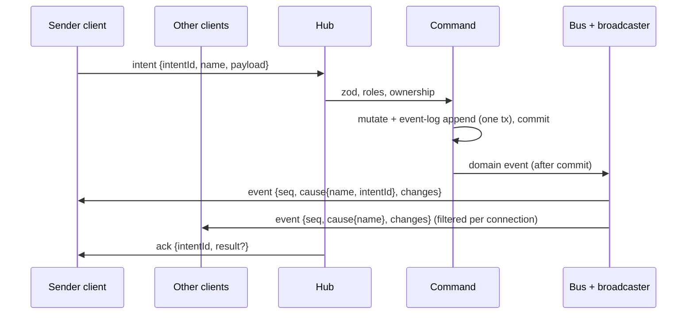

# Protocol

Consolidated REST (Hono RPC) + WebSocket catalogue. **Living doc**: the integrator extends it after each build phase's specs reach `complete`, alongside the [data model](../data-model/README.md) ([process](../process.md#stages)). Shared file: changes only via the orchestrator, in the same merge as the matching `src/shared/protocol/` code ([AGENTS §9.9](../../AGENTS.md#99-shared-files)).

| Phase | Specs consolidated | Status |
|---|---|---|
| Foundation | [live-sync](../specs/live-sync.md), [campaign-management](../specs/campaign-management.md), [fixtures-adapters](../specs/fixtures-adapters.md) | done (2026-10-12) |
| Scenes / Combat / Reward | see [roadmap](../roadmap.md#build-order-mvp) | > Later phase |

Spec shorthand: SYNC = live-sync, CAMP = campaign-management, FIX = fixtures-adapters.

## 1. Flow

Intent → validate → mutate + commit (with event-log entry) → domain event → listeners (synchronous, after commit) → broadcaster → visibility filter → WS ([ADR-0005](../architecture/adr/0005-server-authoritative-sync.md), [ADR-0016](../architecture/adr/0016-domain-events-pending-actions.md), [ADR-0021](../architecture/adr/0021-sync-protocol-conventions.md) F).

- REST (Hono RPC) calls run the same commands and produce the same events; the result is in the HTTP response ([FR-SYNC-15](../specs/live-sync.md#6-functional-requirements), ADR-0021 D).
- Rollback → no event, no log entry, no `ack`. A listener failure never rolls back ([FR-SYNC-16](../specs/live-sync.md#6-functional-requirements)).

## 2. Auth

| Credential | Held by | Sent | Check | Source |
|---|---|---|---|---|
| DM secret | env `PP_DM_SECRET` (≥ 12 chars); DM client localStorage | Every DM REST request + WS `hello` | `crypto.timingSafeEqual` on SHA-256 digests. Never logged, stored or sent back | [FR-CAMP-01–04](../specs/campaign-management.md#6-functional-requirements), [ADR-0019](../architecture/adr/0019-auth-credentials.md) |
| Link token | URL path `/p/<token>` *(proposed)* | `/api/join/:token` + WS `hello` | Lookup by `Player.linkToken` | [FR-CAMP-13/16/17](../specs/campaign-management.md#6-functional-requirements), ADR-0019 |

- No auth by source address, localhost included ([FR-CAMP-04](../specs/campaign-management.md#6-functional-requirements)).
- **Throttle** *(proposed, [OQ-CAMP-12](../specs/campaign-management.md#15-open-questions))*: 5 failed DM checks in 60 s, server-wide → all DM checks refused 60 s, even correct ones. REST 429; `hello` closed `4401`. Memory only ([FR-CAMP-05](../specs/campaign-management.md#6-functional-requirements)).

**Resolvers** (CAMP provides, SYNC calls; [CAMP §9](../specs/campaign-management.md#9-api--events))

| Resolver | Result | WS `hello` outcome | REST outcome |
|---|---|---|---|
| `verifyDmCredential(value)` | `{campaignId}` | live in that (active) campaign | allowed |
| | `invalid` | close `4401` | 401 |
| | `throttled` | close `4401` | 429 |
| | `noActiveCampaign` | close `4409` (DM client normally opens no WS then) | — (see [CON-15](#11-conflicts-log)) |
| `resolvePlayerLink(token)` | `{campaignId, playerId, campaignActive: true}` | live | `/api/join` 200 |
| | `{…, campaignActive: false}` | close `4409 campaign-inactive` | `/api/join` 200, `campaignActive: false` |
| | `null` | close `4401`, no other frame | 404 |

Sources: [FR-SYNC-02](../specs/live-sync.md#6-functional-requirements), [FR-SYNC-06](../specs/live-sync.md#6-functional-requirements), [FR-CAMP-05/17/18](../specs/campaign-management.md#6-functional-requirements).

## 3. WebSocket

### 3.1 Lifecycle

| Step | Rule | Source |
|---|---|---|
| Endpoint | One WS endpoint, path `/ws` *(proposed, [OQ-SYNC-15](../specs/live-sync.md#15-open-questions))*, same origin as the clients | FR-SYNC-01, [AGENTS §9.2](../../AGENTS.md#92-env-ports-and-data) |
| `hello` | First frame, within 5 s of open, else close `4408` | FR-SYNC-01 |
| Context | `{connId, campaignId, role, playerId?}`; fixed for the connection's life; ids/role in payloads never trusted. DM `campaignId` = active campaign at `hello`; player's from the link | FR-SYNC-02/03, [FR-CAMP-11](../specs/campaign-management.md#6-functional-requirements) |
| Snapshot | Exactly one `snapshot` (seq 0) before any `event` | FR-SYNC-08 |
| Heartbeat | Client `ping` every 10 s → server `pong`. Server closes a connection silent 30 s. Client treats 20 s without `pong` as dropped | FR-SYNC-04 |
| Reconnect | Forever; backoff 0.5 s doubling to 5 s, ±20 % jitter. Stops only on `4401`. Never resends in-flight intents | FR-SYNC-05 |
| Multiple tabs | Several connections per player or DM each get the same stream | FR-SYNC-03 |

**Client connection states** ([FR-SYNC-24](../specs/live-sync.md#6-functional-requirements)): `connecting | live | reconnecting | waiting | rejected`. Intent controls disabled unless `live`. Banner "Reconnecting…" after 1 s not live; after 60 s adds "Server unreachable — check with your DM". `waiting` / `rejected` use CAMP's waiting / invalid-link screens ([CAMP §7](../specs/campaign-management.md#7-uiux-notes)); DM `rejected` → login.

### 3.2 Client → server frames

| Frame | Payload | Who | Check | Source |
|---|---|---|---|---|
| `hello` | `{credential}` | DM, player | §2 resolvers | [SYNC §9](../specs/live-sync.md#9-api--events) |
| `intent` | `{intentId, name, payload}` | DM, player | zod by `name`, roles, ownership (§6) | FR-SYNC-12/13 |
| `signal` | `{name, data}` | DM, player | Signal schema + roles (§7) | FR-SYNC-22 |
| `resync` | `{}` | DM, player | Live connection → fresh snapshot | FR-SYNC-11 |
| `ping` | `{}` | DM, player | Live connection → `pong` | FR-SYNC-04 |

- Bad JSON or payload → `reject invalid` with issues; unknown `name` → `reject unknown_intent`; connection stays open. Frame > 64 KB → close `1009` ([FR-SYNC-12](../specs/live-sync.md#6-functional-requirements); direction: [CON-13](#11-conflicts-log)).
- Frame discriminator field name is not specified: [CON-14](#11-conflicts-log).

### 3.3 Server → client frames

| Frame | Payload | Visibility | Source |
|---|---|---|---|
| `snapshot` | `seq: 0`, `you {campaignId, role, playerId}`, `records {<type>: Record[]}` | Each type's fn; scopes per §4 | FR-SYNC-08/09, SYNC §9 |
| `event` | `seq`, `cause {name, intentId?}`, `changes[]` of `{type, id, op: upsert \| delete, data?}` | Each type's fn + transition matrix (§3.4). `intentId` on the sender's copy only | FR-SYNC-17/19/21, SYNC §9 |
| `signal` | `name`, `data` | Signal type's fn | FR-SYNC-22 |
| `ack` | `intentId`, `result?` | Sender only | FR-SYNC-14 |
| `reject` | `intentId`, `code`, `message`, `issues?` | Sender only | FR-SYNC-14, SYNC §9 |
| `pong` | — | Sender only | FR-SYNC-04 |

### 3.4 Snapshot and event rules

| Rule | Source |
|---|---|
| Client replaces its whole store with a snapshot and drops optimistic state | FR-SYNC-08 |
| Changes committed between snapshot read and send arrive as events after it: none lost, none duplicated | FR-SYNC-10 |
| Per domain event, each connection gets **at most one** `event`, applied atomically; nothing if no change survives the filter. Upsert = whole filtered record | FR-SYNC-17 |
| Events a sender's intent caused reach it **before** its `ack` (needs synchronous listeners) | FR-SYNC-14, ADR-0021 F |
| `seq` per connection: 1, 2, … after each snapshot. Gap → client sends `resync`. Send-buffer overflow or broadcaster error → close `4000`, never drop frames | FR-SYNC-21 |
| Snapshot and events share the filter: a player's store after live events equals a fresh snapshot | FR-SYNC-20 |
| Switching the active scene resyncs every player connection of the campaign | FR-SYNC-11 |
| No named per-feature WS events; UI effects read `cause` | SYNC §9, [ADR-0021](../architecture/adr/0021-sync-protocol-conventions.md) A |

**Transition matrix** per connection ([FR-SYNC-19](../specs/live-sync.md#6-functional-requirements)):

| Before → after | Sent |
|---|---|
| hidden → visible | `upsert` (reveal = appear) |
| visible → hidden | `delete` |
| visible → visible | `upsert` |
| hidden → hidden | nothing |

### 3.5 Close codes ([SYNC §9](../specs/live-sync.md#9-api--events))

| Code | Reason | When | Client does |
|---|---|---|---|
| `1001` | shutdown | Server shutting down | Reconnect (backoff) |
| `1009` | frame too large | Frame > 64 KB (FR-SYNC-12) | Reconnect |
| `4000` | resync required | Send-buffer overflow or broadcaster error (FR-SYNC-21) | Reconnect |
| `4401` | credential invalid | Bad DM secret, throttled, unknown token (FR-SYNC-02, FR-CAMP-05/17) | **Stop**; `rejected` (DM: login; player: invalid-link screen) |
| `4408` | no hello | No `hello` within 5 s (FR-SYNC-01) | Reconnect |
| `4409` | `campaign-inactive` | Player `hello` for inactive campaign; DM `noActiveCampaign`; active campaign switched (FR-SYNC-02/06/07, FR-CAMP-09) | DM: reconnect at once. Player: `waiting`, keep retrying, join ≤ 10 s after reactivation |

- `4401`, `4409` at `hello`: no other frame is sent first (FR-SYNC-02/06).
- Heartbeat-timeout close code is not specified: [CON-11](#11-conflicts-log).

### 3.6 Reject codes ([SYNC §9](../specs/live-sync.md#9-api--events))

| Code | When | Source |
|---|---|---|
| `invalid` | Bad JSON or payload; `issues` = zod issues | FR-SYNC-12 |
| `unknown_intent` | No handler for `name` | FR-SYNC-12 |
| `forbidden` | Role not allowed or ownership check fails; no change, no event | FR-SYNC-13 |
| `not_found` | Listed; target record missing | SYNC §9 |
| `conflict` | Feature guard on non-idempotent actions | SYNC §9, [§11](../specs/live-sync.md#11-edge-cases--failure-modes) |
| `internal` | Listed; server error | SYNC §9 |

### 3.7 Hub API (server-internal)

`resync(selector)`, `disconnect(selector, code)`, `connections(campaignId)` ([SYNC §9](../specs/live-sync.md#9-api--events)). Hub, broadcaster and presence hold no play state ([FR-SYNC-25](../specs/live-sync.md#6-functional-requirements)).

**Test seams** ([FR-SYNC-26](../specs/live-sync.md#6-functional-requirements), [ADR-0022](../architecture/adr/0022-deterministic-seams.md)): injectable clock and timers (heartbeat, backoff); test-only hook pauses a snapshot between read and send.

## 4. Scopes

| Scope | DM snapshot | Player snapshot | Source |
|---|---|---|---|
| `global` | all (imported definitions) | per the type's fn | FR-SYNC-09, [ADR-0018](../architecture/adr/0018-global-imported-content.md) |
| `campaign` | `ctx.campaignId` only | `ctx.campaignId` only, filtered | FR-SYNC-09, [ADR-0020](../architecture/adr/0020-single-active-campaign.md) |
| `scene` | all scenes of the campaign | active scene only | FR-SYNC-09, ADR-0021 C |

No WS frame carries another campaign's data; the campaign list is REST only ([FR-CAMP-07](../specs/campaign-management.md#6-functional-requirements)).

## 5. Record-type registry

Registration: `type, scope, schema, visibility (record, ctx) → full | redacted | hidden, snapshot provider` ([SYNC §8](../specs/live-sync.md#8-data-model), FR-SYNC-18). DM always `full`. **Unregistered type → hidden for players.**

| Type | Owner | Scope | Wire fields | Player visibility | Snapshot provider |
|---|---|---|---|---|---|
| `campaign` | CAMP | campaign | `{id, name}` | full for own campaign | own campaign row |
| `player` | CAMP | campaign | `{id, campaignId, name}` — no token field exists | full for own campaign (*proposed*, [OQ-CAMP-13](../specs/campaign-management.md#15-open-questions)) | all players of the campaign |
| `presence` | SYNC | in-memory, not persisted | `{playerId, online}` | **never sent** (DM only) | from live connections (delivery: [CON-07](#11-conflicts-log)) |
| `probe` *(test mode only)* | SYNC | campaign *(implied by `campaignId`, [CON-06](#11-conflicts-log))* | `{id, campaignId, text, hidden, ownerPlayerId}` | full iff `!hidden && (owner == null \|\| owner == ctx.playerId)`, else hidden | not stated ([CON-06](#11-conflicts-log)) |
| definition *(name TBD)* | entities | global | definition + provenance | hidden until entities registers a fn (default deny) | > Later phase (Scenes) |

Sources: [CAMP §9](../specs/campaign-management.md#9-api--events), [FR-CAMP-19](../specs/campaign-management.md#6-functional-requirements), [SYNC §8–9](../specs/live-sync.md#9-api--events), [FR-SYNC-23](../specs/live-sync.md#6-functional-requirements), [FR-SYNC-27](../specs/live-sync.md#6-functional-requirements), [FIX §9](../specs/fixtures-adapters.md#9-api--events).

> Later phase: Scenes (asset, scene, token, …), Combat (character, encounter, combatant, roll, notification, …), Reward (party loot). One row per type with scope + visibility rule.

## 6. Intents and commands

Registration: `name, schema, roles (default [dm]), authorize, execute` ([SYNC §8](../specs/live-sync.md#8-data-model)). Names `<feature>.<verb>`.

**WS intents**

| Intent | Owner | Roles | Payload | Ownership / authorize | Source |
|---|---|---|---|---|---|
| `probe.set` *(test mode)* | SYNC | DM | `{id?, text, hidden, ownerPlayerId?}` | Owner is a player of `ctx.campaignId` | [SYNC §9](../specs/live-sync.md#9-api--events) |
| `probe.edit` *(test mode)* | SYNC | player | `{id, text}` | Probe visible to the player and `ownerPlayerId == ctx.playerId` | SYNC §9 |

CAMP has **no WS intents**; FIX has none ([FR-FIX-24](../specs/fixtures-adapters.md#6-functional-requirements)).

**Commands over REST** ([CAMP §9](../specs/campaign-management.md#9-api--events); paths *proposed*, [OQ-CAMP-15](../specs/campaign-management.md#15-open-questions); prefix `/api/*`)

| Method | Path | Who | Purpose | Responses |
|---|---|---|---|---|
| POST | `/api/dm/login` | anyone | Verify DM secret | 204 / 401 / 429 |
| GET, POST | `/api/campaigns` | DM | List all + active flag; create (name rules [FR-CAMP-06](../specs/campaign-management.md#6-functional-requirements)) | |
| PATCH | `/api/campaigns/:id` | DM | Rename | |
| POST | `/api/campaigns/:id/activate` | DM | Switch active campaign | |
| GET, POST | `/api/players` | DM | Active campaign's players incl. `linkToken` (**only route returning tokens**); add | |
| PATCH | `/api/players/:id` | DM | Rename (token unchanged) | |
| GET | `/api/join/:token` | token holder | `{playerName, campaignName, campaignActive}` | 200 / 404 |
| GET | `/ws` *(proposed)* | DM, player | WS upgrade; auth in `hello` | |

- DM routes: 401 without the DM secret or with a player token; 429 when throttled ([CAMP §13](../specs/campaign-management.md#13-test-plan), FR-CAMP-05). Header name and error body: [CON-08](#11-conflicts-log), [CON-09](#11-conflicts-log).
- Clients import only `type AppType` from `@server/app` ([AGENTS §9.1](../../AGENTS.md#91-directory-layout-and-path-aliases)).
- **No route** for reset, load or the import pipeline; a route-table test enforces it ([FR-FIX-24](../specs/fixtures-adapters.md#6-functional-requirements)).

**Internal commands** (no route)

| Command | Caller | Input → output | Source |
|---|---|---|---|
| Import batch | Fixture loader only (in-process, DM authority) | `{source {key, name, licence, attribution, url?}, records {kind, sourceKey, data}[]}` → per record `created \| existing` + definition ID. All-or-nothing; errors: unknown kind, every validation error with sourceKey + field path | [FIX §9](../specs/fixtures-adapters.md#9-api--events), [FR-FIX-18–21](../specs/fixtures-adapters.md#6-functional-requirements) |
| Setup fixture steps | Fixture loader | Any registered server command, DM authority, same validation / events / log as UI | [FR-FIX-13](../specs/fixtures-adapters.md#6-functional-requirements) |

## 7. Signals

Registration: `name, schema, roles, visibility` ([SYNC §8](../specs/live-sync.md#8-data-model)). Not domain events: no bus, DB, event log, snapshot or `seq` ([FR-SYNC-22](../specs/live-sync.md#6-functional-requirements)).

| Signal | Owner | Roles | Visibility |
|---|---|---|---|
| none in Foundation | | | |

> Later phase (Scenes, [scenes-map](../specs/scenes-map.md)): ping, laser.

## 8. Domain events

Each lists `changes` (before/after per record; create: before null, delete: after null), including every record whose visibility changes ([SYNC §8](../specs/live-sync.md#8-data-model), [ADR-0021](../architecture/adr/0021-sync-protocol-conventions.md)). Logged in the commit's transaction unless marked non-logged ([FR-SYNC-16](../specs/live-sync.md#6-functional-requirements)).

| Domain event | Owner | Payload | Changes | Logged | Transient | Undoable | After commit |
|---|---|---|---|---|---|---|---|
| `CampaignCreated` | CAMP | | `campaign` upsert | yes | no | no | — (no connections yet) |
| `CampaignRenamed` | CAMP | | `campaign` upsert | yes | no | no | — |
| `CampaignActivated` | CAMP | `{campaignId, previousCampaignId}` | none | yes | no | no | `disconnect(previous campaign, 4409 campaign-inactive)` ≤ 1 s |
| `PlayerAdded` | CAMP | | `player` upsert | yes | no | no | — |
| `PlayerRenamed` | CAMP | | `player` upsert | yes | no | no | — |
| definition created *(name owned by entities)* | FIX → entities | | definition upsert (global) | yes, `campaignId` null | not stated | no (ADR-0016: combat only) | — (only for `created`; `existing` emits nothing) |
| probe events *(not named)* | SYNC | | `probe` upsert | not stated | | | [CON-05](#11-conflicts-log) |

Sources: [CAMP §9](../specs/campaign-management.md#9-api--events), [FR-CAMP-09](../specs/campaign-management.md#6-functional-requirements), [FR-SYNC-07](../specs/live-sync.md#6-functional-requirements), [FR-FIX-23](../specs/fixtures-adapters.md#6-functional-requirements), [ADR-0018](../architecture/adr/0018-global-imported-content.md).

- Listeners in Foundation: broadcaster, event-log write hook ([SYNC §2](../specs/live-sync.md#2-scope), [ADR-0016](../architecture/adr/0016-domain-events-pending-actions.md)).
- Known non-logged: token moves ([ADR-0016](../architecture/adr/0016-domain-events-pending-actions.md)). Undoable in MVP: combat damage/healing applied only.

> Later phase: Scenes, Combat (undoable events + compensating events, [ADR-0016](../architecture/adr/0016-domain-events-pending-actions.md)), Reward.

## 9. How a feature plugs in

From [ADR-0021](../architecture/adr/0021-sync-protocol-conventions.md) consequences, [SYNC §9](../specs/live-sync.md#9-api--events), [AGENTS §9.8](../../AGENTS.md#98-done-for-a-build-task). No changes to hub, broadcaster or client sync code ([SYNC §3](../specs/live-sync.md#3-goals)).

- [ ] **Record types**: name, scope (`global`/`campaign`/`scene`), zod schema, visibility fn `(record, ctx) → full | redacted | hidden`, bounded snapshot provider. Fn reads record + context only; visibility flags live on the record.
- [ ] **Intents**: `<feature>.<verb>`, zod schema, roles (default DM only), ownership check for every player-writable intent ([ADR-0004](../architecture/adr/0004-tenancy-auth-permissions.md)).
- [ ] **Optimistic** intents only if the spec marks them; server wins, reject reverts (ADR-0021 E).
- [ ] **Signals**, if any: name, schema, roles, visibility fn. No DB, bus or log.
- [ ] **Domain events**: typed, zod-validated; `changes` include every record whose visibility changes; mark logged? / undoable?.
- [ ] **No named per-feature WS events.** Reveal = `upsert`, hide = `delete`; no client reducer code.
- [ ] Commands take IDs, tokens, time only from `ctx` ([AGENTS §9.3](../../AGENTS.md#93-fixtures)).
- [ ] Tests: visibility per type for DM and player; convergence (store after events = fresh snapshot); leak scan.
- [ ] Registries are append-only: add your own lines only ([AGENTS §9.9](../../AGENTS.md#99-shared-files)). Add your rows to §5–§8 here and to the [data model](../data-model/README.md) via the orchestrator.

## 10. Versioning

Not specified by any Foundation spec. Single package, clients served by the same server ([ADR-0002](../architecture/adr/0002-single-package.md)). See [CON-17](#11-conflicts-log).

## 11. Conflicts log

Found at Foundation consolidation. Not resolved here; for the DM / orchestrator. Data-model conflicts CON-01–04: [data model §8](../data-model/README.md#8-conflicts-log).

| ID | Message / rule | Where | Suggested fix | Resolution |
|---|---|---|---|---|
| CON-05 | Probe domain events | [live-sync](../specs/live-sync.md) lines 104, 117 list probe intents but no domain event names or logged?/undoable? ([ADR-0021](../architecture/adr/0021-sync-protocol-conventions.md) line 71 requires them); line 150 tests "rollback → no event/log" with probes | SYNC §9: add e.g. `ProbeSet`, `ProbeEdited`: `probe` upsert, logged yes, undoable no | open |
| CON-06 | Probe scope + snapshot provider | [live-sync](../specs/live-sync.md) line 92 has `campaignId` but no scope or provider | SYNC §8: scope `campaign`; provider = the campaign's probes | open |
| CON-07 | Presence delivery | [live-sync](../specs/live-sync.md) line 69: presence is a record but not a domain event; frame (`event` with `seq`? which `cause`?) and snapshot inclusion unstated | SYNC: presence changes go in `event` frames (`cause {name: "presence"}`), included in DM snapshots | open |
| CON-08 | DM credential on REST | [campaign-management](../specs/campaign-management.md) line 48: "sent on every DM REST request", no header | CAMP §9: `Authorization: Bearer <secret>` | open |
| CON-09 | REST errors | [live-sync](../specs/live-sync.md) line 61 and [campaign-management](../specs/campaign-management.md) lines 102–110: no error body or status mapping (duplicate name, unknown id, no active campaign on `/api/players`) | Reuse reject codes as `{code, message, issues?}`; map `invalid` 400, `forbidden` 403, `not_found` 404, `conflict` 409 | open |
| CON-10 | First campaign auto-activates | [campaign-management](../specs/campaign-management.md) line 50 (create while none active → active) vs line 120 (`CampaignActivated`) and line 114 (DM opens no WS without an active campaign) | CAMP: state whether create emits `CampaignActivated {previousCampaignId: null}` and when the DM client opens its WS | open |
| CON-11 | Heartbeat-timeout close code | [live-sync](../specs/live-sync.md) line 50: server closes after 30 s silence; no code in line 115 | SYNC §9: name the code (e.g. `4408` or a new `4xxx`) | open |
| CON-12 | `cause.name` | [live-sync](../specs/live-sync.md) line 109: domain event name or intent name? | SYNC §9: domain event type (intent is in `intentId`) | open |
| CON-13 | 64 KB frame limit | [live-sync](../specs/live-sync.md) line 58 (any frame > 64 KB → `1009`) vs line 137 (snapshot up to 512 KB) | SYNC: limit applies to client → server frames only | open |
| CON-14 | Frame discriminator | [live-sync](../specs/live-sync.md) lines 101–111 name frames but not the field that carries the name | Skeleton builder picks (e.g. `type`) in `src/shared/protocol/`; recorded here in the same merge | open |
| CON-15 | `verifyDmCredential` on REST | [campaign-management](../specs/campaign-management.md) line 114 returns `noActiveCampaign`, but DM REST (list/create campaigns) must work with none active | CAMP §9: REST checks the secret only; `noActiveCampaign` applies to `hello` | open |
| CON-16 | Intent naming | [live-sync](../specs/live-sync.md) line 116 `<feature>.<verb>` vs `probe.set` / `probe.edit` (line 104); `probe` is not a feature slug | Accept `probe` as the prefix (test-only) or rename `sync.probe-set`; low | open |
| CON-17 | Versioning | No spec or ADR sets a protocol versioning policy | Low for MVP (one server, built clients); decide before post-MVP agent API | open |
