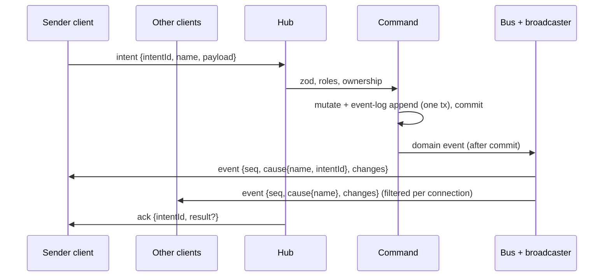

# Protocol

Consolidated REST (Hono RPC) + WebSocket catalogue. **Living doc**: the integrator extends it after each build phase's specs reach `complete`, alongside the [data model](../data-model/README.md) ([process](../process.md#stages)). Shared file: changes only via the orchestrator, in the same merge as the matching `src/shared/protocol/` code ([AGENTS §9.9](../../AGENTS.md#99-shared-files)).

| Phase | Specs consolidated | Status |
|---|---|---|
| Foundation | [live-sync](../specs/live-sync.md), [campaign-management](../specs/campaign-management.md), [fixtures-adapters](../specs/fixtures-adapters.md) | done (2026-10-12); CON-01–17 resolved ([decisions-log](../decisions-log.md) #118) and built in the skeleton |
| Scenes / Combat / Reward | see [roadmap](../roadmap.md#build-order-mvp) | > Later phase |

Spec shorthand: SYNC = live-sync, CAMP = campaign-management, FIX = fixtures-adapters. Code: zod schemas in `src/shared/protocol/` (`frames.ts`, `codes.ts`, `store.ts`).

## 1. Flow

Intent → validate → mutate + commit (with event-log entry) → commit hooks (cache refresh, CON-23) → domain event → listeners (synchronous, after commit) → broadcaster → visibility filter → WS ([ADR-0005](../architecture/adr/0005-server-authoritative-sync.md), [ADR-0016](../architecture/adr/0016-domain-events-pending-actions.md), [ADR-0021](../architecture/adr/0021-sync-protocol-conventions.md) F).

- REST (Hono RPC) calls run the same commands and produce the same events; the result is in the HTTP response ([FR-SYNC-15](../specs/live-sync.md#6-functional-requirements), ADR-0021 D).
- Rollback → no event, no log entry, no `ack`. A listener failure never rolls back ([FR-SYNC-16](../specs/live-sync.md#6-functional-requirements)).
- **Commit hooks** (CON-23, `r.afterCommit(name, fn)`): run after commit, once per event of the commit, before the bus dispatches any of them. Only for refreshing in-memory caches from the DB (e.g. the active-scene cache, [FR-MAP-06](../specs/scenes-map.md#6-functional-requirements)); never mutate state or emit. Skipped on rollback; a failure is logged and never rolls back.

## 2. Auth

| Credential | Held by | Sent | Check | Source |
|---|---|---|---|---|
| DM secret | env `PP_DM_SECRET` (≥ 12 chars); DM client localStorage | Every DM REST request as `Authorization: Bearer <secret>`; WS `hello` as `{role: "dm", secret}` | `crypto.timingSafeEqual` on SHA-256 digests. Never logged, stored or sent back | [FR-CAMP-01–04](../specs/campaign-management.md#6-functional-requirements), [ADR-0019](../architecture/adr/0019-auth-credentials.md), CON-08 |
| Link token | URL path `/p/<token>` *(proposed)* | `/api/join/:token`; WS `hello` as `{role: "player", token}` | Lookup by `Player.linkToken` (format checked first: 22 base64url chars) | [FR-CAMP-13/16/17](../specs/campaign-management.md#6-functional-requirements), ADR-0019 |

- No auth by source address, localhost included ([FR-CAMP-04](../specs/campaign-management.md#6-functional-requirements)).
- `hello.credential.role` picks the resolver, so a mangled player link never counts as a failed DM check.
- **Throttle** *(proposed, [OQ-CAMP-12](../specs/campaign-management.md#15-open-questions))*: 5 failed DM checks in 60 s, server-wide → all DM checks refused 60 s, even correct ones. REST 429; `hello` closed `4401`. Memory only ([FR-CAMP-05](../specs/campaign-management.md#6-functional-requirements)). A failed check = a secret was presented and is wrong; a DM route without `Authorization` gets 401 and doesn't count.

**Resolvers** (CAMP provides, SYNC calls; [CAMP §9](../specs/campaign-management.md#9-api--events))

| Resolver | Result | WS `hello` outcome | REST outcome |
|---|---|---|---|
| `verifyDmCredential(value)` | `{campaignId}` | live in that (active) campaign | — |
| | `invalid` | close `4401` | — |
| | `throttled` | close `4401` | — |
| | `noActiveCampaign` | close `4409` | — |
| `checkDmSecret(value)` (REST: secret only, no campaign needed, CON-15) | `ok` / `invalid` / `throttled` | — | allowed / 401 / 429 |
| `resolvePlayerLink(token)` | `{campaignId, playerId, campaignActive: true}` | live | `/api/join` 200 |
| | `{…, campaignActive: false}` | close `4409 campaign-inactive` | `/api/join` 200, `campaignActive: false` |
| | `null` | close `4401`, no other frame | 404 |

- The DM client opens its WS only once a campaign is active (CON-10); before that it stays on REST ("Create your first campaign").

Sources: [FR-SYNC-02](../specs/live-sync.md#6-functional-requirements), [FR-SYNC-06](../specs/live-sync.md#6-functional-requirements), [FR-CAMP-05/17/18](../specs/campaign-management.md#6-functional-requirements).

## 3. WebSocket

### 3.1 Lifecycle

| Step | Rule | Source |
|---|---|---|
| Endpoint | One WS endpoint, path `/ws` *(proposed, [OQ-SYNC-15](../specs/live-sync.md#15-open-questions))*, same origin as the clients | FR-SYNC-01, [AGENTS §9.2](../../AGENTS.md#92-env-ports-and-data) |
| `hello` | First frame, within 5 s of open, else close `4408`. A first frame that isn't a `hello` → `4408`; a `hello` with a malformed credential → `4401` | FR-SYNC-01 |
| Context | `{connId, campaignId, role, playerId?}`; fixed for the connection's life; ids/role in payloads never trusted. DM `campaignId` = active campaign at `hello`; player's from the link | FR-SYNC-02/03, [FR-CAMP-11](../specs/campaign-management.md#6-functional-requirements) |
| Snapshot | Exactly one `snapshot` (seq 0) before any `event` | FR-SYNC-08 |
| Heartbeat | Client `ping` every 10 s → server `pong`. Server closes a connection silent 30 s with `4408` (CON-11). Client treats 20 s without `pong` as dropped | FR-SYNC-04 |
| Reconnect | Forever; backoff 0.5 s doubling to 1.5 s (#131), immediate retry on focus/visible/online, ±20 % jitter. Stops only on `4401`. Never resends in-flight intents (their promises reject on disconnect). After a failed WS attempt the client probes `GET /ws?probe=1` (server answers `204`, no auth, no body; a plain `GET /ws` stays `426`) at each backoff step and opens a WS only once it answers: Chromium throttles new WebSockets by recent WS failures (up to +5 s each) | FR-SYNC-05 |
| Multiple tabs | Several connections per player or DM each get the same stream | FR-SYNC-03 |

**Client connection states** ([FR-SYNC-24](../specs/live-sync.md#6-functional-requirements)): `connecting | live | reconnecting | waiting | rejected`. Intent controls disabled unless `live`. Banner "Reconnecting…" after 1 s not live; after 60 s adds "Server unreachable — check with your DM". `waiting` / `rejected` use CAMP's waiting / invalid-link screens ([CAMP §7](../specs/campaign-management.md#7-uiux-notes)); DM `rejected` → login.

### 3.2 Client → server frames

Every frame is a JSON object; field **`type`** names the frame (CON-14).

| Frame | Payload | Who | Check | Source |
|---|---|---|---|---|
| `hello` | `{credential: {role: "dm", secret} \| {role: "player", token}}` | DM, player | §2 resolvers | [SYNC §9](../specs/live-sync.md#9-api--events) |
| `intent` | `{intentId (1–64 chars), name, payload}` | DM, player | zod by `name`, roles, ownership (§6) | FR-SYNC-12/13 |
| `signal` | `{name, data}` | DM, player | Signal schema + roles (§7); unknown → `reject unknown_intent`; role not allowed → `reject forbidden`; bad `data` → `reject invalid`. Rejected signals reach nobody. No `ack` | FR-SYNC-22, [ADR-0026](../architecture/adr/0026-signal-routing.md) |
| `resync` | `{}` | DM, player | Live connection → fresh snapshot | FR-SYNC-11 |
| `ping` | `{}` | DM, player | Live connection → `pong` | FR-SYNC-04 |

- Bad JSON or payload → `reject invalid` with issues (`intentId` null if it can't be read); unknown `name` → `reject unknown_intent`; connection stays open ([FR-SYNC-12](../specs/live-sync.md#6-functional-requirements)).
- Client → server frame > 64 KB → close `1009`. Server → client frames have no such limit (snapshots may reach 512 KB, SYNC §12) (CON-13).

### 3.3 Server → client frames

| Frame | Payload | Visibility | Source |
|---|---|---|---|
| `snapshot` | `seq: 0`, `you {campaignId, role, playerId}`, `records {<type>: Record[]}` | Each type's fn; scopes per §4 | FR-SYNC-08/09, SYNC §9 |
| `event` | `seq`, `cause {name, intentId?}`, `changes[]` of `{type, id, op: upsert \| delete, data?}` | Each type's fn + transition matrix (§3.4). `intentId` on the sender connection's copy only | FR-SYNC-17/19/21, SYNC §9 |
| `signal` | `name`, `data`, `from {role, playerId?}` (server-stamped from the sender's connection context, never the payload) | Every **other** live connection of the sender's campaign; never the sender (§7) | FR-SYNC-22, [ADR-0026](../architecture/adr/0026-signal-routing.md) |
| `ack` | `intentId`, `result?` | Sender only | FR-SYNC-14 |
| `reject` | `intentId \| null`, `code`, `message`, `issues?` | Sender only | FR-SYNC-14, SYNC §9 |
| `pong` | — | Sender only | FR-SYNC-04 |

- `cause.name` = the domain event type, e.g. `PlayerRenamed` (CON-12); the intent is identified by `intentId`. Presence changes use `cause.name: "presence"` (CON-07).

### 3.4 Snapshot and event rules

| Rule | Source |
|---|---|
| Client replaces its whole store with a snapshot and drops optimistic state | FR-SYNC-08 |
| Changes committed between snapshot read and send arrive as events after it: none lost, none duplicated | FR-SYNC-10 |
| Per domain event, each connection gets **at most one** `event`, applied atomically; nothing if no change survives the filter. Upsert = whole filtered record | FR-SYNC-17 |
| Events a sender's intent caused reach it **before** its `ack` (needs synchronous listeners) | FR-SYNC-14, ADR-0021 F |
| `seq` per connection: 1, 2, … after each snapshot. Gap → client sends `resync`. Send-buffer overflow (> 1 MB buffered or a dropped send) or broadcaster error → close `4000`, never drop frames | FR-SYNC-21 |
| Snapshot and events share the filter: a player's store after live events equals a fresh snapshot; for windowed types only pinned rows and rows at or above the window floor are compared (CON-39; helpers `convergence`, `leakScan` in `src/server/ws/testing/convergence.ts`) | FR-SYNC-20, [ADR-0029](../architecture/adr/0029-windowed-record-types.md) |
| Switching the active scene resyncs every player connection of the campaign | FR-SYNC-11 |
| No named per-feature WS events; UI effects read `cause` | SYNC §9, [ADR-0021](../architecture/adr/0021-sync-protocol-conventions.md) A |
| Every wire record has an `id` field; the client store is `type → id → record` | skeleton (`src/shared/protocol/store.ts`) |

**Transition matrix** per connection ([FR-SYNC-19](../specs/live-sync.md#6-functional-requirements)):

| Before → after | Sent |
|---|---|
| hidden → visible | `upsert` (reveal = appear) |
| visible → hidden | `delete` |
| visible → visible | `upsert` |
| hidden → hidden | nothing |

### 3.5 Close codes ([SYNC §9](../specs/live-sync.md#9-api--events))

| Code | Reason | When | Client does |
|---|---|---|---|
| `1001` | `shutdown` | Server shutting down | Reconnect (backoff) |
| `1009` | `frame-too-large` | Client frame > 64 KB (FR-SYNC-12) | Reconnect |
| `4000` | `resync-required` | Send-buffer overflow or broadcaster error (FR-SYNC-21) | Reconnect |
| `4401` | `credential-invalid` | Bad DM secret, throttled, unknown token, malformed `hello` (FR-SYNC-02, FR-CAMP-05/17) | **Stop**; `rejected` (DM: login; player: invalid-link screen) |
| `4408` | `no-hello` | No `hello` within 5 s (FR-SYNC-01); 30 s without any inbound frame (FR-SYNC-04, CON-11) | Reconnect |
| `4409` | `campaign-inactive` | Player `hello` for inactive campaign; DM `noActiveCampaign`; active campaign switched (FR-SYNC-02/06/07, FR-CAMP-09) | DM: reconnect at once (then backoff). Player: `waiting`, keep retrying, join ≤ 10 s after reactivation |

- `4401`, `4409` at `hello`: no other frame is sent first (FR-SYNC-02/06).

### 3.6 Reject codes ([SYNC §9](../specs/live-sync.md#9-api--events))

| Code | When | REST status | Source |
|---|---|---|---|
| `invalid` | Bad JSON or payload; `issues` = zod issues `{path, message}` | 400 | FR-SYNC-12 |
| `unknown_intent` | No handler for `name` (incl. REST-only commands sent as intents) | 404 | FR-SYNC-12 |
| `forbidden` | Role not allowed or ownership check fails; no change, no event | 403 | FR-SYNC-13 |
| `not_found` | Target record missing | 404 | SYNC §9 |
| `conflict` | Feature guard on non-idempotent actions; duplicate names; no active campaign | 409 | SYNC §9, [§11](../specs/live-sync.md#11-edge-cases--failure-modes) |
| `internal` | Server error | 500 | SYNC §9 |
| `unauthorized` *(REST only)* | DM route without or with a wrong secret | 401 | FR-CAMP-04 |
| `throttled` *(REST only)* | DM checks locked (FR-CAMP-05) | 429 | FR-CAMP-05 |

REST error body = `{code, message, issues?}` (CON-09).

### 3.7 Hub API (server-internal)

`resync(selector)`, `disconnect(selector, code)`, `connections(campaignId)` ([SYNC §9](../specs/live-sync.md#9-api--events)). Hub, broadcaster and presence hold no play state ([FR-SYNC-25](../specs/live-sync.md#6-functional-requirements)).

**Test seams** ([FR-SYNC-26](../specs/live-sync.md#6-functional-requirements), [ADR-0022](../architecture/adr/0022-deterministic-seams.md)): injectable clock and timers (heartbeat, backoff); test-only `beforeSnapshotSend` hook pauses a snapshot between read and send.

## 4. Scopes

| Scope | DM snapshot | Player snapshot | Source |
|---|---|---|---|
| `global` | all (imported definitions) | per the type's fn | FR-SYNC-09, [ADR-0018](../architecture/adr/0018-global-imported-content.md) |
| `campaign` | `ctx.campaignId` only | `ctx.campaignId` only, filtered | FR-SYNC-09, [ADR-0020](../architecture/adr/0020-single-active-campaign.md) |
| `scene` | all scenes of the campaign | active scene only: **scene gate** `sceneOf(record) = active scene`, on snapshots **and** live events | FR-SYNC-09, ADR-0021 C, CON-22 |

No WS frame carries another campaign's data, DM included (the scope gate runs before the visibility fn); the campaign list is REST only ([FR-CAMP-07](../specs/campaign-management.md#6-functional-requirements)).

**Scene gate** (CON-22): for players, a `scene`-scoped record whose `sceneOf` ≠ the campaign's active scene (or with no active scene) is `hidden` before the visibility fn runs. Snapshot and event path share it, so it feeds the §3.4 transition matrix (moved off the active scene → `delete`; onto it → `upsert`; edits off it → nothing). Providers return every scene's rows of the campaign; the gate filters. The active scene comes from one resolver (`r.activeScene(campaignId → sceneId | null)`, scenes-map's cache); none registered → no active scene.

## 5. Record-type registry

Registration: `type, scope, schema, idOf, campaignOf (campaign/scene scope, required), sceneOf (scene scope, required; CON-22), visibility (record, ctx) → full | redacted | hidden, redact?, snapshot provider, audience?` ([SYNC §8](../specs/live-sync.md#8-data-model), FR-SYNC-18). Missing `campaignOf` / `sceneOf` → registration error. DM always `full` (after the scope gate). **Unregistered type → hidden** (for the DM too: it can't be scope-gated). `audience: "dm"` = never sent to players, not even as an empty snapshot list. `window? {orderBy, size, pin?}` ([ADR-0029](../architecture/adr/0029-windowed-record-types.md), CON-38): snapshot = pinned rows + newest `size` unpinned rows by `orderBy` (a numeric field name), cut before the visibility filter; the provider returns the whole log, the registry cuts it.

| Type | Owner | Scope | Wire fields | Player visibility | Snapshot provider |
|---|---|---|---|---|---|
| `campaign` | CAMP | campaign | `{id, name}` | full for own campaign | own campaign row |
| `player` | CAMP | campaign | `{id, campaignId, name}` — no token field exists | full for own campaign (*proposed*, [OQ-CAMP-13](../specs/campaign-management.md#15-open-questions)) | all players of the campaign, creation order |
| `presence` | SYNC | campaign; in-memory, not persisted; `audience: dm` | `{id, playerId, campaignId, online}` (`id` = `playerId`) | **never sent** (DM only) | DM: one per player of the campaign, `online` from live connections. Changes go in `event` frames with `cause.name: "presence"` (CON-07) |
| `probe` *(test mode only)* | SYNC | campaign (CON-06) | `{id, campaignId, text, hidden, ownerPlayerId}` | full iff `!hidden && (owner == null \|\| owner == ctx.playerId)`, else hidden | the campaign's probes, insertion order (CON-06) |
| `entity`, `imported-entity` | entities | campaign, global | see [§12](#12-scenes-record-types) (CON-25) | | |

Sources: [CAMP §9](../specs/campaign-management.md#9-api--events), [FR-CAMP-19](../specs/campaign-management.md#6-functional-requirements), [SYNC §8–9](../specs/live-sync.md#9-api--events), [FR-SYNC-23](../specs/live-sync.md#6-functional-requirements), [FR-SYNC-27](../specs/live-sync.md#6-functional-requirements), [FIX §9](../specs/fixtures-adapters.md#9-api--events).

Scenes types: [§12](#12-scenes-record-types). Combat types: [§20](#20-combat-record-types). Reward types: [§29](#29-reward-party-loot).

## 6. Intents and commands

Registration: `name, schema, roles (default [dm]), authorize, execute` ([SYNC §8](../specs/live-sync.md#8-data-model)). Names `<short feature name>.<verb>`, unique (e.g. `map.*`, `assets.*`, `entities.*`; CON-30); `probe.*` accepted as a test-only prefix (CON-16). A command is a WS intent only if registered as one.

**WS intents**

| Intent | Owner | Roles | Payload | Ownership / authorize | Result | Source |
|---|---|---|---|---|---|---|
| `probe.set` *(test mode)* | SYNC | DM | `{id?, text (≤ 500), hidden, ownerPlayerId?}`; no `id` = create | Owner is a player of `ctx.campaignId` (else `forbidden`); `id` must be in `ctx.campaignId` (else `not_found`) | `{id}` | [SYNC §9](../specs/live-sync.md#9-api--events) |
| `probe.edit` *(test mode)* | SYNC | player | `{id, text}` | Probe visible to the player and `ownerPlayerId == ctx.playerId` (else `forbidden`) | `{id}` | SYNC §9 |

CAMP has **no WS intents**; FIX has none ([FR-FIX-24](../specs/fixtures-adapters.md#6-functional-requirements)).

**Commands over REST** ([CAMP §9](../specs/campaign-management.md#9-api--events); paths *proposed*, [OQ-CAMP-15](../specs/campaign-management.md#15-open-questions); prefix `/api/*`). DM routes need `Authorization: Bearer <DM secret>` (CON-08) and check the secret only (CON-15).

| Method | Path | Who | Body → 2xx response | Errors |
|---|---|---|---|---|
| POST | `/api/dm/login` | anyone | — → 204 | 401 / 429 |
| GET | `/api/campaigns` | DM | → 200 `{campaigns: {id, name, active}[]}` (creation order) | 401 / 429 |
| POST | `/api/campaigns` | DM | `{name}` (rules [FR-CAMP-06](../specs/campaign-management.md#6-functional-requirements)) → 201 `{campaign}` | 400 / 409 duplicate |
| PATCH | `/api/campaigns/:id` | DM | `{name}` → 200 `{campaign}` | 400 / 404 / 409 |
| POST | `/api/campaigns/:id/activate` | DM | — → 200 `{campaign}` (already active: no-op, no event) | 404 |
| GET | `/api/players` | DM | → 200 `{campaignId, publicBaseUrl \| null, players: {id, name, linkToken}[]}` (**only route returning tokens**) | 409 no active campaign |
| POST | `/api/players` | DM | `{name}` → 201 `{player: {id, name, linkToken}}` | 400 / 409 duplicate or no active campaign |
| PATCH | `/api/players/:id` | DM | `{name}` → 200 `{player}` (token unchanged) | 400 / 404 / 409 |
| GET | `/api/join/:token` | token holder | → 200 `{playerName, campaignName, campaignActive}` | 404 |
| GET | `/ws` *(proposed)* | DM, player | WS upgrade; auth in `hello`. Non-upgrade: `?probe=1` → 204, no auth, no body (reconnect probe, [§3.1](#31-lifecycle)); otherwise → 426 | |

- DM routes: 401 without the DM secret or with a player token; 429 when throttled ([CAMP §13](../specs/campaign-management.md#13-test-plan), FR-CAMP-05). Error body and statuses: §3.6 (CON-09). Unknown `/api/*` → 404 `not_found`.
- Clients import only `type AppType` from `@server/app` ([AGENTS §9.1](../../AGENTS.md#91-directory-layout-and-path-aliases)).
- **No route** for reset, load or the import pipeline; a route-table test enforces it ([FR-FIX-24](../specs/fixtures-adapters.md#6-functional-requirements)).

**Internal commands** (no route, no intent)

| Command | Caller | Input → output | Source |
|---|---|---|---|
| `import.batch` | Fixture loader only (in-process, DM authority) | `{source {key, name, licence, attribution, url?}, records {kind, sourceKey, data}[]}` → per record `{sourceKey, outcome: created \| existing, id}`. All-or-nothing; errors: `invalid` with every issue, path `[sourceKey, "kind"]` or `[sourceKey, "data", …field path]` | [FIX §9](../specs/fixtures-adapters.md#9-api--events), [FR-FIX-18–21](../specs/fixtures-adapters.md#6-functional-requirements) |
| Setup fixture steps | Fixture loader | Any registered server command, DM authority (actor campaign = active campaign), same validation / events / log as UI; no `intentId` | [FR-FIX-13](../specs/fixtures-adapters.md#6-functional-requirements) |

- The pipeline writes through a definition store + kind registry that entities plugs in (Scenes); the skeleton ships the core and tests it with a test-only kind (CON-03).

## 7. Signals

Registration: `name, schema, roles` ([SYNC §8](../specs/live-sync.md#8-data-model)); `r.signal(defineSignal(…))`. Not domain events: no bus, DB, event log, snapshot or `seq` ([FR-SYNC-22](../specs/live-sync.md#6-functional-requirements)).

Routing ([ADR-0026](../architecture/adr/0026-signal-routing.md)):

- The hub checks the sender is live, the name is registered, its role is in `roles`, and `data` passes the zod schema; any failure → `reject` to the sender only, nobody receives it.
- A valid signal goes to every **other** live connection of the sender's campaign (DM and players, incl. the sender's other tabs) as `signal {name, data, from}`; never back to the sender. `from` = `{role: "dm"}` or `{role: "player", playerId}` from the connection context.
- No per-signal visibility fn, no server scene check, no rate limit. Receivers filter: act only if `data.sceneId` is the scene they show (player: active; DM: viewed).
- Client: `connection.sendSignal(name, data)` (dropped when not live, never queued), `useSignal(name, handler)`.

| Signal | Owner | Roles |
|---|---|---|
| none in Foundation | | |

Scenes signals: [§15](#15-scenes-signals).

## 8. Domain events

Each lists `changes` (before/after per record; create: before null, delete: after null), including every record whose visibility changes ([SYNC §8](../specs/live-sync.md#8-data-model), [ADR-0021](../architecture/adr/0021-sync-protocol-conventions.md)). Logged in the commit's transaction unless marked non-logged ([FR-SYNC-16](../specs/live-sync.md#6-functional-requirements)). Payloads are zod-validated (`src/shared/events/`) and never hold a link token or the DM secret.

| Domain event | Owner | Payload | Changes | Logged | Transient | Undoable | After commit |
|---|---|---|---|---|---|---|---|
| `CampaignCreated` | CAMP | `{campaignId, name}` | `campaign` upsert | yes | no | no | — (no connections yet) |
| `CampaignRenamed` | CAMP | `{campaignId, name}` | `campaign` upsert | yes | no | no | — |
| `CampaignActivated` | CAMP | `{campaignId, previousCampaignId}`; `previousCampaignId: null` when create made the first campaign active (CON-10) | none | yes (log `campaignId` = new campaign) | no | no | `disconnect(connections of any other campaign, 4409 campaign-inactive)` ≤ 1 s |
| `PlayerAdded` | CAMP | `{playerId, campaignId, name}` | `player` upsert | yes | no | no | — |
| `PlayerRenamed` | CAMP | `{playerId, campaignId, name}` | `player` upsert | yes | no | no | — |
| `EntityImported` | FIX → entities | see [§16](#16-scenes-domain-events) (CON-25) | `imported-entity` upsert (global) | yes, `campaignId` null | no | no | — (only for `created`; `existing` emits nothing) |
| `ProbeSet` *(test mode)* | SYNC | `{probeId, text, hidden, ownerPlayerId}` | `probe` upsert (before null on create) | yes | no | no | — (CON-05) |
| `ProbeEdited` *(test mode)* | SYNC | `{probeId, text}` | `probe` upsert | yes | no | no | — (CON-05) |

Sources: [CAMP §9](../specs/campaign-management.md#9-api--events), [FR-CAMP-09](../specs/campaign-management.md#6-functional-requirements), [FR-SYNC-07](../specs/live-sync.md#6-functional-requirements), [FR-FIX-23](../specs/fixtures-adapters.md#6-functional-requirements), [ADR-0018](../architecture/adr/0018-global-imported-content.md).

- Listeners in Foundation: broadcaster (hub), campaign-switch disconnect (CAMP); the fixture loader adds a record collector during loads. The event-log write is part of the command transaction, not a listener ([SYNC §2](../specs/live-sync.md#2-scope), [ADR-0016](../architecture/adr/0016-domain-events-pending-actions.md)).
- Known non-logged: token moves ([ADR-0016](../architecture/adr/0016-domain-events-pending-actions.md)). Undoable in MVP: combat damage/healing applied only.
- **Helper events** (CON-40, gate I15): a helper whose record needs its own `cause` (e.g. `notify`) emits its own event via `env.emit`, after the owner's event; other helpers return `RecordChange[]` for the caller's event. Each is its own `event` frame, all before the sender's `ack`.

Scenes events: [§16](#16-scenes-domain-events). Combat events (undoable + compensating, [ADR-0016](../architecture/adr/0016-domain-events-pending-actions.md)): [§22](#22-combat-domain-events). > Later phase: Reward.

## 9. How a feature plugs in

From [ADR-0021](../architecture/adr/0021-sync-protocol-conventions.md) consequences, [SYNC §9](../specs/live-sync.md#9-api--events), [AGENTS §9.8](../../AGENTS.md#98-done-for-a-build-task). No changes to hub, broadcaster or client sync code ([SYNC §3](../specs/live-sync.md#3-goals)). Code: a `Feature` in `src/server/features/<feature>/index.ts`, one line in `src/server/features/index.ts`.

- [ ] **Record types**: name, scope (`global`/`campaign`/`scene`), zod schema, `id` field on the wire, `campaignOf` / `sceneOf` per scope (§4–§5), visibility fn `(record, ctx) → full | redacted | hidden`, bounded snapshot provider. Fn reads record + context only; visibility flags live on the record.
- [ ] **Intents**: `<short feature name>.<verb>` (§6), zod schema, roles (default DM only), ownership check for every player-writable intent ([ADR-0004](../architecture/adr/0004-tenancy-auth-permissions.md)).
- [ ] **Optimistic** intents only if the spec marks them; server wins, reject reverts (ADR-0021 E).
- [ ] **Signals**, if any: name, schema, roles; routing per §7. No DB, bus or log.
- [ ] **Domain events**: typed, zod-validated (`src/shared/events/<feature>.ts`, one line in its `index.ts`); `changes` include every record whose visibility changes; mark logged? / undoable?.
- [ ] **No named per-feature WS events.** Reveal = `upsert`, hide = `delete`; no client reducer code.
- [ ] Commands take IDs, tokens, time only from `ctx` ([AGENTS §9.3](../../AGENTS.md#93-fixtures)).
- [ ] Tests: visibility per type for DM and player; convergence (store after events = fresh snapshot); leak scan.
- [ ] Registries are append-only: add your own lines only ([AGENTS §9.9](../../AGENTS.md#99-shared-files)). Add your rows to §5–§8 here and to the [data model](../data-model/README.md) via the orchestrator.

## 10. Versioning

No protocol versioning in MVP: single package, clients served by the same server ([ADR-0002](../architecture/adr/0002-single-package.md)). Deferred (CON-17): decide before the post-MVP agent API.

## 11. Conflicts log

Found at Foundation consolidation; resolved by the integrator ([decisions-log](../decisions-log.md) #118) and folded into the sections above. Data-model conflicts CON-01–04: [data model §8](../data-model/README.md#8-conflicts-log).

| ID | Topic | Resolution | Now in |
|---|---|---|---|
| CON-05 | Probe domain events | `ProbeSet`, `ProbeEdited`: `probe` upsert, logged, not undoable | §8 |
| CON-06 | Probe scope + provider | Scope `campaign`; provider = the campaign's probes | §5 |
| CON-07 | Presence delivery | `event` frames with `cause.name: "presence"`; in DM snapshots | §3.3, §5 |
| CON-08 | DM credential on REST | `Authorization: Bearer <secret>` | §2, §6 |
| CON-09 | REST errors | Body `{code, message, issues?}`; reject codes → 400/403/404/409; plus `unauthorized` 401, `throttled` 429 | §3.6 |
| CON-10 | First campaign auto-activates | Emits `CampaignActivated {previousCampaignId: null}`; DM WS opens once a campaign is active | §2, §8 |
| CON-11 | Heartbeat-timeout close code | `4408` | §3.1, §3.5 |
| CON-12 | `cause.name` | Domain event type | §3.3 |
| CON-13 | 64 KB limit | Client → server frames only | §3.2 |
| CON-14 | Frame discriminator | Field `type` | §3.2 |
| CON-15 | `verifyDmCredential` on REST | REST checks the secret only (`checkDmSecret`); `noActiveCampaign` applies to `hello` | §2 |
| CON-16 | Intent naming | `probe.*` accepted (test-only) | §6 |
| CON-17 | Versioning | Deferred: decide before post-MVP agent API | §10 |

Scenes consolidation (CON-18+, integrator):

| ID | Message / rule | Where | Suggested fix | Resolution |
|---|---|---|---|---|
| CON-22 | `scene` scope gate (**leak risk**) | Registration (§5 line 164; [live-sync](../specs/live-sync.md) line 90) has `scope` but no way to tell a record's scene; FR-SYNC-09 (line 55) covers snapshots only. [scenes-map](../specs/scenes-map.md) lines 105, 107, 177: `scene` gated by `id`, `token` by `sceneId`. Without an event-path gate, a DM edit to a visible token on a non-active scene is sent to players | Registration gains `sceneOf(record) → sceneId`, required for scope `scene`. Snapshot **and** event path treat a scene-scoped record whose `sceneOf` ≠ the active scene as `hidden` for players (feeds the §3.4 transition matrix). Providers return all campaign rows; the gate filters. Sequenced shared change (`src/server/ws/`, `src/shared/protocol/`) after the skeleton, before scenes-map | resolved (fix/scenes-core): §4 scene gate, §5 `sceneOf`; built in `RecordRegistry.view` (snapshot + events), resolver via `r.activeScene` |
| CON-23 | Active-scene cache timing | [scenes-map](../specs/scenes-map.md) line 46 (FR-MAP-06): cache updated "after commit, **before listeners run**", then players resynced. §1 / [ADR-0021](../architecture/adr/0021-sync-protocol-conventions.md) F have only "listeners, synchronous, after commit"; no pre-listener step | Command core gets a post-commit, pre-dispatch hook (or an ordered first listener) that reloads the cache from the DB; resync of players runs as a listener. Same sequenced change as CON-22 (`src/server/commands/`, `src/server/events/`) | resolved (fix/scenes-core): commit hooks in `Commands.run` (`r.afterCommit`), §1 |
| CON-24 | Signal frame + routing | §3.3 line 94 and §7 line 217 (`signal {name, data}`, "visibility fn"); [live-sync](../specs/live-sync.md) line 68 (FR-SYNC-22) vs accepted [ADR-0026](../architecture/adr/0026-signal-routing.md) (`from {role, playerId?}` server-stamped; forward to every **other** connection of the campaign) | Update §3.3 row, §7 rule and FR-SYNC-22 per ADR-0026 after the skeleton merges (not edited here). [§15](#15-scenes-signals) is authoritative meanwhile | resolved (fix/scenes-core): §3.2, §3.3, §7, FR-SYNC-22 updated; hub routing + `from` built |
| CON-25 | Definition record type + event names | §5 line 172 ("definition *(name TBD)*") and §8 line 236 ("definition created") vs [entities](../specs/entities.md) lines 107–118: types `entity` (campaign) + `imported-entity` (global), event `EntityImported` | Replace both Foundation rows with pointers to [§12](#12-scenes-record-types) / [§16](#16-scenes-domain-events) after the skeleton merges | resolved (fix/scenes-core): §5, §8 rows point to §12 / §16 |
| CON-26 | Broken ADR links | `]($100NN-…md)` (bad regex replace) in [assets-pipeline](../specs/assets-pipeline.md) line 15; [entities](../specs/entities.md) lines 15, 52, 186; [play-shell](../specs/play-shell.md) line 16; [scenes-map](../specs/scenes-map.md) lines 109, 177, 179, 195 | Replace `$1` with `../architecture/adr/` (9 links). Spec owners or integrator; trivial | resolved (integrator)  |
| CON-27 | Stale statuses | [scenes-map](../specs/scenes-map.md) line 65 FR-MAP-25 "*(proposed, OQ-MAP-16)*", line 177 "ADR proposed", line 195 "ADR-0026 awaits acceptance" (accepted, #125). [assets-pipeline](../specs/assets-pipeline.md) line 176 "open: OQ-ASSET-10" and line 196 (entities FR-ENT-08/11 already call `assets.require`) | Drop the "proposed"/"awaits" wording; mark OQ-ASSET-10 decided. Low | resolved (fix/scenes-core): FR-MAP-25, MAP §14–15, OQ-ASSET-10, ASSET §14 |
| CON-28 | Asset window kind | [play-shell](../specs/play-shell.md) lines 158, 172 (OQ-SHELL-06: `asset.images`, DM) vs [assets-pipeline](../specs/assets-pipeline.md) line 60 (FR-ASSET-19: `asset.test`, test mode only; OQ-ASSET-08) | play-shell OQ-SHELL-06 / §14 → `asset.test` (test mode). Builders use `asset.test` | resolved (fix/scenes-core): SHELL §14, OQ-SHELL-06 |
| CON-29 | "Assets are URLs" | [live-sync](../specs/live-sync.md) line 138 vs [assets-pipeline](../specs/assets-pipeline.md) line 173 (asks integrator to amend) and [ADR-0023](../architecture/adr/0023-asset-access-by-capability-id.md) | live-sync §12: "Records carry asset IDs; clients build the URL (ADR-0023)". Low | resolved (fix/scenes-core): SYNC §12 |
| CON-30 | Command naming | §6 line 180 `<feature>.<verb>` vs `map.*` (spec prefix), `assets.*`, `entities.*` (neither slug nor prefix) | Accept as short feature names (CON-16 precedent); §6 rule → "`<short feature name>.<verb>`, unique". Low | resolved (fix/scenes-core): §6, §9 |
| CON-31 | Command → event mapping | [scenes-map](../specs/scenes-map.md) lines 98–101 vs 115–117: which event `map.setSceneMap` / `setGrid` / `setLocked`, REST PATCH (rename, move), `updateToken`, `setTokenHidden` emit is implied, not stated | scenes-map §9: `SceneUpdated` = PATCH + setSceneMap/setGrid/setLocked; `TokenUpdated` = updateToken; `TokenHidden`/`TokenRevealed` = setTokenHidden. [§16](#16-scenes-domain-events) assumes this | resolved (fix/scenes-core): MAP §9 mapping line |
| CON-32 | DM empty-state wording | [play-shell](../specs/play-shell.md) line 46 (DM: "No active scene") vs [scenes-map](../specs/scenes-map.md) line 48 (DM shows the first scene if none active; empty state only with **no scenes**) | play-shell FR-SHELL-02 DM text → "No scenes yet". Low | resolved (fix/scenes-core): FR-SHELL-02, SHELL §13 step 1 |
| CON-33 | Client extension registries | [scenes-map](../specs/scenes-map.md) line 69 (FR-MAP-29: canvas layer registry; token menu + double-click registry) are extension points for Combat / post-MVP, not in [AGENTS §9.9](../../AGENTS.md#99-shared-files) append-only list | Add them to §9.9 when a second spec registers (combat-tracker). Low | resolved (spec/consolidate-combat): AGENTS §9.9 lists the token menu / double-click registry; combat-tracker is the second registrant (CON-43) |

Combat consolidation (CON-38+, integrator; CON-34–37: [data model §8](../data-model/README.md#8-conflicts-log)). Applied by fix/combat-core after `build/entities` merged; line numbers as on `main` @ c579ac1.

| ID | Message / rule | Where | Suggested fix | Resolution |
|---|---|---|---|---|
| CON-38 | Windowed record types | §5 registration list (line 179) has no `window`; §5 line 191 "Later phase" note. [ADR-0029](../architecture/adr/0029-windowed-record-types.md) (#137) adds optional `window {orderBy, size, pin?}` | Line 179: append "`window? {orderBy, size, pin?}` ([ADR-0029](../architecture/adr/0029-windowed-record-types.md)): snapshot = pinned rows + newest `size` by `orderBy`, cut before the visibility filter". Line 191 → pointer to [§20](#20-combat-record-types) | resolved (fix/combat-core): §5; built in `RecordRegistry` + `@shared/protocol/window` |
| CON-39 | Convergence rule | §3.4 line 117 (FR-SYNC-20) vs ADR-0029; [live-sync](../specs/live-sync.md) FR-SYNC-20 amended in this branch | Line 117: append "; for windowed types only pinned rows and rows at or above the window floor are compared" | resolved (fix/combat-core): §3.4; helpers `convergence`, `leakScan` |
| CON-40 | Helper events + Combat pointers in §8 | §8 has no rule for in-transaction helpers (gate I15); lines 269, 271 "Later phase" | §8: add "A helper whose record needs its own `cause` (e.g. `notify`) emits its own event via `env.emit`, after the owner's event; other helpers return `RecordChange[]` for the caller's event. Each is its own `event` frame, all before the sender's `ack`". Line 271 → pointer to [§22](#22-combat-domain-events) | resolved (fix/combat-core): §8 |
| CON-41 | Helper signatures `ctx` → `env` | §13 line 390 `resolveDefinition(ctx, id)`; §17 line 447 `(ctx, before, after)`. Amended in this branch: [entities](../specs/entities.md) FR-ENT-12, FR-ENT-19 and [ADR-0028](../architecture/adr/0028-token-changed-hooks.md) take `env: CommandEnv`, campaign = `env.actor.campaignId` (gate I14; `CommandContext` has no `campaignId`) | Line 390 → `resolveDefinition(env, id)`; line 447 → `(env, before, after)`. Tell the `build/entities` builder | resolved (fix/combat-core): §13; §17 already `env` (build/entities) |
| CON-42 | Hook rows in §16 / §17 | §16 token rows (line 435), `SceneDeleted` (line 432) and `EntityUpdated` (line 431) list no `combatant` / `encounter` changes; §17 line 454 combat hook "> Later phase"; §16 line 438 names §17 only | Line 435 / 432 changes: "+ `combatant` / `encounter` rows from token-changed hooks ([§25](#25-combat-token-changed-hooks), ADR-0028)". Line 431: "+ `combatant` rows (FR-CBT-06)". Line 454 → "combatant `hpMax` / `hpCurrent` and portrait copies, [FR-CBT-06](../specs/combat-tracker.md#6-functional-requirements)". Line 438: add "token-changed hooks ([§25](#25-combat-token-changed-hooks))" | resolved (fix/combat-core): §16, §17 |
| CON-43 | CON-33 + client registries | CON-33 (line 326) still `open`; §18 line 474 lists token menu registry only | CON-33 Resolution → "resolved (spec/consolidate-combat): AGENTS §9.9 lists the token menu / double-click registry; combat-tracker is the second registrant". §18 line 474 → pointer to [§26](#26-combat-registries-and-seams) | resolved (fix/combat-core): CON-33 row, §18 |
| CON-44 | DM snapshot budget | live-sync §12: snapshot ≤ 512 KB *(proposed)*. Worst case DM: scenes ≤ 300 KB ([MAP §12](../specs/scenes-map.md#12-performance--bandwidth)) + game log ≤ 100 KB + notifications ~190 KB + pending + encounters ≤ 53 KB + combatants ≤ 17 KB + hp-change ≤ 20 KB ≈ 680 KB. Typical ≈ 430 KB ([§20](#20-combat-record-types) budget table) | Pick one: notification window 100 → 50 closed (gate I17 alternative; worst ≈ 585 KB) / raise the DM ceiling to 768 KB (players stay < 512 KB) / accept (worst case needs 1,000 tokens + max-size payloads). Pick: raise the DM ceiling; all numbers are proposed | resolved (#142): DM ceiling 768 KB; players stay ≤ 512 KB; notification window stays 100 |

## 12. Scenes: record types

Consolidated 2026-10-12 from the `complete` specs. Shorthand: ASSET = [assets-pipeline](../specs/assets-pipeline.md), ENT = [entities](../specs/entities.md), SHELL = [play-shell](../specs/play-shell.md), MAP = [scenes-map](../specs/scenes-map.md). Foundation sections above amended per [CON-22–32](#11-conflicts-log) (fix/scenes-core). Data side: [data model §9–§13](../data-model/README.md#9-scenes-er-diagram).

DM always `full`. Generic record changes only ([ADR-0021](../architecture/adr/0021-sync-protocol-conventions.md) A).

| Type | Owner | Scope | Wire fields (DM) | Player visibility | Snapshot provider | Source |
|---|---|---|---|---|---|---|
| `asset` | ASSET | campaign | `{id, campaignId, seq, name, mime, bytes, width, height, displayWidth, displayHeight, createdAt}` (no `hash`) | **hidden** | all of the campaign's assets | [FR-ASSET-10](../specs/assets-pipeline.md#6-functional-requirements), ASSET §9 |
| `entity` | ENT | campaign | row minus provenance (+ `tokenShape`, feedback pass) | own character (`ownerPlayerId = ctx.playerId`) **full**; other characters **redacted** `{id, kind, name, portraitAssetId, ownerPlayerId}` (+ derived `down` = `hpCurrent = 0`, feedback pass, #154); monsters **hidden** | campaign's characters + customs | [FR-ENT-15](../specs/entities.md#6-functional-requirements), [ADR-0024](../architecture/adr/0024-definition-visibility.md) |
| `imported-entity` | ENT | global, `audience: dm` (players get no list, not even empty; [ADR-0024](../architecture/adr/0024-definition-visibility.md)) | row incl. provenance | **hidden** | all imported definitions | [FR-ENT-16](../specs/entities.md#6-functional-requirements), [ADR-0018](../architecture/adr/0018-global-imported-content.md) |
| `scene` | MAP | scene, `sceneOf = id` ([CON-22](#11-conflicts-log)) | full row | **redacted** `{id, mapAssetId, mapWidth, mapHeight, grid*, active}` (no name, folder, lock, `seq`) *(proposed, OQ-MAP-17)* | DM: all; player: active | [FR-MAP-26](../specs/scenes-map.md#6-functional-requirements), MAP §9 |
| `scene-folder` | MAP | campaign | full row | **hidden** | campaign's folders | FR-MAP-26 |
| `token` | MAP | scene, `sceneOf = sceneId` | full row incl. `shape`, `speed` (*(feedback pass, built)*) | `hidden` → **hidden**; else **redacted**: all fields but `definitionId` (*(feedback pass, built)*: and `speed` unless `ownerPlayerId = ctx.playerId`, [FR-MAP-36](../specs/scenes-map.md#6-functional-requirements)) | DM: all; player: active scene's | FR-MAP-26, [FR-MAP-19](../specs/scenes-map.md#6-functional-requirements) |

- **Asset IDs** reach a player only as fields of records that player receives (`scene.mapAssetId`, visible `token.imageAssetId`, `entity.portraitAssetId` of characters). Never in a REST body, error, toast, URL or log a player can read ([FR-ASSET-12](../specs/assets-pipeline.md#6-functional-requirements), [ADR-0023](../architecture/adr/0023-asset-access-by-capability-id.md)). Leak tests: ASSET §13 leak property, ENT §13 and MAP §13 leak strings.
- Activation changes token visibility for players via the resync snapshot, not via `changes` ([FR-MAP-06](../specs/scenes-map.md#6-functional-requirements), ADR-0021 C).
- No layout record type ([ADR-0025](../architecture/adr/0025-play-shell-windows.md)).

## 13. Scenes: intents, REST and internal APIs

**WS intents** (default DM only; all `map.*` canvas actions, [ADR-0021](../architecture/adr/0021-sync-protocol-conventions.md) D). ENT, ASSET, SHELL have **none**.

| Intent | Roles | Payload | Ownership / authorize | Result | Source |
|---|---|---|---|---|---|
| `map.activateScene` | DM | `{sceneId}` | Scene in `ctx.campaignId` | | [FR-MAP-06](../specs/scenes-map.md#6-functional-requirements) |
| `map.setSceneMap` | DM | `{sceneId, mapAssetId}` | `assets.require`; locked → `conflict` | | [FR-MAP-09](../specs/scenes-map.md#6-functional-requirements), [FR-MAP-11](../specs/scenes-map.md#6-functional-requirements) |
| `map.setGrid` | DM | `{sceneId, cellSize, offsetX, offsetY, visible, color, opacity}` | Bounds FR-MAP-10; locked → `conflict` | | [FR-MAP-10](../specs/scenes-map.md#6-functional-requirements) |
| `map.setLocked` | DM | `{sceneId, locked}` | Scene in campaign | | FR-MAP-11 |
| `map.placeToken` | DM | `{sceneId, definitionId, col, row, name?, imageAssetId?, ownerPlayerId?, hidden?}` (never size or speed); *(feedback pass, built)* `shape?` (default: definition `tokenShape`, else `round`) | `resolveDefinition`, `assets.require`, owner ∈ campaign, footprint + caps (FR-MAP-14) | | [FR-MAP-13](../specs/scenes-map.md#6-functional-requirements) |
| `map.moveToken` | DM, **player** | `{tokenId, col, row}` | Player: owner = `ctx.playerId`, not hidden, on active scene; can't see → `not_found`, not theirs → `forbidden`. DM: any. **Optimistic**. *(feedback pass, built)*: runs the token-changed hooks ([§25](#25-combat-token-changed-hooks), [ADR-0031](../architecture/adr/0031-token-move-hooks.md)) | | [FR-MAP-15](../specs/scenes-map.md#6-functional-requirements), [FR-MAP-21](../specs/scenes-map.md#6-functional-requirements), [FR-MAP-38](../specs/scenes-map.md#6-functional-requirements) |
| `map.updateToken` | DM | `{tokenId, name?, imageAssetId?, ownerPlayerId?}`; *(feedback pass, built)* `shape?` | Token in campaign; `assets.require`; no size or speed | | [FR-MAP-18](../specs/scenes-map.md#6-functional-requirements) |
| `map.setTokenHidden` | DM | `{tokenId, hidden}` | Token in campaign | | FR-MAP-19 |
| `map.duplicateToken` | DM | `{tokenId}` | Token in campaign; placement rule FR-MAP-17 | `{tokenId}` | [FR-MAP-17](../specs/scenes-map.md#6-functional-requirements) |
| `map.deleteToken` | DM | `{tokenId}` | Token in campaign | | FR-MAP-18 |

**REST** (DM `Authorization: Bearer`, prefix `/api/*` per [OQ-CAMP-15](../specs/campaign-management.md#15-open-questions); errors `{code, message, issues?}` → 400/403/404/409, CON-09; no/invalid secret or player token → 401, throttled → 429). Campaign = `ctx.campaignId` at authentication ([CON-21](../data-model/README.md#8-conflicts-log)).

| Method | Path | Who | Command / purpose | Success | Source |
|---|---|---|---|---|---|
| POST | `/api/assets` | DM | `assets.ingest`: multipart `file`, `name?` | `201 {asset}` created / `200 {asset}` existing; 400, 401, 413, 415, 422, 429 | [FR-ASSET-01–03](../specs/assets-pipeline.md#6-functional-requirements), ASSET §9 |
| GET | `/api/assets/:id/:file` | **anyone holding the ID** (no credential) | Serve `thumb` \| `display` ([§14](#14-scenes-asset-route)) | 200 / 304 / 404 | [FR-ASSET-11](../specs/assets-pipeline.md#6-functional-requirements) |
| POST | `/api/entities` | DM | `entities.create {kind, name, portraitAssetId?, statBlock, derivedFromId?, ownerPlayerId?}`; *(feedback pass, built)* `tokenShape?`; `statBlock` optional `speed`, `abilities`, `saveProficiencies` | `201 {entity}` | [FR-ENT-08–10](../specs/entities.md#6-functional-requirements) |
| PUT | `/api/entities/:id` | DM | `entities.update` (whole replace; imported → 403). *(feedback pass, built)*: `tokenShape?` as create; omitted → null. Also how character speed / scores / saves are set in MVP (#154) | `200 {entity}` | [FR-ENT-07](../specs/entities.md#6-functional-requirements), [FR-ENT-11](../specs/entities.md#6-functional-requirements) |
| POST | `/api/scenes` | DM | Create `{name, mapAssetId, folderId?}` | `201 {scene}` | [FR-MAP-01](../specs/scenes-map.md#6-functional-requirements) |
| PATCH | `/api/scenes/:id` | DM | Rename, move to folder / root | `200` | [FR-MAP-03](../specs/scenes-map.md#6-functional-requirements) |
| DELETE | `/api/scenes/:id` | DM | Delete non-active (active → 409) *(proposed)* | `204` | [FR-MAP-05](../specs/scenes-map.md#6-functional-requirements) |
| POST | `/api/scenes/:id/duplicate` | DM | Duplicate with tokens | `201 {scene}` | [FR-MAP-04](../specs/scenes-map.md#6-functional-requirements) |
| POST | `/api/scene-folders` | DM | Create | `201 {sceneFolder}` | [FR-MAP-02](../specs/scenes-map.md#6-functional-requirements) |
| PATCH, DELETE | `/api/scene-folders/:id` | DM | Rename; delete (scenes → root) | `200`, `204` | FR-MAP-02 |

- **Built** (build/scenes-map): the scene / folder routes run REST-only commands (also fixture steps, never WS intents): `map.createScene`, `map.updateScene` (PATCH), `map.duplicateScene`, `map.deleteScene`, `map.createFolder`, `map.renameFolder`, `map.deleteFolder`. PATCH `/api/scenes/:id` `{name?, folderId?: ID | null}` (empty → 400) → `200 {scene}`; PATCH `/api/scene-folders/:id` `{name}` → `200 {sceneFolder}`. Token owner not a player of the campaign → `invalid`.
- No GET for entities, scenes or folders: the snapshot carries the records ([ENT §9](../specs/entities.md#9-api--events)). No route reaches `entities.import` ([FR-FIX-24](../specs/fixtures-adapters.md#6-functional-requirements)).
- **Campaign at authentication** ([CON-21](../data-model/README.md#8-conflicts-log)): every DM REST route above that acts in a campaign mounts `dmOnly(s), dmCampaign(s)` (`src/server/http.ts`). `dmCampaign` resolves the active campaign once, when the request is authenticated, and sets `c.get("campaignId")`; no active campaign → 409 `conflict`. Handlers run commands with `dmActor(campaignId)`; commands read `actor.campaignId`, so a campaign switch mid-request never moves the write. 401 / 429 come first (middleware order).
- **`POST /api/assets` errors** (CON-09 body `{code, message}`): 400 `invalid` (no `file` part, bad `name`); 413 / 415 / 422 keep code **`invalid`**, the HTTP status carries the cause, `message` is the UI text: 413 "File over 25 MB" (Content-Length or streamed count, stops reading), 415 "Unsupported file type", 422 "Image over 50 megapixels" / "Image is corrupt or unreadable" / "SVG needs width and height or a viewBox" / "SVG entity declarations are not allowed". No new error codes.

**Internal server APIs** (no route)

| API | Owner | Contract | Source |
|---|---|---|---|
| `assets.ingest {bytes, filename, name?}` | ASSET | → `{asset, outcome: created \| existing}`; called by REST upload and fixture loader (FR-FIX-17); DM authority. Two halves: async `prepareIngest` (sniff, SVG rules, sharp derivatives; no disk, rejects 413/415/422) → registered sync command `assets.ingest {image, filename, name?}` (files, then row + log in one tx). `ingestAsset(s, req, opts)` runs both | [FR-ASSET-01](../specs/assets-pipeline.md#6-functional-requirements) |
| `assets.require(ctx, id)` | ASSET | Asset of `ctx.campaignId` or `not_found`. Every command setting an asset-ID field, incl. propagated copies | [FR-ASSET-15](../specs/assets-pipeline.md#6-functional-requirements) |
| `entities.import` | ENT | Implements the pipeline insert interface (CON-03); `source` = descriptor key; one `EntityImported` per created row | [FR-ENT-06](../specs/entities.md#6-functional-requirements) |
| `resolveDefinition(env, id)` | ENT | Global or same-campaign (`env.actor.campaignId`) definition, else `not_found`; every command storing a definition reference (CON-41) | [FR-ENT-12](../specs/entities.md#6-functional-requirements) |
| `effectiveStats(def, inst)`, XP table, kind registry | ENT (`@shared/entities`) | Pure; `def.statBlock` in MVP. *(feedback pass, built)*: `abilityMod(score)`, `proficiencyBonus(stats)`, `checkBonus(stats, ability)`, `saveBonus(stats, ability)` take the stat block (`level` → character, `cr` → monster), never stored ([FR-ENT-24](../specs/entities.md#6-functional-requirements), [ADR-0032](../architecture/adr/0032-ability-derivation.md)) | [FR-ENT-01](../specs/entities.md#6-functional-requirements), [FR-ENT-03](../specs/entities.md#6-functional-requirements), [FR-ENT-13](../specs/entities.md#6-functional-requirements) |
| Definition-changed hook registry | ENT | [§17](#17-scenes-definition-changed-hooks) | [FR-ENT-19](../specs/entities.md#6-functional-requirements) |

## 14. Scenes: asset route

`GET /api/assets/:id/:file` ([ADR-0023](../architecture/adr/0023-asset-access-by-capability-id.md) C′, #123).

| Rule | Detail | Source |
|---|---|---|
| Capability | No credential; knowing the 128-bit ID is the permission. Same for DM and players | [FR-ASSET-11](../specs/assets-pipeline.md#6-functional-requirements) |
| Served iff | Asset exists **and** belongs to the active campaign; `file` ∈ `thumb \| display`. Originals never served; SVG never served | FR-ASSET-11, [FR-ASSET-02](../specs/assets-pipeline.md#6-functional-requirements) |
| Denials | Unknown ID, other / inactive campaign, invalid `file` → **identical 404 body** (no existence oracle). `id`, `file` zod-validated, never used as paths | [FR-ASSET-13](../specs/assets-pipeline.md#6-functional-requirements), ASSET §11 |
| 200 headers | Exact `Content-Type`; `Cache-Control: private, max-age=31536000, immutable`; `ETag: "<id>-<file>"`; `X-Content-Type-Options: nosniff` | [FR-ASSET-14](../specs/assets-pipeline.md#6-functional-requirements) |
| 304 | `If-None-Match` matches **and** the asset would be served | FR-ASSET-14 |
| Upload limits | > 25 MB → 413 (stop reading); format by content sniff: PNG/JPEG/WebP/SVG else 415; > 50 MP or corrupt or SVG without size → 422; nothing written on rejection *(proposed, OQ-ASSET-06)*. Error body code `invalid`, cause in the status ([§13](#13-scenes-intents-rest-and-internal-apis)) | FR-ASSET-02 |
| 404 body | `{code: "not_found", message: "Not found"}` for every denial; `Content-Type: image/webp` on 200 | FR-ASSET-13 |
| Client | `assetUrl(id, file)`, `useAssetImage(id, file)` in `@ui`: one load per URL; `error` retries once after the next reconnect snapshot | [FR-ASSET-16](../specs/assets-pipeline.md#6-functional-requirements) |

## 15. Scenes: signals

Per [ADR-0026](../architecture/adr/0026-signal-routing.md) (accepted, #125); routing rules in [§7](#7-signals) ([CON-24](#11-conflicts-log), resolved). No DB, bus, log, snapshot or `seq` ([FR-SYNC-22](../specs/live-sync.md#6-functional-requirements)).

| Signal | Owner | Roles | Schema | Routing / visibility | Source |
|---|---|---|---|---|---|
| `map.ping` | MAP | DM, player | `{sceneId, x, y}`; `x, y` finite, abs ≤ 16384 | Every **other** live connection of the sender's campaign | [FR-MAP-23](../specs/scenes-map.md#6-functional-requirements), [FR-MAP-25](../specs/scenes-map.md#6-functional-requirements) |
| `map.laser` | MAP | DM, player | `{sceneId, points [x, y][] ≤ 32, end?}`; client sends ≤ 20/s | as ping | [FR-MAP-24](../specs/scenes-map.md#6-functional-requirements), FR-MAP-25 |
| `map.pull` | MAP | **DM only** (roles check drops player sends) | `{sceneId, x, y}` | as ping; players recentre camera | FR-MAP-23, FR-MAP-25 |

- Server → client frame: `signal {name, data, from {role, playerId?}}`; `from` from the connection context, never the payload (ADR-0026).
- Receivers act only if `data.sceneId` is the scene they show (player: active; DM: viewed). No server scene check, no rate limit (ADR-0026).

## 16. Scenes: domain events

All non-transient; **none undoable** ([ADR-0016](../architecture/adr/0016-domain-events-pending-actions.md): combat only). Logged in the commit's transaction unless marked.

| Domain event | Owner | Emitted by | Payload | Changes | Logged | After commit | Source |
|---|---|---|---|---|---|---|---|
| `AssetIngested` | ASSET | `assets.ingest` (`created` only; `existing` emits nothing) | `{assetId, hash, bytes}` | `asset` upsert | yes | — | [FR-ASSET-06](../specs/assets-pipeline.md#6-functional-requirements), ASSET §9 |
| `EntityImported` | ENT | `entities.import` (`created` only) | `{entityId, source, sourceKey}` | `imported-entity` upsert | yes, `campaignId` null | — | [FR-ENT-06](../specs/entities.md#6-functional-requirements), [FR-FIX-23](../specs/fixtures-adapters.md#6-functional-requirements) |
| `EntityCreated` | ENT | `entities.create` (incl. derive) | `{entityId, kind, derivedFromId?}` | `entity` upsert | yes | — | ENT §9 |
| `EntityUpdated` | ENT | `entities.update` | `{entityId}` | `entity` upsert (owner change flips full/redacted) + every hook-changed instance row ([§17](#17-scenes-definition-changed-hooks)) + `combatant` rows ([FR-CBT-06](../specs/combat-tracker.md#6-functional-requirements), CON-42) | yes | — | [FR-ENT-19](../specs/entities.md#6-functional-requirements), ENT §9 |
| `SceneCreated`, `SceneUpdated`, `SceneDuplicated`, `SceneDeleted` | MAP | REST scenes; `setSceneMap` / `setGrid` / `setLocked` → `SceneUpdated` ([CON-31](#11-conflicts-log)) | | `scene` upsert / delete; duplicate + delete include the scene's `token`s; delete + `combatant` / `encounter` rows from token-changed hooks ([§25](#25-combat-token-changed-hooks), ADR-0028) | yes | — | [FR-MAP-27](../specs/scenes-map.md#6-functional-requirements), MAP §9 |
| `SceneFolderCreated`, `SceneFolderRenamed`, `SceneFolderDeleted` | MAP | REST scene-folders | | `scene-folder` upsert / delete; delete includes moved `scene`s | yes | — | MAP §9 |
| `SceneActivated` | MAP | `map.activateScene` | `{sceneId, previousSceneId}` | both `scene` upserts | yes | Active-scene cache updated by a commit hook, **before** listeners ([CON-23](#11-conflicts-log), §1); resync every player connection of the campaign | [FR-MAP-06](../specs/scenes-map.md#6-functional-requirements), [FR-SYNC-11](../specs/live-sync.md#6-functional-requirements) |
| `TokenPlaced`, `TokenUpdated`, `TokenDuplicated`, `TokenDeleted`, `TokenHidden`, `TokenRevealed` | MAP | `map.placeToken`, `updateToken`, `duplicateToken`, `deleteToken`, `setTokenHidden` | | `token` upsert / delete (players per transition matrix: hide = `delete`, reveal = `upsert`); `TokenUpdated` / `TokenHidden` / `TokenRevealed` / `TokenDeleted` + `combatant` / `encounter` rows from token-changed hooks ([§25](#25-combat-token-changed-hooks), ADR-0028, CON-42) | yes | — | MAP §9, [FR-MAP-19](../specs/scenes-map.md#6-functional-requirements) |
| `TokenMoved` | MAP | `map.moveToken` | `{tokenId, sceneId, col, row}` | `token` upsert; *(feedback pass, built)* + rows from token-changed hooks (combat: bound `combatant` `movedFt`, to build) | **no** | — | FR-MAP-27, [ADR-0016](../architecture/adr/0016-domain-events-pending-actions.md) |

- **Built** (build/scenes-map), `src/shared/events/scenes-map.ts`. Payloads: `Scene{Created,Updated,Deleted}` `{sceneId}`; `SceneDuplicated` `{sceneId, sourceSceneId}`; `SceneFolder{Created,Renamed,Deleted}` `{folderId}`; `Token{Placed,Updated,Deleted,Hidden,Revealed}` `{tokenId, sceneId}`; `TokenDuplicated` `{tokenId, sceneId, sourceTokenId}`. No-ops emit nothing: activating the active scene, `setLocked` / `setTokenHidden` to the current value.
- Listeners added in Scenes: none beyond the broadcaster, log hook and the activation resync ([ENT §9](../specs/entities.md#9-api--events): entities adds none). Listeners never mutate state; instance refreshes are hooks inside the transaction: definition-changed hooks (§17) and token-changed hooks ([§25](#25-combat-token-changed-hooks), CON-42).
- Players see `cause TokenHidden` on a hide (accepted, [MAP §11](../specs/scenes-map.md#11-edge-cases--failure-modes)).

## 17. Scenes: definition-changed hooks

Server registry owned by entities, **append-only** ([AGENTS §9.9](../../AGENTS.md#99-shared-files), [OQ-ENT-14](../specs/entities.md#15-open-questions)).

| Rule | Detail | Source |
|---|---|---|
| Signature | `(env {tx, ctx, actor}, before, after) → RecordChange[]`; `before` / `after` are `entity` records (DM view). Writes via `env.tx` only, never emits | [FR-ENT-19](../specs/entities.md#6-functional-requirements) |
| Registry | `definitionChangedHooks` in `src/server/features/entities/definition-hooks.ts`: one import + one `{name, hook}` line per feature; list order = run order | [OQ-ENT-14](../specs/entities.md#15-open-questions) |
| When | Inside `entities.update`'s transaction; every returned row is listed in `EntityUpdated.changes`; a hook error rolls back the whole update | FR-ENT-19, [ADR-0024](../architecture/adr/0024-definition-visibility.md) |
| Not a listener | Listeners never mutate state ([ADR-0016](../architecture/adr/0016-domain-events-pending-actions.md)) | FR-ENT-19 |

| Hook | Registered by | Writes | Source |
|---|---|---|---|
| Token display copies | scenes-map | Every token of the definition: new `size` if `statBlock.size` changed; `imageAssetId` → new portrait only for tokens whose image equals the old portrait (#127). Names and cells untouched (#126) | [FR-MAP-20](../specs/scenes-map.md#6-functional-requirements) |
| Combatant copies / HP clamp | combat-tracker | Combatant `hpMax` / `hpCurrent` and portrait copies (CON-42) | [FR-CBT-06](../specs/combat-tracker.md#6-functional-requirements), [OQ-ENT-10](../specs/entities.md#15-open-questions) |

## 18. Scenes: client registries

**Window types** ([ADR-0025](../architecture/adr/0025-play-shell-windows.md), [FR-SHELL-07](../specs/play-shell.md#6-functional-requirements)); append-only files `src/client/dm/windows.ts`, `src/client/player/windows.ts`. Kind `<prefix>.<name>`. Layout never reaches the server.

| Kind | Owner | Clients | Default open | Default geometry | Launcher | Gate | Source |
|---|---|---|---|---|---|---|---|
| `camp.players` | SHELL (CAMP content) | DM | yes | top-right (right column, top), 400×220, min 360×200 | Players | — | [FR-SHELL-21](../specs/play-shell.md#6-functional-requirements) |
| `map.scenes` | MAP | DM | yes | top-left `dx` 56 (clear of the tool rail), 300×480, min 240×240 | Scenes | — | [MAP §7](../specs/scenes-map.md#7-uiux-notes) |
| `ent.creatures` | ENT | DM | no | top-left `dx` 368 (left column, second slot: right of `map.scenes`, above `dice.log` at 1600×900), 340×512, min 300×240 (below `map.scenes` doesn't fit a 720 px viewport) | Creatures (order 30) | — | [ENT §7](../specs/entities.md#7-uiux-notes), [FR-ENT-18](../specs/entities.md#6-functional-requirements) |
| `asset.test` | ASSET | DM | no | bottom-left +568 px (between `sync.probes` and `shell.test`), 360×224, min 300×200 | Images (order 920; the only way to open it until scenes-map flows exist) | test mode | [FR-ASSET-19](../specs/assets-pipeline.md#6-functional-requirements), [CON-28](#11-conflicts-log) |
| `shell.test` | SHELL | both | no | — | Test | test mode | [FR-SHELL-20](../specs/play-shell.md#6-functional-requirements) |
| `sync.probes` | SHELL (SYNC content) | both | no | — | Probes | test mode | FR-SHELL-21 |

- Player: no window open by default in Scenes ([SHELL §7](../specs/play-shell.md#7-uiux-notes)).
- **Default layout** (fix/window-layout, session-sim): designed for 1600×900, fits 1280×720. DM: left column `map.scenes`, then `ent.creatures` / `cbt.encounters`; right column `camp.players`, `cbt.initiative` below it, `note.history` / DM `char.sheet` left of it; `dice.log` bottom strip right of `map.scenes`. Player: right column `char.sheet`, `cbt.initiative` left of it; `dice.log` bottom-left; `note.history` = toasts + launcher, opened bottom-right. Default-open windows never overlap at either size (unit tests).
- **Open placement** (`placement.ts`): a window with no stored geometry opens at its default rect, fitted to the area below the top bar and above the launcher (shrunk, never below min size). If that overlaps a window on screen: the nearest free slot clear of every open window (never under the tool rail), else the tallest free slot ≥ min height, else the spot covering least. A gated default-open window (player `cbt.initiative`) that becomes available while the page is shown, still at its default-layout geometry and over an open window, is placed the same way; a window the user moved keeps its spot. Stored geometry is always reused as is (FR-SHELL-08). The default layout is built the same way. `defineWindow({… fixedDefault: true})` opts out (always the default rect): `shell.test`, `sync.probes`, whose fixed spots walkthroughs rely on.
- **Registering a window** (build/play-shell): a feature exports `defineWindow({kind, title, clients, defaultSize, minSize, defaultPosition: {anchor, dx?, dy?}, defaultOpen?, launcher?: {icon, label, order}, available?(store), component})` from `@ui/features/play-shell/registry` and adds one import + one list line to the client's `windows.ts`. Anchors: `top-left`, `top-right`, `bottom-left`, `bottom-right`, `center`; top anchors start below the top bar. Bad kind, duplicate kind, wrong client or default < min size throw at load.
- **Shell client API** (`@ui/features/play-shell/*`): `useOpenWindow()(kind, instance?)` (`ShellContext`) opens / fronts / restores; `useBaseKeyDown(handler)` (`hooks`) is the only way base-layer code listens to keys (FR-SHELL-13); `BaseEmpty` (`PlayFrame`) is the one empty state. Window bodies get `{kind, instance}` only.
- **Base layer + tool rail slot**: `PlayFrame` props `base` (canvas; omitted → `BaseEmpty`) and `toolRail`. scenes-map adds one prop line each in `src/client/dm/features/play-shell/DmPlayPage.tsx` and `src/client/player/features/play-shell/PlayerPlayPage.tsx` (orchestrator ruling); its base renders `<BaseEmpty client=…>` when there is nothing to show. Windows sit in a `pointer-events: none` layer above the base, so pointer events and window-origin HTML5 drops outside windows land on the base. Stacking: base `z-0` < windows `z-10` < chrome `z-20` < reconnect banner `z-30` < dialogs / menus `z-50`.
- **Test mode** (`shell.test` available): `ui-base` carries `data-test-last-key` / `data-test-last-drop`; the `shell.test` window has `shell-test-key`, `shell-test-input` and a drag chip `shell-test-drag` (MIME `application/x-pp-shell-test`).
- **Other client registries:** `creatureActions` (Creatures toolbar / row actions; entities ships none; combat-tracker adds the form) [FR-ENT-20](../specs/entities.md#6-functional-requirements); canvas layers (map < grid < *props, fog* < tokens < pointers) and token menu / double-click entries [FR-MAP-29](../specs/scenes-map.md#6-functional-requirements) ([CON-33](#11-conflicts-log)). Combat registrations in every registry: [§26](#26-combat-registries-and-seams) (CON-43). *(feedback pass, built by build/scenes-map-feedback)*: token overlays `tokenOverlays` drawn ([FR-MAP-34](../specs/scenes-map.md#6-functional-requirements)), DM selection / targeting API `@dm/features/scenes-map/selection` (`useMapSelection`, `getMapSelection`, `setMapSelection`, `toggleMapSelection`, `setTargeting`, `useTargeting`; [FR-MAP-33](../specs/scenes-map.md#6-functional-requirements)); *(feedback pass, to build)*: shell `useShellAlert()` ([FR-SHELL-22](../specs/play-shell.md#6-functional-requirements)); details in [§28](#28-feedback-pass-to-build).
- **Alerts** (**built**, build/play-shell-feedback; [FR-SHELL-22–27](../specs/play-shell.md#6-functional-requirements)): `useShellAlert()` (`ShellContext`, both clients) returns `alert({id, title, detail?, sound?})` → flash (`ui-alert-flash`, portalled above dialogs, `pointer-events: none`), Toast in the client's toast region (own sonner toaster `shell-alerts`; DM top-centre below the top bar, player bottom-right), sound, title mark while hidden. Sound list `sounds.ts` (`ping` only, synthesised); audio context made / resumed on the first `pointerdown` / `keydown`. Player speaker in the top bar. Test mode: `ui-topbar` `data-test-last-sound`, `shell-test-alert` in `shell.test`. Callers alert only on live events, never on a snapshot.
- **Drag contract:** Creatures rows → canvas: HTML5 drag, MIME `application/x-pp-definition`, data `{definitionId}`; the shell delivers window-origin drops to the base layer ([FR-ENT-18](../specs/entities.md#6-functional-requirements), [FR-SHELL-13](../specs/play-shell.md#6-functional-requirements), [FR-MAP-13](../specs/scenes-map.md#6-functional-requirements)).

## 19. Scenes: build notes

From [ADR-0025](../architecture/adr/0025-play-shell-windows.md), [ADR-0026](../architecture/adr/0026-signal-routing.md), [AGENTS §9.9](../../AGENTS.md#99-shared-files) and the conflicts above. Orchestrator decides; this is the dependency order the specs imply.

| Step | Branch | Needs | Shared files touched |
|---|---|---|---|
| 0 | skeleton | — | owns all shared files |
| 1 | `fix/scenes-core` (done) | skeleton | ADR-0026 signals (`r.signal`); `sceneOf` scope gate on snapshot + events + `r.activeScene` resolver (CON-22); commit hooks `r.afterCommit` (CON-23): `src/server/{ws,commands}/`, `src/server/services.ts`, `src/shared/protocol/`, client sync |
| 2 | `build/play-shell` | skeleton | creates `src/client/{dm,player}/windows.ts` if absent; existing `src/client/common/` files only via orchestrator |
| 3 | `build/assets-pipeline` | 2 (for `asset.test`) | `src/server/db/` (asset), `src/shared/events/` (`AssetIngested`), route mount, record-type registry, `fixtures/bundles/index.ts`, `windows.ts` line; start-up sweep (FR-ASSET-07) touches `src/server/index.ts` → shared change |
| 4 | `build/entities` | 2, 3 (`assets.require`) | `src/server/db/` (`entity` table behind the pipeline insert interface, CON-03), `src/shared/events/`, route mount, record-type registry, bundles, `windows.ts` line; creates hook + `creatureActions` registries in its own folder |
| 5 | `build/scenes-map` | 1, 2, 3, 4 | `src/server/db/` (scene, scene_folder, token), `src/shared/events/`, signals + record types with scope `scene`, route mounts, hook registry line, `windows.ts` line, bundles |

- Every builder: data-model / protocol facts for its tables are already here; a deviation is a shared change, reported to the orchestrator.

Core seams added by `build/assets-pipeline` (sequenced shared changes):

| Seam | Where | Contract |
|---|---|---|
| `dmCampaign(s)` + `dmActor(id)`, `DmCampaignEnv` | `src/server/http.ts` | CON-21 campaign at authentication for DM REST routes ([§13](#13-scenes-intents-rest-and-internal-apis)); reuse in entities and scenes-map routes |
| `r.onStart(name, fn)` | `src/server/services.ts`, run by `startServer` | Once per real server start, after the schema push, before listening; awaited; a throw aborts start (`StartupError`). Never run by the fixture loader or its preflight, nor by `createServices` alone. First user: asset store sweep (FR-ASSET-07) |
| Async fixture step inputs | `fixtures-adapters/loader.ts`, `fixture-types.ts` | A setup step's `input` function may return a Promise; the loader awaits it, then runs the command synchronously. Used by `assets.ingest` steps (image processing is async) |
| `asset` table, `AssetIngested` | `src/server/db/schema.ts`, `src/shared/events/assets-pipeline.ts` | [data model §10](../data-model/README.md#10-scenes-asset), [§16](#16-scenes-domain-events) |

## 20. Combat: record types

Consolidated 2026-10-12 from the Combat specs [character-sheet](../specs/character-sheet.md) (CHAR), [dice-roll-log](../specs/dice-roll-log.md) (DICE), [notifications](../specs/notifications.md) (NOTE), [combat-tracker](../specs/combat-tracker.md) (CBT), after review-combat-3 and decisions #134–#140; specs `complete` (#142). Earlier sections amended per [CON-38–44](#11-conflicts-log) (fix/combat-core). Data side: [data model §14–§18](../data-model/README.md#14-combat-er-diagram).

All scope `campaign` (no scene gate: combat runs whatever the active scene). DM always `full`. Generic record changes only ([ADR-0021](../architecture/adr/0021-sync-protocol-conventions.md) A). Visibility fns read only the record and the connection context ([FR-CBT-27](../specs/combat-tracker.md#6-functional-requirements)). CHAR adds **no** record type: sheet data travels as `entity` ([§12](#12-scenes-record-types), [FR-CHAR-14](../specs/character-sheet.md#6-functional-requirements)).

| Type | Owner | Wire fields (DM) | Player visibility | Snapshot provider / window | Source |
|---|---|---|---|---|---|
| `game-log-entry` | DICE | full row ([data model §15](../data-model/README.md#15-combat-roll-game-log-entry-public-log-settings)) | `public` → **redacted** (minus `dmPayload`); else **hidden**, no placeholder | campaign's entries; `window {orderBy: n, size: 100}` | [FR-DICE-15](../specs/dice-roll-log.md#6-functional-requirements), [FR-DICE-17](../specs/dice-roll-log.md#6-functional-requirements), #139 P21 |
| `game-log-settings` | DICE | `{id (= campaignId), campaignId, <9 category booleans>}` | `audience: dm` (never sent) | the row, or defaults (all false) with `id = campaignId` | [FR-DICE-16](../specs/dice-roll-log.md#6-functional-requirements), #139 P23 |
| `notification` | NOTE | full row | **full** iff `audience = all` or (`player` and `audiencePlayerId = ctx.playerId`); else **hidden**. No redacted form: kinds keep DM-only data out of `text`, `payload`, `resolution` | `window {orderBy: seq, size: 100, pin: state = pending}` | [FR-NOTE-06](../specs/notifications.md#6-functional-requirements), [FR-NOTE-12](../specs/notifications.md#6-functional-requirements) |
| `encounter` | CBT | full row | `started` → **redacted** `{id, status, round, playerTurnCombatantId}`; else **hidden** | `window {orderBy: seq, size: 20, pin: status ≠ ended}` | [CBT §9](../specs/combat-tracker.md#9-api--events), [FR-CBT-31](../specs/combat-tracker.md#6-functional-requirements), gate I20, I26 |
| `encounter-entry` | CBT | full row | `audience: dm` | entries of encounters in the `encounter` snapshot | CBT §9 |
| `combatant` | CBT | full row | `!active`, `removed` or `hidden` → **hidden**. PC → **redacted** `{id, encounterId, kind, entityId, tokenId, name, imageAssetId, playerPosition, initiative}`. Monster → **redacted** `{id, encounterId, kind, tokenId, name, imageAssetId, playerPosition, band}` (band computed in the fn; HP numbers never sent). *(feedback pass, to build)*: `!active` or `hidden` → hidden; removed → `{id, encounterId, kind, tokenId, name, imageAssetId, removed: true, movedFt}`; both redactions + `removed`, `movedFt` ([FR-CBT-37](../specs/combat-tracker.md#6-functional-requirements)) | combatants of the started encounter | CBT §9, [FR-CBT-26](../specs/combat-tracker.md#6-functional-requirements), #139 P3, P7, gate I21 |
| `hp-change` | CBT | full row (the combat log entry) | `audience: dm` | the started encounter's rows; `window {orderBy: seq, size: 50}` | CBT §9, gate I22 |

- **Window** ([ADR-0029](../architecture/adr/0029-windowed-record-types.md), #137): registration gains optional `window {orderBy, size, pin?}`. `orderBy` = a numeric field name (`"n"`, `"seq"`); `pin(row)` a predicate; `size` counts **unpinned** rows only. Snapshot = every pinned row + the newest `size` unpinned rows by `orderBy` (ties: provider order), cut **before** the visibility filter (floor identical for every viewer); a player may get fewer. The provider returns the whole log; the registry cuts it. Convergence (FR-SYNC-20, amended) compares only pinned rows and rows ≥ the floor. A change below the floor (undo, late close) is delivered live; a fresh snapshot omits it. No "load older" in MVP. Built (fix/combat-core, [CON-38](#11-conflicts-log)): `RecordTypeDef.window`, `RecordRegistry.windowCuts` / `windowIds`, `cutWindow` + `windowProjection` (`@shared/protocol/window`); test helpers `convergence(s, live, fresh)` and `leakScan(s, client)` in `src/server/ws/testing/convergence.ts`; test-only windowed type `log-probe`.
- **Command lists every record whose visibility changes**: hide / reveal / remove / restore / End rewrite `combatant` rows and the encounter's `playerTurnCombatantId` in the same event ([FR-CBT-13](../specs/combat-tracker.md#6-functional-requirements), FR-CBT-27).
- **Accepted leaks**: notification `seq` gaps (hidden ones exist, NOTE §8); the rolling player sees `applied` and `multiplier` (#138); an unchanged band upsert hints "something hit it"; a hidden combatant's turn shows no marker (timing); `CharacterHpAdjusted` redacted upsert to other players ([CHAR §9](../specs/character-sheet.md#9-api--events)); a PC is Down (`down`, no HP, #154; feedback pass, built). *(feedback pass, to build)*: a removed, non-hidden combatant's name and token; monster `movedFt`; the rolling player sees the target count.

**Snapshot budget per type** (gate I17; DM worst case vs live-sync's 512 KB: [CON-44](#11-conflicts-log))

| Type | Typical | Worst | Players | Source |
|---|---|---|---|---|
| `game-log-entry` | ≈ 60 KB (100 × 300–600 B) | ≤ 100 KB | visible subset | [DICE §12](../specs/dice-roll-log.md#12-performance--bandwidth) |
| `notification` | ≤ 40 KB | ~190 KB + pending | own + `all` | [NOTE §12](../specs/notifications.md#12-performance--bandwidth) |
| `encounter` + `encounter-entry` | < 10 KB | ≈ 53 KB | 1 redacted row | [CBT §12](../specs/combat-tracker.md#12-performance--bandwidth) |
| `combatant` | | ≤ 17 KB (56 × 300 B) | ≈ 12 KB | CBT §12 |
| `hp-change` | | ≤ 20 KB (50 × 400 B) | none | CBT §12 |

## 21. Combat: intents, REST and internal APIs

**WS intents** (strict zod; **none optimistic**; names per §6 / CON-30). Ownership failures answer `forbidden`; records invisible to the caller answer `not_found` (#130).

| Intent | Owner | Roles | Payload | Ownership / authorize | Result | Source |
|---|---|---|---|---|---|---|
| `dice.roll` | DICE | DM, player | `{expression, mode, category, label?, actor?, manual?, public?}` | Actor: player = self or own character (else `forbidden`; invisible → `not_found`); DM = DM, `{entityId}` via `resolveDefinition`, `{tokenId}`. Player `public` → `forbidden`. Grammar / limits → `invalid` | `{rollId, entryId}` | [FR-DICE-01](../specs/dice-roll-log.md#6-functional-requirements), FR-DICE-09–13 |
| `dice.setCategoryPublic` | DICE | DM | `{category, public}` | Same value → no-op, no event | — | [FR-DICE-12](../specs/dice-roll-log.md#6-functional-requirements) |
| `char.roll` | CHAR | DM, player | `{characterId, kind: initiative \| attack, mode?, manual?, public?}` (no expression or bonus field). *(feedback pass: zod `SheetRollIntent` built, server to build)*: `kind` + `check \| save` with required `ability` (`str` … `cha`; else `invalid`); no scores → `conflict` ([FR-CHAR-21](../specs/character-sheet.md#6-functional-requirements)) | DM: character of the campaign; player: `ownerPlayerId = env.actor.playerId` (other's → `forbidden`; unknown / monster / other campaign → `not_found`). No attack → `conflict`. Player `public` → `forbidden`. Manual count 1 / 2 | `{rollIds, entryId}` | [FR-CHAR-05–09](../specs/character-sheet.md#6-functional-requirements), FR-CHAR-17 |
| `char.adjustHp` | CHAR | DM, player | `{characterId, delta}` int −999…999, ≠ 0 | As `char.roll`. No-op clamp → success, no event | `{hpBefore, hpAfter}` | [FR-CHAR-10](../specs/character-sheet.md#6-functional-requirements), #139 P5 |
| `note.dismiss` | NOTE | DM | `{id}` | In campaign (else `not_found`); `pending` (else `conflict`) | — | [FR-NOTE-11](../specs/notifications.md#6-functional-requirements), #136 |
| `note.resolve` | NOTE | DM, player | `{id, resolution?}` | `genericResolve` kinds only (MVP: `test`; else `forbidden`); player can't see → `not_found`; then FR-NOTE-08 | — | [FR-NOTE-09](../specs/notifications.md#6-functional-requirements) |
| `note.testSend` *(test mode)* | NOTE | DM, player | DM: `{text, audience?, audiencePlayerId?, actionLabel?, actionRole?, actionPlayerId?}`; player: `{text, actionLabel?}` strict | Player: audience = self, owner = DM | `{id}` | [FR-NOTE-22](../specs/notifications.md#6-functional-requirements) |
| `cbt.start` | CBT | DM | `{encounterId, sceneId}` | Encounter `planned`; no other `started` (`conflict`); scene in campaign | — | [FR-CBT-07](../specs/combat-tracker.md#6-functional-requirements), FR-CBT-08 |
| `cbt.end` | CBT | DM | `{encounterId}` | `started` | — | [FR-CBT-10](../specs/combat-tracker.md#6-functional-requirements) |
| `cbt.rollInitiative` | CBT | DM, player | `{combatantIds (1–50), mode?, manual?, public?}` | Player: exactly one own PC, initiative still null (else `conflict`), no `public` (`forbidden`); invisible → `not_found`. `manual` needs exactly one combatant (`invalid`). DM may overwrite | `{rollIds}` | [FR-CBT-11](../specs/combat-tracker.md#6-functional-requirements), gate I25 |
| `cbt.setInitiative` | CBT | DM | `{combatantId, value}` int −10…50 | | — | FR-CBT-12 |
| `cbt.nextTurn`, `cbt.prevTurn` | CBT | DM | `{encounterId, expectedRound, expectedTurnId}` | Mismatch → `conflict`; round 0 → 1 needs every initiative | — | [FR-CBT-14](../specs/combat-tracker.md#6-functional-requirements) |
| `cbt.setRemoved` | CBT | DM | `{combatantId, removed}` | | — | FR-CBT-15 |
| `cbt.attack` | CBT | DM, player | `{attackerId, mode?, manual?}` (no target, no `public`) | Attacker active, non-removed, of the started encounter; player: own PC (`forbidden`), visible (`not_found`). No attack → `conflict` | `{cardId, rollIds}` | [FR-CBT-16–18](../specs/combat-tracker.md#6-functional-requirements), #135 |
| `cbt.applyCard` | CBT | DM | `{cardId, targetId, toHitTotal (−20…99), hit, damageTotal (0–999), multiplier, public?}` → *(feedback pass: zod `ApplyCardTargetsInput` / `HpChangesResult` built, command to build)* `{cardId, toHitTotal, damageTotal, targets [{targetId, hit, multiplier}] (1–20, unique), public?}` | Each target active, non-removed (`not_found`); encounter started, card pending (`conflict`). Rolled values from roll rows. All or nothing | `{hpChangeId}` → `{hpChangeIds}` | [FR-CBT-34](../specs/combat-tracker.md#6-functional-requirements) (was FR-CBT-20), #134, #136 |
| `cbt.applyHp` | CBT | DM | `{combatantId, kind: damage \| heal, amount 1–999, public?}` | | `{hpChangeId}` | FR-CBT-21 |
| `cbt.undo` | CBT | DM | `{expectedHpChangeId}` | Latest non-undone row of the started encounter; none / mismatch → `conflict`. *(feedback pass, to build)*: undoes that row + every non-undone row of the same card (one apply, #154) | `{hpChangeId}` → `{hpChangeIds}` | [FR-CBT-25](../specs/combat-tracker.md#6-functional-requirements), [FR-CBT-35](../specs/combat-tracker.md#6-functional-requirements) |
| `cbt.rollAbility` *(feedback pass: zod `RollAbilityInput` built, command to build)* | CBT | DM | `{combatantId, kind: check \| save, ability, mode?, manual?, public?}` | Active combatant of the started encounter (removed too); no scores → `conflict`; hidden combatant → never public; player → `forbidden` | `{rollIds, entryId}` | [FR-CBT-44](../specs/combat-tracker.md#6-functional-requirements), #149, #154 |

- **Sheet routing** (#135): in a started encounter the sheet's Attack / Initiative send `cbt.attack` / `cbt.rollInitiative` (client roll-route registry), else `char.roll`; *(feedback pass, to build)* checks / saves always `char.roll` (combat claims only `initiative`, `attack`, [FR-CBT-45](../specs/combat-tracker.md#6-functional-requirements)) ([FR-CHAR-16](../specs/character-sheet.md#6-functional-requirements), [FR-CBT-30](../specs/combat-tracker.md#6-functional-requirements)). The server never routes: `char.roll` doesn't read combat state.
- **Lost in-flight intent** (FR-SYNC-05: never resent) → Toast "Connection lost — check the game log / HP before trying again" (FR-CHAR-12, FR-CBT-29).

**REST** (DM `Authorization: Bearer`; `dmOnly`, `dmCampaign` per [CON-21](../data-model/README.md#8-conflicts-log); prefix *proposed*, [OQ-CAMP-15](../specs/campaign-management.md#15-open-questions); errors `{code, message, issues?}`, CON-09)

| Method | Path | Who | Command / purpose | Success | Source |
|---|---|---|---|---|---|
| POST | `/api/encounters` | DM | Create `{name, partyCharacterIds \| null, entries [{definitionId, quantity}]}` | `201 {encounter}` | [FR-CBT-01](../specs/combat-tracker.md#6-functional-requirements), FR-CBT-02 |
| PUT | `/api/encounters/:id` | DM | Whole replace; `planned` only (else 409) | `200` | FR-CBT-01 |
| DELETE | `/api/encounters/:id` | DM | `planned` only (else 409) | `204` | FR-CBT-01 |

- Creature form (New / Derive / Edit) uses entities' `POST` / `PUT /api/entities` ([FR-CBT-05](../specs/combat-tracker.md#6-functional-requirements)). DICE, NOTE, CHAR have **no** routes.

**Internal server APIs** (no route, no intent). Helpers run **in the caller's transaction** and take `env: CommandEnv` first; campaign and player = `env.actor.campaignId` / `.playerId`; IDs, time, dice from `env.ctx` (gate I14).

| API | Owner | Contract | Source |
|---|---|---|---|
| `dice.evaluate(env, {expression, mode, category, label?, actor: {kind, id, name}, manual?, source, target?}) → Roll` | DICE | Grammar, mode, manual checks; writes the `roll` row only; no event. Caller resolves the actor | [FR-DICE-19](../specs/dice-roll-log.md#6-functional-requirements), FR-DICE-01–08 |
| `gameLog.append(env, {kind, category, actorName, payload, dmPayload?, rollIds, encounterId?, public?}) → RecordChange` | DICE | Stamps `n`, `at`, roller, `public` (FR-DICE-13); kind must be registered (else `internal`); no event | FR-DICE-19 |
| `gameLog.markUndone(env, entryId) → RecordChange` | DICE | Sets `undone`; no event | FR-DICE-19 |
| *Built (build/dice-roll-log)* | DICE | Import `{ dice, gameLog }` from `@server/features/dice-roll-log`. `target` = `{entityId?, tokenId?, name}`. `dice.rollPayloadItem(roll)` builds a `roll`-kind payload item (multi-roll entries = an array of them). Kind defs: `defineLogKind({kind, payload, dmPayload?, formatLine})` → `LineSegment[]` (`@shared/dice-roll-log/kind-types`). Client: `useRollControl` / `RollButton` (`@ui/features/dice-roll-log/roll-control`); `onRoll` gets `manual?: ManualEntry[]`, one per expression | FR-DICE-18, FR-DICE-19, FR-DICE-24 |
| `notify(env, {kind, audience, audiencePlayerId?, text, payload, action?}) → id` | NOTE | Inserts the row, emits `NotificationCreated`. Unknown kind, bad payload / text, payload > 1 KB → throws (caller fails `internal`) | [FR-NOTE-02](../specs/notifications.md#6-functional-requirements), FR-NOTE-03, [ADR-0027](../architecture/adr/0027-notification-creation.md) |
| `resolveNotification(env, id, resolution?)` | NOTE | `not_found` / `conflict` (not pending) / `forbidden` (not action owner or DM) / `invalid` → **whole command rolls back**; emits `NotificationResolved` | [FR-NOTE-08](../specs/notifications.md#6-functional-requirements) |
| `reopenNotification(env, id)` | NOTE | `resolved` → `pending` (clears `closed*`, `resolution`), else `conflict`; emits `NotificationReopened` after the owner's event | [FR-NOTE-10](../specs/notifications.md#6-functional-requirements), gate I28 |
| `characters.adjustHp(env, characterId, delta) → {hpBefore, hpAfter, change}` | CHAR | Clamp 0…hpMax; returns the `entity` change for the caller's event; emits nothing. Only writer of `hpCurrent` besides entities' create / update | [FR-CHAR-13](../specs/character-sheet.md#6-functional-requirements) |
| `characterRolls(statBlock, kind)` | CHAR (`@shared/character-sheet`) | Pure: initiative d20 + `initBonus`; attack d20 + `toHit` and the attack's damage. *(feedback pass, built)*: `characterRolls(statBlock, kind, ability?)`, check / save = `1d20 + bonus` (FR-ENT-24), category `ability-check` / `saving-throw` | [FR-CHAR-05](../specs/character-sheet.md#6-functional-requirements) |
| *Built (build/character-sheet)* | CHAR | Import `{ characters }` from `@server/features/character-sheet`; `adjustHp` returns `change: RecordChange \| null` (null = clamp left HP unchanged: add nothing to the event). `characterRolls` (`@shared/character-sheet/logic`) → `{expression, category, label, d20}[]` or `null` (no attack → caller `conflict`); mode applies where `d20`. Client roll routes: `rollRoutes` list in `@ui/features/character-sheet/roll-routes`; contract `RollRoute {name, claim(store, characterId, kind) → RollRouteClaim \| null}`, `RollRouteClaim {badge, critExpressions?, send(sendIntent, {mode, manual?, public?})}` in `@ui/features/character-sheet/routing`; first claim wins, a throwing `claim` passes | FR-CHAR-05, FR-CHAR-13, FR-CHAR-16 |
| `difficultyMethods` (`dmg-2014`) | CBT (`@shared/combat-tracker`) | Pure `rate(partyLevels, monsterCrs)`; derived label only | [FR-CBT-03](../specs/combat-tracker.md#6-functional-requirements), #136 |
| Used from Scenes | ENT, ASSET | `resolveDefinition(env, id)`, `effectiveStats`, XP table, `assets.require` | [§13](#13-scenes-intents-rest-and-internal-apis), [CON-41](#11-conflicts-log) |

- **Helper events** (gate I15): a helper whose record needs its own `cause` (`notify`, `resolveNotification`, `reopenNotification`) emits its own event via `env.emit`, **after** the owner's event; the others return `RecordChange[]` for the caller's event. Each event is its own `event` frame, all before the sender's `ack` ([FR-SYNC-14](../specs/live-sync.md#6-functional-requirements)). To move into §8: [CON-40](#11-conflicts-log).

## 22. Combat: domain events

All logged in the command's transaction; none transient. **Undoable: `AttackApplied`, `HpApplied` only**; undo = compensating `CombatEntryUndone` ([ADR-0016](../architecture/adr/0016-domain-events-pending-actions.md) A, #139 P4); no Redo (re-apply the reopened card). Payloads strict zod in `src/shared/events/{dice-roll-log,character-sheet,notifications,combat-tracker}.ts`, registered in `domainEvents` (built by fix/combat-core). Payloads the specs left open are fix/combat-core picks: `EncounterCreated` / `Updated` / `Deleted`, `EncounterEnded` = `{encounterId}`; `InitiativeRolled` = `{encounterId, combatantIds, rollIds, entryIds}`; `InitiativeSet` = `{encounterId, combatantId, value}`; `CombatantRemoved` / `Restored` = `{encounterId, combatantId}`; `…facts` (FR-CBT-23) = `HpChangeFacts` (every `hp_change` column but `campaignId`, `seq`, `at`, `entryId`, undo fields; `hpChangeId` = row id); `TurnChanged.direction` = `next` \| `prev`. A builder needing another field raises a shared change.

| Domain event | Owner | Emitted by | Payload | Changes | Undoable | Source |
|---|---|---|---|---|---|---|
| `DiceRolled` | DICE | `dice.roll` | `{entryId, rollIds}` | `game-log-entry` upsert (players iff public) | no | [DICE §9](../specs/dice-roll-log.md#9-api--events) |
| `PublicLogCategorySet` | DICE | `dice.setCategoryPublic` | `{category, public}` | `game-log-settings` upsert (DM only) | no | FR-DICE-12 |
| `CharacterHpAdjusted` | CHAR | `char.adjustHp` | `{entityId, delta, hpBefore, hpAfter}` | `entity` upsert (DM + owner full; others redacted, no HP) | no (not a combat log entry) | [CHAR §9](../specs/character-sheet.md#9-api--events) |
| `CharacterRolled` | CHAR | `char.roll` | `{characterId, kind, mode, manual, attackName?, damageType?, rollIds, entryId}`; *(feedback pass, built)* `kind` + `check`, `save`; `ability?` | `game-log-entry` upsert | no (#67) | CHAR §9, gate I1 |
| `NotificationCreated` | NOTE | `notify` | `{notificationId, kind, audience, audiencePlayerId, hasAction}` | `notification` upsert (before null) | no | [NOTE §9](../specs/notifications.md#9-api--events) |
| `NotificationResolved`, `NotificationDismissed`, `NotificationReopened` | NOTE | `resolveNotification` (`cbt.applyCard`, `note.resolve`), `note.dismiss`, `reopenNotification` (`cbt.undo`) | `{notificationId, kind}` | `notification` upsert | no | NOTE §9 |
| `EncounterCreated` / `Updated` / `Deleted` | CBT | REST | | `encounter` (+ `encounter-entry`) — DM only while planned | no | [CBT §9](../specs/combat-tracker.md#9-api--events) |
| `EncounterStarted` | CBT | `cbt.start` | `{encounterId, sceneId, combatantIds}` | `encounter`, `combatant` creates | no | FR-CBT-07 |
| `EncounterEnded` | CBT | `cbt.end` | `{encounterId}` | `encounter`, every `combatant` (players: deletes) | no | FR-CBT-10 |
| `InitiativeRolled` / `InitiativeSet` | CBT | `cbt.rollInitiative` / `cbt.setInitiative` | | `combatant`s whose value or rank changed; `game-log-entry` (rolled) | no | FR-CBT-11–13 |
| `TurnChanged` | CBT | `cbt.nextTurn` / `prevTurn` | `{round, turnCombatantId, direction}` | `encounter`; *(feedback pass, to build)* on Next + the new turn combatant (`movedFt` = 0); player client alerts its owner ([FR-CBT-40/41](../specs/combat-tracker.md#6-functional-requirements)) | no | FR-CBT-14 |
| `CombatantRemoved` / `Restored` | CBT | `cbt.setRemoved` | | `combatant`s (ranks), `encounter` (player turn copy); removed = player delete (*(feedback pass, to build)*: player upsert `removed: true`) | no | FR-CBT-15, FR-CBT-31, FR-CBT-37 |
| `AttackRolled` (+ `NotificationCreated`) | CBT | `cbt.attack` | `{cardId, rollIds}` | `game-log-entry` (player sender only); card | no | [FR-CBT-18](../specs/combat-tracker.md#6-functional-requirements) |
| `AttackApplied` (+ `NotificationResolved`) | CBT | `cbt.applyCard` | `{hpChangeId, …facts}` (FR-CBT-23) | target `combatant` or `entity` (via `adjustHp`); `hp-change`; `game-log-entry`; card. *(feedback pass, to build)*: **one per target** (payload unchanged), then one `NotificationResolved` | **yes** (*(feedback pass, to build)*: per apply) | FR-CBT-34, FR-CBT-22 |
| `HpApplied` | CBT | `cbt.applyHp` | `{hpChangeId, …facts}` | target; `hp-change`; `game-log-entry` | **yes** | FR-CBT-21 |
| `CombatEntryUndone` (+ `NotificationReopened`) | CBT | `cbt.undo` | `{hpChangeId}` | target; `hp-change` (`undone`); `game-log-entry` (`undone`); card → pending. *(feedback pass, to build)*: one per row of the apply (latest first), then one `NotificationReopened` | compensating | FR-CBT-25, FR-CBT-35, gate I28 |
| `CombatantRolled` *(feedback pass: event built, emitter to build)* | CBT | `cbt.rollAbility` | `{encounterId, combatantId, kind, ability, rollIds, entryId}` | `game-log-entry` (players iff public; hidden combatant never) | no | [FR-CBT-44](../specs/combat-tracker.md#6-functional-requirements) |
| `TokenMoved` *(scenes-map)* *(feedback pass, to build)* | MAP | `map.moveToken` | | + bound `combatant` (`movedFt`) from the token-changed hook; unlogged | no | [FR-CBT-39](../specs/combat-tracker.md#6-functional-requirements), [ADR-0031](../architecture/adr/0031-token-move-hooks.md) |
| `EntityUpdated` *(entities)* | ENT | `entities.update` | | + `combatant` rows from combat's definition-changed hook | no | [FR-CBT-06](../specs/combat-tracker.md#6-functional-requirements) |
| `TokenUpdated` / `TokenHidden` / `TokenRevealed` / `TokenDeleted`, `SceneDeleted` *(scenes-map)* | MAP | token commands, scene delete | | + `combatant` / `encounter` rows from token-changed hooks ([§25](#25-combat-token-changed-hooks)) | no | [FR-CBT-09](../specs/combat-tracker.md#6-functional-requirements), [ADR-0028](../architecture/adr/0028-token-changed-hooks.md) |

- **Event order** within one command: owner event first, helper events after (`AttackRolled` → `NotificationCreated`; `AttackApplied` → `NotificationResolved`; `CombatEntryUndone` → `NotificationReopened`).
- **Listeners, signals:** none added in Combat. No listener writes state; damage cards are created by `cbt.attack` via `notify` ([ADR-0027](../architecture/adr/0027-notification-creation.md)).
- Not in MVP: `LogEntryVisibilitySet` (single-entry reveal → tier B, #139 P8).

## 23. Combat: notification kinds

Server kind registry `src/server/features/notifications/kinds.ts`; client views `src/client/{dm,player}/notification-views.ts` (append-only, [§26](#26-combat-registries-and-seams)).

| Kind | Owner | Audience | Action (owner) | Payload | Resolution | `genericResolve` | Source |
|---|---|---|---|---|---|---|---|
| `damage-card` | CBT | the rolling player; DM attacks: `dm` | "Apply" (`dm` only, #136) | `{encounterId, attackerId, attackerName, attackName, damageType, mode, crit, toHit {rollId, dice, constant, total, natural, manual}, damage {rollId, dice, constant, total, manual}}`; `dice` = `[value, kept]` pairs; ≤ 1 KB | `{targetName \| null, hit, multiplier, applied}` (no DM-only ids). *(feedback pass: zod `DamageCardTargetsResolution`, `DamageCardResolutionRead` and the per-kind `resolutionMaxBytes` built; writes and `damage-card`'s 8 KB line (#157) to build)*: `{targets: [{targetName \| null, hit, multiplier, applied}]}` (1–20); old shape still parsed; needs > 256 B ([OQ-CBT-39](../specs/combat-tracker.md#15-open-questions)) | no | [CBT §8](../specs/combat-tracker.md#8-data-model), FR-CBT-18, #138, #140 |
| `test` *(test mode)* | NOTE | DM: any; player: self | DM or player; player sends → owner DM | `{}` + text | none | yes | FR-NOTE-22 |
| `loot-received` | LOOT | `all` | none (state `info`) | `{entryId}`; text "Party loot: ‹text› (‹coins›)" / "Party loot: ‹text›" / "Party loot: ‹coins›", cut to 280, add-time values (an edit leaves it unchanged) | none | no | [FR-LOOT-13](../specs/party-loot.md#6-functional-requirements), #146 |

- Text: "‹attacker›: ‹to-hit› to hit, ‹damage› ‹type›" (FR-CBT-18). Views: DM `onAction` = attack popup ([FR-CBT-19](../specs/combat-tracker.md#6-functional-requirements)); player: pending "Waiting for DM", resolved "Hit ‹target›: N damage" ("Hit: N damage" if `targetName` null) / "Miss" (FR-CBT-30). *(feedback pass, to build)*: DM view opens the non-modal multi-target popup ([FR-CBT-33](../specs/combat-tracker.md#6-functional-requirements)); player resolved view one part per target, "Hit Goblin: 6 · Hit Goblin 2: 3 (half) · Miss" ([FR-CBT-42](../specs/combat-tracker.md#6-functional-requirements)).
- Toasts: per [FR-NOTE-13–15](../specs/notifications.md#6-functional-requirements): event frames only; pending → the action owner only (so the rolling player gets no toast, on create or resolve; they read the resolution in `note.history`: [OQ-NOTE-14](../specs/notifications.md#15-open-questions), #141).
- `loot-received` (built by `build/party-loot`): created only by `partyLoot.add` when no coin < 0 (spends, change-making entries and moves create none). Toasts per FR-NOTE-13/14, DM included. View (both clients): coins icon, generic text + " (edited)" while the entry is in the store and edited, an "Open" link to `loot.log` ([FR-LOOT-14](../specs/party-loot.md#6-functional-requirements)).

## 24. Combat: windows

Window registries `src/client/{dm,player}/windows.ts` ([§18](#18-scenes-client-registries)); kinds confirmed (gate I12, OQ-SHELL-06).

| Kind | Owner | Clients | Default open | Default geometry | Launcher | Gate | Source |
|---|---|---|---|---|---|---|---|
| `char.sheet` | CHAR | both | player yes; DM no | player top-right below the top bar; DM top-right `dx` 412 (left of the right column; CHAR §7's "below `camp.players`" is `cbt.initiative`'s spot); 320×440, min 280×320 | "Sheet" / "Sheets" | — | [CHAR §7](../specs/character-sheet.md#7-uiux-notes), FR-CHAR-15 |
| `dice.log` | DICE | both | yes | DICE §7: bottom-left above the launcher, 420×320, min 300×200. **Built:** player bottom-left `dx` 56, 340×280; DM bottom strip, bottom-left `dx` 368 (right of `map.scenes`, left of the right column at 1280×720), 460×240 | "Log" | — | [DICE §7](../specs/dice-roll-log.md#7-uiux-notes), FR-DICE-21 |
| `note.history` | NOTE | both | no | NOTE: bottom-right above the toast region, 360×480, min 280×240. **Built:** player bottom-right, 360×300; DM top-right `dx` 412 (left of `camp.players`), 360×320 | bell + unread badge *(proposed, OQ-NOTE-13)* | — | [FR-NOTE-17](../specs/notifications.md#6-functional-requirements) |
| `cbt.initiative` | CBT | both | yes | DM: right edge, below `camp.players` (top-right `dy` 232), 400×540 fitted above the launcher (352 high at 720, 532 at 900), min 320×240; rows scroll under a fixed header. Player: right column, left of `char.sheet` (top-right `dx` 332), 280×400, min 240×200 (CBT §7's top-left covered the party's tokens) | "Initiative" | player `available` iff a started encounter is in the store | [CBT §7](../specs/combat-tracker.md#7-uiux-notes) |
| `cbt.encounters` | CBT | DM | no | top-left `dx` 368 (left column, second slot, as `ent.creatures`), 440×512, min 360×320. The open encounter is remembered per campaign in `localStorage` `pp.cbt.open-encounter.v1.<campaignId>.dm` (browser-local, like #121) | "Encounters" | — | CBT §7 |

- Dice settings gear lives in the `dice.log` body (no shell header slot, FR-DICE-22). Launcher `badge?(store)` is a pending shared change to play-shell ([OQ-NOTE-13](../specs/notifications.md#15-open-questions)).

## 25. Combat: token-changed hooks

Server registry owned by scenes-map, **append-only**, created by `build/scenes-map` ([ADR-0028](../architecture/adr/0028-token-changed-hooks.md), #134, [FR-MAP-30](../specs/scenes-map.md#6-functional-requirements)). Same pattern as definition-changed hooks ([§17](#17-scenes-definition-changed-hooks)).

**Built** (build/scenes-map): `tokenChangedHooks` in `src/server/features/scenes-map/token-hooks.ts`, one import + one `{name, hook}` line per feature, list order = run order; `before` / `after` are DM-view `token` records. Scene delete runs the hooks per token in `seq` order, before any row is deleted. Tests add hooks via `tokenHooksOf(services).register(name, hook)`.

| Rule | Detail | Source |
|---|---|---|
| Signature | `(env, before, after \| null) → RecordChange[]`; may throw a reject | ADR-0028 (gate I14) |
| When | Inside `map.updateToken`, `map.setTokenHidden`, `map.deleteToken` and scene delete (per token); returned rows go into the token event's `changes`; a hook error rolls back the command | FR-MAP-30 |
| On moves *(feedback pass, built)* | Also inside `map.moveToken` (`moveTokenCommand(hooks)`); rows into `TokenMoved.changes`, still unlogged. May run as a **player** actor on an optimistic intent; must never reject a move (review check + test); a throw → `internal`, move rolled back | [ADR-0031](../architecture/adr/0031-token-move-hooks.md), [FR-MAP-38](../specs/scenes-map.md#6-functional-requirements) |
| Not run | ~~Moves~~ (*(feedback pass, built)*, ADR-0031), placement, duplicate | ADR-0028 |
| No hook registered | No behaviour change | ADR-0028 |

| Hook | Registered by | Writes | Source |
|---|---|---|---|
| Combatant copies | combat-tracker | Token bound to an **active** combatant: rename / image / hide / reveal → combatant `name`, `imageAssetId`, `hidden`; if `hidden` changed, ranks (`playerPosition`) and `playerTurnCombatantId`. Delete (token or scene) → `conflict` "Token is in a running encounter". Other bound combatants: `tokenId` → null. *(feedback pass, to build)*: a move of a token bound to an active, non-removed combatant → `movedFt += distance` (5/10/5, cap 9,999), checked before the copy branch | [FR-CBT-09](../specs/combat-tracker.md#6-functional-requirements), [FR-CBT-39](../specs/combat-tracker.md#6-functional-requirements) |

- Definition-changed hook (entities' registry, [§17](#17-scenes-definition-changed-hooks)): combat registers combatant `hpMax` / `hpCurrent` follow and portrait copies ([FR-CBT-06](../specs/combat-tracker.md#6-functional-requirements), gate I10, I23); [CON-42](#11-conflicts-log).

## 26. Combat: registries and seams

**Append-only registries** ([AGENTS §9.9](../../AGENTS.md#99-shared-files)): a builder adds its own lines only.

| Registry | Path | Created by | Combat lines | Source |
|---|---|---|---|---|
| Server features | `src/server/features/index.ts` | skeleton | `characterSheet`, `diceRollLog`, `notifications`, `combatTracker` | §9 |
| Record types | record-type registry | skeleton | `game-log-entry`, `game-log-settings`, `notification`, `encounter`, `encounter-entry`, `combatant`, `hp-change` | [§20](#20-combat-record-types) |
| Route mounts | `src/server/app.ts` | skeleton | `/api/encounters` | §21 |
| Log-entry kinds | `src/shared/dice-roll-log/kinds.ts` | `build/dice-roll-log` (`roll`) | CBT `cbt.attack`, `cbt.hp` | [FR-DICE-18](../specs/dice-roll-log.md#6-functional-requirements) |
| Notification kinds (server) | `src/server/features/notifications/kinds.ts` | `build/notifications` (`test`) | CBT `damage-card` | [FR-NOTE-03](../specs/notifications.md#6-functional-requirements) |
| Notification views (client) | `src/client/dm/notification-views.ts`, `src/client/player/notification-views.ts` | `build/notifications` | CBT `damage-card` | [FR-NOTE-19](../specs/notifications.md#6-functional-requirements) |
| Roll routes (client) | `src/client/common/features/character-sheet/roll-routes.ts` | `build/character-sheet` (empty) | CBT `cbt.rollInitiative` / `cbt.attack` route (*(feedback pass, to build)*: claims only `initiative`, `attack`) | [FR-CHAR-16](../specs/character-sheet.md#6-functional-requirements) |
| Token-changed hooks (server) | `src/server/features/scenes-map/token-hooks.ts` (`tokenChangedHooks`) | `build/scenes-map` (built, empty) | CBT combatant copies (+ `movedFt` on moves, to build) | [FR-MAP-30](../specs/scenes-map.md#6-functional-requirements), ADR-0028 |
| Token menu / double-click (client) | `src/client/dm/features/scenes-map/token-menu.ts` (`tokenMenuEntries`, `tokenDoubleClick`) | `build/scenes-map` (menu: scenes-map entries; double-click: empty) | CBT "Damage / heal…", "Remove from combat" (DM, bound tokens) | [FR-MAP-29](../specs/scenes-map.md#6-functional-requirements), FR-CBT-30, CON-33 |
| Canvas layers (client) | `src/client/common/features/scenes-map/canvas-layers.ts` | `build/scenes-map` (map, grid, tokens, pointers; props / fog slots free) | — | [FR-MAP-29](../specs/scenes-map.md#6-functional-requirements) |
| Token overlays (client) *(feedback pass)* | `src/client/common/features/scenes-map/token-overlays.ts` (`tokenOverlays`) | `fix/feedback-core` (empty, built) | CBT `cbt` (Out, Down, target ring, `movedFt`) | [FR-MAP-34](../specs/scenes-map.md#6-functional-requirements), FR-CBT-38/39 |
| Definition-changed hooks | entities' folder | `build/entities` | CBT FR-CBT-06 | [FR-ENT-19](../specs/entities.md#6-functional-requirements) |
| `creatureActions` (DM) | entities' folder | `build/entities` | CBT New / Derive / Edit | [FR-ENT-20](../specs/entities.md#6-functional-requirements), FR-CBT-05 |
| Windows | `src/client/{dm,player}/windows.ts` | `build/play-shell` | `char.sheet`, `dice.log`, `note.history`, `cbt.initiative`, `cbt.encounters` | [§24](#24-combat-windows) |
| Bundles | `fixtures/bundles/index.ts` | skeleton | `character-sheet`, `dice-log`, `notifications`, `combat`, `mid-combat` | [FIX §8](../specs/fixtures-adapters.md#8-data-model) |

- `difficultyMethods` lives in `@shared/combat-tracker` (combat's own folder, not shared).

**Seams and core changes** (shared files; orchestrator routes them)

| Seam | Where | Contract | Source |
|---|---|---|---|
| `ctx.dice` | `src/server/commands/context.ts` (+ loader reseed in `src/server/features/fixtures-adapters/`) | Engine `{next(): int32}` beside `ids` / `tokens` / `clock`. Real = CSPRNG (`realDice`); seeded = deterministic per fixture key `(fixed seed, key)` / per test (`seededDice`, and `seededContext` includes it; own stream, so dice never shift IDs or tokens), only with `PP_DATA_DISPOSABLE=1` (same guard as ADR-0022). The loader's per-fixture `seededContext` reseeds it. `rollDice(ctx.dice, notation)` (`src/server/commands/dice.ts`) sets the library's process-global generator for one synchronous evaluation, then restores it, and returns `{roll, total, dice: {value, kept}[][]}`; between evaluations the generator throws, so nothing falls back to `Math.random`. Biome plugin `biome-plugins/no-math-random.grit` forbids `Math.random` in `src/server/**`, `src/shared/**`, `fixtures/**` (the client backoff keeps it). **Built** (fix/combat-core) | [FR-DICE-03](../specs/dice-roll-log.md#6-functional-requirements), #137, [ADR-0022](../architecture/adr/0022-deterministic-seams.md), [AGENTS §9.3](../../AGENTS.md#93-fixtures) |
| Dice library | `package.json`, `bun.lock` | `@dice-roller/rpg-dice-roller` 5.5 (**built**) | [ADR-0001](../architecture/adr/0001-tech-stack.md) |
| `window` on registration | `src/server/ws/`, `src/shared/protocol/` | §20 window rule; convergence + leak-scan helpers honour it (**built**) | [ADR-0029](../architecture/adr/0029-windowed-record-types.md), CON-38 |
| Combat tables + events | `src/server/db/schema.ts`, `src/shared/events/` | [data model §14–§18](../data-model/README.md#14-combat-er-diagram), §22 (**built**; no commands) | #142 |
| E2E bundle per spec | `scripts/e2e.ts`, `e2e/support/env.ts` | A spec's header line `// e2e-bundle: <name>` (default `sync-probe`); `bun run e2e` loads each bundle into its own temp data dir + server; `e2eEnv().recordId(fixtureKey, type)` reads the manifest | orchestrator (fix/combat-core) |
| `badge?(store)` on window types | `src/client/common/` shell (existing files) | Launcher unread badge | [OQ-NOTE-13](../specs/notifications.md#15-open-questions) *(proposed)* |

## 27. Combat: build notes

Dependency order the specs imply; the orchestrator decides. Every builder: the facts above and in [data model §14–§18](../data-model/README.md#14-combat-er-diagram) are the contract; a deviation is a shared change.

| Step | Branch | Needs | Shared files touched |
|---|---|---|---|
| 1 | `fix/combat-core` (shared branch first; done) | `build/entities` merged | `ctx.dice` + loader reseed; dice library; Biome `Math.random` rule; ADR-0029 `window` + helpers; all Combat tables in `src/server/db/` and events in `src/shared/events/` (§20–§22); data model / protocol conflict rows CON-34–44 |
| 2 | `build/scenes-map` (FKs + hook registry built) | entities, step 1 optional | + FR-MAP-30 token-changed hook registry, FR-MAP-29 token menu registry (both created empty); `ON DELETE SET NULL` FKs `encounter.sceneId` → scene, `combatant.tokenId` → token in `schema.ts` ([data model §18](../data-model/README.md#18-combat-constraints-not-in-db-derived-visibility-fields)) |
| 3 | `build/dice-roll-log` ∥ `build/notifications` | step 1 | Append-only lines only (§26); notifications also `badge?(store)` (OQ-NOTE-13, shell) |
| 4 | `build/character-sheet` | 3 (dice helpers, roll control), entities | Append-only lines; creates `roll-routes.ts` |
| 5 | `build/combat-tracker` | 2, 3, 4 | Append-only lines in every registry of §26; `/api/encounters` mount |

## 28. Feedback pass (to build)

Consolidated 2026-10-13 from the feedback revisions of [entities](../specs/entities.md), [character-sheet](../specs/character-sheet.md), [scenes-map](../specs/scenes-map.md), [combat-tracker](../specs/combat-tracker.md), [play-shell](../specs/play-shell.md) (F1, F3, F4, F6, F7, F7.1, F8, #149; DM gate #154; [ADR-0031](../architecture/adr/0031-token-move-hooks.md), [ADR-0032](../architecture/adr/0032-ability-derivation.md)). Rows marked *(feedback pass, to build)* in §12–§26 and [data model §11–§18](../data-model/README.md#11-scenes-entity) are not in the code yet. Party-loot rows are added by its own branch.

**Step 1 built** (`fix/feedback-core`): the 4 columns (push-safe on old dev DBs); `CombatantRolled`, `CharacterRolled` kinds; stat block `speed` / `abilities` / `saveProficiencies`, `TokenShape`, ability helpers; `characterRolls` check / save; per-kind `resolutionMaxBytes`; empty `tokenOverlays`; zod for the new intents. Today's servers still parse the old shapes, so new zod sits **beside** them until the feature build switches:

| Old (in use) | New (switch to) | Switched by |
|---|---|---|
| `CharRollKind`, `CharRollIntent` | `SheetRollKind`, `SheetRollIntent` (+ `AbilityRollKind`) | character-sheet |
| `ApplyCardInput`, `HpChangeResult` (applyCard, undo) | `ApplyCardTargetsInput`, `HpChangesResult` | combat-tracker |
| `DamageCardResolution` (single target) | `DamageCardTargetsResolution`; readers `DamageCardResolutionRead`; kind line `resolutionMaxBytes: DAMAGE_CARD_RESOLUTION_MAX_BYTES` | combat-tracker |
| `TokenRecord`, `PlayerTokenRecord` (no `shape`, `speed`; the rows already carry both) | add `shape`, `speed` with the speed redaction | scenes-map ✓ (switched; `PlayerTokenRecord.speed` optional) |
| `EntityRecord`, entity REST bodies (no `tokenShape`) | add `tokenShape` (switched, `build/entities-feedback`; no old shape kept) | entities |

**Summary of contract changes**

| Area | Change | Source |
|---|---|---|
| Columns | `token.shape` text not null default `round`; `token.speed` int null; `entity.token_shape` text null; `combatant.moved_ft` int not null default 0. Additive; push at boot, no backfill | [data model §11, §12, §17](../data-model/README.md#11-scenes-entity) |
| JSON leaf | `statBlock` optional `speed`, `abilities`, `saveProficiencies` (zod only, both kinds) | [FR-ENT-21/23](../specs/entities.md#6-functional-requirements) |
| Visibility | `token.speed` owner-only; `combatant` removed → redacted `removed: true`; both combatant redactions + `removed`, `movedFt`; redacted character + derived `down` | [§12](#12-scenes-record-types), [§20](#20-combat-record-types) |
| Intents | `map.placeToken` / `map.updateToken` `shape?`; `char.roll` `check \| save` + `ability`; `cbt.applyCard` `targets[]` → `{hpChangeIds}`; `cbt.undo` → `{hpChangeIds}`; new `cbt.rollAbility` → `{rollIds, entryId}` | [§13](#13-scenes-intents-rest-and-internal-apis), [§21](#21-combat-intents-rest-and-internal-apis) |
| REST | `POST` / `PUT /api/entities` `tokenShape?` (PUT omitted → null) | §13 |
| Events | New `CombatantRolled`; `CharacterRolled` `kind` + `check`, `save`, `ability?`; `AttackApplied` / `CombatEntryUndone` once per row; `TurnChanged` (Next) + `movedFt` reset; `TokenMoved` + hook rows | [§16](#16-scenes-domain-events), [§22](#22-combat-domain-events) |
| Hooks | Token-changed hooks run in `map.moveToken` (player actor possible, never reject) | [§25](#25-combat-token-changed-hooks), ADR-0031 |
| Notification | `damage-card` resolution `{targets […]}`, > 256 B: per-kind cap needed ([OQ-CBT-39](../specs/combat-tracker.md#15-open-questions), FR-NOTE-03) | [§23](#23-combat-notification-kinds) |
| Client registries / APIs | New append-only `tokenOverlays` (`src/client/common/features/scenes-map/token-overlays.ts`); selection / targeting API `@dm/features/scenes-map/selection`; `useShellAlert()` (**built**, [§18](#18-scenes-client-registries)); `CharRollKind` + `check`, `save` | [§26](#26-combat-registries-and-seams), [FR-MAP-33/34](../specs/scenes-map.md#6-functional-requirements), [FR-SHELL-22](../specs/play-shell.md#6-functional-requirements) |
| Browser storage | `pp.sound.v1.<campaignId>.<playerId>` `{muted, volume}` (**built**) | [FR-SHELL-24](../specs/play-shell.md#6-functional-requirements) |
| Shared derivation | `abilityMod`, `proficiencyBonus`, `checkBonus`, `saveBonus` in `@shared/entities` | ADR-0032 |

**Build order** (the orchestrator decides; locks per AGENTS §9.9)

| Step | Branch | Needs | Shared files touched |
|---|---|---|---|
| 1 ✓ built | `fix/feedback-core` (shared branch first) | party-loot merged (it holds the schema / events lock, #152), or rebased after it | `src/server/db/` (4 columns); `src/shared/events/` (`CombatantRolled`, `CharacterRolled` kind + `ability`); empty `token-overlays.ts`; notifications per-kind resolution cap (OQ-CBT-39, `src/shared/notifications/`) |
| 2a | `build/entities-feedback` | 1 | none beyond 1 (zod, helpers, `down` in its own visibility line, fixtures) |
| 2b | `build/play-shell-feedback` | 1 | play-shell frame files (shared: `PlayFrame.tsx`, `ShellContext.tsx`, `test-windows.tsx`, sequence lock); FR-SHELL-28: dice-roll-log's `GameLog.tsx` / `window.ts` (assigned paths). **Built:** FR-SHELL-22–28; FR-SHELL-28 as a 3-entry minimum on the log list (default sizes unchanged) |
| 3 | `build/scenes-map-feedback` | 1, 2a | scenes-map's own common files (feature-owned, #154); `map.moveToken` hook factory in its server folder |
| 4 | `build/character-sheet-feedback` | 2a | own common files; carries combat's one-line route fix (FR-CBT-45, `combat-tracker/roll-route.ts`, assigned path) so check / save never route as an attack |
| 5 | `build/combat-tracker-feedback` | 2b, 3, 4 | own common files; registry lines (`tokenOverlays`, token-changed hook branch) |
| 6 | Walkthroughs | 5 | entities, character-sheet, scenes-map (9 steps), play-shell (13 steps), combat-tracker (14 + 4a, 12a), then a `session-sim` regression |

## 29. Reward: party loot

Built by `build/party-loot` from [party-loot](../specs/party-loot.md) (LOOT, #146, #150, #152). Data side: [data model §19](../data-model/README.md#19-reward-loot-entry-party-pot-wallet).

**Record types** (scope `campaign`; DM full; player **full** for their own campaign, no redacted form; [FR-LOOT-10](../specs/party-loot.md#6-functional-requirements))

| Type | Wire fields | Snapshot provider / window | Source |
|---|---|---|---|
| `loot-entry` | `{id, campaignId, seq, kind, from, to, text, cp, sp, ep, gp, pp, createdAt, editedAt}`; endpoint `{kind: party \| world \| character, characterId?}` | campaign's entries; `window {orderBy: seq, size: 100}`, no pin | [FR-LOOT-01](../specs/party-loot.md#6-functional-requirements), [FR-LOOT-11](../specs/party-loot.md#6-functional-requirements) |
| `party-pot` | `{id (= campaignId), campaignId, cp…pp}` signed, unbounded | one computed row (zeros if no entries); not windowed | [FR-LOOT-09](../specs/party-loot.md#6-functional-requirements) |
| `wallet` | `{id (= characterId), campaignId, characterId, cp…pp}` signed, unbounded | one computed row per character with ≥ 1 move; not windowed | FR-LOOT-09 |

**WS intents** (strict zod, none optimistic; no REST)

| Intent | Roles | Payload | Checks | Result | Source |
|---|---|---|---|---|---|
| `loot.add` | DM | `{text?, cp?, sp?, ep?, gp?, pp?}` | FR-LOOT-02 (`invalid`); player → `forbidden` | `{entryId}` | [FR-LOOT-03](../specs/party-loot.md#6-functional-requirements) |
| `loot.edit` | DM | `{entryId, text, cp, sp, ep, gp, pp}` (all required) | FR-LOOT-02; not in campaign → `not_found`; a move → `conflict`; unchanged → `ack`, no event | — | [FR-LOOT-04](../specs/party-loot.md#6-functional-requirements) |
| `loot.move` | DM, player | `{from, to, cp?…pp?, text?}` | Coins 0…999 999, one > 0; `from ≠ to`; `world` only opposite a character (`invalid`); unknown / other-campaign character → `not_found`; player: own → pot / other PC, or pot → own, else `forbidden` (checked at commit). No balance check | `{entryId}` | [FR-LOOT-06](../specs/party-loot.md#6-functional-requirements), [FR-LOOT-07](../specs/party-loot.md#6-functional-requirements) |

- Lost in-flight intent (FR-SYNC-05) → Toast "Connection lost — check the loot log before adding / moving again" or "… check the entry before saving again" (FR-LOOT-16–18).

**Internal API:** `partyLoot.add(env, input) → {entryId}` (import `{ partyLoot }` from `@server/features/party-loot`): in the caller's transaction; inserts the row, emits `LootAdded`, then `notify`s `loot-received` iff no coin < 0. Bad input → `invalid`. Pure `formatCoins`, `gpValue`, `lootNotificationText`, `notifiesLoot` in `@shared/party-loot/format`.

**Domain events** (all logged; none undoable or transient; no listeners, no signals)

| Event | Emitted by | Payload | Changes |
|---|---|---|---|
| `LootAdded` (+ `NotificationCreated` iff no coin < 0) | `partyLoot.add` (`loot.add`) | `{entryId, text, cp…pp}` | `loot-entry` (before null); `party-pot` iff its value changed |
| `LootEdited` | `loot.edit` | `{entryId, before {text, cp…pp}, after {text, cp…pp}}` | `loot-entry`; `party-pot` iff its value changed |
| `CoinMoved` | `loot.move` | `{entryId, from, to, text, cp…pp}` | `loot-entry` (before null); `party-pot` iff an end is `party`; `wallet` per character end (before null on its first move) |

**Window** `loot.log` "Party loot": both clients, closed by default, `center` 440×560, min 320×320; launcher "Loot" (coins icon, order 60). Body: pot strip, wallets, DM add form, Move form, log newest first ([FR-LOOT-15](../specs/party-loot.md#6-functional-requirements)).

**Snapshot budget:** ≤ 100 × 400 B + pot + ≤ 10 wallets ≈ 42 KB worst, same for DM and players (LOOT §12, CON-44).

**Registry lines:** server feature `partyLootFeature`; record types `loot-entry`, `party-pot`, `wallet`; notification kind `loot-received` (server + both client views); window `loot.log` (both); bundle `party-loot`; fixture units `loot-1`, `loot-wallets`, `loot-second` ([data model §19](../data-model/README.md#19-reward-loot-entry-party-pot-wallet)).
