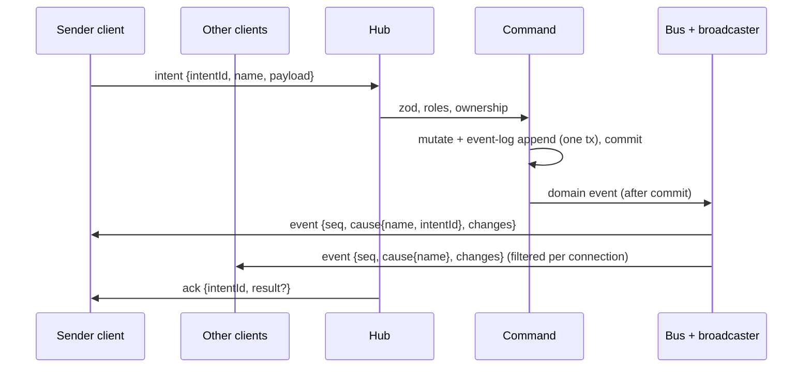

# Protocol

Consolidated REST (Hono RPC) + WebSocket catalogue. **Living doc**: the integrator extends it after each build phase's specs reach `complete`, alongside the [data model](../data-model/README.md) ([process](../process.md#stages)). Shared file: changes only via the orchestrator, in the same merge as the matching `src/shared/protocol/` code ([AGENTS §9.9](../../AGENTS.md#99-shared-files)).

| Phase | Specs consolidated | Status |
|---|---|---|
| Foundation | [live-sync](../specs/live-sync.md), [campaign-management](../specs/campaign-management.md), [fixtures-adapters](../specs/fixtures-adapters.md) | done (2026-10-12); CON-01–17 resolved ([decisions-log](../decisions-log.md) #118) and built in the skeleton |
| Scenes / Combat / Reward | see [roadmap](../roadmap.md#build-order-mvp) | > Later phase |

Spec shorthand: SYNC = live-sync, CAMP = campaign-management, FIX = fixtures-adapters. Code: zod schemas in `src/shared/protocol/` (`frames.ts`, `codes.ts`, `store.ts`).

## 1. Flow

Intent → validate → mutate + commit (with event-log entry) → commit hooks (cache refresh, CON-23) → domain event → listeners (synchronous, after commit) → broadcaster → visibility filter → WS ([ADR-0005](../architecture/adr/0005-server-authoritative-sync.md), [ADR-0016](../architecture/adr/0016-domain-events-pending-actions.md), [ADR-0021](../architecture/adr/0021-sync-protocol-conventions.md) F).

- REST (Hono RPC) calls run the same commands and produce the same events; the result is in the HTTP response ([FR-SYNC-15](../specs/live-sync.md#6-functional-requirements), ADR-0021 D).
- Rollback → no event, no log entry, no `ack`. A listener failure never rolls back ([FR-SYNC-16](../specs/live-sync.md#6-functional-requirements)).
- **Commit hooks** (CON-23, `r.afterCommit(name, fn)`): run after commit, once per event of the commit, before the bus dispatches any of them. Only for refreshing in-memory caches from the DB (e.g. the active-scene cache, [FR-MAP-06](../specs/scenes-map.md#6-functional-requirements)); never mutate state or emit. Skipped on rollback; a failure is logged and never rolls back.

## 2. Auth

| Credential | Held by | Sent | Check | Source |
|---|---|---|---|---|
| DM secret | env `PP_DM_SECRET` (≥ 12 chars); DM client localStorage | Every DM REST request as `Authorization: Bearer <secret>`; WS `hello` as `{role: "dm", secret}` | `crypto.timingSafeEqual` on SHA-256 digests. Never logged, stored or sent back | [FR-CAMP-01–04](../specs/campaign-management.md#6-functional-requirements), [ADR-0019](../architecture/adr/0019-auth-credentials.md), CON-08 |
| Link token | URL path `/p/<token>` *(proposed)* | `/api/join/:token`; WS `hello` as `{role: "player", token}` | Lookup by `Player.linkToken` (format checked first: 22 base64url chars) | [FR-CAMP-13/16/17](../specs/campaign-management.md#6-functional-requirements), ADR-0019 |

- No auth by source address, localhost included ([FR-CAMP-04](../specs/campaign-management.md#6-functional-requirements)).
- `hello.credential.role` picks the resolver, so a mangled player link never counts as a failed DM check.
- **Throttle** *(proposed, [OQ-CAMP-12](../specs/campaign-management.md#15-open-questions))*: 5 failed DM checks in 60 s, server-wide → all DM checks refused 60 s, even correct ones. REST 429; `hello` closed `4401`. Memory only ([FR-CAMP-05](../specs/campaign-management.md#6-functional-requirements)). A failed check = a secret was presented and is wrong; a DM route without `Authorization` gets 401 and doesn't count.

**Resolvers** (CAMP provides, SYNC calls; [CAMP §9](../specs/campaign-management.md#9-api--events))

| Resolver | Result | WS `hello` outcome | REST outcome |
|---|---|---|---|
| `verifyDmCredential(value)` | `{campaignId}` | live in that (active) campaign | — |
| | `invalid` | close `4401` | — |
| | `throttled` | close `4401` | — |
| | `noActiveCampaign` | close `4409` | — |
| `checkDmSecret(value)` (REST: secret only, no campaign needed, CON-15) | `ok` / `invalid` / `throttled` | — | allowed / 401 / 429 |
| `resolvePlayerLink(token)` | `{campaignId, playerId, campaignActive: true}` | live | `/api/join` 200 |
| | `{…, campaignActive: false}` | close `4409 campaign-inactive` | `/api/join` 200, `campaignActive: false` |
| | `null` | close `4401`, no other frame | 404 |

- The DM client opens its WS only once a campaign is active (CON-10); before that it stays on REST ("Create your first campaign").

Sources: [FR-SYNC-02](../specs/live-sync.md#6-functional-requirements), [FR-SYNC-06](../specs/live-sync.md#6-functional-requirements), [FR-CAMP-05/17/18](../specs/campaign-management.md#6-functional-requirements).

## 3. WebSocket

### 3.1 Lifecycle

| Step | Rule | Source |
|---|---|---|
| Endpoint | One WS endpoint, path `/ws` *(proposed, [OQ-SYNC-15](../specs/live-sync.md#15-open-questions))*, same origin as the clients | FR-SYNC-01, [AGENTS §9.2](../../AGENTS.md#92-env-ports-and-data) |
| `hello` | First frame, within 5 s of open, else close `4408`. A first frame that isn't a `hello` → `4408`; a `hello` with a malformed credential → `4401` | FR-SYNC-01 |
| Context | `{connId, campaignId, role, playerId?}`; fixed for the connection's life; ids/role in payloads never trusted. DM `campaignId` = active campaign at `hello`; player's from the link | FR-SYNC-02/03, [FR-CAMP-11](../specs/campaign-management.md#6-functional-requirements) |
| Snapshot | Exactly one `snapshot` (seq 0) before any `event` | FR-SYNC-08 |
| Heartbeat | Client `ping` every 10 s → server `pong`. Server closes a connection silent 30 s with `4408` (CON-11). Client treats 20 s without `pong` as dropped | FR-SYNC-04 |
| Reconnect | Forever; backoff 0.5 s doubling to 1.5 s (#131), immediate retry on focus/visible/online, ±20 % jitter. Stops only on `4401`. Never resends in-flight intents (their promises reject on disconnect). After a failed WS attempt the client probes `GET /ws?probe=1` (server answers `204`, no auth, no body; a plain `GET /ws` stays `426`) at each backoff step and opens a WS only once it answers: Chromium throttles new WebSockets by recent WS failures (up to +5 s each) | FR-SYNC-05 |
| Multiple tabs | Several connections per player or DM each get the same stream | FR-SYNC-03 |

**Client connection states** ([FR-SYNC-24](../specs/live-sync.md#6-functional-requirements)): `connecting | live | reconnecting | waiting | rejected`. Intent controls disabled unless `live`. Banner "Reconnecting…" after 1 s not live; after 60 s adds "Server unreachable — check with your DM". `waiting` / `rejected` use CAMP's waiting / invalid-link screens ([CAMP §7](../specs/campaign-management.md#7-uiux-notes)); DM `rejected` → login.

### 3.2 Client → server frames

Every frame is a JSON object; field **`type`** names the frame (CON-14).

| Frame | Payload | Who | Check | Source |
|---|---|---|---|---|
| `hello` | `{credential: {role: "dm", secret} \| {role: "player", token}}` | DM, player | §2 resolvers | [SYNC §9](../specs/live-sync.md#9-api--events) |
| `intent` | `{intentId (1–64 chars), name, payload}` | DM, player | zod by `name`, roles, ownership (§6) | FR-SYNC-12/13 |
| `signal` | `{name, data}` | DM, player | Signal schema + roles (§7); unknown → `reject unknown_intent`; role not allowed → `reject forbidden`; bad `data` → `reject invalid`. Rejected signals reach nobody. No `ack` | FR-SYNC-22, [ADR-0026](../architecture/adr/0026-signal-routing.md) |
| `resync` | `{}` | DM, player | Live connection → fresh snapshot | FR-SYNC-11 |
| `ping` | `{}` | DM, player | Live connection → `pong` | FR-SYNC-04 |

- Bad JSON or payload → `reject invalid` with issues (`intentId` null if it can't be read); unknown `name` → `reject unknown_intent`; connection stays open ([FR-SYNC-12](../specs/live-sync.md#6-functional-requirements)).
- Client → server frame > 64 KB → close `1009`. Server → client frames have no such limit (snapshots may reach 512 KB, SYNC §12) (CON-13); the server's send buffer and Bun `backpressureLimit` are 4 MiB (#163).

### 3.3 Server → client frames

| Frame | Payload | Visibility | Source |
|---|---|---|---|
| `snapshot` | `seq: 0`, `you {campaignId, role, playerId}`, `records {<type>: Record[]}` | Each type's fn; scopes per §4 | FR-SYNC-08/09, SYNC §9 |
| `event` | `seq`, `cause {name, intentId?}`, `changes[]` of `{type, id, op: upsert \| delete, data?}` | Each type's fn + transition matrix (§3.4). `intentId` on the sender connection's copy only | FR-SYNC-17/19/21, SYNC §9 |
| `signal` | `name`, `data`, `from {role, playerId?}` (server-stamped from the sender's connection context, never the payload) | Every **other** live connection of the sender's campaign; never the sender (§7) | FR-SYNC-22, [ADR-0026](../architecture/adr/0026-signal-routing.md) |
| `ack` | `intentId`, `result?` | Sender only | FR-SYNC-14 |
| `reject` | `intentId \| null`, `code`, `message`, `issues?` | Sender only | FR-SYNC-14, SYNC §9 |
| `pong` | — | Sender only | FR-SYNC-04 |

- `cause.name` = the domain event type, e.g. `PlayerRenamed` (CON-12); the intent is identified by `intentId`. Presence changes use `cause.name: "presence"` (CON-07).

### 3.4 Snapshot and event rules

| Rule | Source |
|---|---|
| Client replaces its whole store with a snapshot and drops optimistic state | FR-SYNC-08 |
| Changes committed between snapshot read and send arrive as events after it: none lost, none duplicated | FR-SYNC-10 |
| Per domain event, each connection gets **at most one** `event`, applied atomically; nothing if no change survives the filter. Upsert = whole filtered record | FR-SYNC-17 |
| Events a sender's intent caused reach it **before** its `ack` (needs synchronous listeners) | FR-SYNC-14, ADR-0021 F |
| `seq` per connection: 1, 2, … after each snapshot. Gap → client sends `resync`. Send-buffer overflow (> 1 MB buffered or a dropped send) or broadcaster error → close `4000`, never drop frames | FR-SYNC-21 |
| Snapshot and events share the filter: a player's store after live events equals a fresh snapshot; for windowed types only pinned rows and rows at or above the window floor are compared (CON-39; helpers `convergence`, `leakScan` in `src/server/ws/testing/convergence.ts`) | FR-SYNC-20, [ADR-0029](../architecture/adr/0029-windowed-record-types.md) |
| Switching the active scene resyncs every player connection of the campaign | FR-SYNC-11 |
| **Active-scene window** *(built, fix/active-scene-window)*: `dmWindow` types reach the DM snapshot for the active scene only; the DM client loads another scene with `sync.loadScene` (§6), answered in the hub's frame order (events committed before the read are in it, later ones follow as events). Live events unchanged. Convergence for those types compares the active + loaded scenes only; `convergence(s, live, fresh, loaded?)` takes the loaded set, `leakScan` also scans `ack.records` | [ADR-0041](../architecture/adr/0041-active-scene-window.md), FR-SYNC-10/20 |
| No named per-feature WS events; UI effects read `cause` | SYNC §9, [ADR-0021](../architecture/adr/0021-sync-protocol-conventions.md) A |
| Every wire record has an `id` field; the client store is `type → id → record` | skeleton (`src/shared/protocol/store.ts`) |

**Transition matrix** per connection ([FR-SYNC-19](../specs/live-sync.md#6-functional-requirements)):

| Before → after | Sent |
|---|---|
| hidden → visible | `upsert` (reveal = appear) |
| visible → hidden | `delete` |
| visible → visible | `upsert` |
| hidden → hidden | nothing |

### 3.5 Close codes ([SYNC §9](../specs/live-sync.md#9-api--events))

| Code | Reason | When | Client does |
|---|---|---|---|
| `1001` | `shutdown` | Server shutting down | Reconnect (backoff) |
| `1009` | `frame-too-large` | Client frame > 64 KB (FR-SYNC-12) | Reconnect |
| `4000` | `resync-required` | Send-buffer overflow or broadcaster error (FR-SYNC-21) | Reconnect |
| `4401` | `credential-invalid` | Bad DM secret, throttled, unknown token, malformed `hello` (FR-SYNC-02, FR-CAMP-05/17) | **Stop**; `rejected` (DM: probes `POST /api/dm/login` with the stored secret first: 401 → wipe + login; 429 → keep the secret, CAMP §7 "Too many attempts…", fresh connection after 60 s; other → fresh connection after 1 s (#163). Player: invalid-link screen) |
| `4408` | `no-hello` | No `hello` within 5 s (FR-SYNC-01); 30 s without any inbound frame (FR-SYNC-04, CON-11) | Reconnect |
| `4409` | `campaign-inactive` | Player `hello` for inactive campaign; DM `noActiveCampaign`; active campaign switched (FR-SYNC-02/06/07, FR-CAMP-09) | DM: reconnect at once (then backoff). Player: `waiting`, keep retrying, join ≤ 10 s after reactivation |

- `4401`, `4409` at `hello`: no other frame is sent first (FR-SYNC-02/06).

### 3.6 Reject codes ([SYNC §9](../specs/live-sync.md#9-api--events))

| Code | When | REST status | Source |
|---|---|---|---|
| `invalid` | Bad JSON or payload; `issues` = zod issues `{path, message}` | 400 | FR-SYNC-12 |
| `unknown_intent` | No handler for `name` (incl. REST-only commands sent as intents) | 404 | FR-SYNC-12 |
| `forbidden` | Role not allowed or ownership check fails; no change, no event | 403 | FR-SYNC-13 |
| `not_found` | Target record missing | 404 | SYNC §9 |
| `conflict` | Feature guard on non-idempotent actions; duplicate names; no active campaign | 409 | SYNC §9, [§11](../specs/live-sync.md#11-edge-cases--failure-modes) |
| `internal` | Server error | 500 | SYNC §9 |
| `unauthorized` *(REST only)* | DM route without or with a wrong secret | 401 | FR-CAMP-04 |
| `throttled` *(REST only)* | DM checks locked (FR-CAMP-05) | 429 | FR-CAMP-05 |

REST error body = `{code, message, issues?}` (CON-09).

### 3.7 Hub API (server-internal)

`resync(selector)`, `disconnect(selector, code)`, `connections(campaignId)` ([SYNC §9](../specs/live-sync.md#9-api--events)). Hub, broadcaster and presence hold no play state ([FR-SYNC-25](../specs/live-sync.md#6-functional-requirements)).

**Test seams** ([FR-SYNC-26](../specs/live-sync.md#6-functional-requirements), [ADR-0022](../architecture/adr/0022-deterministic-seams.md)): injectable clock and timers (heartbeat, backoff); test-only `beforeSnapshotSend` hook pauses a snapshot between read and send.

## 4. Scopes

| Scope | DM snapshot | Player snapshot | Source |
|---|---|---|---|
| `global` | all (imported definitions) | per the type's fn | FR-SYNC-09, [ADR-0018](../architecture/adr/0018-global-imported-content.md) |
| `campaign` | `ctx.campaignId` only | `ctx.campaignId` only, filtered | FR-SYNC-09, [ADR-0020](../architecture/adr/0020-single-active-campaign.md) |
| `scene` | all scenes of the campaign; `dmWindow` types: active scene only (none if none active), others via `sync.loadScene` | active scene only: **scene gate** `sceneOf(record) = active scene`, on snapshots **and** live events | FR-SYNC-09, ADR-0021 C, CON-22, [ADR-0041](../architecture/adr/0041-active-scene-window.md) |

No WS frame carries another campaign's data, DM included (the scope gate runs before the visibility fn); the campaign list is REST only ([FR-CAMP-07](../specs/campaign-management.md#6-functional-requirements)).

**Scene gate** (CON-22): for players, a `scene`-scoped record whose `sceneOf` ≠ the campaign's active scene (or with no active scene) is `hidden` before the visibility fn runs. Snapshot and event path share it, so it feeds the §3.4 transition matrix (moved off the active scene → `delete`; onto it → `upsert`; edits off it → nothing). Providers return every scene's rows of the campaign; the gate filters. The active scene comes from one resolver (`r.activeScene(campaignId → sceneId | null)`, scenes-map's cache); none registered → no active scene.

## 5. Record-type registry

Registration: `type, scope, schema, idOf, campaignOf (campaign/scene scope, required), sceneOf (scene scope, required; CON-22), visibility (record, ctx) → full | redacted | hidden, redact?, snapshot provider, audience?` ([SYNC §8](../specs/live-sync.md#8-data-model), FR-SYNC-18). Missing `campaignOf` / `sceneOf` → registration error. DM always `full` (after the scope gate). **Unregistered type → hidden** (for the DM too: it can't be scope-gated). `audience: "dm"` = never sent to players, not even as an empty snapshot list. `window? {orderBy, size, pin?}` ([ADR-0029](../architecture/adr/0029-windowed-record-types.md), CON-38): snapshot = pinned rows + newest `size` unpinned rows by `orderBy` (a numeric field name), cut before the visibility filter; the provider returns the whole log, the registry cuts it. `dmWindow? "active-scene"` ([ADR-0041](../architecture/adr/0041-active-scene-window.md); scene scope only, else a registration error): the DM snapshot holds only the active scene's rows; the provider still returns every scene's rows, the registry cuts them. Flagged: `token` (fix/active-scene-window); `scene-structure`, `scene-prop`, `aoe-template` by `fix/scn-core`. `sync.loadScene` resolves a scene's campaign through one provider, `records.provideSceneCampaign(sceneId → campaignId | null)` (scenes-map, from the `scene` table).

| Type | Owner | Scope | Wire fields | Player visibility | Snapshot provider |
|---|---|---|---|---|---|
| `campaign` | CAMP | campaign | `{id, name}` | full for own campaign | own campaign row |
| `player` | CAMP | campaign | `{id, campaignId, name}` — no token field exists | full for own campaign (*proposed*, [OQ-CAMP-13](../specs/campaign-management.md#15-open-questions)) | all players of the campaign, creation order |
| `presence` | SYNC | campaign; in-memory, not persisted; `audience: dm` | `{id, playerId, campaignId, online}` (`id` = `playerId`) | **never sent** (DM only) | DM: one per player of the campaign, `online` from live connections. Changes go in `event` frames with `cause.name: "presence"` (CON-07) |
| `probe` *(test mode only)* | SYNC | campaign (CON-06) | `{id, campaignId, text, hidden, ownerPlayerId}` | full iff `!hidden && (owner == null \|\| owner == ctx.playerId)`, else hidden | the campaign's probes, insertion order (CON-06) |
| `entity`, `imported-entity` | entities | campaign, global | see [§12](#12-scenes-record-types) (CON-25) | | |
| `creature-sheet` | CHARX | campaign | `creature_sheet` row ([data model §20](../data-model/README.md#20-sprint-1-creature-sheet)); table **built** (fix/charx-core); record type **built** (build/character-sheet-full), registered in `src/server/features/character-sheet/index.ts`; wire `id` = `entityId` | **full** iff `ownerPlayerId = ctx.playerId` (the row's copy), else **hidden** (other players' sheets, every NPC sheet) ([FR-CHARX-36](../specs/character-sheet-full.md#6-functional-requirements)) | the campaign's rows | see [§31](#31-sprint-1-character-sheet-full) |
| `effect` | CBTX | campaign | `effect` row ([data model §21](../data-model/README.md#21-sprint-1-effect-and-combat-play-state)); table + zod record **built** (fix/cbtx-core); record type **built** (build/combat-extras), registered in CBTX's own `index.ts` | **hidden** if `secret`, `hidden` or ended; else **redacted** `{id, kind, condition, level, label, targetCombatantId, targetCharacterId, encounterId, endsRound}` ([FR-CBTX-31](../specs/combat-extras.md#6-functional-requirements)) | the campaign's active effects (not windowed) | see [§32](#32-sprint-1-combat-extras) |

Sources: [CAMP §9](../specs/campaign-management.md#9-api--events), [FR-CAMP-19](../specs/campaign-management.md#6-functional-requirements), [SYNC §8–9](../specs/live-sync.md#9-api--events), [FR-SYNC-23](../specs/live-sync.md#6-functional-requirements), [FR-SYNC-27](../specs/live-sync.md#6-functional-requirements), [FIX §9](../specs/fixtures-adapters.md#9-api--events).

Scenes types: [§12](#12-scenes-record-types). Combat types: [§20](#20-combat-record-types). Reward types: [§29](#29-reward-party-loot). Sprint 1 types: [§31](#31-sprint-1-character-sheet-full). Fog (`fog`, sprint 2 phase 2): [§35](#35-sprint-2-phase-2-fog-of-war). Scene tools (`scene-structure`, `scene-prop`, `aoe-template`, `map-settings`, sprint 2 phase 2): [§36](#36-sprint-2-phase-2-scene-tools).

## 6. Intents and commands

Registration: `name, schema, roles (default [dm]), authorize, execute` ([SYNC §8](../specs/live-sync.md#8-data-model)). Names `<short feature name>.<verb>`, unique (e.g. `map.*`, `assets.*`, `entities.*`; CON-30); `probe.*` accepted as a test-only prefix (CON-16). A command is a WS intent only if registered as one.

**WS intents**

| Intent | Owner | Roles | Payload | Ownership / authorize | Result | Source |
|---|---|---|---|---|---|---|
| `probe.set` *(test mode)* | SYNC | DM | `{id?, text (≤ 500), hidden, ownerPlayerId?}`; no `id` = create | Owner is a player of `ctx.campaignId` (else `forbidden`); `id` must be in `ctx.campaignId` (else `not_found`) | `{id}` | [SYNC §9](../specs/live-sync.md#9-api--events) |
| `probe.edit` *(test mode)* | SYNC | player | `{id, text}` | Probe visible to the player and `ownerPlayerId == ctx.playerId` (else `forbidden`) | `{id}` | SYNC §9 |
| `sync.loadScene` *(built, fix/active-scene-window)* | SYNC | DM | `{sceneId}` | Player → `forbidden`; unknown or other-campaign scene → `not_found`. Handled by the hub, not a command: read-only, no bus, log or `seq`, answered in frame order | `{records {<type>: Record[]}}`: every `dmWindow` type's rows of that scene, through the scope gate + visibility fn as in a snapshot | [ADR-0041](../architecture/adr/0041-active-scene-window.md), `src/shared/protocol/scene-window.ts` |

CAMP has **no WS intents**; FIX has none ([FR-FIX-24](../specs/fixtures-adapters.md#6-functional-requirements)).

**Commands over REST** ([CAMP §9](../specs/campaign-management.md#9-api--events); paths *proposed*, [OQ-CAMP-15](../specs/campaign-management.md#15-open-questions); prefix `/api/*`). DM routes need `Authorization: Bearer <DM secret>` (CON-08) and check the secret only (CON-15).

| Method | Path | Who | Body → 2xx response | Errors |
|---|---|---|---|---|
| POST | `/api/dm/login` | anyone | — → 204 | 401 / 429 |
| GET | `/api/campaigns` | DM | → 200 `{campaigns: {id, name, active}[]}` (creation order) | 401 / 429 |
| POST | `/api/campaigns` | DM | `{name}` (rules [FR-CAMP-06](../specs/campaign-management.md#6-functional-requirements)) → 201 `{campaign}` | 400 / 409 duplicate |
| PATCH | `/api/campaigns/:id` | DM | `{name}` → 200 `{campaign}` | 400 / 404 / 409 |
| POST | `/api/campaigns/:id/activate` | DM | — → 200 `{campaign}` (already active: no-op, no event) | 404 |
| GET | `/api/players` | DM | → 200 `{campaignId, publicBaseUrl \| null, players: {id, name, linkToken}[]}` (**only route returning tokens**) | 409 no active campaign |
| POST | `/api/players` | DM | `{name}` → 201 `{player: {id, name, linkToken}}` | 400 / 409 duplicate or no active campaign |
| PATCH | `/api/players/:id` | DM | `{name}` → 200 `{player}` (token unchanged) | 400 / 404 / 409 |
| GET | `/api/join/:token` | token holder | → 200 `{playerName, campaignName, campaignActive}` | 404 |
| GET | `/ws` *(proposed)* | DM, player | WS upgrade; auth in `hello`. Non-upgrade: `?probe=1` → 204, no auth, no body (reconnect probe, [§3.1](#31-lifecycle)); otherwise → 426 | |

- DM routes: 401 without the DM secret or with a player token; 429 when throttled ([CAMP §13](../specs/campaign-management.md#13-test-plan), FR-CAMP-05). Error body and statuses: §3.6 (CON-09). Unknown `/api/*` → 404 `not_found`.
- Clients import only `type AppType` from `@server/app` ([AGENTS §9.1](../../AGENTS.md#91-directory-layout-and-path-aliases)).
- **No route** for reset, load or the import pipeline; a route-table test enforces it ([FR-FIX-24](../specs/fixtures-adapters.md#6-functional-requirements)).

**Internal commands** (no route, no intent)

| Command | Caller | Input → output | Source |
|---|---|---|---|
| `import.batch` | Fixture loader only (in-process, DM authority) | `{source {key, name, licence, attribution, url?}, records {kind, sourceKey, data}[]}` → per record `{sourceKey, outcome: created \| existing, id}`. All-or-nothing; errors: `invalid` with every issue, path `[sourceKey, "kind"]` or `[sourceKey, "data", …field path]` | [FIX §9](../specs/fixtures-adapters.md#9-api--events), [FR-FIX-18–21](../specs/fixtures-adapters.md#6-functional-requirements) |
| Setup fixture steps | Fixture loader | Any registered server command, DM authority (actor campaign = active campaign), same validation / events / log as UI; no `intentId` | [FR-FIX-13](../specs/fixtures-adapters.md#6-functional-requirements) |

- The pipeline writes through a definition store + kind registry that entities plugs in (Scenes); the skeleton ships the core and tests it with a test-only kind (CON-03).
- **Crash hook** *(test mode only, #163)*: `PP_TEST_CRASH` ([AGENTS §9.2](../../AGENTS.md#92-env-ports-and-data)) makes the process SIGKILL itself at one seam: `<command>:before-commit` (in `Commands.run`, after `execute` and the event-log append, before commit: the transaction never commits), `<command>:after-commit` (committed; before commit hooks, listeners and the `ack`), `assets.ingest:after-files` (files renamed into place, no row: next start sweeps the orphan set) or `fixture:<key>` (`fixtures:*` only: before the commit of that fixture's first command; manifest stays `loading`). Refused at config parse unless `PP_TEST_MODE=1` and `PP_DATA_DISPOSABLE=1`; an unknown command refuses server start. `src/server/commands/crash.ts`; no wire change.

## 7. Signals

Registration: `name, schema, roles` ([SYNC §8](../specs/live-sync.md#8-data-model)); `r.signal(defineSignal(…))`. Not domain events: no bus, DB, event log, snapshot or `seq` ([FR-SYNC-22](../specs/live-sync.md#6-functional-requirements)).

Routing ([ADR-0026](../architecture/adr/0026-signal-routing.md), amended by [ADR-0033](../architecture/adr/0033-signal-audience.md)):

- The hub checks the sender is live, the name is registered, its role is in `roles`, and `data` passes the zod schema; any failure → `reject` to the sender only, nobody receives it.
- A valid signal goes to every **other** live connection of the sender's campaign (DM and players, incl. the sender's other tabs) as `signal {name, data, from}`; never back to the sender. `from` = `{role: "dm"}` or `{role: "player", playerId}` from the connection context.
- No per-signal visibility fn, no server scene check, no rate limit. Receivers filter: act only if `data.sceneId` is the scene they show (player: active; DM: viewed).
- *(built, fix/signal-audience)* **Audience** ([ADR-0033](../architecture/adr/0033-signal-audience.md), [FR-SYNC-28](../specs/live-sync.md#6-functional-requirements)): a type may register `audience(data, sender {role, playerId?, campaignId}, read) → "all" | "dm"`, `read` = `{db, activeSceneOf(campaignId)}`. Run once per signal after zod + roles; synchronous; read-only by convention (review + state-digest test). `"all"` = the rule above; `"dm"` = other live **DM** connections only. A thrown reject (`not_found`, `forbidden`, `invalid`) → sender only, nobody receives it; any other error (incl. another reject code or a return other than `"all"` / `"dm"`) → `reject internal` to the sender only, logged ≤ once per (connection, name) per 10 s. Senders ignore signal rejects (they carry `intentId: null`). Code: `SignalDef.audience?` in `src/server/ws/signals.ts`, hub `signal()`; frames unchanged.
- Client: `connection.sendSignal(name, data)` (dropped when not live, never queued), `useSignal(name, handler)`.
- Client: `connection.onEvent(fn)` / `useEventFrame(handler)`: every applied live `event` frame with its `cause` and the new store; never a snapshot, resync or seq-gap frame (FR-CBT-41 turn alert; built by `build/combat-tracker-feedback`, #160).

| Signal | Owner | Roles |
|---|---|---|
| none in Foundation | | |

Scenes signals: [§15](#15-scenes-signals).

## 8. Domain events

Each lists `changes` (before/after per record; create: before null, delete: after null), including every record whose visibility changes ([SYNC §8](../specs/live-sync.md#8-data-model), [ADR-0021](../architecture/adr/0021-sync-protocol-conventions.md)). Logged in the commit's transaction unless marked non-logged ([FR-SYNC-16](../specs/live-sync.md#6-functional-requirements)). Payloads are zod-validated (`src/shared/events/`) and never hold a link token or the DM secret.

| Domain event | Owner | Payload | Changes | Logged | Transient | Undoable | After commit |
|---|---|---|---|---|---|---|---|
| `CampaignCreated` | CAMP | `{campaignId, name}` | `campaign` upsert | yes | no | no | — (no connections yet) |
| `CampaignRenamed` | CAMP | `{campaignId, name}` | `campaign` upsert | yes | no | no | — |
| `CampaignActivated` | CAMP | `{campaignId, previousCampaignId}`; `previousCampaignId: null` when create made the first campaign active (CON-10) | none | yes (log `campaignId` = new campaign) | no | no | `disconnect(connections of any other campaign, 4409 campaign-inactive)` ≤ 1 s |
| `PlayerAdded` | CAMP | `{playerId, campaignId, name}` | `player` upsert | yes | no | no | — |
| `PlayerRenamed` | CAMP | `{playerId, campaignId, name}` | `player` upsert | yes | no | no | — |
| `EntityImported` | FIX → entities | see [§16](#16-scenes-domain-events) (CON-25) | `imported-entity` upsert (global) | yes, `campaignId` null | no | no | — (only for `created`; `existing` emits nothing) |
| `ProbeSet` *(test mode)* | SYNC | `{probeId, text, hidden, ownerPlayerId}` | `probe` upsert (before null on create) | yes | no | no | — (CON-05) |
| `ProbeEdited` *(test mode)* | SYNC | `{probeId, text}` | `probe` upsert | yes | no | no | — (CON-05) |
| `CharacterCreated` | CHARX | `{characterId, ownerPlayerId, status}` | `entity` + `creature-sheet` upserts | yes | no | no | — |
| `CharacterApproved` | CHARX | `{characterId}` | `creature-sheet` upsert | yes | no | no | — |
| `CharacterLockSet` | CHARX | `{characterId, locked}` | `creature-sheet` upsert | yes | no | no | — |
| `CharacterSheetEdited` | CHARX | `{creatureId, op: set \| putRow \| deleteRow \| moveRow, fields?, list?, rowId?}` (keys and ids, never values) | `entity` and / or `creature-sheet` + hook-changed instances | yes | no | no | — |
| `CharacterResourceUsed` | CHARX | `{characterId, resource: {slot} \| {hitDie} \| {feature}, before, after}` | `creature-sheet` upsert | yes | no | no | — |
| `EffectsAdded` | CBTX | `{effectIds}` | `effect` creates; concentration + linked ended by an incapacitating condition | yes | no | no | — |
| `EffectUpdated` | CBTX | `{effectId}` | `effect` | yes | no | no | — |
| `EffectsEnded` | CBTX | `{effectIds, reason}` (`reason` = an `endedReason`) | `effect`s + linked; closed cards follow as `NotificationResolved` | yes | no | no | — |
| `ConcentrationSet` | CBTX | `{effectId, replacedId?}` | `effect`s | yes | no | no | — |
| `TempHpSet` | CBTX | `{targetKind: combatant \| character, targetId, before, after}` (0–999) | `combatant` or `entity` | yes | no | no | — |
| `ConcentrationRolled` | CBTX | `{notificationId, effectId, rollIds, entryId, total, dc, success}` | `game-log-entry`; `effect`s on a fail; then `NotificationResolved` | yes | no | no | — |
| `DeathSaveRolled` | CBTX | `{characterId, rollIds, entryId, natural, before, after}` (`{successes, failures}` each) | `entity`; `game-log-entry` | yes | no | no | — |
| `DeathSavesSet` | CBTX | `{characterId, successes, failures}` | `entity` | yes | no | no | — |
| `CombatantsAdded` | CBTX | `{encounterId, combatantIds}` (1–20) | `combatant` creates + ranks; `encounter`; `effect` hidden copies; *(sprint 2, FR-CBTX-44, built, fix/combat2-add)* created `token`s first, then combatants, HP and initiative roll entries (DM-only), ranks, effect copies | yes | no | no | — |
| `CombatantBound` *(sprint 2, emitted by `cbtx.bindToken`, built, fix/combat2-add)* | CBTX | `{combatantId, tokenId \| null}` (null = unlink) | `combatant`; on a `hidden` change also ranks, `encounter`, `effect` hidden copies | yes | no | no | — |
| `DamageRolled` *(sprint 2)* | CBT | `{cardId, rollIds (≥ 1), attached}` | `game-log-entry`; then `NotificationUpdated` (`attached`) or `NotificationCreated` | yes | no | no | — |
| `NotificationUpdated` *(sprint 2)* | NOTE | `{notificationId, kind}` | `notification` upsert (pending row, new payload / text; same `seq`) | yes | no | no | — (no toast) |
| `EffectPresetSaved` / `EffectPresetDeleted` *(sprint 2, MOD)* | MOD | `{presetId}` | `effect-preset` upsert / delete | yes | no | no | — |
| `PresetApplied` *(sprint 2, MOD)* | MOD | `{presetKey, effectIds (0–20), concentrationId?}` (`presetKey` = built-in key or preset id; event log only) | `effect` creates; a started / replaced concentration | yes | no | no | — |
| `EffectToggled` *(sprint 2, MOD)* | MOD | `{characterId, presetId, on, effectId}` | `effect` create / end; `effect-preset` (`activeEffectId`); `creature-sheet` (use spent, tier 3) | yes | no | no | — |
| `EffectModifiersSet` *(sprint 2, MOD)* | MOD | `{effectId}` | `effect` | yes | no | no | — |
| `FogEdited` *(sprint 2 phase 2, FOG; schema built, fix/fog-core; emitted, build/fog-server)* | FOG | `{sceneId, editId, kind, shape?}` (`shape` on rect / polygon edits only) | `fog` upsert; flipped fog subjects (`token`, SCN props / templates); `scene-structure` (door flags); token-hook rows | yes | no | no (own per-scene stack, FR-FOG-07) | — |
| `FogUndone` *(sprint 2 phase 2, FOG; schema built, fix/fog-core; emitted, build/fog-server)* | FOG | `{sceneId, editId}` | as `FogEdited` | yes | no | no | — |
| `StructureEdited` *(sprint 2 phase 2, SCN; schema built, fix/scn-core; emitted, build/scene-tools-structure)* | SCN | `{sceneId, op: addWalls \| addDoor \| removeSegments \| setDoor, ns}` (one name for every op, FR-SCN-33; `ns` = the `n`s added, removed or set; an edit that changes nothing emits nothing) | `scene-structure` upsert | yes | no | no | — |
| `PropPlaced` / `PropUpdated` / `PropHidden` / `PropRevealed` / `PropDuplicated` / `PropDeleted` *(SCN; schema built)* | SCN | `{propId}` | `scene-prop` upsert / delete | yes | no | no | — |
| `TemplatePlaced` / `TemplateUpdated` / `TemplateDeleted` *(SCN; schema built)* | SCN | `{templateId}` | `aoe-template` upsert / delete | yes | no | no | — |
| `TemplatesCleared` *(SCN; schema built)* | SCN | `{sceneId, templateIds}` | `aoe-template` deletes | yes | no | no | — |
| `DiagonalRuleSet` *(SCN; schema built; emitted, build/scene-tools-settings)* | SCN | `{rule: "5-10-5" \| "5"}` | `map-settings` upsert | yes | no | no | — |

Sources: [CAMP §9](../specs/campaign-management.md#9-api--events), [FR-CAMP-09](../specs/campaign-management.md#6-functional-requirements), [FR-SYNC-07](../specs/live-sync.md#6-functional-requirements), [FR-FIX-23](../specs/fixtures-adapters.md#6-functional-requirements), [ADR-0018](../architecture/adr/0018-global-imported-content.md).

- Listeners in Foundation: broadcaster (hub), campaign-switch disconnect (CAMP); the fixture loader adds a record collector during loads. The event-log write is part of the command transaction, not a listener ([SYNC §2](../specs/live-sync.md#2-scope), [ADR-0016](../architecture/adr/0016-domain-events-pending-actions.md)).
- Known non-logged: token moves ([ADR-0016](../architecture/adr/0016-domain-events-pending-actions.md)). Undoable in MVP: combat damage/healing applied only.
- **Helper events** (CON-40, gate I15): a helper whose record needs its own `cause` (e.g. `notify`) emits its own event via `env.emit`, after the owner's event; other helpers return `RecordChange[]` for the caller's event. Each is its own `event` frame, all before the sender's `ack`.

CHARX rows: schemas **built** (fix/charx-core, `src/shared/events/character-sheet.ts`, registered); emitted by the CHARX commands **built** (build/character-sheet-full); visibility per [§31](#31-sprint-1-character-sheet-full). CBTX rows: schemas **built** (fix/cbtx-core, `src/shared/events/combat-extras.ts`, registered; ids and numbers, never labels); emitted by the CBTX commands (**built**, build/combat-extras); visibility per [§32](#32-sprint-1-combat-extras). Sprint-2 rows (`CombatantBound`, `DamageRolled`, `NotificationUpdated`): schemas **built** (fix/combat2-core, registered); `NotificationUpdated` emitted by the **built** `updateNotification` helper; the other two by the P2a feature branches ([§33](#33-sprint-2-phase-1-combat-p2a)). MOD rows: schemas **built** (fix/mod-core, `src/shared/events/effect-modifiers.ts`, registered; ids, keys and flags, never labels); emitted by build/effect-modifiers ([§34](#34-sprint-2-phase-1-effect-modifiers-tier-1)). Scenes events: [§16](#16-scenes-domain-events). Combat events (undoable + compensating, [ADR-0016](../architecture/adr/0016-domain-events-pending-actions.md)): [§22](#22-combat-domain-events). > Later phase: Reward.

## 9. How a feature plugs in

From [ADR-0021](../architecture/adr/0021-sync-protocol-conventions.md) consequences, [SYNC §9](../specs/live-sync.md#9-api--events), [AGENTS §9.8](../../AGENTS.md#98-done-for-a-build-task). No changes to hub, broadcaster or client sync code ([SYNC §3](../specs/live-sync.md#3-goals)). Code: a `Feature` in `src/server/features/<feature>/index.ts`, one line in `src/server/features/index.ts`.

- [ ] **Record types**: name, scope (`global`/`campaign`/`scene`), zod schema, `id` field on the wire, `campaignOf` / `sceneOf` per scope (§4–§5), visibility fn `(record, ctx) → full | redacted | hidden`, bounded snapshot provider. Fn reads record + context only; visibility flags live on the record.
- [ ] **Intents**: `<short feature name>.<verb>` (§6), zod schema, roles (default DM only), ownership check for every player-writable intent ([ADR-0004](../architecture/adr/0004-tenancy-auth-permissions.md)).
- [ ] **Optimistic** intents only if the spec marks them; server wins, reject reverts (ADR-0021 E).
- [ ] **Signals**, if any: name, schema, roles; routing per §7. No DB, bus or log.
- [ ] **Domain events**: typed, zod-validated (`src/shared/events/<feature>.ts`, one line in its `index.ts`); `changes` include every record whose visibility changes; mark logged? / undoable?.
- [ ] **No named per-feature WS events.** Reveal = `upsert`, hide = `delete`; no client reducer code.
- [ ] Commands take IDs, tokens, time only from `ctx` ([AGENTS §9.3](../../AGENTS.md#93-fixtures)).
- [ ] Tests: visibility per type for DM and player; convergence (store after events = fresh snapshot); leak scan.
- [ ] Registries are append-only: add your own lines only ([AGENTS §9.9](../../AGENTS.md#99-shared-files)). Add your rows to §5–§8 here and to the [data model](../data-model/README.md) via the orchestrator.

## 10. Versioning

No protocol versioning in MVP: single package, clients served by the same server ([ADR-0002](../architecture/adr/0002-single-package.md)). Deferred (CON-17): decide before the post-MVP agent API.

## 11. Conflicts log

Found at Foundation consolidation; resolved by the integrator ([decisions-log](../decisions-log.md) #118) and folded into the sections above. Data-model conflicts CON-01–04: [data model §8](../data-model/README.md#8-conflicts-log).

| ID | Topic | Resolution | Now in |
|---|---|---|---|
| CON-05 | Probe domain events | `ProbeSet`, `ProbeEdited`: `probe` upsert, logged, not undoable | §8 |
| CON-06 | Probe scope + provider | Scope `campaign`; provider = the campaign's probes | §5 |
| CON-07 | Presence delivery | `event` frames with `cause.name: "presence"`; in DM snapshots | §3.3, §5 |
| CON-08 | DM credential on REST | `Authorization: Bearer <secret>` | §2, §6 |
| CON-09 | REST errors | Body `{code, message, issues?}`; reject codes → 400/403/404/409; plus `unauthorized` 401, `throttled` 429 | §3.6 |
| CON-10 | First campaign auto-activates | Emits `CampaignActivated {previousCampaignId: null}`; DM WS opens once a campaign is active | §2, §8 |
| CON-11 | Heartbeat-timeout close code | `4408` | §3.1, §3.5 |
| CON-12 | `cause.name` | Domain event type | §3.3 |
| CON-13 | 64 KB limit | Client → server frames only | §3.2 |
| CON-14 | Frame discriminator | Field `type` | §3.2 |
| CON-15 | `verifyDmCredential` on REST | REST checks the secret only (`checkDmSecret`); `noActiveCampaign` applies to `hello` | §2 |
| CON-16 | Intent naming | `probe.*` accepted (test-only) | §6 |
| CON-17 | Versioning | Deferred: decide before post-MVP agent API | §10 |

Scenes consolidation (CON-18+, integrator):

| ID | Message / rule | Where | Suggested fix | Resolution |
|---|---|---|---|---|
| CON-22 | `scene` scope gate (**leak risk**) | Registration (§5 line 164; [live-sync](../specs/live-sync.md) line 90) has `scope` but no way to tell a record's scene; FR-SYNC-09 (line 55) covers snapshots only. [scenes-map](../specs/scenes-map.md) lines 105, 107, 177: `scene` gated by `id`, `token` by `sceneId`. Without an event-path gate, a DM edit to a visible token on a non-active scene is sent to players | Registration gains `sceneOf(record) → sceneId`, required for scope `scene`. Snapshot **and** event path treat a scene-scoped record whose `sceneOf` ≠ the active scene as `hidden` for players (feeds the §3.4 transition matrix). Providers return all campaign rows; the gate filters. Sequenced shared change (`src/server/ws/`, `src/shared/protocol/`) after the skeleton, before scenes-map | resolved (fix/scenes-core): §4 scene gate, §5 `sceneOf`; built in `RecordRegistry.view` (snapshot + events), resolver via `r.activeScene` |
| CON-23 | Active-scene cache timing | [scenes-map](../specs/scenes-map.md) line 46 (FR-MAP-06): cache updated "after commit, **before listeners run**", then players resynced. §1 / [ADR-0021](../architecture/adr/0021-sync-protocol-conventions.md) F have only "listeners, synchronous, after commit"; no pre-listener step | Command core gets a post-commit, pre-dispatch hook (or an ordered first listener) that reloads the cache from the DB; resync of players runs as a listener. Same sequenced change as CON-22 (`src/server/commands/`, `src/server/events/`) | resolved (fix/scenes-core): commit hooks in `Commands.run` (`r.afterCommit`), §1 |
| CON-24 | Signal frame + routing | §3.3 line 94 and §7 line 217 (`signal {name, data}`, "visibility fn"); [live-sync](../specs/live-sync.md) line 68 (FR-SYNC-22) vs accepted [ADR-0026](../architecture/adr/0026-signal-routing.md) (`from {role, playerId?}` server-stamped; forward to every **other** connection of the campaign) | Update §3.3 row, §7 rule and FR-SYNC-22 per ADR-0026 after the skeleton merges (not edited here). [§15](#15-scenes-signals) is authoritative meanwhile | resolved (fix/scenes-core): §3.2, §3.3, §7, FR-SYNC-22 updated; hub routing + `from` built |
| CON-25 | Definition record type + event names | §5 line 172 ("definition *(name TBD)*") and §8 line 236 ("definition created") vs [entities](../specs/entities.md) lines 107–118: types `entity` (campaign) + `imported-entity` (global), event `EntityImported` | Replace both Foundation rows with pointers to [§12](#12-scenes-record-types) / [§16](#16-scenes-domain-events) after the skeleton merges | resolved (fix/scenes-core): §5, §8 rows point to §12 / §16 |
| CON-26 | Broken ADR links | `]($100NN-…md)` (bad regex replace) in [assets-pipeline](../specs/assets-pipeline.md) line 15; [entities](../specs/entities.md) lines 15, 52, 186; [play-shell](../specs/play-shell.md) line 16; [scenes-map](../specs/scenes-map.md) lines 109, 177, 179, 195 | Replace `$1` with `../architecture/adr/` (9 links). Spec owners or integrator; trivial | resolved (integrator)  |
| CON-27 | Stale statuses | [scenes-map](../specs/scenes-map.md) line 65 FR-MAP-25 "*(proposed, OQ-MAP-16)*", line 177 "ADR proposed", line 195 "ADR-0026 awaits acceptance" (accepted, #125). [assets-pipeline](../specs/assets-pipeline.md) line 176 "open: OQ-ASSET-10" and line 196 (entities FR-ENT-08/11 already call `assets.require`) | Drop the "proposed"/"awaits" wording; mark OQ-ASSET-10 decided. Low | resolved (fix/scenes-core): FR-MAP-25, MAP §14–15, OQ-ASSET-10, ASSET §14 |
| CON-28 | Asset window kind | [play-shell](../specs/play-shell.md) lines 158, 172 (OQ-SHELL-06: `asset.images`, DM) vs [assets-pipeline](../specs/assets-pipeline.md) line 60 (FR-ASSET-19: `asset.test`, test mode only; OQ-ASSET-08) | play-shell OQ-SHELL-06 / §14 → `asset.test` (test mode). Builders use `asset.test` | resolved (fix/scenes-core): SHELL §14, OQ-SHELL-06 |
| CON-29 | "Assets are URLs" | [live-sync](../specs/live-sync.md) line 138 vs [assets-pipeline](../specs/assets-pipeline.md) line 173 (asks integrator to amend) and [ADR-0023](../architecture/adr/0023-asset-access-by-capability-id.md) | live-sync §12: "Records carry asset IDs; clients build the URL (ADR-0023)". Low | resolved (fix/scenes-core): SYNC §12 |
| CON-30 | Command naming | §6 line 180 `<feature>.<verb>` vs `map.*` (spec prefix), `assets.*`, `entities.*` (neither slug nor prefix) | Accept as short feature names (CON-16 precedent); §6 rule → "`<short feature name>.<verb>`, unique". Low | resolved (fix/scenes-core): §6, §9 |
| CON-31 | Command → event mapping | [scenes-map](../specs/scenes-map.md) lines 98–101 vs 115–117: which event `map.setSceneMap` / `setGrid` / `setLocked`, REST PATCH (rename, move), `updateToken`, `setTokenHidden` emit is implied, not stated | scenes-map §9: `SceneUpdated` = PATCH + setSceneMap/setGrid/setLocked; `TokenUpdated` = updateToken; `TokenHidden`/`TokenRevealed` = setTokenHidden. [§16](#16-scenes-domain-events) assumes this | resolved (fix/scenes-core): MAP §9 mapping line |
| CON-32 | DM empty-state wording | [play-shell](../specs/play-shell.md) line 46 (DM: "No active scene") vs [scenes-map](../specs/scenes-map.md) line 48 (DM shows the first scene if none active; empty state only with **no scenes**) | play-shell FR-SHELL-02 DM text → "No scenes yet". Low | resolved (fix/scenes-core): FR-SHELL-02, SHELL §13 step 1 |
| CON-33 | Client extension registries | [scenes-map](../specs/scenes-map.md) line 69 (FR-MAP-29: canvas layer registry; token menu + double-click registry) are extension points for Combat / post-MVP, not in [AGENTS §9.9](../../AGENTS.md#99-shared-files) append-only list | Add them to §9.9 when a second spec registers (combat-tracker). Low | resolved (spec/consolidate-combat): AGENTS §9.9 lists the token menu / double-click registry; combat-tracker is the second registrant (CON-43) |

Combat consolidation (CON-38+, integrator; CON-34–37: [data model §8](../data-model/README.md#8-conflicts-log)). Applied by fix/combat-core after `build/entities` merged; line numbers as on `main` @ c579ac1.

| ID | Message / rule | Where | Suggested fix | Resolution |
|---|---|---|---|---|
| CON-38 | Windowed record types | §5 registration list (line 179) has no `window`; §5 line 191 "Later phase" note. [ADR-0029](../architecture/adr/0029-windowed-record-types.md) (#137) adds optional `window {orderBy, size, pin?}` | Line 179: append "`window? {orderBy, size, pin?}` ([ADR-0029](../architecture/adr/0029-windowed-record-types.md)): snapshot = pinned rows + newest `size` by `orderBy`, cut before the visibility filter". Line 191 → pointer to [§20](#20-combat-record-types) | resolved (fix/combat-core): §5; built in `RecordRegistry` + `@shared/protocol/window` |
| CON-39 | Convergence rule | §3.4 line 117 (FR-SYNC-20) vs ADR-0029; [live-sync](../specs/live-sync.md) FR-SYNC-20 amended in this branch | Line 117: append "; for windowed types only pinned rows and rows at or above the window floor are compared" | resolved (fix/combat-core): §3.4; helpers `convergence`, `leakScan` |
| CON-40 | Helper events + Combat pointers in §8 | §8 has no rule for in-transaction helpers (gate I15); lines 269, 271 "Later phase" | §8: add "A helper whose record needs its own `cause` (e.g. `notify`) emits its own event via `env.emit`, after the owner's event; other helpers return `RecordChange[]` for the caller's event. Each is its own `event` frame, all before the sender's `ack`". Line 271 → pointer to [§22](#22-combat-domain-events) | resolved (fix/combat-core): §8 |
| CON-41 | Helper signatures `ctx` → `env` | §13 line 390 `resolveDefinition(ctx, id)`; §17 line 447 `(ctx, before, after)`. Amended in this branch: [entities](../specs/entities.md) FR-ENT-12, FR-ENT-19 and [ADR-0028](../architecture/adr/0028-token-changed-hooks.md) take `env: CommandEnv`, campaign = `env.actor.campaignId` (gate I14; `CommandContext` has no `campaignId`) | Line 390 → `resolveDefinition(env, id)`; line 447 → `(env, before, after)`. Tell the `build/entities` builder | resolved (fix/combat-core): §13; §17 already `env` (build/entities) |
| CON-42 | Hook rows in §16 / §17 | §16 token rows (line 435), `SceneDeleted` (line 432) and `EntityUpdated` (line 431) list no `combatant` / `encounter` changes; §17 line 454 combat hook "> Later phase"; §16 line 438 names §17 only | Line 435 / 432 changes: "+ `combatant` / `encounter` rows from token-changed hooks ([§25](#25-combat-token-changed-hooks), ADR-0028)". Line 431: "+ `combatant` rows (FR-CBT-06)". Line 454 → "combatant `hpMax` / `hpCurrent` and portrait copies, [FR-CBT-06](../specs/combat-tracker.md#6-functional-requirements)". Line 438: add "token-changed hooks ([§25](#25-combat-token-changed-hooks))" | resolved (fix/combat-core): §16, §17 |
| CON-43 | CON-33 + client registries | CON-33 (line 326) still `open`; §18 line 474 lists token menu registry only | CON-33 Resolution → "resolved (spec/consolidate-combat): AGENTS §9.9 lists the token menu / double-click registry; combat-tracker is the second registrant". §18 line 474 → pointer to [§26](#26-combat-registries-and-seams) | resolved (fix/combat-core): CON-33 row, §18 |
| CON-44 | DM snapshot budget | live-sync §12: snapshot ≤ 512 KB *(proposed)*. Worst case DM: scenes ≤ 300 KB ([MAP §12](../specs/scenes-map.md#12-performance--bandwidth)) + game log ≤ 100 KB + notifications ~190 KB + pending + encounters ≤ 53 KB + combatants ≤ 17 KB + hp-change ≤ 20 KB ≈ 680 KB. Typical ≈ 430 KB ([§20](#20-combat-record-types) budget table) | Pick one: notification window 100 → 50 closed (gate I17 alternative; worst ≈ 585 KB) / raise the DM ceiling to 768 KB (players stay < 512 KB) / accept (worst case needs 1,000 tokens + max-size payloads). Pick: raise the DM ceiling; all numbers are proposed | resolved (#142): DM ceiling 768 KB; players stay ≤ 512 KB; notification window stays 100. Re-baselined #163 ([§20 budget](#20-combat-record-types)): realistic heavy DM 491 KB / players 246 KB; the all-caps worst case is still over (DM 1.70 MB); test + warn log, no runtime cap. Re-baselined [ADR-0041](../architecture/adr/0041-active-scene-window.md) (fix/active-scene-window, measured): heavy DM 781,930 → 663,699 B (the 240 non-active tokens off the frame; 122,733 B left); session-sim DM 20,612 → 17,723 B; largest scene load (200 max-string tokens) 98,628 B < 512 KiB. *(fix/fog-core, measured)* heavy DM 663,703 B (the empty `fog` list; `token.fogged` is off the wire while false); players 273,627–276,687 B. *(build/fog-server, measured)* heavy DM 663,704 B (no fog row in the harness yet). Fog rows, `fogged` copies and the revealed battle scene join the harness in build/fog-visibility (FR-FOG-25). *(fix/scn-core, measured)* + one typical prepped SCN active scene (150 walls, 10 doors, 15 props, 3 kept templates, `map-settings`; [§36](#36-sprint-2-phase-2-scene-tools)): SCN rows 7,592 B DM (structure 2,518, props 4,049, templates 944, settings 81), 3,418 B per player; heavy DM 671,291 B (115,141 B left); players 277,041–280,101 B. *(build/fog-visibility, measured, OQ-FOG-04 B)* fog on in the harness: new scenes fogged (FR-FOG-02), battle scene revealed (FR-FOG-25), 30 `fog` rows (4,756 B DM; never windowed), 216 of 300 tokens `fogged`: heavy DM 676,057 B (110,375 B left; FOG §12 measured 676,257 B); players 277,040–280,100 B (1 `fog` row each) |

## 12. Scenes: record types

Consolidated 2026-10-12 from the `complete` specs. Shorthand: ASSET = [assets-pipeline](../specs/assets-pipeline.md), ENT = [entities](../specs/entities.md), SHELL = [play-shell](../specs/play-shell.md), MAP = [scenes-map](../specs/scenes-map.md). Foundation sections above amended per [CON-22–32](#11-conflicts-log) (fix/scenes-core). Data side: [data model §9–§13](../data-model/README.md#9-scenes-er-diagram).

DM always `full`. Generic record changes only ([ADR-0021](../architecture/adr/0021-sync-protocol-conventions.md) A).

| Type | Owner | Scope | Wire fields (DM) | Player visibility | Snapshot provider | Source |
|---|---|---|---|---|---|---|
| `asset` | ASSET | campaign | `{id, campaignId, seq, name, mime, bytes, width, height, displayWidth, displayHeight, createdAt}` (no `hash`) | **hidden** | all of the campaign's assets | [FR-ASSET-10](../specs/assets-pipeline.md#6-functional-requirements), ASSET §9 |
| `entity` | ENT | campaign | row minus provenance (+ `tokenShape`, feedback pass) | own character (`ownerPlayerId = ctx.playerId`) **full**; other characters **redacted** `{id, kind, name, portraitAssetId, ownerPlayerId}` (+ derived `down` = `hpCurrent = 0`, feedback pass, #154; *(sprint 1, built, fix/charx-core)* + `level, className, species` and *(built, fix/cbtx-core)* CBTX's derived `deathState` ([FR-CBTX-32](../specs/combat-extras.md#6-functional-requirements)): the **one whitelist** `RedactedCharacter` / `REDACTED_CHARACTER_KEYS`, [ADR-0036](../architecture/adr/0036-full-sheet-derivation.md), [FR-CHARX-35](../specs/character-sheet-full.md#6-functional-requirements)); monsters **hidden** | campaign's characters + customs | [FR-ENT-15](../specs/entities.md#6-functional-requirements), [ADR-0024](../architecture/adr/0024-definition-visibility.md) |
| `imported-entity` | ENT | global, `audience: dm` (players get no list, not even empty; [ADR-0024](../architecture/adr/0024-definition-visibility.md)) | row incl. provenance | **hidden** | all imported definitions | [FR-ENT-16](../specs/entities.md#6-functional-requirements), [ADR-0018](../architecture/adr/0018-global-imported-content.md) |
| `scene` | MAP | scene, `sceneOf = id` ([CON-22](#11-conflicts-log)) | full row | **redacted** `{id, mapAssetId, mapWidth, mapHeight, grid*, active}` (no name, folder, lock, `seq`) *(proposed, OQ-MAP-17)* | DM: all; player: active | [FR-MAP-26](../specs/scenes-map.md#6-functional-requirements), MAP §9 |
| `scene-folder` | MAP | campaign | full row | **hidden** | campaign's folders | FR-MAP-26 |
| `token` | MAP | scene, `sceneOf = sceneId` | full row incl. `shape`, `speed` (*(feedback pass, built)*), `characterId` (*(sprint 2, built, fix/combat2-core)*), `fogged` (*(sprint 2 phase 2, built, fix/fog-core)*: server copy, on the wire **only when true**, [§35](#35-sprint-2-phase-2-fog-of-war)) | `hidden` *(fix/fog-core: or any `hides` hook, `tokenHiddenForPlayers`)* → **hidden**; else **redacted**: all fields but `definitionId` (*(feedback pass, built)*: and `speed` unless `ownerPlayerId = ctx.playerId`, [FR-MAP-36](../specs/scenes-map.md#6-functional-requirements); *(build/fog-server)* `fogged` likewise, FOG §9); *(sprint 2, built)* `characterId` kept: set only on character tokens (null on monster / NPC tokens), never `definitionId` on any token ([FR-MAP-50](../specs/scenes-map.md#6-functional-requirements), ruling P2b-1) | DM: active scene's (`dmWindow`, [ADR-0041](../architecture/adr/0041-active-scene-window.md); others via `sync.loadScene`); player: active scene's | FR-MAP-26, [FR-MAP-19](../specs/scenes-map.md#6-functional-requirements) |

- **Asset IDs** reach a player only as fields of records that player receives (`scene.mapAssetId`, visible `token.imageAssetId`, `entity.portraitAssetId` of characters). Never in a REST body, error, toast, URL or log a player can read ([FR-ASSET-12](../specs/assets-pipeline.md#6-functional-requirements), [ADR-0023](../architecture/adr/0023-asset-access-by-capability-id.md)). Leak tests: ASSET §13 leak property, ENT §13 and MAP §13 leak strings.
- Activation changes token visibility for players via the resync snapshot, not via `changes` ([FR-MAP-06](../specs/scenes-map.md#6-functional-requirements), ADR-0021 C).
- No layout record type ([ADR-0025](../architecture/adr/0025-play-shell-windows.md)).

## 13. Scenes: intents, REST and internal APIs

**WS intents** (default DM only; all `map.*` canvas actions, [ADR-0021](../architecture/adr/0021-sync-protocol-conventions.md) D). ENT, ASSET, SHELL have **none**.

| Intent | Roles | Payload | Ownership / authorize | Result | Source |
|---|---|---|---|---|---|
| `map.activateScene` | DM | `{sceneId}` | Scene in `ctx.campaignId` | | [FR-MAP-06](../specs/scenes-map.md#6-functional-requirements) |
| `map.setSceneMap` | DM | `{sceneId, mapAssetId}` | `assets.require`; locked → `conflict` | | [FR-MAP-09](../specs/scenes-map.md#6-functional-requirements), [FR-MAP-11](../specs/scenes-map.md#6-functional-requirements) |
| `map.setGrid` | DM | `{sceneId, cellSize, offsetX, offsetY, visible, color, opacity}` | Bounds FR-MAP-10; locked → `conflict` | | [FR-MAP-10](../specs/scenes-map.md#6-functional-requirements) |
| `map.setLocked` | DM | `{sceneId, locked}` | Scene in campaign | | FR-MAP-11 |
| `map.placeToken` | DM | `{sceneId, definitionId, col, row, name?, imageAssetId?, ownerPlayerId?, hidden?}` (never size or speed); *(feedback pass, built)* `shape?` (default: definition `tokenShape`, else `round`) | `resolveDefinition`, `assets.require`, owner ∈ campaign, footprint + caps (FR-MAP-14) | | [FR-MAP-13](../specs/scenes-map.md#6-functional-requirements) |
| `map.moveToken` | DM, **player** | `{tokenId, col, row}` | Player: owner = `ctx.playerId`, not hidden, on active scene; can't see → `not_found`, not theirs → `forbidden`. DM: any. **Optimistic**. *(feedback pass, built)*: runs the token-changed hooks ([§25](#25-combat-token-changed-hooks), [ADR-0031](../architecture/adr/0031-token-move-hooks.md)) | | [FR-MAP-15](../specs/scenes-map.md#6-functional-requirements), [FR-MAP-21](../specs/scenes-map.md#6-functional-requirements), [FR-MAP-38](../specs/scenes-map.md#6-functional-requirements) |
| `map.updateToken` | DM | `{tokenId, name?, imageAssetId?, ownerPlayerId?}`; *(feedback pass, built)* `shape?` | Token in campaign; `assets.require`; no size or speed | | [FR-MAP-18](../specs/scenes-map.md#6-functional-requirements) |
| `map.setTokenHidden` | DM | `{tokenId, hidden}` | Token in campaign | | FR-MAP-19 |
| `map.duplicateToken` | DM | `{tokenId}` | Token in campaign; placement rule FR-MAP-17 | `{tokenId}` | [FR-MAP-17](../specs/scenes-map.md#6-functional-requirements) |
| `map.deleteToken` | DM | `{tokenId}` | Token in campaign | | FR-MAP-18 |

**REST** (DM `Authorization: Bearer`, prefix `/api/*` per [OQ-CAMP-15](../specs/campaign-management.md#15-open-questions); errors `{code, message, issues?}` → 400/403/404/409, CON-09; no/invalid secret or player token → 401, throttled → 429). Campaign = `ctx.campaignId` at authentication ([CON-21](../data-model/README.md#8-conflicts-log)).

| Method | Path | Who | Command / purpose | Success | Source |
|---|---|---|---|---|---|
| POST | `/api/assets` | DM | `assets.ingest`: multipart `file`, `name?` | `201 {asset}` created / `200 {asset}` existing; 400, 401, 413, 415, 422, 429 | [FR-ASSET-01–03](../specs/assets-pipeline.md#6-functional-requirements), ASSET §9 |
| GET | `/api/assets/:id/:file` | **anyone holding the ID** (no credential) | Serve `thumb` \| `display` ([§14](#14-scenes-asset-route)) | 200 / 304 / 404 | [FR-ASSET-11](../specs/assets-pipeline.md#6-functional-requirements) |
| POST | `/api/entities` | DM | `entities.create {kind, name, portraitAssetId?, statBlock, derivedFromId?, ownerPlayerId?}`; *(feedback pass, built)* `tokenShape?`; `statBlock` optional `speed`, `abilities`, `saveProficiencies` | `201 {entity}` | [FR-ENT-08–10](../specs/entities.md#6-functional-requirements) |
| PUT | `/api/entities/:id` | DM | `entities.update` (whole replace; imported → 403). *(feedback pass, built)*: `tokenShape?` as create; omitted → null. Also how character speed / scores / saves are set in MVP (#154) | `200 {entity}` | [FR-ENT-07](../specs/entities.md#6-functional-requirements), [FR-ENT-11](../specs/entities.md#6-functional-requirements) |
| POST | `/api/scenes` | DM | Create `{name, mapAssetId, folderId?}` | `201 {scene}` | [FR-MAP-01](../specs/scenes-map.md#6-functional-requirements) |
| PATCH | `/api/scenes/:id` | DM | Rename, move to folder / root | `200` | [FR-MAP-03](../specs/scenes-map.md#6-functional-requirements) |
| DELETE | `/api/scenes/:id` | DM | Delete non-active (active → 409) *(proposed)* | `204` | [FR-MAP-05](../specs/scenes-map.md#6-functional-requirements) |
| POST | `/api/scenes/:id/duplicate` | DM | Duplicate with tokens | `201 {scene}` | [FR-MAP-04](../specs/scenes-map.md#6-functional-requirements) |
| POST | `/api/scene-folders` | DM | Create | `201 {sceneFolder}` | [FR-MAP-02](../specs/scenes-map.md#6-functional-requirements) |
| PATCH, DELETE | `/api/scene-folders/:id` | DM | Rename; delete (scenes → root) | `200`, `204` | FR-MAP-02 |

- **Built** (build/scenes-map): the scene / folder routes run REST-only commands (also fixture steps, never WS intents): `map.createScene`, `map.updateScene` (PATCH), `map.duplicateScene`, `map.deleteScene`, `map.createFolder`, `map.renameFolder`, `map.deleteFolder`. PATCH `/api/scenes/:id` `{name?, folderId?: ID | null}` (empty → 400) → `200 {scene}`; PATCH `/api/scene-folders/:id` `{name}` → `200 {sceneFolder}`. Token owner not a player of the campaign → `invalid`.
- No GET for entities, scenes or folders: the snapshot carries the records ([ENT §9](../specs/entities.md#9-api--events)). No route reaches `entities.import` ([FR-FIX-24](../specs/fixtures-adapters.md#6-functional-requirements)).
- **Campaign at authentication** ([CON-21](../data-model/README.md#8-conflicts-log)): every DM REST route above that acts in a campaign mounts `dmOnly(s), dmCampaign(s)` (`src/server/http.ts`). `dmCampaign` resolves the active campaign once, when the request is authenticated, and sets `c.get("campaignId")`; no active campaign → 409 `conflict`. Handlers run commands with `dmActor(campaignId)`; commands read `actor.campaignId`, so a campaign switch mid-request never moves the write. 401 / 429 come first (middleware order).
- **`POST /api/assets` errors** (CON-09 body `{code, message}`): 400 `invalid` (no `file` part, bad `name`); 413 / 415 / 422 keep code **`invalid`**, the HTTP status carries the cause, `message` is the UI text: 413 "File over 25 MB" (Content-Length or streamed count, stops reading), 415 "Unsupported file type", 422 "Image over 50 megapixels" / "Image is corrupt or unreadable" / "SVG needs width and height or a viewBox" / "SVG entity declarations are not allowed". No new error codes.

**Internal server APIs** (no route)

| API | Owner | Contract | Source |
|---|---|---|---|
| `assets.ingest {bytes, filename, name?}` | ASSET | → `{asset, outcome: created \| existing}`; called by REST upload and fixture loader (FR-FIX-17); DM authority. Two halves: async `prepareIngest` (sniff, SVG rules, sharp derivatives; no disk, rejects 413/415/422) → registered sync command `assets.ingest {image, filename, name?}` (files, then row + log in one tx). `ingestAsset(s, req, opts)` runs both | [FR-ASSET-01](../specs/assets-pipeline.md#6-functional-requirements) |
| `assets.require(ctx, id)` | ASSET | Asset of `ctx.campaignId` or `not_found`. Every command setting an asset-ID field, incl. propagated copies | [FR-ASSET-15](../specs/assets-pipeline.md#6-functional-requirements) |
| `entities.import` | ENT | Implements the pipeline insert interface (CON-03); `source` = descriptor key; one `EntityImported` per created row | [FR-ENT-06](../specs/entities.md#6-functional-requirements) |
| `resolveDefinition(env, id)` | ENT | Global or same-campaign (`env.actor.campaignId`) definition, else `not_found`; every command storing a definition reference (CON-41) | [FR-ENT-12](../specs/entities.md#6-functional-requirements) |
| `effectiveStats(def, inst)`, XP table, kind registry | ENT (`@shared/entities`) | Pure; `def.statBlock` in MVP. *(feedback pass, built)*: `abilityMod(score)`, `proficiencyBonus(stats)`, `checkBonus(stats, ability)`, `saveBonus(stats, ability)` take the stat block (`level` → character, `cr` → monster), never stored ([FR-ENT-24](../specs/entities.md#6-functional-requirements), [ADR-0032](../architecture/adr/0032-ability-derivation.md)) | [FR-ENT-01](../specs/entities.md#6-functional-requirements), [FR-ENT-03](../specs/entities.md#6-functional-requirements), [FR-ENT-13](../specs/entities.md#6-functional-requirements) |
| Definition-changed hook registry | ENT | [§17](#17-scenes-definition-changed-hooks) | [FR-ENT-19](../specs/entities.md#6-functional-requirements) |

## 14. Scenes: asset route

`GET /api/assets/:id/:file` ([ADR-0023](../architecture/adr/0023-asset-access-by-capability-id.md) C′, #123).

| Rule | Detail | Source |
|---|---|---|
| Capability | No credential; knowing the 128-bit ID is the permission. Same for DM and players | [FR-ASSET-11](../specs/assets-pipeline.md#6-functional-requirements) |
| Served iff | Asset exists **and** belongs to the active campaign; `file` ∈ `thumb \| display`. Originals never served; SVG never served | FR-ASSET-11, [FR-ASSET-02](../specs/assets-pipeline.md#6-functional-requirements) |
| Denials | Unknown ID, other / inactive campaign, invalid `file` → **identical 404 body** (no existence oracle). `id`, `file` zod-validated, never used as paths | [FR-ASSET-13](../specs/assets-pipeline.md#6-functional-requirements), ASSET §11 |
| 200 headers | Exact `Content-Type`; `Cache-Control: private, max-age=31536000, immutable`; `ETag: "<id>-<file>"`; `X-Content-Type-Options: nosniff` | [FR-ASSET-14](../specs/assets-pipeline.md#6-functional-requirements) |
| 304 | `If-None-Match` matches **and** the asset would be served | FR-ASSET-14 |
| Upload limits | > 25 MB → 413 (stop reading); format by content sniff: PNG/JPEG/WebP/SVG else 415; > 50 MP or corrupt or SVG without size → 422; nothing written on rejection *(proposed, OQ-ASSET-06)*. Error body code `invalid`, cause in the status ([§13](#13-scenes-intents-rest-and-internal-apis)) | FR-ASSET-02 |
| 404 body | `{code: "not_found", message: "Not found"}` for every denial; `Content-Type: image/webp` on 200 | FR-ASSET-13 |
| Client | `assetUrl(id, file)`, `useAssetImage(id, file)` in `@ui`: one load per URL; `error` retries once after the next reconnect snapshot | [FR-ASSET-16](../specs/assets-pipeline.md#6-functional-requirements) |

## 15. Scenes: signals

Per [ADR-0026](../architecture/adr/0026-signal-routing.md) (accepted, #125); routing rules in [§7](#7-signals) ([CON-24](#11-conflicts-log), resolved). No DB, bus, log, snapshot or `seq` ([FR-SYNC-22](../specs/live-sync.md#6-functional-requirements)).

| Signal | Owner | Roles | Schema | Routing / visibility | Source |
|---|---|---|---|---|---|
| `map.ping` | MAP | DM, player | `{sceneId, x, y}`; `x, y` finite, abs ≤ 16384 | Every **other** live connection of the sender's campaign | [FR-MAP-23](../specs/scenes-map.md#6-functional-requirements), [FR-MAP-25](../specs/scenes-map.md#6-functional-requirements) |
| `map.laser` | MAP | DM, player | `{sceneId, points [x, y][] ≤ 32, end?}`; client sends ≤ 20/s | as ping | [FR-MAP-24](../specs/scenes-map.md#6-functional-requirements), FR-MAP-25 |
| `map.pull` | MAP | **DM only** (roles check drops player sends) | `{sceneId, x, y}` | as ping; players recentre camera | FR-MAP-23, FR-MAP-25 |
| `map.drag` *(built, build/scenes-map-playtest)* | MAP | DM, player | `{sceneId, tokenId, x, y}` \| `{sceneId, tokenId, end: true}`; `x, y` finite, abs ≤ 16384 (token top-left, `display` px); client ≤ 20/s, 1 s repeat at rest, intent before `end` on drop | `audience`: player → FR-MAP-21 first (missing / hidden / off the active scene → `not_found`, not theirs → `forbidden`), then `sceneId` match (`invalid`); DM → token in campaign (`not_found`), `sceneId` match. Hidden token or non-active scene → `"dm"`; else `"all"`. Receivers: no movement label; preview dropped on `end`, a `token` change for it, a snapshot or 3 s silence | [FR-MAP-39–41](../specs/scenes-map.md#6-functional-requirements), [ADR-0033](../architecture/adr/0033-signal-audience.md) |

- Server → client frame: `signal {name, data, from {role, playerId?}}`; `from` from the connection context, never the payload (ADR-0026).
- Receivers act only if `data.sceneId` is the scene they show (player: active; DM: viewed). No server scene check, no rate limit (ADR-0026); *(built, build/scenes-map-playtest)* except `map.drag`'s `audience` (ADR-0033).
- `map.drag` sender, FR-MAP-28 *(fixed, build/scene-tools-structure)*: a drag in progress when the client leaves `live` ends at once (snap back, no intent, no more frames), so receivers drop the preview within 3 s, or at once on their snapshot. Token drag handlers are stable across renders (react-konva would otherwise miss the `dragend` that `draggable: false` fires); MapCanvas also aborts any drag still open on leaving `live` or unmount (`TokenDrag.abort`).

## 16. Scenes: domain events

All non-transient; **none undoable** ([ADR-0016](../architecture/adr/0016-domain-events-pending-actions.md): combat only). Logged in the commit's transaction unless marked.

| Domain event | Owner | Emitted by | Payload | Changes | Logged | After commit | Source |
|---|---|---|---|---|---|---|---|
| `AssetIngested` | ASSET | `assets.ingest` (`created` only; `existing` emits nothing) | `{assetId, hash, bytes}` | `asset` upsert | yes | — | [FR-ASSET-06](../specs/assets-pipeline.md#6-functional-requirements), ASSET §9 |
| `EntityImported` | ENT | `entities.import` (`created` only) | `{entityId, source, sourceKey}` | `imported-entity` upsert | yes, `campaignId` null | — | [FR-ENT-06](../specs/entities.md#6-functional-requirements), [FR-FIX-23](../specs/fixtures-adapters.md#6-functional-requirements) |
| `EntityCreated` | ENT | `entities.create` (incl. derive) | `{entityId, kind, derivedFromId?}` | `entity` upsert | yes | — | ENT §9 |
| `EntityUpdated` | ENT | `entities.update` | `{entityId}` | `entity` upsert (owner change flips full/redacted) + every hook-changed instance row ([§17](#17-scenes-definition-changed-hooks)) + `combatant` rows ([FR-CBT-06](../specs/combat-tracker.md#6-functional-requirements), CON-42) | yes | — | [FR-ENT-19](../specs/entities.md#6-functional-requirements), ENT §9 |
| `SceneCreated`, `SceneUpdated`, `SceneDuplicated`, `SceneDeleted` | MAP | REST scenes; `setSceneMap` / `setGrid` / `setLocked` → `SceneUpdated` ([CON-31](#11-conflicts-log)) | | `scene` upsert / delete; duplicate + delete include the scene's `token`s; delete + `combatant` / `encounter` rows from token-changed hooks ([§25](#25-combat-token-changed-hooks), ADR-0028) | yes | — | [FR-MAP-27](../specs/scenes-map.md#6-functional-requirements), MAP §9 |
| `SceneFolderCreated`, `SceneFolderRenamed`, `SceneFolderDeleted` | MAP | REST scene-folders | | `scene-folder` upsert / delete; delete includes moved `scene`s | yes | — | MAP §9 |
| `SceneActivated` | MAP | `map.activateScene` | `{sceneId, previousSceneId}` | both `scene` upserts | yes | Active-scene cache updated by a commit hook, **before** listeners ([CON-23](#11-conflicts-log), §1); resync every player connection of the campaign | [FR-MAP-06](../specs/scenes-map.md#6-functional-requirements), [FR-SYNC-11](../specs/live-sync.md#6-functional-requirements) |
| `TokenPlaced`, `TokenUpdated`, `TokenDuplicated`, `TokenDeleted`, `TokenHidden`, `TokenRevealed` | MAP | `map.placeToken`, `updateToken`, `duplicateToken`, `deleteToken`, `setTokenHidden` | | `token` upsert / delete (players per transition matrix: hide = `delete`, reveal = `upsert`); `TokenUpdated` / `TokenHidden` / `TokenRevealed` / `TokenDeleted` + `combatant` / `encounter` rows from token-changed hooks ([§25](#25-combat-token-changed-hooks), ADR-0028, CON-42) | yes | — | MAP §9, [FR-MAP-19](../specs/scenes-map.md#6-functional-requirements) |
| `TokenMoved` | MAP | `map.moveToken` | `{tokenId, sceneId, col, row}` | `token` upsert; *(feedback pass, built)* + rows from token-changed hooks (combat: bound `combatant` `movedFt`, built) | **no** | — | FR-MAP-27, [ADR-0016](../architecture/adr/0016-domain-events-pending-actions.md) |

- **Built** (build/scenes-map), `src/shared/events/scenes-map.ts`. Payloads: `Scene{Created,Updated,Deleted}` `{sceneId}`; `SceneDuplicated` `{sceneId, sourceSceneId}`; `SceneFolder{Created,Renamed,Deleted}` `{folderId}`; `Token{Placed,Updated,Deleted,Hidden,Revealed}` `{tokenId, sceneId}`; `TokenDuplicated` `{tokenId, sceneId, sourceTokenId}`. No-ops emit nothing: activating the active scene, `setLocked` / `setTokenHidden` to the current value.
- Listeners added in Scenes: none beyond the broadcaster, log hook and the activation resync ([ENT §9](../specs/entities.md#9-api--events): entities adds none). Listeners never mutate state; instance refreshes are hooks inside the transaction: definition-changed hooks (§17) and token-changed hooks ([§25](#25-combat-token-changed-hooks), CON-42).
- Players see `cause TokenHidden` on a hide (accepted, [MAP §11](../specs/scenes-map.md#11-edge-cases--failure-modes)).

## 17. Scenes: definition-changed hooks

Server registry owned by entities, **append-only** ([AGENTS §9.9](../../AGENTS.md#99-shared-files), [OQ-ENT-14](../specs/entities.md#15-open-questions)).

| Rule | Detail | Source |
|---|---|---|
| Signature | `(env {tx, ctx, actor}, before, after) → RecordChange[]`; `before` / `after` are `entity` records (DM view). Writes via `env.tx` only, never emits | [FR-ENT-19](../specs/entities.md#6-functional-requirements) |
| Registry | `definitionChangedHooks` in `src/server/features/entities/definition-hooks.ts`: one import + one `{name, hook}` line per feature; list order = run order | [OQ-ENT-14](../specs/entities.md#15-open-questions) |
| When | Inside `entities.update`'s transaction; every returned row is listed in `EntityUpdated.changes`; a hook error rolls back the whole update | FR-ENT-19, [ADR-0024](../architecture/adr/0024-definition-visibility.md) |
| Not a listener | Listeners never mutate state ([ADR-0016](../architecture/adr/0016-domain-events-pending-actions.md)) | FR-ENT-19 |

| Hook | Registered by | Writes | Source |
|---|---|---|---|
| Token display copies | scenes-map | Every token of the definition: new `size` if `statBlock.size` changed; `imageAssetId` → new portrait only for tokens whose image equals the old portrait (#127). Names and cells untouched (#126) | [FR-MAP-20](../specs/scenes-map.md#6-functional-requirements) |
| Combatant copies / HP clamp | combat-tracker | Combatant `hpMax` / `hpCurrent` and portrait copies (CON-42) | [FR-CBT-06](../specs/combat-tracker.md#6-functional-requirements), [OQ-ENT-10](../specs/entities.md#15-open-questions) |

## 18. Scenes: client registries

**Window types** ([ADR-0025](../architecture/adr/0025-play-shell-windows.md), [FR-SHELL-07](../specs/play-shell.md#6-functional-requirements)); append-only files `src/client/dm/windows.ts`, `src/client/player/windows.ts`. Kind `<prefix>.<name>`. Layout never reaches the server.

| Kind | Owner | Clients | Default open | Default geometry | Launcher | Gate | Source |
|---|---|---|---|---|---|---|---|
| `camp.players` | SHELL (CAMP content) | DM | no (map-first, #162) | bottom-right (right edge, below `cbt.initiative`), ~~400×220~~ *(P3 polish, fix/p3-polish)* 400×340 (two players × two party lines, the add row and the link note unscrolled at 1440×900; no longer fits below an open 500-high Initiative, so then a full-size edge slot wins, #193), min 360×200; no 200 px there (1280×720) → left edge | Players | — | [FR-SHELL-21](../specs/play-shell.md#6-functional-requirements) |
| `map.scenes` | MAP | DM | no (map-first, #162) | top-left `dx` 56 (clear of the tool rail), 260×440, min 240×240 | Scenes | — | [MAP §7](../specs/scenes-map.md#7-uiux-notes) |
| `ent.creatures` | ENT | DM | no | top-left `dx` 56 (left edge, as `map.scenes` / `cbt.encounters`; above `dice.log`, shorter where needed, #162), 340×512, min 300×240 | Creatures (order 30) | — | [ENT §7](../specs/entities.md#7-uiux-notes), [FR-ENT-18](../specs/entities.md#6-functional-requirements) |
| `asset.test` | ASSET | DM | no | bottom-left +568 px (between `sync.probes` and `shell.test`), 360×224, min 300×200 | Images (order 920; the only way to open it until scenes-map flows exist) | test mode | [FR-ASSET-19](../specs/assets-pipeline.md#6-functional-requirements), [CON-28](#11-conflicts-log) |
| `shell.test` | SHELL | both | no | — | Test | test mode | [FR-SHELL-20](../specs/play-shell.md#6-functional-requirements) |
| `sync.probes` | SHELL (SYNC content) | both | no | — | Probes | test mode | FR-SHELL-21 |

- Player: no window open by default in Scenes ([SHELL §7](../specs/play-shell.md#7-uiux-notes)).
- **Default layout** (map-first, #162): designed for 1440×900, fits 1280×720. DM opens `cbt.initiative` (top-right) and `dice.log` (bottom-left) only; left edge `map.scenes` / `ent.creatures` / `cbt.encounters` / `loot.log`, right edge below `cbt.initiative` `camp.players` / `char.sheet` / `note.history`. Player: right edge `char.sheet`, `cbt.initiative` below it (left edge above `dice.log` at 1280×720); `dice.log` bottom-left; `note.history` = toasts + launcher, opened bottom-right. Default-open windows never overlap; every window type opens at the left or right edge at 1280×720, 1440×900 and 1600×900; battlemap uncovered by the default layout: DM ≥ 70% at 1440×900 / ≥ 60% at 1280×720, player ≥ 65% at both (unit tests, registry-driven). *(built, fix/polish-map-fit)* Token check ([FR-SHELL-34](../specs/play-shell.md#6-functional-requirements)): at 1280×720, 1440×900 and 1600×900 the `session-sim` Goblin Ambush tokens (DM: all six, Initiative open; player: the four visible, before and after Initiative appears), fitted per FR-MAP-44, have no centre inside a window rect. *(G2, built, fix/map-fit-floor)* Where that fit hits the FR-MAP-46 floor (DM at 1280×720), only the PC tokens (Mira, Thorn) must be clear; the cell is ≥ 48 px at every size.
- **Open placement** (`placement.ts`): a window with no stored geometry opens at its default rect, fitted to the area below the top bar and above the launcher (shrunk, never below min size). If that overlaps a window on screen, edge-first (map-first, #162; never under the tool rail, never a mid-map column): a free slot in its default column (full size, nearest; else the tallest ≥ min height; *(P3 polish, fix/p3-polish)* of several full-size free slots at either edge, the one covering the least on-screen map token area wins first), else the same in the left or right edge column, else the spot covering least in its default column (a cascade), else at the other edge. A gated default-open window (player `cbt.initiative`) that becomes available while the page is shown, still at its default-layout geometry and over an open window, is placed the same way; a window the user moved keeps its spot. Stored geometry is always reused as is (FR-SHELL-08). The default layout is built the same way. `defineWindow({… fixedDefault: true})` opts out (always the default rect): `shell.test`, `sync.probes`, whose fixed spots walkthroughs rely on.
- **Registering a window** (build/play-shell): a feature exports `defineWindow({kind, title, clients, defaultSize, minSize, defaultPosition: {anchor, dx?, dy?}, defaultOpen?, launcher?: {icon, label, order}, available?(store), component})` from `@ui/features/play-shell/registry` and adds one import + one list line to the client's `windows.ts`. Anchors: `top-left`, `top-right`, `bottom-left`, `bottom-right`, `center`; top anchors start below the top bar. Bad kind, duplicate kind, wrong client or default < min size throw at load.
- *(built, fix/shell-minimise)* **Minimise = parked** ([FR-SHELL-36–38](../specs/play-shell.md#6-functional-requirements), #190): a minimised window stays mounted (`ui-window` `data-state="minimised"`, `visibility: hidden` + `inert`, so scroll positions, tabs and drafts survive; not focusable, not in the free area); close and unavailable kinds unmount. Launcher button: open = pressed + bar, minimised = hollow ring, closed = plain; Tooltip "‹Label› (open)" / "‹Label› (minimised — click to restore)" / "‹Label›"; title-bar Tooltips "Minimise — keep it on the launcher" / "Close". `defineWindow({… activity?(store) → string | number | null})`: baseline taken when the window is seen minimised (after the first snapshot for a layout restored minimised); `ui-launcher-activity` (top-left dot) while the value differs; restore / close clear it; a throw → null, logged once (`activity.ts`). `useWindowShown()` (`ShellWindow`): false while the body's window is minimised, for effects that mean "the user sees this".
- *(built, fix/shell-minimise)* **Grow to content** ([FR-SHELL-39](../specs/play-shell.md#6-functional-requirements)): `defineWindow({… growToContent?: true})`. While the window's `WindowState` has no `fixedH`, `ShellWindow` renders the body at its natural height (a root `h-full` resolves to auto) and grows the window to it, down from its top (bottom-anchored types: up, keeping the bottom), capped by the work area; then the whole body scrolls. Render-only; a move stores the un-grown height. A user resize end stores `h` + `fixedH: true` (reset clears it). Measured heights: `reportContentHeight` / `contentHeights()` / `useContentHeights()` in `free-area.ts`; `renderedWindowRects(windows, registry, available, vp, measured = contentHeights())` and `windowRect` (`geometry.ts`) return the grown rect, so the free area, the toast keep-out and the attack popup read one source.
- **Shell client API** (`@ui/features/play-shell/*`): `useOpenWindow()(kind, instance?)` (`ShellContext`) opens / fronts / restores; `useBaseKeyDown(handler)` (`hooks`) is the only way base-layer code listens to keys (FR-SHELL-13); `BaseEmpty` (`PlayFrame`) is the one empty state. Window bodies get `{kind, instance}` only.
- **Base layer + tool rail slot**: `PlayFrame` props `base` (canvas; omitted → `BaseEmpty`) and `toolRail`. scenes-map adds one prop line each in `src/client/dm/features/play-shell/DmPlayPage.tsx` and `src/client/player/features/play-shell/PlayerPlayPage.tsx` (orchestrator ruling); its base renders `<BaseEmpty client=…>` when there is nothing to show. Windows sit in a `pointer-events: none` layer above the base, so pointer events and window-origin HTML5 drops outside windows land on the base. Stacking: base `z-0` < windows `z-10` < chrome `z-20` < reconnect banner `z-30` < dialogs / menus `z-50`.
- **Test mode** (`shell.test` available): `ui-base` carries `data-test-last-key` / `data-test-last-drop`; the `shell.test` window has `shell-test-key`, `shell-test-input` and a drag chip `shell-test-drag` (MIME `application/x-pp-shell-test`).
- **Other client registries:** `creatureActions` (Creatures toolbar / row actions; entities ships none; combat-tracker adds the form) [FR-ENT-20](../specs/entities.md#6-functional-requirements); canvas layers (map < grid < *props, fog* < tokens < *(built, build/scenes-map-playtest)* **labels** < pointers) and token menu / double-click entries [FR-MAP-29](../specs/scenes-map.md#6-functional-requirements) ([CON-33](#11-conflicts-log)). Combat registrations in every registry: [§26](#26-combat-registries-and-seams) (CON-43). *(feedback pass, built by build/scenes-map-feedback)*: token overlays `tokenOverlays` drawn ([FR-MAP-34](../specs/scenes-map.md#6-functional-requirements)), DM selection / targeting API `@dm/features/scenes-map/selection` (`useMapSelection`, `getMapSelection`, `setMapSelection`, `toggleMapSelection`, `setTargeting`, `useTargeting`; [FR-MAP-33](../specs/scenes-map.md#6-functional-requirements)); *(feedback pass, to build)*: shell `useShellAlert()` ([FR-SHELL-22](../specs/play-shell.md#6-functional-requirements)); details in [§28](#28-feedback-pass-to-build).
- **Alerts** (**built**, build/play-shell-feedback; [FR-SHELL-22–27](../specs/play-shell.md#6-functional-requirements)): `useShellAlert()` (`ShellContext`, both clients) returns `alert({id, title, detail?, sound?})` → flash (`ui-alert-flash`, portalled above dialogs, `pointer-events: none`), Toast in the client's toast region (own sonner toaster `shell-alerts`; DM top-centre below the top bar, player bottom-right), sound, title mark while hidden. Sound list `sounds.ts` (`ping` only, synthesised); audio context made / resumed on the first `pointerdown` / `keydown`. Player speaker in the top bar. Test mode: `ui-topbar` `data-test-last-sound`, `shell-test-alert` in `shell.test`. Callers alert only on live events, never on a snapshot.
- *(built, fix/playtest-glitches)* **Work area** = viewport below the top bar, above the launcher (`workArea(vp)`: `{w: vp.w, h: vp.h − 48 − 64}`). Each `WindowState` stores `area {w, h}` (work area when its geometry was last set: default layout, open, appear, move / resize end); on a smaller work area a window wholly inside its stored area fits per axis (attached to the right / bottom edge, gap ≤ 20 px = default 12 px edge gap + 8 → keeps the gap; else moves only as needed; then shrinks to min); parked windows and windows without `area` clamp only; render-only ([FR-SHELL-29](../specs/play-shell.md#6-functional-requirements)). `placement.ts` already fits defaults to it. Code: `geometry.ts` (`workArea`, `fitRect`, `renderedRect`), `manager.ts` (stamps `area`), `ShellWindow.tsx`, `@shared/play-shell/layout.ts`.
- *(built, fix/polish-map-fit)* **Free area + camera fit** (R1, [FR-SHELL-34](../specs/play-shell.md#6-functional-requirements), [FR-MAP-44/45](../specs/scenes-map.md#6-functional-requirements)): `@ui/features/play-shell/free-area` exports `freeArea(rects, vp)` (largest rect of the work area right of the rail, x ≥ 68, that no rendered open window overlaps; tie → higher, then left; < 320×240 or < 25 % of the work area → the work area right of the rail), `useFreeArea()` → `{area, appearances, ready}` and `noteAppearance(): void` (feature-driven opens, e.g. FR-CBT-60). An appearance = a change of available kinds, under the same layout key, that renders an open window (a reconnect snapshot counts once); user opens, restores and other snapshots don't. The canvas (`camera.ts` `contentBox`, `fitContent`, `cameraOn`) fits the content box (token footprints + 1 cell, cut to the map; no tokens → the map) into the free area with a 16 px margin, scale ≤ the whole-map fit into the work area; on scene open (after the layout is applied) and, while `map-canvas` `data-camera="fitted"`, on each appearance; pan, wheel zoom and pull set `moved`. Tool rail `map-tool-fit` refits (also while not live). Client only. *(G2, built, fix/map-fit-floor)* `fitContent(box, free, map, work, cell, pcs)` returns `{x, y, scale, floor}`: scale ≥ `FIT_MIN_CELL_PX` (48) / cell, capped by the max zoom, beating the whole-map cap ([FR-MAP-46](../specs/scenes-map.md#6-functional-requirements)); at the floor the box is centred, then panned the least so `pcs` (`footprintBox` of the owned tokens in the client's store) lies in the free area minus the 16 px margin, centred on them per axis where they don't fit. `map-canvas` carries `data-cell-px` and `data-fit-floor`. *(G3, built, fix/map-fit-floor)* A browser viewport resize refits once, 200 ms after the last `resize` event, while `fitted` (camera event `resize`); settled during a token drag it refits after the drop; `moved` never refits ([FR-MAP-47](../specs/scenes-map.md#6-functional-requirements); `createResizeRefit` in `camera.ts`).
- *(playtest pass, to build)* **Tooltips**: one shared `Tooltip` (`@ui/components/ui/overlays`), open delay 400 ms, skip delay 300 ms, `ui-tooltip`; closes on press, never opens while its trigger's popover / dialog / menu is open or on focus return; no native `title` on interactive elements ([FR-SHELL-30/31](../specs/play-shell.md#6-functional-requirements)).
- *(built, fix/playtest-glitches)* **Presence** unknown while not `live`: DM badge "– / M online" `data-state=unknown` (else `known`, "N/M online"), players-panel dots muted ("–", `camp-player-online` `data-state=unknown`) ([FR-SHELL-33](../specs/play-shell.md#6-functional-requirements), [FR-SYNC-29](../specs/live-sync.md#6-functional-requirements)). Code: `@ui/sync/presence` (`presenceOf`, `presenceBadge`, `onlineDot`), `usePresence()` in `@ui/sync/store`.
- **Drag contract:** Creatures rows → canvas: HTML5 drag, MIME `application/x-pp-definition`, data `{definitionId}`; the shell delivers window-origin drops to the base layer ([FR-ENT-18](../specs/entities.md#6-functional-requirements), [FR-SHELL-13](../specs/play-shell.md#6-functional-requirements), [FR-MAP-13](../specs/scenes-map.md#6-functional-requirements)).

## 19. Scenes: build notes

From [ADR-0025](../architecture/adr/0025-play-shell-windows.md), [ADR-0026](../architecture/adr/0026-signal-routing.md), [AGENTS §9.9](../../AGENTS.md#99-shared-files) and the conflicts above. Orchestrator decides; this is the dependency order the specs imply.

| Step | Branch | Needs | Shared files touched |
|---|---|---|---|
| 0 | skeleton | — | owns all shared files |
| 1 | `fix/scenes-core` (done) | skeleton | ADR-0026 signals (`r.signal`); `sceneOf` scope gate on snapshot + events + `r.activeScene` resolver (CON-22); commit hooks `r.afterCommit` (CON-23): `src/server/{ws,commands}/`, `src/server/services.ts`, `src/shared/protocol/`, client sync |
| 2 | `build/play-shell` | skeleton | creates `src/client/{dm,player}/windows.ts` if absent; existing `src/client/common/` files only via orchestrator |
| 3 | `build/assets-pipeline` | 2 (for `asset.test`) | `src/server/db/` (asset), `src/shared/events/` (`AssetIngested`), route mount, record-type registry, `fixtures/bundles/index.ts`, `windows.ts` line; start-up sweep (FR-ASSET-07) touches `src/server/index.ts` → shared change |
| 4 | `build/entities` | 2, 3 (`assets.require`) | `src/server/db/` (`entity` table behind the pipeline insert interface, CON-03), `src/shared/events/`, route mount, record-type registry, bundles, `windows.ts` line; creates hook + `creatureActions` registries in its own folder |
| 5 | `build/scenes-map` | 1, 2, 3, 4 | `src/server/db/` (scene, scene_folder, token), `src/shared/events/`, signals + record types with scope `scene`, route mounts, hook registry line, `windows.ts` line, bundles |

- Every builder: data-model / protocol facts for its tables are already here; a deviation is a shared change, reported to the orchestrator.

Core seams added by `build/assets-pipeline` (sequenced shared changes):

| Seam | Where | Contract |
|---|---|---|
| `dmCampaign(s)` + `dmActor(id)`, `DmCampaignEnv` | `src/server/http.ts` | CON-21 campaign at authentication for DM REST routes ([§13](#13-scenes-intents-rest-and-internal-apis)); reuse in entities and scenes-map routes |
| `r.onStart(name, fn)` | `src/server/services.ts`, run by `startServer` | Once per real server start, after the schema push, before listening; awaited; a throw aborts start (`StartupError`). Never run by the fixture loader or its preflight, nor by `createServices` alone. First user: asset store sweep (FR-ASSET-07) |
| Async fixture step inputs | `fixtures-adapters/loader.ts`, `fixture-types.ts` | A setup step's `input` function may return a Promise; the loader awaits it, then runs the command synchronously. Used by `assets.ingest` steps (image processing is async) |
| `asset` table, `AssetIngested` | `src/server/db/schema.ts`, `src/shared/events/assets-pipeline.ts` | [data model §10](../data-model/README.md#10-scenes-asset), [§16](#16-scenes-domain-events) |

## 20. Combat: record types

Consolidated 2026-10-12 from the Combat specs [character-sheet](../specs/character-sheet.md) (CHAR), [dice-roll-log](../specs/dice-roll-log.md) (DICE), [notifications](../specs/notifications.md) (NOTE), [combat-tracker](../specs/combat-tracker.md) (CBT), after review-combat-3 and decisions #134–#140; specs `complete` (#142). Earlier sections amended per [CON-38–44](#11-conflicts-log) (fix/combat-core). Data side: [data model §14–§18](../data-model/README.md#14-combat-er-diagram).

All scope `campaign` (no scene gate: combat runs whatever the active scene). DM always `full`. Generic record changes only ([ADR-0021](../architecture/adr/0021-sync-protocol-conventions.md) A). Visibility fns read only the record and the connection context ([FR-CBT-27](../specs/combat-tracker.md#6-functional-requirements)). CHAR adds **no** record type: sheet data travels as `entity` ([§12](#12-scenes-record-types), [FR-CHAR-14](../specs/character-sheet.md#6-functional-requirements)).

| Type | Owner | Wire fields (DM) | Player visibility | Snapshot provider / window | Source |
|---|---|---|---|---|---|
| `game-log-entry` | DICE | full row ([data model §15](../data-model/README.md#15-combat-roll-game-log-entry-public-log-settings)) | `public` → **redacted** (minus `dmPayload`); else **hidden**, no placeholder | campaign's entries; `window {orderBy: n, size: 100}` | [FR-DICE-15](../specs/dice-roll-log.md#6-functional-requirements), [FR-DICE-17](../specs/dice-roll-log.md#6-functional-requirements), #139 P21 |
| `game-log-settings` | DICE | `{id (= campaignId), campaignId, <9 category booleans>}` | `audience: dm` (never sent) | the row, or defaults (all false) with `id = campaignId` | [FR-DICE-16](../specs/dice-roll-log.md#6-functional-requirements), #139 P23 |
| `notification` | NOTE | full row | **full** iff `audience = all` or (`player` and `audiencePlayerId = ctx.playerId`); else **hidden**. No redacted form: kinds keep DM-only data out of `text`, `payload`, `resolution` | `window {orderBy: seq, size: 100, pin: state = pending}` | [FR-NOTE-06](../specs/notifications.md#6-functional-requirements), [FR-NOTE-12](../specs/notifications.md#6-functional-requirements) |
| `encounter` | CBT | full row | `started` → **redacted** `{id, status, round, playerTurnCombatantId}`; else **hidden** | `window {orderBy: seq, size: 20, pin: status ≠ ended}` | [CBT §9](../specs/combat-tracker.md#9-api--events), [FR-CBT-31](../specs/combat-tracker.md#6-functional-requirements), gate I20, I26 |
| `encounter-entry` | CBT | full row | `audience: dm` | entries of encounters in the `encounter` snapshot | CBT §9 |
| `combatant` | CBT | full row | `!active` or `hidden` → **hidden**. Removed → **redacted** `{id, encounterId, kind, tokenId, name, imageAssetId, removed: true, movedFt}` ([FR-CBT-37](../specs/combat-tracker.md#6-functional-requirements)). PC → **redacted** `{id, encounterId, kind, entityId, tokenId, name, imageAssetId, playerPosition, initiative, removed: false, movedFt}`. Monster → **redacted** `{id, encounterId, kind, tokenId, name, imageAssetId, playerPosition, band, removed: false, movedFt}` (band computed in the fn; HP numbers never sent). *(feedback pass, built)* *(sprint 1, built, fix/cbtx-core)*: DM row + `tempHp` (monsters); no player shape carries it ([FR-CBTX-32](../specs/combat-extras.md#6-functional-requirements)) | combatants of the started encounter | CBT §9, [FR-CBT-26](../specs/combat-tracker.md#6-functional-requirements), #139 P3, P7, gate I21 |
| `hp-change` | CBT | full row (the combat log entry); *(sprint 1, built, fix/cbtx-core)* + `tempBefore, tempAfter, deathBefore, deathAfter, noteIds` | `audience: dm` | the started encounter's rows; `window {orderBy: seq, size: 50}` | CBT §9, gate I22 |

- **Window** ([ADR-0029](../architecture/adr/0029-windowed-record-types.md), #137): registration gains optional `window {orderBy, size, pin?}`. `orderBy` = a numeric field name (`"n"`, `"seq"`); `pin(row)` a predicate; `size` counts **unpinned** rows only. Snapshot = every pinned row + the newest `size` unpinned rows by `orderBy` (ties: provider order), cut **before** the visibility filter (floor identical for every viewer); a player may get fewer. The registry cuts the provider's rows; `game-log-entry`, `hp-change` and `notification` providers already return only the window (SQL `ORDER BY … DESC LIMIT` + pinned rows, #163), so build time is flat in history. Convergence (FR-SYNC-20, amended) compares only pinned rows and rows ≥ the floor. A change below the floor (undo, late close) is delivered live; a fresh snapshot omits it. No "load older" in MVP. Built (fix/combat-core, [CON-38](#11-conflicts-log)): `RecordTypeDef.window`, `RecordRegistry.windowCuts` / `windowIds`, `cutWindow` + `windowProjection` (`@shared/protocol/window`); test helpers `convergence(s, live, fresh)` and `leakScan(s, client)` in `src/server/ws/testing/convergence.ts`; test-only windowed type `log-probe`.
- **Command lists every record whose visibility changes**: hide / reveal / remove / restore / End rewrite `combatant` rows and the encounter's `playerTurnCombatantId` in the same event ([FR-CBT-13](../specs/combat-tracker.md#6-functional-requirements), FR-CBT-27).
- **Accepted leaks**: notification `seq` gaps (hidden ones exist, NOTE §8); the rolling player sees `applied` and `multiplier` (#138); an unchanged band upsert hints "something hit it"; a hidden combatant's turn shows no marker (timing); `CharacterHpAdjusted` redacted upsert to other players ([CHAR §9](../specs/character-sheet.md#9-api--events)); a PC is Down (`down`, no HP, #154; feedback pass, built); a removed, non-hidden combatant's name and token; monster `movedFt`; the rolling player sees the target count (feedback pass, built).

**Snapshot budget per type** (re-baselined #163 from measured rows: max-length ASCII strings, through `RecordRegistry.snapshot`; ceilings [CON-44](#11-conflicts-log): DM 768 KiB, players 512 KiB). "Heavy" = the `bun test` realistic-heavy session (`src/server/ws/snapshot-size.test.ts`: session-sim + 6 PCs, 30 scenes, 300 tokens / 60 active, 20 encounters, 100 log entries, 20 pending + 10 applied cards, 100 loot). "Worst" = every cap at once (Phase 4 audit scenario B).

| Type | Per row (DM / player) | Heavy, DM | Worst, DM | Players (worst) |
|---|---|---|---|---|
| `token` (+ `scene`, `scene-folder`) | 474 B / 411 B; scene 511 B | 300 → 142 KB (+ 30 scenes 15 KB); *(ADR-0041, built)* DM active scene only: 60 → 29 KB | 1,000 → 481 KB + 30 scenes 15 KB; *(ADR-0041)* DM ≤ 200 → ≈ 96 KB; a scene load ≤ 98,628 B measured | active scene only: 200 × 411 B ≈ 83 KB |
| `game-log-entry` | 855 B avg; ≤ 2.8 KB (2 rolls × 50 dice, the most one command writes) | 100 → 85 KB | 100 → 276 KB | visible subset, ≈ same |
| `notification` | info ≈ 400 B; pending card ≈ 1.5 KB; resolved card ≤ 3.6 KB (20 targets) | 120 → 92 KB | 100 closed + every pending row (no cap: FR-NOTE-12, ADR-0029 pin) → 508 KB at 100 pending; ≈ 1.5 KB per further pending card | own + `all`: attacking player 508 KB |
| `encounter` + `encounter-entry` | 670 B + 227 B per entry | 20 + 85 → 33 KB | 50 + 983 → 257 KB | 1 redacted row |
| `combatant` | 551 B / 326 B | 46 → 25 KB | 56 → 31 KB | ≈ 18 KB |
| `hp-change` | ≈ 1 KB | 30 → 30 KB | 50 → 50 KB | none |
| `loot-entry` (+ pot, wallets) | 471 B | 100 → 47 KB | 100 → 50 KB | same |
| `entity` | ≈ 700 B / ≈ 300 B | 19 → 13 KB | 29 → ≈ 20 KB | own + bound |
| **Frame** | | **DM 491 KB (64 %), players ≤ 246 KB (47 %)**; DM build ≈ 7 ms | DM 1.70 MB, attacking player 937 KB, others 429 KB; DM build 75 ms (was 144 ms) | |

- Enforced by test, not at runtime: `snapshot-size.test.ts` asserts session-sim and heavy under the ceilings and DM build < 200 ms. `Hub.sendSnapshot` logs `warn` with the largest types when a frame is over its ceiling and still sends it. `backpressureLimit`, `maxPayloadLength` and the hub's 4000 send-buffer limit are 4 MiB (#163), so a big snapshot over a slow tunnel doesn't loop 4000 → reconnect.
- The worst case still breaks both ceilings. Remaining levers are DM decisions (#163 report): ended encounters' entries (CBT §7 shows them read-only, so not cut), game-log window 50, resolution trimmed in snapshots, token caps.

## 21. Combat: intents, REST and internal APIs

**WS intents** (strict zod; **none optimistic**; names per §6 / CON-30). Ownership failures answer `forbidden`; records invisible to the caller answer `not_found` (#130).

| Intent | Owner | Roles | Payload | Ownership / authorize | Result | Source |
|---|---|---|---|---|---|---|
| `dice.roll` | DICE | DM, player | `{expression, mode, category, label?, actor?, manual?, public?}` | Actor: player = self or own character (else `forbidden`; invisible → `not_found`); DM = DM, `{entityId}` via `resolveDefinition`, `{tokenId}`; *(sprint 2, built, fix/physical-crit)* `{combatantId}`: an active, non-removed combatant of the started encounter → actor `entity` (`combatant.entityId`) named as the combatant, else `not_found`; DM only (player → `invalid`); no new actor kind ([FR-DICE-34](../specs/dice-roll-log.md#6-functional-requirements)). Player `public` → `forbidden`. Grammar / limits → `invalid` | `{rollId, entryId}` | [FR-DICE-01](../specs/dice-roll-log.md#6-functional-requirements), FR-DICE-09–13 |
| `dice.setCategoryPublic` | DICE | DM | `{category, public}` | Same value → no-op, no event | — | [FR-DICE-12](../specs/dice-roll-log.md#6-functional-requirements) |
| `char.roll` | CHAR | DM, player | `{characterId, kind: initiative \| attack, mode?, manual?, public?}` (no expression or bonus field). *(feedback pass, built: `SheetRollIntent`)*: `kind` + `check \| save` with required `ability` (`str` … `cha`; else `invalid`); no scores → `conflict` ([FR-CHAR-21](../specs/character-sheet.md#6-functional-requirements)). *(sprint 2, built, fix/charx-buttons)* `kind` + `toHit` (`attackId?`) and `spellToHit` (`spellId`; spell without `roll: attack` → `conflict`): d20 + to-hit only, one `attack` entry, manual 1; `attack` / `spellAttack` keep to-hit + damage ([FR-CHARX-42](../specs/character-sheet-full.md#6-functional-requirements)) | DM: character of the campaign; player: `ownerPlayerId = env.actor.playerId` (other's → `forbidden`; unknown / monster / other campaign → `not_found`). No attack → `conflict`. Player `public` → `forbidden`. Manual count 1 / 2 | `{rollIds, entryId}` | [FR-CHAR-05–09](../specs/character-sheet.md#6-functional-requirements), FR-CHAR-17 |
| `char.adjustHp` | CHAR | DM, player | `{characterId, delta}` int −999…999, ≠ 0 | As `char.roll`. No-op clamp → success, no event | `{hpBefore, hpAfter}` | [FR-CHAR-10](../specs/character-sheet.md#6-functional-requirements), #139 P5 |
| `note.dismiss` | NOTE | DM | `{id}` | In campaign (else `not_found`); `pending` (else `conflict`) | — | [FR-NOTE-11](../specs/notifications.md#6-functional-requirements), #136 |
| `note.resolve` | NOTE | DM, player | `{id, resolution?}` | `genericResolve` kinds only (MVP: `test`; else `forbidden`); player can't see → `not_found`; then FR-NOTE-08 | — | [FR-NOTE-09](../specs/notifications.md#6-functional-requirements) |
| `note.testSend` *(test mode)* | NOTE | DM, player | DM: `{text, audience?, audiencePlayerId?, actionLabel?, actionRole?, actionPlayerId?}`; player: `{text, actionLabel?}` strict | Player: audience = self, owner = DM | `{id}` | [FR-NOTE-22](../specs/notifications.md#6-functional-requirements) |
| `cbt.start` | CBT | DM | `{encounterId, sceneId}` | Encounter `planned`; no other `started` (`conflict`); scene in campaign. *(sprint 1, built, fix/charx-combat-routes)* party `null` leaves drafts out (FR-CHARX-11, OQ-CBT-46) | — | [FR-CBT-07](../specs/combat-tracker.md#6-functional-requirements), FR-CBT-08 |
| `cbt.end` | CBT | DM | `{encounterId}` | `started`; *(polish, built)* dismisses the encounter's pending cards via `dismissForEncounter` (FR-CBT-59); `cbt.applyCard` after End → `conflict` "Encounter has ended" | — | [FR-CBT-10](../specs/combat-tracker.md#6-functional-requirements) |
| `cbt.rollInitiative` | CBT | DM, player | `{combatantIds (1–50), mode?, manual?, public?}` | Player: exactly one own PC, initiative still null (else `conflict`), no `public` (`forbidden`); invisible → `not_found`. `manual` needs exactly one combatant (`invalid`). DM may overwrite (round 0). *(built, build/combat-playtest)* `round ≥ 1`: if any listed combatant already has initiative → `conflict` "Initiative already set: ‹names›", whole intent, DM and player; combatants without initiative roll ([FR-CBT-46/47](../specs/combat-tracker.md#6-functional-requirements)) | `{rollIds}` | [FR-CBT-11](../specs/combat-tracker.md#6-functional-requirements), gate I25 |
| `cbt.setInitiative` | CBT | DM | `{combatantId, value}` int −10…50 | | — | FR-CBT-12 |
| `cbt.nextTurn`, `cbt.prevTurn` | CBT | DM | `{encounterId, expectedRound, expectedTurnId}` | Mismatch → `conflict`; round 0 → 1 needs every initiative | — | [FR-CBT-14](../specs/combat-tracker.md#6-functional-requirements) |
| `cbt.setRemoved` | CBT | DM | `{combatantId, removed}` | | — | FR-CBT-15 |
| `cbt.attack` | CBT | DM, player | `{attackerId, mode?, manual?}` (no target, no `public`); *(sprint 1, built, fix/charx-combat-routes)* `attackId?` \| `spellId?` (not both, else `invalid`) | Attacker active, non-removed, of the started encounter; player: own PC (`forbidden`), visible (`not_found`). No attack → `conflict`. *(built, build/combat-playtest)* DM sender: one `roll` entry, `public: false` always ([FR-CBT-52](../specs/combat-tracker.md#6-functional-requirements)). *(sprint 1, built, fix/charx-combat-routes)* The row is resolved by CHARX's `sheetAttack` on the attacker's own definition: neither id = the first attack; unknown row (incl. another creature's) → `not_found`; a spell needs `roll: attack` and `damage`, and spellcasting, else `conflict`; card `attackName` / `damageType` from the row ([FR-CHARX-24](../specs/character-sheet-full.md#6-functional-requirements), OQ-CBT-47). *(sprint 2, built, fix/combat2-split-attack)* `rolls? "both" \| "toHit"`: `toHit` rolls the d20 only (`manual` 1 entry), card `damage: null`, text "Mira: 15 to hit (Light crossbow)"; the card stores the row (`attackId` = the named or first attack's id, or `spellId`) ([FR-CBT-70](../specs/combat-tracker.md#6-functional-requirements)) | `{cardId, rollIds}` | [FR-CBT-16–18](../specs/combat-tracker.md#6-functional-requirements), #135 |
| `cbt.applyCard` | CBT | DM | `{cardId, toHitTotal (−20…99), damageTotal (0–999), targets [{targetId, hit, multiplier}] (1–20, unique; else `invalid`), public?}` (`ApplyCardTargetsInput`; feedback pass, built; the single-target shape is gone). *(sprint 2, built, fix/combat2-split-attack)* both totals optional on the wire | Each target active, non-removed (`not_found`); encounter started, card pending (`conflict`). Rolled values from roll rows. All or nothing. *(sprint 2)* `toHitTotal` iff the card has `toHit` (else `invalid`); no `damageTotal` only when the card has no damage roll and every target is `hit: false` (else `invalid` "Damage needed"); a typed total on a card without a damage roll = DM set (`damageRolled` null); damage-only rows have null to-hit fields ([FR-CBT-72](../specs/combat-tracker.md#6-functional-requirements)) | `{hpChangeIds}` (apply order, `HpChangesResult`) | [FR-CBT-34](../specs/combat-tracker.md#6-functional-requirements) (was FR-CBT-20), #134, #136 |
| `cbt.applyHp` | CBT | DM | `{combatantId, kind: damage \| heal, amount 1–999, public?}` | | `{hpChangeId}` | FR-CBT-21 |
| `cbt.undo` | CBT | DM | `{expectedHpChangeId}` | Latest non-undone row of the started encounter; none / mismatch → `conflict`. Undoes that row + every non-undone row of the same card (one apply, #154; feedback pass, built) | `{hpChangeIds}` (latest first) | [FR-CBT-25](../specs/combat-tracker.md#6-functional-requirements), [FR-CBT-35](../specs/combat-tracker.md#6-functional-requirements) |
| `cbt.rollAbility` *(feedback pass, built)* | CBT | DM | `{combatantId, kind: check \| save, ability, mode?, manual?, public?}` | Active combatant of the started encounter (removed too); no scores → `conflict`; hidden combatant → never public; player → `forbidden` | `{rollIds, entryId}` | [FR-CBT-44](../specs/combat-tracker.md#6-functional-requirements), #149, #154 |

- **Sheet routing** (#135): in a started encounter the sheet's Attack / Initiative send `cbt.attack` / `cbt.rollInitiative` (client roll-route registry), else `char.roll`; *(feedback pass, built)* checks / saves always `char.roll` (combat claims only `initiative`, `attack`, [FR-CBT-45](../specs/combat-tracker.md#6-functional-requirements)); *(sprint 1, built, fix/charx-combat-routes)* routes get the row `ref` (`{attackId}` \| `{spellId}`); combat claims every attack row's Attack and `spellAttack` only for a spell with damage, passing `ref` to `cbt.attack`; `damage`, `spellDamage`, `skill` never ([FR-CHARX-24](../specs/character-sheet-full.md#6-functional-requirements)) ([FR-CHAR-16](../specs/character-sheet.md#6-functional-requirements), [FR-CBT-30](../specs/combat-tracker.md#6-functional-requirements)). The server never routes: `char.roll` doesn't read combat state. *(built, build/combat-playtest)* A route may answer `hidden`; combat hides Initiative when `round ≥ 1` and the PC has initiative ([FR-CHAR-24](../specs/character-sheet.md#6-functional-requirements)).
- **Lost in-flight intent** (FR-SYNC-05: never resent) → Toast "Connection lost — check the game log / HP before trying again" (FR-CHAR-12, FR-CBT-29).

**REST** (DM `Authorization: Bearer`; `dmOnly`, `dmCampaign` per [CON-21](../data-model/README.md#8-conflicts-log); prefix *proposed*, [OQ-CAMP-15](../specs/campaign-management.md#15-open-questions); errors `{code, message, issues?}`, CON-09)

| Method | Path | Who | Command / purpose | Success | Source |
|---|---|---|---|---|---|
| POST | `/api/encounters` | DM | Create `{name, partyCharacterIds \| null, entries [{definitionId, quantity}]}` | `201 {encounter}` | [FR-CBT-01](../specs/combat-tracker.md#6-functional-requirements), FR-CBT-02 |
| PUT | `/api/encounters/:id` | DM | Whole replace; `planned` only (else 409) | `200` | FR-CBT-01 |
| DELETE | `/api/encounters/:id` | DM | `planned` only (else 409) | `204` | FR-CBT-01 |

- Creature form (New / Derive / Edit) uses entities' `POST` / `PUT /api/entities` ([FR-CBT-05](../specs/combat-tracker.md#6-functional-requirements)). DICE, NOTE, CHAR have **no** routes.

**Internal server APIs** (no route, no intent). Helpers run **in the caller's transaction** and take `env: CommandEnv` first; campaign and player = `env.actor.campaignId` / `.playerId`; IDs, time, dice from `env.ctx` (gate I14).

| API | Owner | Contract | Source |
|---|---|---|---|
| `dice.evaluate(env, {expression, mode, category, label?, actor: {kind, id, name}, manual?, source, target?}) → Roll` | DICE | Grammar, mode, manual checks; writes the `roll` row only; no event. Caller resolves the actor | [FR-DICE-19](../specs/dice-roll-log.md#6-functional-requirements), FR-DICE-01–08 |
| `gameLog.append(env, {kind, category, actorName, payload, dmPayload?, rollIds, encounterId?, public?}) → RecordChange` | DICE | Stamps `n`, `at`, roller, `public` (FR-DICE-13); kind must be registered (else `internal`); no event | FR-DICE-19 |
| `gameLog.markUndone(env, entryId) → RecordChange` | DICE | Sets `undone`; no event | FR-DICE-19 |
| *Built (build/dice-roll-log)* | DICE | Import `{ dice, gameLog }` from `@server/features/dice-roll-log`. `target` = `{entityId?, tokenId?, name}`. `dice.rollPayloadItem(roll)` builds a `roll`-kind payload item (multi-roll entries = an array of them). Kind defs: `defineLogKind({kind, payload, dmPayload?, formatLine})` → `LineSegment[]` (`@shared/dice-roll-log/kind-types`). Client: `useRollControl` / `RollButton` (`@ui/features/dice-roll-log/roll-control`); `onRoll` gets `manual?: ManualEntry[]`, one per expression. *(sprint 2, built, fix/physical-crit)* Physical crit: after a natural 20 (or with the new option `crit?: boolean`, X-1) a crit slot keeps the base inputs and adds an "Extra critical dice" group; its `ManualEntry` (for the crit expression) = base + extra totals, `dice` per term base then extra when all known. Incomplete / out-of-range slots send nothing and show `dice-manual-error` | FR-DICE-18, FR-DICE-19, FR-DICE-24, FR-DICE-31, FR-DICE-32 |
| `notify(env, {kind, audience, audiencePlayerId?, text, payload, action?}) → id` | NOTE | Inserts the row, emits `NotificationCreated`. Unknown kind, bad payload / text, payload over the kind's `payloadMaxBytes` (default 1 KB, #163) → throws (caller fails `internal`) | [FR-NOTE-02](../specs/notifications.md#6-functional-requirements), FR-NOTE-03, [ADR-0027](../architecture/adr/0027-notification-creation.md) |
| `resolveNotification(env, id, resolution?)` | NOTE | `not_found` / `conflict` (not pending) / `forbidden` (not action owner or DM) / `invalid` → **whole command rolls back**; emits `NotificationResolved` | [FR-NOTE-08](../specs/notifications.md#6-functional-requirements) |
| `reopenNotification(env, id)` | NOTE | `resolved` → `pending` (clears `closed*`, `resolution`), else `conflict`; emits `NotificationReopened` after the owner's event | [FR-NOTE-10](../specs/notifications.md#6-functional-requirements), gate I28 |
| `dismissForEncounter(env, encounterId) → RecordChange[]` *(polish, built)* | NOTE | Called by the command that ends an encounter (`cbt.end`), in its transaction, after its own event: every `pending` row of `env.actor.campaignId` whose kind has an end rule (`onEncounterEnd: "dismiss"`) and whose `encounterIdOf(payload)` = `encounterId` → `dismissed` (`closed*` from the actor and clock), one `NotificationDismissed` each in row `seq` order. None → no change, no event | [FR-NOTE-23](../specs/notifications.md#6-functional-requirements), [ADR-0034](../architecture/adr/0034-encounter-scoped-notifications.md) |
| `characters.adjustHp(env, characterId, delta) → {hpBefore, hpAfter, change}` | CHAR | Clamp 0…hpMax; returns the `entity` change for the caller's event; emits nothing. Only writer of `hpCurrent` besides entities' create / update | [FR-CHAR-13](../specs/character-sheet.md#6-functional-requirements) |
| `characterRolls(statBlock, kind)` | CHAR (`@shared/character-sheet`) | Pure: initiative d20 + `initBonus`; attack d20 + `toHit` and the attack's damage. *(feedback pass, built)*: `characterRolls(statBlock, kind, ability?)`, check / save = `1d20 + bonus` (FR-ENT-24), category `ability-check` / `saving-throw` | [FR-CHAR-05](../specs/character-sheet.md#6-functional-requirements) |
| *Built (build/character-sheet)* | CHAR | Import `{ characters }` from `@server/features/character-sheet`; `adjustHp` returns `change: RecordChange \| null` (null = clamp left HP unchanged: add nothing to the event). `characterRolls` (`@shared/character-sheet/logic`) → `{expression, category, label, d20}[]` or `null` (no attack → caller `conflict`); mode applies where `d20`. Client roll routes: `rollRoutes` list in `@ui/features/character-sheet/roll-routes`; contract `RollRoute {name, claim(store, characterId, kind) → RollRouteClaim \| null}`, `RollRouteClaim {badge, critExpressions?, send(sendIntent, {mode, manual?, public?})}` in `@ui/features/character-sheet/routing`; first claim wins, a throwing `claim` passes | FR-CHAR-05, FR-CHAR-13, FR-CHAR-16 |
| `difficultyMethods` (`dmg-2014`) | CBT (`@shared/combat-tracker`) | Pure `rate(partyLevels, monsterCrs)`; derived label only | [FR-CBT-03](../specs/combat-tracker.md#6-functional-requirements), #136 |
| Used from Scenes | ENT, ASSET | `resolveDefinition(env, id)`, `effectiveStats`, XP table, `assets.require` | [§13](#13-scenes-intents-rest-and-internal-apis), [CON-41](#11-conflicts-log) |

- **Helper events** (gate I15): a helper whose record needs its own `cause` (`notify`, `resolveNotification`, `reopenNotification`) emits its own event via `env.emit`, **after** the owner's event; the others return `RecordChange[]` for the caller's event. Each event is its own `event` frame, all before the sender's `ack` ([FR-SYNC-14](../specs/live-sync.md#6-functional-requirements)). To move into §8: [CON-40](#11-conflicts-log).

## 22. Combat: domain events

All logged in the command's transaction; none transient. **Undoable: `AttackApplied`, `HpApplied` only**; undo = compensating `CombatEntryUndone` ([ADR-0016](../architecture/adr/0016-domain-events-pending-actions.md) A, #139 P4); no Redo (re-apply the reopened card). Payloads strict zod in `src/shared/events/{dice-roll-log,character-sheet,notifications,combat-tracker}.ts`, registered in `domainEvents` (built by fix/combat-core). Payloads the specs left open are fix/combat-core picks: `EncounterCreated` / `Updated` / `Deleted`, `EncounterEnded` = `{encounterId}`; `InitiativeRolled` = `{encounterId, combatantIds, rollIds, entryIds}`; `InitiativeSet` = `{encounterId, combatantId, value}`; `CombatantRemoved` / `Restored` = `{encounterId, combatantId}`; `…facts` (FR-CBT-23) = `HpChangeFacts` (every `hp_change` column but `campaignId`, `seq`, `at`, `entryId`, undo fields; `hpChangeId` = row id; *(sprint 1, schema built, fix/cbtx-core)* CBTX's `tempBefore`, `tempAfter`, `deathBefore`, `deathAfter`, `noteIds` optional, so payloads logged before still parse, [FR-CBTX-21](../specs/combat-extras.md#6-functional-requirements)); `TurnChanged.direction` = `next` \| `prev`. A builder needing another field raises a shared change.

| Domain event | Owner | Emitted by | Payload | Changes | Undoable | Source |
|---|---|---|---|---|---|---|
| `DiceRolled` | DICE | `dice.roll` | `{entryId, rollIds}` | `game-log-entry` upsert (players iff public) | no | [DICE §9](../specs/dice-roll-log.md#9-api--events) |
| `PublicLogCategorySet` | DICE | `dice.setCategoryPublic` | `{category, public}` | `game-log-settings` upsert (DM only) | no | FR-DICE-12 |
| `CharacterHpAdjusted` | CHAR | `char.adjustHp` | `{entityId, delta, hpBefore, hpAfter}`; *(sprint 1, schema built, fix/cbtx-core)* + optional `tempBefore, tempAfter, deathBefore, deathAfter, noteIds` (built, build/combat-extras: `char.adjustHp` runs through `hpRules`; present only when temp HP, the counters or a concentration card were involved, [FR-CBTX-02/21](../specs/combat-extras.md#6-functional-requirements)) | `entity` upsert (DM + owner full; others redacted, no HP) | no (not a combat log entry) | [CHAR §9](../specs/character-sheet.md#9-api--events) |
| `CharacterRolled` | CHAR | `char.roll` | `{characterId, kind, mode, manual, attackName?, damageType?, rollIds, entryId}`; *(feedback pass, built)* `kind` + `check`, `save`; `ability?`; *(sprint 1, built: schema fix/charx-core, emitter build/character-sheet-full)* `kind` + `skill`, `damage`, `spellAttack`, `spellDamage`; `skill?`, `attackId?`, `spellId?`, each only on its kind ([FR-CHARX-20](../specs/character-sheet-full.md#6-functional-requirements)); *(sprint 2, built, fix/charx-buttons)* `kind` + `toHit` (`attackId?`), `spellToHit` (`spellId`) ([FR-CHARX-42](../specs/character-sheet-full.md#6-functional-requirements)) | `game-log-entry` upsert | no (#67) | CHAR §9, gate I1 |
| `NotificationCreated` | NOTE | `notify` | `{notificationId, kind, audience, audiencePlayerId, hasAction}` | `notification` upsert (before null) | no | [NOTE §9](../specs/notifications.md#9-api--events) |
| `NotificationResolved`, `NotificationDismissed`, `NotificationReopened` | NOTE | `resolveNotification` (`cbt.applyCard`, `note.resolve`), `note.dismiss`, `reopenNotification` (`cbt.undo`) | `{notificationId, kind}` | `notification` upsert | no | NOTE §9 |
| `EncounterCreated` / `Updated` / `Deleted` | CBT | REST | | `encounter` (+ `encounter-entry`) — DM only while planned | no | [CBT §9](../specs/combat-tracker.md#9-api--events) |
| `EncounterStarted` | CBT | `cbt.start` | `{encounterId, sceneId, combatantIds}` | `encounter`, `combatant` creates; *(sprint 2, built, fix/combat2-add)* created `token`s first, then `encounter`, combatants, HP roll entries (`other`, always DM-only), monster initiative entries (DM-only by default, FR-CBT-69) | no | FR-CBT-07, [FR-CBT-64](../specs/combat-tracker.md#6-functional-requirements) |
| `EncounterEnded` (+ `NotificationDismissed` per pending opted-in card, *polish, built*) | CBT | `cbt.end` | `{encounterId}` | `encounter`, every `combatant` (players: deletes); each card upsert rides on its own `NotificationDismissed` | no | FR-CBT-10, [FR-CBT-59, -61](../specs/combat-tracker.md#6-functional-requirements) |
| `InitiativeRolled` / `InitiativeSet` | CBT | `cbt.rollInitiative` / `cbt.setInitiative` | | `combatant`s whose value or rank changed; `game-log-entry` (rolled) | no | FR-CBT-11–13 |
| `TurnChanged` | CBT | `cbt.nextTurn` / `prevTurn` | `{round, turnCombatantId, direction}` | `encounter`; *(feedback pass, built)* on Next + the new turn combatant (`movedFt` = 0, only if it was not 0); player client alerts its owner ([FR-CBT-40/41](../specs/combat-tracker.md#6-functional-requirements)) | no | FR-CBT-14 |
| `CombatantRemoved` / `Restored` | CBT | `cbt.setRemoved` | | `combatant`s (ranks), `encounter` (player turn copy); removed = player upsert `removed: true` (feedback pass, built) | no | FR-CBT-15, FR-CBT-31, FR-CBT-37 |
| `AttackRolled` (+ `NotificationCreated`) | CBT | `cbt.attack` | `{cardId, rollIds}` | `game-log-entry` (player sender: public; *(built, build/combat-playtest)* DM sender: DM-only, FR-CBT-52); card | no | [FR-CBT-18](../specs/combat-tracker.md#6-functional-requirements) |
| `AttackApplied` (+ `NotificationResolved`) | CBT | `cbt.applyCard` | `{hpChangeId, …facts}` (FR-CBT-23) | target `combatant` or `entity` (via `adjustHp`); `hp-change`; `game-log-entry`; card. *(feedback pass, built)*: **one per target** (payload unchanged), then one `NotificationResolved` | **yes** (per apply) | FR-CBT-34, FR-CBT-22 |
| `HpApplied` | CBT | `cbt.applyHp` | `{hpChangeId, …facts}` | target; `hp-change`; `game-log-entry` | **yes** | FR-CBT-21 |
| `CombatEntryUndone` (+ `NotificationReopened`) | CBT | `cbt.undo` | `{hpChangeId}` | target; `hp-change` (`undone`); `game-log-entry` (`undone`); card → pending. *(feedback pass, built)*: one per row of the apply (latest first), then one `NotificationReopened` | compensating | FR-CBT-25, FR-CBT-35, gate I28 |
| `CombatantRolled` *(feedback pass, built)* | CBT | `cbt.rollAbility` | `{encounterId, combatantId, kind, ability, rollIds, entryId}` | `game-log-entry` (players iff public; hidden combatant never) | no | [FR-CBT-44](../specs/combat-tracker.md#6-functional-requirements) |
| `TokenMoved` *(scenes-map)* *(feedback pass, built)* | MAP | `map.moveToken` | | + bound `combatant` (`movedFt`) from the token-changed hook; unlogged | no | [FR-CBT-39](../specs/combat-tracker.md#6-functional-requirements), [ADR-0031](../architecture/adr/0031-token-move-hooks.md) |
| `EntityUpdated` *(entities)* | ENT | `entities.update` | | + `combatant` rows from combat's definition-changed hook | no | [FR-CBT-06](../specs/combat-tracker.md#6-functional-requirements) |
| `TokenUpdated` / `TokenHidden` / `TokenRevealed` / `TokenDeleted`, `SceneDeleted` *(scenes-map)* | MAP | token commands, scene delete | | + `combatant` / `encounter` rows from token-changed hooks ([§25](#25-combat-token-changed-hooks)) | no | [FR-CBT-09](../specs/combat-tracker.md#6-functional-requirements), [ADR-0028](../architecture/adr/0028-token-changed-hooks.md) |

- **Event order** within one command: owner event first, helper events after (`AttackRolled` → `NotificationCreated`; `AttackApplied` → `NotificationResolved`; `CombatEntryUndone` → `NotificationReopened`; *(polish, built)* `EncounterEnded` → `NotificationDismissed` × N, FR-CBT-61).
- **Listeners, signals:** none added in Combat. No listener writes state; damage cards are created by `cbt.attack` via `notify` ([ADR-0027](../architecture/adr/0027-notification-creation.md)).
- Not in MVP: `LogEntryVisibilitySet` (single-entry reveal → tier B, #139 P8).

## 23. Combat: notification kinds

Server kind registry `src/server/features/notifications/kinds.ts`; client views `src/client/{dm,player}/notification-views.ts` (append-only, [§26](#26-combat-registries-and-seams)).

| Kind | Owner | Audience | Action (owner) | Payload | Resolution | `genericResolve` | End rule *(polish, FR-NOTE-23)* | Source |
|---|---|---|---|---|---|---|---|---|
| `damage-card` | CBT | the rolling player; DM attacks: `dm` | "Apply" (`dm` only, #136) | `{encounterId, attackerId, attackerName, attackName, damageType, mode, crit, toHit {rollId, dice, constant, total, natural, manual}, damage {rollId, dice, constant, total, manual}}`; `dice` = `[value, kept]` pairs; kind line `payloadMaxBytes` = 4 KB (#163: crit card with non-ASCII names > 1 KB; ASCII worst ≈ 950 B). *(sprint 2, built)* `toHit` \| null, `damage` \| null, `attackId?`, `spellId?`, `saveDc?` ([§33](#33-sprint-2-phase-1-combat-p2a)); `cbt.rollDamage` completes a pending to-hit-only card with `updateNotification` (text + payload) | `{targets: [{targetName \| null, hit, multiplier, applied}]}` (1–20, apply order; no DM-only ids; `DamageCardTargetsResolution`). Readers (`DamageCardResolutionRead`) also accept the old single-target `{targetName \| null, hit, multiplier, applied}`. Kind line `resolutionMaxBytes: DAMAGE_CARD_RESOLUTION_MAX_BYTES` = 8 KB (#157, [OQ-CBT-39](../specs/combat-tracker.md#15-open-questions)) *(feedback pass, built)* | no | `DAMAGE_CARD_END_RULE` (`@shared/combat-tracker/end-rule.ts`): dismiss, `encounterIdOf` = `payload.encounterId` ([FR-CBT-59](../specs/combat-tracker.md#6-functional-requirements)) | [CBT §8](../specs/combat-tracker.md#8-data-model), FR-CBT-18, #138, #140 |
| `test` *(test mode)* | NOTE | DM: any; player: self | DM or player; player sends → owner DM | `{}` + text | none | yes | none | FR-NOTE-22 |
| `loot-received` | LOOT | `all` | none (state `info`) | `{entryId}`; text "Party loot: ‹text› (‹coins›)" / "Party loot: ‹text›" / "Party loot: ‹coins›", cut to 280, add-time values (an edit leaves it unchanged) | none | no | none | [FR-LOOT-13](../specs/party-loot.md#6-functional-requirements), #146 |
| `charx-draft` *(sprint 2, built, fix/charx-cues)* | CHARX | `dm` | "Review" (`dm`); DM view `onAction` opens `char.sheet` on it (`openSheetFor` + `openWindow`, no intent) | `{characterId}`; text "‹player› made a character: ‹name›. Awaiting your approval" (create-time words). Created by a **player's** `char.create` (DM-created drafts: none) | `{outcome: "approved"}`, set by `char.approve` of the draft in its transaction (after `CharacterApproved`); the DM's `note.dismiss` closes it, the draft stays a draft | no | none (not encounter-scoped) | [FR-CHARX-45](../specs/character-sheet-full.md#6-functional-requirements) |
| `charx-approved` *(sprint 2, built, fix/charx-cues)* | CHARX | `player` = owner | none (state `info`) | `{characterId}`; text "‹name› was approved by the DM: ready to play". Created by `char.approve` turning a draft ready (after the card's `NotificationResolved`); approving a ready character creates none | none | no | none | [FR-CHARX-46](../specs/character-sheet-full.md#6-functional-requirements) |

- Text: "‹attacker›: ‹to-hit› to hit, ‹damage› ‹type›" (FR-CBT-18); *(polish, built)* " (natural 1)" / " (natural 20)" after the to-hit ([FR-CBT-57](../specs/combat-tracker.md#6-functional-requirements)). End rule *(polish, built)*: `EncounterEndRule` type in `@shared/notifications/end-rule.ts`; server kind `endRule` and client view `endRule` hold the same constant, checked at load (`buildKindMap`, `createNotificationViews`). Views *(feedback pass, built)*: DM `onAction` opens the non-modal multi-target popup ([FR-CBT-33](../specs/combat-tracker.md#6-functional-requirements)); player: pending "Waiting for DM", resolved one part per target, "Hit Goblin: 6 · Hit Goblin 2: 3 (half) · Miss" ([FR-CBT-42](../specs/combat-tracker.md#6-functional-requirements); legacy rows render the same way).
- Toasts: per [FR-NOTE-13–15](../specs/notifications.md#6-functional-requirements): event frames only; pending → the action owner only (so the rolling player gets no toast, on create or resolve; they read the resolution in `note.history`: [OQ-NOTE-14](../specs/notifications.md#15-open-questions), #141).
- `loot-received` (built by `build/party-loot`): created only by `partyLoot.add` when no coin < 0 (spends, change-making entries and moves create none). Toasts per FR-NOTE-13/14, DM included. View (both clients): coins icon, generic text + " (edited)" while the entry is in the store and edited, an "Open" link to `loot.log` ([FR-LOOT-14](../specs/party-loot.md#6-functional-requirements)).

## 24. Combat: windows

Window registries `src/client/{dm,player}/windows.ts` ([§18](#18-scenes-client-registries)); kinds confirmed (gate I12, OQ-SHELL-06).

| Kind | Owner | Clients | Default open | Default geometry | Launcher | Gate | Source |
|---|---|---|---|---|---|---|---|
| `char.sheet` | CHAR | both | player yes; DM no | player top-right below the top bar; DM bottom-right (right edge below `cbt.initiative`, CHAR §7; 332 high at 900 px, left edge at 1280×720; map-first, #162); 320×440, min 280×320 | "Sheet" / "Sheets" | — | [CHAR §7](../specs/character-sheet.md#7-uiux-notes), FR-CHAR-15 |
| `dice.log` | DICE | both | yes | DICE §7: bottom-left above the launcher, 420×320, min 300×200. **Built:** player bottom-left `dx` 56, 340×280; DM bottom-left `dx` 56, 460×240 (map-first, #162); roll bar = pinned footer, only the entry list scrolls (FR-SHELL-28). *(R3, built)* Roll bar collapsed to one row (expression, mode, DM eye, Roll, Options chevron; the rest behind Options, stored per browser `pp.dice.options.v1.<campaignId>.<dm \| playerId>`, FR-DICE-30): ≥ 6 single-line entries at the default size, ≥ 4 with Physical dice on ([FR-SHELL-35](../specs/play-shell.md#6-functional-requirements)); geometry unchanged. *(N1, built, fix/shell-minimise)* `activity` = highest entry `n` in this client's store: minimised "new" dot ([FR-DICE-33](../specs/dice-roll-log.md#6-functional-requirements)) | "Log" | — | [DICE §7](../specs/dice-roll-log.md#7-uiux-notes), FR-DICE-21, FR-DICE-30 |
| `note.history` | NOTE | both | no | NOTE: bottom-right above the toast region, 360×480, min 280×240. **Built:** player bottom-right, 360×300; DM bottom-right (right edge below `cbt.initiative`; left edge at 1280×720; map-first, #162), 360×320. *(sprint 2, built, fix/combat2-polish, FR-NOTE-31)* both clients use the shared 360×480 (no per-client override) with `minOpenH: 480`: open placement (`placement.ts`, ruling) takes a full-size free slot at either edge first (any window), else a `minOpenH` window opens at that height on top, covering the least (DM 1280×720: over `dice.log`); windows without it shrink as before | bell + unread badge *(proposed, OQ-NOTE-13)* | — | [FR-NOTE-17](../specs/notifications.md#6-functional-requirements) |
| `cbt.initiative` | CBT | both | yes | DM: top-right, 400×500, min 320×240 (map-first, #162: with `dice.log` the DM's only default-open window; *(playtest pass, built)* height for header + 6 rows at 1440×900 with no pending card, [FR-SHELL-32](../specs/play-shell.md#6-functional-requirements); set in `src/client/dm/features/combat-tracker/initiative-window.tsx`. Cost: no 320 px slot is left below it for `cbt.encounters`, so Encounters opened after Creatures / Scenes cascades at the left edge, at 1440 and 1600 as at 1280); rows scroll under a fixed header. Player: bottom-right (right edge below `char.sheet`, 312 high at 900 px; at 1280×720 left edge above `dice.log`; map-first, #162: it auto-opens on Start, never mid-map), 280×400, min 240×200 (*(sprint 2, placement ruling)* at 1440 / 1600 × 900 a full-size slot at the left edge above `dice.log` beats the 312-high slot below the sheet). *(sprint 2, built, fix/combat2-polish, FR-CBT-77)* both opt in to `growToContent` (FR-SHELL-39) and `activity` = `round:turnCombatantId` (DM) / `round:playerTurnCombatantId` (player); new rows scroll into view, sticky footer `cbt-init-more` ("↓ N more"); DM Pending ≤ 3 rows, own scroll; DM Init column narrow (number only) from round 1 unless a row can roll (FR-CBTX-46) | "Initiative" | player `available` iff a started encounter is in the store | [CBT §7](../specs/combat-tracker.md#7-uiux-notes) |
| `cbt.encounters` | CBT | DM | no | top-left `dx` 56 (left edge, as `map.scenes` / `ent.creatures`; shorter in that column rather than mid-map, #162), 440×512, min 360×320. The open encounter is remembered per campaign in `localStorage` `pp.cbt.open-encounter.v1.<campaignId>.dm` (browser-local, like #121) | "Encounters" | — | CBT §7 |
| `dicex.tray` *(sprint 3, built, build/dicex-tray)* | DICEX | both | no (map-first, #162) | 360×300, min 300×240; bottom-left `dx` 56 just above the client's `dice.log` (DM `dy` 252, player `dy` 292: left edge, near the log); fits 1280×720, no product overlap at 1600×900 (registry-driven tests). Opened by staging (`openWindow`: open / restore + front); closing drops the staged request, minimising keeps it. Companion = the dice-extras runtime (throws, tray open / close sync), mounted while the kind is available, so no `PlayFrame.tsx` change | "Dice" (order 45, after "Log") | — | [FR-DICEX-01](../specs/dice-extras.md#6-functional-requirements), -03, -17 |

- Dice settings gear lives in the `dice.log` body (no shell header slot, FR-DICE-22). Launcher `badge?(store)` is a pending shared change to play-shell ([OQ-NOTE-13](../specs/notifications.md#15-open-questions)).

## 25. Combat: token-changed hooks

Server registry owned by scenes-map, **append-only**, created by `build/scenes-map` ([ADR-0028](../architecture/adr/0028-token-changed-hooks.md), #134, [FR-MAP-30](../specs/scenes-map.md#6-functional-requirements)). Same pattern as definition-changed hooks ([§17](#17-scenes-definition-changed-hooks)).

**Built** (build/scenes-map): `tokenChangedHooks` in `src/server/features/scenes-map/token-hooks.ts`, one import + one `{name, hook}` line per feature, list order = run order; `before` / `after` are DM-view `token` records. Scene delete runs the hooks per token in `seq` order, before any row is deleted. Tests add hooks via `tokenHooksOf(services).register(name, hook)`. *(fix/fog-core, built)* One hook list per process (`tokenHooks`; hooks are stateless), so a test unregisters its hook after the case; `runTokenChangedHooks(env, before, after)` runs it for callers outside scenes-map's commands: fog commands and the FR-MAP-20 size refresh, per token whose fog-hidden value flips ([FR-FOG-13](../specs/fog-of-war.md#6-functional-requirements), [§35](#35-sprint-2-phase-2-fog-of-war)).

| Rule | Detail | Source |
|---|---|---|
| Signature | `(env, before, after \| null) → RecordChange[]`; may throw a reject | ADR-0028 (gate I14) |
| When | Inside `map.updateToken`, `map.setTokenHidden`, `map.deleteToken` and scene delete (per token); returned rows go into the token event's `changes`; a hook error rolls back the command | FR-MAP-30 |
| On moves *(feedback pass, built)* | Also inside `map.moveToken` (`moveTokenCommand(hooks)`); rows into `TokenMoved.changes`, still unlogged. May run as a **player** actor on an optimistic intent; must never reject a move (review check + test); a throw → `internal`, move rolled back | [ADR-0031](../architecture/adr/0031-token-move-hooks.md), [FR-MAP-38](../specs/scenes-map.md#6-functional-requirements) |
| Not run | ~~Moves~~ (*(feedback pass, built)*, ADR-0031), placement, duplicate | ADR-0028 |
| No hook registered | No behaviour change | ADR-0028 |

| Hook | Registered by | Writes | Source |
|---|---|---|---|
| Combatant copies | combat-tracker | Token bound to an **active** combatant: rename / image / hide / reveal → combatant `name`, `imageAssetId`, `hidden`; if `hidden` changed, ranks (`playerPosition`) and `playerTurnCombatantId`. Delete (token or scene) → `conflict` "Token is in a running encounter". Other bound combatants: `tokenId` → null. *(feedback pass, built)*: a move of a token bound to an active, non-removed combatant → `movedFt += distance` (5/10/5, cap 9,999), checked before the copy branch | [FR-CBT-09](../specs/combat-tracker.md#6-functional-requirements), [FR-CBT-39](../specs/combat-tracker.md#6-functional-requirements) |

- Definition-changed hook (entities' registry, [§17](#17-scenes-definition-changed-hooks)): combat registers combatant `hpMax` / `hpCurrent` follow and portrait copies ([FR-CBT-06](../specs/combat-tracker.md#6-functional-requirements), gate I10, I23); [CON-42](#11-conflicts-log).

## 26. Combat: registries and seams

**Append-only registries** ([AGENTS §9.9](../../AGENTS.md#99-shared-files)): a builder adds its own lines only.

| Registry | Path | Created by | Combat lines | Source |
|---|---|---|---|---|
| Server features | `src/server/features/index.ts` | skeleton | `characterSheet`, `diceRollLog`, `notifications`, `combatTracker` | §9 |
| Record types | record-type registry | skeleton | `game-log-entry`, `game-log-settings`, `notification`, `encounter`, `encounter-entry`, `combatant`, `hp-change` | [§20](#20-combat-record-types) |
| Route mounts | `src/server/app.ts` | skeleton | `/api/encounters` | §21 |
| Log-entry kinds | `src/shared/dice-roll-log/kinds.ts` | `build/dice-roll-log` (`roll`) | CBT `cbt.attack`, `cbt.hp` | [FR-DICE-18](../specs/dice-roll-log.md#6-functional-requirements) |
| Notification kinds (server) | `src/server/features/notifications/kinds.ts` | `build/notifications` (`test`) | CBT `damage-card` | [FR-NOTE-03](../specs/notifications.md#6-functional-requirements) |
| Notification views (client) | `src/client/dm/notification-views.ts`, `src/client/player/notification-views.ts` | `build/notifications` | CBT `damage-card` | [FR-NOTE-19](../specs/notifications.md#6-functional-requirements) |
| Roll routes (client) | `src/client/common/features/character-sheet/roll-routes.ts` | `build/character-sheet` (empty) | CBT `cbt.rollInitiative` / `cbt.attack` route (*(feedback pass, built)*: claims only `initiative`, `attack`; *(built, build/combat-playtest)* may answer `hidden`, FR-CHAR-24; *(sprint 1, built, fix/charx-combat-routes)* `claim(store, characterId, kind, ref?)`, claims `spellAttack` with damage too, FR-CHARX-24; *(sprint 2, built, fix/charx-buttons)* `SheetRollKind` + `toHit`, `spellToHit`: each of a row's three buttons (Attack `toHit` / `spellToHit`, Damage `damage` / `spellDamage`, Attack + damage `attack` / `spellAttack`) asks the routes with its kind + `ref`, FR-CHARX-43; *(sprint 2, built, fix/combat2-split-attack)* combat claims, while in combat: `toHit` / `spellToHit` (spell with damage) → `cbt.attack {rolls: "toHit"}`, `damage` / `spellDamage` (never healing; save spells too) → `cbt.rollDamage`, `attack` / `spellAttack` → `cbt.attack`; `RollRouteClaim.crit?` (Damage after a pending natural-20 to-hit card of that row: `critExpressions` + `crit: true`, passed to `useRollControl` via `claimRollOptions`), FR-CBT-74) | [FR-CHAR-16](../specs/character-sheet.md#6-functional-requirements) |
| Token-changed hooks (server) | `src/server/features/scenes-map/token-hooks.ts` (`tokenChangedHooks`) | `build/scenes-map` (built, empty) | CBT combatant copies (+ `movedFt` on moves) | [FR-MAP-30](../specs/scenes-map.md#6-functional-requirements), ADR-0028 |
| Token menu / double-click (client) | `src/client/dm/features/scenes-map/token-menu.ts` (`tokenMenuEntries`, `tokenDoubleClick`) | `build/scenes-map` (menu: scenes-map entries; double-click: empty) | CBT "Damage / heal…", "Remove from combat" (DM, bound tokens) | [FR-MAP-29](../specs/scenes-map.md#6-functional-requirements), FR-CBT-30, CON-33 |
| Canvas layers (client) | `src/client/common/features/scenes-map/canvas-layers.ts` | `build/scenes-map` (map, grid, tokens, pointers; props / fog slots free; *(built, build/scenes-map-playtest)* `labels` between tokens and pointers, FR-MAP-42). *(sprint 2 phase 2, built, fix/scn-core)* entry shape `{id, order, component, clients?, group?, toggle?}` (FR-SCN-03); SCN's empty `scn-props` 20 + `scn-structure` 26 (group `scn-objects`), `scn-templates` 35, `scn-edit` 48 (DM, mounted while drawing); fog 30 free for FOG | — | [FR-MAP-29](../specs/scenes-map.md#6-functional-requirements), [FR-SCN-02/03](../specs/scene-tools.md#6-functional-requirements) |
| Canvas tools (client) *(sprint 2 phase 2)* | `src/client/common/features/scenes-map/canvas-tools.ts` (`canvasTools`) | `fix/scn-core` (empty, built) | SCN Structure (`structure`, order 10, DM) *(built, build/scene-tools-structure)*; Props, AoE; FOG its tool | [FR-SCN-06](../specs/scene-tools.md#6-functional-requirements), FR-FOG-17, [§36](#36-sprint-2-phase-2-scene-tools) |
| Token overlays (client) *(feedback pass)* | `src/client/common/features/scenes-map/token-overlays.ts` (`tokenOverlays`) | `fix/feedback-core` (empty, built) | CBT `cbt` (Out, Down, target ring, `movedFt`). *(built, build/scenes-map-playtest)* result gains `cross {id, tone}` (translucent X, first non-null wins); badges drawn in the label row; `dim` on the token group only. *(built, build/combat-playtest)* CBT Down → `cross` `cbt-token-down`. *(sprint 1, built, fix/cbtx-core)* result gains `bar {id, fraction \| null, temp?, tone: full \| bloodied}` (first non-null wins) and `icons [{id, icon, tone, label, value?}]` (concatenated); drawn inside the token group: bar on the top edge (null fraction = band tone at full width, no track; temp a neutral segment, ≤ 100 %), icons below it, max 4 then "+N" (`map-token-icons-more`). CBTX's `cbtx` line (**built**, build/combat-extras: HP bar, effect icons, death badge). *(sprint 2, built, fix/combat2-core)* result gains `cue {id, label}` (pulsing role-accent ring + bell glyph above image, bar and icons; steady under `prefers-reduced-motion`; first non-null wins; Konva `name` = `id`, attr `label`); overlay gains optional `subscribe(onChange) → unsubscribe` (MapCanvas subscribes once per overlay while mounted and redraws on `onChange`; a throw is logged once and ignored). *(built, fix/combat2-polish)* Notifications' `note` line (`notifications/token-cue.ts`, FR-NOTE-30): DM client only, cue `note-token-cue` for 4 s; CBTX's `cbtx` line also decorates an **unbound** character token (via `characterId`, DM also `definitionId`) with its death badge + `cbt-token-down` X while dead or at 0 HP (FR-CBTX-50) | [FR-MAP-34](../specs/scenes-map.md#6-functional-requirements), FR-CBT-38/39, FR-MAP-43, FR-CBT-48, [OQ-CBTX-21](../specs/combat-extras.md#15-open-questions), [FR-MAP-49](../specs/scenes-map.md#6-functional-requirements) |
| Combat rule hooks (server) *(sprint 1)* | `src/server/features/combat-tracker/rule-hooks.ts` (`combatRuleHooks`) | `fix/cbtx-core` (empty, built) | CBTX `combat-extras.rules` (**built**, build/combat-extras): `started`, `added`, `turnChanged`, `ended`; run after the caller's event by `cbt.start`, `cbtx.addCombatants`, `cbt.nextTurn` / `prevTurn`, `cbt.end` | [FR-CBTX-01](../specs/combat-extras.md#6-functional-requirements), [ADR-0035](../architecture/adr/0035-combat-rule-hooks.md) |
| Scene visibility hooks (server) *(sprint 2 phase 2)* | `src/server/features/scenes-map/visibility-hooks.ts` (`sceneVisibilityHooks`) | `fix/fog-core` (empty, built) | FOG `derive` *(built, build/fog-server)*; `hides`, `dragToDm` *(built, build/fog-visibility)*; SCN calls `deriveSceneObject`, consults `hides` | [ADR-0039](../architecture/adr/0039-fog-visibility.md), [§35](#35-sprint-2-phase-2-fog-of-war) |
| Scene lifecycle hooks (server) *(sprint 2 phase 2)* | `src/server/features/scenes-map/scene-hooks.ts` (`sceneHooks`) | `fix/fog-core` (empty, built) | FOG `duplicated`, `deleting` *(built, build/fog-server)*; `created` *(built, build/fog-visibility)*; SCN `scene-tools.scene-rows` `duplicated`, `deleting` *(built, fix/scn-core)* | ADR-0039, §35, [§36](#36-sprint-2-phase-2-scene-tools) |
| Move guards (server) *(sprint 2 phase 2)* | `src/server/features/scenes-map/move-guards.ts` (`moveGuards`) | `fix/scn-core` (empty, built) | SCN `scene-tools.walls` *(built, build/scene-tools-structure)* | [ADR-0040](../architecture/adr/0040-token-move-guards.md), §36 |
| Roll hooks (server) *(sprint 2)* | `src/server/features/dice-roll-log/roll-hooks.ts` (`rollHooks`) | `fix/mod-core` (empty, built) | MOD's hook (build/effect-modifiers). Run by `dice.evaluate` only when the caller passes a `subject`; [§34](#34-sprint-2-phase-1-effect-modifiers-tier-1) | [FR-MOD-13](../specs/effect-modifiers.md#6-functional-requirements), [ADR-0038](../architecture/adr/0038-effect-modifiers.md) |
| Tray extras (client) *(sprint 3)* | `src/client/common/features/dice-extras/tray-extras.ts` (`trayExtras`) | `build/dicex-tray` (empty, built) | — (MOD tier 2 / R2: "box per bonus die" groups). Entry `{key, order, useDice(request, mode) → {label, faces, count, sign}[]}`; `useDice` is a hook, called every render in `order`; chips labelled, read-only, beside the base dice in `compose` / `adjust` (`dicex-tray-extra` + `data-value` = key) | [FR-DICEX-08](../specs/dice-extras.md#6-functional-requirements) b |
| Definition-changed hooks | entities' folder | `build/entities` | CBT FR-CBT-06 | [FR-ENT-19](../specs/entities.md#6-functional-requirements) |
| `creatureActions` (DM) | entities' folder | `build/entities` | CBT New / Derive / Edit | [FR-ENT-20](../specs/entities.md#6-functional-requirements), FR-CBT-05 |
| Windows | `src/client/{dm,player}/windows.ts` | `build/play-shell` | `char.sheet`, `dice.log`, `note.history`, `cbt.initiative`, `cbt.encounters` | [§24](#24-combat-windows) |
| Bundles | `fixtures/bundles/index.ts` | skeleton | `character-sheet`, `dice-log`, `notifications`, `combat`, `mid-combat` | [FIX §8](../specs/fixtures-adapters.md#8-data-model) |

- `difficultyMethods` lives in `@shared/combat-tracker` (combat's own folder, not shared).

**Seams and core changes** (shared files; orchestrator routes them)

| Seam | Where | Contract | Source |
|---|---|---|---|
| `ctx.dice` | `src/server/commands/context.ts` (+ loader reseed in `src/server/features/fixtures-adapters/`) | Engine `{next(): int32}` beside `ids` / `tokens` / `clock`. Real = CSPRNG (`realDice`); seeded = deterministic per fixture key `(fixed seed, key)` / per test (`seededDice`, and `seededContext` includes it; own stream, so dice never shift IDs or tokens), only with `PP_DATA_DISPOSABLE=1` (same guard as ADR-0022). The loader's per-fixture `seededContext` reseeds it. `rollDice(ctx.dice, notation)` (`src/server/commands/dice.ts`) sets the library's process-global generator for one synchronous evaluation, then restores it, and returns `{roll, total, dice: {value, kept}[][]}`; between evaluations the generator throws, so nothing falls back to `Math.random`. Biome plugin `biome-plugins/no-math-random.grit` forbids `Math.random` in `src/server/**`, `src/shared/**`, `fixtures/**` (the client backoff keeps it). **Built** (fix/combat-core) | [FR-DICE-03](../specs/dice-roll-log.md#6-functional-requirements), #137, [ADR-0022](../architecture/adr/0022-deterministic-seams.md), [AGENTS §9.3](../../AGENTS.md#93-fixtures) |
| Dice library | `package.json`, `bun.lock` | `@dice-roller/rpg-dice-roller` 5.5 (**built**) | [ADR-0001](../architecture/adr/0001-tech-stack.md) |
| `window` on registration | `src/server/ws/`, `src/shared/protocol/` | §20 window rule; convergence + leak-scan helpers honour it (**built**) | [ADR-0029](../architecture/adr/0029-windowed-record-types.md), CON-38 |
| Combat tables + events | `src/server/db/schema.ts`, `src/shared/events/` | [data model §14–§18](../data-model/README.md#14-combat-er-diagram), §22 (**built**; no commands) | #142 |
| E2E bundle per spec | `scripts/e2e.ts`, `e2e/support/env.ts` | A spec's header line `// e2e-bundle: <name>` (default `sync-probe`); `bun run e2e` loads each bundle into its own temp data dir + server; `e2eEnv().recordId(fixtureKey, type)` reads the manifest | orchestrator (fix/combat-core) |
| `badge?(store)` on window types | `src/client/common/` shell (existing files) | Launcher unread badge | [OQ-NOTE-13](../specs/notifications.md#15-open-questions) *(proposed)* |
| Roll control ↔ dice tray *(sprint 3, built, build/dicex-tray)* | `src/client/common/features/dice-roll-log/roll-control.tsx`, `GameLog.tsx` (D1 → R2 hotspot) | `control.roll(keys)`: `keys.altKey` → `stageTray({kind: "control", options, mode})` with the caller's `RollControlOptions` **verbatim** (unknown fields such as MOD's `subject` pass through) and nothing rolled; else as before, and every finished roll starts a pending throw (`diceExtras.sent`, ends on the first own `roll` entry or 3 s). The tray runs `useRollControl` on the staged options with its own mode and calls the caller's `onRoll` with the same `RollRequest` object (`previewMode`, `manualParts` untouched); physical mode → the exported `ManualForm` inside the tray. `STAGE_HINT` = "Alt: adjust in tray". Roll bar: tray Button (`dicex-tray-open`) and Alt+click on Roll stage `free`; Enter still rolls at once. Hosts that pass their own key state (Initiative anchors, death-save menu item) stage only if they forward `altKey` | [FR-DICEX-05](../specs/dice-extras.md#6-functional-requirements), -06, -07, -08, -09 |
| 3D dice chunk *(sprint 3, built, build/dicex-3d)* | `src/client/common/features/dice-extras/lazy3d.ts` → dynamic `import("./dice3d/index")` | No wire change: throws stay derived from received `roll` entries. The chunk (`three` 0.186 + `cannon-es` 0.20, renderer, meshes; ≈ 160 KB gz) loads on the first 3D throw only (that throw draws flat); never imported statically (bundle-size test). D2's stored looks plug into `looksOf` in `ThrowLayer.tsx`; materials for all four `material` values exist | [FR-DICEX-15](../specs/dice-extras.md#6-functional-requirements), -20, -22, [ADR-0044](../architecture/adr/0044-3d-dice.md) |

## 27. Combat: build notes

Dependency order the specs imply; the orchestrator decides. Every builder: the facts above and in [data model §14–§18](../data-model/README.md#14-combat-er-diagram) are the contract; a deviation is a shared change.

| Step | Branch | Needs | Shared files touched |
|---|---|---|---|
| 1 | `fix/combat-core` (shared branch first; done) | `build/entities` merged | `ctx.dice` + loader reseed; dice library; Biome `Math.random` rule; ADR-0029 `window` + helpers; all Combat tables in `src/server/db/` and events in `src/shared/events/` (§20–§22); data model / protocol conflict rows CON-34–44 |
| 2 | `build/scenes-map` (FKs + hook registry built) | entities, step 1 optional | + FR-MAP-30 token-changed hook registry, FR-MAP-29 token menu registry (both created empty); `ON DELETE SET NULL` FKs `encounter.sceneId` → scene, `combatant.tokenId` → token in `schema.ts` ([data model §18](../data-model/README.md#18-combat-constraints-not-in-db-derived-visibility-fields)) |
| 3 | `build/dice-roll-log` ∥ `build/notifications` | step 1 | Append-only lines only (§26); notifications also `badge?(store)` (OQ-NOTE-13, shell) |
| 4 | `build/character-sheet` | 3 (dice helpers, roll control), entities | Append-only lines; creates `roll-routes.ts` |
| 5 | `build/combat-tracker` | 2, 3, 4 | Append-only lines in every registry of §26; `/api/encounters` mount |

## 28. Feedback pass (to build)

Consolidated 2026-10-13 from the feedback revisions of [entities](../specs/entities.md), [character-sheet](../specs/character-sheet.md), [scenes-map](../specs/scenes-map.md), [combat-tracker](../specs/combat-tracker.md), [play-shell](../specs/play-shell.md) (F1, F3, F4, F6, F7, F7.1, F8, #149; DM gate #154; [ADR-0031](../architecture/adr/0031-token-move-hooks.md), [ADR-0032](../architecture/adr/0032-ability-derivation.md)). Rows marked *(feedback pass, to build)* in §12–§26 and [data model §11–§18](../data-model/README.md#11-scenes-entity) are not in the code yet. Party-loot rows are added by its own branch.

**Step 1 built** (`fix/feedback-core`): the 4 columns (push-safe on old dev DBs); `CombatantRolled`, `CharacterRolled` kinds; stat block `speed` / `abilities` / `saveProficiencies`, `TokenShape`, ability helpers; `characterRolls` check / save; per-kind `resolutionMaxBytes`; empty `tokenOverlays`; zod for the new intents. Today's servers still parse the old shapes, so new zod sits **beside** them until the feature build switches:

| Old (in use) | New (switch to) | Switched by |
|---|---|---|
| ~~`CharRollKind`, `CharRollIntent`~~ (deleted) | `SheetRollKind`, `SheetRollIntent` (+ `AbilityRollKind`) | character-sheet ✓ switched |
| ~~`ApplyCardInput`~~ (deleted); `HpChangeResult` kept for `cbt.applyHp` only | `ApplyCardTargetsInput`, `HpChangesResult` (applyCard, undo) | combat-tracker ✓ switched |
| ~~`DamageCardResolution`~~ (deleted) | `DamageCardTargetsResolution`; readers `DamageCardResolutionRead`; kind line `resolutionMaxBytes: DAMAGE_CARD_RESOLUTION_MAX_BYTES` (8 KB) | combat-tracker ✓ switched |
| `TokenRecord`, `PlayerTokenRecord` (no `shape`, `speed`; the rows already carry both) | add `shape`, `speed` with the speed redaction | scenes-map ✓ (switched; `PlayerTokenRecord.speed` optional) |
| `EntityRecord`, entity REST bodies (no `tokenShape`) | add `tokenShape` (switched, `build/entities-feedback`; no old shape kept) | entities |

**Summary of contract changes**

| Area | Change | Source |
|---|---|---|
| Columns | `token.shape` text not null default `round`; `token.speed` int null; `entity.token_shape` text null; `combatant.moved_ft` int not null default 0. Additive; push at boot, no backfill | [data model §11, §12, §17](../data-model/README.md#11-scenes-entity) |
| JSON leaf | `statBlock` optional `speed`, `abilities`, `saveProficiencies` (zod only, both kinds) | [FR-ENT-21/23](../specs/entities.md#6-functional-requirements) |
| Visibility | `token.speed` owner-only; `combatant` removed → redacted `removed: true`; both combatant redactions + `removed`, `movedFt`; redacted character + derived `down` | [§12](#12-scenes-record-types), [§20](#20-combat-record-types) |
| Intents | `map.placeToken` / `map.updateToken` `shape?`; `char.roll` `check \| save` + `ability`; `cbt.applyCard` `targets[]` → `{hpChangeIds}`; `cbt.undo` → `{hpChangeIds}`; new `cbt.rollAbility` → `{rollIds, entryId}` | [§13](#13-scenes-intents-rest-and-internal-apis), [§21](#21-combat-intents-rest-and-internal-apis) |
| REST | `POST` / `PUT /api/entities` `tokenShape?` (PUT omitted → null) | §13 |
| Events | New `CombatantRolled`; `CharacterRolled` `kind` + `check`, `save`, `ability?`; `AttackApplied` / `CombatEntryUndone` once per row; `TurnChanged` (Next) + `movedFt` reset; `TokenMoved` + hook rows | [§16](#16-scenes-domain-events), [§22](#22-combat-domain-events) |
| Hooks | Token-changed hooks run in `map.moveToken` (player actor possible, never reject) | [§25](#25-combat-token-changed-hooks), ADR-0031 |
| Notification | `damage-card` resolution `{targets […]}`, > 256 B: per-kind cap needed ([OQ-CBT-39](../specs/combat-tracker.md#15-open-questions), FR-NOTE-03) | [§23](#23-combat-notification-kinds) |
| Client registries / APIs | New append-only `tokenOverlays` (`src/client/common/features/scenes-map/token-overlays.ts`); selection / targeting API `@dm/features/scenes-map/selection`; `useShellAlert()` (**built**, [§18](#18-scenes-client-registries)); roll-route kind `SheetRollKind` (+ `check`, `save`; built) | [§26](#26-combat-registries-and-seams), [FR-MAP-33/34](../specs/scenes-map.md#6-functional-requirements), [FR-SHELL-22](../specs/play-shell.md#6-functional-requirements) |
| Browser storage | `pp.sound.v1.<campaignId>.<playerId>` `{muted, volume}` (**built**) | [FR-SHELL-24](../specs/play-shell.md#6-functional-requirements) |
| Shared derivation | `abilityMod`, `proficiencyBonus`, `checkBonus`, `saveBonus` in `@shared/entities` | ADR-0032 |

**Build order** (the orchestrator decides; locks per AGENTS §9.9)

| Step | Branch | Needs | Shared files touched |
|---|---|---|---|
| 1 ✓ built | `fix/feedback-core` (shared branch first) | party-loot merged (it holds the schema / events lock, #152), or rebased after it | `src/server/db/` (4 columns); `src/shared/events/` (`CombatantRolled`, `CharacterRolled` kind + `ability`); empty `token-overlays.ts`; notifications per-kind resolution cap (OQ-CBT-39, `src/shared/notifications/`) |
| 2a | `build/entities-feedback` | 1 | none beyond 1 (zod, helpers, `down` in its own visibility line, fixtures) |
| 2b | `build/play-shell-feedback` | 1 | play-shell frame files (shared: `PlayFrame.tsx`, `ShellContext.tsx`, `test-windows.tsx`, sequence lock); FR-SHELL-28: dice-roll-log's `GameLog.tsx` / `window.ts` (assigned paths). **Built:** FR-SHELL-22–28; FR-SHELL-28 as a 3-entry minimum on the log list (default sizes unchanged) |
| 3 | `build/scenes-map-feedback` | 1, 2a | scenes-map's own common files (feature-owned, #154); `map.moveToken` hook factory in its server folder |
| 4 | `build/character-sheet-feedback` | 2a | own common files; carries combat's one-line route fix (FR-CBT-45, `combat-tracker/roll-route.ts`, assigned path) so check / save never route as an attack |
| 5 ✓ built | `build/combat-tracker-feedback` | 2b, 3, 4 | own common files; registry lines (`tokenOverlays`, token-changed hook branch). Sync client event-frame hook for the turn alert (FR-CBT-41): pending shared change in `src/client/common/sync/` |
| 6 | Walkthroughs | 5 | entities, character-sheet, scenes-map (9 steps), play-shell (13 steps), combat-tracker (14 + 4a, 12a), then a `session-sim` regression |

## 29. Reward: party loot

Built by `build/party-loot` from [party-loot](../specs/party-loot.md) (LOOT, #146, #150, #152). Data side: [data model §19](../data-model/README.md#19-reward-loot-entry-party-pot-wallet).

**Record types** (scope `campaign`; DM full; player **full** for their own campaign, no redacted form; [FR-LOOT-10](../specs/party-loot.md#6-functional-requirements))

| Type | Wire fields | Snapshot provider / window | Source |
|---|---|---|---|
| `loot-entry` | `{id, campaignId, seq, kind, from, to, text, cp, sp, ep, gp, pp, createdAt, editedAt}`; endpoint `{kind: party \| world \| character, characterId?}` | campaign's entries; `window {orderBy: seq, size: 100}`, no pin | [FR-LOOT-01](../specs/party-loot.md#6-functional-requirements), [FR-LOOT-11](../specs/party-loot.md#6-functional-requirements) |
| `party-pot` | `{id (= campaignId), campaignId, cp…pp}` signed, unbounded | one computed row (zeros if no entries); not windowed | [FR-LOOT-09](../specs/party-loot.md#6-functional-requirements) |
| `wallet` | `{id (= characterId), campaignId, characterId, cp…pp}` signed, unbounded | one computed row per character with ≥ 1 move; not windowed | FR-LOOT-09 |

**WS intents** (strict zod, none optimistic; no REST)

| Intent | Roles | Payload | Checks | Result | Source |
|---|---|---|---|---|---|
| `loot.add` | DM | `{text?, cp?, sp?, ep?, gp?, pp?}` | FR-LOOT-02 (`invalid`); player → `forbidden` | `{entryId}` | [FR-LOOT-03](../specs/party-loot.md#6-functional-requirements) |
| `loot.edit` | DM | `{entryId, text, cp, sp, ep, gp, pp}` (all required) | FR-LOOT-02; not in campaign → `not_found`; a move → `conflict`; unchanged → `ack`, no event | — | [FR-LOOT-04](../specs/party-loot.md#6-functional-requirements) |
| `loot.move` | DM, player | `{from, to, cp?…pp?, text?}` | Coins 0…999 999, one > 0; `from ≠ to`; `world` only opposite a character (`invalid`); unknown / other-campaign character → `not_found`; player: own → pot / other PC, or pot → own, else `forbidden` (checked at commit). No balance check | `{entryId}` | [FR-LOOT-06](../specs/party-loot.md#6-functional-requirements), [FR-LOOT-07](../specs/party-loot.md#6-functional-requirements) |

- Lost in-flight intent (FR-SYNC-05) → Toast "Connection lost — check the loot log before adding / moving again" or "… check the entry before saving again" (FR-LOOT-16–18).

**Internal API:** `partyLoot.add(env, input) → {entryId}` (import `{ partyLoot }` from `@server/features/party-loot`): in the caller's transaction; inserts the row, emits `LootAdded`, then `notify`s `loot-received` iff no coin < 0. Bad input → `invalid`. Pure `formatCoins`, `gpValue`, `lootNotificationText`, `notifiesLoot` in `@shared/party-loot/format`.

**Domain events** (all logged; none undoable or transient; no listeners, no signals)

| Event | Emitted by | Payload | Changes |
|---|---|---|---|
| `LootAdded` (+ `NotificationCreated` iff no coin < 0) | `partyLoot.add` (`loot.add`) | `{entryId, text, cp…pp}` | `loot-entry` (before null); `party-pot` iff its value changed |
| `LootEdited` | `loot.edit` | `{entryId, before {text, cp…pp}, after {text, cp…pp}}` | `loot-entry`; `party-pot` iff its value changed |
| `CoinMoved` | `loot.move` | `{entryId, from, to, text, cp…pp}` | `loot-entry` (before null); `party-pot` iff an end is `party`; `wallet` per character end (before null on its first move) |

**Window** `loot.log` "Party loot": both clients, closed by default, `center` 440×560, min 320×320; launcher "Loot" (coins icon, order 60). Body: pot strip, wallets, DM add form, Move form, log newest first ([FR-LOOT-15](../specs/party-loot.md#6-functional-requirements)).

**Snapshot budget:** ≤ 100 × 471 B (measured, 200-char text, #163) + pot + ≤ 10 wallets ≈ 50 KB worst, same for DM and players (LOOT §12, CON-44).

**Registry lines:** server feature `partyLootFeature`; record types `loot-entry`, `party-pot`, `wallet`; notification kind `loot-received` (server + both client views); window `loot.log` (both); bundle `party-loot`; fixture units `loot-1`, `loot-wallets`, `loot-second` ([data model §19](../data-model/README.md#19-reward-loot-entry-party-pot-wallet)).

## 30. Playtest pass (to build)

Consolidated 2026-10-14 from the playtest revisions (#171, gate #172) of [play-shell](../specs/play-shell.md), [live-sync](../specs/live-sync.md), [scenes-map](../specs/scenes-map.md), [combat-tracker](../specs/combat-tracker.md), [character-sheet](../specs/character-sheet.md), [dice-roll-log](../specs/dice-roll-log.md); [ADR-0033](../architecture/adr/0033-signal-audience.md). Rows marked *(playtest pass, to build)* above.

**Summary of contract changes**

| Area | Change | Source |
|---|---|---|
| Columns, record types, visibility fns, domain event types | **none** | — |
| Signals | Optional `audience` hook (§7); new `map.drag` (§15) | ADR-0033, FR-SYNC-28, FR-MAP-39–41 |
| Intents | `cbt.rollInitiative`: from round 1 rejects (whole intent) if any listed combatant has initiative (§21) | FR-CBT-46/47 |
| Events | `AttackRolled` changes gain the DM sender's DM-only `roll` entry (§22); payloads unchanged | FR-CBT-52 |
| JSON leaf | `cbt.attack` log entry: payload `manual? {toHit, damage}`; dmPayload `rolls? {toHit, damage}` ([data model §17](../data-model/README.md#17-combat-encounter-combatant-combat-log-entry)). *(sprint 2, built, fix/combat2-split-attack)* payload `toHit` \| null (damage-only line); dmPayload `hitComputed`, `toHitRolled`, `damageRolled` \| null, `rolls.toHit?` / `rolls.damage?` each optional | FR-CBT-53, FR-DICE-28, FR-CBT-73 |
| Client registries | `canvas-layers.ts` + `labels`; `tokenOverlays` result + `cross`, badges in the label row; roll routes may answer `hidden` (§26) | FR-MAP-42/43, FR-CHAR-24 |
| Browser storage | Layout `WindowState.area? {w, h}` (`pp.layout.v1.*`, same key, still parses old entries) | FR-SHELL-15/29 |
| Shared UI | Tooltip delay 400 ms / skip 300 ms, suppression, `ui-tooltip`; presence unknown while not live (§18) | FR-SHELL-30/31/33, FR-SYNC-29 |
| Window geometry | DM `cbt.initiative` ≈ 400×500 (§24) | FR-SHELL-32 |
| Fixtures | `thorn-town` (new, `session-sim`); `thorn-battlemap` → `session-sim` ([FIX §8](../specs/fixtures-adapters.md#8-data-model)) | G1 |

**Build order** (the orchestrator decides; locks per AGENTS §9.9)

| Step | Branch | Needs | Shared files touched |
|---|---|---|---|
| 1 | `fix/tooltip-delay` | — | `src/client/common/components/ui/overlays.tsx` (+ `menus.tsx` / `controls.tsx` only if needed), `src/client/{dm,player}/main.tsx`; feature files' `title` hints (feature-owned) |
| 2 | `fix/signal-audience` (shared branch first; done) | — | `src/server/ws/signals.ts`, `src/server/ws/hub.ts` |
| 3 | `build/scenes-map-playtest` (done) | 2 | scenes-map's own files and registries (`canvas-layers.ts`, `token-overlays.ts` contract); `fixtures/units/scenes-map/thorn-town.ts`, `fixtures/bundles/session-sim.ts`; re-run `session-sim` e2e + CON-44 tests |
| 4 | `build/combat-playtest` (+ character-sheet FR-CHAR-24/25, dice FR-DICE-28/29) | 1, 3 | none shared: combat, character-sheet (`routing.ts`, `roll-routes.ts` contract), dice `roll-kind.ts`, `@shared/combat-tracker/log-kinds.ts` |
| 5 | `fix/playtest-glitches` (G2, G3, G10, G11) (done) | 1 | play-shell frame (`geometry.ts`, `ShellWindow.tsx`, `manager.ts`, `@shared/play-shell/layout.ts`); `src/client/common/sync/store.ts` + new `presence.ts`; `DmPlayPage.tsx` (PresenceBadge); campaign-management `CampaignBar.tsx`, `PlayersPanel.tsx`; DM `initiative-window.tsx` default height; token SVGs + `images` unit (`token-thorn`) |
| 6 | Walkthroughs | 1–5 | play-shell (16 + 15b), scenes-map (11), combat-tracker (14 + 4a, 4b, 9a, 12a, 12b), character-sheet (11), dice-roll-log (11), then a `session-sim` regression; orchestrator updates [playtest-mvp](../agents/playtest-mvp.md) |

## 31. Sprint 1: character-sheet-full

From [character-sheet-full](../specs/character-sheet-full.md) (CHARX, `complete`, #178, #179; [ADR-0036](../architecture/adr/0036-full-sheet-derivation.md)). **Built by `fix/charx-core`** (shared branch first, slice 1) and **`build/character-sheet-full`** (slices 2–3): marked *built*. Slice 4 (combat routes) **built by `fix/charx-combat-routes`**. Data side: [data model §20](../data-model/README.md#20-sprint-1-creature-sheet), [§11](../data-model/README.md#11-scenes-entity).

**Record types**

| Type | Status | Visibility | Source |
|---|---|---|---|
| `creature-sheet` | **built**: table; record type + zod record `CreatureSheetRecord` (`@shared/character-sheet/sheet`), the row + `id` (= `entityId`) | DM full; owner (row's `ownerPlayerId` copy) full; others hidden | [FR-CHARX-36](../specs/character-sheet-full.md#6-functional-requirements) |
| `entity` | redaction **built**: other players get the one whitelist `id, kind, name, portraitAssetId, ownerPlayerId, down, level, className, species` + `deathState` (*built, fix/cbtx-core*, [§32](#32-sprint-1-combat-extras)); a key whose value is `undefined` is left out | FR-ENT-15 + whitelist | [FR-CHARX-35](../specs/character-sheet-full.md#6-functional-requirements) |

**WS intents** (default deny; none optimistic) **built** (strict zod in `@shared/character-sheet/sheet` and `schemas`; names `CHARX_INTENTS`): `char.create`, `char.approve`, `char.setLock`, `char.edit`, `char.putRow` / `char.deleteRow` / `char.moveRow`, `char.useResource`, `char.roll` gains `skill?`, `attackId?`, `spellId?` and the new kinds. Payloads, roles and results: [CHARX §9](../specs/character-sheet-full.md#9-api--events). `char.edit` `set` keys = `SHEET_EDIT_FIELDS`; row lists = `SHEET_ROW_LISTS`; counters = `SheetResource` (all **built**, `src/shared/events/character-sheet.ts`).

**Domain events**: [§8](#8-domain-events) rows; `CharacterRolled` amendment in [§22](#22-combat-domain-events). Schemas and emitters **built**. All logged, none undoable ([FR-CHARX-19](../specs/character-sheet-full.md#6-functional-requirements)).

**Internal server APIs** (in the caller's transaction; emit nothing)

| API | Owner | Status | Contract | Source |
|---|---|---|---|---|
| `createIn(env, body) → {record, change}` | ENT | built | `POST /api/entities` minus HTTP and event: validated `CreateEntityBody` in; name, owner, portrait, derive checks; character `hpCurrent = hpMax`; `level` / `className` from `classes` | OQ-CHARX-19, [FR-CHARX-08](../specs/character-sheet-full.md#6-functional-requirements) |
| `updateIn(env, id, next, hooks) → {before, record, changes}` | ENT | built | `PUT` minus HTTP and event, definition-changed hooks included (`changes` = `entity` change, then hook rows). `next` = `UpdateEntityBody` + optional `hpCurrent` (character), clamped 0…hpMax; absent → FR-ENT-11 clamp. Imported → `forbidden`, other campaign → `not_found`. `hooks` = `definitionHooksOf(services)` | OQ-CHARX-19, [FR-CHARX-13/15](../specs/character-sheet-full.md#6-functional-requirements) |
| `followHpMax(before {hpCurrent, hpMax}, hpMaxAfter, {draft})` | ENT | built | FR-CHARX-15: draft → new max; full HP → new max; else clamp. CHARX passes the result as `updateIn`'s `hpCurrent` | [FR-CHARX-15](../specs/character-sheet-full.md#6-functional-requirements) |
| `withClassTotals`, `withAttackIds(block, nextId)` | ENT (`@shared/entities`) | built | `level` = Σ class levels, `className` = names joined "/" (every entities write applies it); legacy attacks get `ctx.ids` ids (CHARX's first write) | [FR-CHARX-04/16](../specs/character-sheet-full.md#6-functional-requirements) |
| Derivation helpers | ENT (`@shared/entities`) | built | `proficiencyBonus`, `checkBonus`, `saveBonus`, `skillBonus`, `passiveScore`, `spellAttackBonus`, `spellSaveDc`, `hitDice`, `sheetValue`, `overrideOf`, `isOverridden`, `withoutOverride`; signatures unchanged (stat block in), overrides honoured. **CBTX concentration:** `saveBonus(stats, "con")` = `concentrationSaveBonus(stats)`, a `save.con` override wins | [FR-CHARX-05–07](../specs/character-sheet-full.md#6-functional-requirements), [§7.1](../specs/character-sheet-full.md#71-sheet-sections-seam-combat-extras) |
| `sheetAttack(env, creatureId, ref) → {name, toHit, damage, damageType}` | CHARX | built (`characters.sheetAttack`; pure `resolveSheetAttack(stats, sheet, ref)` in `@shared/character-sheet/logic`, also used by combat's client route) | For `cbt.attack` (`attackId?` / `spellId?`): no ref = first attack; unknown row → `not_found`; spell without `roll: attack`, damage or spellcasting → `conflict`; `damageType` null when unset | OQ-CHARX-12 |
| `characterRolls(stats, sheet, kind, ref)` | CHARX (`@shared/character-sheet`) | built | Roll specs per [CHARX §6 table](../specs/character-sheet-full.md#6-functional-requirements) → `{ok, specs}` or `{ok: false, code: not_found \| conflict, message}`; the MVP form `characterRolls(stats, kind[, ability])` stays for combat | [FR-CHARX-21](../specs/character-sheet-full.md#6-functional-requirements) |

**Hooks and registries**: CHARX's definition-changed hook line `character-sheet.sheet-copies` in `src/server/features/entities/definition-hooks.ts` (owner copy, counter clamp; FR-CHARX-13/17) **built**. Client sheet sections `src/client/common/features/character-sheet/sheet-sections.ts` **built** (created empty; contract `SheetSection` + `sectionsFor` in `./sections`, slots header / vitals / main / tab, each section in its own error boundary; [§7.1](../specs/character-sheet-full.md#71-sheet-sections-seam-combat-extras)); `creatureActions` "Sheet" (`charx.sheet`, DM) **built**. `char.roll` payload helpers send `skill` / `attackId` / `spellId` (`charRollPayload`, built). Roll routes `claim(store, characterId, kind, ref?)` (FR-CHARX-24) **built** (fix/charx-combat-routes): every sheet roll asks the routes with its row's `ref` (`routeRef`); a hidden claim renders nothing. DM Initiative row: a definition with several attack rows gets an attack picker (`cbt-init-row-attack-option`, `data-value` = attack id; OQ-CHARX-12). Drafts are left out of `partyCharacterIds: null` at `cbt.start` and in the encounter editor (OQ-CHARX-13).

## 32. Sprint 1: combat-extras

From [combat-extras](../specs/combat-extras.md) (CBTX, `complete`, #178; [ADR-0035](../architecture/adr/0035-combat-rule-hooks.md)). **Built by `fix/cbtx-core`** (shared branch first) and **build/combat-extras** (track D): everything below is built. Data side: [data model §21](../data-model/README.md#21-sprint-1-effect-and-combat-play-state), [§11](../data-model/README.md#11-scenes-entity), [§17](../data-model/README.md#17-combat-encounter-combatant-combat-log-entry).

**Record types**

| Type | Status | Visibility | Source |
|---|---|---|---|
| `effect` | table, zod record (`EffectRecord`), player shape + redaction (`PlayerEffectRecord`, `redactEffect`, `effectVisibleToPlayers`) **built** (`@shared/combat-extras/schemas`); registration **built** in CBTX's `index.ts` | DM full; players hidden if `secret`, `hidden` or ended, else redacted (no source, anchor or concentration link) | [FR-CBTX-31](../specs/combat-extras.md#6-functional-requirements) |
| `entity` | **built**: character record + `tempHp`, `deathSuccesses`, `deathFailures` (default 0; DM + owner); other players get the one whitelist with derived `deathState` (`deathStateOf`), never the counters or temp HP | FR-ENT-15 + whitelist | [FR-CBTX-19/32](../specs/combat-extras.md#6-functional-requirements), [ADR-0036](../architecture/adr/0036-full-sheet-derivation.md) |
| `combatant` | **built**: DM record + `tempHp` (0–999); player shapes unchanged (no `tempHp`) | §20 | FR-CBTX-14/32 |
| `hp-change` | **built**: + `tempBefore`, `tempAfter`, `deathBefore`, `deathAfter`, `noteIds`; DM only | §20 | [FR-CBTX-21](../specs/combat-extras.md#6-functional-requirements) |

**Results** (**built**, `@shared/combat-tracker/schemas`): `UndoResult` = `{hpChangeIds, notRestored}`, `TurnResult` = `{notRestored}` (`notRestored: string[]`, default `[]`; names of effects a restore skipped because the slot is taken, FR-CBTX-07/22). `cbt.undo` / `cbt.prevTurn` return them once the CBTX build wires `hpRules.revert` and the `turnChanged` hook.

**WS intents** (strict zod, `@shared/combat-extras/intents`; none optimistic) **built**: `cbtx.addEffect`, `cbtx.updateEffect`, `cbtx.endEffect`, `cbtx.setConcentration`, `cbtx.setTempHp`, `cbtx.rollConcentration`, `cbtx.rollDeathSave`, `cbtx.setDeathSaves`, `cbtx.addCombatants`. Payloads, roles and results: [CBTX §9](../specs/combat-extras.md#9-api--events). Limits **built** (`EFFECT_LABEL_MAX` 40, `DURATION_ROUNDS_MAX` 100, `EFFECT_TARGETS_MAX` 20, `EFFECTS_PER_TARGET_MAX` 20, `EFFECTS_PER_CAMPAIGN_MAX` 300, `TEMP_HP_MAX` 999, `DEATH_SAVES_MAX` 3).

**Domain events**: [§8](#8-domain-events) rows; `HpChangeFacts` and `CharacterHpAdjusted` amendments in [§22](#22-combat-domain-events). Schemas and emitters **built**. All logged, none undoable (undo stays combat log entries only, OQ-CBTX-20).

**Notification kind** **built** (`src/server/features/combat-extras/card-kind.ts`; views in both clients): `cbtx-concentration` (`CONCENTRATION_CARD_KIND`): audience owner player or `dm`, action "Roll save", `genericResolve` false, no `onEncounterEnd`; payload `{effectId, targetName, dc, damage, hpChangeId | null, encounterId | null}`, resolution `{total, dc, success}` | `{outcome: "ended" | "undone"}`. Rule closures pass `{byRule: true}` to `resolveNotification` (FR-CBTX-43; notifications helper change, built).

**Internal server APIs and seams**

| API | Owner | Status | Contract | Source |
|---|---|---|---|---|
| `combatRuleHooks`, `CombatRuleHooks` (`register`, `unregister`, `run(point, env, encounter, detail)`), `bindCombatRuleHooks`, `combatRuleHooksOf` | CBT (file), CBTX (lines) | built; CBTX line built; called by start / turns / end / add | Points `started` `{combatantIds}`, `added` `{combatantIds}`, `turnChanged` `{direction, from {round, turnCombatantId}, to, notRestored: string[]}` (hooks append skipped restores), `ended` `{combatantIds}`; each `(env, encounter, detail) → RecordChange[]` in the causing command's transaction; may `notify`; a throw rolls the command back | [FR-CBTX-01](../specs/combat-extras.md#6-functional-requirements), [ADR-0035](../architecture/adr/0035-combat-rule-hooks.md) |
| `hpRules.apply` / `after` / `revert` | CBTX | built | The only path that changes HP, temp HP and death counters from damage / heal; callers `cbt.applyCard`, `cbt.applyHp`, `cbt.undo`, `char.adjustHp` | FR-CBTX-01/02 |
| `deathStateOf(hpCurrent, successes, failures)` | CBTX (`@shared/combat-extras/rules`) | built | `dead` at 3 failures; else `stable` at 0 HP + 3 successes; else `dying` at 0 HP; else null | [FR-CBTX-19](../specs/combat-extras.md#6-functional-requirements) |
| Conditions | CBTX (`@shared/combat-extras/conditions`) | built | `CONDITIONS` (15 keys incl. `exhaustion`, level 1–6), `CONDITION_INFO` (name + one-line reminder, own words), `INCAPACITATING_CONDITIONS` | FR-CBTX-03, FR-CBTX-11 |
| Token overlay `bar`, `icons` | MAP (contract), CBTX (`cbtx` line) | contract + renderer built; `cbtx` line built | [§26](#26-combat-registries-and-seams) token overlays row | FR-CBTX-28/29, OQ-CBTX-21 |
| Token-changed hook `cbtx` (hidden copy), token menu entries, `sheetSections` (3 entries), notification views, `combatExtras` feature line, bundle `combat-extras` | CBTX | built (the three `sheetSections` lines after CHARX's registry merged) | [CBTX §14](../specs/combat-extras.md#14-dependencies) | CBTX §14 |

## 33. Sprint 2 phase 1: combat (P2a)

From [combat-tracker](../specs/combat-tracker.md#14-dependencies), [combat-extras](../specs/combat-extras.md#14-dependencies), [entities](../specs/entities.md#14-dependencies), [notifications](../specs/notifications.md#14-dependencies), [scenes-map](../specs/scenes-map.md#14-dependencies) (all `complete`; DM gate 1, #190, #191; [ADR-0037](../architecture/adr/0037-split-attack-damage.md)). **Shapes, schema, events and seams built by `fix/combat2-core`** (shared branch first); behaviour lands in `fix/combat2-add` (FR-CBT-62–68, FR-CBTX-44/45), `fix/combat2-polish` (FR-CBT-75–80, FR-CBTX-46–50, FR-NOTE-26–32) and `fix/combat2-split-attack` (FR-CBT-70–74). Until then the server refuses the new options (`invalid`) or ignores them, so old clients and fixtures behave as before. Data side: [data model §22](../data-model/README.md#22-sprint-2-combat-p2a).

**Record types**

| Type | Change | Player view | Source |
|---|---|---|---|
| `token` | + `characterId` (string \| null): `definitionId` on character tokens, else null; written at place, `placeTokenIn`, duplicate (copied), scene copy; re-asserted by the FR-MAP-20 definition-changed path; boot backfill (`scenes-map.character-backfill` start hook, idempotent). Never in an intent (`invalid`) **built** | kept ([§12](#12-scenes-record-types)); `definitionId` still never sent | [FR-MAP-26](../specs/scenes-map.md#6-functional-requirements), [FR-MAP-50](../specs/scenes-map.md#6-functional-requirements) |
| `encounter` | + `createTokens`, `addHidden` (bool, default true) **built** (stored; Start applies them, built fix/combat2-add) | DM only (not in `PlayerEncounterRecord`) | [FR-CBT-62](../specs/combat-tracker.md#6-functional-requirements) |
| `encounter-entry` | + `hpMode` `average` \| `rolled` (default `average`) **built** | DM only (record type `audience: dm`) | FR-CBT-62 |
| `notification` | pending rows may be **updated by their kind owner** (`updateNotification`): `text`, `payload`, `updatedAt` change; audience, action, `seq`, `createdAt` never **built** | FR-NOTE-06 unchanged | [FR-NOTE-25](../specs/notifications.md#6-functional-requirements) |
| `entity` / `imported-entity` | stat block + optional `hpFormula` (`NdM±K`, stored normalised) **built** | as the stat block (FR-ENT-15) | [FR-ENT-25](../specs/entities.md#6-functional-requirements) |

**WS intents and REST bodies** (strict zod; **built** as schemas; behaviour per branch above)

| Intent / body | Change | Branch (behaviour) | Source |
|---|---|---|---|
| `POST` / `PUT /api/encounters` | + `createTokens?`, `addHidden?` (omitted = true; PUT is a whole replace); entries + `hpMode?` (omitted = `average`; duplicates merged, first `hpMode` kept); `rolled` without `hpFormula` → `invalid` "‹name› has no HP formula" (`entries.i.hpMode`) | fix/combat2-add **built** | FR-CBT-62 |
| `cbt.start` | + `at? {col, row}` (`GridCell`), `excludeCharacterIds?` (≤ 50; each a party member, else `invalid`). Per monster instance: free placed token → created token (`createTokens`, `hidden` = `addHidden`) → token-less; HP per entry mode; every monster rolls initiative (mode normal, DM-only); caps → `conflict` "Scene is full" | fix/combat2-add **built** | [FR-CBT-64–66](../specs/combat-tracker.md#6-functional-requirements) |
| `cbt.attack` | + `rolls? "both" \| "toHit"` (absent = both); `manual` 2 entries (both) or 1 (toHit). `toHit` → to-hit-only card (`damage: null`); player roll line public, DM's DM-only | fix/combat2-split-attack **built** | [FR-CBT-70](../specs/combat-tracker.md#6-functional-requirements) |
| `cbt.rollDamage` (new, `CBT_INTENTS.rollDamage`) | `{attackerId, manual?, attackId? \| spellId?}` → `{cardId, rollIds, attached}`; DM, player (own visible PC). Row via `characterRolls(…, "damage" \| "spellDamage")` (no ref = the first attack); healing or no damage → `conflict`. Attacker's latest pending to-hit-only card of the same row in the started encounter → `DamageRolled` + `NotificationUpdated` (natural 20 → doubled dice; manual checked against it); none → damage-only card, `DamageRolled` + `NotificationCreated` (save spell: `saveDc`, text "— DC 13 DEX"). Roll line (category `damage`): player public; DM DM-only, except completing a player-owned card → public (hidden attacker → never) | fix/combat2-split-attack **built** | [FR-CBT-71](../specs/combat-tracker.md#6-functional-requirements) |
| `cbt.applyCard` | `toHitTotal?`, `damageTotal?` optional on the wire; rules per [§21](#21-combat-intents-rest-and-internal-apis) row | fix/combat2-split-attack **built** | [FR-CBT-72](../specs/combat-tracker.md#6-functional-requirements) |
| `cbtx.addCombatants` | definition items + `quantity?` (1–20), `hpMode?`; + `createTokens?` (absent = false), `hidden?` (absent = false), `at?`; ≤ 20 instances per call. Order as Start; characters never get a created token; encounter without a scene → token-less; every added monster (token items too) rolls initiative (DM-only) | fix/combat2-add **built** | [FR-CBTX-44](../specs/combat-extras.md#6-functional-requirements) |
| `cbtx.bindToken` (new, `CBTX_INTENTS.bindToken`) | `{combatantId, tokenId \| null}` (null = unlink), DM. Link: combatant active + token-less (else `invalid`), token on the encounter's scene (`not_found`), not bound to an active combatant (`conflict`), same definition (`invalid` "Token is a different creature"); copies name, image, `hidden`. Unlink: bound (else `conflict`); copies kept. Inactive / not started → `conflict`. Emits `CombatantBound` | fix/combat2-add **built** | [FR-CBTX-45](../specs/combat-extras.md#6-functional-requirements) |

**Damage card payload** (`damage-card`, [§23](#23-combat-notification-kinds)) **built**: `toHit` \| null, `damage` \| null (never both, zod refine); optional `attackId`, `spellId` (the row Damage completes), `saveDc {dc 1–30, ability}`. Rows stored before parse unchanged. Helpers `isFullCard`, `parseFullCard`, type `FullDamageCardPayload` (`@shared/combat-tracker/schemas`). *(fix/combat2-split-attack, built)* the DM popup and `cbt.applyCard` read partial cards; outcome lines per [FR-CBT-73](../specs/combat-tracker.md#6-functional-requirements) (damage-only "Mira → Goblin: 6 piercing damage (Light crossbow)"; one "physical" badge per line).

**Domain events**: `DamageRolled`, `CombatantBound`, `NotificationUpdated` ([§8](#8-domain-events) rows). `EncounterStarted` payload unchanged; its changes gain created tokens (before the combatants) and HP / initiative roll entries (**built**, fix/combat2-add). Monster initiative `roll` entries are `public: false` unless the DM sends `public: true` (`cbt.rollInitiative`, Start, add; [FR-CBT-69](../specs/combat-tracker.md#6-functional-requirements), built). Token-changed hook: a token bound only to active **removed** combatants deletes, their `tokenId` → null in `TokenDeleted`'s changes ([FR-CBT-68](../specs/combat-tracker.md#6-functional-requirements), built); the definition-changed hook rewrites HP only where `hpMax` = the old definition `hpMax` ([FR-CBT-67](../specs/combat-tracker.md#6-functional-requirements), built). DM "Roll monsters" shows only while a non-removed monster lacks initiative, round 0 too (`showRollMonsters`).

**Internal server APIs and client seams**

| API | Owner | Status | Contract | Source |
|---|---|---|---|---|
| `placeTokenIn(env, {sceneId, definitionId, col, row, hidden?, name?, …}) → {token, change}` | MAP (`src/server/features/scenes-map/commands.ts`) | built | `map.placeToken` minus intent and event, in the caller's transaction: FR-MAP-13 copies (incl. shape, speed, owner, `characterId`), FR-MAP-14 validity (`invalid`) and caps (`conflict`), FR-MAP-16 numbering (tokens placed earlier in the command count); IDs / time from `ctx`; no token-changed hooks. The caller lists `change` in its own event | [FR-MAP-48](../specs/scenes-map.md#6-functional-requirements) |
| `freeCellsNear(scene, tokens, at, size, n) → {col, row}[]`, `insideMap` | MAP (`@shared/scenes-map/geometry`) | built | Up to `n` top-left cells nearest `at` (5/10/5 distance, ties by row then col), footprint fully inside the map, overlapping no token and no earlier result; fewer if full | FR-MAP-48 |
| `updateNotification(env, id, {text?, payload}) → record` | NOTE (`src/server/features/notifications/helpers.ts`) | built | Pending only (`conflict`), campaign (`not_found`); payload re-checked (kind zod + `payloadMaxBytes`), text per FR-NOTE-21 (else throws → `internal`); emits `NotificationUpdated` after the owner's event | [FR-NOTE-25](../specs/notifications.md#6-functional-requirements) |
| `resolveNotification(…, {byRule: true})` | NOTE | built | Writes `closedByRole` / `closedByPlayerId` null (`closedAt` set). History "Closed" badge **built** (fix/combat2-polish) | [FR-NOTE-28](../specs/notifications.md#6-functional-requirements) |
| `hpAverage`, `hpRollSpec`, `parseHpFormula`, `clampRolledHp` | ENT (`@shared/entities`) | built | `max(1, floor(N(M+1)/2) + K)` ≤ 999 (form hint); roll expression for `dice.evaluate`; clamp 1–999 | FR-ENT-25 |
| `TokenPlacer(env, scene, at?)`, `anchorCell(scene, at?)`, `monsterHp(env, def, mode, name, encounterId)` | CBT (`src/server/features/combat-tracker/join.ts`) | built, fix/combat2-add | Shared by Start and `cbtx.addCombatants`: `at` clamped into the map (omitted → map centre cell); one `freeCellsNear` call per token (earlier ones occupied), none free → `at`; `placeTokenIn` caps → `conflict` "Scene is full". `monsterHp`: average = `effectiveStats.hpMax`; rolled = `hpRollSpec` via `dice.evaluate`, `clampRolledHp`, one DM-only `roll` entry (category `other`, label "HP (2d6)"); no formula → average | FR-CBT-64/65 |
| `rollInitiativeFor(env, combatants, encounterId, {mode, manual?, public?})` | CBT (`initiative.ts`) | built, fix/combat2-add | One roll + `roll` entry each, writes `initiative` / `initRollId` (caller reranks); `public`: hidden → false, monster → `public === true`, PC → sent value or category | FR-CBT-11, -69 |
| `@ui/features/combat-tracker/{lookup, parts#CreatureLookup}`; `@dm/features/combat-tracker/{join-preview, join-parts, place-at}`; `@dm/features/combat-extras/{add-dialog, link, link-hint}` | CBT / CBTX clients | built, fix/combat2-add | Lookup ranking (FR-CBT-63); Start / Add preview (`token` / `new` / `none`), "Not on this map", `at` = the cell under the free area's centre, read from the live map stage; token menu Link to / Unlink (`cbtxTokenMenu` lines `cbtx.link`, `cbtx.unlink`); `LinkHintNote` for the popup's "not in combat" note (wired after the "N selected not in combat" note in `attack-popup.tsx`, fix/combat2-polish) | FR-CBT-63–66, FR-CBTX-44/45 |
| Notification view fields `encounterIdOf?(payload)`, `cueTokens?(n, store, viewedSceneId)`; `encounterIdOfView(view, payload)`; action context `origin {source: toast \| history, rect}`, `closeToast()` | NOTE (`src/client/common/features/notifications/views.ts`) | built (runtime: fix/combat2-polish) | `origin` / `closeToast` **required**, filled by the toast and History rows (`originOf`); `cueTokens` gets the DM's viewed scene (the drawn token's) | [FR-NOTE-26/29/30](../specs/notifications.md#6-functional-requirements) |
| `hideToast(notificationId)` (`notifications/toasts.ts`) | NOTE (client) | built | Closes that row's toast as the user's close and keeps it hidden for the page load (`ToastState.hiddenIds`); row and bell unchanged. Used by the attack popup on every open (item 11) | FR-NOTE-26 |
| Action cue `cueTriggers`, `defaultCueTokens`, `startCues`, `noteCueOverlay` (`notifications/token-cue.ts`) | NOTE (client, DM) | built | Live `event` frame, row new + `pending` + `actionRole = player` → 4 s cue on `cueTokens` else the owner's bound tokens on the viewed scene, else all their tokens there; restart on a repeat; a resolved row stops cueing; never from a snapshot | [FR-NOTE-30](../specs/notifications.md#6-functional-requirements) |
| DM toast keep-out `dmStackPlacement(vp, initiativeRect)` (`notifications/keep-out.ts`) | NOTE (client, DM) | built | Initiative's rendered rect from `renderedWindowRects` (grown height) against the stack's measured height; overlap → stack left of it (12 px gap), else below it; players unchanged | [FR-NOTE-32](../specs/notifications.md#6-functional-requirements) |
| CBTX `concentrationView` | CBTX (client, both) | built | `encounterIdOf` = payload `encounterId` (DM Pending, FR-CBT-79); `cueTokens` = the target character's bound token, else its tokens on the viewed scene | [FR-CBTX-48/49](../specs/combat-extras.md#6-functional-requirements) |
| Token overlay `cue`, `subscribe` | MAP | built | [§26](#26-combat-registries-and-seams) token overlays row | [FR-MAP-49](../specs/scenes-map.md#6-functional-requirements) |

## 34. Sprint 2 phase 1: effect modifiers (tier 1)

From [effect-modifiers](../specs/effect-modifiers.md) (MOD, `complete`; DM gate 1, #190: tier 1 only; [ADR-0038](../architecture/adr/0038-effect-modifiers.md)). **Shapes, schema, events and the roll seam built by `fix/mod-core`**; commands, built-in presets, the MOD hook and the `effect-preset` registration **built** (build/effect-modifiers slice 2); callers (slice 3) and UI (slice 4) follow. Until slice 3 no caller passes a `subject`, so rolls are unchanged. Data side: [data model §23](../data-model/README.md#23-sprint-2-effect-modifiers-tier-1).

**Shapes** (`@shared/effect-modifiers/schemas`, a leaf module) **built**: `Modifier` (built tiers only; `BUILT_TIER` = 1: `dice` `{on: RollSel, dice "NdM" N 1–4 M 4–12, sign ±1}`, `flat` `{on: RollSel, value −10…10 ≠ 0}`; `mode`, `defense` and `flat` on `{roll: "ac"}` → `invalid` "This modifier kind is not available yet"), `AnyModifier` (every tier, for tier-tagged built-ins), `modifierTier`, `Modifiers` (0–6), `PresetModifiers` (1–6), `RollSel` (`abilities` on save / check only, `via` on attack / damage only), `RollSubject` `{creature: {combatantId} | {characterId}, roll, ability?, via?, crit?}`, `BUILTIN_PRESET_KEYS` (9 keys, MOD §8.3; the preset data ships with build/effect-modifiers), `isBuiltinPresetKey`, `playerPresetKey`, `EffectPresetRecord`, limits (`CAMPAIGN_PRESETS_MAX` 40, `CHARACTER_PRESETS_MAX` 6, name 40, key 40, note 200).

**Record types**

| Type | Status | Visibility | Source |
|---|---|---|---|
| `effect` | **built**: + `modifiers` (Modifier[] 0–6), `presetKey` (≤ 40 \| null); both on `custom` effects only (zod) | DM full. Player: as [§32](#32-sprint-1-combat-extras); **iff `targetCharacterId` set**, + `modifiers` and `presetKey` redacted to built-in keys (an id → null). Monster effects carry neither key (`redactEffect`, `PlayerEffectRecord`) | [FR-MOD-03](../specs/effect-modifiers.md#6-functional-requirements), [FR-MOD-21](../specs/effect-modifiers.md#6-functional-requirements) |
| `effect-preset` | table + zod record **built**; registered **built** (MOD's `records.ts`; the one preset transport seam, #190 D5 A) | DM full; player: rows with `ownerPlayerId` = the connection's player, every other row hidden. Snapshot: all rows of the campaign | [FR-MOD-22](../specs/effect-modifiers.md#6-functional-requirements) |

**WS intents** (**built**, `@shared/effect-modifiers/intents`; strict zod) per [MOD §9](../specs/effect-modifiers.md#9-api--events). No REST.

| Intent | Who | Input | Result | Errors |
|---|---|---|---|---|
| `mod.putPreset` | DM; owner (own character, unlocked) | `{preset: {id?, characterId \| null, key? (built-in, campaign rows only), name (label rules), modifiers 1–6, durationRounds 1–100 \| null, concentration, note? ≤ 200}}`; replace keeps `characterId` and `key` | `{presetId}` | player + campaign preset / another's character → `forbidden`; locked → `forbidden` "Locked by the DM"; second customisation of a key, caps (40 / 6) → `conflict`; hidden built-in key → `invalid` |
| `mod.deletePreset` | as above | `{presetId}` | — | unknown / invisible → `not_found` |
| `mod.apply` | DM | `{targets [TargetRef] 1–20, preset {key} \| {presetId}, sourceCombatantId?, durationRounds? (absent = preset's, null = none), linkConcentration?, startConcentration?, secret?}` | `{effectIds, skipped (names)}` | link without the source concentrating → `conflict`; start on a non-concentration preset, character preset on another creature → `invalid`; limits → `conflict` |
| `mod.toggle` | DM; owner | `{characterId, presetId, on, force?}` | `{effectId \| null}` | player `force`, another's character → `forbidden`; campaign preset → `invalid` |
| `mod.setModifiers` | DM | `{effectId, modifiers 0–6}` | — | condition / concentration → `invalid`; ended → `conflict` |

**Domain events**: [§8](#8-domain-events) MOD rows (schemas built, registered).

**Log payloads** (`roll` kind, **built**): a payload item gains optional `mods [{label | null, value, expression?, auto?: true, rollId?}]` (1–20) and `modes [label | null]`; `total` includes the parts. `label` is null when the effect is not player-visible. New `dmPayload` `{items: [{mods: [{effectId, label}], modes?}]}` (same index as the payload; present only when a part exists) names every part for the DM. Line: "Mira — Shortsword attack: 14 + 4 + 3 Bless = 21"; "− 2 Bane"; "(DM)" for unnamed parts; "(rolled for you)" on `auto`; "(adv: Rage)" from `modes`; a death save's note stays after the total. Rows from before parse unchanged.

**Callers** (**built**, slice 3; FR-MOD-15/16): every roll below passes a `subject`; part rolls follow their base roll in `rollIds` (entry, event, result); entries carry `dmPayload` when a part exists.

| Caller | Subject | Outcome incl. parts |
|---|---|---|
| `char.roll` (characters only; NPC-sheet definitions none) | by the spec's category: `attack` / `damage` (`via` spell for `spell*` kinds), `saving-throw` → `save` + ability, `ability-check` / `skill-check` → `check` + ability (skill → its ability), `initiative`; healing none | line totals |
| `cbt.attack` (incl. `rolls: "toHit"`) | to-hit `attack`, damage `damage` + `crit` on a natural 20; `via` spell iff `spellId`; a PC combatant → its character | card `toHit` / `damage` gain `mods` (≤ 6 each, `CARD_MODS_MAX`; more → `conflict`), `total` incl. parts; card text |
| `cbt.rollDamage` | `damage`, `crit` from the completed card's natural 20 | completed / damage-only card part as above |
| `cbt.rollAbility` | `save` / `check` + ability | line |
| `cbt.rollInitiative` | `initiative` (Start's / add's rolls: none) | `initiative` value |
| `cbtx.rollConcentration` | `save`, `con` | total vs DC (event, resolution `total`) |
| `cbtx.rollDeathSave` | `save`, no ability | ≥ 10 on the total; natural 1 / 20 read the base d20 |

**Apply** (`cbt.applyCard`): `toHitRolled` / `damageRolled` = base row + the card part's `mods` (no "DM set" on an unedited total); `rollIds` incl. part rolls. `cbt.attack` line: `payload.toHit.mods` (player-safe, shown after the constant when unedited: "12 + 4 − 2 Bane = 14"); `dmPayload.mods {toHit?: [{effectId, label}], damage?: [RollModPart]}` names the to-hit parts and lists the damage parts after the DM's damage breakdown (names from the roll line's `dmPayload`).

**Internal server APIs and seams**

| API | Owner | Status | Contract | Source |
|---|---|---|---|---|
| `dice.evaluate(env, input, hooks = rollHooks) → EvaluatedRoll` | DICE (`evaluate.ts`) | built | `input.subject?: RollSubject` (parsed; bad → `internal`, nothing rolled). No subject → exactly as before, no `mods` key. With one: the base `roll` row, then every hook in registry order in the caller's transaction; result `mods {parts, modTotal, modes}`; > 20 parts → `conflict`; a hook throw rolls the command back. The roll row's `total` stays the base; the outcome total = `total + mods.modTotal`. `hooks` is for tests only | [FR-MOD-13/14](../specs/effect-modifiers.md#6-functional-requirements) |
| `RollHook {id, adjust(env, subject, base) → {parts: RollPart[], modes: RollModeHint[]}}` | DICE (`roll-hooks.ts`) | built; MOD's line `effect-modifiers.parts` **built** (active effects of the creature, PC combatant → its character; `dice` → `rollExtra`, doubled on a crit's damage, `auto` on a manual base; `flat` → value; label public iff `effectVisibleToPlayers`) | `base {manual, category, source, rollExtra(expression, label) → Roll}`; `rollExtra` writes a `ctx.dice` roll row like the base (same actor, target, category, source; mode normal; never manual). `RollPart {effectId, label, public, value, expression?, rollId?, auto?}`; `RollModeHint {effectId, mode, label, public}` | FR-MOD-13, ADR-0038 |
| `dice.rollPayloadItem(r)`, `dice.rollDmPayload(rolls)`, `dice.rollIdsOf(r)` | DICE | built | Payload item with `mods` / `modes` and total incl. parts; the entry's `dmPayload` (undefined without parts); base + bonus-die roll ids for `rollIds` (≤ 20 per entry, FR-DICE-19) | [FR-MOD-19](../specs/effect-modifiers.md#6-functional-requirements), FR-DICE-26 |
| `modSegments(mods, dm?)`, `modeLabels(modes, dm?)`, `modsTotal(mods)` | MOD (`@shared/effect-modifiers/line`) | built | Shared by the `roll` kind and (slice 3) `cbt.attack` / card lines | [FR-MOD-20](../specs/effect-modifiers.md#6-functional-requirements) |
| `insertEffect(env, {…, modifiers?, presetKey?})` | CBTX (`effects.ts`) | built | Stores both (defaults `[]` / null); every CBTX rule moves the row, so modifiers follow | FR-MOD-03, -09 |
| Built-in presets `builtinPresets(tier = BUILT_TIER)`, `builtinPreset(key)` | MOD (`@shared/effect-modifiers/presets`) | built | Tier-tagged data (MOD §8.3); tier 1 ships 6 (Shield of Faith, Reckless, Dodge hidden; Rage = +2 weapon damage) | [FR-MOD-05](../specs/effect-modifiers.md#6-functional-requirements) |
| `matches`, `activeMods`, `matchingMods`, `partDice`, `toggleOn`, `presetChoices` | MOD (`@shared/effect-modifiers/rules`) | built | Pure; server hook and clients | FR-MOD-02, -04, -06, -11 |
| Preset owner copy | MOD (definition-changed hook line `effect-modifiers.preset-owner`) | built | Character presets' `ownerPlayerId` follows the character's owner in the update's transaction | [FR-MOD-07](../specs/effect-modifiers.md#6-functional-requirements) |
| Sheet section `mod.effects` | MOD (`sheet-sections.ts` line; `@ui/features/effect-modifiers/section`) | built (slice 4) | Tab "Active effects", order 10, both clients, characters: Active (every effect, parts in words; DM Modifiers… / End; owner End own concentration), Toggles (`mod.toggle`), Presets (owner unless locked, DM) | [FR-MOD-26](../specs/effect-modifiers.md#6-functional-requirements) |
| Token menu `mod.apply` (80), `mod.modifiers` (81) | MOD (DM `token-menu.ts` lines) | built (slice 4) | Apply effect ▸ (customised + built-in + campaign; selection as FR-CBTX-35) → apply dialog (duration, source, start / link concentration, secret; Edit presets… manager); Effect modifiers… (one token's custom effects: edit / end) | [FR-MOD-28](../specs/effect-modifiers.md#6-functional-requirements) |
| Client preset seam | MOD (`@ui/features/effect-modifiers/store`: `presetsIn`, `usePresets`) | built | Every client preset read goes through it (#190 D5 A: on-demand loading later = this file + the record type) | FR-MOD-22 |

## 35. Sprint 2 phase 2: fog of war

From [fog-of-war](../specs/fog-of-war.md) (FOG, `complete`; DM gate 2, #196; [ADR-0039](../architecture/adr/0039-fog-visibility.md), [ADR-0040](../architecture/adr/0040-token-move-guards.md), [ADR-0041](../architecture/adr/0041-active-scene-window.md)). **Core built by `fix/fog-core`**: schema, shapes, codec, events, the `fog` record type and both scenes-map registries with every call site; both registries ship **empty**, so nothing changes for anyone. Commands + `derive` / lifecycle lines: build/fog-server; client: build/fog-client; `hides` / `dragToDm` / `created` lines (the switch-on): **built, build/fog-visibility** (players see fog from here on). Data side: [data model §24](../data-model/README.md#24-sprint-2-fog-of-war).

**Shapes** (`@shared/fog-of-war`) **built**: `schemas` (`FOG_TYPE`, `FogFill`, `FogBox [col0, row0, cols, rows]`, `FogEditKind`, `FogShape` = `FogRect {kind: rect, c0, r0, c1, r1}` \| `FogPolygon {kind: polygon, points 3–64}`, ints \|v\| ≤ 1,024, `FogOp`, `FogRecord`, `PlayerFogRecord`, caps `FOG_RUNS_MAX` 2,000, `FOG_UNDO_MAX` 20, `FOG_BOX_MAX` 513); `mask` (`fogBox(scene)`, `encodeRuns` / `decodeRuns` / `maskOf` (corrupt → fully fogged + `corrupt`), `rowOf`, `rebase`, `cellFogged`, `footprintFogged`, `runsWithinCap`); `raster` (`polygonProblem` → `crossing` \| `zero-area` \| null, `forEachShapeCell`, `applyShape(mask, op, shape) → {mask, changed}`: centre inside or on the boundary, exact integer bounds, cells off the box ignored); `visibility` (`fogHidden(type, record)`: `fogged` and not exempt; exempt = token with `ownerPlayerId`, `aoe-template` with `placedByPlayerId`).

**Record types**

| Type | Status | Scope | Wire (DM) | Player visibility | Snapshot |
|---|---|---|---|---|---|
| `fog` | **built** (FOG's `records.ts`, feature `fogOfWar`) | scene, `sceneOf = id` (= scene id) | `{id, campaignId, fill, box, runs, undo: {n, editId, kind} \| null}` | **redacted** `{id, fill, box, runs}` | DM: every scene's row, **never windowed** (not `dmWindow`, so no `sync.loadScene` key); player: active scene's (scene gate). No row = every cell clear |
| `token` | `fogged` **built** (column + derive call sites); fog's `hides` **built** (build/fog-visibility) | unchanged | + `fogged: true` only when true | `hidden` or fog-hidden (`fogged`, no `ownerPlayerId`; `tokenHiddenForPlayers`) → **hidden**: covering = `delete`, revealing = `upsert`, a move into fog = `delete` in its own `TokenMoved`; an owned token under fog stays visible to every player, `fogged` only on the owner's wire | unchanged (ADR-0041 window) |

**Registries** (scenes-map's, append-only, [AGENTS §9.9](../../AGENTS.md#99-shared-files)). One live list per process (hooks are stateless; visibility fns are pure and can't reach services); tests `register` / `unregister` on `visibilityHooks` / `lifecycleHooks`. Run in list order; a throw rolls the command back.

| Registry | Member | Signature | Runs in (built call sites) |
|---|---|---|---|
| `visibility-hooks.ts` (`sceneVisibilityHooks`) | `derive?` | `(read, {type, sceneId, cells: {col, row, w, h} \| [c, r][]}) → {fogged?}`; reads only (`read` = `tx` or a signal's `read.db`) | via `deriveSceneObject(read, obj) → {fogged}` before the single write: `map.placeToken`, `placeTokenIn`, `map.duplicateToken`, `map.moveToken` (validate → guards (`fix/scn-core`) → derive → write → token hooks), `map.duplicateScene` (each copy, after the scene's `duplicated` hooks), the FR-MAP-20 size refresh (size changes only) |
| | `hides?` | `(type, record) → boolean`; record only, same for every player | `tokenVisibility` (→ snapshots, events, `sync.loadScene`), `map.moveToken`'s player check and `map.drag`'s player check (`not_found`, as unknown) |
| | `dragToDm?` | `(read, token, at {col, row} \| null) → boolean`; `at` = FR-MAP-15 rounding of the frame's top-left, null on `end` | `map.drag` audience → `"dm"`; also `"dm"` while `tokenHiddenForPlayers`. The scene's grid is read only while a `dragToDm` is registered |
| `scene-hooks.ts` (`sceneHooks`) | `created?` | `(env, scene) → RecordChange[]` | `map.createScene` after the insert; rows follow the scene upsert in `SceneCreated` |
| | `duplicated?` | `(env, source, copy) → RecordChange[]` | `map.duplicateScene` after the copy's insert, **before** its tokens; rows after the scene upsert in `SceneDuplicated` |
| | `deleting?` | `(env, scene) → RecordChange[]` | `map.deleteScene` **before** token hooks and any row delete; rows before the scene delete in `SceneDeleted` |

- **Exports** (scenes-map): `deriveSceneObject`, `tokenHiddenForPlayers(token)` (= `hidden` or any `hides`; every combat hidden copy uses it from build/fog-visibility, FR-FOG-14), `runTokenChangedHooks(env, before, after)` ([§25](#25-combat-token-changed-hooks)).
- **Size refresh** (FR-MAP-20, amended by FR-FOG-13): re-derives `fogged` on a size change; a token whose fog-hidden value (`hides`) flips runs the token-changed hooks, rows after the token rows in `EntityUpdated.changes`; a reject rolls the update back.
- **Events:** `FogEdited` / `FogUndone` ([§8](#8-domain-events)) **built**, emitted by the fog commands: `changes` = the `fog` upsert, then every token whose `fogged` flips (seq order), *(build/fog-visibility)* then every `scene-prop` and kept `aoe-template` whose `fogged` flips (template footprint = uncut cells), then the scene's `scene-structure` if any door flag `f` flips (one row; `rev` + 1; walls untouched; OQ-SCN-06, FR-SCN-36), then token-changed hook rows for tokens whose fog-hidden value flips (`combatant`, `encounter`, `effect`; FR-FOG-13 / -14). A reject in a hook rolls the whole edit back (`fog-of-war/rederive.ts`).
- **Intents** *(built, build/fog-server)*, WS, DM only (player → `forbidden`), any scene of the campaign, active or not (FR-FOG-09); input `@shared/fog-of-war/schemas` (`FOG_INTENTS`, strict):

| Intent | Payload | Ack `result` | Rejects |
|---|---|---|---|
| `fog.edit` | `{sceneId, op: reveal \| hide, shape: FogShape}` | `{editId \| null}`; null = no cell changed (no event, no entry) | `not_found` (scene); `invalid` (zod; polygon "Edges can't cross" / "The polygon has no area"); `conflict` "Fog too detailed — reveal or hide larger areas" (> 2,000 runs, nothing written) |
| `fog.setAll` | `{sceneId, fogged}` | `{editId \| null}`; same value → null | `not_found` |
| `fog.undo` | `{sceneId, expectedEditId}` | — | `not_found`; `conflict` "Fog changed — check and undo again" (not the latest) / "Nothing to undo" |

- **Command rules** *(built)*: the stored mask is re-based to the scene's current box (`fogBox`) before the shape applies; the written row = `rowOf(next)`; the undo entry stores the row before as stored (no row → `{fill: clear, box [0,0,0,0], runs ""}`; a corrupt row → its fail-closed fully fogged mask, plus an `error` log); > 20 entries → the oldest dropped in the same transaction. Undo writes the entry's row back, deletes the entry, re-derives tokens. Fixture steps use `fogCommands(silentLogger)` (`fixtures/units/fog-of-war/commands.ts`).
- **Registry lines** *(built, build/fog-server; `fog-of-war/hooks.ts`)*: `fog-of-war.fogged` (`derive`: `footprintFogged` against the stored row; no row → false; corrupt → fogged) and `fog-of-war.fog-row` (`duplicated`: copies the source row with the copy's id, never the stack, no row → no change; `deleting`: `{type: fog, before, after: null}` when a row exists). *(built, build/fog-visibility)* `fog-of-war.fogged` gains `hides` (= `fogHidden(type, record)`: `fogged` and not exempt; exempt = token with `ownerPlayerId`, template with `placedByPlayerId`; props never) and `dragToDm` (`at` null → false, so an `end` frame routes by the stored state; an owned token → false; else true iff the token's FR-MAP-14 footprint at `at` is wholly fogged in the stored row); `fog-of-war.fog-row` gains `created` (the new scene's row `{fill: fog, box: fogBox(scene), runs: ""}`, no undo entry, after the scene upsert in `SceneCreated`; FR-FOG-02). The player redaction carries `fogged` only on the viewer's own tokens (like `speed`); the DM wire keeps it on every token. *(build/fog-visibility)* SCN's `redactTemplate` drops `fogged` too, so an exempt player-placed template in fog reaches every player without it (FOG §13: no player record carries `fogged` but the viewer's own tokens).
- **Combat copies** *(built, build/fog-visibility; FR-FOG-14, OQ-FOG-07)*: every combatant / effect hidden copy = `tokenHiddenForPlayers(token)`: Start binding and Start's created tokens (`combat-tracker/lifecycle.ts`; placed tokens mapped through it before `planBindings`), Add binding and created tokens (`combat-extras/add-combatants.ts`), link (`bind-token.ts`), combat's token hook (copies, rerank, player turn) and CBTX's `cbtxTokenHook` (effect copies; compares fog-hidden before / after). Fed by fog commands, moves and the size refresh (FR-FOG-13). A fog-hidden monster is a hidden combatant (no player row; its lines DM-only); a reveal lists token + combatant + ranks in the one `FogEdited`.
- **Player render** *(built, build/fog-visibility)*: the `fog` canvas layer line (order 30) is registered for both clients (`clients` default): opaque for players (`fog.player`, placeholder `#000`) from their redacted `fog` record; no row → no fog. No Fog tool, bar or badge on the player client.
- **Ripple** *(built, build/fog-visibility; FR-FOG-25)*: fixture units `town`, `battlemap`, `scenes-extras` end with `fog.setAll {fogged: false}` per scene they create (one `reveal-all` entry each; `fog-ambush-partial` undo depth 4); test helpers reveal after create (`combat-tracker/testing.ts`, `dice-roll-log/testing.ts`, scenes-map `commands` / `feedback` / `place-token-in` / `character-copy` / `move-guards` tests, `combat2-add.test.ts`, `scene-tools/testing.ts` `scnSetup`; a `revealed` default where a helper creates scenes); the CON-44 harness reveals its battle scene and keeps the other new scenes fogged.
- **Fixtures** *(built)*: units `fog-ambush`, `fog-ambush-partial` (build/fog-server), `fog-scn` (build/fog-visibility: barrel prop (16, 2), DM kept template "Trap" sphere 10 ft at vertex (18, 5), closed door (15, 13)–(16, 13) with `f = 1`, all in fog on Goblin Ambush); bundles `fog` = `scenes` + `goblin-2` + `encounter-1` + `fog-ambush` + `fog-ambush-partial`; `fog-scn` = `fog` + `scn-walls` + `scn-prop-images` + `scn-props` + `scn-templates` + `fog-scn`.
- **CON-44** ([§11](#11-conflicts-log)): heavy DM 663,703 B after fix/fog-core; 663,704 B after build/fog-server; *(build/fog-visibility, measured, option B)* 676,057 B (110,375 B left of 786,432): 30 `fog` rows 4,756 B on the DM frame, 1 per player; 216 of 300 tokens `fogged` (off the DM frame by the token window); players 277,040–280,100 B.

## 36. Sprint 2 phase 2: scene tools

From [scene-tools](../specs/scene-tools.md) (SCN, `complete`; DM gate 2, #196; [ADR-0039](../architecture/adr/0039-fog-visibility.md), [ADR-0040](../architecture/adr/0040-token-move-guards.md), [ADR-0041](../architecture/adr/0041-active-scene-window.md)). **Core built by `fix/scn-core`**: schema, shapes, geometry, events, the four record types with their visibility, the scene-hook line, the `moveGuards` registry and its `map.moveToken` call site, the fog seam helpers. No SCN command or guard exists yet, so nothing changes for anyone. Commands, guard line, signal, fixtures: build/scene-tools-structure, -props, -templates, -settings (SCN §14), each registering in its own `src/server/features/scene-tools/register-<slice>.ts` (empty in core). Data side: [data model §25](../data-model/README.md#25-sprint-2-scene-tools).

**Shapes** (`@shared/scene-tools`) **built**: `schemas` (type names; `SCN_INTENTS`, `SCN_SIGNALS`; caps `SEGMENTS_MAX` 2,000, `ADD_WALLS_MAX` 200, `REMOVE_SEGMENTS_MAX` 500, `PROPS_PER_SCENE_MAX` 200, `PROPS_PER_CAMPAIGN_MAX` 2,000, `PROP_SIDE_MIN/MAX` 1–20, `TEMPLATES_PER_SCENE_MAX` 20, `TEMPLATES_PER_PLAYER_MAX` 3, label ≤ 40; `TEMPLATE_SIZE` 5–300 / `TEMPLATE_WIDTH` 5–60 step 5, `TEMPLATE_ANGLE` 0–345 step 15; `Wall`, `Door`, `PlayerDoor` tuples; record shapes; every §9 intent payload incl. `PlayerPlaceTemplateInput` (no `hidden` / `placedByPlayerId`); `TemplateSignalData` place \| end); `geometry` (`vertexToPx`, `pxToVertex`, `vertexRange`, `segmentKey` (dedupe both directions), `segmentProblem` → `length` \| `bounds` \| null, `segmentsTouch`, `blockingSegments` / `moveBlocked` (FR-SCN-10, doubled integers, unmoved = clear), `propCells`, `propDrawnSides`, `templateCells(t, scene, {cut})` (angles: 0 = east, 90 = south; cube quadrant = ⌊angle / 90⌋), `doorCells`, `distanceFt(a, b, rule)`).

**Record types** (feature `sceneTools`, `src/server/features/scene-tools/records.ts`)

| Type | Scope | Wire (DM) | Player visibility | Snapshot |
|---|---|---|---|---|
| `scene-structure` | scene, `sceneOf = id` (= scene id); `dmWindow` | `{id, campaignId, rev, nextN, walls [n, x1, y1, x2, y2][], doors [n, x1, y1, x2, y2, state, f][]}` | **redacted** `{id, doors [n, x1, y1, x2, y2, open 0 \| 1][]}`: no walls; locked → closed; `f = 1` dropped | DM: active scene's (+ `sync.loadScene`); player: active scene's. No row = empty |
| `scene-prop` | scene, `sceneOf = sceneId`; `dmWindow` | `{id, campaignId, sceneId, seq, assetId, col, row, w, h, rotation, z, hidden, locked, fogged?}` | `hidden` or any `hides` → **hidden**; else **redacted** (no `campaignId`, `locked`) | same |
| `aoe-template` | scene, `sceneOf = sceneId`; `dmWindow` | `{id, campaignId, sceneId, shape, x, y, size, width \| null, angle, label, placedByPlayerId \| null, hidden, fogged?}` | `hidden` or any `hides` (fog exempts player-placed) → **hidden**; else **redacted**: no `campaignId` (scene-tools templates), *(build/fog-visibility)* no `fogged` | same |
| `map-settings` | campaign, `id` = campaignId | `{id, diagonalRule}` | **full** | the campaign's row; none = `5-10-5` |

- **Compact wire:** no timestamps; `seq` on props only (draw order, FR-SCN-18); `fogged` only when true. `campaignId` stays on the DM wire (the scope gate reads it from the record; SCN §8 says compact, ≈ 50 B per row).
- **Scene hooks:** `scene-tools.scene-rows` in `sceneHooks`: `duplicated` copies the structure row (same `n`, `rev`, `nextN`, door `f`) and every prop (new IDs, same fields, `fogged` copied: fog copies its row unchanged, so the copy is exact whatever the hook order; 2,000-prop campaign cap → `conflict`, rollback); never templates. `deleting` lists structure, props, templates as deletes (before the cascade).
- **Move guards** (`move-guards.ts`, ADR-0040): `(env {read, actor}, token, from, to) → void`, may throw (`conflict`); `map.moveToken` = validate → authorize → on-map check → **guards** → `derive` → one write → token-changed hooks → `TokenMoved`. A refusal writes, logs and emits nothing. `read` is select-only. Placement, `placeTokenIn`, duplicate, scene copy: none. One list per process (`tokenMoveGuards`; tests `register` / `unregister`).
- **Fog seam** (`src/server/features/scene-tools/copies.ts`): `propFogged(read, sceneId, {col, row, w, h})`, `templateFogged(read, scene, template)` (uncut cells), `doorFogFlag(read, sceneId, segment) → 0 | 1`, each through `deriveSceneObject` before the write (FR-SCN-35, -36). `diagonalRuleOf(read, campaignId)` in `rows.ts` for combat (FR-SCN-30).
- **Events:** [§8](#8-domain-events) rows; schemas registered, emitted by the slices.

**Structure** (walls and doors) **built by `build/scene-tools-structure`**: commands in `src/server/features/scene-tools/structure.ts` (registered in `register-structure.ts`), wall guard `guard.ts`, client in `src/client/common/features/scene-tools/`.

| Intent | Who | Input → ack | Rules | Event |
|---|---|---|---|---|
| `scn.addWalls` | DM | `{sceneId, segments [x1, y1, x2, y2][] 1–200}` → `{ns}` | One `n` per input segment, in order; a segment identical (either direction) to one already there or earlier in the batch gets that `n` (no new segment). Length 0 / outside the vertex range ± 1 → `invalid` (issue path `["segments", i]`). > 2,000 segments per scene → `conflict`. Nothing new → no write, no event | `StructureEdited` `addWalls`, `ns` = the new ones |
| `scn.addDoor` | DM | `{sceneId, segment, state?}` (default closed) → `{n}` | Identical to an existing wall or door → `conflict` "A wall or door is already there"; cap and bounds as above; `f` from `doorFogFlag` (`deriveSceneObject`) **before** the write | `addDoor`, `[n]` |
| `scn.setDoor` | DM | `{sceneId, n, state}` | `n` not a door (unknown or a wall) → `not_found`; `f` kept; same state → nothing | `setDoor`, `[n]` |
| `scn.removeSegments` | DM | `{sceneId, ns 1–500}` | Every `n` must exist (wall or door), else `not_found` and nothing removed; `n`s are never reused | `removeSegments`, `ns` |

- All four: default-DM (`forbidden` for players); the scene must be in the actor's campaign (`not_found`); any scene, active or not. One transaction: the row (created lazily, `rev` + 1, `nextN`) + one log entry → `StructureEdited` with one `scene-structure` upsert. Players get the redacted row (doors only, locked → closed) and only the cause name; a non-active scene's edit reaches no player.
- **Wall guard** `scene-tools.walls` (line in `moveGuards`): players only (DM and system pass at once); refused iff `moveBlocked(from, to, footprint(size), walls, doors)` (FR-SCN-10) → `conflict` "Blocked by a wall or door" (same text for a wall, a closed and a locked door). Reads the move's transaction; parsed segments are cached per scene, keyed by the row head (`rev`, `nextN`, `updatedAt`, JSON byte length). Benchmark at 2,000 segments: p95 ≈ 0.3 ms.
- **Client** (DM unless noted): the `scn-structure` layer draws walls (one shape `scn-walls`, attr `count`; hidden while the `dm-only` switch is off) and doors `scn-door` (id `door-<n>`, attr `state` open / closed / locked; players: open / closed only). Select-tool double-click toggles open ↔ closed (locked stays); right-click → door menu (`scn-door-menu-<open|close|lock|unlock|delete>`, a DOM island). DM drag hint from `pointers.drag`: crossed segments + `scn-through-wall` tag. Player: a refused own move (the move overlay snaps back from the drop cell) flashes `scn-blocked-cell` for 1 s. Structure tool (`map-tool-structure`, panel `scn-structure-panel`): `scn-structure-mode-<wall|door|erase>` (polyline + double-click → one `scn.addWalls`; two clicks → `scn.addDoor`; click within 8 screen px or Ctrl / Shift box → `scn.removeSegments`); previews on `scn-edit` (`scn-edit-polyline` / `-vertex` / `-erase` / `-box`); nothing is sent until the shown scene is loaded (ADR-0041).
- **Undo** (FR-SCN-15, client only, `undo.ts` + `undo-store.ts`): **one** per-scene stack (50 entries) for structure and prop edits. An entry = ordered inverse intents; a step that re-creates (`recreates {ns}` / `{propId}`) remaps the old refs (`n`, `ns`, `propId`) from its ack in its later steps and in older entries; a reject drops the entry (Toast). `scn-undo` / Ctrl+Z in the Structure or Props panel. Lost on reload.
- **Fixture** `scn-walls` (Goblin Ambush: walls n 1–3 at x = 8, d1 n 4 closed, d2 n 5 locked; `requires: battlemap`) in bundle `scene-tools`. CON-44 re-run on the merged tree: heavy DM 671,306 B; players 276,950–280,010 B.

**Settings** (diagonal rule, Layers popover) **built by `build/scene-tools-settings`**: command in `src/server/features/scene-tools/settings.ts` (registered in `register-settings.ts`), client in `src/client/common/features/scene-tools/` (`diagonal-rule.ts`, `layer-switches.ts`) and `src/client/dm/features/scene-tools/` (`diagonal-rule-panel.tsx`, `layers-popover.tsx`).

| Intent | Who | Input → ack | Rules | Event |
|---|---|---|---|---|
| `scn.setDiagonalRule` | DM | `{rule: "5-10-5" \| "5"}` → — | Default-DM (`forbidden` for players); strict zod (`invalid`). Writes the actor's campaign's `map_settings` row (created on the first set). The rule already in effect (no row = `5-10-5`) → no write, no event | `DiagonalRuleSet` `{rule}`, one `map-settings` upsert (everyone in the campaign, full) |

- **One distance fn** (FR-SCN-30): `distanceFt(a, b, rule)` (`@shared/scene-tools/geometry`). The client reads the rule from the store's `map-settings` row (`diagonalRuleIn(records)`, no row or a bad value = `5-10-5`) for the ruler label (`map-ruler-label`) and the drag's movement indicator (`map-move-label`), on both clients. Combat's `movedFt` (FR-CBT-39): server-side in combat's token-changed hook via `diagonalRuleOf(tx, campaignId)` + `distanceFt` *(built)*; a move refused by a move guard never reaches the hooks, so it adds nothing.
- **Ruler panel** (DM): `ToolRail` `basePanels` (a base tool's panel beside the rail, like a registry tool's; none while targeting); `DmMapToolRail` passes `{ruler: DiagonalRulePanel}`. `scn-ruler-panel` with ToggleGroup `scn-diagonal-rule` (`data-value` = the server's rule; items `scn-diagonal-rule-5-10-5` / `-5`); shows the store's value, no optimistic state; disabled while not live. Players have no panel.
- **Layers popover** (DM, FR-SCN-05): rail button `map-tool-layers` (`data-some-off`) → popover `scn-layers`, one Switch `scn-layer-toggle-<key>` per registered layer toggle (`props`, `walls`, `templates`, in layer order; the registry loads with the lazy canvas chunk) plus `dm-only` "DM-only items". Off = not mounted / not drawn on this DM client (walls, hidden props and templates, hidden tokens and their labels via `withoutDmOnly`) and not hit (MapCanvas box select skips hidden tokens; the Props and AoE tools hit only what is drawn, `pickableTemplates`); players are never filtered. Never sent. Works while not live. Kept per campaign in browser storage `pp.layers.v1.<campaignId>` = `{off: string[]}` (zod-parsed; invalid → all on + one warning; storage failure → memory only, one warning).
- **Toggle hints:** `ToggleTip` (`@ui/components/ui/toggle-tip`) puts the shared Tooltip on a wrapper span, so the Tooltip's own `data-state` no longer overwrites a ToggleGroupItem's `on` / `off` (rail tools, Structure modes, AoE shapes keep their highlight). The disabled wrapper keeps `map-tool-<id>-off`.
- **Tests:** `settings.test.ts` (row + log + one event, no-op, forbidden / invalid, campaigns apart, DM / player / other-campaign visibility in events and snapshot, crash before / after commit), `settings-sync.test.ts` (WS reach, convergence, reconnect, restart); e2e `scene-tools-settings` (SCN §13 steps 9–10). CON-44 re-run on the tree with build/fog-visibility merged: heavy DM 676,059 B; players 277,041–280,101 B (settings add nothing: the row was already in the harness).

**Canvas core** (client, `src/client/common/features/scenes-map/`) **built** by `fix/scn-core`; no tool or drawing is registered yet, so nothing changes on screen.

| Piece | Path | Rule |
|---|---|---|
| Layer entry | `layers.ts` | `LayerDef {id, order, component, clients? (default both), group?, toggle? {key, label, layer: objects \| tokens \| dm-only \| fog}}`; duplicate id, order or toggle key throws at load. `layerSlots(layers, client, off)`: same-group neighbours mount as Konva `Group`s inside one `<Layer name=group>`; DM entries whose toggle is off are dropped. `LAYER_ORDER`: map 0, grid 10, scnProps 20, scnStructure 26, fog 30, scnTemplates 35, tokens 40, labels 45, scnEdit 48, pointers 50. Budget ≤ 8 Konva layers with fog, 9 while drawing |
| Layer toggles | `tool-store.ts` `useLayerToggles` | `{off: {[toggleKey]: true}}`, client only; registered toggles: `props`, `walls`, `templates` (`layerToggles()` lists them). The Layers popover and `localStorage` persistence *(built, build/scene-tools-settings; above)*; `dm-only` is a popover switch, not a layer entry |
| Tool entry | `tools.ts` | `CanvasToolDef {id, label, icon, clients, order, panel?, cursor?, pointer? {down, move, up, cancel(reason) → dropped?}}`; ids differ from `select` / `ruler` / `ping`; duplicate id or order throws. `ToolPointer` = map px, `cell`, nearest `vertex`, screen px, button / modifiers, `clicks`, client, scene, grid, `intent(name, input)`, `signal(name, data)` |
| Tool store | `tool-store.ts` | `MapTool` = base tool or registry id; `useMapTool().client` set by MapCanvas (the rail filters registry tools by it) |
| Dispatch | `MapCanvas.tsx` | Active drawing tool (one with `pointer`): left press (live, Space not held) → `down`, every stage move → `move`, its release anywhere → `up`. Space (not in a field or button) + drag pans with any tool. Esc: token drag, then box select, then the tool's `cancel("escape")` (stops propagation only when it returns true). Tool switch / scene switch / leaving live → `cancel("tool" \| "scene" \| "live")`. Tokens take no left-press (no select, double-click or drag) while drawing; right-click menus still open. Context gains `activeTool`, `drawing`; root `data-drawing`, `data-space-pan` |
| Rail | `ToolRail.tsx` | Registry tools for the client after the base tools (`map-tool-<id>`), disabled while not live (FR-SCN-34) or targeting; the active tool's `panel` beside the rail (`map-tool-panel`, `data-tool`); *(build/scene-tools-settings)* `basePanels` for base tools (DM Ruler), hints via `ToggleTip` |
| SCN layers | `src/client/common/features/scene-tools/layers/` | `PropsLayer`, `StructureLayer` (Groups), `TemplatesLayer`, `EditLayer` (null unless `drawing`); each slice fills its own file |

- **CON-44** ([§11](#11-conflicts-log)), measured by fix/scn-core: the heavy harness (`prepTypicalScnScene`) puts one typical prepped scene on the active battle scene. SCN rows: DM 7,592 B (SCN §12 prototype 7,384 B; + `campaignId` per row), players 3,418 B; heavy DM 671,291 B (115,141 B under 786,432); players 277,041–280,101 B. Other scenes' SCN rows stay off the DM frame (`dmWindow`).
