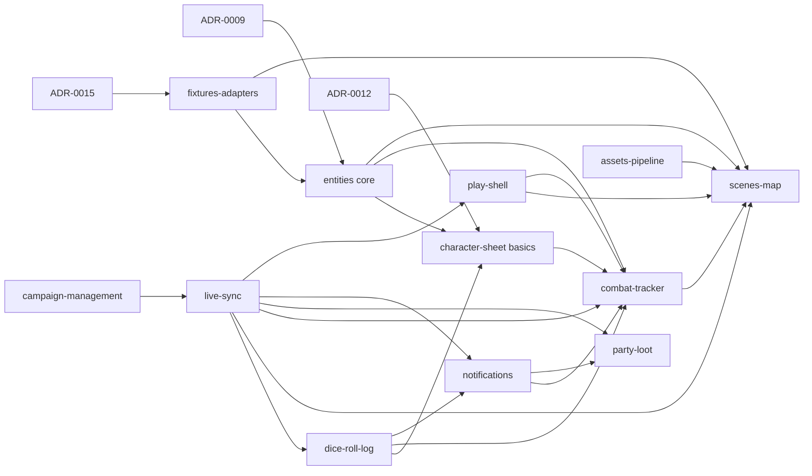

# Roadmap

MVP = playable session simulation ([ADR-0014](architecture/adr/0014-mvp-scope.md), [vision](vision.md#mvp-a-playable-session-simulation)). Per-feature ranking: [feature tiers](feature-tiers.md).

## Build order (MVP)

Specs are written **just in time**: each phase's specs are written, reviewed by the DM and consolidated right before that phase is built. The next phase's specs are written while the current phase builds ([orchestrator prompt](agents/orchestrator-prompt.md#6-phases-and-gates)).

| Phase | Specs | Delivers | Exit check |
|---|---|---|---|
| 1. Foundation (skeleton) | [live-sync](specs/live-sync.md), [campaign-management](specs/campaign-management.md), [fixtures-adapters](specs/fixtures-adapters.md) | Campaign, DM secret, player links, live sync, event bus + event log, fixture reset/load, import pipeline core | DM + player connect in separate browsers; snapshot on reconnect; fixture rebuild in one command |
| 2. Scenes | [assets-pipeline](specs/assets-pipeline.md), [entities](specs/entities.md), [play-shell](specs/play-shell.md), [scenes-map](specs/scenes-map.md) | Map upload, grid, tokens, hide/reveal, ruler, ping/laser, scene list + switch, floating windows | Town → battlemap; tokens moved by DM and player; hidden token revealed |
| 3. Combat | [character-sheet](specs/character-sheet.md), [dice-roll-log](specs/dice-roll-log.md), [notifications](specs/notifications.md), [combat-tracker](specs/combat-tracker.md) | Sheet basics, dice + game log, notifications, encounter builder, combat, attack popup, damage cards, undo | One full fight vs mixed enemies; public/hidden log; undo a wrong damage |
| 4. Reward + hardening | [party-loot](specs/party-loot.md) | Party loot; crash recovery across all features | Full session simulation; kill server mid-combat, resume intact |

Not blocking MVP: [ADR-0010](architecture/adr/0010-compendium-design.md), [0011](architecture/adr/0011-cross-references.md). [ADR-0012](architecture/adr/0012-character-derived-values.md): MVP basics are stored (decided); full-sheet derivation open, post-MVP.

[Data model](data-model/README.md) and [protocol](protocol/README.md) are **living docs**, extended phase by phase.
## Dependencies

## Priority build list (2026-10-31)

DM decisions [#413](decisions-log.md), [#416](decisions-log.md). Items 1–4 are [sprint 15](agents/sprint-15.md). Tiers: [feature tiers](feature-tiers.md).

| # | Work | Spec / items | Note |
|---|---|---|---|
| 1 | Upgrade guards: a clear refusal on renames, a CI upgrade check | BL-172, BL-173 | First: notes add tables, and the real campaign upgrades itself on every `play` |
| 2 | Play fixes from session-sim-17 | BL-174, -175, -176, -164, -171, -151 | |
| 3 | Window position memory and related placement bugs | BL-146, BL-143–145 | Approved in #381 |
| 4 | **Linked notes with backlinks** | [world-builder](specs/post-mvp/world-builder.md), [ADR-0011](architecture/adr/0011-cross-references.md) | Next big feature |
| 5 | Quest log | [world-builder](specs/post-mvp/world-builder.md) | Right after notes |
| 6 | In-game calendar | [campaign-manager](specs/post-mvp/campaign-manager.md) | |
| 7 | Session timeline | [campaign-manager](specs/post-mvp/campaign-manager.md) | The spec must settle how it fits [ADR-0013](architecture/adr/0013-session-journal-scope.md)'s "no session entity" |
| 8 | NPC directory players build | [world-builder](specs/post-mvp/world-builder.md) | Builds on notes |

**After that (tier B, unordered):** journal entries, shared party notes and map pins (all need notes); character builder and guided level-up ([levelling](specs/post-mvp/levelling.md)).

**Background, between items:** attack and dice details (BL-150, -155–157, -177), stat block and AoE label polish (BL-149, -153), performance (BL-142, -152, -166), CI flakes (BL-154, -158, -159), smaller UI glitches (the backlog's other open rows).

**Parked**
- Tier C: legendary / lair actions, reaction tracker, encumbrance, Obsidian import.
- Only if someone else runs it: [single executable](specs/post-mvp/single-executable.md) and generated migrations (BL-167 waits for the same point).

**Handled by the MCP tools, no build:** importing existing characters, homebrew files, Griffon's Saddlebag items.

## After MVP (v1 candidates, unordered)

Historical: the original post-MVP list, mostly built. Current order: [priority build list](#priority-build-list-2026-10-31).

| Stub | From original MVP list |
|---|---|
| [compendium](specs/post-mvp/compendium.md) | SRD import, browse, clone, homebrew |
| [world-builder](specs/post-mvp/world-builder.md) | NPCs, locations, factions, quests, search, cross-refs, location ↔ scenes |
| [scene-tools](specs/scene-tools.md) | **Fog first (right after MVP)**, then AoE props, layers, walls |
| [character-sheet-full](specs/character-sheet-full.md) | Full 5e sheet |
| [combat-extras](specs/combat-extras.md) | Conditions, concentration, durations, temp HP, custom actions, multi-target |
| [party-board](specs/post-mvp/party-board.md) | Handouts, party inventory |

Plus the rest of [post-MVP](specs/README.md#post-mvp).
