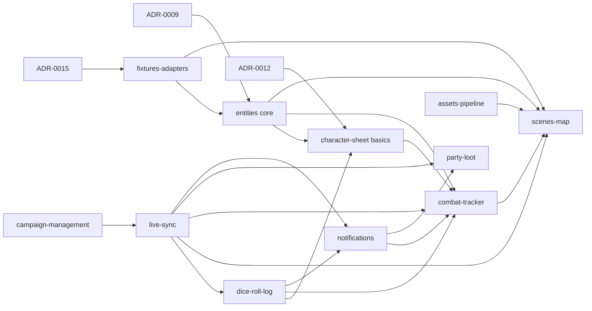

# Roadmap

MVP = playable session simulation ([ADR-0014](architecture/adr/0014-mvp-scope.md), [vision](vision.md#mvp-a-playable-session-simulation)).

## Spec writing order (MVP)

Same wave = parallel. Later waves need earlier ones at least `draft`.

| Wave | Specs | Why this order |
|---|---|---|
| 0 | [ADR-0009](architecture/adr/0009-entity-content-model.md) entity model, [ADR-0015](architecture/adr/0015-source-adapters-fixtures.md) adapters/fixtures, [ADR-0012](architecture/adr/0012-character-derived-values.md) (basics only) | Shape characters, monsters and fixtures |
| 1 | [live-sync](specs/live-sync.md), [campaign-management](specs/campaign-management.md), [assets-pipeline](specs/assets-pipeline.md), [fixtures-adapters](specs/fixtures-adapters.md) | Foundations: auth, events, files, rebuildable setups |
| 2 | [entities](specs/entities.md) (core), [character-sheet](specs/character-sheet.md) (basics), [dice-roll-log](specs/dice-roll-log.md), [notifications](specs/notifications.md) | What tokens and combat act on; feed for damage cards |
| 3 | [scenes-map](specs/scenes-map.md), [combat-tracker](specs/combat-tracker.md), [party-loot](specs/party-loot.md) | The session itself |

Not blocking MVP: [ADR-0010](architecture/adr/0010-compendium-design.md), [0011](architecture/adr/0011-cross-references.md), [0013](architecture/adr/0013-session-journal-scope.md).

After wave 3: [data model](data-model/README.md) → [protocol](protocol/README.md) consolidation → build ([process](process.md)).

## Dependencies

## MVP build phases

> TODO (spec phase): confirm once specs are `complete`. Indicative only.

| Phase | Delivers | Exit check |
|---|---|---|
| 1. Skeleton | Campaign, auth, live sync, fixture pipeline | DM + player connect; snapshot on reconnect; fixture rebuild works |
| 2. Scenes | Assets, scenes, tokens, ruler, scene switch | Town → battlemap with tokens moved by DM and player |
| 3. Combat | Sheet basics, dice, combat | One full fight vs one enemy kind |
| 4. Reward + hardening | Party loot; crash recovery | Full session simulation; kill server mid-combat, resume intact |

## After MVP (v1 candidates, unordered)

| Stub | From original MVP list |
|---|---|
| [compendium](specs/post-mvp/compendium.md) | SRD import, browse, clone, homebrew |
| [world-builder](specs/post-mvp/world-builder.md) | NPCs, locations, factions, quests, search, cross-refs, location ↔ scenes |
| [scene-tools](specs/post-mvp/scene-tools.md) | Fog, AoE props, hidden tokens |
| [character-sheet-full](specs/post-mvp/character-sheet-full.md) | Full 5e sheet |
| [combat-extras](specs/post-mvp/combat-extras.md) | Encounter builder, CR math, conditions, concentration, visibility |
| [party-board](specs/post-mvp/party-board.md) | Handouts, party inventory |

Plus the rest of [post-MVP](specs/README.md#post-mvp).
