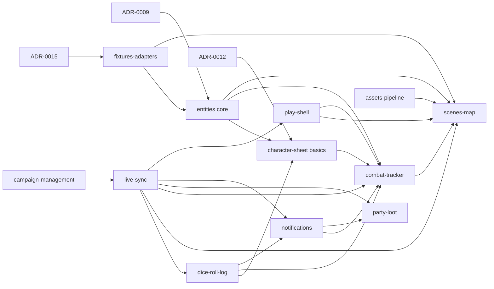

# Roadmap

MVP = playable session simulation ([ADR-0014](architecture/adr/0014-mvp-scope.md), [vision](vision.md#mvp-a-playable-session-simulation)). Per-feature ranking: [feature tiers](feature-tiers.md).

## Build order (MVP)

Specs are written **just in time**: each phase's specs are written, reviewed by the DM and consolidated right before that phase is built. The next phase's specs are written while the current phase builds ([orchestrator prompt](agents/orchestrator-prompt.md#6-phases-and-gates)).

| Phase | Specs | Delivers | Exit check |
|---|---|---|---|
| 1. Foundation (skeleton) | [live-sync](specs/live-sync.md), [campaign-management](specs/campaign-management.md), [fixtures-adapters](specs/fixtures-adapters.md) | Campaign, DM secret, player links, live sync, event bus + event log, fixture reset/load, import pipeline core | DM + player connect in separate browsers; snapshot on reconnect; fixture rebuild in one command |
| 2. Scenes | [assets-pipeline](specs/assets-pipeline.md), [entities](specs/entities.md), [play-shell](specs/play-shell.md), [scenes-map](specs/scenes-map.md) | Map upload, grid, tokens, hide/reveal, ruler, ping/laser, scene list + switch, floating windows | Town → battlemap; tokens moved by DM and player; hidden token revealed |
| 3. Combat | [character-sheet](specs/character-sheet.md), [dice-roll-log](specs/dice-roll-log.md), [notifications](specs/notifications.md), [combat-tracker](specs/combat-tracker.md) | Sheet basics, dice + game log, notifications, encounter builder, combat, attack popup, damage cards, undo | One full fight vs mixed enemies; public/hidden log; undo a wrong damage |
| 4. Reward + hardening | [party-loot](specs/party-loot.md) | Party loot; crash recovery across all features | Full session simulation; kill server mid-combat, resume intact |

Not blocking MVP: [ADR-0010](architecture/adr/0010-compendium-design.md), [0011](architecture/adr/0011-cross-references.md). [ADR-0012](architecture/adr/0012-character-derived-values.md): MVP basics are stored (decided); full-sheet derivation open, post-MVP.

[Data model](data-model/README.md) and [protocol](protocol/README.md) are **living docs**, extended phase by phase.
## Dependencies

## After MVP (v1 candidates, unordered)

| Stub | From original MVP list |
|---|---|
| [compendium](specs/post-mvp/compendium.md) | SRD import, browse, clone, homebrew |
| [world-builder](specs/post-mvp/world-builder.md) | NPCs, locations, factions, quests, search, cross-refs, location ↔ scenes |
| [scene-tools](specs/scene-tools.md) | **Fog first (right after MVP)**, then AoE props, layers, walls |
| [character-sheet-full](specs/character-sheet-full.md) | Full 5e sheet |
| [combat-extras](specs/combat-extras.md) | Conditions, concentration, durations, temp HP, custom actions, multi-target |
| [party-board](specs/post-mvp/party-board.md) | Handouts, party inventory |

Plus the rest of [post-MVP](specs/README.md#post-mvp).
