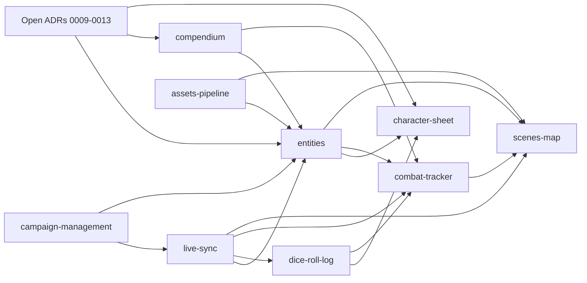

# Roadmap

## Spec writing order

Specs in the same wave can be written in parallel. Later waves depend on earlier ones being at least `draft`.

| Wave | Specs | Why this order |
|---|---|---|
| 0 | Proposed ADRs [0009](architecture/adr/0009-entity-content-model.md)–[0013](architecture/adr/0013-session-journal-scope.md) | Entity/compendium model shapes almost every spec |
| 1 | [live-sync](specs/live-sync.md), [assets-pipeline](specs/assets-pipeline.md), [campaign-management](specs/campaign-management.md) | Foundations: auth, scope, events, files |
| 2 | [entities](specs/entities.md), [compendium](specs/compendium.md), [dice-roll-log](specs/dice-roll-log.md) | Content and rolling, used by play features |
| 3 | [character-sheet](specs/character-sheet.md), [combat-tracker](specs/combat-tracker.md), [scenes-map](specs/scenes-map.md) | Play features, built on everything above |

After wave 3: [data model](data-model/README.md) and [protocol](protocol/README.md) consolidation, then build ([process](process.md)).

## Dependencies

## MVP build phases

> TODO (spec phase): confirm after specs reach `complete`. Indicative only.

| Phase | Delivers | Exit check |
|---|---|---|
| 1. Skeleton | Campaign, auth, live sync, assets | DM + player connect; snapshot on reconnect |
| 2. Content | Entities, compendium import (Open5e) | Browse SRD, clone to campaign |
| 3. Play | Dice, character sheet, combat, scenes | Run a full session end-to-end |
| 4. Hardening | Crash recovery, preload, perf | Kill server mid-combat, resume intact |

## Post-MVP

Stubs only, unordered: see [specs/post-mvp/](specs/README.md#post-mvp).
