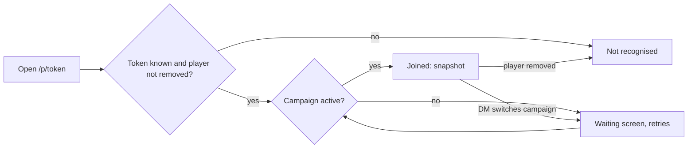

# Campaign management

> Five-minute read. Bullets over prose. See [AGENTS.md](../../AGENTS.md).

## 1. Summary

- Create and switch campaigns; campaign is the top-level scope ([ADR-0004](../architecture/adr/0004-tenancy-auth-permissions.md)).
- Add players and hand out their player links; a player joins by opening the link, nothing else.
- DM access via the DM secret. Built first, in the Phase 2 skeleton ([roadmap](../roadmap.md#build-order-mvp)).

## 2. Scope

- DM secret setup (server config) and DM login.
- Create campaigns; list them; switch the **active campaign** (one at a time, [OQ-CAMP-04](#15-open-questions)).
- Rename campaign and player *(proposed, [OQ-CAMP-09](#15-open-questions))*.
- Add players; copy each player's link; remove a player *(soft remove, [OQ-CAMP-08](#15-open-questions))*.
- Player join via player link: landing, "not recognised" and "campaign not running" screens.
- Player links that survive server restarts and tunnel URL changes ([ADR-0003](../architecture/adr/0003-local-hosting.md)).

## 3. Goals

- A player joins from a player link with no setup beyond opening the URL ([vision](../vision.md#success-criteria)).
- DM and player connect in separate browser contexts and both survive a reload and a server restart without re-entering anything.
- No player connection ever receives the DM secret, any player link token, or another campaign's data.
- A new tunnel URL needs no data change: the DM re-copies links (same tokens) from the player list.

## 4. Non-goals

- User accounts, roles, ACL ([ADR-0004](../architecture/adr/0004-tenancy-auth-permissions.md)).
- Link revocation / rotation / kick as a feature (tier F, [feature tiers](../feature-tiers.md#5-dm-tools)). Removing a player ends their access as a side effect only.
- Backup / export UI (tier D). Backup = copy the SQLite file + asset dir.
- Session tracking (tier F, [ADR-0013](../architecture/adr/0013-session-journal-scope.md)).
- Campaign delete / archive; several campaigns live at once.
- Starting or managing the cloudflared tunnel.

## 5. User stories

**DM**
- As the DM, I want to set my secret once in config so that only I can open the DM client, even through the tunnel.
- As the DM, I want to create a campaign and switch between campaigns so that test and real games stay separate.
- As the DM, I want to add a player and copy their link so that I can paste it into our group chat.
- As the DM, I want to re-copy links after the tunnel URL changes so that players can rejoin next session.
- As the DM, I want to see who is connected so that I know when to start.

**Player**
- As a player, I want to open my link and be in the game as me, with no sign-up.
- As a player, I want a reload or a dropped connection to put me straight back in.
- As a player, I want a clear message if my link is wrong or the game isn't running.

## 6. Functional requirements

| ID | Requirement | Notes |
|---|---|---|
| **DM secret and login** | | |
| FR-CAMP-01 | Server reads the DM secret from env config at start. If unset, empty or under 12 characters, it refuses to start with a clear error. | [OQ-CAMP-03](#15-open-questions); 12 is proposed |
| FR-CAMP-02 | The DM client shows a login screen until a valid DM secret is entered. A wrong secret shows an error and grants nothing. | |
| FR-CAMP-03 | The secret is compared in constant time. It is never logged, stored in the DB, or included in any response or event. | |
| FR-CAMP-04 | After login, the DM stays logged in across page reload and server restart. If the configured secret changes, the stored credential is rejected and the login screen returns. | Transport: [OQ-CAMP-10](#15-open-questions) |
| FR-CAMP-05 | DM access is never granted by source address (localhost included). Every DM request and connection presents the credential. | Tunnel traffic arrives from localhost |
| FR-CAMP-06 | Failed DM logins are rate-limited. | [OQ-CAMP-12](#15-open-questions) |
| **Campaigns** | | |
| FR-CAMP-07 | DM creates a campaign with a name: trimmed, 1–60 characters, unique (case-insensitive). Duplicate → error, nothing created. | |
| FR-CAMP-08 | A campaign created while no campaign is active becomes the active campaign. | First-run path |
| FR-CAMP-09 | DM lists all campaigns, with the active campaign marked. | |
| FR-CAMP-10 | At most one campaign is active at any time (enforced by the DB). The active campaign survives a server restart. | [OQ-CAMP-04](#15-open-questions) |
| FR-CAMP-11 | DM switches the active campaign. The server closes every player connection of the old campaign (reason `campaign-inactive`). The DM client re-snapshots into the new campaign. | |
| FR-CAMP-12 | *(proposed)* DM renames a campaign; same rules as FR-CAMP-07. Connected players see the new name without reloading. | [OQ-CAMP-09](#15-open-questions) |
| FR-CAMP-13 | A player connection's campaign comes from its player link only, never from request input. DM requests are scoped to the active campaign. | |
| **Players and links** | | |
| FR-CAMP-14 | DM adds a player to the active campaign with a name: trimmed, 1–40 characters, unique (case-insensitive) among non-removed players of that campaign. | |
| FR-CAMP-15 | Adding a player generates a link token: at least 128 bits from a CSPRNG, URL-safe. The token is unique server-wide. | Test seam: [OQ-CAMP-11](#15-open-questions) |
| FR-CAMP-16 | DM sees the player list: name, online state, copy-link button. | Online state from [live-sync](live-sync.md) presence |
| FR-CAMP-17 | Copy link puts `<public base URL>/p/<token>` on the clipboard. The token carries no host; changing the base URL and re-copying gives a working link with the same token. | Path illustrative; base URL: [OQ-CAMP-07](#15-open-questions) |
| FR-CAMP-18 | A player link stays valid across server restarts and base URL changes until the player is removed. | |
| FR-CAMP-19 | *(proposed)* DM renames a player; the token is unchanged. | [OQ-CAMP-09](#15-open-questions) |
| FR-CAMP-20 | DM removes a player (after confirmation). The link stops working immediately, the player's open connections close (reason `player-removed`), and records owned by the player keep pointing at them. | [OQ-CAMP-08](#15-open-questions) |
| FR-CAMP-21 | Re-adding a removed player's name creates a new player with a new token. The old link stays dead. | |
| **Player join** | | |
| FR-CAMP-22 | Opening a valid link for the active campaign lands the player in the campaign with no further input. The page shows the player name and campaign name. | Later: lands on the active scene ([play-shell](play-shell.md)) |
| FR-CAMP-23 | Reloading the page keeps the player joined. | Token stays in the URL |
| FR-CAMP-24 | An unknown or removed token shows "link not recognised". No campaign data is sent. | |
| FR-CAMP-25 | A valid token for an inactive campaign shows a waiting screen naming the campaign. The player joins automatically, without reloading, once the DM activates it. | Retry via live-sync reconnect |
| FR-CAMP-26 | The same link may be open in several browsers at once. All of them connect as that player. | Trusted table |
| **Visibility and commands** | | |
| FR-CAMP-27 | Player connections never receive the DM secret, any link token, or any data from another campaign. | |
| FR-CAMP-28 | Players receive `{id, name}` of the non-removed players in their own campaign. | [OQ-CAMP-13](#15-open-questions) |
| FR-CAMP-29 | Every mutation in this spec is a server command. Each commits in one transaction together with its domain event in the event log ([ADR-0016](../architecture/adr/0016-domain-events-pending-actions.md)). Fixtures call the same commands. | |

## 7. UI/UX notes

Per [visual-direction](../design/visual-direction.md): shadcn defaults, dark only, laptop viewports. Every interactive element gets a test ID ([ADR-0017](../architecture/adr/0017-agent-verification-fixture-library.md)).

- **Screens**
  - **DM login** (DM route): one password input + submit. Error inline. Rate-limit message when throttled.
  - **Campaign switcher** (DM header): Select/Command list, active one marked; "New campaign" Dialog (name field). Switching while players are online → confirm Dialog ("N players will be disconnected").
  - **Players panel** (DM): Table with name, online dot, copy-link button (Toast "Link copied"), rename, remove (confirm Dialog). Add-player input at the bottom. Shows the base URL used for links; warns if it is a localhost URL ([OQ-CAMP-07](#15-open-questions)).
  - **Player join** (`/p/<token>`): loading → joined / not recognised / waiting.
- **States:** empty (no campaigns → "Create your first campaign"; no players → "Add a player to get a link"), loading, error (validation inline; server errors as Toast), disconnected (banner from [live-sync](live-sync.md)).
- **DM view:** switcher + players panel. In the skeleton this is a plain DM page. Where it lives later is up to [play-shell](play-shell.md) (window or Sheet).
- **Player view:** joined → "Playing as **Mira** in **Fixture Campaign**" in the skeleton, the active scene later. Not recognised → "This link isn't recognised. Ask your DM for your link." Waiting → "**Fixture Campaign** isn't running right now. This page connects when the DM starts it."

## 8. Data model

No JSON leaf fields ([ADR-0006](../architecture/adr/0006-persistence.md)).

| Entity | Field | Type | Notes |
|---|---|---|---|
| Campaign | id | ID | The scope itself, so it has no `campaignId` |
| | name | text | 1–60, unique case-insensitive |
| | active | boolean | At most one `true` (partial unique index) |
| | createdAt, updatedAt | timestamp | Clock seam ([ADR-0008](../architecture/adr/0008-parallel-dev-isolation.md)) |
| Player | id | ID | Referenced by owned records (characters, tokens) |
| | campaignId | ID → Campaign | |
| | name | text | 1–40, unique case-insensitive among non-removed players in the campaign |
| | linkToken | text | Unique; stored in plain text so the DM can re-copy it. **DM-only field.** |
| | createdAt | timestamp | |
| | removedAt | timestamp, nullable | Soft remove ([OQ-CAMP-08](#15-open-questions)) |
| *DM secret* | — | — | Env config only; not persisted ([OQ-CAMP-03](#15-open-questions)) |

- **Relations:** Campaign 1—* Player. Player 1—* owned records (characters, tokens), defined by [entities](entities.md) and [scenes-map](scenes-map.md).
- **Derived values:** player link URL = public base URL + path + `linkToken` (not stored). Online state comes from live-sync presence (not stored here). "Current players" = `removedAt` is null.
- **Persisted runtime state:** `Campaign.active`.
- **Domain events** (all written to the event log): `CampaignCreated`, `CampaignRenamed`, `CampaignActivated {campaignId, previousCampaignId}`, `PlayerAdded`, `PlayerRenamed`, `PlayerRemoved`. Events never carry `linkToken`.

## 9. API & events

Names are illustrative. The envelope, error shape and auth transport belong to [live-sync](live-sync.md). CRUD goes over REST, per the [OQ-SYNC-04](live-sync.md#15-open-questions) pick.

**REST (Hono RPC)**

| Method | Path | Who | Purpose |
|---|---|---|---|
| POST | `/api/dm/login` | anyone | Verify DM secret → 204 / 401 / 429 |
| GET | `/api/campaigns` | DM | List campaigns + active flag |
| POST | `/api/campaigns` | DM | Create (FR-CAMP-07/08) |
| PATCH | `/api/campaigns/:id` | DM | Rename *(proposed)* |
| POST | `/api/campaigns/:id/activate` | DM | Switch active campaign |
| GET | `/api/players` | DM | Active campaign's players, incl. `linkToken` |
| POST | `/api/players` | DM | Add player to the active campaign |
| PATCH | `/api/players/:id` | DM | Rename *(proposed)* |
| DELETE | `/api/players/:id` | DM | Soft remove |
| GET | `/api/join/:token` | anyone with token | `{playerName, campaignName, campaignActive}` or 404 |

**WS intents (client → server)**

| Intent | Who | Validation / ownership |
|---|---|---|
| — | — | None. All mutations here are REST commands. Join auth is the live-sync handshake. |

**WS events (server → client)**

| Event | Payload | Visibility rule |
|---|---|---|
| `campaign.created` | `{id, name}` | DM only |
| `campaign.updated` | `{id, name}` | DM; players of that campaign |
| `campaign.activated` | `{id, previousId}` | DM only (DM client re-snapshots). Old campaign's players are disconnected, not notified by event. |
| `player.upserted` | DM: `{id, name, linkToken}`; players: `{id, name}` | DM full; players of the same campaign get `linkToken` redacted |
| `player.removed` | `{id}` | DM; players of the same campaign |
| Connection close reasons | `campaign-inactive`, `player-removed`, `link-invalid` | Sent only to the affected connection (mechanism: live-sync) |

**Snapshot contribution:** `campaign {id, name}` and `players[]`, filtered as for `player.upserted`.

**Provided to live-sync** (in-process): `verifyDmCredential(value) → bool`, and `resolvePlayerLink(token) → {campaignId, playerId, campaignActive} | null`.

## 10. Permissions

| Action | DM | Player | Server check |
|---|---|---|---|
| Log in as DM | ✓ | ✗ | Constant-time secret compare, rate-limited |
| Create / rename / switch campaign | ✓ | ✗ | DM credential |
| Add / rename / remove player, read link tokens | ✓ | ✗ | DM credential |
| Join a campaign | — | Own link only | Token resolves to a non-removed player; campaign is active |
| Read own campaign name + player names | ✓ | ✓ | Campaign comes from the token (FR-CAMP-13) |

No player-writable actions in this spec.

## 11. Edge cases & failure modes

- **Player disconnect / reconnect:** reconnects with the token from the URL and gets a fresh snapshot. If the player was removed or the campaign switched meanwhile → the not-recognised or waiting screen.
- **DM disconnect / reconnect:** players are unaffected. The DM client re-authenticates with its stored credential and re-snapshots.
- **Server crash mid-action:** each command is one transaction (row + event log). After a restart the campaign or player either exists fully or not at all. A retried create hits the unique name → error. The DM refreshes the list. Activation is one transaction flipping both flags, so it is never zero-then-two.
- **Server or tunnel down:** the player's browser can't load the page; nothing app-side to show. Links work again once it is back. A new tunnel host → the DM re-copies the links.
- **Link reused on two laptops:** both connect as the same player and can act as them (FR-CAMP-26). No dedupe.
- **Removed player still connected:** connections close immediately, then the not-recognised screen. Their tokens and characters stay. The DM reassigns ownership ([scenes-map](scenes-map.md), tier S). Past game log entries keep the name.
- **DM switches campaign mid-session:** confirm dialog. The old campaign's players see the waiting screen and auto-join when it is reactivated.
- **Concurrent edits:** single DM. Two DM tabs → last write wins. Name uniqueness is enforced by the DB, so racing creates give one success and one error.
- **Invalid / malicious input:** zod on every route. Names are trimmed and control characters rejected. Names are rendered as text, never as HTML. Unknown tokens → 404 with no detail. Tokens are unguessable (≥128 bits), so the join route needs no rate limit.
- **Player opens the DM route:** sees the login screen; nothing is loaded without the secret.
- **Secret changed in env between runs:** the DM client gets 401 → login screen (FR-CAMP-04).

## 12. Performance & bandwidth

- Tiny: a handful of campaigns, ≤ ~7 players each. Payloads < 2 KB. No assets.
- Join = one small REST call + the live-sync snapshot. Nothing here adds to tunnel upload ([ADR-0003](../architecture/adr/0003-local-hosting.md)).
- Login rate limit must not affect normal reconnects (those use the stored credential, not the login route).

## 13. Test plan

Isolated per worktree: fresh temp DB and asset dir per run, own ports, DM secret from the worktree's env ([ADR-0008](../architecture/adr/0008-parallel-dev-isolation.md)). Agent build loop per [ADR-0017](../architecture/adr/0017-agent-verification-fixture-library.md). Fixture reset/load uses the commands from the build conventions (names not fixed here).

**Fixtures added** (scripts of the commands in this spec):

| Fixture | Contents |
|---|---|
| `campaign-empty` | Campaign "Fixture Campaign", active, no players |
| `campaign-party` | Adds `player-1` "Mira" with a stable link ([OQ-CAMP-11](#15-open-questions)). Base of `session-sim` ([fixtures-adapters](fixtures-adapters.md)) |
| `campaign-second` | Campaign "Second Campaign", inactive, one player "Bram" with a stable link |

**Bundle:** `campaign-basics` = `campaign-party` + `campaign-second`.

| Level | What | Fixtures |
|---|---|---|
| Unit | Name validation; token length/charset; seeded token determinism; constant-time compare; link building from the base URL; startup refusal without a secret | none |
| Integration | Each command commits its row + event log entry (injected failure → neither). At most one active. DM routes 401 without the secret and with a player token. Token resolves → removed → null. Inactive campaign → `campaignActive: false`. Player snapshot and events never contain `linkToken` or second-campaign data. Rate limit after N failures. | `campaign-empty`, `campaign-basics` |
| E2E (thin) | Playwright: DM + player contexts, join + reload + switch (walkthrough below, scripted) | `campaign-basics` |

**Browser walkthrough** (DM and each player in separate browser contexts):

1. **Bundle:** reset and load `campaign-basics`; start the app on the worktree ports.
2. **DM:** open the DM route, enter a wrong secret → error. Enter the fixture secret → "Fixture Campaign" active, player list shows Mira.
3. **DM:** add player "Thorn" and copy Thorn's link (read from the UI).
4. **Player A:** open Mira's stable link → "Playing as Mira in Fixture Campaign". The DM list shows Mira online.
5. **Player B:** open Thorn's link → joined as Thorn.
6. **Both:** reload → still joined. **DM:** reload → still logged in.
7. **DM:** remove Thorn → Player B shows "link not recognised"; Thorn is gone from Player A's player names.
8. **DM:** switch to "Second Campaign" → confirm → Player A shows the waiting screen. **Player C:** open Bram's link → joined.
9. **DM:** switch back → Player A auto-joins without reloading; Player C shows the waiting screen.
10. **Server:** kill and restart → DM still logged in, "Fixture Campaign" still active, Player A reconnects, Thorn's link still dead.
11. **Expected:** every step above holds; no `linkToken` appears in any player network payload (inspect WS frames / REST responses).

## 14. Dependencies

| On | What we need | Status |
|---|---|---|
| [live-sync](live-sync.md) | Credential transport and connection binding using our resolvers; presence (online state); close-with-reason; snapshot slot for campaign + players; reconnect retry that also covers the waiting screen | open ([OQ-CAMP-10](#15-open-questions)) |
| [fixtures-adapters](fixtures-adapters.md) | Fixtures call our commands; stable tokens via the seed seam; DM secret in worktree env | open ([OQ-CAMP-11](#15-open-questions)) |
| [play-shell](play-shell.md) | Where the switcher and players panel live; the player landing page after join | open (phase 2) |
| [entities](entities.md), [scenes-map](scenes-map.md) | Owned records reference `Player.id`; removed-player ownership is reassigned by the DM | open (phase 2) |
| Build conventions (AGENTS.md, being drafted) | Env var names (DM secret, public base URL); fixture reset/load command names | open |

## 15. Open questions

**Bold** option = suggested pick (not decided).

| ID | Question | Options (pick marked) | Blocking? | Affects |
|---|---|---|---|---|
| OQ-CAMP-01 | Tunnel URL may change per session. How do player links survive? | **Opaque token in the path; links built from a configured public base URL; DM re-copies after a host change.** Zero infra, but players need a new link per new host. / Fixed named tunnel: stable host, but needs a Cloudflare account + domain. / Short redirect service: needs a cloud service ([ADR-0003](../architecture/adr/0003-local-hosting.md) says no). See [proposed ADR](../architecture/adr/proposed-auth-credentials.md) | yes | live-sync |
| OQ-CAMP-02 | ~~Player link revocation / rotation~~ **Decided: not needed (tier F)**. Trusted table. | — | — | — |
| OQ-CAMP-03 | How is the DM secret set and stored? | **Env config only, checked at start (min 12 chars), never persisted.** Simplest, fixture-friendly; changing it means editing config and restarting. / Env on first run, hashed in DB: survives a config loss, but two sources of truth. / Generated on first run and printed: no setup, but awkward for fixtures and easy to lose. | yes | live-sync, fixtures-adapters |
| OQ-CAMP-04 | Can several campaigns be live at once? | **No: one active campaign per server, persisted flag.** Clear DM scope and snapshot; switching kicks the old campaign's players. / Yes, each connection scoped by its own campaign: no global state, but the DM client needs per-tab scoping. See [proposed ADR](../architecture/adr/proposed-single-active-campaign.md) | yes | live-sync, all specs (campaign scoping) |
| OQ-CAMP-05 | ~~Session journal in MVP?~~ **Decided: no session tracking** ([ADR-0013](../architecture/adr/0013-session-journal-scope.md)) | — | — | — |
| OQ-CAMP-06 | ~~Campaign export/backup UI~~ **Decided: no UI (tier D)**. Document copying the SQLite file + asset dir. | — | — | — |
| OQ-CAMP-07 | How does the DM client know the public (tunnel) base URL to build links? | **Env config; if unset, use the DM client's origin and show a warning.** Fits [ADR-0008](../architecture/adr/0008-parallel-dev-isolation.md), but needs a restart when the tunnel host changes. / DM pastes it in the UI (persisted): no restart, but one more setting. / Server parses cloudflared output: automatic, but couples us to the tunnel tool. | no · owner: spec-campaign-management | — |
| OQ-CAMP-08 | What does "remove player" do? | **Soft remove: the link dies, open connections close, owned records are kept for the DM to reassign.** No dangling references; close-on-remove is a side effect, not a kick feature (tier F). / Hard delete with cascade: loses characters and log attribution. / No remove in MVP: simplest, but typos stay forever. | yes | entities, scenes-map, live-sync |
| OQ-CAMP-09 | Rename campaign / player in MVP? | **Yes. Near-free, and fixes typos without a remove + new link.** / No, defer: strictly tier S only. | no · owner: spec-campaign-management | — |
| OQ-CAMP-10 | Credential transport and connection binding. | **live-sync owns it, using CAMP's resolvers. DM client keeps the secret in localStorage and sends it per REST request and in the WS auth message. The player token stays in the URL.** No server session state. / Login issues an httpOnly session cookie: the secret isn't kept client-side, but adds a persisted session table. | yes | live-sync |
| OQ-CAMP-11 | How do fixtures get stable player links? | **Token generation goes through the same seeded-random seam as IDs.** Fixtures stay on the UI path. / `addPlayer` takes an optional token (fixture-only): explicit, but a path the UI can't reach ([ADR-0017](../architecture/adr/0017-agent-verification-fixture-library.md)). | no · owner: fixtures-adapters | fixtures-adapters |
| OQ-CAMP-12 | DM login brute-force protection (via the tunnel). | **Global backoff: after 5 failures in 1 min, reject logins for 1 min.** Simple, but an attacker can delay a fresh DM login (stored credentials are unaffected). / Per client IP via the tunnel header: precise, but trusts a header. / None: trusted table, but the secret is exposed to the internet. | no · owner: spec-campaign-management | live-sync |
| OQ-CAMP-13 | Do players see other players' names? | **Yes, `{id, name}` of current players in their campaign.** Needed for the game log and party UI. / No: a stricter filter, but other specs must resolve names themselves. | no · owner: spec-campaign-management | dice-roll-log, play-shell |
| OQ-CAMP-14 | Glossary: add **Active campaign** ("the one campaign the server currently serves to players") and **Public base URL** ("the externally reachable URL, usually the tunnel, used to build player links")? | **Add both** / keep them spec-local | no · owner: integrator | glossary |

## 16. Out of scope

- Accounts, roles, ACL ([ADR-0004](../architecture/adr/0004-tenancy-auth-permissions.md)).
- Sessions, timeline, prep notes → [campaign-manager](post-mvp/campaign-manager.md).
- Link revocation/rotation, kick (tier F). Backup UI (tier D).
- Connection lifecycle, presence, snapshots → [live-sync](live-sync.md).
- Characters owned by players → [entities](entities.md), [character-sheet](character-sheet.md).
