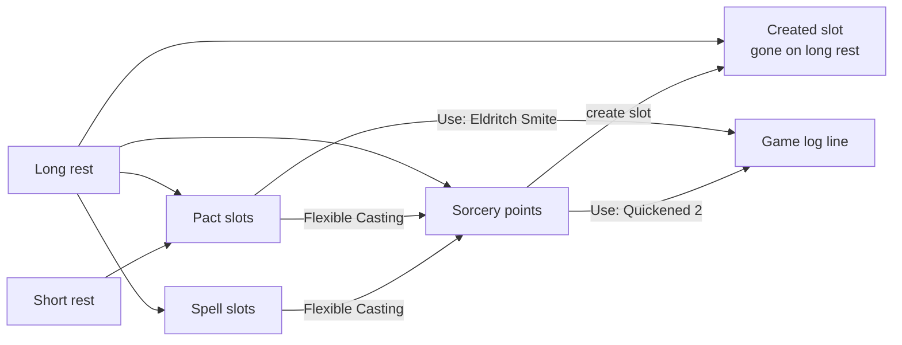

# Class resources

> Five-minute read for §1–§7; §8 onwards is reference. Builds on [character-sheet-full](character-sheet-full.md) (CHARX: counters, feature rows, rests) and [effect-modifiers](effect-modifiers.md) (MOD: toggles, rule triggers). Started from the playtest party (2026-11-05): a Sorcerer 5 / Warlock 2 whose sorcery points and pact slots are plain feature-use counters today.

> **DM decisions (2026-11-05).** Spending a slot from the spell row comes later (OQ-CRES-04 B). Use lines are seen by everyone (OQ-CRES-05 A). The other open questions go as suggested. New: **pact weapons** (FR-CRES-14–16), because Soel's pact weapon is a hand crossbow, so "melee" can't stand in for "pact weapon".

> **Built, slice 1 (`build/cres-pact`, 2026-11-06):** pact slots and pact weapons, FR-CRES-01–04 and -14–16. Tests `FR-CRES-…` in `pact-slots.test.ts`, `pact-weapon.test.ts` (server and shared), `pact.test.ts`; e2e `class-resources.e2e.ts`; bundle `class-resources`. Next: sorcery points (FR-CRES-05–08), then spend links (FR-CRES-09–13).

## 1. Summary

- **Pact slots**: a second slot pool on the stat block. All its slots are the same level, and they come back on a **short** rest.
- **Sorcery points**: a feature row marked as the points pool. **Flexible Casting** turns a slot into points, or points into a **created slot** that lasts until a long rest.
- **Feature use with a cost**: a feature row can name what it spends: N uses of another row (metamagic → sorcery points, Turn Undead → Channel Divinity), a pact slot (Eldritch Smite) or any slot. One **Use** button spends it and writes one game-log line.
- **Pact weapons**: an attack row can be marked as a pact weapon (any weapon, ranged too), and a rule-trigger filter matches it (Eldritch Smite, Hexblade features).



## 2. Scope

- Pact slots: stat-block field, sheet pips, a counter, the short-rest reset, the editor.
- Sorcery points pool, both Flexible Casting directions, created slots.
- Spend links on feature rows, the **Use** button and its game-log line.
- Pact-weapon mark on attack rows and the `pactWeapon` trigger filter.
- **Not now:** spending a slot from the spell row (OQ-CRES-04 B). Slots stay ticked by hand, as FR-CHARX-25 and FR-VFX-08 say.
- **Party coverage** (§8.4): what each playtest character's class features need. Most of it is trigger or preset **data** the DM can set up today, with no code.

## 3. Goals

- Dean's sorlock plays a full turn without arithmetic: quicken a spell (−2 points), burn a pact slot for points on a short rest, and create a 2nd-level slot.
- Both warlocks get their pact slots back on a short rest without the DM ticking pips.
- One spend mechanism covers metamagic, Channel Divinity options and Eldritch Smite. No class-specific code beyond the slot tables in §8.3.
- The server decides every spend ([ADR-0005](../architecture/adr/0005-server-authoritative-sync.md)). Undo of a Use gives the spend back.

## 4. Non-goals

- Automatic class levels → pools (the slot table, points = sorcerer level): that is [levelling](post-mvp/levelling.md). The owner or the DM types the numbers.
- Applying metamagic's rules effect (twinning a target, doubling a duration). The Use spends and logs; the table plays the effect.
- New roll-time riders. Riders stay in [effect-modifiers](effect-modifiers.md).
- Other class pools (ki, superiority dice, bardic inspiration): these are already feature rows with uses. The spend link (FR-CRES-09) covers spending them from another row.

## 5. User stories

**Player**
- As a sorcerer, I want to Use Quickened Spell and see my sorcery points drop by 2.
- As a sorcerer-warlock, I want to turn my pact slot into points before a short rest, so that I don't waste it.
- As a warlock, I want my pact slots back after a short rest without asking the DM.
- As a cleric, I want Turn Undead to spend my Channel Divinity and say so in the log.

**DM**
- As the DM, I want to see in the game log what a player spent and on what, and undo it if it was a mistake.
- As the DM, I want to fix a player's pools on a locked sheet.

## 6. Functional requirements

| ID | Requirement | Notes |
|---|---|---|
| **Pact slots** | | |
| FR-CRES-01 | Stat block `spellcasting.pact?: {level: 1–5, slots: 1–4}` (characters and custom monsters). Absent = no pact slots. Edited where the slot maxima are edited (CHARX edit mode). | §8.1 |
| FR-CRES-02 | Sheet counter `pactUsed` 0…`pact.slots`. `char.useResource` takes `resource: {pact: true}` with `delta` or `reset`, the same rules as slots (FR-CHARX-17; no overspend). Lowering `pact.slots` clamps `pactUsed`. | Amends FR-CHARX-17 |
| FR-CRES-03 | `char.rest`: **short** and **long** both set `pactUsed` 0. The short-rest confirm line adds "pact slots". | Amends FR-CHARX-121/123 |
| FR-CRES-04 | Spells box: a "Pact" pip row after the spell-level rows, labelled with its level ("Pact · 4th"), same pips and ticking as slots (owner and DM, also locked). | §7 |
| **Sorcery points** | | |
| FR-CRES-05 | A feature row may carry `pool: "sorcery-points"`; at most one per sheet (`invalid` "Only one sorcery points row"). Its `usesMax` = the points; `used` = points spent; `reset` as set on the row (long by default). | §8.2 |
| FR-CRES-06 | `char.convertSlot {characterId, from: {slot: 1–9} \| {pact: true}}`: needs a sorcery-points row and an unused slot of that kind. Spends the slot, regains points equal to its level (pact: `pact.level`). Points can't pass the maximum: a conversion that would → `invalid` "Sorcery points are full" (OQ-CRES-02). | Flexible Casting, slot → points |
| FR-CRES-07 | `char.createSlot {characterId, level: 1–5}`: costs 2 / 3 / 5 / 6 / 7 points (§8.3). Not enough points → `invalid` (no overspend). Adds 1 to `slotsCreated[level]`. | Points → slot |
| FR-CRES-08 | Created slots show as extra pips (outlined) after that level's pips. Ticking a level spends a created slot **before** a normal one (gone, not ticked). Long rest clears `slotsCreated`; short rest keeps them. | OQ-CRES-03 |
| **Feature use with a cost** | | |
| FR-CRES-09 | A feature row may carry `spend: {from, amount}`: `from` = `{feature: rowId}` \| `{pact: true}` \| `{slot: "any"}`; `amount` = 1–20 or `"ask"` (Twinned Spell: the spell's level). The row can't spend from itself. A dangling `rowId` shows "Spend source missing" and disables Use. | §8.2 |
| FR-CRES-10 | **Use** button on a row with `spend` (view mode, Features tab and Main's Features box; owner and DM, also locked). `ask` → a small number input first. `{slot: "any"}` → a pick of the levels with a slot left, created ones included. | `cres-feature-use` |
| FR-CRES-11 | `char.useFeature {characterId, rowId, amount?, slotLevel?}`: one transaction, the spend per FR-CRES-09. A feature-row source may overspend after a confirm, exactly as toggles do (FR-MOD-59). Slots and pact: none left → `invalid`. A row that also has its own `usesMax` spends 1 of its own too (Shadow Darkness: no; Eldritch Smite: no; a once-per-rest option: yes). | |
| FR-CRES-12 | Every Use, conversion and slot creation writes **one game-log line**, for example "Quirin · Quickened Spell · −2 sorcery points (3 left)" or "Quirin · pact slot → 1 sorcery point". The line has **Undo** for its sender and the DM until the next long rest, and Undo restores exactly what was spent. **Everyone** in the campaign sees the line, like a public roll. The sheet's public-rolls switch (FR-CHARX-114, BL-139) gets a "Resource use" entry; with it off, only the DM and the owner see the line. | OQ-CRES-05 A |
| FR-CRES-13 | None of these intents rolls, changes HP or starts an effect. A Use with a linked toggle preset is out (§16). | |
| **Pact weapons** | | |
| FR-CRES-14 | Attack rows gain `pactWeapon: boolean` (default false). Set in the attack row editor (owner unlocked, DM), and it shows a "Pact" chip on the row in view mode. Any number of rows may carry it (Hexblade: a summoned blade and a bound crossbow). | `cres-pact-weapon` |
| FR-CRES-15 | New rule-trigger filter `{if: "pactWeapon"}`, valid on `hit` and `roll` triggers: it matches a roll or hit made from an attack row with `pactWeapon: true`, and never a spell row. Filters still combine with AND (`pactWeapon` + `ask` = Eldritch Smite). | Amends MOD §8.4 |
| FR-CRES-16 | The content tools (`character_put_row` attacks, `character_put_trigger`) take the field and the filter, from the same zod schemas ([ADR-0072](../architecture/adr/0072-agent-mcp-server.md)). | agent-api |

## 7. UI/UX notes

Per [visual-direction](../design/visual-direction.md) and CHARX's printed-sheet boxes (FR-CHARX-105/114). No new styling.

```text
┌ SPELLS ──────────────────────────────────────────────────┐
│ 1st         ●●○○ □     □ = created slot, until long rest │
│ 2nd         ●○○                                          │
│ 3rd         ○○                                           │
│ Pact · 1st  ●○         back on a short rest              │
├ FEATURES ────────────────────────────────────────────────┤
│ Sorcery points    3 / 5               [Convert ▾]        │
│ Quickened Spell   2 sorcery points    [Use]              │
│ Shadow Darkness   2 sorcery points    [Use]              │
└──────────────────────────────────────────────────────────┘
```

- **Convert ▾** (on the sorcery-points row): a popover with two lists. "Slot → points" lists the levels with an unused slot, plus "Pact". "Points → slot" lists levels 1–5, each with its cost; the levels you can't afford are disabled.
- **States:** no spellcasting → no pip rows and Convert hidden; disconnected → Use, Convert and the pips are disabled, like every intent button.
- **DM view:** as the owner, on every character's sheet, including locked ones.
- **Player view:** own sheet only (FR-CHARX-36). Other players see only the log line, unless the owner switched it off (FR-CRES-12).
- Test IDs: `cres-pact-pips`, `cres-convert`, `cres-convert-slot` / `cres-create-slot` (+ `data-value` = level or `pact`), `cres-feature-use` (+ `data-record-id` = row id), `cres-use-amount`, `cres-pact-weapon` (editor switch and view chip, + `data-record-id` = attack row id).

## 8. Data model

### 8.1 Stat block (entities' JSON leaf, zod only, no column)

| Field | Type | Notes |
|---|---|---|
| `spellcasting.pact` | `{level: int 1–5, slots: int 1–4}` optional | FR-CRES-01 |

### 8.2 `creature-sheet` additions

| Field | Type | Notes |
|---|---|---|
| `pactUsed` | int 0–4, default 0 | **New column** `pact_used` (add only, AGENTS §3) |
| `slotsCreated` | JSON `{"1"…"5": int 0–9}`, default `{}` | **New column** `slots_created` |
| `features[].pool` | `"sorcery-points"` optional | JSON leaf |
| `features[].spend` | `{from: {feature: Id} \| {pact: true} \| {slot: "any"}, amount: int 1–20 \| "ask"}` optional | JSON leaf |
| `attacks[].pactWeapon` | boolean, default false | JSON leaf (stat-block attacks, FR-CRES-14) |
| `rule-trigger.rule.when[]` | `+ {if: "pactWeapon"}` | MOD's filter union (FR-CRES-15) |

- **Derived:** points left = `usesMax − used`; a level's slots left = `max − used + created`; whether the Use button is enabled.
- **Persisted runtime state:** none beyond the above. Each log line stores its spend so Undo can return it.

### 8.3 Fixed tables (own words, SRD 5.1)

| Created slot level | 1 | 2 | 3 | 4 | 5 |
|---|---|---|---|---|---|
| Sorcery points | 2 | 3 | 5 | 6 | 7 |

### 8.4 Party coverage (playtest, 2026-11-05)

**Code** = needs this spec; **data** = the DM (or the agent, through the content tools) can set it up today; **gap** = no model yet.

| Character | Feature | Fit | How |
|---|---|---|---|
| Quirin (Sorc 5 / Wlk 2) | Sorcery points, Flexible Casting | code | FR-CRES-05–08 |
| | Pact slots (2 × 1st, short rest) | code | FR-CRES-01–04; today a "Pact Magic 0/2 short" feature row |
| | Quickened Spell, 2nd metamagic, Shadow Darkness | code | spend links, 2 / ask / 2 points |
| | Agonizing Blast | data | roll trigger, row "Eldritch Blast", part `cha` (MOD §8.7) |
| | Hex | data | hit trigger `1d6` necrotic with an `ask` filter ("Target hexed?"): the content tools can't make campaign marks. A DM-made "Hex" mark + `targetMarked` later (MOD §8.7) |
| | Strength of the Grave | gap | needs a "dropped to 0 HP" event; stays a manual use |
| Soel (Hexblade 7) | Pact slots (2 × 4th) | code | today stored as normal 4th-level slots, so a short rest **doesn't** restore them |
| | Eldritch Smite | data, then code | Now: hit trigger, `row` = the pact crossbow, ask, once per turn, `5d8` force (1 + slot level 4), pact slot ticked by hand. Later: the `pactWeapon` filter (FR-CRES-15) and a spend link `{pact}` |
| | Hexblade's Curse | data + gap | hit trigger `prof` damage, ask "Target cursed?" (as Hex). Crit on 19–20: gap (OQ-CRES-06) |
| | Pact weapon (hand crossbow) | code | FR-CRES-14–15; until then triggers name the row (`row` filter) |
| Tilly (Light Cleric 7) | Turn Undead, Radiance of the Dawn | code | spend link → Channel Divinity row |
| | Potent Spellcasting (cleric 8) | data, at level 8 | roll trigger, cantrip damage, part `wis`; Tilly is 7 now |
| Ulfhild (Zealot 7) | Rage, Reckless Attack, Divine Fury | done | presets and a trigger, already in place |
| | Fanatical Focus | data | the gems reroll covers it; the feature row counts the use |

## 9. API & events

**REST:** none.

**WS intents** (strict zod; none optimistic)

| Intent | Who | Validation / ownership | Result |
|---|---|---|---|
| `char.useResource {…, resource: {pact: true}}` | DM; owner (locked ok) | FR-CRES-02 | `{before, after}` |
| `char.convertSlot {characterId, from}` | DM; owner (locked ok) | FR-CRES-06 | `{points}` |
| `char.createSlot {characterId, level}` | DM; owner (locked ok) | FR-CRES-07 | `{points}` |
| `char.useFeature {characterId, rowId, amount?, slotLevel?, overspend?}` | DM; owner (locked ok) | FR-CRES-09–11 | `{logEntryId}` |
| `char.putRow` (features, attacks) | DM; owner (unlocked) | `pool` / `spend` checked per FR-CRES-05/09; `pactWeapon` per FR-CRES-14 | as today |
| `mod.putTrigger` | as today | `{if: "pactWeapon"}` only on `hit` / `roll` (FR-CRES-15) | as today |

**WS events** (domain events → record changes)

| Event | Changes | Visibility rule |
|---|---|---|
| `CharacterResourceUsed` (extended resource) | `creature-sheet` | FR-CHARX-36: DM + owner |
| `CharacterSlotConverted` / `CharacterSlotCreated` | `creature-sheet` + log entry | sheet: DM + owner; log line: everyone, or DM + owner when the sheet's "Resource use" switch is off (FR-CRES-12) |
| `CharacterFeatureUsed` | `creature-sheet` + log entry | as above |

## 10. Permissions

| Action | DM | Player | Server check |
|---|---|---|---|
| Edit pact max, `pool`, `spend`, `pactWeapon` | ✓ | own, unlocked | CHARX edit rules |
| Tick pact pips, Convert, Create slot, Use | ✓ | own, locked ok | owner = `ctx.playerId` |
| Undo a Use line | ✓ | own line | sender or DM |

## 11. Edge cases & failure modes

- **Player disconnect / reconnect:** the snapshot carries the sheet. A Use sent while offline is never queued, because intents aren't optimistic.
- **DM disconnect / reconnect:** same as the player.
- **Server crash mid-action:** the spend and its log line are written in one transaction, so either both exist or neither does.
- **Concurrent edits:** two Uses race → applied in server order. The second may find the pool empty → `invalid`, or a confirm for a feature row.
- **Spend source deleted:** the row keeps its `spend`, shows "Spend source missing" and disables Use (FR-CRES-09).
- **`usesMax` lowered below `used`:** existing CHARX clamping. Created slots are not clamped.
- **Invalid / malicious input:** a level above 5 to create, a slot level with no slot, `amount` on a fixed-cost row, a self-spend → `invalid`.

## 12. Performance & bandwidth

- One sheet record change per action (≤ 48 KB row, usually a few hundred bytes after diffing). No new fan-out.

## 13. Test plan

Isolated per worktree ([ADR-0008](../architecture/adr/0008-parallel-dev-isolation.md), [ADR-0017](../architecture/adr/0017-agent-verification-fixture-library.md)).

**Fixtures:** unit `fixtures/units/class-resources/char-vex.ts`. Vex is a Sorcerer 5 / Warlock 2 owned by `player-1`, with slots 4/3/2 and a pact slot `{level 1, slots 2}`. Rows: "Font of Magic" (pool, 5, long), "Quickened Spell" (spend 2 from Font), "Twinned Spell" (spend ask), "Eldritch Smite" (spend pact); attack rows "Pact blade" (`pactWeapon`) and "Dagger"; trigger "Smite" (hit, `pactWeapon`, ask, `2d8` force). Bundle **`class-resources`** = `base` + `char-vex`.

| Level | What | Fixtures |
|---|---|---|
| Unit | `FR-CRES-15 pactWeapon filter`: matches "Pact blade", not "Dagger", never a spell row; refused on `turnStart`. Created-slot costs; convert maths and the cap; spending created slots first; rest outcome for pact, created slots and the pool; `spend` zod (self-spend, ask) | inline |
| Integration | Each intent: DM and owner allowed, another player `forbidden`, locked ok; one transaction for spend + log line; Undo returns the exact spend; visibility of sheet and log line per role | `class-resources` |
| E2E (thin) | `class-resources.e2e.ts`: player Converts pact → points, creates a 1st-level slot, Uses Quickened; DM short-rests → pact back, created slot kept; long rest → created gone | `class-resources` |

**Browser walkthrough:** `fixtures:reset-load class-resources`.

1. Player-1 opens Vex: Pact · 1st ○○, Sorcery points 5 / 5.
2. Player-1 ticks one pact pip, then Converts the other pact slot → "Sorcery points are full".
3. Player-1 Uses Quickened → 3 / 5, and the log line shows.
4. Player-1 Converts pact → 4 / 5, then creates a 1st-level slot → 2 / 5 and an outlined pip appears.
5. The DM short-rests Vex → pact ○○, the created pip stays.
6. The DM long-rests Vex → everything is full and the created pip is gone.
7. Player-2 sees the log lines, never Vex's sheet. Player-1 switches "Resource use" off and Uses Quickened → player-2 sees no new line.
8. In combat, Vex hits with "Pact blade" → the Smite part is offered; a hit with "Dagger" → nothing offered.

## 14. Dependencies

| On | What we need | Status |
|---|---|---|
| [character-sheet-full](character-sheet-full.md) | FR-CHARX-17, -121, -123 amended; Spells box pip row | needs CHARX update at merge |
| [effect-modifiers](effect-modifiers.md) | FR-MOD-59 overspend confirm reused; the `pactWeapon` filter in MOD §8.4 | built; filter needs a MOD note at merge |
| [agent-api](agent-api.md) | `pactWeapon` on attack rows and the filter in the content tools (FR-CRES-16) | follows the zod schemas |
| [dice-roll-log](dice-roll-log.md) | a new log-entry kind `resource-use` (registry `kinds.ts`, append) | registry exists |
| DB schema | two new `creature_sheet` columns | shared file, via the orchestrator |

## 15. Open questions

**Bold** option = the pick. All decided by the DM on 2026-11-05 (OQ-CRES-04 and -05 explicitly, the rest as suggested), except OQ-CRES-09, which is proposed.

| ID | Question | Options (pick marked) | Blocking? | Affects |
|---|---|---|---|---|
| OQ-CRES-01 | How is the sorcery-points pool modelled? | **A. A tagged feature row (`pool`)**: keeps rests, overspend, toggles, the MCP tools · B. A dedicated sheet counter: cleaner, but duplicates feature-use logic · C. Generic pools with conversion rules as data: flexible, but much more to build | no (decided) | CHARX |
| OQ-CRES-02 | Slot → points past the maximum | **A. Refuse** (RAW: can't exceed the max) · B. Allow and waste the extra | no (decided) | — |
| OQ-CRES-03 | Ticking a level that has created slots | **A. Created slots spent first** · B. Ask which one | no (decided) | — |
| OQ-CRES-04 | Spend a slot from the spell row (cast at level N, pact or created). Today CHARX FR-CHARX-25 and spell-fx FR-VFX-08 keep slots manual | A. Yes: "Cast at ▾" on spell rows ticks the slot, and metamagic is picked in the same menu · **B. Not now**: Use and the pips cover it, revisit after play · C. Yes, but only on Cast (spell-fx) rows | no (decided) | CHARX, VFX; a proposed ADR if A or C |
| OQ-CRES-05 | Who sees the Use / Convert log line? | **A. Everyone, like a public roll** ("Quirin · Quickened Spell"), with a per-sheet public switch like the rolls · B. DM + owner only · C. Everyone, with the numbers redacted | no (decided) | dice-roll-log, log-share |
| OQ-CRES-06 | Hexblade's Curse crits on 19–20 against the target | A. Add a `critRange` modifier kind to MOD (effect on the attacker, scoped to a mark) · **B. Out for now**: the DM calls the crit | no (decided) | effect-modifiers |
| OQ-CRES-07 | Set up the §8.4 "data" items for the real party now (Agonizing Blast, Hex, Hexblade's Curse damage, Potent Spellcasting)? | **A. Yes, through the content tools, before the next session** · B. Leave it to the players | no (decided) | — |
| OQ-CRES-08 | Glossary: add **Pact slot**, **Sorcery points**, **Created slot**, **Spend link**? | **A. Yes, at merge** · B. Use plain words only | no (decided) | glossary |
| OQ-CRES-09 | How are pact weapons marked? | **A. A flag on attack rows + a `pactWeapon` trigger filter** (FR-CRES-14–15) · B. Keep naming rows in the `row` filter: no code, but it breaks on a rename and caps at 4 names · C. A "pact weapon" item kind in the compendium: heavier, no gain at the table | no | effect-modifiers, agent-api |

## 16. Out of scope

- A Use that also switches on a toggle preset (Radiant Consumption-style): the toggle already spends its own row (MOD tier 3).
- Class/level → pool maxima and slot tables: [levelling](post-mvp/levelling.md).
- Other classes' named pools: they are feature rows today; spend links cover the options that draw on them.
- Event "dropped to 0 HP" (Strength of the Grave, Relentless Endurance): a later MOD event.
