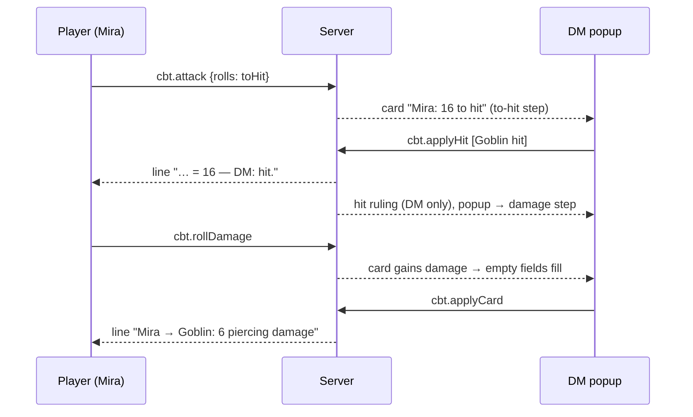
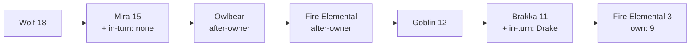

# Combat tracker

> Five-minute read. Bullets over prose. See [AGENTS.md](../../AGENTS.md).

> **Sprint 6, track WF (window + layout fix pack; spec-windows; session-sim-9 FAIL c, BL-43).** Decided, not open (#286): the last Initiative row never bleeds under the "↓ N more" footer (c03: the Elite row's text painted below the footer). Likely cause (WF4 confirms it first): the footer is `sticky` inside the scrolling list (FR-CBT-77), and the grown window's body doesn't clip the list, so a partly hidden row paints past it. New **FR-CBT-125** (WF4, with [FR-CBTX-57 / -58](combat-extras.md#6-functional-requirements) for the names and chips). Client only, 0 B; no open question. Walkthrough F10 in [play-shell §13](play-shell.md#13-test-plan). CP (companions) edits this spec in parallel with its own range; its owned rows follow these rules (WF4 merges first).

## 1. Summary

- Replaces Shieldmaiden for one table: **build an encounter** with a difficulty rating, **start** it on a prepped battlemap, run initiative and turns, **confirm every attack** in the DM's attack popup, track HP, **undo** mistakes ([ADR-0014](../architecture/adr/0014-mvp-scope.md), #53, #55, #74).
- Every attack is a **damage card** (notification kind `damage-card`), created in the attack command's transaction ([ADR-0027](../architecture/adr/0027-notification-creation.md)). The card has no target; **the DM picks the targets** (one or more; the map selection preselects them, #148) and applies (#134, #135). Apply = HP changes + game-log lines + card resolved, in one transaction. Server-side only: commands, in-transaction hooks and helpers. **No listener writes state.** All combat state is in the DB, so a crash mid-turn loses nothing.
- **Playtest pass** (#171; FR-CBT-46–55): from round 1 only combatants without initiative roll, nobody re-rolls, the DM's number input overrides (P4, amended #172); Down = translucent X on the token, Down badge for PCs in the Initiative row (P2, G9); the DM sees NPC dice (own DM-only roll line for DM attacks, breakdown in the outcome line), physical tags, "DM ruled hit" wording (P5, G7, G8); skip cue, End in the Initiative window, no stale targets, popup clear of its targets (G4, G6, G5, G2).
- **Polish pass** (sprint 1; FR-CBT-56–61): with no targets the popup opens away from the likely targets (R2); natural 1 / 20 shown on the card and in the popup, and a ruling against a natural roll reads "DM ruled" for everyone (R4); End dismisses the encounter's pending cards (R5). All decided #178.
- **Sprint 2, phase 1** (DM notes #188 + session-sim-4; FR-CBT-62–80): adding creatures with an autocomplete, initiative rolled on the way in, created tokens (hidden by default) and average / rolled HP (N5); **Attack / Damage / Attack + damage** as three actions, the same in and out of combat (N7, [§6.1](#61-n7-combat-route-semantics)); the popup opens over the notification it came from and moves like a window (N8); rows below the fold, temp HP previews, every pending combat action in Initiative, Undo copy (G4, G5, G9, G10); fold-ins: monster initiative lines DM-only (decided #190), PCs not on the map, one "physical" badge, no toast under its popup.
- **Sprint 4** (track R, DM [#243](../decisions-log.md) [15] [16], BL-10; FR-CBT-81–86): an attack's damage can have **several typed parts** (Brakka's Flame Tongue greatsword +1: slashing + fire): rolled as parts, on the card, each with its own multiplier in the popup (resistance per part), summed at apply, named in the outcome line; a crit doubles every part. Landed trigger parts bring their dice into the line ([FR-MOD-57](effect-modifiers.md#6-functional-requirements), [15]). The players' hit / miss wording credits the DM on every line, "— DM: hit." (BL-10, OQ-CBT-58 decided at sprint-4 gate 1, #245). Test plan: [MOD §13.1](effect-modifiers.md#131-sprint-4-track-r-mod-cbt-cbtx-charx). FR-CBT-63 (lookup matcher) and FR-CBT-43 (Type select) get compendium's replacement text at merge (rulings B8, applied by the integrator; this revision leaves both alone).

**Sprint 4 at a glance**

| Need | FRs | Slice | Named test (MOD §13.1) |
|---|---|---|---|
| [16] parts on card, popup, apply, line | FR-CBT-81–84 | S4-1b `build/weapon-combat` | `FR-CBT-81` (incl. text cap), `-82`, `-83`, `-84` |
| Creature form keeps the fields | FR-CBT-86 | S4-1a `build/weapon-rows` | `FR-CBT-86` |
| BL-10 wording | FR-CBT-85 | S4-1b | `FR-CBT-85` |
| [15] trigger dice on the line | FR-CBT-84 + FR-MOD-57 | S4-5 `fix/fury-log-line` | `FR-MOD-57` |

- **Sprint 5** (track R of [sprint-5](../agents/sprint-5.md), DM [#250](../decisions-log.md) [8], #251; FR-CBT-87–97). Decided, not open: **a damage roll that arrives after the DM applied the attack fills the open attack popup, never overriding a value already there** [8]. Today Apply stays disabled on a Hit until a damage total exists, so the DM can't apply the attack first: this revision adds **Apply hit** (players see "— DM: hit." at once, the popup stays open in its **damage step**, the late roll fills it, the DM applies the damage). Also fixed: the DM's line counts Rage twice (BL-27), "DM ruled hit" runs on (BL-24), trigger parts lose their type on lines (BL-23, [MOD](effect-modifiers.md#6-functional-requirements) FR-MOD-62), combat trails differ between clients after a reload (sim-8 glitch 6; stored on the token, [MAP](scenes-map.md#6-functional-requirements) FR-MAP-65–67, combat's side FR-CBT-97). Flow: [§6.2](#62-sprint-5-late-damage); every case: the table below. Test plan: [§13.1](#131-sprint-5-track-r-cbt-mod-map). ADR (accepted #256, the integrator numbers it): [Apply hit](../architecture/adr/0053-apply-hit.md) (refines ADR-0037). **Added (DM #252): the ally side**: the DM sets any combatant as ally or enemy at any time, a planned entry can start friendly; likely targets and difficulty follow the side, everything else stays on kind ([§6.3](#63-sprint-5-ally-side), FR-CBT-98–104; companions with owners are BL-30, next sprint).

**Sprint 5 at a glance**

| Need | FRs | Slice | Named test (§13.1) |
|---|---|---|---|
| [8] Apply hit, damage step, late roll fills, never overrides | FR-CBT-87–94, FR-MOD-63 | R1 `build/late-damage` | `FR-CBT-88`, `-89`, `-90 fills empty fields only`, `-91`, `-92 second roll unused`, `-93 no join when closed / applied`, `-94` |
| BL-24, BL-27, BL-23 log wording | FR-CBT-95, -96, FR-MOD-62 | R2 `fix/combat-lines` | `FR-CBT-95 ruling punctuation`, `FR-CBT-96 Rage once in the DM line`, `FR-MOD-62 trigger part types` |
| Trails equal after a reload | FR-CBT-97, FR-MAP-65–67 | R0 core + R3 `fix/combat-trails` | `FR-MAP-67 trail equality after reload` (DM + two players) |
| #252 ally side (any combatant, any time; friendly entries) | FR-CBT-98–104, [§6.3](#63-sprint-5-ally-side) | R0 core + R4 `build/combat-sides` | `FR-CBT-99 setSide`, `-100 side for players`, `-101 likely targets by side`, `-102 difficulty enemies only`, `-103 kind rules unchanged` |

#### Sprint 5: every late-damage case

FR-CBT-87–94; flow in [§6.2](#62-sprint-5-late-damage).

| Case | Server | DM sees | Players see |
|---|---|---|---|
| Damage arrives, popup open (either step) | attaches (FR-CBT-71) | untouched fields fill; typed ones keep + "rolled N"; a focused field fills on blur only if empty | roller: own card + roll line; others: the roll line |
| DM typed a total, then the roll arrives | attaches | typed total kept (base part), extra / trigger parts fill | as above |
| Popup closed (Later, other card open) | attaches | toast updates; next open is filled, typed values kept (per card) | as above |
| Card owner rolls again, card pending with damage | no card; `unusedRolls` on the card | "Also rolled: 9 — not used" | roll line only |
| DM rolls again on a player's card | a new DM damage-only card (FR-CBT-71) | that card | nothing new |
| Card already applied | new damage-only card (as built) | new card; note "Undo it to use this roll there" if applied this turn | as built |
| Another attacker / another weapon row | that attacker's own card | its own toast; this popup unchanged | as built |
| Two rolls at once | serialised: first attaches, second "not used" | one fill, one hint | two roll lines |
| Apply hit and the roll cross | both valid, either order | damage step, filled | hit line, roll line |
| Apply sent while the roll's upsert is in flight | `damageRollId` stale → `conflict`, nothing written | Toast "Damage just arrived — check and Apply again"; popup filled | nothing |
| Apply committed before the roll | roll → "already applied" case | as that case | as built |
| DM reconnects, popup open | snapshot: card + ruling | typed fields kept, untouched ones re-fill | — |
| DM reloads / server restarts | ruling and card in the DB | popup closed; reopen → damage step from the ruling (typed values lost) | — |
| Wrong Apply hit | — | Dismiss, or drop the row (resolves `dropped`) (OQ-CBT-66) | hit line stays |
| Next / End before the damage | pending / End dismisses it (FR-CBT-59), ruling delete sent | Pending "waiting for damage" | — |

- **Sprint 6** (track CP of [sprint-6](../agents/sprint-6.md), DM [#252](../decisions-log.md) / BL-30, [#286](../decisions-log.md); FR-CBT-105–124). Decided, not open: a creature can have an **owner player** (a **companion**): a **pet** (its own copy of a definition, HP kept between fights, in the Party window) or a **summon** (any compendium monster placed for a player, HP for that fight, **Dismiss**) — one concept. **Turn mode** per companion: right after the owner (default), in the owner's turn (no own Initiative row), own initiative. The owner gets a **companion card** ([CHARX](character-sheet-full.md#6-functional-requirements) FR-CHARX-59–70), the "your turn" alert, and attacks through the DM popup like any player's. Builds on the ally side (FR-CBT-98). Flow and rules: [§6.4](#64-sprint-6-companions); test plan [§13.3](#133-sprint-6-track-cp-cbt-ent-charx-party-map); build split [§14.3](#143-build-split-sprint-6-track-cp). Proposed ADR: [companion visibility](../architecture/adr/0056-companion-visibility.md) (amends ADR-0024). DM questions: OQ-CBT-77–83.

**Sprint 6 at a glance**

| Need | FRs | Slice ([§14.3](#143-build-split-sprint-6-track-cp)) | Named test ([§13.3](#133-sprint-6-track-cp-cbt-ent-charx-party-map)) |
|---|---|---|---|
| Owner on a combatant; set / cleared | FR-CBT-105, -111 | CP0 core, CP2 | `FR-CBT-105 owner set and cleared` |
| Turn order per mode; in-turn has no row | FR-CBT-106–108 | CP0, CP2 | `FR-CBT-107 order per turn mode`, `FR-CBT-107 in-turn companion has no row` |
| Pets join at Start, HP kept; summon HP gone | FR-CBT-109, -113 | CP2, CP3 | `FR-CBT-113 summon HP gone after End, pet HP kept` |
| Summon, Dismiss, concentration, hostile | FR-CBT-110, -112, -120 | CP3 | `FR-CBT-110 summon`, `FR-CBT-112 dismiss`, `FR-CBT-120 concentration lost card` |
| Owner's attacks, alert | FR-CBT-114, -115 | CP0 (guard), CP2 | `FR-CBT-114 owner attacks via the DM popup`, `FR-CBT-115 owner's turn alert` |
| Visibility (owner vs other players) | FR-CBT-116, -117 | CP0 | `FR-CBT-116 other players get a band only`, leak scan per player |

## 2. Scope

MVP = tier S ([feature tiers §2, §5, §7](../feature-tiers.md#2-combat)).

- **Encounter builder:** name, creatures × quantity from **one picker** over every monster definition (any source, #84; type-to-filter), party (default all characters), live XP, rating and total CR. Lifecycle planned → started → ended (#78).
- **Custom creature form** (Shieldmaiden-style, #85): New / Derive / Edit, from the Creatures window ([FR-ENT-20](entities.md#6-functional-requirements)). **Start** binds combatants to tokens the DM placed (some hidden, #77; hidden tokens → hidden combatants, #76). **End.**
- Initiative: roll (one click for all monsters, individual rolls) or enter; deterministic ties. Next / previous turn; rounds. *(#171, amended #172)* From round 1 only combatants without initiative roll; the DM's number input overrides in every round.
- **Attack** (DM from the initiative list; player from the sheet while in combat, #135): to-hit + damage rolled server-side (Shift adv / Ctrl dis, manual entry) → card → **attack popup** (DM picks the targets: map selection preselected, Ctrl/Shift and box select on the map; per target hit vs AC and normal / half / none / double; override any value) → apply.
- **Feedback pass** (#145, #148, #154; FR-CBT-33–43): multi-target apply with per-target hit and multiplier, one undo step per apply; token indicators Out (removed) and Down (0 HP), seen by everyone; movement used this turn; player **turn alert** (flash + ping via play-shell).
- **Checks and saves** (#149; FR-CBT-44/45): the DM rolls a monster's check or save from the Initiative row; sheet checks and saves never route to combat.
- Direct damage / heal (DM). Remove / restore a combatant. **Undo** (DM, strict LIFO, damage/heal only, [ADR-0016](../architecture/adr/0016-domain-events-pending-actions.md)).
- **Sprint 2** (FR-CBT-62–80): builder add options (create tokens, add hidden, HP average / rolled) applied at Start; autocomplete lookup; split Attack / Damage cards; movable popup; Initiative overflow cue; temp HP in previews.
- **Sprint 4** (FR-CBT-81–86): damage parts per attack (typed, per-part multiplier, crit doubles all), trigger part dice on outcome lines, BL-10 wording; the creature form keeps the new attack fields.
- **Sprint 5** (FR-CBT-87–97): Apply hit before damage and the popup's damage step; a late damage roll fills empty fields only; a second roll is kept as "not used"; DM line fixes (BL-24, BL-27); combat writes the stored trails (FR-MAP-65); the ally side (#252, FR-CBT-98–104). *Out:* companions / summons with an owner player and turn mode (BL-30, next sprint); BL-25 (built in sprint 4, OQ-CBT-67); server-side "undo hit" (OQ-CBT-66 option B); a turn-time charge window for late rolls (OQ-MOD-46 option B).
- **Sprint 6** (FR-CBT-105–124, #252 / BL-30): companions (owner PC + its player, turn mode, pet or summon) on combatants; pets join at Start with their kept HP and write it back at End; DM **Summon…** of any monster (SRD, compendium, custom) for a PC, **Dismiss**, release / turn hostile; turn order per mode; the owner's alert, attacks and card data; a DM card when a linked concentration ends. *Out:* players summoning by themselves (OQ-CBT-78 option B), companions outside an encounter except pets (a summon is combat-only), per-spell summon templates, a second character sheet.
- Player initiative view with **monster health band** (healthy / bloodied / down). **Stats capture** (#54): every HP change stores source, target, attack, rolls, overrides, applied, overkill, HP before/after.

## 3. Goals

- One full fight vs mixed enemies runs from the play page: no one reads numbers aloud, the DM confirms every hit ([roadmap](../roadmap.md) Combat exit).
- Players never learn a hidden combatant (name, ID, rank, turn; except a hidden PC's own sheet rolls, OQ-CBT-28), a monster's AC, stats or HP number (only the band, and the damage their own hit applied, #138), or a planned encounter.
- Hard kill mid-turn → restart → round, turn, initiative, HP, pending cards and game log intact ([vision](../vision.md#success-criteria)).
- A wrong damage is fixed in two clicks (Undo, re-apply the reopened card), also for a multi-target card.
- A player notices their turn without watching the screen; everyone sees who is down or out on the map.

## 4. Non-goals

- Conditions, concentration, durations, temp HP, death saves, add combatants mid-fight, token-less hidden combatants, legendary / lair / reactions → [combat-extras](combat-extras.md).
- Drag-to-reorder initiative, current-turn token highlight, end-of-combat summary (tier B); player target selection, stat block on token click (later, unranked; #134). Rules automation beyond the hit hint.
- Redo (re-apply the reopened card). Undo of initiative, turns, removals (#70). Undo after End. Custom actions, spells (tier A). Party HP for players (tier B). Stats UI → [stats](post-mvp/stats.md). Gems → [gems](post-mvp/gems.md) (design-for-later only, FR-CBT-32).
- Multi-target direct damage / heal (`cbt.applyHp` stays one combatant); blocking or correcting movement (indicators only; the next turn resets); DM-added alert sounds (tier A, [ADR-0030](../architecture/adr/0030-ui-notification-sounds.md)); player targeting (#134, #148).

## 5. User stories

- **DM:** As the DM, I want to pick goblins, a wolf and my Elite Goblin Warrior from one list and see "Deadly", and have Start pick up the tokens I placed (hidden stay hidden), so that prep is done before the session.
- **DM:** As the DM, I want each attack in a popup where I pick the target, see hit/miss vs AC and fudge numbers, and undo a wrong apply, so that I stay in control and mistakes cost seconds.
- **Player:** As a player, I want to press Attack on my sheet (Shift for advantage), see the damage my hit did, the turn order and whether a monster is bloodied, so that nobody reads numbers aloud and I can plan.
- **DM:** As the DM, I want to box-select the three goblins in the blast, apply 20 to all with one at half, and undo it in one click, so that area damage is as quick as a single hit.
- **Player:** As a player, I want a flash and a ping when my turn starts and my drag to turn amber when I dash, so that I don't stall the table or overrun my speed.

## 6. Functional requirements

All commands: rows + event-log entry + domain event in one transaction, then helper events (I15); IDs and time from `ctx`, dice from `ctx.dice` ([AGENTS §9.3](../../AGENTS.md#93-fixtures), #137). Helpers take `env: CommandEnv`; campaign and player = `env.actor.campaignId` / `.playerId`. Failure → no change, event or log entry.

| ID | Requirement | Notes |
|---|---|---|
| **Prep** | | |
| FR-CBT-01 | Encounter create / update / delete (REST, DM): `{name, partyCharacterIds \| null, entries [{definitionId, quantity}]}`. Name trimmed 1–60, no control chars. 0–20 entries, quantity 1–20, total ≤ 50; ≤ 30 non-ended encounters per campaign (`conflict`). Definitions via `resolveDefinition`, kind `monster` (else `invalid`); duplicate definitions merged. Update / delete only while `planned`, else `conflict`. | ADR-0021 D |
| FR-CBT-02 | Party: `null` = every character of the campaign at read time; a list holds only characters of the campaign (else `invalid`). | #139 (P12). *Amended by [FR-CHARX-11](character-sheet-full.md#6-functional-requirements): drafts left out of `null` (OQ-CBT-46)* |
| FR-CBT-03 | Difficulty is **derived, never stored** (#136). `difficultyMethods` registry in `@shared/combat-tracker`: `{id, label, rate(partyLevels, monsterCrs)}`; MVP ships one, `dmg-2014`: XP per CR (entities' table, CR 0 = 10); thresholds = sum of per-level easy / medium / hard / deadly; ladder `[×0.5, ×1, ×1.5, ×2, ×2.5, ×3, ×4, ×5]`, base step by monster count 1 / 2 / 3–6 / 7–10 / 11–14 / 15+ = ×1 … ×4, one step up for < 3 PCs, one down for ≥ 6, clamped. Rating = highest threshold ≤ adjusted XP, else "Trivial"; no party → "—". Card shows rating, base / adjusted XP, thresholds and **total CR** (sum, secondary); live while editing. DMG numbers only, no text (licence note, [ADR-0018](../architecture/adr/0018-global-imported-content.md)). | #136, I27. *(S5: enemy entries only, friendly listed, planning-only, FR-CBT-102)* |
| FR-CBT-04 | Creature picker: one Combobox of every monster the campaign can use, FR-ENT-18 order, type-to-filter; row = name, CR, XP; never branches on source. Pick adds quantity 1, or +1 if present. | #84. *Sprint 2: autocomplete, FR-CBT-63* |
| FR-CBT-05 | Creature form (Dialog), `creatureActions` New (blank), Derive (any monster; name = base, or "‹name› (copy)" for a custom), Edit (customs only). Fields = creature core: name, size, AC, HP max, init bonus, CR (+ XP), portrait (asset picker), optional attack (name, to-hit, damage, damage type). Entities' zod; saves via `POST` / `PUT /api/entities`; errors inline. | FR-ENT-09/11 |
| FR-CBT-06 | Definition-changed hook ([FR-ENT-19](entities.md#6-functional-requirements)) `(env, before, after)`: active monster combatants of the definition get the new `hpMax`; `hpCurrent` = new max if it equalled the old, else clamped. Any combatant whose `imageAssetId` = the old portrait takes the new one. Rows go into `EntityUpdated.changes`. | I10, I23. *Sprint 2: rolled HP kept, FR-CBT-67* |
| **Start / end** | | |
| FR-CBT-07 | `cbt.start {encounterId, sceneId}`: encounter `planned`, no other `started` in the campaign (`conflict`), scene in campaign. Creates combatants, `round 0`, `turn null`, status `started`, ranks (FR-CBT-13), then `EncounterStarted`. | #139 (P15). *Amended by [FR-CBTX-01](combat-extras.md#6-functional-requirements): `started` rule hook. Sprint 2: `at?`, `excludeCharacterIds?`, options applied, FR-CBT-64–66* |
| FR-CBT-08 | Binding: party characters by name, then entries in order × quantity. Each takes the next unbound token on the scene with that `definitionId` (token `seq` order) and copies its `name`, `imageAssetId`, `hidden`. None left → token-less, visible: name per FR-MAP-16 numbering over the encounter's combatant names ("Goblin" → "Goblin 3"), image = portrait. Monsters: `hpMax = hpCurrent = effectiveStats.hpMax`. Start dialog previews bindings ("no token" marked). | #139 (P16). *Sprint 2: created tokens, rolled HP, PCs not on the map, FR-CBT-64–66* |
| FR-CBT-09 | Token-changed hook ([ADR-0028](../architecture/adr/0028-token-changed-hooks.md)) `(env, before, after \| null)`: rename / image / hide / reveal of a token bound to an active combatant updates its copies in the token command's transaction, plus ranks and the player turn copy if `hidden` changed. Delete (token or scene) of a token bound to an active combatant → `conflict` "Token is in a running encounter"; other bound combatants get `tokenId` null. | #134. *Sprint 2: removed-only binding deletable, FR-CBT-68* |
| FR-CBT-10 | `cbt.end {encounterId}`: `started` → `ended`, `endedAt`; every combatant `active = false` (players get deletes). Pending cards are dismissed (FR-CBT-59); applying a card after End → `conflict` "Encounter has ended". | #139 (P17); amended #178. *Amended by [FR-CBTX-01, -12](combat-extras.md#6-functional-requirements): `ended` rule hook; event order FR-CBT-61* |
| **Initiative and turns** | | |
| FR-CBT-11 | `cbt.rollInitiative {combatantIds (1–50), mode?, manual?, public?}`: one roll each, d20 + init bonus (`characterRolls(effectiveStats, "initiative")`), via `dice.evaluate` + one `roll` entry each (category initiative, `encounterId`, `public` per FR-CBT-24: hidden → false). Player: exactly one own PC (`ownerPlayerId`), initiative still null (else `conflict`), no `public` (→ `forbidden`, as FR-DICE-13). `manual` needs exactly one combatant (else `invalid`). DM may overwrite. "Roll monsters" sends every non-removed monster without initiative. *(#172)* From round 1 no re-rolls: FR-CBT-46, -47. | I25, #139 (P10); amended #171. *Sprint 2: monster entries DM-only, FR-CBT-69; monsters roll at Start / add, FR-CBT-64* |
| FR-CBT-12 | `cbt.setInitiative {combatantId, value}` (DM): int −10…50, no roll. | Manual "enter" |
| FR-CBT-13 | Order: initiative desc, init bonus desc, PC before monster, combatant `seq`; no initiative last. The server writes `position` (1…n, all combatants) and `playerPosition` (1…k over active, non-removed, non-hidden; else null) for every row whose value changed, in the commanding transaction (start, initiative, remove / restore, hide / reveal hook). | #139 (P3) |
| FR-CBT-14 | `cbt.nextTurn` / `cbt.prevTurn {encounterId, expectedRound, expectedTurnId}`; mismatch → `conflict`. Eligible = not removed and not a monster at 0 HP. Round 0 next: every non-removed combatant needs initiative (`conflict` "N without initiative"), then round 1, first eligible. Next past the last → round + 1; prev before the first → previous round's last; at round 1's first → `conflict`. Initiative changes keep the turn on the same combatant. Skip cue: FR-CBT-50 (#171). | #139 (P14). *Amended by [FR-CBTX-01, -25](combat-extras.md#6-functional-requirements): `turnChanged` hook; dead PCs not eligible (OQ-CBT-48)* |
| FR-CBT-31 | `playerTurnCombatantId` on the encounter = the turn combatant if not hidden or removed, else null; written with the turn, by `setRemoved` and by the token hook. | I20 |
| FR-CBT-15 | `cbt.setRemoved {combatantId, removed}` (DM): removed combatants skip turns, reach players redacted as removed (FR-CBT-37) and leave the player initiative list; DM sees a "Removed" section with Restore. | Amended #148 |
| **Attacks and damage cards** | | |
| FR-CBT-16 | `cbt.attack {attackerId, mode?, manual?}` (no target, #135): attacker = active, non-removed combatant of the started encounter; player: own PC only (`forbidden`), visible to them (`not_found`). No attack → `conflict` "No weapon attack". Rolls to-hit (d20 + toHit, mode) then damage (`characterRolls(effectiveStats, "attack")`); natural 20 → damage dice count doubled ("critical"). *(Sprint 4: damage = parts, every part doubled on a crit, FR-CBT-81, -83.)* | #139 (P13). *Amended by [FR-CHARX-24](character-sheet-full.md#6-functional-requirements): `attackId?` / `spellId?` via `sheetAttack` (OQ-CBT-47). Sprint 2: `rolls?`, FR-CBT-70; `cbt.rollDamage`, FR-CBT-71* |
| FR-CBT-17 | Manual attack: two entries, to-hit first (dice total, per-die optional); the client shows the doubled damage expression if the d20 is 20; the server validates against the expression it implies. | I3 |
| FR-CBT-18 | Same transaction: rolls; **player sender** → one public `roll` entry (category attack, both rolls, `encounterId`); ~~DM sender → no entry until apply~~ (*#171:* DM sender → one DM-only entry, FR-CBT-52). `AttackRolled`, then `notify(env, …)` kind `damage-card`, action "Apply" (DM only, #136), payload §8, audience = the rolling player, or `dm`; text "‹attacker›: ‹to-hit› to hit, ‹damage› ‹type›" (*R4:* + natural marker, FR-CBT-57). Result `{cardId, rollIds}`; the DM client opens the popup on its own attacks. | ADR-0027, I4 |
| FR-CBT-19 | *Superseded by FR-CBT-33* (multi-target popup, #148). | |
| FR-CBT-20 | *Superseded by FR-CBT-34* (`cbt.applyCard {targets[]}`, #148). | |
| FR-CBT-21 | `cbt.applyHp {combatantId, kind: damage \| heal, amount 1–999, public?}` (DM): direct change, `cbt.hp` entry (category damage / healing), combat log entry, `HpApplied`. | Traps, potions |
| FR-CBT-22 | HP: monster → `hpCurrent` clamped 0…hpMax. PC → `characters.adjustHp(env, characterId, ∓raw)` ([FR-CHAR-13](character-sheet.md#6-functional-requirements)); its change listed in our event. `applied = \|hpBefore − hpAfter\|`; damage `overkill = max(0, raw − hpBefore)`. | #139 (P11). *Amended by [FR-CBTX-02](combat-extras.md#6-functional-requirements): the HP step runs through `hpRules.apply` (temp HP, death saves)* |
| FR-CBT-23 | Stats capture: every apply writes one combat log entry (§8): rolled and final values, override flags (to-hit, hit, damage), target AC used; the event payload carries the same facts. | #54 |
| FR-CBT-24 | Log lines (kinds `cbt.attack`, `cbt.hp`, `encounterId` set; one `cbt.attack` line per target, FR-CBT-36): public text = actors, roll + modifier, outcome, damage ("Goblin attacks Mira: 12 + 4 = 16 — hit! 6 slashing damage"); AC, computed hit, overrides in `dmPayload` (*#171:* + physical tag, dice breakdown, override wording, FR-CBT-53). One category per entry. `public`: **false** if attacker or target is hidden; else true for a player-rolled card (#73); else the DM's `public` if sent, else the category setting. DM rolls for a PC follow the same rule. | #139 (P1, P6), I4. *Sprint 2: partial-card lines, one physical badge, FR-CBT-73* |
| FR-CBT-32 | **Design for later (gems, #140):** apply reads the card's current to-hit and damage rolls; a later gem intent may replace either (per-die results in the payload) before apply. No MVP intent or UI. | Tier A |
| **Undo** | | |
| FR-CBT-25 | `cbt.undo {expectedHpChangeId}` (DM): the latest non-undone combat log entry of the started encounter (by `seq`); none → `conflict` "Nothing to undo"; ≠ expected → `conflict`. Applies the inverse delta, clamped (monster or `characters.adjustHp`); marks the row undone, `gameLog.markUndone`; emits `CombatEntryUndone`, **then** `reopenNotification` if from a card. One step per click; a step = one apply (FR-CBT-35). | I2, I28, #139 (P4). *Amended by [FR-CBTX-22](combat-extras.md#6-functional-requirements): inverse via `hpRules.revert`* |
| **Visibility and resilience** | | |
| FR-CBT-26 | Health band (players, monsters): `down` if hp = 0; `bloodied` if 2 × hp ≤ hpMax; else `healthy`. Computed in the visibility fn; HP numbers never sent. | #139 (P9) |
| FR-CBT-27 | Visibility per §9; DM always full. Visibility fns read only the record and the connection context; every command lists every record whose visibility changes. | ADR-0021 |
| FR-CBT-28 | No combat state in memory: after a hard kill + restart, snapshots equal pre-crash state. | Vision |
| FR-CBT-29 | Controls disabled unless `live`; one intent in flight per control; an in-flight intent lost to a drop → Toast "Connection lost — check the game log / HP before trying again". Reject → Toast with message. | as FR-CHAR-12 |
| FR-CBT-30 | Client registrations (feedback additions: FR-CBT-42): windows `cbt.initiative`, `cbt.encounters`; `creatureActions` New / Derive / Edit; token menu "Damage / heal…", "Remove from combat" on tokens bound to an active combatant (DM); notification views `damage-card` (DM `onAction` = popup; player: pending "Waiting for DM", resolved per FR-CBT-42); dice kinds `cbt.attack`, `cbt.hp`; **sheet roll routing**: while the character is an active, non-removed combatant of the started encounter (store), its sheet Attack sends `cbt.attack` (no `public`; supplies the doubled-damage `critExpressions`) and Initiative `cbt.rollInitiative`; every other kind and every other time: the sheet's own `char.roll` (FR-CBT-45). | #135. *Amended by [FR-CHARX-24](character-sheet-full.md#6-functional-requirements): route passes `ref`, claims `spellAttack` (OQ-CBT-47). Sprint 2: three actions, FR-CBT-74, §6.1* |
| **Feedback pass** (#145, #148) | | |
| FR-CBT-33 | **Multi-target popup** (supersedes FR-CBT-19): DM, **non-modal** (no overlay; the canvas stays usable). Shared: attacker, attack, to-hit dice + editable total, damage dice + editable total. **Target list** = (a) *selection rows*: combatants of the started encounter, active, non-removed, attacker excluded, bound to a token in the map selection ([FR-MAP-33](scenes-map.md#6-functional-requirements)); ∪ (b) *added rows*: picked from the "Add target" Combobox (every eligible combatant incl. hidden and token-less). On open (card, toast, Pending list, own attack) the list = (a). While open: `setTargeting(true)`; click, Ctrl/Shift-click and box on the map edit the selection and (a) follows (other selected tokens ignored, note "N selected not in combat"). Adding a combatant whose token is on the viewed scene selects it (it becomes an (a) row); one without a token there stays an (b) row until removed. Removing a row deselects its token. **Per-target row:** name (eye-off if hidden), AC, "vs AC N → Hit / Miss" toggle (preset nat 20 hit, nat 1 miss, else total ≥ AC; follows to-hit edits until toggled), multiplier Normal / Half / None / Double, preview "Goblin 7 → 1". **Apply** needs 1–20 rows; > 20 → disabled with note "Max 20 targets". **Later**, **Dismiss**. Esc with focus in the popup closes it; Esc on the canvas clears the selection (FR-MAP-31). Close → targeting off; selection kept (*#171:* except after Apply, FR-CBT-54; placement FR-CBT-55). | F7, #134 DM only. *Sprint 2: partial cards FR-CBT-72; temp HP preview FR-CBT-78* |
| FR-CBT-34 | `cbt.applyCard {cardId, toHitTotal (−20…99), damageTotal (0–999), targets [{targetId, hit, multiplier}] (1–20, unique ids, else `invalid`), public?}` (DM; supersedes FR-CBT-20). Each target active, non-removed (`not_found`); encounter started, card pending (`conflict`); rolled values from the card's roll rows, never the client. Per target, in list order: `raw = hit ? floor(damageTotal × {1, ½, 0, 2}) : 0`, HP (FR-CBT-22), one combat log entry, one log line (FR-CBT-36), one `AttackApplied` (payload unchanged, per row). Then one `resolveNotification` with resolution `{targets […]}` (§8). All or nothing. | F7. *Sprint 2: optional totals for partial cards, FR-CBT-72. Sprint 4: extra parts with their own totals and multipliers, FR-CBT-82.* *(S5: `damageRollId` check, FR-CBT-94; a ruled card's apply, FR-CBT-91)* |
| FR-CBT-35 | **Undo unit = one apply** (#154): the latest non-undone combat log entry **plus every non-undone entry of the same card** (a card has at most one live apply: applying resolves it, undo reopens it). `expectedHpChangeId` = the latest entry. Each row: inverse delta, undone, `markUndone`, its own `CombatEntryUndone {hpChangeId}` (latest first); then one `reopenNotification`. Direct HP = one row. Undo Tooltip "Undo: Goblin → Goblin, Goblin 2 (2 targets)" (*single-row copy: FR-CBT-80*). | F7. *Amended by [FR-CBTX-22](combat-extras.md#6-functional-requirements): undo also reverts temp HP, death saves, effects of the apply.* *(S5: a ruled card reopens into its damage step and re-upserts the ruling; Apply hit is never undone, FR-CBT-91)* |
| FR-CBT-36 | **Outcome line per target:** one `cbt.attack` entry per target, same `rollIds` and text as FR-CBT-24; `public` per entry: false if the attacker or **that** target is hidden, else FR-CBT-24's rule. Undo strikes each. | F7; OQ-CBT-33 |
| FR-CBT-37 | **Removed, for players** (amends FR-CBT-15, §9; #154): an active, removed, non-hidden combatant reaches players redacted `{id, encounterId, kind, tokenId, name, imageAssetId, removed: true, movedFt}` (no rank, band or initiative). Remove and restore are upserts; the player list omits removed rows. Hidden or ended → hidden as before. | F6. *(S5: both redactions gain `side = publicSideOf`, FR-CBT-100)* |
| FR-CBT-38 | **Token indicators** (both clients; `tokenOverlays` line, [FR-MAP-34](scenes-map.md#6-functional-requirements)) for a token bound to an active combatant of the started encounter: **Out** (`removed`): dim + badge "Out" (`cbt-token-out`); **Down** → ~~badge "Down"~~ (*#171:* translucent X, FR-CBT-48) in `hp.down` (`cbt-token-down`), seen by **everyone** who receives the token (#154): monster `hpCurrent = 0` (players: band `down`); PC: its character's `hpCurrent = 0` (DM, owner) or `down: true` on the redacted character ([FR-ENT-15](entities.md#6-functional-requirements); other players, no HP); **Target**: while targeting, a selected token bound to an eligible combatant → `ring: "target"`. Players see a badge only on tokens and combatants they receive. Nothing after End. | F6, F7, F8 |
| FR-CBT-39 | **Movement used:** combatant `movedFt` (int ≥ 0, 0 at Start). Combat's token-changed hook on a move ([FR-MAP-38](scenes-map.md#6-functional-requirements), [ADR-0031](../architecture/adr/0031-token-move-hooks.md)) of a token bound to an active, non-removed combatant adds the move's 5/10/5 distance (FR-MAP-22), cap 9,999, whoever moved it (DM or owning player, #154); it never rejects. The hook may run as a player actor; its `movedFt` branch runs before the name / image / hidden copy check (which skips on a move). Overlay `movedFt(token)` returns it (FR-MAP-37). DM row: on the name line, a footprints icon + "40 / 30 ft" (labelled "Moved …") in the tone of FR-MAP-37 ("40 ft" without speed); hidden for a combatant with no bound token (#165). | F3 |
| FR-CBT-40 | **Reset on Next only** (#154): `cbt.nextTurn` sets the new turn combatant's `movedFt` to 0 in its transaction (listed in `TurnChanged`'s changes); Start round 1 (Next from round 0) sets every combatant's `movedFt` to 0, so round-0 positioning never counts (BL-03, #237). `cbt.prevTurn` leaves `movedFt` unchanged (a mistaken Next + Prev loses nothing). | F3 |
| FR-CBT-41 | **Turn alert** (player client): an `event` with `cause.name = TurnChanged` whose `encounter` upsert has `playerTurnCombatantId` = a PC combatant whose `entityId` is a character with `ownerPlayerId = you.playerId` → `alert({id: "cbt.turn", title: "Your turn", detail: ‹PC name›, sound: "ping"})` ([FR-SHELL-22](play-shell.md#6-functional-requirements)). Next and Prev both count. Never from a snapshot, resync or other cause (reveal, restore); none for a hidden PC (owner gets null, #141); none on the DM client. No new event: whose turn it is is already public (OQ-CBT-30). | F1, [ADR-0030](../architecture/adr/0030-ui-notification-sounds.md). *Amended by [FR-CBTX-38](combat-extras.md#6-functional-requirements): "(death save)" detail for a dying own PC* |
| FR-CBT-42 | Client registrations (adds to FR-CBT-30): `tokenOverlays` line `cbt` (FR-CBT-38, FR-CBT-39); the popup uses the selection API; the turn alert handler (FR-CBT-41); player `damage-card` resolved view: one part per target in apply order, joined " · ": hit → "Hit ‹name›: N" + " (half)" / " (none)" / " (double)" unless normal; miss → "Miss ‹name›"; null name → "Hit: N" / "Miss". E.g. "Hit Goblin: 6 · Hit Goblin 2: 3 (half) · Miss". Legacy single-target rows render the same way. | |
| FR-CBT-43 | Creature form (amends FR-CBT-05) adds **Speed** (number, optional, step 5) and **Token shape** (Default / Round / Square / None) ([FR-ENT-21/22](entities.md#6-functional-requirements)), the six **ability scores** (all or none) and **save proficiencies** (checkboxes) ([FR-ENT-23](entities.md#6-functional-requirements)). `PUT` is a whole replace: the form always sends `tokenShape` ("Default" = null) and the whole stat block, so Edit never drops a field it doesn't show. Monsters and customs only; characters' fields come from fixtures / API in MVP (#154). *(S4, track C)* Monsters gain an optional **Type** Select (the 14 SRD creature types + "None", [FR-ENT-26](entities.md#6-functional-requirements)); Derive and Edit prefill it from the source; "None" omits `type`. It picks the token art of tokens placed afterwards ([FR-ENT-27](entities.md#6-functional-requirements)); giving a definition its first type fills its tokens that have none. Test ID `cbt-form-type`. | F3, F4, #149; S4: FR-ENT-26 |
| **Checks and saves** (#149) | | |
| FR-CBT-44 | `cbt.rollAbility {combatantId, kind: check \| save, ability, mode?, manual?, public?}` (DM; #154): active combatant of the started encounter (removed ones too). Stats via `effectiveStats` of its entity (monster definition or character); bonus per [FR-ENT-24](entities.md#6-functional-requirements); no ability scores → `conflict` "No ability scores". One roll `1d20 + bonus` via `characterRolls` ([FR-CHAR-21](character-sheet.md#6-functional-requirements)), one `roll` entry: category `ability-check` / `saving-throw`, label "Dexterity save", actor = combatant name, `encounterId`; `public` false if the combatant is hidden, else the DM's override, else the category setting. Emits `CombatantRolled`. Result `{rollIds, entryId}`. UI: row menu **Check ▸ / Save ▸** with six items showing signed bonuses (shared roll control: Shift / Ctrl, physical-dice popover, public toggle). | #149; DM rolls monster saves |
| FR-CBT-45 | **Routing** (amends FR-CBT-30): combat's sheet roll route claims only `initiative` and `attack`; `check` / `save` fall through to `char.roll` ([FR-CHAR-23](character-sheet.md#6-functional-requirements)). Must ship with the sheet's new kinds (else a check would be sent as an attack). | #149; built route claims every non-initiative kind. *Amended by [FR-CHARX-24](character-sheet-full.md#6-functional-requirements): also `spellAttack` (OQ-CBT-47). Sprint 2: FR-CBT-74* |
| **Playtest pass** (#171) | | |
| FR-CBT-46 | **From round 1, roll controls only for combatants without initiative** (P4, amended #172): while the started encounter's `round ≥ 1`, a roll-initiative control shows only for a combatant whose `initiative` is null. In MVP that is a combatant restored after Start that never had one (Start round 1 needs initiative only for non-removed combatants, FR-CBT-14); later also creatures added mid-fight (summons, reinforcements, a late PC; [combat-extras](combat-extras.md)). Controls: the DM row's Roll button; "Roll monsters" (sends only non-removed monsters without initiative; hidden when there are none); the player sheet's Initiative via combat's route ([FR-CHAR-24](character-sheet.md#6-functional-requirements)). Nobody re-rolls: a combatant with initiative shows no roll control. Every row keeps its number input (`cbt.setInitiative`), the DM's override in every round; a combatant without initiative sorts last (FR-CBT-13), its input marked "Set". Player Initiative window hint for an own PC without initiative: "Roll initiative on your sheet" (any round). Round 0 unchanged. Round never returns to 0 (FR-CBT-14). | P4, #172 |
| FR-CBT-47 | **Server: no re-rolls from round 1** (decided #172): while the encounter's `round ≥ 1`, a `cbt.rollInitiative` that lists **any** combatant that already has initiative is rejected whole: `conflict` "Initiative already set: ‹names›" (names every listed combatant that has one), for DM and player; nothing written, not even for the listed combatants without initiative. A list of combatants without initiative rolls as in FR-CBT-11. Round 0: DM may overwrite (FR-CBT-11). `cbt.setInitiative` works in every round. Design for later: combatants added mid-fight follow the same rule. | P4, #172 |
| FR-CBT-48 | **Down as a cross** (P2; amends FR-CBT-38): combat's `tokenOverlays` line returns `cross {id: "cbt-token-down", tone: "down"}` instead of the Down badge ([FR-MAP-43](scenes-map.md#6-functional-requirements)): a semi-transparent X centred on the token, same audience rules as FR-CBT-38. Out keeps dim + "Out" badge, now in the label row (FR-MAP-43); `dim` dims the token group only, the name and "Out" badge stay at full opacity; removed and down → both. | P2 |
| FR-CBT-49 | **PC Down in the Initiative row** (G9): the DM row of a PC whose character has `hpCurrent = 0` shows a "Down" Badge in `hp.down` in the band column (`cbt-init-row-band`, `data-value="down"`), as monsters' band does. *(decided #172)* Player rows of PCs show the same Badge from the redacted character's `down` ([FR-ENT-15](entities.md#6-functional-requirements)); players already see that PC's X on the map. | G9 |
| FR-CBT-50 | **Skip cue** (G4): DM rows of combatants Next / Prev would skip (monster at 0 HP) are muted with a skip icon (`cbt-init-row-skip`, Tooltip "Skipped while down"). When the DM's own `cbt.nextTurn` / `cbt.prevTurn` is acked and the turn passed over such combatants, a DM Toast names them: "Skipped Goblin, Goblin 2 (down)" (+ " · Round 2" if the round changed) (`cbt-init-skipped`). Computed on the DM client from the order at send time; no server or event change. Players: none (they see bands and the turn marker). | G4. *Amended by [FR-CBTX-25](combat-extras.md#6-functional-requirements): "Skipped Thorn (dead)" (OQ-CBT-48)* |
| FR-CBT-51 | **End from Initiative** (G6): DM Initiative header "End encounter" Button (`cbt-init-end`) → confirm Dialog as in Encounters (`cbt-init-end-confirm`) → `cbt.end` (FR-CBT-10). Only while started. | G6 |
| FR-CBT-52 | **DM attack roll line** (G7, P5; amends FR-CBT-18): **any DM-sent** `cbt.attack` (monster or PC, e.g. a hidden PC #141 or a DM rolling for an absent player) also writes, in its transaction, one `roll` entry like a player's: category attack, both rolls with per-die results, labels "‹attack› attack" / "‹attack› damage (‹type›)", actor = attacker name, `encounterId`, manual rolls tagged "physical" (FR-DICE-20). **Always `public: false`** (DM-only, whatever the Attack tickbox: players see what they saw before; the outcome line at apply carries the public rule, FR-CBT-24). Listed in `AttackRolled`'s changes. Not struck by Undo (rolls are facts); stays if the card is dismissed. | G7, P5 |
| FR-CBT-53 | **Outcome line detail** (P5, G7, G8; amends FR-CBT-24): `cbt.attack` entries gain (a) public `manual {toHit, damage}` → a "physical" badge after the roll it marks, for everyone who sees the line (as players' physical rolls); (b) `dmPayload.rolls {toHit {expression, mode, dice [value, kept][], constant}, damage {expression, dice, constant, crit}}` copied from the card's roll rows; the **DM's** line shows them: kept and dropped d20s, "6 slashing damage (1d6+2: 4 + 2)"; (c) DM-view wording: `hit ≠ hitComputed` → "13 vs AC 15 — DM ruled hit" / "18 vs AC 15 — DM ruled miss" in place of "— hit!" / "— miss"; edited totals → "16 (DM set; rolled 13)", "9 slashing damage (DM set; rolled 6)". Players' line unchanged (no `dmPayload`, FR-DICE-15). Rows written before this pass parse without (a) / (b). *(Sprint 4, BL-10: the players' hit / miss wording is FR-CBT-85, decided #245.)* | P5, G7, G8 |
| FR-CBT-54 | **No stale targets** (G5; amends FR-CBT-33): a successful Apply clears the map selection (`setMapSelection([])`); Later, Dismiss and close keep it. The next popup therefore opens with no rows unless the DM selects again. | G5 |
| FR-CBT-55 | **Popup placement** (G2): the popup opens vertically centred at the left or right edge of the work area ([FR-SHELL-29](play-shell.md#6-functional-requirements)), on the side farther from the centre of its selection rows' tokens (no selection rows: FR-CBT-56, amended #178). Right side = just left of the DM's Initiative window if it is open (protocol §24: top-right), so it never covers it. ~~Not draggable (design for later).~~ *(N8, #188: draggable, FR-CBT-76; opened from a notification it opens over it, FR-CBT-75)* | G2 |
| **Polish pass** (sprint 1) | | |
| FR-CBT-56 | **Popup side with no targets** (R2; amends FR-CBT-55; decided #178, OQ-CBT-43): with no selection rows at open, the side comes from the attacker's **likely targets**: active, non-removed combatants of the **other kind** (monster attacker → PCs; PC attacker → monsters), bound to a token on the viewed scene. Placement (amended #180): candidate positions (work-area left edge, left of Initiative, beside each likely target) are scored by how much of the likely targets' on-screen token area they cover; least covered wins (the popup may sit over other windows, never over Initiative); ties keep the side rule (side farther from the mean x of their token centres). None → left (as before). Fixed per open: rows added later don't move it. DM client only. | R2. *(S5: "other kind" → other side, FR-CBT-101)* |
| FR-CBT-57 | **Natural roll on the card and in the popup** (R4; decided #178): the card text adds " (natural 1)" / " (natural 20)" after the to-hit when the card's `toHit.natural` is 1 / 20: "Mira: 5 to hit (natural 1), 6 piercing" (composed at create, FR-CBT-18; older cards keep their text). Popup: a Badge beside the to-hit total, "natural 1" (`hp.down`) / "natural 20" (`hp.full`); a target row whose Hit / Miss contradicts it (Hit on a natural 1, Miss on a natural 20) shows "natural 1" / "natural 20" next to the toggle in `hp.bloodied`, plus the hint "Players see: DM ruled hit" / "… miss" (FR-CBT-58). Hit preset unchanged (FR-CBT-33). | R4 |
| FR-CBT-58 | **Rulings against a natural roll are public** (R4; decided #178, OQ-CBT-44; amends FR-CBT-53 (c) for this case only): a `cbt.attack` line shows " (natural 1)" / " (natural 20)" after the to-hit total (and its "physical" badge), for everyone who sees the line, when `payload.toHit.natural` is 1 / 20. When `payload.hit` contradicts it (natural 1 and hit; natural 20 and miss), everyone's line reads "— DM ruled hit" / "— DM ruled miss" in place of "— hit!" / "— miss". Built from `payload` alone: natural and hit are already public, and a natural roll ignores AC, so no AC fact leaks. Every other override (hit vs a non-natural total, edited totals) stays DM-only (FR-CBT-53 (c), G8). No payload, schema or event change; old rows render the same way. E.g. players: "Mira attacks Goblin: 1 + 4 = 5 (natural 1) — DM ruled hit 6 piercing damage". | R4 |
| FR-CBT-59 | **End dismisses the encounter's pending cards** (R5; decided #178, OQ-CBT-45; amends FR-CBT-10): `cbt.end` calls notifications' `dismissForEncounter(env, encounterId)` ([FR-NOTE-23](notifications.md#6-functional-requirements)) in its transaction, after `EncounterEnded`: every pending notification of this encounter whose kind's **end rule** says `onEncounterEnd: "dismiss"` becomes `dismissed` (event order FR-CBT-61). `damage-card`'s end rule is the shared constant `DAMAGE_CARD_END_RULE` in `@shared/combat-tracker` (`{onEncounterEnd: "dismiss", encounterIdOf: (p) => p.encounterId}`), referenced by the server kind definition and the client view entries ([FR-NOTE-23](notifications.md#6-functional-requirements)). Toasts and Pending rows go (FR-NOTE-14), the summary toast follows the count (FR-NOTE-15), the bell drops them (FR-NOTE-24). Both End confirms (Encounters, FR-CBT-51) read: "Combatants leave the initiative list. N pending card(s) will be dismissed: apply them first if they count." **N** = pending notifications in the DM store whose DM view entry carries an end rule with `"dismiss"` and whose `encounterIdOf(payload)` is this encounter (other kinds with an `encounterId`, e.g. a pending `cbtx-concentration` card, don't count); 0 → first sentence only. Cards stay in History as "Dismissed". Later kinds (combat-extras: concentration, expiry info) choose their own rule. | R5 |
| FR-CBT-60 | **Initiative window follows Start / End** (R5 fold-in of the sprint-1 "empty Initiative window" nit; decided #178): when the DM's own `cbt.end` is acked, that tab's `cbt.initiative` minimises (launcher keeps it). When its own `cbt.start` is acked: `cbt.initiative` opens and comes to front (`openWindow`), `cbt.encounters` minimises, then the tab notes one **appearance** ([FR-SHELL-34](play-shell.md#6-functional-requirements) `noteAppearance()`), so the map refits if the camera is still `fitted` ([FR-MAP-44](scenes-map.md#6-functional-requirements) (b), R1). Client only; other DM tabs and players unchanged (players' window is already gated). | R5, R1 |
| FR-CBT-61 | **`cbt.end` event order** (with [combat-extras](combat-extras.md#6-functional-requirements)): one transaction, events in this order: (1) `EncounterEnded`, its changes incl. CBTX `ended`-hook rows (FR-CBTX-12); (2) CBTX `NotificationResolved` for concentrations that end at End (FR-CBTX-10); (3) one `NotificationDismissed` per opted-in pending card (FR-CBT-59). Before combat-extras merges: (1), (3). If the dismissal later moves into an `ended` hook, this order still holds. | R5; review X-7 |
| **Sprint 2: adding creatures** (N5, DM-specified #188; shared with [FR-CBTX-44](combat-extras.md#6-functional-requirements)) | | |
| FR-CBT-62 | **Builder add options** (amends FR-CBT-01, -04, -43): an encounter gains `createTokens` and `addHidden` (bool, both default **true**: tickboxes "Create tokens", "Add hidden" under the entries; "Add hidden" disabled while "Create tokens" is off, OQ-CBTX-22); an entry gains `hpMode` `average` (default) \| `rolled` (row: name, CR, − qty +, **HP** Select). `rolled` on a definition without `hpFormula` → `invalid` "‹name› has no HP formula" ([FR-ENT-25](entities.md#6-functional-requirements)); the Select shows Rolled disabled with Tooltip "No HP formula". Creature lookup = FR-CBT-63. The creature form gains **HP formula** (text, optional) with hint "Average N" and a "Use as HP max" button. REST bodies: `createTokens?`, `addHidden?`, entries `hpMode?` (omitted = defaults). | N5 |
| FR-CBT-63 | **Creature lookup is an autocomplete** (replaces FR-CBT-04's Combobox; same part in the Add dialog): a text input; from 1 typed char, up to 8 suggestions. *(S4, track C)* Matching and order per [FR-CMP-37](compendium.md#6-functional-requirements): every typed word must match (folded: case, accents, apostrophes); store rows (customs, characters) match by the shared `nameTier` (0 exact name, 1 name starts with the query, 2 every word starts a name word, 3 every word inside the name); imported monsters come from the server search (FR-CMP-17) in its order; merged by tier, then store rows before imported, then the server's order (so equal names follow source rank, [FR-CMP-38](compendium.md#6-functional-requirements): the SRD Goblin before the fixture Goblin). Row = name, CR, XP, source Badge. ↑ / ↓ + Enter or click adds it (quantity 1, or +1 if present) and keeps focus in the input; Esc clears. Empty input shows no list (not a dropdown); no match → "No creature matches ‘…’". Builder: every monster the campaign can use; Add dialog: monsters + characters not already in combat. | N5; S4: FR-CMP-37 |
| FR-CBT-64 | **Start applies the options** (amends FR-CBT-07, -08, -11): `cbt.start {encounterId, sceneId, at?, excludeCharacterIds?}`. Per monster instance, in FR-CBT-08 order: (1) the next unbound token on the scene with its `definitionId` → bound, as today (copies incl. `hidden`); (2) none and `createTokens` → a **new token** (FR-CBT-65, `hidden` = `addHidden`), bound; (3) else token-less, visible (FR-CBT-08). PCs never get a created token (FR-CBT-66). **HP:** `average` → `effectiveStats.hpMax`; `rolled` → the formula via `dice.evaluate` (seeded `ctx.dice`), clamped 1–999, plus one DM-only `roll` entry (category `other`, label "HP (2d6)", actor = combatant name, `public: false`); a definition that lost its formula since → average (the preview says so). **Initiative before adding:** every monster combatant rolls initiative in the same transaction (FR-CBT-11; mode normal; `public` per FR-CBT-69), so Initiative opens ranked; PCs stay null (their players roll). The DM corrects a monster's number with `cbt.setInitiative` (FR-CBT-12); "Roll monsters" (FR-CBT-11, unchanged) then has nothing to send and stays hidden. `EncounterStarted`'s changes gain the token creates (before the combatants) and the roll entries. Start preview per row: "token" / "new token" / "no token", HP mode, eye-off if hidden. Builder reading: OQ-CBT-50 (decided #190). | N5 |
| FR-CBT-65 | **Where created tokens go** (Start and [FR-CBTX-44](combat-extras.md#6-functional-requirements)): the DM client sends `at {col, row}` = the grid cell under the centre of its **free area** ([FR-SHELL-34](play-shell.md#6-functional-requirements)), only when it views the encounter's scene; else omitted. Server: `at` clamped into the map; omitted → the map's centre cell. Cells come from scenes-map's `freeCellsNear` ([FR-MAP-48](scenes-map.md#6-functional-requirements): its order, footprint and map-bounds rules; tokens placed earlier in the same command count as occupied); if it returns fewer cells than tokens to place, the remaining tokens go to `at` (overlap allowed). Token fields as `map.placeToken` ([FR-MAP-13](scenes-map.md#6-functional-requirements): FR-MAP-16 numbered name, portrait, size, shape, speed, no owner), created in the combat command's transaction through scenes-map's server helper `placeTokenIn` (settled S3; it also writes the token's `characterId` copy, which stays null for monsters); the combatant copies the token (FR-CBT-08). Created tokens are ordinary tokens: they stay on the map after End, like placed ones. Scene / campaign token caps → `conflict` "Scene is full", nothing written. **No scene** (every scene has a map; an encounter can lose its scene: `sceneId` null after a scene delete) → no tokens, creatures join token-less; the Add dialog disables the tickbox with "This encounter has no scene". DM viewing another scene → map centre of the encounter's scene; the dialog notes "Tokens go to ‹scene›". *(Integrator, #195: a created token's image = the definition's portrait, else the image of that definition's latest token on the scene (as Ctrl-D, FR-MAP-17), else none; drag-to-map unchanged.)* | N5 |
| FR-CBT-66 | **Party PCs not on the map** (report item 17; amends FR-CBT-08): the Start dialog lists party PCs with no unbound token of theirs on the scene under "Not on this map", one tickbox each, **off** by default (OQ-CBT-54, decided #190: amends #139's whole-party default for PCs off the map); unticked → `excludeCharacterIds`, not a combatant (add later: FR-CBTX-26). The dialog's rating counts only joining PCs (FR-CBT-03); the editor keeps the planned party. Each id must be a party member (`invalid`). | Item 17 |
| FR-CBT-67 | **Rolled HP survives definition edits** (amends FR-CBT-06): the definition-changed hook rewrites `hpMax` / `hpCurrent` only for monster combatants whose `hpMax` equals the **old** definition `hpMax` (average ones); rolled ones keep theirs. Portrait rule unchanged. | N5 |
| FR-CBT-68 | **Deleting a token of a removed combatant** (amends FR-CBT-09): a token bound only to active **removed** combatants may be deleted: their `tokenId` → null in the token command's transaction (listed in its changes; players get the removed upsert). A token bound to a non-removed active combatant still → `conflict` "Token is in a running encounter". So a mistaken add is cleaned up with Remove + delete. | N5 |
| FR-CBT-69 | **Monster initiative rolls are DM-only** (report item 15; OQ-CBT-49 decided #190; amends FR-CBT-11, -24 public rule): a `roll` entry of category initiative for a **monster** combatant is `public: false` unless the DM sends `public: true`; "Roll monsters", Start and add send none. PCs unchanged. Matches players' Initiative, which never shows monster numbers (§9). | Item 15 |
| **Sprint 2: Attack / Damage / Attack + damage** (N7, [§6.1](#61-n7-combat-route-semantics); [ADR: split attack and damage](../architecture/adr/0037-split-attack-damage.md), accepted #190) | | |
| FR-CBT-70 | **To-hit-only card** (amends FR-CBT-16, -18): `cbt.attack` gains `rolls?: "both" \| "toHit"` (absent = `both`, today). `toHit` rolls the d20 only: card payload `damage: null`, text "‹attacker›: ‹N› to hit (‹attack›)" (+ natural marker, FR-CBT-57). Card payload: `toHit` and `damage` each nullable, never both (zod). Roll line: player → one public entry with the to-hit roll; DM → DM-only (FR-CBT-52). | N7 |
| FR-CBT-71 | **`cbt.rollDamage {attackerId, manual?, attackId?, spellId?}`** (DM, player; attacker checks as FR-CBT-16; the row needs damage, else `conflict` "No damage roll for ‹name›"): the attacker's **latest pending card with `damage: null`** for the same row (`attackId` / `spellId`) gets the damage: dice doubled if its `toHit.natural` is 20 (`crit`), payload + text "Mira: 15 to hit, 6 piercing" through `updateNotification` ([FR-NOTE-25](notifications.md#6-functional-requirements)); any sender may complete it (the DM rolling for an absent player). None pending → a new **damage-only card** (`toHit: null`) via `notify` as FR-CBT-18, text "Mira: 6 piercing (Light crossbow)" (+ " — DC 13 DEX" for a save spell). Roll entry (category `damage`): player → public; DM on a DM-owned card or a new DM card → DM-only (FR-CBT-52); **DM completing a player-owned card** → the card owner's rule (public, as the player's own damage roll would be), so the table sees the damage the player's card now shows. Manual: one entry, checked against the implied (doubled) expression. Emits `DamageRolled {cardId, rollIds, attached}`, then `NotificationUpdated` or `NotificationCreated`. Result `{cardId, rollIds, attached}`. | N7. *(S5: attach rule unchanged; the card owner's second roll on a completed pending card makes no card, FR-CBT-92)* |
| FR-CBT-72 | **Popup and apply for partial cards** (amends FR-CBT-33, -34): `cbt.applyCard`: `toHitTotal` required iff the card has `toHit`; `damageTotal` may be absent only if the card has no damage roll **and** every target is `hit: false` (else `invalid` "Damage needed"); a DM-typed total on a card without a damage roll = "DM set" (`damageRolled` null). To-hit-only card: damage cell "Waiting for damage" + empty editable total; Apply enabled iff every row is Miss or a total is set; damage attaching while open fills the cell (a typed total stays, hint "rolled N"). Damage-only card: no to-hit cell or "vs AC", rows preset **Hit**, multipliers as today (save spell: hint "Half on a successful save"); its `hp_change` rows have null to-hit fields. | N7. *(S5: Apply hit replaces the disabled Apply on a Hit, FR-CBT-87; "a typed total stays" becomes the per-field fill rule, FR-CBT-90)* |
| FR-CBT-73 | **Outcome lines** (amends FR-CBT-24, -53, -58): to-hit-only applied as misses → "Mira attacks Goblin: 12 + 4 = 16 — miss" (no damage part); damage-only → "Mira → Goblin: 6 piercing damage (Light crossbow)" (+ " (half)"; DM: dice breakdown). **One "physical" badge per line** (report item 12): both rolls manual → one badge at the end; one manual roll → after that roll (FR-CBT-53 (a)). Old rows render as before. | N7, item 12 |
| FR-CBT-74 | **Route and DM menu** (amends FR-CBT-30, -45; supersedes [FR-CHARX-24](character-sheet-full.md#6-functional-requirements)'s claim list; kind names settled S1): in combat (FR-CBT-30 condition) the route claims, per weapon attack and per attack or save spell (§6.1): `toHit` → `cbt.attack {rolls: "toHit"}`; `spellToHit` likewise **only for a spell with `damage`** (as FR-CHARX-24 today; a no-damage attack spell rolls plainly, no card); `damage` / `spellDamage` → `cbt.rollDamage`; `attack` / `spellAttack` (Attack + damage, stored meaning unchanged) → `cbt.attack`. Healing (`spellDamage` of a healing spell), checks, saves and skills are never claimed. Until this build claims them, `toHit` / `spellToHit` roll plainly (P2b's sheet build merges first). When the latest pending to-hit-only card of that row in the store has a natural 20, Damage supplies `critExpressions` and opens the shared roll control with `crit: true` ([FR-DICE-31](dice-roll-log.md#6-functional-requirements), X-1), so the physical-dice popover shows the extra critical dice from the start. Out of combat (or hidden PC): the sheet's own `char.roll`, same rolls, no card. DM Initiative row: **Attack ▸** lists each attack with the same three actions (click = Attack + damage). | N7 |
| **Sprint 2: popup from a notification** (N8, DM-decided #188) | | |
| FR-CBT-75 | **Opens over its notification** (amends FR-CBT-55, -56 for this path; report item 11): opened from a card's toast or Notifications row ([FR-NOTE-26](notifications.md#6-functional-requirements) `origin`), the popup's top-left goes to the origin rect's top-left, clamped into the work area (play-shell's `workArea` / `clampRect`), and that toast closes (`closeToast()`; not a dismiss). Other opens (Pending row, own attack) keep FR-CBT-55/56 and also `hideToast(cardId)`: a card's toast never shows while its popup is open. | N8, item 11 |
| FR-CBT-76 | **Movable like a window** (amends FR-CBT-55 "Not draggable"): drag by its header (`cbt-popup-drag`) with play-shell's `moveRect`, clamped into the work area; it may then cover Initiative. Position lasts until the popup closes (client memory); the next open places it again. | N8 |
| **Sprint 2: glitches** (session-sim-4) | | |
| FR-CBT-77 | **Rows below the fold** (G4; window growth settled S2): the window defs of `cbt.initiative` (DM and player) opt in to play-shell's `growToContent` ([FR-SHELL-39](play-shell.md#6-functional-requirements), always: height follows content up to the work area until the user resizes it) and, (N1 = A, decided #190: minimise = parked) to the minimise dot with `activity` = `` `${round}:${turnCombatantId}` `` (DM) / `` `${round}:${playerTurnCombatantId}` `` (player; players never get `turnCombatantId`). Also, in either Initiative window, when combatant rows appear (Start, add, restore, reveal) or the Pending section first appears, the list scrolls the first new row into view if it is below the fold; while any row is below it, a sticky footer "↓ N more" (`cbt-init-more`, `data-value` = N) scrolls to them. DM Pending section capped at 3 rows (own scroll), so cards never push every row away. | G4 |
| FR-CBT-78 | **Temp HP in previews** (G5; DM only): popup target preview and the Damage / heal dialog apply CBTX's absorption ([FR-CBTX-15](combat-extras.md#6-functional-requirements), shared pure fn): "Thorn 10 (+5) → 10 (+2)"; the dialog header reads "HP 10 / 10 · Temp 5", its preview "→ 10 / 10 · Temp 2" (heal ignores temp). | G5 |
| FR-CBT-79 | **Pending lists every combat action** (G9): the DM Initiative "Pending (n)" lists pending notifications whose DM view links them to the started encounter ([FR-NOTE-29](notifications.md#6-functional-requirements)): damage cards (click → popup) and combat-extras' concentration cards: player-owned → "Waiting for Mira: concentration save DC 10 (Bless)" with the DM's Roll (the view's `onAction`); DM-owned → as their toast. | G9 |
| FR-CBT-80 | **Undo tooltip copy** (G10; amends FR-CBT-25, -35 text): one row: "Undo: Sela → Goblin 2, 6 damage" / "…, miss" (hit false) / "Undo: DM → Mira, heal 5"; the amount is `raw` (damage dealt after the multiplier), not `applied`, so 99 to a PC at 4 HP reads "99 damage". Multi-target unchanged ("(2 targets)"). Client only. | G10 |
| **Sprint 4: damage parts, log, BL-10** (track R, #243 [15] [16]) | | |
| FR-CBT-81 | **Damage parts on the card** ([16]; amends FR-CBT-16, -18, -71): `cbt.attack` and `cbt.rollDamage` roll the attack row's damage as **parts** ([FR-CHARX-55](character-sheet-full.md#6-functional-requirements)): the **base part** (`damage` + `bonus`, typed `damageType`, effect mods attached as today) and 0–2 **extra parts** (each its own roll row in the same entry, typed). Card payload: `damage` keeps its fields and meaning (base part incl. its mods) and gains **`extra [{type, rollId, dice[], constant, total, manual}]`** ≤ 2, in row order (card schema, §8). Card text: "Brakka: 22 to hit, 15 slashing + 8 fire" (*sprint 4 build, rulings:* no weapon name) (+ offered parts, FR-MOD-48). **Text cap** (FR-NOTE-21: 280 chars; review B15): when the composed text is longer, the offers collapse first to "(+ N trigger parts on a hit)" (`withOffersText`), then the text is cut to 279 chars + "…"; `notify` / `updateNotification` never fail on length. A to-hit-only card gets its parts when Damage completes it; a damage-only card has them from the start. Monster rows with extra parts (NPC sheet) roll the same way from the Initiative row's **Attack ▸**. The 4 KB payload cap: weapon parts never drop; fit order per [FR-MOD-37](effect-modifiers.md#6-functional-requirements) (offers, then mod labels, then names; measured with multi-byte names, MOD §12). | [16] |
| FR-CBT-82 | **Per-part multiplier in the popup and at apply** (amends FR-CBT-33, -34, -72; OQ-CBT-57 decided #245): the damage cell lists the parts "15 slashing + 8 fire", each total editable (the base part edits `damageTotal` as today). Each target row's multiplier applies to the base part; **each extra part** shows a chip under the row with its own multiplier ToggleGroup, preset from the target's defenses for that type ([FR-MOD-58](effect-modifiers.md#6-functional-requirements): "fire · Half (Fire Ward)"); the preview sums: "Goblin 25 → 0". `cbt.applyCard` gains **`extraTotals? [int 0–999]`** (the DM's values per extra part, absent = rolled) and per target **`extraMultipliers? [normal \| half \| none \| double]`** (absent = the row's `multiplier`), each ≤ the card's extra count (else `invalid`). Per Hit target: `raw = floor(damageTotal × m) + Σ floor(extraTotal_i × m_i)` + trigger parts (FR-MOD-38); miss → 0. Each part's DM-set value marks "DM set" as today. | Resistance per part |
| FR-CBT-83 | **Crit doubles every part** (amends FR-CBT-16, -71; OQ-CBT-56 decided #245): on a natural 20, the base part's and every extra part's dice counts double (constants don't); trigger parts as FR-MOD-37 / §8.4. Manual (physical) entries are checked per part against its doubled expression; `critExpressions` from the route doubles each part (FR-CBT-74). | 5e |
| FR-CBT-84 | **Outcome line and stats with parts** (amends FR-CBT-24, -53, -73): the `cbt.attack` line payload gains **`damageParts [{type, value, multiplier?}]`** (extra parts after their multiplier; public, like the damage); text "… — hit! 15 slashing + 4 fire (half) damage + 6 radiant (Divine Fury)" (the one format, FR-MOD-20: weapon parts, the base part's multiplier text after it, "damage", then trigger parts; review B24). **Dice** (rulings B4; seams S8 as amended by B5): `die {faces, value, kept, offered?, label?}` segments come **only** from `payload` on players' lines and from `dmPayload` on the DM's. Players: values for weapon parts (no extra-part dice, as FR-CBT-53 (b) / FR-DICE-36 keep NPC and breakdown dice DM-only), plus the dice of public **character** trigger parts ([FR-MOD-57](effect-modifiers.md#6-functional-requirements), [15]). DM: the per-part breakdown in `dmPayload.rolls.extra` and every trigger part's dice, `label` = the part's name ("Flame Tongue greatsword fire", "Divine Fury"). The line's `rollIds` gain the extra part rolls and public character-trigger rolls; other trigger rolls go in `dmPayload.rollIds`. `hp_change` gains **`damageParts [{type, rolled, total, multiplier, raw}]`** (DM, stats #54); `raw` keeps the whole amount. Resolution `applied` unchanged (sum). | [15], stats |
| FR-CBT-85 | **Players' hit / miss wording** (BL-10; amends FR-CBT-24, -53 (c); #178 G8 holds: a ruling against a non-natural roll stays DM-only, so the players' words must read the same whether or not the DM ruled; OQ-CBT-58 decided #245): every players' `cbt.attack` line reads "— DM: hit." / "— DM: miss" / "— DM: critical hit!" in place of "— hit!" / "— miss" / "— critical hit!". Natural rulings stay public as FR-CBT-58 ("— DM ruled hit"). The DM's line is unchanged ("vs AC 14 — DM ruled hit"). Built from `payload` alone; no schema or event change; old rows render with the new words. | BL-10. *(S5: full stop after "DM ruled hit", FR-CBT-95)* |
| FR-CBT-86 | **Creature form keeps the new attack fields** (amends FR-CBT-43): the form's whole `PUT` carries `bonus` and `extraDamage` of the attack it loaded (it doesn't edit them; the NPC sheet does, FR-CHARX-56), so Edit never drops them. Built in S4-1a, before C-art's Type select in the same file (seams S14). | FR-CBT-43 rule |
| **Sprint 5** (track R; [8] decided #250; every pick decided at sprint-5 gate 1, #256) | | |
| FR-CBT-87 | **Apply hit** ([8]; OQ-CBT-59 decided #256; amends FR-CBT-72): on a card with a to-hit roll and no damage yet, with ≥ 1 Hit row and no typed total, the primary button reads **Apply hit** (`cbt-popup-apply-hit`) and sends `cbt.applyHit`; on its ack the popup stays open in its damage step (FR-CBT-89). All Miss, or a typed total → Apply as today. The map selection stays until the final Apply (FR-CBT-54). | [8] |
| FR-CBT-88 | **`cbt.applyHit {cardId, toHitTotal (−20…99), targets [{targetId, hit, multiplier}] (1–20)}`** (DM). Errors, one code per case: no started encounter, card not pending, or already ruled → `conflict` ("Hit already applied"); card without `toHit`, no `hit: true`, duplicate or > 20 targets → `invalid`; unknown or removed target → `not_found`. One transaction: the **hit ruling** (§8, DM-only); per target one `cbt.attack` line without damage (`awaitingDamage`; players "… = 16 — DM: hit." / "— DM: miss", `public` per FR-CBT-36); no HP, no `hp_change`; the card stays pending and unchanged; **`HitApplied {cardId, encounterId, rulingId, entryIds}`** (logged, not undoable). Result `{rulingId}`. | [8], ADR Apply hit (accepted #256) |
| FR-CBT-89 | **Damage step** (any card with a hit ruling, opened any time, also after a reload or restart): to-hit read-only; rows = the ruled hits in order (✕ drops one; no "Add target"); multipliers preset from the ruling; damage cell "Waiting for damage", labelled with the card's type; Apply needs a total (rolled or typed) and ≥ 1 row. Pending row: "Mira: hit Goblin — waiting for damage" / "— damage ready". Dismiss ends the card; the hit lines stay (OQ-CBT-66). | [8] |
| FR-CBT-90 | **A late roll fills, never overrides** ([8]; OQ-CBT-61 decided #256; amends FR-CBT-72): when the card gains its damage (attach rule FR-CBT-71, unchanged, OQ-CBT-60), each **field** (base total, each extra part, each offered trigger part) fills on its own unless the DM typed into it; a typed field keeps its value and shows "rolled N". **A focused field never fills:** it shows "rolled N" and fills on blur only if still empty. Typed values and their flags are kept **per card** in `popup-store` until reload (across Later, another card, a reconnect). A total typed before the roll is the base part's. The DM's multipliers, ticks and dropped rows stay. *(Seams S7; OQ-DICEX-39 decided A, #256)* The fill doesn't wait for the dice to land (the landing hold covers tray, popup and log only). | [8] |
| FR-CBT-91 | **Apply after Apply hit** (`cbt.applyCard` on a ruled card; amends FR-CBT-34, -35, -72): no `toHitTotal` (sent → `invalid`); every target a ruled hit with `hit: true` (else `invalid` "Not a hit target"). Per target a damage-only line (FR-CBT-73 / -84); `hp_change` rows take the ruling's to-hit facts, and **ruled misses also get a `raw 0` row** (stats, FR-CBT-23). Resolution: ruled misses `{hit: false, applied: 0}`, dropped hits `{hit: true, applied: 0, dropped: true}`. **Ruling lifecycle:** Apply, Dismiss and End list the `hit-ruling` **delete** in their changes (the DB row stays for undo); Undo reopens into the damage step and re-upserts it. Apply hit is never undone. | [8] |
| FR-CBT-92 | **Rolling again** (OQ-CBT-63 decided #256; amends FR-CBT-71): a `cbt.rollDamage` with no damage-null card of that row while the attacker's latest pending card of that row has to-hit and damage: if the sender is **the card's owner** (its rolling player; the DM on a DM card), no card: the roll entry as today, and the card's `unusedRolls [{rollId, total}]` (≤ 3, oldest dropped); the popup shows "Also rolled: 9 — not used". Any other sender (the DM on a player's card) → FR-CBT-71 as built (a new DM damage-only card), so no DM-only roll reaches the owner. Result `{cardId, rollIds, attached: false, unused: true}`. Damage-only rows: a new card per roll, unchanged. | [8] |
| FR-CBT-93 | **When a late roll can't join** (OQ-CBT-62 decided #256): (a) popup closed → it still attaches; the next open shows it, typed values kept (FR-CBT-90); (b) card already resolved → a new damage-only card (as built), whose popup notes "Mira's Light crossbow attack was already applied. Undo it to use this roll there." (`cbt-popup-late-note`) **only if that card was resolved during the current turn** as this DM client saw it (client memory; no note after a reload); (c) another attacker or row → its own card; (d) physical dice (OQ-CBT-64 decided #256) → the manual entry is the roll. | [8] |
| FR-CBT-94 | **Ordering** (intents serialise per campaign; cases in [§1](#sprint-5-every-late-damage-case)): the first committed `cbt.rollDamage` wins the card's damage; Apply hit and the roll are valid in either order. **`cbt.applyCard` carries `damageRollId`** (the card's damage `rollId` the popup was built from, or null): if the card's differs → `conflict` "Damage just arrived — check and Apply again", nothing written, and the popup fills. Apply committed first → the roll takes FR-CBT-93 (b). A reload loses typed values, never the ruling. | [8] |
| FR-CBT-95 | **Punctuation after a ruling** (BL-24; amends FR-CBT-53 (c), -58, -85): the ruling text ends with a full stop before the damage, the way "— DM: hit." does: "vs AC 16 — DM ruled hit. 10 slashing damage" (DM), "… (natural 1) — DM ruled hit. 6 piercing damage" (players, natural ruling); a ruled hit without damage (FR-CBT-88) ends at the full stop; "— DM ruled miss" unchanged. Built from `payload` / `dmPayload` alone: old lines render the new way. | BL-24 |
| FR-CBT-96 | **The DM's line counts every number once** (BL-27; amends FR-CBT-84, FR-MOD-20 on damage): roll-hook parts **included** in the base part's total (Rage +2) render inside the base part's muted run, after its dice, as "incl. + 2 Rage": "14 slashing (4 + 3 + 5, incl. + 2 Rage) + 6 fire damage"; never as a "+ 2 Rage" between parts. Rule: text outside the muted runs always sums to the line's damage. Players' line unchanged ("14 slashing + 6 fire"). To-hit parts unchanged ("12 + 4 + 2 Bless = 18" adds up). No schema change; old lines render the new way. | BL-27 |
| FR-CBT-97 | **Combat writes the trails** (combat's side of [FR-MAP-65](scenes-map.md#6-functional-requirements); OQ-MAP-50 decided #256): the token-changed hook on a committed move of **any** token on the started encounter's scene (bound or not, any mover) calls scenes-map's `appendTrail(env, token, from, to)` in the move's transaction (before the `movedFt` branch; never rejects). **Not while the token is `hidden`**; its reveal (the same hook on `map.setTokenHidden`) resets the trail to null, so the next move starts from the current cell (FR-MAP-66). `cbt.nextTurn`, `cbt.prevTurn` (incl. Start round 1) and `cbt.end` call `clearTrails(env, sceneId)` in their transaction; the cleared `token` upserts ride in `TurnChanged` / `EncounterEnded` changes. A move refused by a guard never reaches the hook: no segment. | sim-8 #6 |
| **Sprint 5, ally side** (DM #252, added to track R; [§6.3](#63-sprint-5-ally-side)) | | |
| FR-CBT-98 | **Side** (#252): every combatant has a side, **`ally`** (the party's) or **`enemy`**. Stored: combatant `side` (`ally` \| `enemy` \| null; null = the kind's default: PC → ally, monster → enemy, so old rows need no backfill) and **`publicSide`** (`ally` \| `enemy` \| null, null = the kind's default): the side players were last shown, written only by non-secret changes (review B1; replaces the draft's `sideSecret`: "secret" = `sideOf ≠ publicSideOf`); encounter entry `side` (`ally` \| `enemy`, default `enemy`; the builder's "Friendly" toggle). Derived `sideOf(c) = c.side ?? (pc ? ally : enemy)` and `publicSideOf(c) = c.publicSide ?? (pc ? ally : enemy)` in `@shared/combat-tracker/rules.ts`, the one place clients and server read them. Start (FR-CBT-64) copies the entry's side onto each instance; PCs and combat-extras' mid-fight add ([FR-CBTX-44](combat-extras.md#6-functional-requirements)) start at their kind's default. **Built for BL-30** (companions, next sprint): side stays its own field; owner player and turn mode will be separate combatant fields, so a companion = `side: ally` + an owner, and nothing here changes. | #252 |
| FR-CBT-99 | **`cbt.setSide {combatantId, side, secret?}`** (DM only; **PCs too, both ways**, OQ-CBT-71 decided #256). Errors, one code per case: no started encounter → `conflict` "No encounter running"; combatant unknown, of another campaign or not in the started encounter → `not_found`; removed combatants are allowed. Writes `side`; a non-secret change also sets `publicSide = side`, a secret one leaves `publicSide`. No-op (ack, nothing written) iff `side` is unchanged and (secret, or `publicSideOf = side`), so an open set to the current side reveals it. One transaction: combatant upsert, one `cbt.side` line, `CombatantSideChanged {encounterId, combatantId, side, secret}` (logged). **Not undoable** (Undo stays HP-only): the DM sets it back. Lines: DM "DM — Goblin 2 is now an ally" (+ " (secret)"); players "Goblin 2 is now an ally" / "… an enemy" iff visible to them and `publicSide` changed. | #252 |
| FR-CBT-100 | **Side for players** (OQ-CBT-72 decided #256; review B1): the player redaction (FR-CBT-37) gains `side = publicSideOf(c)`; the true `side` and `publicSide` never reach players. So **open ally → secret enemy → no player change** (a betrayal stays secret, no line); a secretly dominated PC still reads as an ally; revealing it later is an open set. Hidden or inactive combatants stay hidden (FR-CBT-27). Monster HP stays a band on every side (OQ-CBT-73 decided #256, #138). | #252, #138 |
| FR-CBT-101 | **Likely targets follow the side** (amends FR-CBT-56): "the other kind" becomes **the other side**: an `ally` attacker's likely targets are active, non-removed `enemy` combatants with a token on the viewed scene, and the reverse (charmed Goblin 2 → the other goblins; a dominated Mira → the party). Placement tiers (FR-CBT-55/56) otherwise unchanged; read at open, so a side change doesn't move an open popup. | #252 |
| FR-CBT-102 | **Difficulty counts enemies only** (amends FR-CBT-03; OQ-CBT-74 decided #256): the encounter card rates `rate(partyLevels, CRs of enemy entries)`; total CR = enemy entries only; a "Friendly: Goblin ×1 (CR 1/4)" line under it when any entry is friendly; all friendly → "—". **Planning-only**: the rating reads the entries, so a mid-fight `cbt.setSide` doesn't change it (entries are never edited by Start or setSide). | #252 |
| FR-CBT-103 | **What stays on kind, not side** (each checked; #252 changes none): ties in turn order "PC before monster" (FR-CBT-13); turn alerts only for the owner's PCs (FR-CBT-41; friendly monsters have no owner until BL-30); round-1 roll controls and the player's Roll (FR-CBT-46/47) and "Roll monsters" (every monster without initiative, friendly too); a monster at 0 HP is skipped (FR-CBT-14, -50); monster HP band vs PC HP for players (#138, FR-CBT-26); combat-extras' death saves and End's effect clean-up (monsters' effects end, PCs' stay, [FR-CBTX-12](combat-extras.md#6-functional-requirements)); drag paths, trails and vision sources follow token **ownership** (FR-MAP-53, -66; FR-FOG-32); effect-modifier triggers have no side filter ("an ally within 5 ft" is an `ask` the DM confirms, [MOD §6.3](effect-modifiers.md#63-what-the-model-cant-express-dm-confirms-with-ask-a-reminder-or-by-hand)); trigger badges stay DM-only for monsters (FR-MOD-55); party loot has no XP (nothing to change). | #252 |
| FR-CBT-104 | **Side in the UI**: DM Initiative row menu **Set as ally** / **Set as enemy** (`cbt-init-row-side`) with a "Secret" tickbox in its submenu (`cbt-init-row-side-secret`); token menu the same entry for bound tokens (FR-CBT-30). Rows show an "Ally" chip (lucide `handshake`, `cbt-init-row-ally`, `data-value` `ally` \| `enemy`) on monsters set to ally and an "Enemy" chip on PCs set to enemy (the kind's default shows nothing); the DM's chip is dashed while players see another side (`sideOf ≠ publicSideOf`). *(Seams S9)* The side chip follows W4's chip-overflow rule ([combat-extras](combat-extras.md#6-functional-requirements)): it never folds into "+N" and sits before the effect chips. `tokenOverlays` line `cbt` adds the same chip as a badge. Builder entry rows: a "Friendly" Switch (`cbt-enc-entry-friendly`). Players: the chip on their Initiative rows and tokens (FR-CBT-100). | #252 |
| **Sprint 6, companions** (DM #252 / BL-30; [§6.4](#64-sprint-6-companions)) | | |
| FR-CBT-105 | **Companion** (#252): a combatant with an **owner**: `ownerCharacterId` (a PC of the campaign: the one it belongs to and is anchored to) and `ownerPlayerId` (that PC's player, a copy written with it; the field visibility reads), plus `turnMode` (FR-CBT-106), `pet` and `ownerHidden` (FR-CBT-116). All null = not a companion. A companion is kind `monster`; a PC is never one. The owner PC **has a player** (a PC without one can't own a companion) and **is a combatant of the same encounter**; combatants are never deleted (removed instead), so the owner's row always exists. Two lifetimes, one concept: **pet** (`pet: true`; its entity is the player's own copy, [FR-ENT-31](entities.md#6-functional-requirements); HP kept between fights) and **summon** (`pet: false`; any monster definition; HP for this fight; FR-CBT-110). Companions join on side **`ally`** (`side` and `publicSide`, FR-CBT-98). A character's owner change rewrites `ownerPlayerId` on its companion combatants and their tokens in that transaction ([FR-ENT-34](entities.md#6-functional-requirements)). Owner = a PC: OQ-CBT-77. | #252, BL-30 |
| FR-CBT-106 | **Turn mode** (#252): `after-owner` (default; Tasha-style summons, pet owlbear), `in-owner-turn` (Drakewarden drake, Beast Master; no own Initiative row), `own` (Conjure Elemental, NPC allies). Set at join (pet: its `turnMode`, FR-ENT-33; summon: the dialog) and by `cbt.setCompanion` (FR-CBT-111). A mode change in a fight **lasts for that fight only**: a pet's stored `turnMode` is not rewritten (OQ-CBT-83a). Semantics per mode and owner state: [§6.4](#64-sprint-6-companions). | #252 |
| FR-CBT-107 | **Order** (amends FR-CBT-13): `after-owner` ranks **immediately after its owner's PC combatant** (the owner's sort key, then these companions by `seq`) in every owner state, since a removed, dead or hidden owner keeps its `position` (FR-CBT-13): its own `initiative` stays null and is never needed (both clients show the owner's number, "After Mira"). Owner without initiative (round 0) → both sort last, together. `in-owner-turn`: **no rank and no row** (`position`, `playerPosition` null; rendered inside the owner's row) while the owner is eligible; while it is ineligible the companion ranks as `after-owner` (FR-CBT-108). `own`: as any combatant. `rerank` runs in every command that changes an owner's initiative or state (remove, restore, hide, reveal, death) or a companion's owner or mode. | #252 |
| FR-CBT-108 | **Turns and owner states** (amends FR-CBT-14, -40, -46, -47): the [owner-state table](#64-sprint-6-companions) is the rule. `after-owner`: its own turn right after the owner's slot in every state. `in-owner-turn`: acts in the owner's turn while the owner is **eligible** (FR-CBT-14: active, not removed, not dead; a dying PC at 0 HP is eligible); while the owner is **ineligible** (removed, dead) it takes its own turn in the owner's slot, as `after-owner`, so it is never stranded. Effects and `turnStart` triggers anchored to an `in-owner-turn` companion use the start of the owner's turn (its own turn while the owner is ineligible) ([FR-CBTX-05](combat-extras.md#6-functional-requirements), effect-modifiers' triggers). Next onto the owner resets its in-turn companions' `movedFt` (FR-CBT-40). Round-0 Next doesn't count `after-owner` / `in-owner-turn` companions as "without initiative"; they show no roll control ("After Mira" / "In Mira's turn"). `own` companions roll at join like monsters (FR-CBT-64, DM-only line, FR-CBT-69); "Roll monsters" includes them if they lack one. A player never rolls a companion's initiative. | #252 |
| FR-CBT-109 | **Pets join at Start** (amends FR-CBT-07, -08, -66): `cbt.start` gains `petIds?` (pets of joining PCs). The Start dialog lists each joining PC's pets under it: ticked iff an unbound token of the pet is on the scene, else under "Not on this map", unticked. A pet binds its token (FR-CBT-08) or joins token-less: kind `monster`, `pet: true`, owner copies and `turnMode` from the pet, **`hpCurrent` = the pet's kept `hpCurrent`**, `hpMax` = its stat block's, temp HP 0, `card` (FR-CBT-117), side `ally`. Difficulty ignores pets (FR-CBT-102). Mid-fight: combat-extras' Add ([FR-CBTX-44](combat-extras.md#6-functional-requirements), OQ-CBT-84). | #252 |
| FR-CBT-110 | **`cbt.summon`** (DM; OQ-CBT-78; inputs and errors in §9): `count` (1–8) companions of one monster definition (imported, compendium or custom, never a pet) for one owner PC of the started encounter, in one transaction: tokens on free cells next to the owner's token ([FR-MAP-75](scenes-map.md#6-functional-requirements); owner = the owner's player, visible unless `hidden`, FR-MAP-16 numbering), or token-less; combatants with owner copies, `pet: false`, `turnMode` (default `after-owner`), HP per `hpMode` (FR-CBT-64), initiative per mode (FR-CBT-108), `card`, side `ally`, and `concentrationEffectId` = the owner's active concentration iff `linkConcentration`; rerank; one `cbt.companion` line (FR-CBT-122). Emits **`CompanionsSummoned`** (logged; tokens first). Summons exist only in a started encounter (OQ-CBT-83c). | #252 |
| FR-CBT-111 | **`cbt.setCompanion`** (DM; §9): make an active monster combatant a companion (a charmed goblin, an NPC ally; `pet: false`), change its owner or mode, or **release** it (owner fields and `card` cleared; mode `own`, keeping the owner's current initiative as its own number). **Turn hostile** = release + an open side change to `enemy` (FR-CBT-99) in one transaction (OQ-CBT-82). A **pet's** owner can't change or be released here ("Change a pet's owner in the Party window", FR-PARTY-43); its mode can (that fight only, FR-CBT-106). The new owner follows FR-CBT-105 (a PC combatant with a player). The bound token's `ownerPlayerId` follows: the owner's player, cleared on release / turn hostile ([FR-MAP-74](scenes-map.md#6-functional-requirements)). One transaction: combatant, token, rerank, one `cbt.companion` line; **`CompanionChanged`** (logged). | #252 |
| FR-CBT-112 | **`cbt.dismiss`** (DM; the owner for their own summon, OQ-CBT-78; §9): the companion leaves the fight: `active = false` (players get a delete), its CBTX effects end (`removed`), a **summon's** bound token is deleted (FR-MAP-79, OQ-CBT-83b), a **pet** writes its `hpCurrent` back to its entity (FR-CBT-113) and keeps its token; rerank; one `cbt.companion` line; **`CompanionDismissed`** (logged). Not the turn combatant (Next first). Not undoable (summon again). **Undo after Dismiss** (amends FR-CBT-25, -35): an Undo whose step includes an entry on an inactive (dismissed) target is refused whole, `conflict` "Dismissed: adjust it in the Party window" (a multi-target apply too). Pending cards it attacked with stay. | #252 |
| FR-CBT-113 | **HP, End** (amends FR-CBT-10, -22, -61): in a fight every companion's HP lives on its combatant (monster path; temp HP per [FR-CBTX-15](combat-extras.md#6-functional-requirements)). **`cbt.end`**, in its transaction after `EncounterEnded`'s rows: each active pet combatant's `hpCurrent` is **written back** to its pet (temp HP dropped); each summon's bound token is **deleted** (FR-MAP-79, OQ-CBT-83b). Event order FR-CBT-61 gains (1b): these entity upserts and token deletes inside `EncounterEnded`'s changes. A pet down at End stays at 0 (Down in the Party window) until healed. | "HP kept" vs "for that fight" |
| FR-CBT-114 | **The owner attacks like a player** (amends FR-CBT-16, -71 and the `own` guard): a player may send `cbt.attack` / `cbt.rollDamage` as a combatant with `ownerPlayerId = actor` (any mode; active, non-removed, visible to them). The rolled row is a **`card` row** (FR-CBT-117): a player's `attackId` must be one of the card's row ids (`not_found` otherwise); the DM may also name any stat-block row. Card audience = that player; the DM's popup, Apply hit and late damage as any player's card (FR-CBT-33, -87–94). **Roll lines are DM + owner only** (OQ-CBT-80): `public: false` with `audiencePlayerId` = the owner (dice-roll-log, §14); other players see only the **outcome line**, built as for a monster attacker, whose `payload` carries the to-hit total, natural flag, hit / miss and damage totals and types, while the "N + M" split, the bonus and every die go to `dmPayload` (DM) — the owner has them on the roll line and the card. Sent from the companion card ([FR-CHARX-64](character-sheet-full.md#6-functional-requirements)); the DM keeps **Attack ▸** (FR-CBT-118). | #252, review 1 |
| FR-CBT-115 | **Owner's turn alert** (amends FR-CBT-41): the player client also alerts when `playerTurnCombatantId` is a combatant with `ownerPlayerId = you` (an `after-owner` or `own` companion): "Your turn" — detail "Owlbear (Mira)". The owner PC's own alert names its `in-owner-turn` companions: "Brakka + Drake Companion". Same rules otherwise (TurnChanged only; never a snapshot; hidden → none). No new event. The sound plays through the existing alert stack (FR-SHELL-24 / -25, `pp.sound.v1`), which PF moves into Preferences unchanged: same mute and volume (seams S10). | F1 rule |
| FR-CBT-116 | **Visibility** (amends FR-CBT-27, -37, §9; [ADR-0056](../architecture/adr/0056-companion-visibility.md)): the `combatant` redaction uses the viewer (as `entity` / `token` do). Companion, active, not hidden, **owner not hidden** (`ownerHidden` false): **owner** → the monster redaction + `hpCurrent`, `hpMax`, `tempHp`, `ownerCharacterId`, `ownerPlayerId`, `turnMode`, `pet`, `card`; **other players** → the monster redaction (band) + `ownerCharacterId`, `ownerPlayerId`, `turnMode` (OQ-CBT-80); DM full (`concentrationEffectId`, `ownerHidden` DM-only). **Hidden owner** (#141): `ownerHidden` = the owner combatant's `hidden`, copied onto its companions by the command or token hook that hides / reveals the owner (FR-CBT-09); while true the companion is hidden from every player, so no slot, label or line points at the hidden PC (its own token follows its own Hidden flag). Hidden / inactive → hidden for all, the owner too. Every command that changes owner, mode, `card`, `ownerHidden` or `active` lists the combatant. | #252, ADR-0024 amended |
| FR-CBT-117 | **Card copy** (amends FR-CBT-06): companion combatants carry `card` = [FR-CHARX-60](character-sheet-full.md#6-functional-requirements)'s `companionCard(statBlock)`, written at join / summon / `setCompanion` and refreshed by combat's definition-changed hook (pet edits, custom edits, SRD Update) in that update's transaction, with the `hpMax` rule of FR-CBT-67; never edited per instance; cleared on release. **Stable row ids:** each card row's `id` = the stat-block row's `id`, else one from `ctx.ids` at copy time; a refresh keeps a card row's id while the row at that index keeps its name, else a new id (a stale `attackId` → `not_found`, never another row). | ADR-0024 copies; review 13 |
| FR-CBT-118 | **DM Initiative** (UI): companion rows show an owner chip "Mira" with her player colour dot (`cbt-init-row-owner`) and a mode icon (`cbt-init-row-mode`, `data-value`); `after-owner` rows sit right under the owner, indented. `in-owner-turn` companions are a **companion line** inside the owner's row (`cbt-init-companion` + `data-record-id`): name, HP, AC, band, effect chips, its own menu (Attack ▸, Check ▸ / Save ▸, Damage / heal, Effect…, Companion ▸) (OQ-CBT-79). Row and token menu **Companion ▸** (`cbt-init-row-companion`): Owner… (PC Select), Turn mode (three radio items), Release, Turn hostile, Dismiss. Header **Summon…** (`cbt-init-summon`) and a PC row's **Summon for Mira…**: dialog per §7. Rows and companion lines pass WF's row rules and tests FR-CBTX-57 / -58 and FR-CBT-125 (no cut names, icon-only trigger chips when tight, nothing below "↓ N more") (seams S4). | #252 |
| FR-CBT-119 | **Player Initiative** (UI): companion rows and companion lines with the owner chip, for everyone who receives them; the **owner** sees HP "45 / 59" on own companions (others: the band) and a card icon that opens the companion card ([FR-CHARX-59](character-sheet-full.md#6-functional-requirements)); a click on an own companion's row does the same. Same row rules as FR-CBT-118 (FR-CBTX-57 / -58, FR-CBT-125; seams S4). | #252 |
| FR-CBT-120 | **Linked concentration ends** (OQ-CBT-81): when a summon's `concentrationEffectId` effect ends (any reason), combat's line in combat-extras' effect hooks (`effectHooks`, [ADR-0049](../architecture/adr/0049-trigger-state.md), append-only) creates, in that transaction, one DM notification kind **`cbt-summon-concentration`** per owner: "Mira lost concentration (Conjure Elemental): Fire Elemental, Fire Elemental 2", action **Dismiss** (DM; resolves with `cbt.dismiss` of each), view button **Turn hostile** (FR-CBT-111), the DM's notification Dismiss = keep them; `concentrationEffectId` cleared. End rule `onEncounterEnd: "dismiss"` ([FR-NOTE-23](notifications.md#6-functional-requirements)). It **resolves itself** (outcome `gone`) in the transaction that leaves none of its summons linked and active (Dismiss by owner or DM, End, turn hostile, release). Players: nothing: clearing the DM-only link is an identical redacted upsert, which the hub drops per change (FR-SYNC-17 / -19), and the frame is the effect event players already get. | #252 |
| FR-CBT-121 | **Caps** (OQ-CBT-83): ≤ **8** companion combatants per owner PC per encounter (pets included), within combat-extras' 56 combatants per encounter; pets: FR-ENT-35 (≤ 3 per PC). | Conjure Animals 8 wolves |
| FR-CBT-122 | **Log lines** (new kind `cbt.companion`, one append line in `src/shared/dice-roll-log/kinds.ts`): "Mira summons Fire Elemental ×2" / "Fire Elemental is dismissed" / "Owlbear now follows Brakka" / "Fire Elemental turns hostile". `public` iff the combatant is not hidden; DM text adds the turn mode. | #252 |
| FR-CBT-123 | **What stays on kind** (re-check of FR-CBT-103): ties (PC before monster); no death saves for companions (monster: 0 HP → Down X, skipped); difficulty planning-only; companion HP is a band for non-owners (#138); drag paths, trails and vision follow the token owner (FR-MAP-53, -66, FR-FOG-32; [FR-MAP-78](scenes-map.md#6-functional-requirements)). Changed: the turn alert (FR-CBT-115) and the player's attack guard (FR-CBT-114). | #252 |
| FR-CBT-124 | **Fixtures**: units `cp-srd`, `pet-owlbear`, `pet-drake`, `cp-pet-thorn`, `cp-ally`, `cp-combat`; bundles **`companions-prep`**, **`companions`**, **`companions-e2e`**, **`companions-start`**, **`companions-ally`** ([§13.3](#133-sprint-6-track-cp-cbt-ent-charx-party-map)); `fixtures:reset-load companions` works from empty and is deterministic; the `session-sim-10` units also load on top of `session-sim-9`'s running fight, unchanged (seams S12). | ADR-0017 |
| FR-CBT-125 | **Nothing below "↓ N more"** (sprint 6, BL-43; sim-9 c03; amends FR-CBT-77's footer): in both Initiative windows the combatant list is its own **clipping viewport** (`overflow` hidden on the outside, its own scroll inside); the "↓ N more" footer (`cbt-init-more`) sits **below** that viewport, in its own space, not over the list. No row content paints below the viewport's bottom edge or under / past the footer, and nothing paints outside the window body. A row cut by the viewport is cut at the viewport's edge (above the footer); N = rows wholly or partly below that edge (as built). With no row below the fold the footer is absent and the viewport takes its space. Same for the DM Pending section's own scroll (capped at 3 rows). Applies to owned / companion rows (CP) too. Client only. | sim-9 c03 |

### 6.1 N7 combat route semantics

DM-specified (#188): three sheet actions, the same everywhere. [character-sheet-full](character-sheet-full.md) owns the buttons, kinds and `char.roll` (names settled S1: existing kinds keep their stored meaning, only `toHit` / `spellToHit` are new); this table is what each does when routed into combat, and its fallback.

| Action (sheet kind weapon / spell) | Out of combat, hidden PC (sheet's `char.roll`) | In combat: intent | Card | DM popup | Apply | Log lines |
|---|---|---|---|---|---|---|
| **Attack** (`toHit` / `spellToHit`, new) | To-hit roll only, one entry | `cbt.attack {rolls: "toHit"}` (FR-CBT-70) | "Mira: 15 to hit (Light crossbow)", damage pending | To-hit + Hit / Miss rows; damage "Waiting for damage", DM may type a total | Needs a damage total unless every row is Miss (FR-CBT-72) | Player: public to-hit line now; outcome per target at apply ("— miss" without damage) |
| **Damage** (`damage` / `spellDamage`; healing never routes) | Damage roll only, one entry (after a natural 20 in combat: roll control `crit: true`) | `cbt.rollDamage` (FR-CBT-71) | Completes the latest pending to-hit-only card of that row ("Mira: 15 to hit, 6 piercing"; crit doubles); else a new damage-only card | Completed: as a full card. Damage-only: rows preset Hit, no "vs AC" | As today | Player: public damage line; outcome "Mira → Goblin: 6 piercing damage" for damage-only |
| **Attack + damage** (`attack` / `spellAttack`, unchanged) | Both rolls, one entry (today's Attack) | `cbt.attack` (today) | Today | Today | Today | Today |

- Spells: Attack = spell attack to-hit (routed only for a spell with damage; without damage it rolls plainly); Damage = spell damage (attack and save spells; save spells have no Attack and get a damage-only card with "DC 13 DEX"); Attack + damage = both. Healing never routes.
- **NPC sheet** (FR-CHARX-22): its three buttons stay DM-only plain rolls in combat too: a definition has no instance to route to, so cards come from the DM's Initiative row **Attack ▸** (accepted, review P2b-9).
- A player clicking Damage twice: the first completes the card, the second makes a damage-only card (the DM dismisses it). *(Sprint 5, FR-CBT-92: while that completed card is pending, the second roll is kept on it as "not used" instead; no new card.)* The DM's Initiative row offers the same three per attack.

### 6.2 Sprint 5: late damage

The table flow "roll to hit, DM says hit, roll damage" ([ADR-0037](../architecture/adr/0037-split-attack-damage.md)) now works with the popup open throughout. Server-authoritative: the popup's fill is presentation of a logged roll; only the DM applies (#134, #136).

Every case (server, DM, players) is the table in [§1](#sprint-5-every-late-damage-case); the FR rows above state the rules.

### 6.3 Sprint 5: ally side

DM decision #252 (not open): the DM can set **any combatant as an ally** (or back to enemy) at any time in an encounter, also a creature that joined as an enemy (a charmed goblin); a planned encounter's entry can start friendly. Companions with an owner player and a turn mode are next sprint (BL-30); the side field leaves room for them (FR-CBT-98).

**Everything that keyed off kind** (FR-CBT-98–104)

| Today keyed off kind | New rule | FR |
|---|---|---|
| Popup likely targets / side (FR-CBT-56: "the other kind") | **The other side** | FR-CBT-101 |
| Difficulty + total CR (FR-CBT-03: every entry) | Enemy entries only, friendly ones listed; planning-only | FR-CBT-102 |
| Turn order ties (PC before monster) | Unchanged (kind) | FR-CBT-103 |
| "Your turn" alert (owner's PC) | Unchanged; owners for friendly monsters are BL-30 | FR-CBT-103 |
| Round-1 roll controls, "Roll monsters" | Unchanged (kind: who rolls) | FR-CBT-103 |
| Health band vs HP for players (#138) | Unchanged: monsters show a band on either side | FR-CBT-100, -103 |
| Skip at 0 HP; death saves; End's effect clean-up | Unchanged (kind) | FR-CBT-103 |
| Effect-modifier "ally within 5 ft" | Unchanged: an `ask`, no side filter | FR-CBT-103 |
| Drag path / trail / vision sources | Unchanged (token ownership) | FR-CBT-103 |
| Party-loot XP | None exists | FR-CBT-103 |

**Per role**

| | DM | Players |
|---|---|---|
| Set the side | row / token menu, any combatant, secret or not | ✗ |
| See the side | always, a dashed chip while players see another side | `side = publicSideOf` on visible combatants: the last side they were openly shown (a secret change shows them nothing); hidden combatants stay hidden |
| Log line | "DM — Goblin 2 is now an ally" (+ "(secret)") | "Goblin 2 is now an ally" iff visible and the side they see changes |
| Monster HP | numbers | band (any side) |

- **Disconnect / reconnect:** the side is on the combatant: the snapshot carries it. **Crash:** combatant ⇔ line ⇔ event in one transaction. **Two DM tabs:** last write wins; a repeat is a no-op. **Reveal a hidden ally:** players get the combatant with its `publicSideOf` side. **End:** combatants go inactive (players get deletes); the encounter's entries keep their side for a re-run.

### 6.4 Sprint 6: companions

DM decision #252 / BL-30 (not open). A **companion** is one concept: a creature with an owner PC and its player. Pet vs summon differ only in where the creature comes from and how long its HP lives.

| | Pet | Summon |
|---|---|---|
| Example | Pet owlbear, Drakewarden drake | Fire elemental, Tasha's summons, Conjure Animals |
| Definition | The player's **own copy** (a custom monster with `companionOf`, [FR-ENT-31](entities.md#6-functional-requirements)) | **Any** monster: SRD, compendium, custom (shared, never copied) |
| Created by | DM: Party window **New pet…** or Creatures **Make pet…** ([FR-ENT-32](entities.md#6-functional-requirements)) | DM: Initiative **Summon…** (FR-CBT-110) |
| Exists | Always; joins fights at Start / Add | One encounter only |
| HP | On the combatant in a fight; **written back** to the pet at End / Dismiss | On the combatant; gone at End / Dismiss |
| Token | Stays (an owned token, like a PC's) | Created next to the owner; **deleted** at Dismiss / End |
| Party window | Listed ([FR-PARTY-41](party-board.md#6-functional-requirements)) | No (Initiative only) |
| Owner sees | Card, HP, attacks (pet row full, combatant `card`) | Card, HP, attacks (combatant `card`) |

**Turn modes** (FR-CBT-106–108)

| Mode | Initiative row | Own turn | Initiative number | Who rolls | Owner's alert |
|---|---|---|---|---|---|
| `after-owner` (default) | yes, under the owner, indented | yes, right after the owner | the owner's (shown "After Mira") | nobody | on its turn: "Owlbear (Mira)" |
| `in-owner-turn` | no: a line inside the owner's row | no: acts in the owner's turn | — | nobody | the owner's alert: "Brakka + Drake Companion" |
| `own` | yes, ranked by its number | yes | its own | server at join (DM-only line); DM sets | on its turn |

**Owner states** (FR-CBT-108; the owner PC is always a combatant of the encounter, FR-CBT-105; one named test per row, §13.3)

| Owner PC is… | `after-owner` | `in-owner-turn` | `own` | Players see the companion |
|---|---|---|---|---|
| active (eligible; incl. dying at 0 HP) | own turn right after the owner | acts in the owner's turn; anchors = the owner's turn start | unchanged | as FR-CBT-116 |
| hidden (#141) | unchanged (the DM runs both turns) | unchanged | unchanged | **hidden** (`ownerHidden`), its token by its own Hidden flag |
| removed (Out) | keeps its slot (the owner's position stays); own turn there | **own turn in the owner's slot** (as `after-owner`); anchors = its own turn | unchanged | as FR-CBT-116 |
| dead (CBTX, skipped) | as removed | as removed | unchanged | as FR-CBT-116 |
| restored / revived | as active | back inside the owner's turn from the next Next | unchanged | as FR-CBT-116 |
| without initiative (round 0) | sorts last with the owner | no row (inside the owner's) | rolled at join | as FR-CBT-116 |

**Per role**

| | DM | Owner (player) | Other players |
|---|---|---|---|
| Create | Summon…, New pet… / Make pet… | ✗ (OQ-CBT-78) | ✗ |
| Mode, owner, release, turn hostile | Companion ▸ | ✗ | ✗ |
| Edit stats (#288) | any (definition, NPC sheet, card) | own **pets**: AC, HP max, speed, attack rows on the card (FR-ENT-38, FR-CHARX-63); summons never | ✗ |
| Dismiss a summon | ✓ | own summons (OQ-CBT-78) | ✗ |
| Attack / damage | row or line **Attack ▸** | companion card Roll → DM popup (FR-CBT-114) | ✗ |
| See | everything | HP numbers, AC, speed, attacks, conditions (card); its own roll lines (DM + owner) | name, owner, band, conditions, outcome lines (no bonus or dice); a pet's row only while present (FR-ENT-37) |
| Turn alert | — | yes (FR-CBT-115) | — |

- **Disconnect / reconnect:** owner, mode, `card` and HP are on the combatant (pets: on the entity between fights): the snapshot carries them; the card re-renders. **Crash:** summon ⇔ tokens ⇔ combatants ⇔ line; dismiss ⇔ token delete ⇔ write-back; End ⇔ write-backs ⇔ token deletes: one transaction each; restart → identical snapshots. **Two DM tabs:** last write wins; a second Dismiss of the same summon → `invalid` (inactive). **Hidden summon** (Hidden tick): hidden from everyone incl. the owner until revealed (#141): the owner's card picker doesn't list it, and the reveal brings it in.

## 7. UI/UX notes

Per [visual-direction](../design/visual-direction.md): shadcn defaults, dark, dense; `hp.full` / `hp.bloodied` / `hp.down`, `visibility.hidden` tokens.

| Kind | Clients | Default open | Geometry | Launcher |
|---|---|---|---|---|
| `cbt.initiative` | both (player `available` iff a started encounter is in the store) | yes | DM: right edge; player: top-left below the top bar, clear of the tool rail; 340×520, min 280×240 *(sprint 5, seams S9: W's default heights per viewport, 320 at 1280×720 and 400 at 1280×800, are authoritative in [play-shell §7](play-shell.md#7-uiux-notes) with protocol §18 / §24)* | "Initiative" |
| `cbt.encounters` | DM | no | centre-left, 460×560, min 360×320 | "Encounters" |

- **`cbt.encounters` (DM):** list (planned / started / ended Badges) + "New encounter". Editor: name, picker, entry rows (name, CR, − qty +, remove), party checkboxes (level), difficulty Card (rating Badge, base / adjusted XP, thresholds, total CR). **Start** (viewed scene; Dialog previews bindings) / **End** (confirm). Started / ended: read-only.
- **`cbt.initiative` (DM):** header: encounter, Round N, Prev / Next (round 0: "Start round 1"), **Undo** (Tooltip "Undo: Goblin → Mira, 6"), "Roll monsters" (from round 1 only while a non-removed monster lacks initiative, #172), "End encounter" (#171, G6). **Pending cards** (click → popup). Rows by `position`: turn marker, portrait, name, initiative (roll button / number input), AC, HP `cur/max`, band Badge, moved (FR-CBT-39), eye-off if hidden; row menu Attack, Check ▸, Save ▸ (FR-CBT-44; hidden without scores), Damage / heal, Remove. Removed section with Restore.
- **`cbt.initiative` (player), read-only:** Round N; rows by `playerPosition`: turn marker (`playerTurnCombatantId`), portrait / initials, name, band Badge (monsters), initiative (PCs). Own PC without initiative: "Roll initiative on your sheet". Attacks start from the sheet (one Attack button).
- **Attack popup** (FR-CBT-33): a non-modal panel (visual-direction prefers panels to modals), target rows as a compact table; changed numbers marked "edited".
- **Playtest pass (#171):** from round 1 rows show only the number input (no dice icon); a PC at 0 HP shows a red "Down" Badge where monsters show their band; skipped rows are muted with a skip icon; the DM's attack roll line is muted with the eye-off marker like any DM-only entry; outcome lines show "physical" Badges and, for the DM, the dice in a muted run after the totals.
- **Polish pass:** no-target popup opens on the side away from the PCs for a monster attack (R2). Card and popup show "natural 1" / "natural 20"; a contradicting Hit / Miss row is amber with the players' wording (R4). End confirm names the pending cards it will dismiss; after End the DM's Initiative window minimises (R5).
- **Sprint 2:** builder rows gain an HP Select and two tickboxes under the list; the lookup is a plain input with a suggestion list (shadcn Command in a Popover anchored to the input, opens only while typing). Start preview marks "new token" rows and lists "Not on this map" PCs. Popup: header is the drag handle (grab cursor); a to-hit-only card shows "Waiting for damage" muted in the damage cell; a damage-only card hides the to-hit column. Initiative: "↓ N more" sticky footer, Pending capped at 3 rows; DM row **Attack ▸** items carry three small buttons (Attack + damage · Attack · Damage). Temp HP in previews as "(+5)" in the neutral temp tone (combat-extras' bar segment colour).
- **Map** (FR-CBT-38): Out = dimmed token + "Out" badge (label row, #171); Down = ~~"Down" badge~~ translucent X in `hp.down` (#171); target ring + crosshair while the popup is open. **Player:** same badges on what they receive (Down on any PC, FR-CBT-38); turn alert = shell flash + ping + Toast "Your turn — Mira" (FR-CBT-41).
- **States:** no encounter: DM "No encounter running — open Encounters"; player window unavailable. Loading: shell skeleton. Disconnected: last state + banner, controls disabled. Errors: Toast.
- **Test IDs** (records add `data-record-id`; option values use `data-value`): `cbt-enc-<list|row|new|name|picker|entry|entry-inc|entry-dec|entry-remove|party|xp-base|xp-adjusted|rating|total-cr|start|start-confirm|binding|end>` (`row` + `data-status`); `cbt-init-<round|next|prev|undo|roll-monsters|row|card|hint|empty|end|end-confirm|skipped>` (`row` + `data-turn`, `data-hidden`), `cbt-init-row-<init|roll|hp|band|moved|skip|attack|attack-option|check|save|hp-adjust|remove|restore>` (`moved` + `data-tone`; `band` + `data-value`; `init` + `data-missing`); `cbt-popup-<tohit|damage|apply|later|dismiss>`, `cbt-popup-target-<add|row|hit|mult|preview|remove>` (`row` + `data-record-id` = combatant id), `cbt-popup-not-in-combat`, `cbt-popup-max-targets`; *(R4)* `cbt-popup-natural` (+ `data-value` = `1` \| `20`), `cbt-popup-target-natural`; *(R5)* `cbt-enc-end-pending` / `cbt-init-end-pending` (the confirm's count line, + `data-value` = N); `cbt-hp-<amount|damage|heal>`; `cbt-form-<field|save|error>` (`field` + `data-field`, incl. `speed`, `tokenShape`); *(sprint 2)* `cbt-enc-picker` and `cbt-enc-picker-option` **retired** (the Combobox is gone), replaced by `cbt-lookup-<input|option|empty>` (`option` + `data-record-id`), `cbt-enc-entry-hp` (+ `data-value` = mode), `cbt-enc-create-tokens`, `cbt-enc-add-hidden`, `cbt-enc-binding` + `data-value` = `token` \| `new` \| `none`, `cbt-enc-not-on-map` (+ `data-record-id` = character), `cbt-form-field` `data-field="hpFormula"`, `cbt-form-hp-average`; `cbt-popup-drag`, `cbt-popup-waiting-damage`; `cbt-init-more` (+ `data-value` = N), `cbt-init-pending` (+ `data-record-id` = notification id, `data-kind`), `cbt-init-row-attack-option` + `data-value` = `both` \| `toHit` \| `damage`; `cbt-hp-temp`. Konva (overlays): `cbt-token-out` (badge), `cbt-token-down` (cross since #171) (id = token id). Roots: `cbt-init`, `cbt-enc-list`, `cbt-popup`, `cbt-form`. *(Sprint 4)* ~~`cbt-popup-damage-part` (+ `data-value` = part index, 0 = base)~~ *(sprint 4 build, rulings)* `cbt-popup-damage` = the base part's input, `cbt-popup-damage-part` = an extra part's input (id suffix 1–2 in row order), `cbt-popup-target-part` (+ `data-value` = extra index; per target row), `cbt-popup-target-part-mult` (+ `data-value` = multiplier); log lines keep `dice-log-entry` (D).
- **Sprint 4:** popup damage cell "15 slashing + 8 fire", each number an Input; under each target row one small chip per extra part: "fire" + multiplier ToggleGroup + hint "Half (Fire Ward)" (same look as trigger chips); card and toast list parts joined " + ". Players' outcome line reads "— DM: hit." / "— DM: miss" (FR-CBT-85).
- **Sprint 5, ally side (#252):** DM: row and token menu "Set as ally / enemy" with a Secret tick; a `handshake` "Ally" chip (or "Enemy" on a PC), dashed while players see another side; builder entry "Friendly" Switch; the difficulty card's "Friendly: …" line. Players: the chip for the side they were openly shown (FR-CBT-100). Chip in the row's name line, `badge` look per visual-direction (FR-CBT-104).
- **Sprint 5 (DM view):** to-hit step as today; with a Hit row and no damage the primary Button reads "Apply hit". Damage step: a small "Hit applied" Badge in the header, the to-hit as plain text, the rows' Hit / Miss toggles gone, each row with ✕; the damage cell shows "Waiting for damage" in `text.muted` with a slow pulse (no spinner) until the roll attaches, then the rolled dice and totals; a kept DM value shows "rolled 9" in `text.muted` beside its Input; "Also rolled: 9 — not used" as a muted line under the damage cell; the late note on a new card is a muted line above Apply. **Player view:** unchanged components: the hit line in the Game log, then their own card's damage and the damage line. **Test IDs:** `cbt-popup-apply-hit`, `cbt-popup-step` (`data-value` `to-hit` \| `damage`), `cbt-popup-waiting`, `cbt-popup-rolled-hint` (+ `data-value` = part index, `base` for the base part), `cbt-popup-unused`, `cbt-popup-late-note`, `cbt-popup-row-drop` (+ `data-record-id`), `cbt-init-card` (the damage card's Pending row; R1 build ruling #262) gains `data-step` (`to-hit` | `damage`).
- **Sprint 6, companions (#252):** **DM:** owner chip (name + player colour dot, `badge` look) and a mode icon on companion rows (lucide `corner-down-right` after-owner, `link` in-turn, `dices` own; icon only, Tooltip names the mode); `after-owner` rows indented one step under the owner; an in-turn companion is a compact second line inside the owner's row (its own HP / AC / band / chips, same row menu). **Summon…** dialog (Dialog, not a window): creature lookup (FR-CBT-63's autocomplete over every monster incl. the compendium, through the shared matcher IM owns), count (1–8), owner PC Select (active PCs; preset when opened from a PC row), turn mode RadioGroup (After the owner / In the owner's turn / Own initiative), HP Select (Average / Rolled, FR-CBT-62), "Hidden" tick (off), "Linked to Mira's concentration (Conjure Elemental)" tick (shown iff she concentrates). Start dialog: pets under their PC. Companion ▸ submenu in the row and token menus. **Player:** owner chip on companion rows for everyone; own companions show HP numbers and a card icon. **Test IDs:** `cbt-init-row-owner` (+ `data-value` = owner character id), `cbt-init-row-mode` (+ `data-value` = mode), `cbt-init-companion` (+ `data-record-id`), `cbt-init-row-companion`, `cbt-companion-owner`, `cbt-companion-mode` (+ `data-value`), `cbt-companion-release`, `cbt-companion-hostile`, `cbt-companion-dismiss`, `cbt-init-summon`, `cbt-summon-<lookup|count|owner|mode|hp|hidden|concentration|submit|error>` (`mode` + `data-value`), `cbt-enc-pet` (+ `data-record-id` = pet id, `data-checked`), `cbt-init-row-card` (player card icon, + `data-record-id`). Notification `cbt-summon-concentration` uses notifications' IDs plus `cbt-summon-hostile` for its view button.

## 8. Data model

All rows per campaign; `seq` by the DB ([CON-20](../data-model/README.md#8-conflicts-log)); timestamps `ctx.clock`.

| Entity | Field | Type | Notes |
|---|---|---|---|
| Encounter | id, campaignId, seq, name | ID, ID, int, text 1–60 | |
| | status, sceneId, partyCharacterIds | `planned` \| `started` \| `ended`, ID → Scene \| null (set null), **JSON leaf** ID[] \| null | ≤ 1 `started` per campaign (partial unique); party null = all |
| | round, turnCombatantId, playerTurnCombatantId | int ≥ 0, ID \| null, ID \| null | **Combat** state; round 0 = initiative phase; player copy FR-CBT-31 |
| | startedAt, endedAt, createdAt, updatedAt | timestamp \| null ×2, timestamp ×2 | |
| | createTokens, addHidden *(sprint 2)* | bool ×2, default true | Add options applied at Start (FR-CBT-62/64) |
| Encounter entry | id, encounterId, seq, definitionId, quantity | ID, ID (cascade), int, ID → Entity, int 1–20 | Live link to the definition |
| | hpMode *(sprint 2)* | `average` \| `rolled`, default `average` | FR-CBT-62; `rolled` needs `hpFormula` |
| Combatant | id, campaignId, encounterId, seq, kind | ID, ID, ID, int, `pc` \| `monster` | Instance ([ADR-0009](../architecture/adr/0009-entity-content-model.md)) |
| | entityId, tokenId | ID → Entity, ID → Token \| null (set null) | Character or definition |
| | name, imageAssetId, hidden, active, removed | text 1–40, **asset ref** \| null, bool ×3 | Display copies (FR-CBT-08/09); `active` false after End |
| | initiative, initRollId, position, playerPosition | int \| null, ID \| null, int, int \| null | Server-written (FR-CBT-13) |
| | hpCurrent, hpMax | int \| null ×2 | Monsters only (PC HP on the character, #92) |
| | movedFt | int 0–9,999, default 0 | Movement used this turn (FR-CBT-39/40) |
| **Combat log entry** (`hp_change`) | id, campaignId, encounterId, seq, at, kind | ID, ID, ID, int, timestamp, `damage` \| `heal` | Undo + stats source (I9) |
| | source, cardId, rollIds | `card` \| `direct`, ID \| null, **JSON leaf** ID[] | |
| | attackerId, attackerName, attackName, damageType | ID \| null, text \| null ×3 | Copies at the time |
| | targetId, targetEntityId, targetName, targetAc | ID, ID, text, int | Effective values (ADR-0009) |
| | toHitRolled, toHitTotal, natural, hitComputed, hit | int \| null ×3, bool \| null ×2 | Override = rolled ≠ final |
| | damageRolled, damageTotal, multiplier | int \| null, int, `normal` \| `half` \| `none` \| `double` \| null | |
| | raw, applied, overkill, hpBefore, hpAfter, entryId, undone, undoneAt | int ×5, ID → game-log entry, bool, timestamp \| null | Undo marker on this row. One row per target; rows sharing a non-null `cardId` and not undone = one apply (FR-CBT-35), no new column |
| Outcome line *(dice-roll-log's `game-log-entry`, kind `cbt.attack`)* | payload, dmPayload | **JSON leaf** ×2 | *(#171, FR-CBT-53)* payload + `manual {toHit, damage}` (player-safe); dmPayload + `rolls {toHit, damage}` (≤ 50 dice each as `[value, kept]`, ≈ 0.5 KB max). Optional on read (old rows). No column change |
| Damage card | `notification` row, kind `damage-card` | [notifications §8](notifications.md#8-data-model) | |
| | payload (player-safe, ~~≤ 1 KB~~ ≤ the kind's `payloadMaxBytes`, 4 KB as built, #163) | **JSON leaf** | `{encounterId, attackerId, attackerName, attackName, damageType, mode, crit, toHit {rollId, dice[], constant, total, natural, manual}, damage {rollId, dice[], constant, total, manual}}`; *(sprint 2, FR-CBT-70/71)* `toHit` \| null, `damage` \| null (never both), optional `attackId` / `spellId` (which row Damage completes) and `saveDc {dc, ability}` (save spells); old rows parse; `dice[]` = per-die results as compact `[value, kept]` pairs (#140); test: payload ≤ 1 KB at 50 dice |
| | resolution | **JSON leaf** ≤ 8 KB (OQ-CBT-39, #157) | `{targets: [{targetName \| null (null if hidden), hit, multiplier, applied}]}` (1–20, apply order; FR-CBT-34). Readers also accept the old single-target shape `{targetName, hit, multiplier, applied}` (rows from before). hp_change links back via `cardId`; seen by the rolling player (#138) |
| *(Sprint 4)* Damage card payload | `damage.extra` | **JSON leaf** ≤ 2 × `{type, rollId, dice[] ([value, kept]), constant, total, manual}` | FR-CBT-81; base part = `damage` as before; old cards parse; worst card ≤ 4 KB by FR-MOD-37's fit order (ASCII 4,089 B with 2 offers; CJK names need the label cut, MOD §12) |
| *(Sprint 4)* Combat log entry (`hp_change`) | `damageParts` (new column) | **JSON leaf** ≤ 2 × `{type, rolled, total, multiplier, raw}` \| null, DM | FR-CBT-84; extra parts only (the base part keeps `damageType`, `damageRolled`, `damageTotal`, `multiplier`); `raw` stays the whole amount |
| *(Sprint 4)* Outcome line | payload `damageParts`; `parts[]` + `expression?`, `dice?`; `dmPayload.rolls.extra` | **JSON leaf**, optional | FR-CBT-84, FR-MOD-57; old rows parse |

- **Relations:** Campaign 1—* Encounter 1—* Entry, Combatant; Entry, Combatant → Entity; Combatant → Token (0..1); combat log entry → Combatant, card, rolls, game-log entry. Game-log entries carry `encounterId`; rolls are linked from entries via `rollIds` (I24).
- **Derived:** difficulty and total CR (FR-CBT-03), band (FR-CBT-26), eligible turns, hit hint; *(#171)* roll buttons shown iff `round = 0`; PC Down badge; skipped names (DM client, FR-CBT-50); *(polish)* likely targets and popup side (FR-CBT-56); natural marker and public ruling from `payload` (FR-CBT-57/58); End confirm count (FR-CBT-59); *(sprint 2)* free cells for created tokens (FR-CBT-65), card completeness (to-hit-only / damage-only / full), temp HP preview, "N more", Undo copy from `raw`.
- **Persisted runtime state:** status, round, turns, initiative, positions, monster HP, flags, `movedFt`, combat log, cards. Popup edits and targets are client memory (lost on reload; card stays). *(Sprint 2)* popup position, hidden toasts and the scroll cue are client memory too. *(Sprint 5)* the hit ruling is persisted (a reload or restart reopens the damage step); typed popup values stay client memory.

**Sprint 5** (FR-CBT-87–97; OQ-CBT-65 decided #256, OQ-MAP-50 decided #256)

| Entity | Field | Type | Notes |
|---|---|---|---|
| **Hit ruling** (`hit_ruling`, record type `hit-ruling`, new) | id, campaignId, encounterId, cardId, createdAt | ID, ID, ID (cascade), ID → notification (unique), timestamp | One per card, written by `cbt.applyHit`; never edited; the DB row is kept after the card resolves (undo reopens into the damage step) and deleted with its encounter; on the wire it leaves with the card (delete at Apply / Dismiss / End, upsert at Undo) |
| | toHitTotal, toHitSet | int −20…99, bool | The DM's to-hit at Apply hit; `toHitSet` = it differs from the rolled total (stats, FR-CBT-23) |
| | targets | **JSON leaf** 1–20 × `{targetId, hit, multiplier}` | Ruling order; `hp_change` to-hit facts come from here (FR-CBT-91) |
| Damage card payload | `unusedRolls?` | **JSON leaf** ≤ 3 × `{rollId, total}` | FR-CBT-92; player-safe (the roller's own rolls); first to drop in the 4 KB fit order (FR-CBT-81) |
| Damage card resolution | `targets[].dropped?` | `true` \| absent | FR-CBT-91: a ruled hit the DM dropped (`hit: true, applied: 0`); old rows parse |
| Outcome line | payload `awaitingDamage?` | `true` \| absent | FR-CBT-88's hit line has no damage segments; old rows parse |
| Combatant *(#252)* | side, publicSide | `ally` \| `enemy` \| null ×2 (null = kind's default) | FR-CBT-98; `publicSide` = the side players were last shown, written only by non-secret changes, DM-only; written by Start (from the entry) and `cbt.setSide` only; `sideSecret` DM-only |
| Encounter entry *(#252)* | side | `ally` \| `enemy`, default `enemy` | FR-CBT-98; the builder's "Friendly"; read by difficulty (FR-CBT-102) |
| Token *(scenes-map)* | `trail` | **JSON leaf** `{cells}` \| null | Owned by [scenes-map FR-MAP-65](scenes-map.md#6-functional-requirements); combat writes it through scenes-map's helpers (FR-CBT-97) |

- **Derived:** `sideOf(c)` (both clients and server; FR-CBT-98); the players' side copy (FR-CBT-100). **Derived (DM client):** popup step = "damage" iff a `hit-ruling` row exists for the card; per field "typed" flags (client memory); the late note's resolved card (FR-CBT-93 b).

**Sprint 6** (FR-CBT-105–124; companions, #252)

| Entity | Field | Type | Notes |
|---|---|---|---|
| Combatant | ownerCharacterId, ownerPlayerId | ID → Entity (character) \| null, ID → Player \| null | FR-CBT-105; both null or both set; `ownerPlayerId` = a copy of the character's owner, rewritten with it |
| | turnMode | `after-owner` \| `in-owner-turn` \| `own` \| null | FR-CBT-106; null iff not a companion |
| | pet | bool, default false | The entity is a pet (FR-ENT-31): HP written back at End / Dismiss |
| | ownerHidden | bool, default false | Copy of the owner combatant's `hidden`, written with it (FR-CBT-116); DM-only; companions only |
| | concentrationEffectId | ID → Effect \| null (set null) | DM-only; FR-CBT-110 / -120 |
| | card | **JSON leaf** \| null | Display copy with stable row ids (FR-CBT-117) `companionCard(statBlock)` ([FR-CHARX-60](character-sheet-full.md#6-functional-requirements)): size, type?, AC, HP max, speed?, ≤ 8 attack rows; companions only; ≤ 2,038 B measured at max |
| Encounter | — | — | No change: `petIds` is a Start input, not stored |
| Entity *(entities)* | companionOf, turnMode | ID → Entity \| null, mode \| null | Pets: [FR-ENT-31](entities.md#6-functional-requirements); `ownerPlayerId`, `hpCurrent` reused |

- **Derived:** order key per mode (FR-CBT-107; `after-owner` reads the owner's key); "After Mira" / "In Mira's turn" labels; the in-turn companion lines per owner row; the owner's alert detail (FR-CBT-115). `summon = ownerPlayerId ≠ null ∧ ¬pet`. **Persisted runtime state:** companion fields, HP on the combatant; the pet's kept HP on its entity. **No new table or record type.**

## 9. API & events

**REST (DM, `Authorization: Bearer`):** *(sprint 2: bodies gain `createTokens?`, `addHidden?`, entries `hpMode?`, FR-CBT-62)* `POST /api/encounters` → `201 {encounter}`; `PUT /api/encounters/:id` (whole replace) → `200`; `DELETE /api/encounters/:id` → `204` *(prefix proposed, [OQ-CAMP-15](campaign-management.md#15-open-questions))*. Creature form uses entities' routes.

**WS intents** (strict zod; none optimistic)

| Intent | Who | Validation | Result |
|---|---|---|---|
| `cbt.start` / `cbt.end` | DM | FR-CBT-07, -10 | — |
| `cbt.rollInitiative {combatantIds, mode?, manual?, public?}` | DM, player | FR-CBT-11; invisible → `not_found`; *(#172)* `round ≥ 1` and any listed combatant has initiative → `conflict` naming them (FR-CBT-47) | `{rollIds}` |
| `cbt.setInitiative`, `cbt.nextTurn`, `cbt.prevTurn`, `cbt.setRemoved` | DM | FR-CBT-12, -14, -15 | — |
| `cbt.attack {attackerId, mode?, manual?}` | DM, player | FR-CBT-16, -17 | `{cardId, rollIds}` |
| `cbt.applyCard {cardId, toHitTotal, damageTotal, targets [{targetId, hit, multiplier}], public?}` | DM | FR-CBT-34 | `{hpChangeIds}` |
| `cbt.applyHp`, `cbt.undo` | DM | FR-CBT-21, -25, -35 | `{hpChangeId}` / `{hpChangeIds}` |
| `cbt.rollAbility {combatantId, kind, ability, mode?, manual?, public?}` | DM | FR-CBT-44 | `{rollIds, entryId}` |
| *(sprint 2)* `cbt.start` + `at?`, `excludeCharacterIds?` | DM | FR-CBT-64–66 | — |
| *(sprint 2)* `cbt.attack` + `rolls?: "both" \| "toHit"` | DM, player | FR-CBT-70 | `{cardId, rollIds}` |
| *(sprint 2)* `cbt.rollDamage {attackerId, manual?, attackId?, spellId?}` | DM, player | FR-CBT-71; player: own visible PC | `{cardId, rollIds, attached}` |
| *(sprint 2)* `cbt.applyCard` `toHitTotal?`, `damageTotal?` | DM | FR-CBT-72 | as before |
| *(sprint 4)* `cbt.applyCard` + `extraTotals? [int]`, `targets[].extraMultipliers? [mult]` (each ≤ the card's extra count) | DM | FR-CBT-82; more than the card has → `invalid` | as before |
| `note.dismiss {id}` (notifications) | DM | Dismisses a card (#136) | — |
| *(sprint 5)* `cbt.applyHit {cardId, toHitTotal, targets [{targetId, hit, multiplier}]}` | DM | FR-CBT-88 | `{rulingId}` |
| *(sprint 5)* `cbt.applyCard` on a ruled card: no `toHitTotal`, targets ⊆ ruled hits | DM | FR-CBT-91 | as before |
| *(sprint 5)* `cbt.applyCard` + **`damageRollId`** (string \| null; every card) | DM | FR-CBT-94: ≠ the card's damage `rollId` → `conflict` "Damage just arrived — check and Apply again" | as before |
| *(sprint 5)* `cbt.rollDamage` result + `unused?: true` | DM, player | FR-CBT-92 | `{cardId, rollIds, attached, unused?}` |
| *(sprint 5, #252)* `cbt.setSide {combatantId, side, secret?}` | DM | FR-CBT-99: no started encounter → `conflict`; combatant unknown or not in the started encounter → `not_found`; removed allowed | — |
| *(sprint 5, #252)* REST encounter bodies: entries `side?` | DM | FR-CBT-98 | as before |
| *(sprint 6)* `cbt.start` + `petIds?` | DM | FR-CBT-109: each a pet of a joining PC, else `invalid` | — |
| *(sprint 6)* `cbt.summon {encounterId, definitionId, count, ownerCharacterId, turnMode?, hpMode?, hidden?, at?, linkConcentration?}` | DM | FR-CBT-110. One code per case: no started encounter → `conflict`; the definition not a monster via `resolveDefinition`, or a pet → `invalid` ("Pets join as themselves"); owner not an active, non-removed PC combatant of the encounter → `conflict` "Mira isn't in this fight"; owner without a player → `invalid` "Mira has no player"; caps (FR-CBT-121) or a full scene → `conflict`; `count` outside 1–8 → `invalid`; `linkConcentration` while the owner has no active concentration → `invalid` "Mira isn't concentrating"; player → `forbidden` | `{combatantIds}` |
| *(sprint 6)* `cbt.setCompanion {combatantId, owner: {characterId, turnMode?} \| null, side?}` | DM | FR-CBT-111. A PC as `combatantId` → `invalid`; inactive / unknown → `not_found`; the new owner not a PC combatant of the encounter → `conflict`, without a player → `invalid` "Mira has no player"; a pet's owner change or release → `conflict` "Change a pet's owner in the Party window"; the turn combatant to `in-owner-turn` → `conflict` "Change it after its turn"; same values → ack, no event | — |
| *(sprint 6)* `cbt.dismiss {combatantId}` | DM; player: a summon with `ownerPlayerId = actor` (OQ-CBT-78) | FR-CBT-112: not a companion of the started encounter → `invalid` "Only companions can be dismissed"; already inactive → `invalid`; the turn combatant → `conflict` "Press Next first"; a player on a pet or another's summon → `forbidden` | — |
| *(sprint 6)* `cbt.attack`, `cbt.rollDamage` as a companion | DM, player (`ownerPlayerId = actor`) | FR-CBT-114: another's companion → `forbidden`; hidden → `not_found`; a player's `attackId` not in the card → `not_found` | as before |
| *(sprint 6)* `cbt.undo` | DM | FR-CBT-112: a step with an entry on an inactive target → `conflict` "Dismissed: adjust it in the Party window" (whole step) | as before |

**Record types** (scope `campaign`; DM full)

| Type | Player visibility | Snapshot ([ADR-0029](../architecture/adr/0029-windowed-record-types.md)) |
|---|---|---|
| `encounter` | `started` → `{id, status, round, playerTurnCombatantId}`; else hidden | `window {orderBy: seq, size: 20, pin: status ≠ ended}` (I26) |
| `encounter-entry` | `audience: dm` | Entries of encounters in the `encounter` snapshot |
| `combatant` | `!active` or `hidden` → hidden. Removed → `{id, encounterId, kind, tokenId, name, imageAssetId, removed, movedFt}` (FR-CBT-37). PC → `{id, encounterId, kind, entityId, tokenId, name, imageAssetId, playerPosition, initiative, removed, movedFt}`. Monster → `{id, encounterId, kind, tokenId, name, imageAssetId, playerPosition, band, removed, movedFt}` | Combatants of the started encounter |
| `hp-change` (combat log entry) | `audience: dm` | Started encounter's rows, `window {orderBy: seq, size: 50}` (I22) |
| `notification` `damage-card` | Notifications' audience rule: rolling player + DM, or DM | `pin` pending, newest 100 closed |
| *(sprint 5, #252)* `combatant` + `side` | redaction gains `side = publicSideOf(c)`; the true `side` and `publicSide` stripped (FR-CBT-100) | as before |
| *(sprint 6)* `combatant` companion (fn takes the viewer) | owner: monster redaction + `hpCurrent`, `hpMax`, `tempHp`, `ownerCharacterId`, `ownerPlayerId`, `turnMode`, `pet`, `card`; other players: monster redaction + `ownerCharacterId`, `ownerPlayerId`, `turnMode`; `concentrationEffectId`, `ownerHidden` DM-only; hidden / inactive / `ownerHidden` → hidden for every player (FR-CBT-116) | as before |
| *(sprint 6)* `game-log-entry` companion roll lines (dice-roll-log's type) | `public: false` + `audiencePlayerId` = the owner: DM + owner only; other players nothing (FR-CBT-114; dice-roll-log change, §14) | as before |
| *(sprint 6)* `notification` `cbt-summon-concentration` | `audience: dm` | notifications' rule (`pin` pending) |
| *(sprint 5)* `hit-ruling` | `audience: dm` | Rows of the started encounter whose card is pending (≤ 1 per pending card); live: Apply, Dismiss and End send its delete, Undo's reopen its upsert, so the live DM store equals a fresh snapshot (FR-CBT-91) |

**Domain events** (all logged; WS = generic record changes, `cause.name` = event)

| Event | Changes | Player sees | Undoable |
|---|---|---|---|
| `EncounterCreated` / `Updated` / `Deleted` | `encounter` (+ entries) | nothing | no |
| `EncounterStarted {encounterId, sceneId, combatantIds}` | `encounter`, `combatant` creates | encounter + visible combatants | no |
| `EncounterEnded {encounterId}` (+ one `NotificationDismissed` per closed card, FR-CBT-59; order FR-CBT-61) | `encounter`, every `combatant`; the cards' `notification` upserts ride on their own `NotificationDismissed` events | deletes; the rolling player's own card upsert `dismissed` (FR-NOTE-06) | no |
| `InitiativeRolled` / `InitiativeSet` | `combatant`s (positions); `game-log-entry` | visible rows whose rank or value changed; entry if public | no |
| `TurnChanged {round, turnCombatantId, direction}`; `CombatantRemoved` / `Restored` | `encounter` / `combatant`s; `TurnChanged` on Next + the new turn combatant's `movedFt` reset (FR-CBT-40) | upsert; removed = upsert `removed: true` (FR-CBT-37); owner's client alerts (FR-CBT-41) | no |
| `AttackRolled {cardId, rollIds}` (+ `NotificationCreated`) | `game-log-entry` (player roll; *#171:* DM roll, `public: false`, FR-CBT-52); card | entry if a player rolled; DM's entry never; own card | no |
| `AttackApplied {hpChangeId, …facts}` × targets (+ one `NotificationResolved`) | per target: `combatant` or `entity` (adjustHp); `hp-change`; `game-log-entry`; card on the last | band; own PC full; entry per FR-CBT-36; own card resolution | **yes** (per apply, FR-CBT-35) |
| `HpApplied {hpChangeId, …facts}` | target; `hp-change`; `game-log-entry` | as above | **yes** |
| `CombatantRolled {encounterId, combatantId, kind, ability, rollIds, entryId}` | `game-log-entry` | entry iff public (hidden combatant → never) | no |
| `CombatEntryUndone {hpChangeId}` × rows of the apply (+ one `NotificationReopened`) | target; `hp-change`; entry (`undone`); card | band / own HP; struck entry if visible; card pending | compensating |
| `EntityUpdated` / token events (hooks) | + `combatant`, `encounter` copies | per rule (reveal = upsert, hide = delete) | no |
| `TokenMoved` (scenes-map, unlogged; hook FR-CBT-39) | + bound `combatant` `movedFt` | upsert | no |
| *(sprint 2)* `EncounterStarted` | + created `token`s (first), monster initiative and HP `roll` entries (FR-CBT-64) | visible tokens + combatants; initiative entries per FR-CBT-69 (`public` false by default); HP roll entries never (always DM-only) | no |
| *(sprint 2)* `DamageRolled {cardId, rollIds, attached}` (+ `NotificationUpdated` or `NotificationCreated`) | `game-log-entry` (player: public; DM: DM-only); card | rolling player: own card upsert + their roll line; other players: the roll line if public; DM's line never | no |
| *(sprint 2)* `TokenDeleted` (hook FR-CBT-68) | + removed `combatant` `tokenId` null | removed upsert (FR-CBT-37) | no |
| *(sprint 5)* **`HitApplied {cardId, encounterId, rulingId, entryIds}`** (new) | `hit-ruling` create; one `game-log-entry` per target (`awaitingDamage`) | lines per FR-CBT-36 (public unless attacker or that target hidden); the ruling never; card unchanged, so no card upsert | no |
| *(sprint 5)* `DamageRolled` (FR-CBT-92: `attached: false`, card = the completed one) + `NotificationUpdated` | `game-log-entry`; card (`unusedRolls`) | roller: own card upsert + roll line; others: roll line if public | no |
| *(sprint 5, #252)* **`CombatantSideChanged {encounterId, combatantId, side, secret}`** (new) | `combatant`; `game-log-entry` (`cbt.side`) | the combatant upsert if visible (side per FR-CBT-100); the line iff visible and the side they see changes | no (set it back) |
| *(sprint 5)* `TokenMoved` (hook FR-CBT-97); `TurnChanged`, `EncounterEnded` | + `token` upserts with the new / cleared `trail` (the move's own upsert carries it) | per token visibility; `trail` only on player tokens (FR-MAP-66) | no |
| *(sprint 6)* **`CompanionsSummoned {encounterId, combatantIds, ownerCharacterId}`** (new) | `token` creates (first), `combatant` creates (ranks of others), initiative / HP `roll` entries, `game-log-entry` (`cbt.companion`) | visible tokens + combatants per FR-CBT-116 (owner: `card`, HP); the line if visible; roll entries per FR-CBT-64 / -69 | no |
| *(sprint 6)* **`CompanionChanged {encounterId, combatantId, ownerCharacterId \| null, turnMode \| null, side?}`** (new) | `combatant` (+ reranked rows), the bound `token` (owner), `game-log-entry` | upsert per FR-CBT-116 (the old owner loses `card` / HP, the new owner gains them); side per FR-CBT-100 | no |
| *(sprint 6)* **`CompanionDismissed {encounterId, combatantId, by}`** (new) | `combatant` (`active: false`), summon: `token` delete; pet: `entity` upsert (HP write-back); ended `effect`s; reranked rows; `game-log-entry` | combatant delete; token delete; the pet upsert per FR-ENT-37 (owner full, others band) | no |
| *(sprint 6)* `EncounterEnded` | + pet `entity` upserts (write-back), summon `token` deletes (FR-CBT-113) | pet per FR-ENT-37; token deletes | no |
| *(sprint 6)* `EncounterStarted` | + pet combatants (FR-CBT-109) | per FR-CBT-116 | no |
| *(sprint 6)* combat-extras' effect events (`EffectsEnded`, …) | + one `cbt-summon-concentration` `NotificationCreated` (FR-CBT-120) | nothing | no |
| *(sprint 6)* entities' `EntityUpdated` (definition hook, FR-CBT-117) | + companion `combatant` `card` / `hpMax` upserts | owner: `card`; others: the same redacted upsert (band may change with `hpMax`; timing tell accepted, as ENT §9) | no |

- **What a late roll changes, per role** (sprint 5): nothing new on the wire for the fill itself. **DM:** the card upsert (`NotificationUpdated`, as built) and the roll line; the popup fill is client presentation of that card. **Card owner:** the same card upsert (text "Mira: 16 to hit, 6 piercing") and their public roll line. **Other players:** the public roll line only. New per-event data: the `hit-ruling` row (DM only), the hit lines, `unusedRolls` on the owner's card, the token `trail`. No new field reaches a player who couldn't see the attack before.

- **PC Down for other players:** every PC HP change (apply, undo, direct HP via `characters.adjustHp`; sheet) upserts the `entity`; other players get the redacted character, whose derived `down` may flip ([FR-ENT-15](entities.md#6-functional-requirements)).
- **Hooks:** definition-changed (FR-CBT-06), token-changed (FR-CBT-09; on moves FR-CBT-39). **Helpers used:** `dice.evaluate`, `gameLog.append` / `markUndone`, `notify` / `resolveNotification` / `reopenNotification`, `characters.adjustHp`, `characterRolls`, `effectiveStats`, `resolveDefinition`. **Listeners, signals:** none.

## 10. Permissions

| Action | DM | Player | Server check |
|---|---|---|---|
| Encounter CRUD, start, end, creature form | ✓ | ✗ | DM credential / DM-only intents |
| Roll initiative | round 0: any combatant, overwrite; round ≥ 1: only combatants without initiative (#172) | own PC, once (initiative null), any round | FR-CBT-11, FR-CBT-47 |
| Set initiative by number | any round, incl. combatants without one (#171) | ✗ | role |
| Set initiative, turns, remove, direct HP, undo | ✓ | ✗ | role |
| Attack | any active combatant | own visible PC (from the sheet) | FR-CBT-16 |
| *(sprint 2)* Roll damage (complete or new card) | any active combatant | own visible PC (from the sheet) | FR-CBT-71 |
| *(sprint 2)* Start options, exclude PCs, place tokens | ✓ | ✗ | role; FR-CBT-64–66 |
| Pick targets (map selection, popup), apply / dismiss card | ✓ | ✗ (sees own card and resolution) | role; FR-NOTE-08 (#136); selection is DM-client only |
| Turn alert | — | own PCs | client only (FR-CBT-41) |
| Own PC HP outside combat | via sheet | own, via sheet; not undoable, not a combat log entry | [FR-CHAR-09](character-sheet.md#6-functional-requirements) (#139, P5) |
| *(Sprint 4)* Per-part totals and multipliers | ✓ | ✗ (sees own card's parts and the line) | role (`cbt.applyCard`) |
| *(Sprint 5)* Apply hit; the damage step | ✓ | ✗ (sees the hit lines, own card, unused rolls) | role (`cbt.applyHit`, DM only) |
| *(Sprint 5, #252)* Set a combatant's side (secret or not); mark an entry friendly | ✓ any combatant, both ways | ✗ (sees the side of visible combatants, FR-CBT-100) | role (`cbt.setSide`, REST DM) |
| *(Sprint 5)* A late damage roll | any active combatant | own visible PC (sheet Damage, physical entry) | FR-CBT-71 (unchanged); never chooses the card |
| *(Sprint 6)* Summon; set owner / mode; release; turn hostile; pets at Start | ✓ | ✗ (OQ-CBT-78) | role (`cbt.summon`, `cbt.setCompanion`, `cbt.start`) |
| *(Sprint 6)* Dismiss | any companion | own summons (OQ-CBT-78) | FR-CBT-112 |
| *(Sprint 6)* Attack / Damage as a companion | any | own companions (any turn mode), visible | FR-CBT-114 (`ownerPlayerId = actor`) |
| *(Sprint 6)* Roll a companion's initiative | ✓ (`own` mode; set any) | ✗ | FR-CBT-108 |
| *(Sprint 6)* See a companion's HP, card | all | own companions | FR-CBT-116 |

## 11. Edge cases & failure modes

- **Player disconnect / reconnect:** controls disabled; an attack in flight is never resent; if committed, the card and roll line are in the snapshot. Reconnect mid-turn → round, turn, order, bands.
- **DM disconnect:** players keep attacking; cards pile up pending; summary toast on return. An open popup's edits are lost; the card stays pending.
- **Server crash mid-action:** one transaction each: card ⇔ rolls; apply ⇔ HP ⇔ log line ⇔ card resolved; undo ⇔ inverse ⇔ marks ⇔ reopen. Restart → identical snapshots. **Concurrency:** two DM tabs apply one card → second `conflict`. Double Next / Undo → `expected*` guards. Sheet heal + combat damage → deltas in commit order; undo restores only its own delta.
- **Removed target** can't be picked or applied (`not_found`). **After End:** pending cards can only be dismissed; Undo → "Nothing to undo" (combat log entries stay for stats). **Hidden PC** (its token hidden): hidden from every player incl. the owner, so the sheet falls back to `char.roll` (no card); the DM rolls for it or reveals (OQ-CBT-28, #141).
- **Definition edited mid-fight:** FR-CBT-06; log keeps the values used. Active scene switched: combat continues. **Windowed log:** undoing an entry older than the newest 100 still delivers the struck entry live; a fresh snapshot omits it ([ADR-0029](../architecture/adr/0029-windowed-record-types.md)).
- **Leaks accepted:** the rolling player's resolution shows `applied`, so a killing blow reveals the monster's last HP, and `multiplier` hints at resistances (#138); a band upsert with unchanged band hints "something hit it" (as the public log); a hidden combatant's turn shows no marker (timing hint).
- **Invalid input:** strict zod; a player can't attack as another PC, send `public` or a target, or re-roll set initiative; ids of another campaign → `not_found`; names rendered as text. `targets` empty, > 20 or with a duplicate id → `invalid`.
- **Feedback pass.** *Multi-target:* one bad target (removed, gone) fails the whole apply; the DM fixes the list. A viewed-scene switch clears the selection, so selection rows leave the list; added rows stay. Two DM tabs: own selection each. *Undo* reverts every row of the apply, each clamped. *Movement:* a move and its `movedFt` commit together (crash-safe); DM corrections count too (the next Next resets); Prev keeps it; a removed or token-less combatant gains nothing. *Turn alert:* a player offline at their turn start gets no alert on rejoin (the snapshot shows the turn marker); a crash between commit and send loses that alert (accepted). *Indicators* rebuild from the snapshot.
- **Playtest pass (#171).** *A roll races a set value* (the player clicks Initiative as the DM types a number, or a stale DM tab still shows Roll): the combatant now has initiative → `conflict` naming it (FR-CBT-11 / -47) → Toast; the control is gone with the `combatant` upsert. Reconnect: controls re-derived from the snapshot. *Skip cue* is computed from the DM client's store at send time; a reconnect between send and ack (intent lost, FR-CBT-29) shows no toast, the rows' skip icons still show who is down. *Apply clears the selection* only on `ack`; a reject keeps it. *DM attack roll line* commits with its card (one transaction); crash before commit → neither. *Down X / PC Down badge* rebuild from the snapshot. *Disconnect / reconnect:* all new UI is derived from records, nothing replays.
- **Log window (#171):** each DM attack now adds a DM-only roll entry (FR-CBT-52). The 100-entry window is cut before the visibility filter ([ADR-0029](../architecture/adr/0029-windowed-record-types.md)), so in long fights players see fewer than 100 lines in their snapshot. Accepted by ADR-0029; not a bug.
- **Polish pass (sprint 1).** *R2:* likely targets come from the DM store at open; a scene switch or a token moved after open doesn't move the popup. *R4:* the natural marker and public ruling are derived from each line's stored `payload` on every render, so a reconnect, reload or restart shows the same text; nothing new is sent; a player can't tell a non-natural DM ruling from a normal hit (G8 kept). *R5:* End and its dismissals commit in one transaction: crash before commit → encounter still started, cards pending; after → both ended / dismissed. A DM reconnecting after End gets no summary toast for those cards (none pending). Two DM tabs: the other tab's confirm count may be stale; the server dismisses whatever is pending at commit. A player whose card is dismissed sees its row "Dismissed" (no toast, FR-NOTE-13). FR-CBT-60 runs only on the tab whose own intent was acked; a reconnect never minimises or opens it.
- **Sprint 2.** *Start with options:* tokens, combatants, HP and initiative rolls commit together (crash before → encounter still planned, no token; after → all). Restart → identical snapshots. A hidden created token never reaches players (scenes-map's token rule), its combatant is hidden (copy). Two DM tabs: `at` comes from the starting tab. *Split cards:* a Damage completing a card commits with the update or not at all; a Damage racing the DM's Apply → serial: Apply first → the Damage makes a damage-only card (the DM dismisses it); Damage first → the DM's popup fills (a typed total wins). A player offline when the DM completes their card sees it in their snapshot. *Popup over the toast / drag:* client memory; a reload shows the summary toast and the card under Pending, popup closed. *Rows below the fold:* derived from the store on every render. *Monster initiative DM-only (FR-CBT-69):* a DM who wants the table to see a number types it or sends public from the roll popover.
- **Leaks accepted (sprint 2):** players see created visible tokens appear at once (as if placed); a to-hit-only card tells the rolling player their damage is still due (their own card). Players learn nothing new about rolled HP (DM-only line; band only).
- **Leaks accepted (feedback):** a removed, non-hidden combatant's name and token (players saw it before); monster `movedFt` (they saw the move); a PC is Down (#154; no HP number); the rolling player sees how many targets, incl. hidden ones (null names, as #138).
- **Sprint 4 (parts, BL-10).** *Disconnect / reconnect:* cards and lines carry their parts in the snapshot; an open popup's per-part edits are lost (client memory), the card stays. *Crash between hit and apply:* the card is pending with its parts; restart → apply once (one transaction: HP, `hp_change.damageParts`, line, trigger state). *Undo:* one apply = one step (unchanged); the inverse uses the row's `applied`, so parts need nothing extra; MOD reverts trigger parts and state. *Row edited between Attack and Damage:* Damage rolls the row as committed (FR-CHARX-55 edge). *Old cards* (no `extra`) apply as before. *Visibility:* card parts follow the card's audience (rolling player + DM); line `damageParts` are public like the damage; `hp_change.damageParts` DM only; the BL-10 wording leaks nothing (same on every line). *Invalid input:* more `extraTotals` / `extraMultipliers` than parts → `invalid`.
- **Sprint 5 (late damage, trails).** *Player disconnect / reconnect:* a Damage in flight is never resent; committed → the card and roll line are in the snapshot. *DM disconnect / reconnect with the popup open:* the popup stays; the snapshot brings the card and ruling; untouched fields re-fill, typed ones stay (per card, FR-CBT-90). *Two tabs or an in-flight roll at Apply:* a stale `damageRollId` → `conflict`, the popup fills (FR-CBT-94). *DM reload:* typed values are lost; reopen → the damage step from the ruling. *Server crash:* `cbt.applyHit` ⇔ ruling ⇔ hit lines ⇔ `HitApplied` (one transaction); `cbt.rollDamage` ⇔ roll ⇔ card update (or `unusedRolls`); apply ⇔ HP ⇔ damage lines ⇔ resolved. Restart → identical snapshots; the popup reopens in the step the DB says. *Two DM tabs:* the second Apply hit → `conflict` "Hit already applied"; the other tab's popup switches step on the ruling's create. *Target removed, hidden or killed between the steps:* the damage Apply → `not_found` for a removed one (DM drops the row); a hidden one keeps DM-only lines (FR-CBT-36). *Next before the damage:* the card stays pending; offered parts are evaluated when the damage is rolled (as built; OQ-MOD-46). *End:* the ruled card is dismissed (FR-CBT-59) and its `hit-ruling` delete is sent (FR-CBT-91), so live and fresh DM stores agree. *Leaks:* the ruling is DM-only; a hit line on a hidden target stays DM-only; `unusedRolls` holds only the roller's own public rolls; a player's card text is unchanged by Apply hit, so the owner learns of the hit from the public line only (none for a hidden target). *Invalid input:* `cbt.applyHit` on a damage-only card → `invalid`; with no hit → `invalid`; on a resolved card → `conflict`; `cbt.applyCard` with a target outside the ruling or `hit: false` on a ruled card → `invalid`.

- **Sprint 6 (companions).** *Player disconnect / reconnect:* companion rows, `card` and HP come with the snapshot; an attack from the card in flight is never resent (FR-CBT-29). *Owner offline at its companion's turn:* no alert on rejoin (as FR-CBT-41). *DM disconnect:* the owner keeps attacking from the card; cards pile up pending. *Server crash:* summon (tokens + combatants + rolls + line), dismiss (inactive + token delete or write-back + effects + line), End (write-backs + token deletes) and `setCompanion` are one transaction each; restart → identical snapshots; a pet's kept HP equals its last committed value (never half-written). *Concurrency:* two DM tabs dismissing → the second `invalid` (inactive); owner and DM dismissing at once → serialised, the second `invalid`; a definition edit during a summon → the summon copies the committed block, the hook refreshes later rows. *Owner PC removed, dead or hidden mid-fight:* the owner-state table in §6.4 (FR-CBT-108): companions keep the owner's slot, an `in-owner-turn` one takes its own turn there, a hidden owner hides its companions from players; no initiative is ever null after round 0. *Undo after Dismiss:* refused whole (FR-CBT-112). *Owner reassigned* (character owner change): owner copies follow in that transaction; the old owner gets upserts without `card` / HP, the new owner with. *Turn hostile while its card is open:* the owner's card shows "No longer your companion" and leaves the picker. *Summon at a full scene:* `conflict` "Scene is full", nothing written (FR-CBT-65). *Invalid / malicious input:* per §9's intent table (a player's `attackId` outside the card → `not_found`). *Concentration card after the owner dismissed:* it resolved itself (FR-CBT-120), so the DM's action never hits `invalid`. *Leaks accepted (listed in the ADR):* other players see who owns a companion, its turn mode and band, and its outcome lines' totals (no bonus, no dice); the owner learns a summoned definition's AC, HP and attacks while it is theirs (#252); a summon's numbered name ("Fire Elemental 2") as any token. *Closed:* companion roll lines (DM + owner), a prepared pet's name (non-owners get a pet only while present, FR-ENT-37), the owner's `derivedFromId`.

## 12. Performance & bandwidth

- **Sprint 6 (measured** by spec-companions, 2026-10-19, throwaway probe on the realistic-heavy harness (`session-sim` + `buildRealisticHeavy` + worst presents), modelled companion fields added to the real snapshot frames per FR-CBT-116 / FR-ENT-37, not committed; **base DM 681,860 B, players 283,315–286,615 B**): worst = 6 players × **4 owned combatants** (24 of the started encounter's 40 monsters) with an **8-attack max-length `card`** + **3 pets** per player: **DM +106,026 B → 787,886 B** (785 KB left of 1.5 MiB), **players +25,337 B → ≤ 311,952 B** (< 512 KiB). Per piece: `card` 2,038 B (8 attacks, max lengths; 818 B with 3), owner fields ≈ 110 B per companion row, a pet row 2,896 B full / 285 B redacted. Extreme 6 owned combatants per player (36): DM +132,966 B, players +31,515 B. Typical (2 per player, 1 pet, 3-attack cards): DM +29,682 B, players +8,065 B. Per event: a summon of 8 ≈ 8 × (≈ 2.6 KB combatant with `card` + ≤ 400 B token) ≈ 24 KB to the DM and the owner, ≈ 8 × 0.8 KB to other players; Dismiss = one delete + one token delete (+ one pet upsert ≤ 2.9 KB). `src/server/ws/snapshot-size.test.ts` gains the worst rows in CP0 (§14.3).
- **Sprint 6 total vs #256 (measured** 2026-10-20, review 17: a throwaway test placed in `snapshot-size.test.ts`'s realistic-heavy suite **after its committed worst rows** (sprint-5 colours and track-R rows, kept by the suite), then CP's worst model on top, file restored**):** committed worst DM **650,704 B**, players ≤ 265,777 B → **+ CP worst** (24 owned combatants with 8-attack cards, `ownerHidden` on every combatant, 18 pets all present; the owner's row without `derivedFromId`) **DM 757,344 B (+106,640), players ≤ 290,285 B (+24,508)** → **+ IM worst tags at 500 images** (+112.5 KB DM, 0 B players; IM's measured figure, summed here, not re-run) **≈ 869,800 B DM (≈ 703 KB left of 1.5 MiB), players ≤ 290,285 B (≈ 234 KB left of 512 KiB)**. The ≈ 925 KB "sprint-5 worst" in the line above was a sum of per-track estimates; the committed scenario measures lower. A non-present pet now costs other players 0 B (FR-ENT-37); companion roll lines are no longer in other players' log windows.

- **Sprint 5 (measured** by spec-combat, 2026-10-18, throwaway probe on the realistic-heavy harness — `session-sim` + `buildRealisticHeavy`, max-length ASCII — via `snapshotFrames`, not committed; base DM 672,311 B, players ≤ 282,113 B**):** `hit-ruling` worst (one per pending card, 20 cards × 20 targets) **+39,675 B DM** (one row 1,982 B), players 0. Card `unusedRolls` (3 per card) on every damage card **+5,120 B DM, +768 … +1,024 B per player**. Token `trail` at the 20-segment cap: DM 60 active-scene tokens **+13,800 B**, players (6 player tokens) **+1,380 B**; the per-move token upsert 578 → 808 B (+230 B at the cap). **Ally side (#252, same probe):** `side` on all 46 combatants (+ `publicSide` for the DM; re-measured in the review pass, review B1) and on all 85 encounter entries **+2,931 B DM, +690 B per player**; `cbt.setSide` sends one combatant upsert (≤ 320 B) + one line. **Track R total: +61,526 B DM, +3,094 B per player** (worst). Sum vs sprint 4's worst (DM 863 KB, players 346 KB): **DM ≈ 925 KB of the 1.5 MiB ceiling, players ≈ 349 KB < 512 KiB** (DM ceiling raised to 1.5 MiB at sprint-5 gate 1, #256; players unchanged, #208; the same figures in [MAP §12](scenes-map.md#12-performance--bandwidth)). Per event: `HitApplied` = one ruling (≤ 2 KB, DM) + ≤ 20 lines, below `cbt.applyCard`'s frame; Next adds one `token` upsert per trailed token (typ. 1–3 × ≈ 600 B; worst 60 × 808 B ≈ 48 KB to the DM once per turn). `src/server/ws/snapshot-size.test.ts` gains these rows in R0 (seams S14; §13.1).

- Sprint 4 (measured, [MOD §12](effect-modifiers.md#12-performance--bandwidth)): card `damage.extra` +490 B per card at max (20 pending cards +9,800 B DM; players +1,470 … +1,960); damage roll entries +170 B per extra part (30 × 2: +10,200 B, public); outcome lines with 2 parts + a trigger part's dice +445 B per line (30: +13,350 B, public); `hp_change.damageParts` +178 B per row (30: +5,340 B, DM). Worst card ≤ 4 KB by FR-MOD-37's fit order: ASCII 4,089 B after dropping to 2 offers; 3-byte names 4,454 B even with 0 offers, so mod labels are cut next (≈ 3,482 B).

- Sprint 2: Start / add with tokens adds ≤ 50 token creates (≤ 400 B each) and ≤ 50 DM-only roll entries to one event (≤ ~60 KB worst, typ. < 5 KB); card payload grows ≤ 150 B (ids, save DC), checked against the kind's `payloadMaxBytes` (4 KB, #163; the combined test with M's parts is M slice 3's, review M-9); one `NotificationUpdated` per completed card. CON-44: no new record type; snapshot growth = the created tokens (counted in scenes-map's token budget) and two encounter booleans + entry `hpMode` (≈ 30 B per encounter): negligible against the heavy DM snapshot (~731 KiB of 768 KiB) but re-run the CON-44 test.
- Playtest pass: a DM attack adds one DM-only entry (≤ 1 KB, DM connections only); outcome `dmPayload.rolls` adds ≤ 0.5 KB per line to DM frames and the DM snapshot's log window (100 entries, within the 100 KB type budget). No player-side growth.
- Feedback pass: an apply sends one `AttackApplied` frame per target (≤ 20 × ≤ 3 KB per connection, typ. 2–4); an in-combat move adds one `combatant` upsert ≤ 300 B; removed combatants now reach players (+≤ 200 B each).
- Snapshot per type (I17): `combatant` ≤ 56 × 300 B ≈ 17 KB (players ≈ 12 KB redacted); `encounter` + entries ≤ 30 non-ended × ≈ 1.5 KB + 20 ended × 400 B ≈ 53 KB worst, DM-only (typ. < 10 KB); `hp-change` ≤ 50 × 400 B = 20 KB DM-only; cards in notifications' budget. Human-paced: per attack 2–3 events ≤ 3 KB × 7 connections; "Roll monsters" = one event, ≤ 50 rows ≈ 15 KB. Target: sheet Attack → card on the DM screen ≤ 1 s over the tunnel; apply → player band / sheet ≤ 1 s.

## 13. Test plan

Isolated per worktree ([ADR-0008](../architecture/adr/0008-parallel-dev-isolation.md)): `bun test` on `:memory:`, port 0, seeded `ctx.dice`; walkthrough on the `verify` profile ([AGENTS §9.6](../../AGENTS.md#96-browser-verification-test-agents)); loop per [ADR-0017](../architecture/adr/0017-agent-verification-fixture-library.md). Tests named after FRs.

**Fixtures** (`fixtures/units/combat-tracker/`; setups run as DM, FR-FIX-13; manual rolls where values must be exact)

| Key | Requires | Contents | `session-sim` |
|---|---|---|---|
| `goblin-2` | `battlemap` | Token "Goblin 2" (`enemy-1`, `token-goblin`) on Goblin Ambush (12, 8), visible | yes |
| `encounter-1` | `enemy-1`, `enemy-2`, `enemy-custom` | Planned "Ambush at the Ford": Goblin × 2, Wolf, Elite Goblin Warrior; party `null` (FIX §8 row amended at merge, I11) | yes |
| `thorn-battlemap` | `battlemap`, `char-thorn` | Thorn token (owner `player-2`) on Goblin Ambush (2, 9) | ~~no~~ **yes** (#171, G1; with scenes-map's `thorn-town`) |
| `combat-1` | `encounter-1`, `goblin-2`, `thorn-battlemap` | Start on Goblin Ambush; initiative Wolf 18, Mira 15, Goblin 12, Goblin 2 12, Thorn 10, Elite 8; next → round 1, Wolf | no |
| `combat-hit` | `combat-1` | Goblin attacks, manual 15 / 4 → card; apply targets `[{Mira, hit, normal}]` → Mira 6/12 | no |
| `combat-pending` | `combat-hit` | Elite attacks, manual 19 / 5, left pending | no |

- **Bundle `combat`** = `session-sim` + `player-2` + `char-thorn` + `thorn-battlemap`. **Bundle `mid-combat`** = `combat` + `combat-1` + `combat-hit` + `combat-pending` (answers OQ-FIX-04).
- *(Sprint 2)* No new unit or bundle. `encounter-1` keeps the defaults (`createTokens`, `addHidden` true, entries `average`); every instance binds a placed token, so Start creates none. `combat-1`: Start now rolls monster initiative (seeded), the fixture's manual values still overwrite in round 0 (same order; extra DM-only entries). FIX §8 rows amended by the integrator. Entities' `hpFormula` on `enemy-1` / `enemy-2` ([FR-ENT-25](entities.md#6-functional-requirements)).
- **Leak strings** (player frames): "Elite Goblin Warrior", "Goblin Boss", "Ambush at the Ford", Wolf / Elite combatant ids while hidden, `"position"`, `"turnCombatantId"`, monster `hpCurrent` / `hpMax` / `initiative` on `combatant`, `dmPayload`, `encounter-entry`, `hp-change`; *(#171)* the ids of DM attack roll entries (FR-CBT-52), `"rolls"` inside any `cbt.attack` entry, "DM ruled", "DM set". *(R4)* "DM ruled" stays a leak string in frames; FR-CBT-58's player wording is built client-side from `payload`, so frames never carry it. Leak check for the rendered line: a player sees "DM ruled" only on lines whose `payload` has natural 1 + hit or natural 20 + miss.

| Level | What | Fixtures |
|---|---|---|
| Unit | `dmg-2014` (DMG examples, ladder ends ×0.5 / ×5, CR 0, no party), total CR; order + ties; `playerPosition` with hidden / removed; turn eligibility, wrap, round 1; binding (seq order, FR-MAP-16 numbering); band; `raw` per multiplier (half rounds down); overkill; crit doubling; hit rule; visibility matrix (encounter / combatant × DM / owner / other player × hidden / removed / ended); log `public` rule. **Feedback:** target list (selection rows: eligible only, attacker excluded; ∪ added rows; scene switch keeps added rows; > 20 disables Apply); per-target hit preset per AC; resolution parse (new + legacy); resolved-view text (mixed hit / miss, multipliers, null names, legacy shape); undo group (latest + same card); overlay decorate (Out, Down × DM / owner / other player via redacted `down`; target ring only while targeting); `movedFt` sum and cap; turn-alert predicate (TurnChanged + own PC → alert; snapshot, other cause, other PC, null → none). **Playtest (#171):** `FR-CBT-46` controls by round × initiative (round 0: all shown; round ≥ 1: only rows without initiative; Roll monsters hidden when no non-removed monster lacks one; route `hidden` iff round ≥ 1 and initiative set); `FR-CBT-48` overlay → `cross` for monster 0 HP, PC 0 HP (DM / owner) and redacted `down`, `dim` + Out badge, both when removed and down; `FR-CBT-49` PC band Badge; `FR-CBT-50` skipped names (one down, two down, wrap adds round, removed not listed, Prev); `FR-CBT-53` `formatLine` DM vs player (physical badges, dice breakdown, "DM ruled hit / miss", "DM set; rolled N", legacy rows without new fields); `FR-CBT-55` side pick (targets right → left; targets left → right, clear of an open Initiative window; none → left). **Polish (sprint 1):** `FR-CBT-56 likely targets` (no rows + monster attacker, PCs left → right; PC attacker, monsters right → left; removed / token-less / other-scene ignored; none → left; rows win over likely targets); `FR-CBT-57 popup natural` (badge per natural; contradiction note on Hit at nat 1 and Miss at nat 20 only); `FR-CBT-58 formatLine` (player and DM: nat 1 + hit → "(natural 1) — DM ruled hit"; nat 20 + miss → "DM ruled miss"; nat 20 + hit → "(natural 20) — critical hit!"; non-natural override → player "hit!", DM "DM ruled hit"; old rows); `FR-CBT-59 confirm count` (pending cards of this encounter only; a pending `cbtx-concentration`-like card with the same `encounterId` but no end rule → not counted; `DAMAGE_CARD_END_RULE` is the same object in the server kind and both client views); `FR-CBT-60` (own End ack → minimise; own Start ack → open Initiative, minimise Encounters, one `noteAppearance()`; reconnect → nothing) | In-code |
| Unit (sprint 2) | `FR-CBT-63 lookup` (*S4: replaced by "FR-CBT-63 FR-CMP-37 multi-word tiers; store before imported; server order", C-search*) (prefix before word start before substring; 8 max; empty input → no list; Enter adds / +1); `FR-CBT-65 placement` (order and footprint are `freeCellsNear`'s, FR-MAP-48, tested there; here: `at` outside → clamped; omitted → centre; tokens placed earlier in the command count as occupied; fewer cells than tokens → the rest at `at`); `FR-CBT-72 popup` (Apply enabled: to-hit-only + all Miss ✓, + a Hit ✗ until a total; damage-only rows preset Hit, no "vs AC"; attached damage fills unless edited); `FR-CBT-73 formatLine` (to-hit-only miss line; damage-only line ± half; one physical badge when both manual, after the roll when one; old rows); `FR-CBT-74 route` (in combat: `toHit` / `damage` / `attack` → `cbt.attack {rolls: "toHit"}`, `cbt.rollDamage`, `cbt.attack`; spells alike, `spellToHit` without damage not claimed; healing / check / save / skill not claimed; crit expressions + `crit: true` only with a pending natural-20 to-hit card of that row; not in combat or hidden PC → none); `FR-CBT-75 placement` (origin rect → top-left, clamped; toast closed; Pending open → FR-CBT-56 + `hideToast`); `FR-CBT-76 drag` (clamped to work area); `FR-CBT-77 more` (count below the fold; new row → scroll target); `FR-CBT-78 preview` (temp ≥ raw, < raw, 0; heal ignores temp); `FR-CBT-79 pending list` (damage card + linked concentration card, other encounter's not listed); `FR-CBT-80 undo label` (miss, damage `raw` 99 at 4 HP, heal, multi-target) | In-code |
| Integration (sprint 2) | `FR-CBT-62 add options`: REST create with `createTokens: false`, `hpMode: rolled` on Goblin ✓, on Elite (no formula) → `invalid`. `FR-CBT-64 start creates tokens`: `encounter-1` + one extra Goblin entry (`rolled`), Start with `at` (10, 8) → one new hidden token at the nearest free cell, bound; Goblin HPs from seeded dice, one DM-only `roll` entry each; every monster has initiative (DM-only entries); `EncounterStarted.changes` lists the token before its combatant; one tx (throwing hook → no token, encounter planned); `player-1` frames: no hidden token, combatant or roll entry (**leak test `FR-CBT-64 created hidden token never reaches players`**); restart → identical snapshots. `FR-CBT-65`: scene at its token cap → `conflict`, nothing written. `FR-CBT-66`: Thorn's token deleted before Start, `excludeCharacterIds: [Thorn]` → no Thorn combatant; a non-party id → `invalid`. `FR-CBT-67`: rolled Goblin keeps `hpMax` after a definition edit, average one follows. `FR-CBT-68`: removed Goblin 2 → its token deletes, combatant `tokenId` null; not removed → `conflict`. `FR-CBT-69`: Roll monsters → entries `public: false`, `player-1` frames none (**leak test `FR-CBT-69 monster initiative never public by default`**); DM `public: true` → public. `FR-CBT-70/71 split`: `player-1` Attack (`rolls: toHit`) → card `damage: null`; `cbt.rollDamage` → same card, `DamageRolled` + `NotificationUpdated`, no second `NotificationCreated`, `player-2` gets nothing; natural 20 (manual) → doubled dice, manual checked against the doubled expression; no pending to-hit card → damage-only card; the DM's `rollDamage` for Mira completes `player-1`'s card. `FR-CBT-72`: apply to-hit-only all-miss without `damageTotal` ✓; a hit without → `invalid`; damage-only apply → rows with null to-hit, lines per FR-CBT-73 | `combat`, `mid-combat` |
| Integration (#149) | `cbt.rollAbility`: Goblin DEX save = `1d20+2`, category `saving-throw`, `encounterId`, `CombatantRolled`; Wolf (hidden) entry never public even with `public: true`; Elite DEX save adds +2 proficiency; a definition without scores → `conflict`; player sending it → `forbidden`. Sheet route: `check` / `save` not claimed while in combat | `combat` |
| Integration (feedback) | `applyCard` 2 targets (one hidden) → 2 rows, 2 entries (hidden one DM-only), 2 `AttackApplied` + 1 `NotificationResolved`, one tx; a removed target or duplicate id → nothing. Undo → both rows, 2 `CombatEntryUndone`, 1 reopen. Remove → player upsert `removed: true`, restore upsert, End delete. Move hook: `movedFt` in `TokenMoved.changes` (5/10/5), removed / inactive unchanged; a **player** move of their own PC updates `movedFt` and is never rejected (ADR-0031); `nextTurn` resets, `prevTurn` keeps; `mid-combat` restart keeps `movedFt`. PC at 0 HP → `player-2` gets Mira's redacted `entity` with `down: true`, no HP fields | `combat`, `mid-combat` |
| Integration (playtest) | `FR-CBT-47 refuses re-rolls from round 1`: round 1 → DM rolling Goblin and `player-1` rolling Mira → `conflict` naming them, nothing written; DM `[Goblin 2 (none), Goblin]` → `conflict` "Initiative already set: Goblin", Goblin 2 unchanged (whole intent); round 0 still overwrites. `FR-CBT-46 late joiner rolls once` (*sprint 2: monsters now roll at Start, so the monster variant sets up its missing initiative directly in the test DB; the PC variant below is the real path*): Goblin 2 removed in round 0 without initiative, Start round 1, restore → no initiative, sorts last; DM roll → ranked; second roll → `conflict`; `setInitiative 9` overrides. PC: Thorn removed in round 0 without initiative, restored in round 1 → `player-2` rolls once ✓, again → `conflict`. `FR-CBT-52`: DM `cbt.attack` (manual) → one `roll` entry, `public: false` even with Attack public and DM override absent, in `AttackRolled.changes`, `manual` stored; card + entry in one tx (rollback → neither); `player-1` / `player-2` frames contain neither the entry nor its id (**leak test `FR-CBT-52 DM attack roll never reaches players`**). `FR-CBT-53`: apply → DM's entry has `dmPayload.rolls` with per-die values; player copy has `manual` flags, no `dmPayload` (**leak test `FR-CBT-53 outcome dmPayload stripped for players`**) | `combat` |
| Integration (polish) | `FR-CBT-57 card text`: manual attack d20 1 → text "… to hit (natural 1), …"; d20 20 → "(natural 20)" + "(critical)"; other → unchanged. `FR-CBT-59 End dismisses pending cards`: `mid-combat` (Elite card pending) + a second pending card + a test-registered kind without `onEncounterEnd` → `cbt.end` → `EncounterEnded`, then `NotificationDismissed` × 2 (seq order), test kind still pending, one tx (a throw after the helper → nothing ended or dismissed); a card of another (ended earlier) encounter untouched; `player-1`'s frame gets its own card `dismissed`, `player-2` nothing; restart → identical snapshots; `cbt.applyCard` on a dismissed card → `conflict` | `combat`, `mid-combat` |
| Integration | Each command: rows + log + events, rollback → none. Start: bindings, hidden copy, second start `conflict`. Hooks: hide / reveal → combatant delete / upsert, ranks and `playerTurnCombatantId` in the same event; token delete `conflict` while started, set null after; portrait + hpMax edit follow. Attack: player as Thorn `forbidden`; player with a target field `invalid`; player initiative re-roll `conflict`; card audience; player roll line public. Apply: monster + PC paths, rolled values from rows, double apply `conflict`, ended `conflict`; resolution `targetName` null for a hidden target. Undo LIFO, `expected` guard, inverse after a sheet heal, event order, card reopened. **Crash-resume:** `mid-combat`, `restartServer()` → identical snapshots; next turn + apply pending card work. Leak scan; convergence per player | `combat`, `mid-combat` |
| E2E (thin) | DM + `player-1`: start, roll all, Mira attacks from the sheet, DM targets Goblin, applies half, band shown to player; undo; restart. *(#171)* After "Start round 1": no `cbt-init-row-roll`, no `cbt-init-roll-monsters`, no `char-sheet-roll-init` for `player-1`. *(R5)* End with a pending card → no `note-toast`, `note-launcher-badge` absent for the DM. *(Sprint 2, N5)* encounter editing uses `cbt-lookup-input` / `cbt-lookup-option` (lands in `fix/combat2-add`, which also moves `e2e/combat-tracker.e2e.ts` and `e2e/combat-tracker-charx.e2e.ts` off the retired `cbt-enc-picker`). *(Sprint 2, N7; lands in `fix/combat2-split-attack`, X-5)* `player-1` sheet Attack (`toHit`), then Damage → one `note-toast` for the DM whose text gains the damage; DM opens it from the toast → `cbt-popup` shown, toast gone; Apply | `combat` |

**Browser walkthrough** — needs dice-roll-log, notifications, character-sheet built; feedback steps (4–14) also the entities, scenes-map and play-shell feedback builds; playtest checks (#171, #172, in steps 3, 4, 4b, 7–10, 12b–14) also the play-shell, scenes-map and character-sheet playtest builds; *(sprint 2)* steps 2–3, 6–10 also the P2a builds and P2b's three sheet buttons (else mark the sheet's "Attack + damage" as its old Attack and 9c / 9d N/A). A at 1440×900. `PP_TEST_MODE=1` (also exposes `data-test-last-sound`, FR-SHELL-27); `bun run build`; `fixtures:reset-load combat --profile verify`; `start --profile verify` in the test agent's Herdr pane. Contexts **A** DM (`pw-dm`), **B** `player-1`, **C** `player-2`; B, C frame logs via `page.on('websocket')`. Evidence + teardown per AGENTS §9.6.

| # | DM (A) | Players (B, C) | Expected |
|---|---|---|---|
| 1 | View Goblin Ambush, "Show to players"; Encounters → "Ambush at the Ford" | B, C open links | Goblin ×2, Wolf, Elite; party Mira, Thorn; 250 XP base, 625 adjusted, **Deadly**, total CR 1.25. B, C: no Initiative launcher; no leak string |
| 2 | ~~Picker~~ *(sprint 2)* Lookup: type "wo" → Enter (Wolf ×2), then −1. Creatures → Derive Goblin → "Goblin Boss", AC 17, HP 21, CR 1, Save | — | Lookup shows no list before typing, "Wolf" after "wo", focus stays in the input (FR-CBT-63). Rating updates live; Goblin Boss listed as Custom; not in B, C frames |
| 2a | *(sprint 2)* Goblin entry HP → Rolled; open the Elite entry's HP Select | — | "Create tokens" and "Add hidden" ticked; Elite: Rolled disabled, Tooltip "No HP formula" (FR-CBT-62) |
| 3 | Start → preview (all bound) → confirm | — | *(Sprint 2)* Preview: every row "token", Goblins "Rolled", no "Not on this map" list. After the ack: Goblin rows' HP 2–12 (rolled), A's log has DM-only "Goblin — HP (2d6): …" lines; every monster already has initiative (Initiative opens ranked, monsters above the PCs without one); B, C see no HP or monster initiative line (FR-CBT-64, -69). A: 6 rows, Wolf + Elite eye-off; at 1440×900 all 6 rows visible without scrolling (FR-SHELL-32); *(R1/R5)* after the ack: Initiative in front, Encounters minimised, map refit (FR-CBT-60; camera untouched since step 1): no token centre under any open window (Creatures from step 2 included). B, C ≤ 1 s: ~~Thorn, Mira, Goblin, Goblin 2 ranked 1…4~~ *(sprint 2)* Goblin, Goblin 2 by their rolls, then Thorn, Mira (no initiative yet); *(R1)* their Initiative window appears and, camera untouched since step 1, the map refits: no visible token under a window |
| 4 | Goblin 2 row → Remove ~~(before any roll); Roll monsters~~; then set initiative Wolf 18, Mira 15, Goblin 12, Thorn 10, Elite 8 (overwrites, FR-CBT-12); Start round 1 | B: click the page (unlocks audio), sheet Shift+Initiative; C: speaker → Mute, sheet manual 12 (both before the DM's overwrite) | *(Sprint 2)* No "Roll monsters" (every monster rolled at Start, FR-CBT-64); B, C never see ~~Wolf / Elite~~ any monster's initiative roll (FR-CBT-69); B adv line. ~~Roll monsters skips the removed Goblin 2.~~ Order: Wolf, Mira, Goblin, Thorn, Elite. Round 1 = Wolf's turn: A marks Wolf; B, C: no marker (Wolf hidden), no alert. From round 1 (#172): every combatant has initiative, so A has no row Roll buttons and no "Roll monsters", number inputs stay; B, C sheets: Initiative button gone (`char-sheet-init-locked`) |
| 4b | Removed section → Restore Goblin 2 ~~(the creature joins mid-combat without initiative; adding new creatures mid-fight is combat-extras); its row Roll~~; then set Goblin 2 to 11 | — | ~~After restore: a Roll button on Goblin 2's row only, "Roll monsters" shown, Goblin 2 sorted last with "Set"; … After Roll: Goblin 2 ranked by its roll, its Roll and "Roll monsters" gone.~~ *(Sprint 2)* After restore: Goblin 2 keeps its Start roll and rank; no Roll button or "Roll monsters" for anyone; B, C sheets still no Initiative button (a late joiner without initiative is now only a PC added mid-fight: [combat-extras §13](combat-extras.md#13-test-plan) / integration). After 11: order Wolf, Mira, Goblin, Goblin 2, Thorn, Elite (number input overrides) |
| 4a | Goblin row → Save ▸ Dexterity; Wolf row → Save ▸ Wisdom | B: sheet DEX Save | A sees "Goblin — Dexterity save: … + 2" and the Wolf line; B, C see neither (saving throw hidden by default; Wolf hidden). B's save: a plain public line, no card (FR-CBT-45) |
| 5 | Next (Mira's turn) | B: drag Mira (2, 7) → (6, 7), drop; drag on to (10, 7), drop | B: flash + Toast "Your turn — Mira", sound `played` (`data-test-last-sound`); C: no alert. B's labels "move 20 · 20 / 30 ft" normal, then "move 20 · 40 / 30 ft" amber. A: Mira row "Moved 40 / 30 ft" amber |
| 6 | Next × 3 (Goblin, Goblin 2, Thorn) | B: sheet ~~Attack~~ **Attack + damage** (N7) | At Thorn: C flash, sound `muted`; B: no alert. B: public roll line; card "Waiting for DM" (no toast, FR-NOTE-13). A: sticky card toast; card in Pending; *(sprint 2)* the toast doesn't overlap the Initiative window or its Undo (FR-NOTE-32) |
| 7 | Click Goblin's token, Ctrl+click Goblin 2's; open B's card ~~.~~ *(sprint 2)* with the toast's Apply; drag the popup by its header to the right half, then far off-screen. Goblin: Hit, Normal; Goblin 2: Hit, Half; Apply | — | ~~Popup opens … at the left edge (Goblins are right of centre, FR-CBT-55).~~ *(N8)* Popup opens where the toast was, the toast is gone, `note-launcher-badge` still counts the card until Apply (FR-CBT-75); it follows the drag and stops at the work-area edge (FR-CBT-76). Both rows, target rings, crosshair. After Apply: Undo Tooltip "Undo: Mira → Goblin, Goblin 2 (2 targets)". Two outcome lines (A, B, C); A's lines also show B's dice (FR-CBT-53); bands for B, C (no HP in frames); B's card "Hit Goblin: N · Hit Goblin 2: M (half)". After Apply A's map selection is empty (FR-CBT-54) |
| 8 | Elite row → Ctrl+Attack; in the popup click empty canvas, Shift+drag a box over Mira and Thorn, remove Thorn's row; Mira: Hit, damage 9; Apply | — | ~~Rows follow the map: Goblin, Goblin 2 (selection kept from step 7) → none~~ (#171: opens with no rows, step 7's apply cleared the selection) → Mira, Thorn → Mira. *(R2)* The popup covers neither Mira's nor Thorn's token (FR-CBT-56, #180: with Scenes, Creatures and Log open it opens at the work-area left edge); both fully clickable. A: a DM-only "Elite Goblin Warrior — Scimitar attack (dis) …" roll line at the attack (FR-CBT-52); outcome line "… 9 slashing damage (DM set; rolled N)". B's sheet HP −9 ≤ 1 s; no roll or outcome line for B, C (hidden attacker). *(G10)* Undo Tooltip "Undo: Elite Goblin Warrior → Mira, 9 damage" |
| 9 | Undo; Undo | — | First: Mira HP back, Elite card pending. Second (one click): both Goblins back, two entries struck; B's card pending again. The Elite's DM roll line is not struck |
| 9a | Game log: Physical dice on. Goblin row → Attack, enter d20 9, damage 4; select Mira; set **Hit** (AC 16 → computed miss); Apply; Physical dice off | — | A: DM-only roll line "Goblin — Scimitar attack: 9 + 4 = 13 physical · Scimitar damage (slashing): 4 + 2 = 6 physical", muted, eye-off. A's outcome: "Goblin attacks Mira: 9 + 4 = 13 vs AC 16 — DM ruled hit 6 slashing damage (1d6+2: 4 + 2) · physical". B, C: only "Goblin attacks Mira: 9 + 4 = 13 — hit! 6 slashing damage · physical" (*sprint 2:* one badge, FR-CBT-73; non-natural ruling stays DM-only); their frames: no roll line, no `dmPayload`, no "DM ruled". *(R2)* Popup on the right (no selection rows) |
| 9b | *(R4)* Open B's card; select Goblin; set **Hit** (preset Miss); Apply; then Undo | B: Physical dice on, sheet ~~Attack~~ **Attack + damage**, enter d20 1, damage 4; Physical dice off | Card / toast "Mira: 5 to hit (natural 1), 6 piercing". Popup: `cbt-popup-natural` "natural 1"; Goblin row preset Miss; after Hit: amber "natural 1" + "Players see: DM ruled hit". A: "Mira attacks Goblin: 1 + 4 = 5 (natural 1) vs AC 15 — DM ruled hit 6 piercing damage … · physical"; B, C: "Mira attacks Goblin: 1 + 4 = 5 (natural 1) — DM ruled hit 6 piercing damage · physical". After Undo: line struck, card pending again (kept for step 14) |
| 9c | *(sprint 2, N7)* Open Notifications; click Apply on C's card row; select Goblin; Hit; Apply | C: sheet Dagger **Attack**; after A's toast shows, **Damage** | C: one public to-hit line, then one damage line. A: one toast "Thorn: N to hit (Dagger)", whose text becomes "Thorn: N to hit, M piercing" (no second toast, FR-CBT-71). Popup opens over the row (FR-CBT-75) with the damage filled. Outcome "Thorn attacks Goblin: … — hit! M piercing damage" for A, B, C |
| 9d | *(sprint 2, N7)* Initiative Pending → click the new card; select Goblin; Half; Apply | B: sheet shortsword **Damage** (B's step-6 card is full, so nothing to complete) | A: a damage-only card "Mira: N piercing (Shortsword)", its toast hidden while the popup is open (item 11); popup per FR-CBT-56, no to-hit cell, Goblin row preset Hit with AC but no "vs AC". Outcome "Mira → Goblin: ⌊N/2⌋ piercing damage (half)" for A, B, C |
| 10 | Goblin 2 token menu → Damage / heal… 99; Mira's token → Damage / heal… 99 | — | Goblin 2: translucent X (`cbt-token-down`) for A, B, C, its label still readable above it; Mira X for A, B **and C** (#154); A's Initiative: Mira row "Down" Badge (G9); C's frames: Mira `entity` redacted with `down: true`, no HP numbers. *(G10)* Undo Tooltip "Undo: DM → Mira, 99 damage" |
| 11 | Reveal Wolf; try to delete Goblin 2's token; Remove Goblin 2 | — | Wolf appears, ranks shift, for B, C ≤ 1 s; delete → Toast "Token is in a running encounter"; Goblin 2 dimmed + "Out" for A, B, C, gone from B, C's Initiative |
| 12 | Next (Elite) while C is dropped | C back | C: banner, then current turn without reload; no alert on rejoin (or at all: Elite's turn) |
| 12a | Next × 2 (round 2: Wolf, then Mira); Next (Goblin); Prev | B: at Mira's turn drag Mira 1 cell | Round 2 Mira: B alerts; A's row "Moved 0 / 30 ft"; B's label starts "move 5 · 5 / 30 ft" (FR-CBT-40). After Next + Prev: B alerts again; A's row still "Moved 5 / 30 ft" (Prev keeps it) |
| 12b | Goblin row → Damage / heal… 99; Next | — | Goblin row muted with skip icon; Toast "Skipped Goblin (down)" (G4); turn = Thorn, C alerts (muted). Goblin 2 (removed) is not named |
| 13 | Hard-kill + restart | — | All rejoin; round, turn, HP, pending cards, log, `Moved`, Out badge, Down X, PC Down Badge intact; still no roll buttons |
| 14 | ~~End~~ Initiative header "End encounter" → confirm (G6) | — | *(R5)* Confirm: "3 pending cards will be dismissed: apply them first if they count." (Elite's and B's step-6 card reopened at step 9, B's 9b card). After End: no card toast or summary toast; Pending empty; the 3 cards "Dismissed" in History; DM bell without them (FR-NOTE-24); B's own card rows "Dismissed". DM Initiative minimised (FR-CBT-60). Badges and X gone; B, C Initiative unavailable; Ended in list; reopened DM Initiative shows "No encounter running", no Undo (server answers "Nothing to undo"). No leak string; no app console errors (network errors from deliberate outages are expected) |

**Sprint 4 (track R):** fixtures (`weapon-flame-tongue`, `mod-fire-ward`), bundle **`rules-effects`**, named tests (`FR-CBT-81 card parts`, `FR-CBT-82 two damage types applied per part with resistance`, `FR-CBT-83 crit doubles every part`, `FR-CBT-85 BL-10 wording`, crash with parts) and walkthrough steps 3–9, 12 are in [MOD §13.1](effect-modifiers.md#131-sprint-4-track-r-mod-cbt-cbtx-charx). Leak: `player-2` frames never carry another player's card parts or any `hp_change.damageParts`.

### 13.1 Sprint 5 (track R: CBT, MOD, MAP)

One test plan for the track; [MOD §13](effect-modifiers.md#13-test-plan) and [MAP §13](scenes-map.md#13-test-plan) point here. Isolated per worktree (ADR-0008, ADR-0017): `bun test` on `:memory:`, port 0, seeded `ctx.dice`; walkthrough on the `verify` profile.

**Fixtures** (`fixtures/units/combat-tracker/`, owner track R; setups run through commands):

| Key | Requires | Contents |
|---|---|---|
| `late-hit-ruled` | `rules-effects` (its `combat-1`, `char-mira-full`) | As `player-1`: `cbt.attack {Mira, Light crossbow, rolls: "toHit", manual d20 11}` → card "Mira: 15 to hit"; as DM: `cbt.applyHit` Goblin 2 Hit → a pending card in its damage step, waiting for damage |
| `trail-moves` | `combat-1`, `thorn-battlemap` | On the bundle's current turn: `map.moveToken` Mira (as `player-1`) twice, Thorn (as `player-2`) once, Goblin (DM) once → stored trails 2, 1, 1 segments |
| `enc-friendly` *(#252)* | `enemy-1` | Planned encounter "Escort to the Ford": Goblin ×2 (enemy) + Goblin ×1 (`side: ally`); party `null` |

- **Bundle `late-damage`** (review B10): **R0 creates it** as `rules-effects` (registered in `fixtures/bundles/index.ts`); each slice appends its own unit when it merges: R1 `late-hit-ruled`, R3 `trail-moves`, R4 `enc-friendly`. Final = `rules-effects` + all three; `fixtures:reset-load late-damage` from empty, deterministic at every stage. session-sim-9 stacks the three units on session-sim-8. The mid-fight side steps use `combat-1`'s Goblin 2 and Mira (no fixture: the walkthrough sets them).
- **Leak strings** (player frames and acks, plus §13's and MOD §13.1's lists): any `hit-ruling` row or `"rulingId"`; `"publicSide"` or a secret side's real value (#252); a `cbt.side` line for a hidden or secret change; an `unusedRolls` entry naming a DM-only roll (review B3); a `trail` on a non-player token (the Goblin's); a hit line on a hidden target; `unusedRolls` in a frame of a player who doesn't own the card.

**Named tests** (`bun test`, seeded; names start with the FR):

| Test | Level | What |
|---|---|---|
| `FR-CBT-87 Apply hit button` | client | to-hit-only card + a Hit row + no total → "Apply hit"; all Miss → "Apply"; typed total → "Apply"; full card → "Apply" |
| `FR-CBT-88 applyHit writes the hit lines` | integration | ruling row; per target a line, players "— DM: hit." / "— DM: miss", DM "vs AC 13 — hit!"; no HP, no `hp_change`, card pending and unchanged; `HitApplied`; second call `conflict`; damage-only card / no hit → `invalid`; hidden target's line DM-only |
| `FR-CBT-89 damage step from the ruling` | client | rows = ruled hits in order, misses absent, "Add target" hidden, ✕ drops a row; a store with only the card + ruling (fresh load) opens the damage step |
| `FR-CBT-90 late roll fills empty fields only` | client + integration | untouched base, extra and trigger fields fill; a typed base total keeps + "rolled N"; typed then emptied → fills; a **focused** empty field doesn't fill, shows "rolled N", fills on blur (typing "7" never yields "87"); **type, Later, roll, reopen → typed kept + "rolled N"** (per-card `popup-store`); multipliers and unticks kept; Flame Tongue: typed 12 stays as slashing, fire fills |
| `FR-CBT-91 apply after Apply hit` | integration | damage-only lines; `hp_change` to-hit facts from the ruling; a ruled miss gets a `raw 0` row; a ✕-dropped hit resolves `{hit: true, applied: 0, dropped: true}`; target outside the ruling or `hit: false` → `invalid`; `toHitTotal` sent → `invalid`; Apply / Dismiss / End list the `hit-ruling` delete; undo → card pending, ruling re-upserted, damage kept; DM store = a fresh snapshot after each step |
| `FR-CBT-92 second late roll unused` | integration | `player-1`'s second Damage → no card, `unusedRolls` [9], result `unused: true`, roll line public; fifth roll keeps 3; the **DM's** extra roll on Mira's card → a new DM damage-only card, `unusedRolls` unchanged, nothing new in `player-1`'s frames; a damage-only row → a new card per roll (unchanged) |
| `FR-CBT-93 no join when closed or applied` | integration + client | card pending, popup closed → attaches; card resolved this turn → new damage-only card + late note; resolved in an earlier turn → no note; Thorn's roll never changes Mira's card |
| `FR-CBT-94 ordering` | integration | roll → applyHit valid; applyHit → roll valid; `cbt.applyCard` with a stale `damageRollId` (null while the roll committed) → `conflict` "Damage just arrived — check and Apply again", nothing written, then Apply with the new id succeeds; Apply first → the roll makes FR-CBT-93 (b)'s card; two `cbt.rollDamage` in one tick → one attached, one unused |
| `FR-CBT-95 ruling punctuation` | unit | "— DM ruled hit. 10 slashing damage" (DM), natural ruling for players, hit line without damage ends at "."; miss unchanged |
| `FR-CBT-96 Rage once in the DM line` | unit | Brakka Flame Tongue + Rage: DM text outside muted runs sums to the damage ("14 slashing … + 6 fire"), "incl. + 2 Rage" inside the base run; no extra parts: the same; players unchanged |
| `FR-MOD-62 damage types on trigger parts` | unit | Thorn's Sneak Attack (type null) on a piercing card: "+ 10 piercing (Sneak Attack)" on both lines (DM, players); Divine Fury unchanged "+ 6 radiant (Divine Fury)"; a "(DM)" part "+ 9 slashing (DM)"; no card type and no part type → "+ 10 Sneak Attack"; roll line and card text unchanged (already typed) |
| `FR-MOD-63 offers on a late roll` | integration + unit | Brakka Attack → Apply hit (Goblin) → Damage: Divine Fury offered with the damage, settles on the first ruled hit; DM untick kept when the roll arrives; charge spent at the final Apply |
| `FR-CBT-97 trail writes` | integration | moves append (start + end cells); 21 moves keep 21 cells; Next, Prev, Start round 1, End clear; a guard-refused move adds nothing; a token on another scene or outside combat stays null; **moves while `hidden` append nothing; the reveal resets the trail to null** |
| `FR-MAP-66 trail visibility` | integration | DM every token's; players only player tokens'; fog-hidden or blind → no token, no trail; the Goblin's trail never in a player frame; a DM-hidden scouting PC's hidden moves never reach a player, also after the reveal; **party knowledge:** `player-2` blind for two of Mira's moves, then seeing her → receives the full turn's trail (no per-viewer clipping) |
| `FR-MAP-67 trail equality after reload` | integration (real sockets) + client | DM, `player-1`, `player-2` connected; moves; `player-2` reconnects, then the DM: every client's drawn segments (`trailSegments(store)`) equal for every token it holds; equal again after a server restart |
| Crash | integration | `PP_TEST_CRASH cbt.applyHit:before-commit` / `after-commit`; `cbt.rollDamage:after-commit` on a ruled card; `map.moveToken:after-commit` in combat: ruling + lines, card + roll, token + trail all or nothing; `state:digest` equal after restart |
| CON-44 | integration | `src/server/ws/snapshot-size.test.ts` (seams S14 grant, R0) gains §12's sprint-5 rows (20 rulings × 20 targets, 3 unused rolls per card, 60 trails at the cap, `side` + `publicSide` on every combatant and entry); optional `src/server/features/combat-tracker/con44.test.ts` for R's own bounds: DM < 1.5 MiB (#256), players < 512 KiB |
| `FR-CBT-98 side defaults and Start copy` | integration | a row with `side` null reads PC → ally, monster → enemy; `enc-friendly` Start → the friendly Goblin's combatant `side: ally`; a CBTX mid-fight add → its kind's default |
| `FR-CBT-99 setSide` | integration | DM sets Goblin 2 ally, Mira enemy (PC both ways); repeat → no-op, no line; an open set to the side players don't yet see → written, line (a reveal); `player-1` sends it → `forbidden`; no started encounter → `conflict`; unknown combatant or one of an ended encounter → `not_found`; removed one allowed; `CombatantSideChanged` + one `cbt.side` line in one tx; `cbt.undo` ignores it |
| `FR-CBT-100 side for players` | integration | players get `side = publicSideOf` on visible combatants; secret ally → still `enemy`, secret enemy PC → still `ally`; **open ally → secret enemy → players still `ally`, no line, no upsert change** (review B1); `publicSide` and the true side in no player frame; a hidden ally never reaches players; the players' line only when `publicSide` changes |
| `FR-CBT-101 likely targets by side` | unit | `placementTokenIds`: ally Goblin 2 attacking → the other goblins and Wolf (enemies), not the PCs; enemy Mira → the PCs; side change after open → no move |
| `FR-CBT-102 difficulty enemies only` | unit | `enc-friendly`: rating and total CR from Goblin ×2 only, "Friendly: Goblin ×1 (CR 1/4)"; all friendly → "—"; `cbt.setSide` on a started encounter leaves its rating unchanged |
| `FR-CBT-103 kind rules unchanged` | unit + integration | ties PC before monster; turn alert only for owners' PCs (ally Goblin 2's turn alerts nobody); Roll monsters includes the friendly Goblin; ally Goblin 2 at 0 HP skipped; players see its band, never HP; Martial Advantage still `ask`; Goblin 2's drag path DM-only |
| `FR-CBT-104 side UI` | client | row menu labels per side; Ally / Enemy chip only when it differs from the kind's default; dashed while secret (DM); builder "Friendly" Switch sets `side` in the `PUT` |
| E2E (thin) | `e2e/late-damage.e2e.ts` | `player-1` Attack → DM Apply hit → `player-1` Damage → the popup fills → Apply → line |

**Browser walkthrough (sprint 5)** — `bun run build`; `fixtures:reset-load late-damage --profile verify`; `start --profile verify` (Herdr pane). Contexts **A** DM, **B** `player-1` (Mira, Brakka), **C** `player-2` (Thorn); B and C frames logged. Evidence `.verify/<run-id>/`. **Steps per slice** (review B10): **R1** L3–L11, L15; **R2** L12–L14; **R3** L1, L2, L5 (L1's Pending check once R1 is in); **R4** A1–A6; L16 closes every slice's run. The full table is session-sim-9's.

| # | DM (A) | Players (B, C) | Expected |
|---|---|---|---|
| L1 | Open Initiative | B, C open their links | A's Pending: "Mira: hit Goblin 2 — waiting for damage". Trails: A sees Mira 2, Thorn 1, Goblin 1 segments; B and C see Mira 2, Thorn 1 and no Goblin trail (`map-drag-trail` `segments`) |
| L2 | Reload | B, C reload | Every client draws the same trails as in L1 (attr `cells` equal per token); A's Pending row unchanged |
| L3 | Open the fixture card | — | Damage step (`cbt-popup-step` = `damage`): "15 · hit applied", row Goblin 2, damage cell labelled "piercing", "Waiting for damage" |
| L4 | — | B: Mira Light crossbow **Damage** | A: the damage cell fills with B's dice and total, Apply enables; B: own card "Mira: 15 to hit, N piercing"; C: B's roll line only. A **Apply** → A, B, C: "Mira → Goblin 2: N piercing damage (Light crossbow)" |
| L5 | Next | — | Trails gone on A, B, C |
| L6 | Select Goblin; open B's new card, Goblin Hit → **Apply hit** | B: Mira **Attack** (before A acts) | B, C: "Mira attacks Goblin: … — DM: hit." at once; A's popup stays open in the damage step, "Waiting for damage" |
| L7 | — | B: **Damage**, then **Damage** again | A: filled with the first roll; "Also rolled: M — not used"; no second toast or card; B, C: two roll lines; B's card shows the first value |
| L8 | Apply | — | One damage line with the first value; card resolved |
| L9 | B attacks again; Hit → Apply hit; type 7 in the damage Input | B: Damage | A: 7 kept, "rolled N" beside it; Apply → A: "… 7 piercing damage (DM set; rolled N)"; B, C: "… 7 piercing damage" |
| L10 | B attacks again; Apply hit; then **reload** | B: Damage after A's reload | A: Pending row "— damage ready"; click → damage step, filled; Apply |
| L11 | B: **Attack + damage**; Apply it | B: Damage after A's Apply | A: a new damage-only card whose popup shows "Mira's Light crossbow attack was already applied. Undo it to use this roll there."; Dismiss |
| L12 | Next to Brakka; Popup: warded Goblin | B: Rage (anyway); Flame Tongue **Attack**; after A's Apply hit, **Damage** | A: Apply hit → damage step; the roll fills slashing, fire (preset Half), Divine Fury chip ticked. Apply → A: "Brakka → Goblin: 14 slashing (…, incl. + 2 Rage) + 4 fire (half) damage + 6 radiant (Divine Fury)" with no "+ 2 Rage" between parts; B, C: "Brakka → Goblin: 14 slashing + 4 fire (half) damage + 6 radiant (Divine Fury)" |
| L13 | Apply C's card to a Goblin next to Mira | C: Thorn shortsword Attack + damage (Sneak Attack offered) | A, C: "+ 10 piercing (Sneak Attack)" (type kept); A's popup chip the same text |
| L14 | Reveal the Elite (the fixture keeps it hidden: a hidden attacker's lines are DM-only), then Elite attacks Mira (roll low), set **Hit** against the hint, Apply | — | A: "… vs AC N — DM ruled hit. N slashing damage"; B, C: "… — DM: hit. N slashing damage" |
| L15 | Apply hit on a fresh card from B; hard-kill before the damage; restart | All rejoin | Card pending in its damage step; the hit line once; `state:digest` equal before / after; B's Damage then fills it; Apply lands once |
| A1 | *(#252)* Goblin 2 row menu → **Set as ally** | B, C watch | A: "Ally" chip on Goblin 2's row and token; DM line "DM — Goblin 2 is now an ally". B, C: the chip and "Goblin 2 is now an ally"; Goblin 2 still shows a band, no HP |
| A2 | Clear the selection; Goblin 2 row → Attack | — | The popup opens on the side away from the other goblins and the Wolf (its likely targets are enemies now), not away from the PCs |
| A3 | Encounters: "Ambush at the Ford" (started), then "Escort to the Ford" (fixture); in Escort toggle the friendly Goblin's "Friendly" off, then on | — | Ambush: rating unchanged by A1 (planning-only). Escort: total CR 0.5 and "Friendly: Goblin ×1 (CR 1/4)"; Friendly off → the rating and total CR rise at once; on → back *(R4 build ruling #274: entries of the same creature and side merge (FR-CBT-01), so Friendly off on the friendly Goblin gives "Goblin ×3", and on again makes all three friendly)* |
| A4 | Mira row → Set as enemy, **Secret** ticked | B, C watch | A: dashed "Enemy" chip, DM-only line "… (secret)". B, C: no chip, no line; their frames carry no `publicSide` and Mira's `side` stays `ally` |
| A5 | Goblin 2 (open ally since A1) → Set as enemy, **Secret** (a betrayal); then Goblin 2 → Set as enemy (open); Mira → Set as ally | B, C watch | Secret: A's chip dashed; B, C still show "Ally", no line, Goblin 2's `side` in their frames still `ally`. Open: "Goblin 2 is now an enemy" for A, B, C, chip gone. Mira: A's chip gone; B, C see no line (their view never changed) |
| A6 | Set Goblin 2 ally again; reload A, B, C | B, C reload | Same chips and sides after the reload for every client; Ambush rating still unchanged; no console errors |
| L16 | — | — | No console errors; leak scan of B, C frames clean (list above); teardown `fixtures:reset --profile verify` |

### 13.2 Sprint 6 (track WF)

Bundle **`session-sim-9`** (Goblin Ambush combat with ≥ 7 rows and a pending card; no new fixture). Unit / DOM (`below-fold.test.tsx`, both Initiative windows): `FR-CBT-125 nothing below N more`: 9 rows in a window 400 × 500 (DM) / 280 × 400 (player) → the footer's top ≥ the list viewport's bottom; every row's painted box is clipped to the viewport (`getBoundingClientRect` ∩ below-viewport area = the clip, checked via the viewport's `overflow` and the row's offset); `elementFromPoint` 4 px below the footer inside the window body is not a row; N = rows wholly or partly below; scroll to the end → footer gone, the last row whole; Pending capped at 3 with its own scroll, same rule; grown window (FR-SHELL-39) at its cap → same. E2E: none new (walkthrough). Walkthrough F10 in [play-shell §13](play-shell.md#13-test-plan) (c03 repro at 1440×900, DM Initiative default height, Ambush round 1 with the pending card). Disconnect / reconnect / crash: layout only, re-rendered from the store; nothing to lose.

### 13.3 Sprint 6 (track CP: CBT, ENT, CHARX, PARTY, MAP)

One test plan for the track; [ENT §13](entities.md#13-test-plan), [CHARX §13](character-sheet-full.md#13-test-plan), [PARTY §13](party-board.md#13-test-plan) and [MAP §13](scenes-map.md#13-test-plan) point here. Isolated per worktree (ADR-0008, ADR-0017): `bun test` on `:memory:`, port 0, seeded `ctx.dice`; walkthrough on the `verify` profile.

**Fixtures** (owner track CP; setups run through commands; SRD values from the bundled `srd-5.1` monsters, source `fixture`, CC BY 4.0 attribution):

| Key | Kind | Requires | Contents |
|---|---|---|---|
| `cp-srd` | reference | — | `srd/monster/owlbear.ts` (large monstrosity, AC 13, HP 59 `7d10+21`, init +1, speed 40, STR 20 DEX 12 CON 17 INT 3 WIS 12 CHA 7, Beak +7 / 1d10+5 piercing, Claws +7 / 2d8+5 slashing, CR 3) and `srd/monster/fire-elemental.ts` (large elemental, AC 13, HP 102 `12d10+36`, init +3, speed 50, STR 10 DEX 17 CON 16 INT 6 WIS 10 CHA 7, Touch +6 / 2d6+3 fire, CR 5) |
| `pet-owlbear` | setup | `cp-srd`, `char-mira`, `battlemap` | `POST /api/pets {baseDefinitionId: Owlbear, companionOf: Mira}` → pet "Owlbear" (`after-owner`); `pet.adjustHp −14` → 45 / 59; token on Goblin Ambush beside Mira (owner `player-1`, FR-MAP-74) |
| `pet-drake` | setup | `char-brakka`, `battlemap` | Custom "Drake Companion" (medium dragon, AC 15, HP 22, init +1, speed 40, Bite +6 / 1d6+4 piercing + 1d6 fire, CR 1/2; our own numbers, not SRD) made Brakka's pet (`in-owner-turn`); token beside Brakka |
| `cp-pet-thorn` | setup | `enemy-2`, `char-thorn`, `thorn-battlemap` | `POST /api/pets {baseDefinitionId: Wolf (enemy-2), companionOf: Thorn, turnMode: in-owner-turn}` → pet "Wolf" (11 / 11); token beside Thorn on Goblin Ambush (owner `player-2`) |
| `cp-ally` | setup | `combat-1` + `trg-combat` running | `cbt.setCompanion` Goblin 2 → Mira (`after-owner`): a companion combatant without CP3 (no summon) |
| `cp-combat` | setup | `combat-1` + `trg-combat` (the running fight with Mira, Thorn, Brakka; present in both `session-sim-9` and `late-damage`), `pet-owlbear`, `pet-drake` | Both pets join the fight (combat-extras' Add with their tokens, OQ-CBT-84); `cbtx.setConcentration` Thorn "Conjure Elemental" (as `player-2`, [FR-CBTX-09](combat-extras.md#6-functional-requirements)); `cbt.summon` Fire Elemental ×1 for Mira `after-owner`; ×1 for Brakka `in-owner-turn`; ×1 for Thorn `own`, `linkConcentration`, then `cbt.setInitiative` 9. Order: Wolf 18, Brakka 17 (line: Drake Companion, Fire Elemental 2), Mira 15, Owlbear, Fire Elemental, Goblin 12, Goblin 2 12, Thorn 10, Fire Elemental 3 9, Elite 8; still the Wolf's turn |

- **Bundles for slices without CP3** (review 7): **`companions-start`** = `session-sim` (no running fight; `encounter-1` planned) + `cp-srd` + `pet-owlbear` + `cp-pet-thorn`: the DM Starts "Ambush at the Ford" with both pets (FR-CBT-109); **`companions-ally`** = `late-damage` + `cp-ally` (Goblin 2 is Mira's companion in the running fight). Both need only CP0 (`POST /api/pets` and `cbt.setCompanion` server-side land there, §14.3).
- **Bundle `companions-prep`** = `late-damage` + `cp-srd` (walkthrough part 1: the DM creates the pet and the summon through the UI). **Bundle `companions`** = `late-damage` + `cp-srd` + `pet-owlbear` + `pet-drake` + `cp-combat` (part 2 and the integration tests). **Bundle `companions-e2e`** = `companions-prep` under its own name (the e2e summons, so it changes state; sprint-4 lesson, seams S12). CP0 creates all three (registered in `fixtures/bundles/index.ts`, append); each slice appends its unit when it merges.
- **session-sim-10 (seams S12):** `cp-combat` needs only `combat-1` + `trg-combat`, which `session-sim-9` already has running (round 1, the Wolf's turn; `late-hit-ruled` and `trail-moves` don't change the turn), so **the same four units load on top of session-sim-9's running fight**; no variant unit. IM-1 creates `session-sim-10` (= `session-sim-9` + `image-tags`); CP0 appends `cp-srd`, CP1 `pet-owlbear` and `pet-drake`, CP3 `cp-combat` as they land. Until IM-1 merges, CP tests on `companions` plus a fixture test that composes `session-sim-9` + the four units in-test.
- **Leak strings** (player frames and acks, plus §13's, §13.1's and the ADR's): another player's companion `card`, `hpCurrent` / `hpMax` / `tempHp` on a companion combatant the viewer doesn't own; a pet's `statBlock`, `hpCurrent` or `turnMode` in a non-owner frame; `concentrationEffectId`; a hidden summon in any player frame (owner included); `"Drake Companion"` attack names ("Bite") in `player-2`'s frames; *(review 1)* a companion's **roll line** (its id, its bonus "+ 7" / "+ 6", its dice) or the "N + M" to-hit split in a non-owner's frame; a **prepared pet's name** (a pet with no active combatant and no token on the shown scene) in a non-owner's frame; `derivedFromId` in the owner's pet row; `ownerHidden`; any companion of a hidden owner in a player frame.

**Named tests** (`bun test`, seeded; names start with the FR):

| Test | Level | What |
|---|---|---|
| `FR-CBT-105 owner set and cleared` | integration | `setCompanion` Goblin 2 → Mira (`after-owner`): owner copies, `side: ally`, `card`, token owner `player-1`, `CompanionChanged`, one line; release → companion fields and `card` null, mode `own` with Mira's number, token owner null; a PC as target → `invalid`; an owner PC without a player → `invalid` "Mira has no player" (summon too) |
| `FR-CBT-107 order per turn mode` | unit + integration | `ranks()`: after-owner right after its owner (two by `seq`); owner without initiative → both last; `own` by its number; Mira's initiative set → companions move in the same event; asserts **relative** order (owner → its companions; FE 3 by its 9), not a full list |
| `FR-CBT-107 in-turn companion has no row` | unit + integration | `position` / `playerPosition` null; never `turnCombatantId` across a full round of Next / Prev; Next onto Brakka resets the drake's `movedFt`; round-0 Next doesn't count it as "without initiative" |
| `FR-CBT-108 owner active` | unit + integration | after-owner: own turn after Mira; in-owner-turn: no turn, the drake's effect anchored to it ends at the start of Brakka's turn; a `turnStart` trigger on the drake's definition fires at Brakka's turn start |
| `FR-CBT-108 owner hidden` | integration | Brakka's token hidden → the drake and FE 2 get `ownerHidden: true` in the same event; `player-1` / `player-2` frames: deletes for both; DM order unchanged; reveal → back (also `FR-CBT-116`) |
| `FR-CBT-108 owner removed` | integration | Brakka removed in round 2 → the drake (in-owner-turn) takes its own turn in Brakka's slot (`position` set, never null initiative); FE 2 too; the drake's anchored effect ends at the start of its own turn; restore → inside Brakka's turn again from the next Next |
| `FR-CBT-108 owner dead` | integration | Brakka dead (CBTX death saves) → as removed; a dying Brakka at 0 HP (not dead) → the drake stays in her turn |
| `FR-CBT-108 owner without initiative` | unit | round 0: owner and after-owner companions sort last together; Start round 1 doesn't count them as missing |
| `FR-CBT-108 who rolls` | integration | `player-1` `cbt.rollInitiative` for the Owlbear → `forbidden`; an `own` summon has a DM-only initiative entry; "Roll monsters" lists only `own` companions lacking one |
| `FR-CBT-109 pets join at Start` | integration | `companions-start`: Start with `petIds` [Owlbear, Wolf] → bound, `hpCurrent` = the kept value, `card` set, the Wolf inside Thorn's turn; a pet of a non-joining PC → `invalid`; the Start preview lists each pet under its PC |
| `FR-CBT-106 mode change lasts for that fight` | integration | `setCompanion` Owlbear → in-owner-turn mid-fight; End → the pet's stored `turnMode` still `after-owner`; a new Start uses `after-owner` |
| `FR-CBT-110 summon` | integration | Fire Elemental ×2 for Mira: tokens beside Mira's (FR-MAP-75), owner `player-1`, combatants `after-owner`, HP average 102 / rolled per `hpMode`, one line, `CompanionsSummoned` (tokens before combatants), one tx (throwing hook → nothing); Mira not in the fight → `conflict`; count 9 or a 9th companion → `conflict`; a pet as `definitionId` → `invalid`; `linkConcentration` without one → `invalid`; `player-1` sending it → `forbidden` |
| `FR-CBT-112 dismiss` | integration | summon: inactive, token deleted, effects ended, line, `CompanionDismissed`; pet: HP written back, token kept; the turn combatant → `conflict`; owner dismissing own summon ✓, own pet → `forbidden`, another's → `forbidden`; second dismiss → `invalid`; **Undo after Dismiss:** damage on FE then dismiss → Undo → `conflict` "Dismissed: adjust it in the Party window", nothing written; a two-target apply on Goblin + the dismissed FE → the whole Undo refused |
| `FR-CBT-113 summon HP gone after End, pet HP kept` | integration | `companions`: Owlbear to 20, Fire Elemental to 50; End → Owlbear entity `hpCurrent` 20, FE tokens deleted, FE combatants inactive; then a **new encounter** started with the Owlbear (same DB, no bundle reload) → its combatant `hpCurrent` 20; a client reload shows 20; restart → identical snapshots |
| `FR-CBT-114 owner attacks via the DM popup` | integration + client | `player-1` `cbt.attack {attackerId: Owlbear, attackId: <Claws card row id>}` → card audience `player-1`, text "Owlbear: N to hit, M slashing"; the DM's popup opens it as a player card; Apply hit + late damage work; `player-2` attacking as the Owlbear → `forbidden`; a hidden companion → `not_found`; an `attackId` not in the card → `not_found` |
| `FR-CBT-114 roll lines DM and owner only` | integration | the Owlbear's roll entry: `public: false`, `audiencePlayerId` = `player-1`; `player-1`'s frame has it with dice, `player-2`'s doesn't; the outcome line's `payload` has the total, no "N + M" split, no dice (those in `dmPayload`); `player-2` renders "Owlbear attacks Goblin: 19 — DM: hit. 12 slashing damage" |
| `FR-CBT-115 owner's turn alert` | unit (client) | TurnChanged to the Owlbear → `player-1` alerts "Owlbear (Mira)", `player-2` not; to Brakka → "Brakka + Drake Companion, Fire Elemental 2"; to FE 3 → `player-2`; snapshot / other cause → none |
| `FR-CBT-116 other players get a band only` | integration | `player-2`'s Owlbear combatant: band, owner ids, mode; no `card`, `hpCurrent`, `hpMax`, `tempHp`, `pet`; `player-1`'s: all of them; DM: `concentrationEffectId`; a hidden summon reaches no player (owner included) until revealed |
| `FR-CBT-111 pet owner and in-turn guard` | integration | `setCompanion` changing the Owlbear's owner → `conflict` "Change a pet's owner in the Party window"; releasing it → same; switching the turn combatant to `in-owner-turn` → `conflict` "Change it after its turn" |
| `FR-CBT-118 DM rows` | client (DOM) | companion rows: owner chip + colour dot, mode icon, indented after-owner rows; the drake as a companion line in Brakka's row with its own menu; Companion ▸ items; Summon… dialog fields (lookup, count 1–8, owner preset from the row, mode, HP, Hidden, the concentration tick only when the owner concentrates); WF's FR-CBTX-57 / -58, FR-CBT-125 row rules hold with the extra line |
| `FR-CBT-119 player rows` | client (DOM) | `player-1`: own companions show "45 / 59" and the card icon (click opens the card); `player-2`: the band, no icon, no click handler; the owner chip for both |
| `FR-CBT-117 card follows the definition` | integration | DM edits the pet Owlbear's Claws to +8 → combatant `card` upsert in `EntityUpdated.changes`, the Claws row keeps its card id; a row inserted before it → its id still names Claws; a renamed row → new id, the old id → `not_found`; SRD Update of the Fire Elemental → its summons' cards |
| `FR-CBT-120 concentration lost card` | integration | ending Thorn's concentration → one DM `cbt-summon-concentration` naming FE 3; its Dismiss action dismisses FE 3; Turn hostile → `side: enemy` open, owner cleared, `player-2` loses `card`; the notification Dismiss keeps it; End dismisses a pending one; **the owner dismisses FE 3 first → the card resolves itself (`gone`) in that transaction**; clearing `concentrationEffectId` puts no `combatant` change in any player frame (the hub's identical-upsert drop) |
| `FR-CBT-122 lines` | unit | summon / dismiss / follows / hostile texts DM vs players; hidden → DM-only |
| Leak scan per player | integration | `companions` + every step above: `player-1` and `player-2` frames and acks (incl. `sync.load` results) against the leak strings; convergence per player (FR-SYNC-20) |
| Crash | integration | `PP_TEST_CRASH cbt.summon:before-commit` / `after-commit`, `cbt.dismiss:after-commit`, `cbt.end:after-commit` on `companions`: tokens + combatants + write-backs all or nothing; `state:digest` equal after restart |
| CON-44 | integration | `src/server/ws/snapshot-size.test.ts` gains §12's sprint-6 worst rows (24 owned combatants with 8-attack cards, 18 pets): DM < 1.5 MiB, players < 512 KiB |
| `FR-CBT-124 cp units load on session-sim-9` | fixture test | `session-sim-9` + `cp-srd`, `pet-owlbear`, `pet-drake`, `cp-combat` from empty: deterministic; **relative** order only (Mira → Owlbear → Fire Elemental; Brakka's row holds the drake and FE 2; FE 3 ranks by its 9); no start conflict (the fight is joined, not started); `companions`, `companions-prep`, `companions-e2e`, `companions-start`, `companions-ally` load from empty |
| E2E (thin) | `e2e/companions.e2e.ts` (bundle `companions-e2e`) | DM summons a Fire Elemental for Mira; `player-1` opens its card and attacks; DM applies; `player-2` sees a band, no card |

Plus CHARX's `FR-CHARX-60 card fields` / `FR-CHARX-64 card rolls`, ENT's `FR-ENT-32 make pet` / `FR-ENT-37 pet visibility`, PARTY's `FR-PARTY-41 companions tab`, MAP's `FR-MAP-74 owner default` / `FR-MAP-76 companion marker` (named in their specs).

**Browser walkthrough (sprint 6)** — `bun run build`; part 1 `fixtures:reset-load companions-prep --profile verify`, part 2 `fixtures:reset-load companions --profile verify`; `start --profile verify` (Herdr pane). Contexts **A** DM, **B** `player-1` (Mira, Brakka), **C** `player-2` (Thorn); B and C frames logged. 1440×900. Evidence `.verify/<run-id>/`. **Steps per slice** (review 7): CP1 C1–C2, C10–C11; **CP3** C3–C11, D1–D7 (the full run; it has every earlier slice); CP2 and CP4 walk **without CP3** on their own bundles (S1–S6 below); CP5 C2's marker, C3's placement (after CP3) or S5's token. The full table is session-sim-10's.

**Slice walkthroughs without CP3** — `fixtures:reset-load companions-start` (S1–S4), then `companions-ally` (S5–S6):

| # | DM (A) | Players (B, C) | Expected |
|---|---|---|---|
| S1 | Encounters → "Ambush at the Ford" → Start | B, C watch | Preview lists the Owlbear under Mira and the Wolf under Thorn, both ticked (tokens on the map); after Start: the Owlbear row "After Mira" under Mira; the Wolf as a line inside Thorn's row (CP2) |
| S2 | Set initiatives, Start round 1, Next to Mira, Next | B, C watch | B "Your turn — Mira", then "Your turn — Owlbear (Mira)"; at Thorn: C "Your turn — Thorn + Wolf 2" (companions-start numbers the pet next to the ambush's Wolf) (CP2) |
| S3 | Owlbear → Companion ▸ Turn mode → Own initiative; then back to After the owner | — | Its row moves to rank by Mira's number, then back under Mira; the Owlbear's Party mode unchanged (CP2) |
| S4 | — | B: Owlbear's card; Claws **Attack + damage**; C: Wolf card → Bite **Attack** | Cards reach A's popup as player cards; roll lines only in B's / C's own logs (CP4) |
| S5 | Load `companions-ally`; Goblin 2 → Companion ▸ Turn hostile | B, C watch | Before: Goblin 2 "After Mira", B's card lists it (CP4: card, Scimitar Roll); after: owner and Ally chips gone (no "Enemy" chip: a monster on its default side shows none, FR-CBT-98; integrator, CP2 walkthrough), B's picker drops it (CP2) |
| S6 | Reload all; reconnect C | All rejoin | Same rows, chips and cards; leak scan of B, C frames clean |

| # | DM (A) | Players (B, C) | Expected |
|---|---|---|---|
| C1 | Party → **Companions** → **New pet…**: type "owl" → Owlbear; owner Mira; After the owner; Create | B, C open Party → Companions | B: "Owlbear · Mira" with "59 / 59" and **Card**; C: **no Owlbear row** (a pet not yet present stays with the owner and the DM, FR-ENT-37); C's frames: no Owlbear `entity` at all |
| C2 | Creatures → drag Owlbear (badge "Pet of Mira") next to Mira on Goblin Ambush | B, C watch | Token owner `player-1` (B can drag it); a small paw marker in Player 1's colour on it for A, B, C (FR-MAP-76); C's Party now lists the Owlbear with a "Healthy" band, no numbers, no Card (redacted row: no `statBlock`, `hpCurrent`, `derivedFromId`) |
| C3 | Initiative → Add (combat-extras) → the Owlbear token; then Mira's row → **Summon for Mira…** → "fire el" → Fire Elemental, ×1, After the owner, Average → Summon | B, C watch | Owlbear joins right after Mira with "After Mira"; a Fire Elemental token appears beside Mira (owner Player 1); order Wolf, Brakka, Mira, Owlbear, Fire Elemental, Goblin, Goblin 2, Thorn, Elite for A (players: minus hidden); line "Mira summons Fire Elemental" for A, B, C |
| C4 | Next × 3 (Brakka, Mira, Owlbear), then Next (Fire Elemental), then **Next** (Goblin) | B, C watch | At Mira: B "Your turn — Mira"; at Owlbear: B "Your turn — Owlbear (Mira)"; at Fire Elemental: B "… Fire Elemental (Mira)"; C no alert; the turn ends on the Goblin (so C8's Dismiss isn't the turn combatant) |
| C5 | — | B: Initiative → Owlbear's card icon | Companion card: "Owlbear · Mira's pet · Acts after Mira", HP 59 / 59, AC 13, Speed 40 ft, "Large monstrosity", Beak +7 · 1d10+5 piercing, Claws +7 · 2d8+5 slashing, each with Attack / Damage / Attack + damage; no skills, saves, spells or edit controls (FR-CHARX-66) |
| C5a | Watch the Owlbear's row | B: card → **Edit** → AC 14, Claws to-hit +8 → leave edit; switch the card to Fire Elemental | A's Owlbear row and card show AC 14 and "+8" ≤ 1 s; B's card the same, the Fire Elemental card has no Edit (summon); C's Initiative / Party unchanged and C's frames carry no `ac` or attack values (FR-ENT-38, FR-CHARX-63) |
| C6 | Select Goblin; open B's card toast; Hit; Apply | B: card → Claws **Attack + damage** | A: toast "Owlbear: N to hit, M slashing" → popup as for a player card; B's log: the roll line with dice and "+ 7"; C's log: **no roll line**; after Apply A, B, C: the outcome line; C's reads "Owlbear attacks Goblin: T — DM: hit. M slashing damage" (total only, no "+ 7", no dice); B's card toast resolved "Hit Goblin: M" |
| C7 | **Owlbear's** row → Damage / heal… 35 | C: Initiative | B: card and row "24 / 59"; C: Owlbear band **Bloodied**, no numbers; C's frames: no `card`, `hpCurrent`, `hpMax` on the Owlbear or the Fire Elemental |
| C8 | — | B: switch the card to Fire Elemental → **Dismiss** → confirm | Fire Elemental's row and token gone for A, B, C; line "Fire Elemental is dismissed"; B's picker lists only the Owlbear |
| C9 | Reload | B reloads; C goes offline 10 s and back | Same order, card values, owner chips; no alert replayed; C's band unchanged |
| C10 | **End encounter** | B, C watch | Party → Companions: B "Owlbear 24 / 59"; C "Bloodied"; the Owlbear token stays; no Fire Elemental anywhere |
| C11 | — | — | No console errors; leak scan of B, C frames clean; teardown |
| D1 | Load `companions`; open Initiative | B, C open their links | Order as `cp-combat`; Brakka's row carries a companion line "Drake Companion · Fire Elemental 2" (no own rows); FE 3 shows "Thorn" and its own number 9 |
| D2 | Next (Brakka), then **Next until Fire Elemental 3** | B, C watch | At Brakka: B "Your turn — Brakka + Drake Companion, Fire Elemental 2"; the drake never gets a turn marker; at FE 3: C "Your turn — Fire Elemental 3 (Thorn)" |
| D3 | Drake's line → **Attack ▸** Bite (DM path) on Goblin; Apply | B: Drake card → Bite **Attack** | B's card goes to A's popup as a player card; A's own Bite card too; both apply; lines name "Drake Companion" |
| D4 | Thorn's concentration chip → End | C watches | A: notification "Thorn lost concentration (Conjure Elemental): Fire Elemental 3" with Dismiss and Turn hostile; **Turn hostile** → FE 3: "Enemy" chip, owner chip gone, "Fire Elemental 3 turns hostile" for A, B, C; C's card picker drops it; C's frames: FE 3 upsert without `card` |
| D5 | Owlbear → Companion ▸ Turn mode → **In Mira's turn**; then Brakka's row → Remove | B watches | Owlbear's row goes into Mira's row as a line; B's next Mira alert reads "Mira + Owlbear". Brakka removed: the drake and FE 2 get their own rows in Brakka's slot and their own turns (FR-CBT-108) |
| D6 | Hard-kill the server; restart | All rejoin | `state:digest` equal; order, lines, cards, HP intact |
| D7 | End encounter; open Party → Companions | — | Pets' HP written back; the Owlbear's stored mode still "After the owner" (the D5 change lasted for that fight, FR-CBT-106); Fire Elemental 2's token deleted; FE 3 (released) keeps its token as an ordinary monster token; no leak string; no console errors; teardown `fixtures:reset --profile verify` |

## 14. Dependencies

| On | What we need | Status |
|---|---|---|
| ADR-0009, 0016, 0021, 0022, 0024, 0027, 0028, 0029; #53–55, #74, #76–78, #84–85, #92, #134–140 | Instances, events + undo, sync, seams, cards in-tx, token hooks, windows | accepted |
| *(Sprint 4)* #243 [15] [16], BL-10; [character-sheet-full](character-sheet-full.md) FR-CHARX-54–55; [effect-modifiers](effect-modifiers.md) FR-MOD-57–58; dice-roll-log (D, [17]) die segments | Weapon parts, per-part presets, trigger dice on lines | revised in this track; per-die `die` segments settled by seams S8 (OQ-MOD-43). Combat attack / damage / apply, cards, popup, `log-kinds.ts`: R only (S13). Build: S4-0 (zod, `hp_change.damage_parts`; schema after V6, S5), **S4-1b** (combat lock: `attack.ts`, `damage.ts`, `hp.ts`, card view, popup, `log-kinds.ts`, BL-10), S4-1a holds `creature-form.tsx` before C-art (S14; FR-CBT-86), S4-5 (after D5 `build/dice-shapes`); R's slices don't touch `lookup.ts` (C-search's matcher, S14); [MOD §14.3](effect-modifiers.md#143-build-split-sprint-4-track-r) |
| *(Sprint 5)* #250 [8], #252 (ally side), BL-23/24/27, sim-8 #6; [ADR-0037](../architecture/adr/0037-split-attack-damage.md) refined by the [Apply hit ADR](../architecture/adr/0053-apply-hit.md) (accepted #256); [scenes-map](scenes-map.md) FR-MAP-65–67 (same track); [effect-modifiers](effect-modifiers.md) FR-MOD-62, -63 (same track); [dice-roll-log](dice-roll-log.md) (D: log client), [dice-extras](dice-extras.md) (D: roll popup, physical form) | Order of R's log wording after D's log edits (OQ-CBT-69); late rolls use today's Damage paths and forms unchanged (no ask of D); CBTX apply-time effects stay at the damage Apply (OQ-CBT-70). **No new dependency** (decided #256; nothing to add: zod, drizzle, react-konva as built) | accepted (#256) |
| [scenes-map](scenes-map.md) | Tokens; token-changed hook registry (ADR-0028); token menu registry (FR-MAP-29). Feedback: selection + targeting API (FR-MAP-33), `tokenOverlays` (FR-MAP-34), hooks on moves (FR-MAP-38, [ADR-0031](../architecture/adr/0031-token-move-hooks.md)) | complete |
| [entities](entities.md) | `resolveDefinition`, `effectiveStats`, XP table, routes, definition hook + `creatureActions` registries. Feedback / #149: `statBlock.speed`, `tokenShape`, `abilities`, `saveProficiencies`, helpers (FR-ENT-21–24); redacted character `down` (FR-ENT-15) | complete |
| [character-sheet](character-sheet.md) | `characters.adjustHp(env, …)`, `characterRolls` (incl. check / save, FR-CHAR-21); client roll-action routing registry (FR-CBT-30) | complete |
| [dice-roll-log](dice-roll-log.md) | `ctx.dice`, `dice.evaluate` (per-die results), `gameLog.append` / `markUndone`, kind registry, `encounterId`, `dmPayload`, N-expression manual popover; categories `ability-check`, `saving-throw` | complete |
| [notifications](notifications.md) | `notify` / `resolveNotification` / `reopenNotification`, `note.dismiss`, kind + view registries, resolution visible to the audience (#138); post-MVP payload update for gems. Feedback: a `damage-card` resolution up to 8 KB (OQ-CBT-39, #157) | complete; FR-NOTE-03 per-kind cap built |
| [live-sync](live-sync.md), [play-shell](play-shell.md), [fixtures-adapters](fixtures-adapters.md) | Registries incl. `window`, windows, bundles. Feedback: `alert()` with flash + sound, mute / volume, audio unlock ([FR-SHELL-22–27](play-shell.md#6-functional-requirements)) | complete |
| Sprint 1, tracks D and S | [combat-extras](combat-extras.md) and [character-sheet-full](character-sheet-full.md) amend FR-CBT-02, -07, -10, -14, -16, -22, -25, -30, -35, -41, -45, -50 (each marked "Amended by"); OQ-CBT-46–48 | complete (#178); build order per sprint-1 status (P fixes first) |
| Polish pass (sprint 1) | [notifications](notifications.md) `onEncounterEnd` + `dismissForEncounter` (FR-NOTE-23), handled actions leave unread (FR-NOTE-24); [scenes-map](scenes-map.md) FR-MAP-44 refit when the player Initiative appears (step 3) | complete (#178) |
| Sprint 2 (P2a) | [entities](entities.md) `hpFormula` (FR-ENT-25); [notifications](notifications.md) FR-NOTE-25/26/29; [scenes-map](scenes-map.md) token placement helper (S3); [character-sheet-full](character-sheet-full.md) kinds `toHit` / `spellToHit` (S1); [play-shell](play-shell.md) `workArea` / `clampRect` / `moveRect` / free area (consumed), `growToContent` (FR-SHELL-39, always) + minimise dot (N1 = A, #190) (S2); [combat-extras](combat-extras.md) absorption fn, concentration view link (FR-CBTX-15, -48) | in-review |
| Playtest pass (#171) | [scenes-map](scenes-map.md) overlay `cross` + badges in the label row (FR-MAP-43); [character-sheet](character-sheet.md) route `hidden` (FR-CHAR-24); [play-shell](play-shell.md) work area (FR-SHELL-29), Initiative height (FR-SHELL-32); [dice-roll-log](dice-roll-log.md) DM-view convention (FR-DICE-28) | complete (#172) |
| *(Sprint 6)* #252, BL-30; [entities](entities.md) FR-ENT-31–40 (pets), [character-sheet-full](character-sheet-full.md) FR-CHARX-59–70 (card), [party-board](party-board.md) FR-PARTY-41–46, [scenes-map](scenes-map.md) FR-MAP-74–79 (same track); [combat-extras](combat-extras.md) (Add with pets, effects of an in-turn companion, effect hooks: OQ-CBT-84); IM-0 `fix/im-matcher` (the shared matcher `src/shared/search/match.ts` for the summon and pet lookups, seams S6); [fog-of-war](fog-of-war.md) (owned-token vision, OQ-MAP-54; source order OQ-MAP-56); [dice-roll-log](dice-roll-log.md) (a `game-log-entry.audiencePlayerId` so a companion's roll lines reach the DM + its owner only, FR-CBT-114, OQ-CBT-80; one column + one visibility branch, in CP0); [play-shell](play-shell.md) / WF (WF1 frame lock and the card's S3 geometry; WF4 Initiative rows before CP2; WF3 before CP5 on the canvas: seams S2–S5); [proposed companion visibility ADR](../architecture/adr/0056-companion-visibility.md) | Owner / mode / pet / card on combatants; summon / dismiss; the owner's alert and attacks. **No new dependency** (zod, drizzle, react-konva, lucide as built) | proposed (sprint-6 gate 1) |

**Shared-file changes, Phase 3** (built, #139–#141): tables, events, record types, routes and registry lines as in [protocol §20–26](../protocol/README.md#26-combat-registries-and-seams) and [data model §17](../data-model/README.md).

**Shared changes — feedback pass** (written into data-model / protocol at consolidation, marked "to build"; builders report `shared change needed:`):
- `src/server/db/` — `combatant.moved_ft` int not null default 0. No new table; `hp_change` unchanged (apply group = `cardId`).
- `combatant` visibility fn (record-type registry, combat's line): removed → redacted with `removed: true`; `removed`, `movedFt` in both redactions.
- Combat zod (`@shared/combat-tracker`): `cbt.applyCard` `targets[]` (replaces `targetId`, `hit`, `multiplier`); result `{hpChangeIds}`; `damage-card` resolution `{targets […]}` (+ legacy parse); `cbt.undo` result `{hpChangeIds}`.
- `src/shared/events/combat-tracker.ts`: payloads unchanged; `AttackApplied` / `CombatEntryUndone` emitted once per row (protocol §22 note).
- Append-only lines: `tokenOverlays` (`cbt`); token-changed hook branch for moves ([ADR-0031](../architecture/adr/0031-token-move-hooks.md)).
- notifications: per-kind resolution cap for `damage-card` (OQ-CBT-39; `src/shared/notifications/`, notifications-owned).
- Docs: protocol §20, §21, §22, §23, §25; data model §17; FIX §8 `combat-hit` input (`targets`). Glossary: done (OQ-CBT-37).

**Shared changes — #149** (checks and saves):
- `src/shared/events/combat-tracker.ts`: new `CombatantRolled {encounterId, combatantId, kind, ability, rollIds, entryId}` (+ `domainEvents` line).
- Combat zod (`@shared/combat-tracker`): `cbt.rollAbility`. Roll route (combat's line): claim only `initiative` / `attack`.
- DB, record types, visibility: none. dice-roll-log: none (existing categories and tickboxes). Docs: protocol §21, §22.

**Existing common files this build edits** (feature-owned since #154, AGENTS §9.9): `src/client/common/features/combat-tracker/{roll-route.ts, store.ts, parts.tsx}` and the combat-tracker windows under `src/client/{dm,player}/features/combat-tracker/` (`attack-popup.tsx`, `initiative-window.tsx`, `creature-form.tsx`, `card-view.ts`). No other feature's common files; the selection API, `tokenOverlays` and `alert()` are consumed, not edited.

**Shared changes — playtest pass** (#171; builders report `shared change needed:`):
- **None** in `src/server/db/`, `src/shared/events/`, record types or visibility fns. `AttackRolled` payload unchanged (its `changes` gain the DM entry).
- Combat zod / kinds (`@shared/combat-tracker`, feature-owned, registered in the append-only `kinds.ts`): `cbt.attack` log payload `manual?`, dmPayload `rolls?` (optional for old rows).
- Server (own folder): `initiative.ts` re-roll guard (FR-CBT-47); `attack.ts` DM roll entry (FR-CBT-52); apply copies roll rows into `dmPayload` (FR-CBT-53).
- Client (own files): `roll-route.ts` returns `hidden` for initiative from round 1 (needs character-sheet's route contract, FR-CHAR-24: same build or after it); `token-overlay.ts` Down → `cross` (needs scenes-map's FR-MAP-43); DM `initiative-window.tsx` (roll buttons, PC Down, skip cue, End), `attack-popup.tsx` / `popup-store.ts` (clear selection on apply, placement); player `initiative-window.tsx` (hint, PC Down).
- Docs consolidated (#172, protocol §30): protocol §21 (`cbt.rollInitiative` round rule), §22 (`AttackRolled` changes), §24 (`cbt.initiative` DM height, play-shell's FR-SHELL-32), §26 (token overlay line: `cross`); data model §17 note (`cbt.attack` payload / dmPayload fields); FIX §8 `thorn-battlemap` in `session-sim` (G1): the builder re-runs the `session-sim` e2e and CON-44 snapshot-size tests; the orchestrator updates [playtest-mvp](../agents/playtest-mvp.md). The `combat` bundle's own `char-thorn` / `thorn-battlemap` entries become redundant: harmless, kept.

**Shared changes — polish pass** (sprint 1; after the DM gate; builders report `shared change needed:`). **Merges before the combat-extras build** (sprint-1 boundaries):
- **None** in `src/server/db/`, `src/shared/events/`, record types, visibility fns, intents or payload / dmPayload schemas.
- Server (own folder): `attack.ts` card text (FR-CBT-57); `lifecycle.ts` `cbt.end` calls `dismissForEncounter` (FR-CBT-59; needs notifications' helper first or in the same branch); `card-kind.ts` (`damage-card` definition) references `DAMAGE_CARD_END_RULE`; the append-only `kinds.ts` is untouched.
- Shared constant (feature-owned): `@shared/combat-tracker` exports `DAMAGE_CARD_END_RULE` (type `EncounterEndRule` from `@shared/notifications`, FR-NOTE-23); DM / player `card-view.ts` reference it (the append-only view registries untouched).
- Shared kind (feature-owned): `@shared/combat-tracker/log-kinds.ts` `formatLine` (FR-CBT-58).
- Client (own files): `popup-placement.ts` + `attack-popup.tsx` (likely targets, natural badges; FR-CBT-56/57); DM `initiative-window.tsx`, `encounters-window.tsx` (confirm copy, FR-CBT-59; minimise / open, FR-CBT-60 via `useOpenWindow` / `useWindowDispatch`, existing exports, and play-shell's new `noteAppearance()`).
- Docs at consolidation: protocol §21 (`cbt.end` dismisses), §22 (`EncounterEnded` + `NotificationDismissed`), §23 (`damage-card` text, `onEncounterEnd`); data model: none. No fixture or bundle change (walkthrough uses `combat`; integration `combat`, `mid-combat`).

**Shared changes — sprint 2** (track P2a; builders report `shared change needed:`; DB changes one at a time with track M's):
- **`src/server/db/`** (`fix/combat2-core`, before M's `fix/mod-core`): `encounter.create_tokens`, `encounter.add_hidden` (bool not null default true); `encounter_entry.hp_mode` (text not null default `'average'`); **`token.character_id`** (nullable text, display copy for scenes-map's amended FR-MAP-26, review P2b-1: written at placement and kept by the definition-changed path, ADR-0024; scenes-map's visibility fn reads only the token, so players get `characterId` on character tokens and never `definitionId`). Default-safe for push on old dev DBs. `combatant`, `hp_change`: none.
- **scenes-map visibility in the same branch** (P2b-2): `src/server/features/scenes-map/{visibility.ts, records.ts, commands.ts, definition-hook.ts}`, `@shared/scenes-map/schemas.ts` (`PlayerTokenRecord.characterId`); tests updated: `src/server/features/scenes-map/sync.test.ts:122`, `visibility.test.ts:166`; session-sim leak string `definitionId` stays (never on any player token), plus "`characterId` only on character tokens".
- **`src/shared/events/combat-tracker.ts`:** new `DamageRolled {cardId, rollIds, attached}` (+ `domainEvents` line). `EncounterStarted` payload unchanged (changes gain tokens, roll entries). Notifications' `NotificationUpdated` (notifications-owned, same branch).
- **Combat zod** (`@shared/combat-tracker`, feature-owned): encounter / entry fields; `cbt.start` `at?`, `excludeCharacterIds?`; `cbt.attack` `rolls?`; `cbt.rollDamage`; `cbt.applyCard` optional totals; `DamageCardPayload` nullable `toHit` / `damage`, `attackId?`, `spellId?`, `saveDc?`; `log-kinds.ts` damage-only / to-hit-only lines, one physical badge.
- **Record types / visibility fns:** none. `encounter` / `encounter-entry` stay DM-only for the new fields; tokens follow scenes-map's rule.
- **scenes-map server helper** (scenes-map FR by P2b, settled S3): `placeTokenIn(env, …)` + pure `freeCellsNear` in `@shared/scenes-map/geometry`; built in `fix/combat2-core` after P2b's `fix/map-fit-floor` merges; scenes-map lock while it lands.
- **play-shell** (settled S2): `cbt.initiative` window defs set `growToContent` (FR-SHELL-39, always) and (N1 = A, #190) the minimise-dot `activity`; the shell side is P2b's `fix/shell-minimise`, so `fix/combat2-polish` builds **after** it (X-2: registry type, grown rects for FR-NOTE-32).
- **Sheet kinds** (settled S1): `roll-route.ts` claims `toHit` / `spellToHit`, `damage` / `spellDamage`, `attack` / `spellAttack`; `fix/combat2-split-attack` after P2b's `fix/charx-buttons`.
- **Server (own folder):** `lifecycle.ts` (Start options, exclude, monster initiative, HP rolls), `encounters.ts` (REST fields), `attack.ts` (`rolls`), new `damage.ts` (`cbt.rollDamage`), `hp.ts` (apply partial cards), `initiative.ts` (FR-CBT-69 public rule), `hooks.ts` (FR-CBT-67, -68).
- **Client (own files):** `parts.tsx` (lookup), `roll-route.ts` (three actions, needs P2b's kinds: same build or after it), DM `encounters-window.tsx` (rows, tickboxes), `start-end.ts` / Start dialog (preview, `at`, exclude), `attack-popup.tsx` / `popup-placement.ts` / `popup-store.ts` (partial cards, origin, drag, toast hide, temp preview), `initiative-window.tsx` DM + player (more cue, Pending list, Attack ▸ actions), `hp-dialog.tsx` (temp), `targets.ts` (Undo copy), `creature-form.tsx` (HP formula), `card-view.ts` DM + player (partial text, view `encounterIdOf`).
- **E2E:** `fix/combat2-add` moves `e2e/combat-tracker.e2e.ts:70–73` and `e2e/combat-tracker-charx.e2e.ts:65–67` from `cbt-enc-picker` to `cbt-lookup-*`; the new N7 e2e step lands in `fix/combat2-split-attack` (X-5); P2b's `fix/charx-buttons` moves the sheet-button clicks (P2b-6).
- **Re-baselines in `fix/combat2-add`** (Start now rolls seeded monster initiative and writes DM-only entries in `combat-1`, review P2a-16): `fixtures/units/combat-tracker/combat-tracker.fixtures.test.ts` and `fixtures/units/combat-extras/combat-extras.fixtures.test.ts` (digests, entry counts), `src/server/features/combat-tracker/initiative.test.ts` (FR-CBT-46 monster variant), the game-log window counts and the CON-44 heavy-snapshot test, the e2e files that start an encounter (`e2e/combat-playtest.e2e.ts`, `e2e/combat-tracker-alert.e2e.ts`: no Roll monsters after Start).
- **Order** (review build graph): `fix/combat2-core` (after P2b's `fix/map-fit-floor`) → `fix/combat2-add` ∥ `fix/combat2-polish` (after P2b's `fix/shell-minimise`) → `fix/combat2-split-attack` (after `fix/combat2-polish`, P2b's `fix/charx-buttons` and `fix/physical-crit` for `crit: true`); M's `fix/mod-core` after `fix/combat2-add`.
- **Docs (integrator):** protocol §20 (encounter fields), §21 (intents), §22 (`DamageRolled`, `EncounterStarted` changes), §23 (card payload, updatable rows), §24 (popup draggable, not a window type), §26 (route claims); data model §17; FIX §8 rows; glossary (OQ-ENT-21, OQ-NOTE-18); [ADR: split attack and damage](../architecture/adr/0037-split-attack-damage.md) (accepted #190; integrator numbers it).

### 14.1 Build split (sprint 5, track R: CBT, MOD, MAP)

| Slice | Does | Files (own feature folders unless noted) | Shared files (AGENTS §9.9) | Order |
|---|---|---|---|---|
| **R0** `fix/s5-combat-core` | Schema, events, zod, record type, trail helpers, CON-44 rows, the `late-damage` bundle shell (= `rules-effects`, review B10); *(#252)* side columns, `CombatantSideChanged`, `sideOf` | `@shared/combat-tracker/schemas.ts` (`cbt.applyHit`, `unusedRolls`, `awaitingDamage`; `cbt.setSide`, `side` fields), `@shared/combat-tracker/rules.ts` (`sideOf`), `@shared/scenes-map/schemas.ts` (`trail`), `src/server/features/scenes-map/{commands.ts, visibility.ts, records.ts}` (`appendTrail`, `clearTrails`, the move's upsert built after the hooks, player redaction), `src/server/features/combat-tracker/records.ts` (`hit-ruling` type), optional `src/server/features/combat-tracker/con44.test.ts`, `fixtures/bundles/late-damage.ts` | **`src/server/db/`** (`hit_ruling` table; `token.trail` JSON column; *#252:* `combatant.side` nullable, `combatant.public_side` nullable (review B1), `encounter_entry.side` default `'enemy'`), **`src/shared/events/combat-tracker.ts`** (`HitApplied`, `CombatantSideChanged` + `domainEvents` lines), record-type registry (append), **`src/server/ws/snapshot-size.test.ts`** (seams S14 grant: R's worst-case rows), `fixtures/bundles/index.ts` (append `late-damage`), docs: data model, protocol | *(Seams S1)* Schema **lane 2: R0 → K0**, parallel to lane 1 (P0 → C5 core); **merge order P0 → R0 → C5 core → K core**; a later merger rebases (schema lines, data-model / protocol rows). R0 owns only its own tables / columns and unblocks R1, R3, R4 |
| **R1** `build/late-damage` | FR-CBT-87–94, FR-MOD-63 | server `combat-tracker/{hp.ts, damage.ts, card-kind.ts}`, `@shared/combat-tracker/log-kinds.ts` (the `awaitingDamage` line only), `@shared/effect-modifiers/settle.ts` (first ruled hit); DM `combat-tracker/{attack-popup.tsx, targets.ts, pending.ts, popup-store.ts, popup-parts.ts, initiative-window.tsx (Pending row text)}`, `effect-modifiers/popup-facts.ts`; `e2e/late-damage.e2e.ts`; fixture `late-hit-ruled`, appended to bundle `late-damage` | none beyond R0 (the combat apply popup and cards are R's only) | After R0; **∥ R3** |
| **R2** `fix/combat-lines` | FR-CBT-95, -96, FR-MOD-62 (BL-24, BL-27, BL-23) | `@shared/combat-tracker/log-kinds.ts`, `@shared/effect-modifiers/{line.ts, combat-parts.ts}` | none (feature-owned kinds); D's log client untouched | *(Seams S7)* **After D8** (D's log client: `GameLog.tsx`, `roll-kind.ts`) **and after R1** (same `log-kinds.ts`); stack on R1 with `--base build/late-damage` if D8 is done first. D never edits R2's formatter files; R2 never edits `GameLog.tsx` (S15) |
| **R3** `fix/combat-trails` | FR-CBT-97, FR-MAP-65–67 (sim-8 #6) | server `combat-tracker/{hooks.ts, turns.ts, lifecycle.ts}`; client `src/client/common/features/scenes-map/{drag-path.ts, drag-preview.ts, MapCanvas.tsx, layers/DragPaths.tsx}`; fixture `trail-moves`, appended to bundle `late-damage` | canvas files: one holder at a time (sprint-5 hotspot). **Conflicts with K's colours** on `DragPaths.tsx` / `MapCanvas.tsx` (path colour) | After R0; **∥ R1**. *(Seams S10)* Canvas holder order **K1 template menu [1] → W2 Fit → R3 → K3 colours**, one holder at a time; ready early → wait or stack with `--base` on the holder's branch. K3 colours R3's stored `trail` (owner's colour at draw time) |
| **R4** `build/combat-sides` *(#252)* | FR-CBT-98–104 | server `combat-tracker/{sides.ts (new: cbt.setSide), records.ts (redaction), lifecycle.ts (Start copies), encounters.ts (REST entry side)}`; `@shared/combat-tracker/{difficulty.ts, side-kind.ts (new `cbt.side` log kind)}`; DM `combat-tracker/{initiative-window.tsx, token-menu-entries.tsx, encounters-window.tsx, popup-placement.ts}`; `src/client/common/features/combat-tracker/token-overlay.ts`; player `combat-tracker/initiative-window.tsx`; fixture `enc-friendly`, appended to bundle `late-damage` | log-entry kinds `src/shared/dice-roll-log/kinds.ts` (append one line) | After R0; **∥ R3**; after R1 on `initiative-window.tsx` (or stacked on it). *(Seams S9)* **after W4** (chip overflow, one Invisible, Effect… source): R4 rebases and follows W4's overflow rule. *(Seams S8)* D9 (roll-button hints) comes after R1 and R4 on `initiative-window.tsx` |

### 14.2 Build split (sprint 6, track WF)

- **WF4** `fix/init-rows-s6` (FR-CBT-125 with [FR-CBTX-57 / -58](combat-extras.md#6-functional-requirements)): `src/client/common/features/combat-tracker/below-fold.tsx` (footer outside the viewport), the list viewport in DM `initiative-window.tsx` and player `initiative-window.tsx`; combat-extras' `parts.tsx` / DM `row.tsx` / player row (CBTX's lines). No shared file (AGENTS §9.9), no server, schema or wire change. Starts at once; *(settled by seams S4)* **merges before CP2 `build/cp-turns`** (turn modes, owned / summoned rows, Dismiss): CP2 starts once CP0 and WF4 are on `main`, and its rows (incl. the in-owner-turn companion line) pass FR-CBT-125 and FR-CBTX-57 / -58's tests. Full split: [play-shell §14](play-shell.md#14-dependencies).

### 14.3 Build split (sprint 6, track CP)

One track over CBT, ENT, CHARX, PARTY, MAP; every slice lists its shared files (AGENTS §9.9). Hotspot rules from [sprint-6](../agents/sprint-6.md#boundaries-and-hotspots-sequence-these).

| Slice | Does | Files (own feature folders unless noted) | Shared files (AGENTS §9.9) | Order |
|---|---|---|---|---|
| **CP0** `fix/cp-core` | Schema, zod, events, visibility (owner / others, `ownerHidden`, pet presence), ranks and owner states, guards (owner attack from `card` rows, Undo after Dismiss), write-back / token delete, **server-side `POST /api/pets` and `cbt.setCompanion`** (so CP2 / CP4 walk without CP1 / CP3, review 7), the `cbt.companion` log kind, companion roll-line audience, CON-44 rows, units `cp-srd`, `pet-owlbear`, `pet-drake`, `cp-pet-thorn`, `cp-ally` and the bundles | `@shared/combat-tracker/{schemas.ts, rules.ts (ranks per mode, eligibility), companion.ts (new)}`, `@shared/entities/schemas.ts` (pet fields, `companionCard`), server `combat-tracker/{records.ts (viewer-aware fn), ranks.ts, guards.ts (owner attack), lifecycle.ts (pets at Start, End write-back), hooks.ts (card refresh)}`, `entities/{records.ts (pet visibility, presence), commands.ts (owner-change copies incl. tokens), pets.ts (new: `POST /api/pets`)}`, server `combat-tracker/companions.ts` (new: `setCompanion`), `@shared/combat-tracker/companion-kind.ts` (new log kind), `scenes-map/commands.ts` (`deleteTokenIn` helper, owner default for pets: scenes-map's files, orchestrator assigns), `fixtures/units/combat-tracker/cp-srd.ts` + `fixtures/srd/monster/{owlbear,fire-elemental}.ts`, `fixtures/units/{entities,combat-tracker}/{pet-owlbear,pet-drake,cp-pet-thorn,cp-ally}.ts`, `fixtures/bundles/{companions-prep,companions,companions-e2e,companions-start,companions-ally}.ts` | **`src/server/db/`** (`entity.companion_of`, `entity.turn_mode`; `entity.pet_present` (FR-ENT-37); `combatant.owner_character_id`, `owner_player_id`, `turn_mode`, `pet`, `owner_hidden`, `concentration_effect_id`, `card` JSON; **`game_log_entry.audience_player_id`** (dice-roll-log's table and visibility fn: one nullable column + one branch, orchestrator assigns), log-entry kinds `src/shared/dice-roll-log/kinds.ts` (append `cbt.companion`), scenes-map's token / scene hooks (append lines for pet presence), *(iff OQ-MAP-56 C)* fog-of-war `sight.ts` source order (orchestrator assigns), **`src/shared/events/combat-tracker.ts`** (`CompanionsSummoned`, `CompanionChanged`, `CompanionDismissed` + `domainEvents` lines), **`src/server/ws/snapshot-size.test.ts`** (worst rows), record-type registry (combatant fn signature takes the viewer: combat's own line), `fixtures/bundles/index.ts` (append), docs: data model, protocol | **Starts at once** (S14). Schema lane with IM-1 `fix/im-core` (asset tags): parallel, **merges after IM-1** (merges main, rebases its schema; no shared table; seams S1); PF0 has no schema change, no lane. Rebases over IM-0's one import line in `lookup.ts` / `list.ts` (S6). Critical path CP0 → CP2 → CP3. Unblocks every CP slice |
| **CP1** `build/cp-pets` | FR-ENT-32 (UI), -36, -38, -39, FR-PARTY-41–46: Make pet / New pet dialog, `pet.adjustHp`, Party **Companions** tab, Creatures badge + action | `entities/{pet-hp.ts (new), routes.ts}`, DM `entities/` (creature action line + badge), DM `combat-tracker/creature-form.tsx` (keeps `companionOf` / `turnMode` in its whole `PUT`, FR-ENT-33), `src/client/common/features/party-board/{Board.tsx, Companions.tsx (new), logic.ts}` | `creatureActions` (append line) | After CP0 (S14); ∥ CP2, CP4. The lookup uses IM-0's shared matcher (S6). `creature-form.tsx` is also edited by IM-3 (one `context` prop): whichever merges second rebases (S6). The Companions tab's tabs-fit test is CP1's (S7) |
| **CP2** `build/cp-turns` | FR-CBT-105–109, -111, -115, -118, -119, -122, -123: Initiative rows / companion lines / owner chips, Companion ▸ menu (UI over CP0's `setCompanion`), the Start dialog's pets, turn alert | server `combat-tracker/lifecycle.ts` (Start dialog input); DM `combat-tracker/{initiative-window.tsx, token-menu-entries.tsx, start-end.ts}`; player `combat-tracker/initiative-window.tsx`; `src/client/common/features/combat-tracker/turn-alert.ts`; the `cbt.companion` line texts in the client | token menu registry (append) | After CP0 **and WF4 `fix/init-rows-s6`** are both on `main` (or stacked with `--base` on the unmerged one if only one export is needed) (seams S4); passes WF's FR-CBTX-57 / -58 and FR-CBT-125 row tests. ∥ CP1, CP4 |
| **CP3** `build/cp-summon` | FR-CBT-110, -112, -113 (UI), -120, -121: Summon… dialog, Dismiss, concentration card, turn hostile, End token removal; fixture `cp-combat` | server `combat-tracker/{summon.ts (new), dismiss.ts (new), concentration-card.ts (new)}`; DM `combat-tracker/{summon-dialog.tsx (new), initiative-window.tsx (header button)}`; `@shared/combat-tracker/summon-card-kind.ts`; `e2e/companions.e2e.ts` | notifications kinds registry `src/server/features/notifications/kinds.ts` + DM `notification-views.ts` (append), combat-extras `effectHooks` (append line), combat-extras' Add files (pet items; **assigned to CP3**, seams S11; WF4's CBTX files are disjoint) | After CP2 **and IM-0** (S6, S14): the summon lookup is combat's autocomplete over IM-0's matcher, not an image picker; any summon token art uses the token Image… picker IM-3 wires (no new picker in CP) |
| **CP4** `build/cp-card` | FR-CHARX-59–70: companion card window, rolls (combat intents in a fight, `char.roll` for a pet outside), picker, DM link to the NPC sheet | `src/client/common/features/character-sheet/companion/{CompanionCard.tsx, picker.ts, rolls.ts}` (new), `@shared/character-sheet/rolls.ts` (pet roll permission), server `character-sheet/roll.ts` (owner may roll own pet, FR-CHARX-69) | window registries `src/client/{dm,player}/windows.ts` (append `charx.companion`); geometry per seams S3 (`top-left`, `dx` 56, 320×360, min 280×240, not default-open) | After CP0; ∥ CP1, CP2; may start before WF1 but **merges after WF1 `fix/window-reopen`** (frame lock) and passes its registry-driven tests FR-SHELL-61 / -62 with `charx.companion` registered (seams S2) |
| **CP5** `fix/cp-tokens` | FR-MAP-74–79 client side: the companion marker, owner double-click → card | `src/client/common/features/combat-tracker/token-overlay.ts` (marker via `tokenOverlays`), CHARX's double-click line | `token-overlays.ts` (append), token double-click registry (append); **canvas files only if the overlay API can't draw the marker**: then `TokensLayer.tsx` / `canvas-icons.ts`, only after WF3 merged | After CP0 **and WF3 `fix/fit-s6`** (canvas lock WF3 → CP5, seams S5, S14); last on the canvas |

- **Order (seams S14):** CP0 starts at once and merges after IM-1; then CP1 ∥ CP4 (CP4 merges after WF1); CP2 after CP0 + WF4; CP3 after CP2 + IM-0; CP5 after WF3. **Critical path CP0 → CP2 → CP3.** **Cut order** if late (review 15): CP5 marker (cosmetic), then **the owner's pet extras** (owner adjusts pet HP out of combat, FR-ENT-36's player path; owner rolls a pet out of combat, FR-CHARX-69: the DM does both; OQ-CBT-83d), then the concentration card (FR-CBT-120: the DM dismisses by hand), then `in-owner-turn` lines (ship as `after-owner` until then).
- **Docs at consolidation:** data model (combatant, entity rows), protocol (intents, events, record visibility, §26 registries: one `effectHooks` line, one notification kind, one log kind, token overlay / double-click lines), glossary (OQ-ENT-36), ADR (number the proposed one), FIX §8 rows.

## 15. Open questions

| ID | Question | Options (pick marked) | Blocking? | Affects |
|---|---|---|---|---|
| OQ-CBT-77 *(sprint 6)* | **Is the owner a player or a PC?** (#252 says "owner player"; Player 1 plays Mira and Brakka, so "right after the owner" needs a PC) | **Decided (#288): A, the owner is a PC, its player copied.** Options were: **A. A PC (`ownerCharacterId`), its player copied (`ownerPlayerId`)**: turn order is exact; reassigning the PC moves its companions / B. A player only; the DM picks which PC it follows per fight (a second field anyway) / C. A player; "after the owner" = after their first PC in the order (wrong for Brakka's drake). Under A a PC with no player can't own a companion (`invalid` "Mira has no player") | — | entities, CHARX, PARTY |
| OQ-CBT-78 *(sprint 6)* | **Who creates a companion; who dismisses?** | **Decided (#288): A, the DM creates; the DM and the owner dismiss summons.** Options were: **A. DM creates (Summon…, New pet…); DM and the owner dismiss summons**: no player-visible creature list, the DM stays in control / B. The owner also summons for their own spell from a DM-allowed list (fewer DM clicks; needs a player-visible list of monsters, a new leak path) / C. DM only, both ways | — | compendium |
| OQ-CBT-79 *(sprint 6)* | **How is an in-owner's-turn creature acted for?** (it has no row) | **Decided (#288): A, the owner from the card, the DM from a line in the owner's row.** Options were: **A. The owner from its companion card (Roll → DM popup, as any card); the DM from a companion line inside the owner's row (own Attack ▸, HP, chips)** / B. The owner's sheet Actions tab lists the drake's attacks (a second sheet in all but name) / C. DM only, from its token menu | — | CHARX |
| OQ-CBT-80 *(sprint 6)* | **What do other players see of a companion?** | **Decided (#288): A.** Options were: **A. Name, owner, mode, the health band and the outcome lines (to-hit total, hit / miss, damage total), never HP, bonuses or dice; companion roll lines are DM + owner only (a game-log `audiencePlayerId`, dice-roll-log change); a pet reaches them only while present (in a running fight or with a token on the shown scene), so a prepared pet stays secret; the owner's row has no `derivedFromId`** / B. As A, but roll lines public like any player's (other players read "+ 7", "2d8+5": the companion's numbers leak) / C. Down only (as another player's PC) / D. HP numbers (party trust). Under any option the pet's existence and band leak once present (accepted in the ADR) | — | entities, PARTY, CHARX, dice-roll-log, ADR |
| OQ-CBT-81 *(sprint 6)* | **A summon's concentration ends** (failed save, Incapacitated, End effect) | **Decided (#288): B, a DM card with Dismiss / Turn hostile.** Options were: **B. A DM card "Mira lost concentration: Fire Elemental" with Dismiss / Turn hostile; closing it keeps it** (Conjure Elemental turns hostile, Tasha's summons vanish: the DM picks) / A. Automatic Dismiss (wrong for Conjure Elemental) / C. Nothing: the DM remembers | — | combat-extras |
| OQ-CBT-82 *(sprint 6)* | **A summon turns hostile** | **Decided (#288): A, one action "Turn hostile".** Options were: **A. One action "Turn hostile": owner removed, side → enemy (open), own initiative keeping its current number; the owner loses its card** / B. Side → enemy, owner kept (the owner could still attack with it) / C. Use Set as enemy (existing) and Release separately (two clicks, a window where it's an enemy with an owner) | — | — |
| OQ-CBT-83 *(sprint 6)* | **How many companions per player?** | **Decided (#288): A, ≤ 8 companions per PC per encounter, ≤ 3 pets per PC.** Options were: **A. ≤ 8 companion combatants per owner PC per encounter (Conjure Animals' 8 wolves), ≤ 3 pets per PC**; measured worst within the ceilings (§12) / B. 1 pet + 4 summons (tighter; Conjure Animals splits) / C. Only the encounter's 56-combatant cap | — | entities |
| OQ-CBT-83a *(sprint 6; review 4, 16)* | **A mode change made in a fight** (D5: the Owlbear moved into Mira's turn) | **Decided (#288): A, that fight only.** Options were: **A. Lasts for that fight only** (the pet keeps its stored mode; next fight as before) / B. Written back to the pet at End / Dismiss (the next fight starts the new way; a one-off change sticks) | — | entities |
| OQ-CBT-83b *(sprint 6; review 16)* | **Summon tokens at Dismiss / End** | **Decided (#288): A, deleted.** Options were: **A. Deleted** (a summon vanishes with its fight; nothing to clean up) / B. Kept as ordinary monster tokens (the DM deletes them; clutter, and an owned token keeps vision until the DM clears it) | — | scenes-map |
| OQ-CBT-83c *(sprint 6; review 16)* | **Summons outside a fight** (Find Familiar while exploring) | **Decided (#288): A, only in a started encounter.** Options were: **A. Summons exist only in a started encounter; out of combat a familiar is a token with an owner** (move, vision, marker; no card) / B. Summons out of combat too (a summon record without an encounter: card, HP, Dismiss; more scope) | — | scenes-map, CHARX |
| OQ-CBT-83d *(sprint 6; review 15)* | **Keep or cut the owner's pet extras** (beyond #252's list): the owner adjusts a pet's HP out of a fight (FR-ENT-36) and rolls a pet's attacks out of a fight (FR-CHARX-69) | **Decided (#288): A, keep.** Options were: **A. Keep** (the owner heals the owlbear after a rest and rolls a hunt without the DM) / B. Cut: the DM does both (smaller CP1 / CP4; first in the cut order after CP5's marker) | — | entities, CHARX |
| OQ-CBT-84 *(sprint 6)* | **combat-extras:** (a) the mid-fight Add takes pets (a pet token or a pet → combatant with owner copies, its kept HP, its mode, FR-CBT-109's rules); (b) effect durations and `turnStart` triggers anchored to an `in-owner-turn` companion count the owner's turn, and its own turn while the owner is ineligible (FR-CBT-108's owner-state table); (c) Dismiss ends its effects (`removed`); (d) one `effectHooks` line for FR-CBT-120 | **Settled by seams S11:** CP3 edits CBTX's Add files (assigned to CP3) for pet items and appends one `effectHooks` line (d); WF4 edits CBTX `parts.tsx` and the row files (disjoint; order by S4); (b) via combat's anchor helper per FR-CBT-108 (tests `FR-CBT-108 owner active` / `owner removed`); (c) as stated. Rejected: ~~CBTX's own builder does (a)~~ | no (settled) | combat-extras |
| OQ-CBT-59 *(sprint 5)* | **What does applying the attack before its damage do?** ([8] needs an attack applied while damage is still due; today Apply is disabled on a Hit until a damage total exists) | **Decided (#256): A**, Apply hit: players see "— DM: hit." at once; the popup stays open in its damage step; the damage line follows at the final Apply (FR-CBT-87–91). Rejected: ~~B popup stays open with Hit set, nothing sent until damage~~, ~~C only the roller's card says "hit, roll damage"~~ | — | notifications (C), dice-roll-log (A) |
| OQ-CBT-60 *(sprint 5)* | **Which card does a late damage roll join?** | **Decided (#256): A**, the attacker's latest pending card of the same attack row without damage (FR-CBT-71 as built); the popup shows whatever its card gets. Rejected: ~~B the card in the DM's open popup~~, ~~C the attacker's latest pending card of any row~~ | — | — |
| OQ-CBT-61 *(sprint 5)* | **"Never override": per what?** (dice, totals, damage parts, trigger parts) | **Decided (#256): A**, per field: the base part, each extra part and each trigger part fill on their own; a DM-typed field keeps its value ("rolled N" beside it); a total typed before the roll is the base part (FR-CBT-90). Rejected: ~~B a total typed before the roll = the whole damage, parts as hints~~, ~~C any typed value blocks the whole roll~~ | — | effect-modifiers (FR-MOD-63) |
| OQ-CBT-62 *(sprint 5)* | **What does the DM see when the roll arrives after the card was applied?** | **Decided (#256): A**, a new damage-only card as built, its popup noting "already applied — Undo it to use this roll there" when applied this turn (FR-CBT-93 b). Rejected: ~~B no card, a log line + DM toast~~, ~~C the server reopens the applied card~~ | — | notifications |
| OQ-CBT-63 *(sprint 5)* | **A second late roll** (a player rolls Damage twice) | **Decided (#256): A**, no new card: kept on the card as "Also rolled: 9 — not used"; the DM may type it (FR-CBT-92). Rejected: ~~B a new damage-only card~~, ~~C the second roll replaces the first~~ | — | — |
| OQ-CBT-64 *(sprint 5)* | **Physical dice and late damage** | **Decided (#256): A**, same rules: the player's manual entry is the late roll (fills empty fields, first kept) (FR-CBT-93 d). Rejected: ~~B the DM types the spoken dice; a later manual entry is "not used"~~ | — | dice-extras |
| OQ-CBT-65 *(sprint 5)* | **Where does the hit ruling live?** | **Decided (#256): A**, a DM-only `hit-ruling` record (new table, R0): survives reload and crash; +39.7 KB DM worst (measured, §12). Rejected: ~~B popup memory only~~, ~~C on the card payload (leaks hidden target ids)~~ | — | data model |
| OQ-CBT-66 *(sprint 5)* | **Correcting a wrong Apply hit** | **Decided (#256): A**, Dismiss the card, or drop the target's row in the damage step; the hit line stays (FR-CBT-89). Rejected: ~~B "Undo hit" strikes the hit lines~~ | — | — |
| OQ-CBT-67 *(sprint 5)* | **BL-25 (offered trigger die in the manual form): in or out?** | **Decided (#256): A**, out: built in sprint 4 (`fix/physical-dice-combat`); L12 / L15 re-check it on the late path. Rejected: ~~B in~~ | — | dice-extras |
| OQ-CBT-68 *(sprint 5)* | **Glossary:** add **Apply hit** (the DM's ruling that sends the hit lines before damage), **Hit ruling** (its DM-only record), **Damage step** (the attack popup after Apply hit), **Late damage roll** (a damage roll that arrives after Apply hit or while the popup is open); amend **Attack popup** (two steps) and **Trail** (stored per token for the turn) | **Settled by seams S12:** added as worded by the integrator at the gate merge (Apply hit, Hit ruling, Damage step, Late damage roll; Trail and Attack popup amended). Rejected: ~~reuse "Pending action"~~ | — | glossary |
| OQ-CBT-69 *(sprint 5)* | **dice-roll-log (D):** R2 edits the feature-owned line formatters (`@shared/combat-tracker/log-kinds.ts`, `@shared/effect-modifiers/{line,combat-parts}.ts`); D's log client edits (die chips, totals after landing) must not change them | **Settled by seams S7:** R2 merges after D8 (`GameLog.tsx`, `roll-kind.ts`) and after R1; D never edits the formatter files; R2 never edits `GameLog.tsx` (S15). Rejected: ~~D folds R's wording in~~ | — | dice-roll-log |
| OQ-CBT-70 *(sprint 5)* | **combat-extras:** apply-time effects (temp HP absorption, concentration card from damage, death-save damage, FR-CBTX-15 / -22) happen at the damage Apply only, never at Apply hit; undo of the damage Apply reverts them as today | **Settled by the integrator (review-b rulings):** temp HP, concentration and death-save effects happen only at the damage Apply, never at Apply hit; undo as today. Rejected: ~~Apply hit starts concentration checks~~ | — | combat-extras |
| OQ-CBT-71 *(sprint 5, #252)* | **May a PC be set to the enemy side** (a dominated PC)? | **Decided (#256): A**, any combatant, both ways (FR-CBT-99). Rejected: ~~B monsters only~~ | — | — |
| OQ-CBT-72 *(sprint 5, #252)* | **Do players see the ally marker?** (a secret charm) | **Decided (#256): C**, per change: visible by default, a "Secret" tick keeps it DM-only; players keep the side they were last openly shown (`publicSide`, FR-CBT-100). Rejected: ~~A always visible~~, ~~B always DM-only~~ | — | — |
| OQ-CBT-73 *(sprint 5, #252)* | **A friendly monster's HP for players** | **Decided (#256): A**, health band as today (#138 holds). Rejected: ~~B HP numbers while it's an ally~~, ~~C a per-combatant "HP shown" toggle~~ | — | combat-extras (token bars) |
| OQ-CBT-74 *(sprint 5, #252)* | **Does difficulty change when a combatant changes side mid-fight?** | **Decided (#256): A**, planning-only: the rating reads the entries; "Friendly" switch in the builder (FR-CBT-102). Rejected: ~~B live from the combatants' sides~~ | — | — |
| OQ-CBT-75 *(sprint 5, #252)* | **combat-extras:** (a) the mid-fight Add dialog has no side choice (added monsters start as enemies; the DM sets the side after); (b) the Ally chip sits in combat's own row part, next to W's chip fitting (BL-26) | **Settled by seams S9:** (a) the Add dialog keeps the kind's default side, no side choice; (b) W4 builds first, R4 rebases and owns the side chip, which never folds and sits before the effect chips. Rejected: ~~a "Friendly" tickbox in Add~~ | — | combat-extras |
| OQ-CBT-76 *(sprint 5, #252)* | **Glossary:** add **Side** (a combatant's ally / enemy allegiance; kind's default unless the DM sets it), **Ally**, **Friendly entry**; note BL-30's companion builds on Side | **Settled by seams S12:** added as worded by the integrator at the gate merge (Side, Ally, Friendly entry). Rejected: ~~reuse "party"~~ | — | glossary |
| OQ-CBT-56 *(sprint 4)* | **Crit with several damage parts** ([16]): what doubles on a natural 20? | **Decided** (DM, sprint-4 gate 1, #245; G37): every part's dice double (base and extra), constants don't (FR-CBT-83); Flame Tongue crit = 4d6+5 slashing + 4d6 fire. Rejected: ~~base part only~~ | — | dice-extras (tray dice count) |
| OQ-CBT-57 *(sprint 4)* | **Resistances with several parts** ([16]) | **Decided** (DM, sprint-4 gate 1, #245; G37): one multiplier per part, each preset from the target's defenses for its type (FR-CBT-82, FR-MOD-58). Rejected: ~~one multiplier for the whole attack~~ | — | effect-modifiers |
| OQ-CBT-58 *(sprint 4)* | **BL-10: the players' line after a DM ruling** ("9 — hit!" reads odd against AC 14). #178 G8 keeps rulings against a non-natural roll DM-only, so the players' words must read the same whether or not the DM ruled (else the line itself reveals an AC bound). Example: Brakka 5 + 4 = 9 vs AC 14, DM rules hit, 11 slashing | **Decided** (DM, sprint-4 gate 1, #245; G8 = B): credit the DM on every players' line (FR-CBT-85): ruled hit "Brakka attacks Goblin: 5 + 4 = 9 — DM: hit. 11 slashing damage"; ruled miss "Brakka attacks Goblin: 16 + 4 = 20 — DM: miss"; not ruled: "Brakka attacks Goblin: 15 + 4 = 19 — DM: hit. 11 slashing damage"; crit "— DM: critical hit!". Natural rulings stay "— DM ruled hit" (FR-CBT-58). Rejected: ~~unchanged~~, ~~drop the to-hit~~ | — | dice-roll-log (line text) |
| ~~OQ-CBT-49~~ | ~~Monster initiative rolls are public log lines while players' Initiative hides monster numbers (report item 15)~~ | **Decided (#190): A**, DM-only by default; the DM may send one public (FR-CBT-69). Rejected: keep the category setting | — | dice-roll-log |
| ~~OQ-CBT-50~~ | ~~N5 in the builder: where do the options live and when is initiative rolled?~~ | **Decided (#190): A**, options saved on the encounter, applied at Start; monsters roll initiative in Start's transaction (FR-CBT-62/64). Rejected: Start-dialog-only tickboxes; round-0 Roll monsters for the builder | — | combat-extras |
| ~~OQ-CBT-51~~ | ~~Seam with character-sheet-full (N7): names and `char.roll` semantics of the three sheet actions~~ | **Settled S1 (orchestrator):** P2b's names: new `toHit` / `spellToHit` (Attack); `damage` / `spellDamage` (Damage); `attack` / `spellAttack` keep their stored meaning (Attack + damage). No `attackDamage` / `spellAttackDamage`. Route per FR-CBT-74, §6.1. Build: P2b's `fix/charx-buttons` first | — | character-sheet-full (OQ-CHARX-21) |
| ~~OQ-CBT-52~~ | ~~play-shell: Initiative doesn't grow when rows are added (G4)~~ | **Settled S2:** play-shell adds opt-in `growToContent` (P2b's `fix/shell-minimise`); `cbt.initiative` opts in (FR-CBT-77, FR-SHELL-39, always), plus the minimise dot (OQ-SHELL-22; N1 = A, #190) | — | play-shell |
| ~~OQ-CBT-53~~ | ~~scenes-map: combat creates tokens inside its own commands (N5)~~ | **Settled S3:** scenes-map FR (P2b): `placeTokenIn(env, …) → {token, change}` and pure `freeCellsNear` in `@shared/scenes-map/geometry`; built in P2a's `fix/combat2-core` after P2b's `fix/map-fit-floor` merges | — | scenes-map |
| ~~OQ-CBT-54~~ | ~~Start: party PCs with no token on the scene (item 17)~~ | **Decided (#190): A**, listed under "Not on this map", unticked by default (FR-CBT-66; amends #139's whole-party default for PCs off the map). Rejected: ticked by default | — | — |
| ~~OQ-CBT-55~~ | ~~dice-roll-log: the DM's "Roll as" list lacks token-less combatants (item 17)~~ | **Settled S4:** dice-roll-log FR (P2b): "Roll as" lists every active combatant of the started encounter, token or not | — | dice-roll-log |
| ~~OQ-CBT-43~~ | ~~R2: with no targets the popup opens on the left, over the PCs~~ | **Decided #178:** side away from the attacker's likely targets, the other kind's tokens (FR-CBT-56). Rejected: always right; away from the attacker (fails at range) | — | — |
| ~~OQ-CBT-44~~ | ~~R4: may players see that the DM ruled against the dice?~~ | **Decided #178: B**, only rulings against a natural 1 / 20 are public (FR-CBT-58; nothing about AC leaks); FR-CBT-57 natural markers on card and popup. Rejected: every ruling public (AC bit per ruling); DM-only | — | dice-roll-log (FR-DICE-28 unchanged) |
| ~~OQ-CBT-45~~ | ~~R5: pending combat notifications on End~~ | **Decided #178: A**, End dismisses pending cards of kinds that opt in with an end rule (FR-CBT-59, FR-CBT-61, FR-NOTE-23; `damage-card` opts in); plus FR-NOTE-24 and FR-CBT-60. Rejected: keep; ask in the confirm | — | notifications, combat-extras; [ADR-0034](../architecture/adr/0034-encounter-scoped-notifications.md) (accepted #178, number at merge) |
| ~~OQ-CBT-46~~ | ~~Drafts in encounters (mirrors [OQ-CHARX-13](character-sheet-full.md#15-open-questions); amends FR-CBT-02)~~ | **Decided #178 (in character-sheet-full):** drafts left out of `partyCharacterIds: null`; explicit lists may include them | — | character-sheet-full |
| ~~OQ-CBT-47~~ | ~~Several attacks and spell attacks in combat (mirrors [OQ-CHARX-12](character-sheet-full.md#15-open-questions); amends FR-CBT-16, -30, -45)~~ | **Decided #178 (in character-sheet-full):** route claims `attack` + `spellAttack` with `ref`; `cbt.attack` gains `attackId?` / `spellId?` via `sheetAttack` | — | character-sheet-full, combat-extras |
| ~~OQ-CBT-48~~ | ~~Dead PCs skip turns (mirrors [OQ-CBTX-10](combat-extras.md#15-open-questions); amends FR-CBT-14, -50)~~ | **Decided #178 (in combat-extras):** yes, "Skipped Thorn (dead)" | — | combat-extras |
| ~~OQ-CBT-02–28~~ | ~~Phase 3 picks~~ | **Decided (#134–#141):** DM picks targets in the popup; token hooks (ADR-0028); derived difficulty, `dmg-2014`; sheet routes to `cbt.*` in combat, cards in `cbt.attack`'s tx (ADR-0027); P4, P5, P9–P17; hidden PC rolls via `char.roll` (#141). Details: [gate](../agents/gate-phase3-combat.md) | — | — |
| ~~OQ-CBT-29, 31, 32, 34, 38~~ | ~~Undo unit; removed for players; PC Down; which moves count; monster checks / saves~~ | **Decided (#154):** one undo step per apply; removed combatants redacted to players as Out; **PC Down visible to everyone** via a derived `down` on the redacted character (FR-ENT-15, no HP); every move by anyone counts, **reset on Next only**; Initiative row menu Check ▸ / Save ▸ (`cbt.rollAbility`) in MVP | — | entities, scenes-map |
| ~~OQ-CBT-37~~ | ~~Glossary: Damage card, Attack popup, Undo, Combat log entry; Turn alert, Movement used~~ | **Decided (integrator, feedback consolidation):** [glossary](../glossary.md) updated; ADR-0016 undo step = one apply | — | — |
| OQ-CBT-30 | How the turn alert is addressed (F1) | **Derived on the owner's client from `TurnChanged`'s encounter upsert** (no new event; whose turn it is is already public) / `turn-start` notification to the owner / a server push frame | no · owner: spec-feedback | play-shell, notifications |
| OQ-CBT-33 | dice-roll-log: per-target outcome entries share the card's `rollIds` | **Allowed as is** (FR-DICE-26: outcome lines are separate entries written by their owner); stats count distinct roll ids / one entry for all targets (can't hide one target's line) | no · owner: dice-roll-log | [dice-roll-log](dice-roll-log.md), stats |
| OQ-CBT-35, 36 | Spec-local picks | **35: hit per target (each AC)** / one hit for all. **36: non-modal popup; selection rows ∪ added rows** / modal popup with its own picker (misses F7) | no · owner: spec-feedback | scenes-map |
| ~~OQ-CBT-39~~ | **Decided (#155, integrator):** per-kind `resolutionMaxBytes`, `damage-card` 8 KB (#157). A 20-target `damage-card` resolution (≈ 80 B per target) exceeds notifications' 256 B resolution cap (FR-NOTE-03) | **notifications' kind registry takes an optional per-kind `resolutionMaxBytes` (default 256 B); `damage-card` declares 2 KB** / resolution lists ≤ 3 targets + "N more" (player loses detail) | no (build-sequenced: before `build/combat-tracker-feedback`) · owner: integrator (notifications FR-NOTE-03) | [notifications](notifications.md), data model §16 |
| ~~OQ-CBT-40~~ | ~~Server refuses `cbt.rollInitiative` from round 1? (P4)~~ | **Decided (#172):** server refuses re-rolls from round 1: a `cbt.rollInitiative` listing any combatant that already has initiative → `conflict`, whole intent, DM and player; combatants without initiative still roll (P4 amended, FR-CBT-46/47) | — | character-sheet |
| ~~OQ-CBT-41~~ | ~~PC Down Badge also in players' Initiative rows? (G9)~~ | **Decided (#172):** PC Down Badge in players' Initiative rows too (FR-CBT-49) | — | — |
| ~~OQ-CBT-42~~ | ~~Glitch verdicts in this spec (playtest)~~ | **Decided (#172):** verdicts accepted: G4 → FR-CBT-50; G5 → FR-CBT-54; G6 → FR-CBT-51; G9 → FR-CBT-49; G2 popup → FR-CBT-55; G1 fixture (`thorn-battlemap` in `session-sim`); G12 "group roll" not a bug | — | scenes-map, play-shell |

*(Sprint 6, track WF)* No open question: FR-CBT-125's outcome is decided (#286).

## 16. Out of scope

- See §4. Full monster editor, compendium import → [compendium](post-mvp/compendium.md); gems → [gems](post-mvp/gems.md).
- *(Sprint 4)* Server-applied resistances (the popup presets, the DM confirms, #134 / #136); parts on direct HP (`cbt.applyHp`); extra parts on spell attacks; "nonmagical" qualifiers.
- *(Sprint 6)* Players summoning by themselves (OQ-CBT-78 B); summons outside an encounter (a token with an owner covers a familiar out of combat); per-spell summon templates (Tasha's stat scaling by spell level); automatic dismissal at 0 HP (the DM dismisses); a companion's own sheet, skills, saves or spells for the owner (DM rolls them from the row); companions in difficulty ratings; undo of summon / dismiss.
- *(Sprint 5)* A late roll that picks its card by the DM's open popup (OQ-CBT-60 B); automatic reapply after a late roll (OQ-CBT-62 C); "Undo hit" (OQ-CBT-66 B); trails for tokens outside the encounter's scene; companions / summons with an owner player, turn mode and their own cards (BL-30, next sprint; builds on Side, FR-CBT-98); a side filter for rule triggers; UI restyling of the popup (the UI / art sprint, BL-29).
