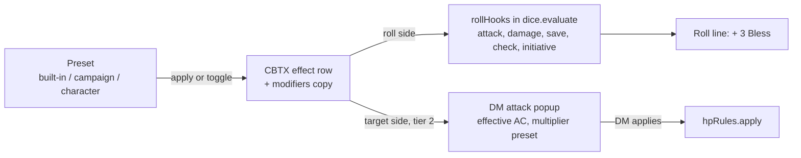

# Effect modifiers

> Five-minute read for §1–§7; §8 onwards is reference. Bullets over prose. See [AGENTS.md](../../AGENTS.md). Builds on [combat-extras](combat-extras.md) (CBTX, effects) and [character-sheet-full](character-sheet-full.md) (CHARX, sheet sections). Sprint plan: [sprint-2](../agents/sprint-2.md) track M, DM note N9 (#188). Cross-cutting decision: [proposed ADR](../architecture/adr/proposed-effect-modifiers.md).

## 1. Summary

- CBTX **effects** gain optional **modifiers**: bonus dice (Bless +1d4 on attacks and saves), flat bonuses (+2 damage), advantage / disadvantage, resistance / vulnerability / immunity, AC bonus. ADR-0009's design-for-later "field / op / value" list becomes real, on effect rows.
- **Applied by the server** when the creature makes a matching roll, inside the rolling command's transaction, through one new seam: a `rollHooks` registry run by `dice.evaluate`. The roll line names them: "Mira — Longsword attack: 14 + 5 + 3 Bless = 22".
- **Presets** (Bless, Bane, Rage, Hunter's Mark, Shield of Faith…) ship as code data; the DM customises them per campaign; a player keeps their own character presets (Rage) as **toggles** with optional **uses** linked to a sheet feature row.
- A sheet section **Effects** (CHARX `sheetSections`) shows what modifies this character, its toggles and presets.
- Target-side modifiers (AC, resistances) never change HP by themselves: they **preset** the DM's attack popup; only the DM applies (#134, #136).



## 2. Scope

Proposed (track M); the DM confirms scope and timing at gate 1 (OQ-MOD-01, -02). Tiers in [§14.2](#142-scope-ladder-for-the-dm).

- **Tier 1:** modifier kinds `dice` and `flat` on roll kinds attack, damage, save, check (incl. skills), initiative; effect rows carry them; presets (built-in, campaign, character); DM applies a preset to creatures; DM and owner toggle character presets; server applies modifiers to every creature roll (sheet, combat, concentration, death saves); roll lines show them; sheet section **Effects**.
- **Tier 2:** kinds `mode` (advantage / disadvantage), `defense` (resistance / vulnerability / immunity), flat `ac`; roll-control preview so physical dice ask for the right dice; DM popup uses effective AC and presets the multiplier.
- **Tier 3:** uses: a character preset links a sheet feature row ("Rage 2 / long rest"); toggling on spends a use.
- *(proposed)* "Start concentration" in the apply dialog: one action makes the caster concentrate and links the targets' effects (CBTX FR-CBTX-10). Not automatic from spell data.

## 3. Goals

- Bless, Bane, Rage, Hunter's Mark and Shield of Faith run without arithmetic: the right number lands in the roll and everyone sees why.
- The server decides: modifiers come from committed effect rows at commit, never from the client ([ADR-0005](../architecture/adr/0005-server-authoritative-sync.md)).
- A player sees on their sheet everything that currently modifies their character, and toggles their own (Rage) in one click.
- No monster modifier, AC, secret effect or hidden creature reaches a player. The DM still confirms every hit and every multiplier.
- Hard kill at any point → restart → effects, modifiers, toggles, uses and roll lines intact.

## 4. Non-goals

- A rules engine: no spell, class or item data, no automatic effects from spells, feats or conditions (compendium, [levelling](post-mvp/levelling.md)). Conditions stay reminders (#178, OQ-CBTX-06; OQ-MOD-05).
- Changing a derived value or an override: modifiers are **roll-time riders**; an [ADR-0036](../architecture/adr/0036-full-sheet-derivation.md) override still decides the base number.
- Automatic apply: a resistance only presets the DM's popup; damage is still applied by the DM ([FR-CBT-34](combat-tracker.md#6-functional-requirements)).
- Target-dependent riders at roll time ("+1d6 vs the marked target", "attacks against it have advantage"): the attack is rolled before targets are picked (#134, #135).
- Undo of apply / toggle / edit commands (corrected by the inverse, as OQ-CBTX-20). Rest buttons (tier C, OQ-CHARX-08).
- Modifiers on the free roll bar (`dice.roll`) and on NPC-sheet rolls of a definition (no instance, no effects).

## 5. User stories

- **DM:** As the DM, I want to box-select Mira, Thorn and Pip, pick "Bless" with Mira as caster, and have +1d4 land on their attacks and saves until Mira loses concentration, so that nobody forgets the d4.
- **DM:** As the DM, I want my Baned goblin's attack to subtract the d4 by itself, and the popup to preset "Half" when Thorn is raging and the hit is slashing, so that I only confirm.
- **DM:** As the DM, I want to edit the Bless preset once for my campaign (house rule), so that every later cast uses my version.
- **Player:** As Thorn's player, I want a Rage switch on my sheet that shows 2 / 2 uses, adds +2 to my weapon damage and gives me advantage on Strength checks, so that raging is one click.
- **Player:** As Mira's player, I want my sheet to list "Bless: +1d4 attack rolls, saving throws, 7 rounds left", so that I know why my numbers changed.

## 6. Functional requirements

All commands: rows + event-log entry + domain event in one transaction; IDs, time from `ctx`, dice from `ctx.dice` ([AGENTS §9.3](../../AGENTS.md#93-fixtures)). Failure → no change, event or log entry. **Creature** = a character (PC) or a monster combatant. Target ref as CBTX: `{combatantId}` \| `{characterId}`. Tier in the last column.

| ID | Requirement | Tier |
|---|---|---|
| **Model** | | |
| FR-MOD-01 | **Modifier** = one typed entry (zod, `@shared/effect-modifiers/schemas.ts`), §8.1: `dice` (signed `NdM`, N 1–4, M ∈ 4/6/8/10/12, on a roll selector), `flat` (int −10…10 ≠ 0, on a roll selector or on `ac`), `mode` (advantage \| disadvantage, on a roll selector), `defense` (resistance \| vulnerability \| immunity, 1–13 damage types). ≤ 6 per effect or preset. Unknown or out-of-tier kinds → `invalid`. | 1 (`mode`, `defense`, `ac`: 2) |
| FR-MOD-02 | **Roll selector** `{roll: attack \| damage \| save \| check \| initiative, abilities?, via?}`. `abilities` (save, check only): matches a save / check of one of them; absent = every one. `via` (attack, damage only): `weapon` = attack rows (PC sheet and monster), `spell` = spell rows; absent = both. A skill check is a `check` of its ability. A death save is a `save` with no ability: only selectors without `abilities` match it. A concentration save is a `con` save. Healing rolls are never `damage`. Pure `matches(selector, rollSubject)` in `@shared`. | 1 |
| FR-MOD-03 | **Effect rows carry modifiers** (amends [FR-CBTX-03](combat-extras.md#6-functional-requirements)): `effect` gains `modifiers` (default `[]`) and `presetKey` (text \| null). Only `custom` effects carry modifiers; conditions and concentration rows never do (`invalid`). Every CBTX rule (expiry, Prev restore, undo restore, concentration end, End, hidden copy) moves the row, so its modifiers follow with no extra code. `kind`, labels and limits unchanged (OQ-MOD-07). | 1 |
| FR-MOD-04 | **Active modifiers of a creature** = modifiers of its active effects (`endedAt` null): a PC → effects with `targetCharacterId` = the character (in or out of combat); a monster → effects with `targetCombatantId` = the combatant. Ordered by effect `seq`, then index (determinism, [FR-DICE-25](dice-roll-log.md#6-functional-requirements)). Pure `activeMods(effects, creature)` in `@shared`, used by server and clients. | 1 |
| **Presets** | | |
| FR-MOD-05 | **Built-in presets**: code data in `@shared/effect-modifiers/presets.ts` (§8.3), own words, no rules text ([ADR-0018](../architecture/adr/0018-global-imported-content.md)): `{key, name, modifiers, durationRounds?, concentration, note}`. Never stored, never sent; both clients import them. | 1 |
| FR-MOD-06 | **Campaign presets** (DM): `mod.putPreset {preset}` with `characterId` null; no `id` → create, with `id` → replace. A row whose `key` = a built-in key **customises** it: preset lists show the row instead of the built-in, marked "Customised"; `mod.deletePreset` on it = back to the built-in (OQ-MOD-12). ≤ 40 per campaign (`conflict`). `EffectPresetSaved` / `EffectPresetDeleted`. | 1 |
| FR-MOD-07 | **Character presets**: `characterId` set; DM, or the owner while the sheet is not locked ([FR-CHARX-12](character-sheet-full.md#6-functional-requirements), `forbidden` "Locked by the DM"); ≤ 6 per character. "Start from" copies a built-in or campaign preset into the form. `ownerPlayerId` is a copy kept by MOD's definition-changed hook line ([FR-ENT-19](entities.md#6-functional-requirements)) in the owner change's transaction, listed so the old owner gets deletes ([FR-CHARX-13](character-sheet-full.md#6-functional-requirements) rule). | 1 |
| FR-MOD-08 | **Copy, not link**: applying or toggling copies the preset's modifiers into the effect row. Editing a preset changes later applies only. `mod.setModifiers {effectId, modifiers}` (DM) edits an active `custom` effect's modifiers, also one made with CBTX's Effect dialog. `EffectModifiersSet`. | 1 |
| **Applying and toggling** | | |
| FR-MOD-09 | `mod.apply {targets [ref] 1–20, preset: {key} \| {presetId}, sourceCombatantId?, durationRounds? 1–100 \| null, linkConcentration?, startConcentration?, secret?}` (DM): per target one `custom` effect, label = preset name, `modifiers` copy, `presetKey` = the built-in key (also when customised), else the preset id, through CBTX's internal `checkLimits` / `insertEffect` (FR-CBTX-04 limits, hidden copy FR-CBTX-13). Duration: given, else the preset's; dropped (no `conflict`) when no encounter is started or the target is not in it; anchor per [FR-CBTX-05](combat-extras.md#6-functional-requirements). A target with an active effect of the same `presetKey` is skipped (result `skipped` names). Character presets can't be applied to another creature (`invalid`). `PresetApplied`. | 1 |
| FR-MOD-10 | **Concentration** (preset `concentration: true`, a source combatant): `linkConcentration` links as FR-CBTX-10 (`conflict` if the source isn't concentrating); `startConcentration: true` first sets the source's concentration (label = preset name, the preset's duration) through CBTX's concentration helper (an active one ends `replaced`, FR-CBTX-09), then links, one transaction. *(proposed)* | 1 |
| FR-MOD-11 | **Toggle**: `mod.toggle {characterId, presetId, on, force?}` (DM; owner) on a **character preset** of that character. On: as FR-MOD-09 with target = the character, no source; anchor = its own active combatant if any. Already in the asked state → success, no event. Off: ends the active effect with that `presetKey` (`endedReason: removed`, FR-CBTX-08). `EffectToggled {characterId, presetId, on, effectId}`. Campaign presets are applied, not toggled (OQ-MOD-04). | 1 |
| FR-MOD-12 | **Uses**: a character preset may name `usesFeatureId` = a row of the character's sheet `features` with `usesMax` (CHARX §8.2). Toggle on spends one use through CHARX's `spendFeatureUse(env, characterId, rowId)` in the same transaction; none left → `conflict` "No Rage uses left". DM `force: true` → on without spending. Off never refunds. Uses reset only by the Features tab's Reset (no rest buttons, OQ-CHARX-08). Row deleted or `usesMax` cleared → toggles without uses; the section says "Uses link broken" (OQ-MOD-10). | 3 |
| **Rolls** | | |
| FR-MOD-13 | **Roll seam** (OQ-MOD-08): dice-roll-log's `dice.evaluate` gains an optional `subject {creature: ref, roll, ability?, via?, crit?}` and runs the append-only `rollHooks` registry (`src/server/features/dice-roll-log/roll-hooks.ts`, entry shape §9) in the caller's transaction. No subject → exactly as today. MOD registers one hook. A hook error rolls back the command. | 1 |
| FR-MOD-14 | **MOD's hook**: active modifiers of the creature (FR-MOD-04) whose selector matches (FR-MOD-02) → parts. `dice` → its own `roll` row via `ctx.dice` (same category and source as the base, label = effect label), doubled dice count when `crit` and `roll: damage`; `flat` → value; `mode` → modes. Returned `{parts [{effectId, label, public, expression?, value, rollId?}], modTotal, modes}`; part ids go into the caller's `rollIds` ([FR-DICE-26](dice-roll-log.md#6-functional-requirements)). | 1 (`mode`: 2) |
| FR-MOD-15 | **Callers pass a subject** (OQ-MOD-08; caller list and kind mapping per seam ruling S1 / S6): `char.roll` (every kind, [FR-CHARX-20](character-sheet-full.md#6-functional-requirements): `toHit` / `spellToHit` → `attack`; `damage` / `spellDamage` → `damage`; `attack` / `spellAttack` (Attack + damage) → `attack` for the to-hit, `damage` for the damage; `via` from the row), `cbt.attack` (to-hit `attack`, damage `damage`, `crit` on a natural 20; with `rolls: "toHit"` only the to-hit part), P2a's `cbt.rollDamage` (`damage`, `via` and `crit` from the card), `cbt.rollAbility`, `cbt.rollInitiative`, `cbtx.rollConcentration` (`save`, `con`), `cbtx.rollDeathSave` (`save`, no ability). A PC combatant's subject is its character. `dice.roll` and definition rolls pass none. | 1 |
| FR-MOD-16 | **Totals**: the outcome total = base total + `modTotal` everywhere a total counts: card to-hit and damage totals and the popup's hit preset, initiative value, concentration total vs DC, death save ≥ 10 (a total of 20+ is not a natural 20: naturals read the base d20 only). **Partial cards** (P2a's split attack): to-hit mods are applied when the to-hit part is rolled, damage mods when the damage part is rolled, each from the effects active at that commit. Rolled facts on the card stay as rolled: a later Bless end doesn't change a part already rolled. | 1 |
| FR-MOD-17 | **Mode** (OQ-MOD-03): final mode = the roller's mode (Shift / Ctrl) combined with every matching `mode` part: any advantage and any disadvantage → normal; else the one present (5e). Applied by FR-DICE-04's rewrite. Physical: a manual entry whose die count doesn't fit the final mode → `conflict` "Effects changed — roll again". | 2 |
| FR-MOD-18 | **Physical dice** (OQ-MOD-03): tier 1 — the base roll is manual as today; bonus dice parts are rolled by the server and tagged `auto` ("+ 3 Bless (rolled for you)"). Tier 2 — the roll control asks one extra manual box per bonus die (FR-MOD-27), sent as `manualMods [{effectId, entry}]`; a mismatch with the committed parts → `conflict` "Effects changed — roll again". | 1 / 2 |
| **Lines and visibility** | | |
| FR-MOD-19 | **Payload**: a roll payload item ([FR-DICE-20](dice-roll-log.md#6-functional-requirements)) and the `damage-card` / `cbt.attack` to-hit and damage parts (nullable since P2a's split attack; `mods` sit on whichever part is present) gain optional `mods [{label \| null, value, expression?, auto?}]` and `modes [label \| null]`; `total` includes them. A part's `label` is public iff its effect is player-visible (not `secret`, not `hidden`, active: `effectVisibleToPlayers`), else null. `dmPayload.mods` carries every label and effect id. Rows from before parse without. | 1 |
| FR-MOD-20 | **Line format** (one shared `modSegments(mods)` in `@shared/effect-modifiers/line.ts`, used by the `roll` kind and `cbt.attack`): after the base dice and constant, each part "+ 3 Bless" / "− 2 Bane" / "+ 2 Rage"; a null label reads "(DM)"; modes "(adv: Rage)"; Tooltip "Bless 1d4: 3". Example: "Mira — Longsword attack: 14 + 5 + 3 Bless = 22". The DM line names every label ([FR-DICE-28](dice-roll-log.md#6-functional-requirements)). | 1 |
| FR-MOD-21 | **`effect` visibility** (amends [FR-CBTX-31](combat-extras.md#6-functional-requirements)): DM full. Player: as today, plus `modifiers` and `presetKey` **iff `targetCharacterId` ≠ null** (PC effects: the table sees them in roll lines anyway; OQ-MOD-06). Effects on monsters never carry them to players. Reads only the record (ADR-0021). | 1 |
| FR-MOD-22 | **`effect-preset` visibility**: DM full; player: rows with `ownerPlayerId` = the connection's player; every other row (campaign presets, other characters') hidden. Snapshot: all rows of the campaign (caps FR-MOD-06/07). | 1 |
| FR-MOD-23 | **Hidden and secret**: a hidden creature's rolls stay DM-only (FR-CBT-44, -52, FR-CBTX-23); a secret or hidden effect's part shows "(DM)" in any public line; monster AC and defense facts live only in `dmPayload` (#138). | 1 |
| **Target side** | | |
| FR-MOD-24 | **Effective AC** = stored AC + Σ `flat` on `ac` of the target's active effects. DM popup ([FR-CBT-33](combat-tracker.md#6-functional-requirements)) shows "AC 17 (15 + 2 Shield of Faith)" and presets Hit vs it; `cbt.applyCard` writes the effective value to `targetAc` and the parts to `dmPayload.acMods`. Players never get AC. | 2 |
| FR-MOD-25 | **Defense preset**: for the card's `damageType`, the popup presets a target row's multiplier: immunity → None, resistance → Half, vulnerability → Double, resistance + vulnerability → Normal; hint "Half (Rage)". The DM can change it; the server applies the DM's choice (#134, #136); `dmPayload.defense {level, label}`. No damage type, `cbt.applyHp` and `char.adjustHp` → no preset. | 2 |
| **Client** | | |
| FR-MOD-26 | **Sheet section** `mod.effects` (CHARX registry, §7.1): slot `tab`, title "Effects", `order: 10`, both clients, `kinds: ["character"]`. Placement per [CHARX §7.1](character-sheet-full.md#71-sheet-sections-seam-combat-extras) as written: section tabs come **after Notes** (Main / Actions / Features / Inventory / Notes / Effects). Shows: **Active** (each active effect with modifiers: name, parts in words "+1d4 attack rolls, saving throws", rounds left; DM: Modifiers… / End); **Toggles** (character presets as switches, uses left "1 / 2"; owner, DM); **Presets** (owner unless locked, DM: New, Start from ▸, Edit, Delete); "Effective AC 17" when an `ac` part applies. | 1 (AC: 2, pips: 3) |
| FR-MOD-27 | **Roll-control preview**: `useRollControl` ([FR-DICE-24](dice-roll-log.md#6-functional-requirements)) gains optional `subject`; it computes `activeMods` from the store for the final mode (physical popover asks two d20s), one manual box per bonus die, and lists "Bless +1d4" in the button Tooltip. Callers pass `subject` (§14.1). | 2 |
| FR-MOD-28 | **DM entry points**: token menu (registry, [FR-MAP-29](scenes-map.md#6-functional-requirements)) **Apply effect ▸** (preset list: customised + built-in + campaign; dialog: duration, source, link / start concentration, secret; acts on the selection as FR-CBTX-35) and **Effect modifiers…** (one token: its active custom effects, edit / end). Preset manager Dialog from the apply dialog ("Edit presets…"). No new window. | 1 |
| FR-MOD-29 | Controls disabled unless `live`; one intent in flight per control; lost in-flight intent → Toast "Connection lost — check effects before trying again"; reject → Toast. | 1 |
| **Robustness** | | |
| FR-MOD-30 | One transaction per command: effect rows, concentration, spent use, preset rows, rolls, log entry, event-log row. No MOD state in server memory; previews are derived from records. | 1 |
| FR-MOD-31 | Fixtures and bundle `effect-modifiers` per §13; `fixtures:reset-load effect-modifiers` works from empty and is deterministic. | 1 |

## 7. UI/UX notes

Per [visual-direction](../design/visual-direction.md): shadcn defaults, dark, dense; lucide icons; no custom styling. No new window ([play-shell](play-shell.md) unchanged).

- **Sheet, Effects tab** (320 px wide): three blocks, each collapsible. Active: one row per effect, chip-style name + rounds left, parts as muted text. Toggles: Switch + name + uses pips. Presets: compact list with Edit / Delete, New and Start from ▸. Effects without modifiers stay in CBTX's header chip row only.
- **Modifier editor** (Dialog, shared by presets and effects): rows of Select (kind) + Select (roll) + optional ability ToggleGroup / via Select + value input; "Add modifier" up to 6; live sentence preview "+1d4 to attack rolls and saving throws".
- **Roll lines**: parts in body text after the constant, labels muted. The DM's line names every part; players see "(DM)" for a part whose effect they don't receive.
- **Popup (tier 2)**: AC cell shows the effective AC with a small "+2" marker and Tooltip; the multiplier toggle shows the preset reason as a hint below it.
- **DM view**: everything above for any PC; token menu entries for monsters. **Player view**: own sheet's Effects tab; others' PCs: summary only (no section, FR-CHARX-32).
- **States**: empty "No active effects" / "No toggles yet — New or Start from a preset"; locked: presets read-only, toggles work; disconnected: last state, controls disabled, banner; error Toast.
- **Test IDs**: `mod-section`, `mod-active` (+ `data-record-id` = effect id), `mod-active-parts`, `mod-active-edit`, `mod-active-end`, `mod-toggle` (+ `data-record-id` = preset id, `data-state` = `on` \| `off`), `mod-toggle-uses` (+ `data-value` = "left/max"), `mod-preset` (+ `data-record-id`), `mod-preset-new`, `mod-preset-from` (+ `data-value` = key), `mod-preset-edit`, `mod-preset-delete`, `mod-editor-<row|kind|roll|ability|via|dice|value|mode|types|level|add|remove|preview|save>`, `mod-apply-<preset|duration|source|link|start-conc|secret|submit|skipped>`, `mod-presets-<list|row|reset|delete>`, `mod-token-menu-<apply|modifiers>`, `mod-ac`, `mod-log-part` (+ `data-value` = label or `dm`), `mod-popup-ac`, `mod-popup-defense`.

### 7.1 Seams

| Seam | Owner | MOD uses | Entry / shape |
|---|---|---|---|
| Effect record | CBTX (P2a doesn't change its shape) | Extends it: `modifiers`, `presetKey` (FR-MOD-03); internal `checkLimits`, `insertEffect`, `endEffects`, concentration helper | Columns §8.2; redaction FR-MOD-21 |
| Roll pipeline | dice-roll-log | New registry `rollHooks` + `subject` on `dice.evaluate` (FR-MOD-13) | §9 "Roll hook" |
| Sheet section | CHARX (P2b doesn't add an effects block) | One `sheetSections` line; tab after Notes (CHARX §7.1) | `{id: "mod.effects", slot: "tab", order: 10, title: "Effects", kinds: ["character"], component}` in `src/client/common/features/character-sheet/sheet-sections.ts` |
| Roll kinds and routes | CHARX kinds, CBT routes (S1) | Subjects per kind; `cbt.rollDamage`; partial cards | FR-MOD-15/16 |
| Log lines | dice-roll-log (`roll` kind), combat-tracker (`cbt.attack`, card) | Optional `mods`, `modes` on payloads and on the nullable card parts (S6) | FR-MOD-19/20 |
| Feature uses | CHARX | `spendFeatureUse(env, characterId, rowId)` (new internal helper) | FR-MOD-12 |

## 8. Data model

### 8.1 Modifier (JSON leaf, zod only)

| Kind | Fields | Example |
|---|---|---|
| `dice` | `on: RollSel`, `dice: "NdM"`, `sign: 1 \| -1` | Bless `{on: {roll: attack}, dice: "1d4", sign: 1}` |
| `flat` | `on: RollSel \| {roll: "ac"}`, `value` int −10…10 ≠ 0 | Rage `{on: {roll: damage, via: weapon}, value: 2}`; Shield of Faith `{on: {roll: ac}, value: 2}` |
| `mode` | `on: RollSel`, `mode: advantage \| disadvantage` | Rage `{on: {roll: check, abilities: [str]}, mode: advantage}` |
| `defense` | `types: DamageType[] 1–13`, `level: resistance \| vulnerability \| immunity` | Rage `{types: [bludgeoning, piercing, slashing], level: resistance}` |

`RollSel = {roll: attack | damage | save | check | initiative, abilities?: Ability[] 1–6, via?: weapon | spell}` (FR-MOD-02). Maps ADR-0009's "field, op, value, source, duration": field = `on` / `types`, op = kind, value = `dice` / `value` / `mode` / `level`, source and duration = the effect's.

### 8.2 Records

| Entity | Field | Type | Notes |
|---|---|---|---|
| Effect *(CBTX, `effect`)* | + modifiers | **JSON leaf** Modifier[] 0–6, default `[]` | `custom` only (FR-MOD-03) |
| | + presetKey | text ≤ 40 \| null | Built-in key or preset id; toggle state (FR-MOD-11) |
| **Effect preset** (`effect-preset`, new table `effect_preset`) | id, campaignId, seq | ID, ID, int | |
| | key | text ≤ 40 \| null | Built-in key it customises (campaign rows only); unique per campaign where set |
| | characterId, ownerPlayerId | ID → Entity (character) \| null, ID \| null | null = campaign preset; owner = copy (FR-MOD-07) |
| | name | text 1–40 | Becomes the effect label |
| | modifiers | **JSON leaf** Modifier[] 1–6 | |
| | durationRounds, concentration | int 1–100 \| null, bool | Defaults for apply / toggle |
| | usesFeatureId | ID \| null | Character presets only; CHARX `features[].id` (tier 3) |
| | note | text ≤ 200 | Own words |
| | createdAt, updatedAt | timestamp | `ctx.clock` |
| Roll *(DICE, table)* | — | — | No change: a bonus die is its own row (`label` = effect label) |
| Game-log entry payload *(DICE / CBT)* | + mods, modes | **JSON leaf**, optional | FR-MOD-19 |
| Damage card payload *(CBT)* | toHit, damage + mods, modes | **JSON leaf**, optional | ≤ 1 KB test kept (§12) |
| Combat log entry *(CBT, `hp_change`)* | targetAc | int | Effective AC (tier 2); `dmPayload.acMods`, `defense` on the line |

### 8.3 Built-in presets (FR-MOD-05)

| Key | Name | Modifiers | Duration | Conc. | Note |
|---|---|---|---|---|---|
| `bless` | Bless | +1d4 attack; +1d4 save | 10 | ✓ | |
| `bane` | Bane | −1d4 attack; −1d4 save | 10 | ✓ | |
| `rage` | Rage | +2 damage (weapon); adv check + save (STR); resist bludgeoning, piercing, slashing | 10 | — | Weapon damage includes ranged rows (OQ-MOD-18) |
| `hunters-mark` | Hunter's Mark | +1d6 damage (weapon) | — | ✓ | Only vs the marked creature: toggle per target or edit in the popup (OQ-MOD-13) |
| `shield-of-faith` | Shield of Faith | +2 AC | 100 | ✓ | |
| `guidance` | Guidance | +1d4 check | 1 | ✓ | Once: end it after the roll |
| `resistance` | Resistance | +1d4 save | 1 | ✓ | Once: end it after the roll |
| `reckless` | Reckless Attack | adv attack (weapon) | 1 | — | Attacks against you: DM's call |
| `dodge` | Dodge | adv save (DEX) | 1 | — | Attacks against you: DM's call |

- **Relations:** Effect preset → Campaign; → Character (0..1); → feature row (soft, by id). Effect → preset (soft, `presetKey`).
- **Derived:** active modifiers, parts per roll, final mode, effective AC, defense preset, toggle state (on = active effect with `presetKey`), uses left (CHARX counter).
- **Persisted runtime state:** effect rows (+ modifiers), preset rows, spent uses (CHARX), roll rows. Dialog edits and previews: client memory.
- **Constraints:** unique (`campaignId`, `key`) where `key` not null; caps FR-MOD-06/07 checked in commands. FK `characterId` cascade (characters are never deleted, FR-ENT-14).

## 9. API & events

**REST:** none. Preset edits are WS intents for DM and owner alike, as sheet edits ([ADR-0036](../architecture/adr/0036-full-sheet-derivation.md) refines ADR-0021 D; OQ-MOD-15).

**WS intents** (strict zod; none optimistic)

| Intent | Who | Validation / ownership | Result |
|---|---|---|---|
| `mod.putPreset {preset}` | DM; owner (own character, unlocked) | FR-MOD-01, -06, -07; player sending `characterId` null or another's → `forbidden` | `{presetId}` |
| `mod.deletePreset {presetId}` | as above | Unknown / invisible → `not_found` | — |
| `mod.apply {targets, preset, …}` | DM | FR-MOD-09, -10 | `{effectIds, skipped}` |
| `mod.toggle {characterId, presetId, on, force?}` | DM; owner | FR-MOD-11, -12; player `force` → `forbidden` | `{effectId \| null}` |
| `mod.setModifiers {effectId, modifiers}` | DM | FR-MOD-08; condition / concentration → `invalid` | — |
| *Existing roll intents* | as today | Tier 2: optional `manualMods [{effectId, entry: ManualEntry}]` (FR-MOD-18) | as today |

**Roll hook** (`src/server/features/dice-roll-log/roll-hooks.ts`, append-only, created empty by `fix/mod-core`; AGENTS §9.9 list)

```ts
interface RollSubject { creature: {combatantId: string} | {characterId: string}; roll: "attack" | "damage" | "save" | "check" | "initiative"; ability?: Ability; via?: "weapon" | "spell"; crit?: boolean }
interface RollPart { effectId: string; label: string; public: boolean; value: number; expression?: string; rollId?: string; auto?: boolean }
interface RollHook { id: string; adjust(env: CommandEnv, s: RollSubject, base: {manual: boolean}): { parts: RollPart[]; modes: { mode: "advantage" | "disadvantage"; label: string; public: boolean }[] } }
export const rollHooks: readonly RollHook[] = [/* mod */];
```

**Record types:** `effect` (amended, FR-MOD-21); `effect-preset` (new, FR-MOD-22; registers in MOD's own `index.ts`).

**Domain events** (all logged; WS = generic record changes, `cause.name` = event; `src/shared/events/effect-modifiers.ts`)

| Event | Changes | Visibility (player) | Undoable |
|---|---|---|---|
| `EffectPresetSaved {presetId}` / `EffectPresetDeleted {presetId}` | `effect-preset` | owner: upsert / delete; others nothing | no |
| `PresetApplied {presetKey, effectIds, concentrationId?}` | `effect` creates; concentration set / replaced | per FR-CBTX-31 + FR-MOD-21 | no |
| `EffectToggled {characterId, presetId, on, effectId}` | `effect`; `creature-sheet` (use spent, tier 3) | effect per rule; sheet → owner | no |
| `EffectModifiersSet {effectId}` | `effect` | per rule | no |
| *Existing:* `CharacterRolled`, `AttackRolled`, `CombatantRolled`, `InitiativeRolled`, `ConcentrationRolled`, `DeathSaveRolled` | + bonus-die rolls in `rollIds`; payload `mods` | per FR-DICE-15 / FR-MOD-19 | as today |
| *Existing:* `AttackApplied` (tier 2) | `hp-change.targetAc` effective; line `dmPayload.acMods`, `defense` | unchanged for players | as today |
| *Existing:* owner change (`CharacterSheetEdited` / `EntityUpdated`) | + `effect-preset` owner copies (hook) | old owner deletes, new owner upserts | no |

## 10. Permissions

| Action | DM | Owner player | Other player | Server check |
|---|---|---|---|---|
| Campaign presets: edit, customise, reset | ✓ | ✗ | ✗ | role |
| Character presets: edit, delete | any | own, unless locked | ✗ | ownership + lock |
| Apply a preset to creatures | ✓ | ✗ (OQ-MOD-04) | ✗ | role |
| Toggle a character preset | ✓ (`force` too) | own | ✗ | ownership |
| Edit an effect's modifiers | ✓ | ✗ | ✗ | role |
| See modifiers | all | PC effects they receive; own presets | PC effects they receive | FR-MOD-21/22 |
| See AC, defense presets, monster modifiers | ✓ | ✗ | ✗ | dmPayload / redaction |

## 11. Edge cases & failure modes

- **Player disconnect / reconnect:** toggles disabled; a lost toggle is not resent (Toast, FR-MOD-29); the snapshot shows whether it committed. Previews rebuild from the snapshot.
- **DM disconnect:** players keep rolling and toggling; modifiers apply server-side whoever is online. Expiry still needs Next (CBTX).
- **Server crash:** apply ⇔ effects ⇔ concentration; toggle ⇔ effect ⇔ spent use; roll ⇔ bonus-die rows ⇔ entry. Restart → identical snapshots.
- **Concurrent:** two tabs toggle on → second is a no-op. DM ends Bless while Mira rolls → serial: a roll after the end has no Bless. Owner edits a preset while the DM locks the sheet → `forbidden`. Preview vs commit differ (an effect changed in between) → the committed line wins; physical (tier 2) → `conflict` "Effects changed — roll again".
- **Undo:** `cbt.undo` reverts HP only; rolled totals (incl. parts) are facts; a reopened card keeps them. Effects ended by that damage come back with their modifiers (FR-CBTX-22). Apply / toggle / edit are corrected by the inverse (OQ-CBTX-20); a mistaken use spend is restored on the Features tab.
- **Out of combat:** PC effects apply to every sheet roll (they live on the character, OQ-CBTX-05); durations are dropped (FR-MOD-09); timed effects end at End (FR-CBTX-12), so a toggled Rage ends with the encounter.
- **Overrides:** a `save.wis` override sets the base; Bless still adds its d4 (rider, not a derived value). MOD never writes `statBlock` or `overrides`.
- **Crit:** bonus damage dice double on a crit (5e); flat bonuses don't. A natural 20 / 1 reads the base d20 only.
- **Hidden / secret:** a hidden creature's effects are hidden copies; its rolls DM-only. A secret effect on a PC still applies: public lines show "+ 2 (DM)" (accepted hint).
- **Leaks accepted:** PC effect modifiers to every player receiving the effect (OQ-MOD-06); public roll lines name non-secret effects on visible monsters ("− 2 Bane"), as chips already do; "(DM)" tells players something unseen modified a roll.
- **Invalid input:** strict zod; dice and value bounds; ≤ 6 modifiers; a player can't apply, edit effects, `force`, or touch another's presets; labels as text.

## 12. Performance & bandwidth

- `effect` + modifiers: ≈ +120 B typical (2 parts), ≤ +420 B (6 parts, compact keys). `effect-preset` ≈ 350 B typical, ≤ 700 B; caps 40 campaign + 6 per character. Built-ins: 0 B (code).
- **CON-44** (DM 768 KiB): heavy DM today 748,879 B (≈ 731 KiB; headroom ≈ 36.7 KiB). Heavy scenario gains 12 effects × 2 parts (≈ 1.4 KB) + 10 campaign + 6 character presets at max length (≈ 11.2 KB) → ≈ 761.5 KB ≈ 744 KiB (headroom ≈ 24 KiB, which fog-of-war also needs; OQ-MOD-14). Players: own presets ≤ 4.2 KB + PC effect modifiers ≤ 3 KB → ≈ 270 KiB of 512.
- Rolls: ≤ 6 extra roll rows per roll (typ. 0–1); a log entry grows ≈ 40 B per part. Card payload ≤ 1 KB at 50 dice: parts add ≤ 6 × 40 B, so the test gains a "50 dice + 6 parts" case (compact parts, or the cap lowers base dice for that case).
- Hook cost: one indexed read of the creature's active effects per roll (≤ 20 rows).

## 13. Test plan

Isolated per worktree ([ADR-0008](../architecture/adr/0008-parallel-dev-isolation.md)): `bun test` on `:memory:`, port 0, seeded `ctx.ids` / `ctx.dice`; walkthrough on the `verify` profile ([AGENTS §9.6](../../AGENTS.md#96-browser-verification-test-agents)); loop per [ADR-0017](../architecture/adr/0017-agent-verification-fixture-library.md). Tests named after FRs. Manual rolls where totals must be exact.

**Fixtures** (`fixtures/units/effect-modifiers/`; setups run as DM)

| Key | Requires | Contents |
|---|---|---|
| `mod-presets` | `campaign` | Customised built-in `bless` note "House: Bless (test)"; campaign preset "Cursed" (−1d4 save); tier 2: "Frost Ward" (resist cold) |
| `mod-bless` | `combat-1` | `mod.apply` `bless` from Mira (`startConcentration`) on Mira and Thorn: concentration + 2 linked effects, 10 rounds |
| `mod-bane` | `combat-1`, `mod-presets` | `bane` on Goblin (source Elite, hidden); "Cursed" **secret** on Goblin 2; tier 2: `shield-of-faith` on Elite (hidden) |
| `mod-rage` | `char-thorn` | Thorn feature row "Rage" (uses 2, long) via `char.putRow`; character preset "Rage" from `rage`, `usesFeatureId` → that row; off |

- **Bundle `effect-modifiers`** = `combat` + `combat-1` + `mod-presets` + `mod-bless` + `mod-bane` + `mod-rage` (round 1, Wolf's turn). `PP_TEST_MODE=1` for the walkthrough.
- **Leak strings** (player frames): "Cursed", "Frost Ward", "House: Bless (test)", Thorn's preset id in `player-1` frames, any `modifiers` on an effect with `targetCombatantId`, `acMods`, `defense`, any `effect-preset` row with `characterId` null; plus CBTX §13's list.

| Level | What | Fixtures |
|---|---|---|
| Unit | `FR-MOD-01` schema bounds (dice grammar, ±10, ≤ 6, `abilities` only on save / check, `via` only on attack / damage); `FR-MOD-02` matcher table (death save vs ability filter, skill → ability, concentration = con, healing ≠ damage, via weapon / spell); `FR-MOD-04` order by `seq`; `FR-MOD-14` parts (crit doubles dice on damage only); `FR-MOD-17` mode combine (adv + dis = normal, two advs = adv); `FR-MOD-20` `modSegments` (signs, "(DM)", modes, auto) and the FR-DICE-28 kind contract with `dmPayload.mods` sentinels; `FR-MOD-21/22` visibility fns (PC vs monster effect, owner vs other player); `FR-MOD-24/25` effective AC and defense preset table; `FR-MOD-05` every built-in parses; section `available` / test ids | In-code |
| Integration | `FR-MOD-09/10` apply 3 targets: concentration started, links, skip duplicate, no duration out of combat, limits. `FR-MOD-11/12` toggle on / no-op / off; uses 2 → 1 → 0 → `conflict`; DM `force`; locked sheet: toggle ok, edit `forbidden`. `FR-MOD-15/16` every caller: `char.roll` `toHit`, `damage`, `attack` (both parts) and save with Bless (seeded totals = base + part; Bless on to-hit only), `cbt.attack` Baned goblin (card total, popup preset hit), `cbt.attack {rolls: "toHit"}` then `cbt.rollDamage` with Rage (to-hit part without, damage part with "+ 2 Rage"; Bless ended between the two → damage unaffected, to-hit kept), `cbt.rollAbility`, `cbt.rollInitiative`, `cbtx.rollConcentration` (Bless on the save, DC compare), `cbtx.rollDeathSave` (Bless yes, Rage no; ≥ 10 on total). Mira fails concentration → Bless ends on both → next roll has no part. `FR-MOD-18` physical base + auto part. `FR-MOD-19/23` "Cursed" public roll → players' payload label null, DM `dmPayload.mods` named. `FR-MOD-07` owner change moves preset rows (old owner delete). Rollback with a throwing hook → nothing. Crash: `PP_TEST_CRASH mod.toggle:before-commit` / `after-commit` → effect + use all or nothing. **Leak scan** per player over the suite. **Snapshot size**: heavy scenario + §12 rows ≤ 768 KiB (CON-44) | `effect-modifiers` |
| E2E (thin) | DM + `player-1`: Mira attacks from the sheet in combat → card total includes Bless; line "+ N Bless" for both; DM applies Bane via token menu → chip for `player-1` | `effect-modifiers` |

**Browser walkthrough** — needs CBTX, CHARX sections, notifications. `bun run build`; `fixtures:reset-load effect-modifiers --profile verify`; `start --profile verify` (test agent's Herdr pane). Contexts **A** DM (`pw-dm`), **B** `player-1` (Mira), **C** `player-2` (Thorn); B, C frames logged via `page.on('websocket')`. Tier-2/3 steps marked; skip with N/A if not built. Evidence + teardown per AGENTS §9.6.

| # | DM (A) | Players (B, C) | Expected |
|---|---|---|---|
| 1 | Open Initiative | B, C open links; sheet → Effects tab | Chips: Bless on Mira, Thorn; Bane on Goblin; A only: "Cursed" eye-off on Goblin 2. B: Active "Bless +1d4 attack rolls, saving throws, 10 rounds". C: Toggles "Rage" off (tier 3: uses left 2 / 2). No leak string |
| 2 | Next (Mira) | B: sheet Attack on Shortsword (normal; to-hit only, S1), then Damage | Card to-hit total = d20 + 4 + part; line for A, B, C "… + N Bless = T"; A's popup presets Hit vs AC from T. Damage part: no Bless part |
| 3 | — | B: Physical dice on; CON Save, manual 10 | Line "10 + 4 + N Bless (rolled for you) = …" for A, B, C |
| 4 | Goblin row → Attack; target Mira, Apply | — | A's DM line "… − N Bane"; public outcome line "Goblin attacks Mira: … − N Bane = …" for B, C |
| 5 | Goblin 2 row → Save ▸ WIS, public on | — | B, C line "… − N (DM) = …", never "Cursed"; A line names "Cursed" |
| 6 | — | C: Effects → Rage on; Dagger Damage | Rage chip for A, B, C; C tier 3: uses left 1 / 2; line "+ 2 Rage" |
| 6a | Hard-kill + restart | All rejoin | Effects, Rage on, uses, lines intact; state digest identical |
| 7 | *(tier 2)* Goblin row → Attack (slashing); target Thorn | C: Athletics check | Popup row Thorn preset Half "(Rage)"; Apply → C sees "(half)" resolution only; C's line "(adv: Rage)", two d20s |
| 8 | *(tier 2)* Thorn's token → Apply effect ▸ Shield of Faith (source Mira, link) | — | A popup on the next attack vs Thorn: "AC 16 (14 + 2 Shield of Faith)"; B, C frames: no AC |
| 9 | *(tier 3)* — | C: Rage off, on, off, on | Second on → Toast "No Rage uses left"; A: Toggle with force → on, uses unchanged |
| 10 | Wolf row → Attack; Mira, Apply (concentration card) | B: Roll save, manual 2 | Line includes "+ N Bless"; total < DC → Bless ends on Mira and Thorn; B's next roll has no part |
| 11 | Edit presets… → Bless: Reset | — | "Customised" mark gone; next apply uses the built-in |
| 12 | End encounter | — | Timed effects (Bane, Rage) end; untimed stay; no leak string; no app console errors |

## 14. Dependencies

| On | What we need | Status |
|---|---|---|
| ADR-0005, 0009, 0016, 0018, 0021, 0022, 0035, 0036; #134, #136, #138, #178 | Authority, modifier list (made real), events, licence, sync, seams, in-tx rules, overrides | accepted |
| [Proposed ADR](../architecture/adr/proposed-effect-modifiers.md) | Modifier model + where it applies | proposed (gate 1) |
| [combat-extras](combat-extras.md) | `effect` columns + redaction; internal effect / concentration helpers; concentration and death-save callers pass a subject | complete; P2a revising (no shape change) |
| [dice-roll-log](dice-roll-log.md) | `rollHooks`, `subject` on `dice.evaluate`, payload `mods`, `roll` line; tier 2 roll-control `subject` | complete; amendment |
| [combat-tracker](combat-tracker.md) | Callers pass a subject (incl. P2a's `cbt.rollDamage`, partial `cbt.attack {rolls: "toHit"}`); card / line `mods` on nullable parts; tier 2 popup AC + defense | complete; P2a revising (split attack, S1) |
| [character-sheet-full](character-sheet-full.md) | `sheetSections` line (tab after Notes, §7.1 unchanged); `char.roll` subject for kinds `toHit`, `spellToHit` (new, S1), `damage`, `spellDamage`, `attack`, `spellAttack`; tier 3 `spendFeatureUse`; tier 2 buttons pass `subject` | complete; P2b revising (N4, N7) |
| [scenes-map](scenes-map.md), [entities](entities.md) | Token menu registry line; definition-changed hook line | complete |

### 14.1 Shared changes / amendments to other specs

Edited by their owners (or the orchestrator's assignee) at merge; MOD edits only this spec.

| Spec / path | Amendment | Tier | Kind |
|---|---|---|---|
| combat-extras FR-CBTX-03, -31, §8 | `effect.modifiers`, `presetKey`; player redaction + them iff PC target | 1 | ★ `fix/mod-core` |
| `src/server/db/` | `effect.modifiers` (JSON, default `[]`), `effect.preset_key`; table `effect_preset` + unique (`campaign_id`, `key`) | 1 | ★ shared, never with P2a's core |
| `src/shared/events/effect-modifiers.ts` + `index.ts` | 5 events | 1 | ★ |
| `src/shared/combat-extras/schemas.ts`, `src/server/features/combat-extras/{records.ts, effects.ts}` | Record shape, redaction, `insertEffect` accepts the fields | 1 | ★ (CBTX files, lock) |
| dice-roll-log FR-DICE-19, -20, §8 | `subject` + `rollHooks`; payload `mods`, `modes`; `roll` line | 1 | ★ new registry `src/server/features/dice-roll-log/roll-hooks.ts` (AGENTS §9.9); `evaluate.ts`; `src/shared/dice-roll-log/{schemas.ts, roll-kind.ts}` |
| combat-tracker FR-CBT-16, -24, -44, -11, FR-CBT-70–74 (P2a, split attack), §8 card | Subjects (incl. `cbt.rollDamage`, partial cards); totals incl. parts; `mods` on the nullable card parts and the line; card text | 1 | `src/server/features/combat-tracker/{attack.ts, abilities.ts, initiative.ts}` + P2a's `cbt.rollDamage` file, `src/shared/combat-tracker/{schemas.ts, log-kinds.ts}` (lock; after P2a's builds) |
| combat-extras FR-CBTX-18, -23 | Subjects on concentration and death saves | 1 | `concentration.ts`, `play-state.ts` (lock; after P2a) |
| character-sheet-full FR-CHARX-20/21, §7.1 | `char.roll` subject per kind (FR-MOD-15); section line `mod.effects` | 1 | `src/server/features/character-sheet/commands.ts` (lock; after P2b); `sheet-sections.ts` (append-only) |
| scenes-map FR-MAP-29; entities FR-ENT-19 | Token menu entries; definition-changed hook line | 1 | append-only |
| `src/server/features/index.ts`, `fixtures/bundles/index.ts`, `src/server/ws/snapshot-size.test.ts` + `testing/snapshot-size.ts` | `effectModifiers`; `effect-modifiers`; heavy scenario rows | 1 | append-only / ★ |
| dice-roll-log FR-DICE-24 | `useRollControl` `subject`, preview, `manualMods` | 2 | `src/client/common/features/dice-roll-log/` (existing shared UI); after P2b's `fix/physical-crit` (S4) |
| CHARX, CBT, CBTX client roll buttons | Pass `subject` to the roll control | 2 | sheet buttons, Initiative row, card / death-save views (lock) |
| combat-tracker FR-CBT-33, -34 | Popup effective AC + defense preset; `targetAc` effective; `dmPayload.acMods`, `defense` | 2 | popup client, server apply (lock) |
| character-sheet-full FR-CHARX-17 | Internal `spendFeatureUse` | 3 | `src/server/features/character-sheet/resources.ts` |
| Docs (integrator) | data model §21 + `effect_preset`; protocol (intents, record type, events, payload `mods`, §26 registry); glossary (OQ-MOD-16); AGENTS §9.9; FIX §8 rows | — | — |

### 14.2 Scope ladder for the DM

| Tier | DM gets | Build slices (in order) | Shared files |
|---|---|---|---|
| **1** | Bless, Bane, Hunter's Mark, flat bonuses on every creature roll; presets; DM apply; owner toggles; Effects tab; lines | 1 `fix/mod-core` ★: db, events, CBTX record + redaction, `rollHooks` + `subject` + payload `mods` + `roll` line, snapshot test. 2 `build/effect-modifiers` (a): commands, hook, presets, fixtures + bundle. 3 (b): wire the 7 server callers (incl. P2a's `cbt.rollDamage`) + card / `cbt.attack` line — **after P2a and P2b builds merge**. 4 (c): section, token menu, dialogs | db, `src/shared/events/`, CBTX schemas / records, dice-roll-log evaluate + schemas, CBT attack / abilities / initiative + log kinds, CHARX `commands.ts`, registries |
| **2** | Advantage / disadvantage (Rage, Reckless, Dodge), resistances in the popup, Shield of Faith AC, exact physical dice | 5 `fix/mod-roll-preview`: roll-control `subject` + callers. 6 `build/effect-modifiers` (d): `mode`, `defense`, `ac` kinds, popup + apply | No db (JSON leaf); shared roll control; CHARX / CBT / CBTX client buttons; CBT popup + apply |
| **3** | Rage "2 / long rest" uses on the toggle | 7 (e): `usesFeatureId`, CHARX `spendFeatureUse`, pips | CHARX `resources.ts` |

- **Order (seam ruling S4, S6):** P2a's `fix/combat2-core` merges first, then MOD slice 1 `fix/mod-core` (the only MOD slice touching `src/server/db/`; tiers 2 and 3 add no column). MOD slices 3+ start after the P2a and P2b builds merge. Slice 5 (roll control) after P2b's `fix/physical-crit`.
- **Size (rough):** tier 1 ≈ the CBTX effects slice; tier 2 ≈ half of it (mostly client wiring); tier 3 small.

## 15. Open questions

**Bold** = suggested pick (not decided). **DM** = needs the DM at gate 1. Owners: **DM** rows → the DM; seams (10, 11, 18, 19) → the orchestrator with the named spec (07, 08, 09, 17 settled by the orchestrator; 07 / 08 confirmed with the ADR at gate 1); 16 → integrator; 12, 13, 15 → this spec (MOD).

| ID | Question | Options (pick marked) | Blocking? | Affects |
|---|---|---|---|---|
| OQ-MOD-01 | **DM** — Scope | **Tier 1 now, tiers 2–3 later** (smallest useful: Bless works) / tiers 1+2 (Rage adv, resistances; ≈ 1.5×, more locks) / all three | yes | all |
| OQ-MOD-02 | **DM** — Timing | **Phase 1, last** (after P2a / P2b builds: same caller files) / after phase 2 (no lock contention; N9 waits) | yes | sprint-2 |
| OQ-MOD-03 | **DM** — Physical dice and bonus dice | **Tier 1: server rolls the bonus die, tagged "rolled for you"; tier 2: an extra box per bonus die** (no client change in tier 1; mixed dice) / extra box from the start (needs the roll-control slice in tier 1) | no | dice-roll-log |
| OQ-MOD-04 | **DM** — Can a player buff other PCs (cleric casts Bless on the party)? | **No: the DM applies; the player concentrates** (matches OQ-CBTX-07; no new permission) / player applies campaign presets to any PC, linked to their concentration (faster at the table; players add effects to others) | no | combat-extras |
| OQ-MOD-05 | **DM** — Conditions apply 5e adv / dis automatically (poisoned, prone…)? | **No: reminders, as #178; the DM can make a preset** / built-in condition modifiers, opt-in per campaign (reopens OQ-CBTX-06) | no | combat-extras |
| OQ-MOD-06 | Who sees a PC effect's modifiers? | **Every player who receives the effect** (reads only the record; lines show them anyway) / owner only (needs an owner copy on `effect`, more hook work) | no | combat-extras FR-CBTX-31 |
| OQ-MOD-07 | Effect record: modifiers on it or beside it? (seam, combat-extras) | **Settled (orchestrator), ADR at gate:** on it, two columns (every CBTX rule carries them; one visibility fn); subject to the DM accepting [proposed-effect-modifiers](../architecture/adr/proposed-effect-modifiers.md). Rejected: a side table (must mirror end / hidden / secret on every rule path) | no | combat-extras |
| OQ-MOD-08 | Where modifiers apply (seam, dice-roll-log) | **Settled (orchestrator), ADR at gate:** `rollHooks` registry in dice-roll-log, run by `dice.evaluate` when a `subject` is passed (one choke point; gems can join); subject to the DM accepting the proposed ADR. Rejected: a MOD helper each caller calls (7 call sites own the logic); ADR-0035 hook point (sheet rolls aren't combat) | no | dice-roll-log, ADR-0035 |
| OQ-MOD-09 | Section slot (seam, character-sheet-full) | **Settled (orchestrator):** `tab` "Effects", after Notes per CHARX §7.1 as written; no CHARX change. Rejected: `main` (below 18 skills) | — | character-sheet-full |
| OQ-MOD-10 | Uses counter (seam, character-sheet-full; tier 3) | **Link a sheet feature row** (one counter, Features tab Reset; PCs only) / own counter on the preset (self-contained; duplicates the Features pips) | no | character-sheet-full |
| OQ-MOD-11 | Target side (seam, combat-tracker; tier 2) | **Popup presets AC and multiplier; DM confirms** (#134 / #136 kept) / hint only, no preset | no | combat-tracker |
| OQ-MOD-12 | Editing a built-in preset | **Customise by key, Reset returns to built-in** (one "Bless" in lists) / derive a copy ("Bless (copy)" beside it) | no | — |
| OQ-MOD-13 | Situational riders (Hunter's Mark vs another target, Rage on a ranged row) | **Tier 1: none; toggle per target or the DM edits the popup total** / per-roll untick for modifiers marked `optional` (later; needs roll-control + intent field) | no | dice-roll-log |
| OQ-MOD-14 | **DM** (taken to the gate by the orchestrator, S6) — CON-44 headroom. Heavy DM today 748,879 B (≈ 731 KiB) of 768 KiB; MOD tier 1 adds ≈ 12.6 KB → ≈ 744 KiB, leaving ≈ 24 KiB for fog of war (phase 2) | **Presets in the snapshot, measured; no ceiling change** / campaign presets loaded on demand, DM only (frees ≈ 7 KB) / raise the DM ceiling (the DM's call only) | no | protocol CON-44, fog-of-war |
| OQ-MOD-15 | Preset transport | **WS intents for DM and owner** (ADR-0036 precedent; live for owners) / REST for campaign presets (ADR-0021 D; two paths) | no | protocol |
| OQ-MOD-16 | Glossary (integrator) | **Modifier**: redefine as a typed entry on an effect (no longer design-for-later); add **Preset**, **Toggle**, **Roll hook**; Effect gains "may carry modifiers" | no | glossary |
| OQ-MOD-17 | Line format (seam, dice-roll-log + combat-tracker) | **Settled S6 (card side):** optional `mods` / `modes` on payloads and on the nullable card parts + shared `modSegments`. Rejected: a separate log entry per modifier (noisy log) | — | dice-roll-log, combat-tracker |
| OQ-MOD-18 | Melee / ranged tag on attack rows to scope Rage (character-sheet-full) | **Later** (not needed for tier 1; DM edits totals) / add `range` to attack rows now (CHARX schema change) | no | character-sheet-full |
| OQ-MOD-19 | Token-less combatants: no token menu | **Accept: apply to them via the sheet (PCs) or later** / an Initiative row-menu entry (combat-tracker file, P2a's lock) | no | combat-tracker |

## 16. Out of scope

- Spell, class, item and feat data; effects created from them (compendium, levelling). Sheet spells' concentration mark (as CBTX §16).
- Target-dependent riders at roll time; "attacks against it have advantage"; per-roll opt-out (OQ-MOD-13, later).
- Condition automation (OQ-MOD-05), rest buttons and automatic resets (tier C), modifiers on derived values or overrides.
- Free roll bar and NPC-sheet definition rolls; modifiers on monsters outside an encounter.
- Undo of MOD commands; effect history UI; stats over modifiers ([stats](post-mvp/stats.md) can read the bonus-die rows later).
