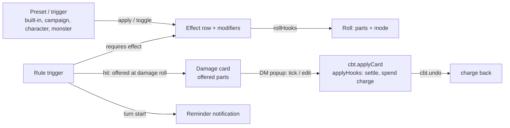
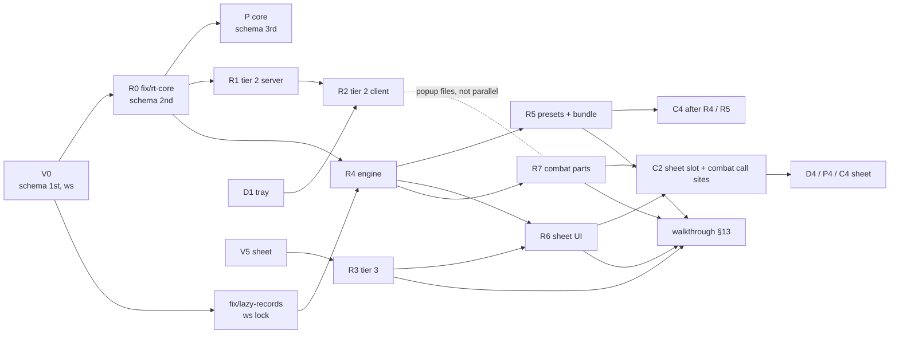
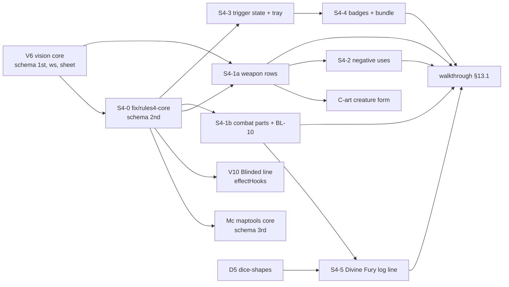

# Effect modifiers

> Five-minute read for §1–§7; §8 onwards is reference. Bullets over prose. See [AGENTS.md](../../AGENTS.md). Builds on [combat-extras](combat-extras.md) (CBTX, effects), [combat-tracker](combat-tracker.md) (CBT, cards, popup, apply, undo) and [character-sheet-full](character-sheet-full.md) (CHARX, sheet sections, features). Sprint 2: tier 1 built (#190, ADR-0038). **Sprint 3 revision** (DM [#203](../decisions-log.md), track R of [sprint-3](../agents/sprint-3.md)): tiers 2 and 3 in scope, plus **rule triggers** ([ADR-0043](../architecture/adr/0043-rule-triggers.md)). Sprint-3 FRs: new FR-MOD-32–52 (21); changed FR-MOD-01, -05, -12–20, -24–28, -30, -31, plus -34, -36, -37, -42, -44, -46, -47, -50 in the rulings pass. Sprint-2 tier-1 FRs that sprint 3 doesn't change, and OQ-MOD-01–19, are in [Appendix A](#appendix-a-built-tier-1-reference-sprint-2). **Seams pass** (S1, S3, S4, S5, S10) and **rulings pass** (review-b R1–R14, D9, C2, C5, X1, X2; orchestrator, 2026-10-16) applied. **Gate 1** (DM, 2026-10-16): every pick decided (#207); **five** built-in trigger presets, Divine Fury only as fixture trigger data (#209); DM ceiling 1 MiB, headroom guard dropped (#208); class-feature coverage check in [§8.7](#87-coverage-check-class-features-209) (#209), which adds the `row` filter, die-size formulas and campaign marks.

> **Sprint 4 revision** (track R of [sprint-4](../agents/sprint-4.md), DM [#243](../decisions-log.md) [14] [15] [16] [18] [19]). **Effects architecture review [18]: keep the model, extend it in two places** (findings: [§6.4](#64-sprint-4-effects-architecture-review-18)); the trigger-state copy and the effect-changed hooks have their own [ADR: trigger state](../architecture/adr/0049-trigger-state.md) (accepted at sprint-4 gate 1, #245; numbered at merge). **Sprint-4 gate 1** (DM, #245): every pick decided (OQ-MOD-40–42, OQ-CBT-56–58, OQ-CHARX-26, -27). **At a glance:** [§6.5](#65-sprint-4-at-a-glance). New FR-MOD-53–61: a **trigger state** record for badges [19] and the tray (sim-7: "Divine Fury +1d6" offered after use), Divine Fury's roll in the combat log [15], a defense preset per weapon damage part [16], negative feature uses [14]. Amended: FR-MOD-12, -20, -25, -27, -37, -38, -41, -49. Weapon damage parts live on attack rows ([CHARX](character-sheet-full.md), FR-CHARX-54–57) and the card ([CBT](combat-tracker.md), FR-CBT-81–86); trigger badges on Initiative rows and tokens are [CBTX](combat-extras.md) FR-CBTX-51–53. **Seams pass** (orchestrator, sprint-4 S5, S6, S8, S9, S13, S14) applied: effect-changed registry in or out of combat, D's per-die segments, token icon as its own overlay line, schema / sheet / creature-form order.

> **Sprint 5 revision** (track R of [sprint-5](../agents/sprint-5.md), DM [#250](../decisions-log.md) [8], #251). One combat design with [combat-tracker](combat-tracker.md#62-sprint-5-late-damage) (late damage, Apply hit) and [scenes-map](scenes-map.md#6-functional-requirements) (stored trails); one test plan: [CBT §13.1](combat-tracker.md#131-sprint-5-track-r-cbt-mod-map). New FR-MOD-62 (trigger parts keep their damage type on lines, BL-23), FR-MOD-63 (offered parts on a late damage roll). Amended: FR-MOD-20, -37, -39, -57 (each row carries an "S5" pointer). Decided at sprint-5 gate 1 (#256): OQ-MOD-46 A (charge window of a late roll stays at the damage roll). No MOD schema, record or snapshot change. *Ally side (DM #252, [FR-CBT-98–104](combat-tracker.md#63-sprint-5-ally-side)):* no MOD change: rule triggers have no side filter ("an ally within 5 ft" stays an `ask`), monster trigger badges stay DM-only whatever the side.

> **Sprint 7 (track FU, BL-48; DM [#311](../decisions-log.md)).** Decided, not open: the Rage toggle's double minus and the Sneak Attack roll line without its damage type. New **FR-MOD-68**, **-69**. Tests `FR-MOD-68 uses shown once` (DOM: `uses-rage-spent` at −1 / 3 → one "−1 / 3", no extra Badge in that row), `FR-MOD-69 trigger roll line typed` (integration, `trg-thorn`: Thorn's Sneak Attack roll entry label names "piercing"; an untyped part on an untyped attack unchanged); walkthrough U17 in [play-shell §13](play-shell.md#13-test-plan); slice FU4. 0 B (label text only). Edge cases: client-only display (FR-MOD-68); FR-MOD-69's label is written in the trigger roll's existing transaction (crash: all or nothing, as today); reconnect re-renders from the store. No open question.

## 1. Summary

- CBTX **effects** carry typed **modifiers**: bonus dice (Bless +1d4), flat bonuses (+2 damage), advantage / disadvantage, resistance / vulnerability / immunity, AC bonus. Applied by the server as roll-time riders through the `rollHooks` registry; lines name them ("+ 3 Bless"). *(Tier 1 built; tiers 2–3 sprint 3.)*
- **Presets** (Bless, Rage, …) ship as code data; the DM customises them; a player keeps character presets as **toggles**, optionally spending a sheet feature use (tier 3).
- **Rule triggers** (sprint 3): conditional riders as **data**, not code (ADR-0007). A trigger = owner + **requires** (an active effect) + **event** (hit, roll, turn start) + **filters** + **frequency** (each / once per turn / round / encounter / a feature's uses) + **effect** (a damage part, a roll part or mode, a reminder) with a small **formula** language (class level, proficiency, ability mods).
- Reference case, **Divine Fury** (a barbarian subclass feature, not SRD; trigger **data** on Brakka in the fixtures, not a built-in, #209): while Rage is on, the first creature Brakka hits on each of her turns with a weapon takes `1d6 + floor(level(barbarian) / 2)` radiant. The d6 is rolled with her damage and **offered** on the card; the DM's apply lands it on the first hit target and spends the turn's **charge** (one use of a trigger in its window, FR-MOD-42); Undo gives the charge back.
- Target-side facts (AC, resistances) and trigger parts never change HP by themselves: they **preset** the DM's attack popup; only the DM applies (#134, #136).
- **Sprint 4:** each trigger of a combatant in the running encounter has a small server-derived **trigger state** (in effect, charge ready / used this turn, linked feature): players and the DM see it as badges (CBTX) and in the sheet, and the tray stops promising a spent trigger. Divine Fury's dice show in the combat log. A weapon's extra damage part (Flame Tongue's fire) gets its own resistance preset. Feature uses may go below zero.



## 2. Scope

**Sprint 3 (#203, gate 1 #207): everything below is in scope.** Tier 1 is built (#190). Cut order if late: §14.2 (OQ-MOD-29).

- **Tier 1** *(built)*: `dice`, `flat` on attack, damage, save, check, initiative; effect rows carry them; presets (built-in, campaign, character); DM apply; owner toggles; server applies to every creature roll; lines; sheet tab **Active effects**.
- **Tier 2**: kinds `mode`, `defense`, flat `ac`; built-ins' tier-2 parts (Rage advantage + resistances, Shield of Faith, Reckless Attack, Dodge); mode known **before** the d20 is rolled; roll-control preview with one box per bonus die on top of dice-extras' **tray**; popup uses effective AC and presets the multiplier.
- **Tier 3**: a character preset spends a sheet feature use ("Rage 3 / long rest").
- **Rule triggers**: `rule-trigger` records on characters and monster definitions; events `hit`, `roll`, `turnStart`; formula grammar; once-per-window charges that Undo and Prev respect; five built-in trigger presets (#209); offered parts on cards and damage rolls; DM override in the popup; reminders.
- "Start concentration" in the apply dialog (#190) stays as built.
- **Sprint 4 (#243, #244):** `trigger-state` record + badges data (FR-MOD-53–55, [19]); tray preview reads it (FR-MOD-56, sim-7); trigger part dice on outcome lines (FR-MOD-57, [15]); per-part defense preset (FR-MOD-58, [16]); negative uses on toggles, forced feature charges and undo (FR-MOD-59, [14]); state in the Triggers block (FR-MOD-60); one feature-use helper (FR-MOD-61).

## 3. Goals

- Bless, Rage, Shield of Faith, **Divine Fury** and **Sneak Attack** run without arithmetic: the right number lands in the roll or the apply, and everyone sees why.
- The server decides: modifiers and trigger parts come from committed rows at commit, never from the client ([ADR-0005](../architecture/adr/0005-server-authoritative-sync.md)). No post-commit writes ([ADR-0035](../architecture/adr/0035-combat-rule-hooks.md)).
- Once per turn means once: a second hit that turn gets no Divine Fury; Undo of the apply gives the charge back; Next starts a fresh turn; Prev returns to the old turn with its uses intact.
- The DM confirms every hit, multiplier and trigger part, and can force or drop one.
- No monster modifier, monster trigger name (unless the DM made it public), AC, secret effect, hidden creature or trigger bookkeeping reaches a player.
- Hard kill at any point → restart → effects, toggles, uses, offered parts, charges and lines intact.

## 4. Non-goals

- A rules engine with class or spell data: triggers are entered by the DM / owner or started from a preset; no automatic triggers from class levels or spells ([levelling](post-mvp/levelling.md), [compendium](post-mvp/compendium.md) may feed presets later, OQ-MOD-35). Non-SRD class / subclass data (e.g. Zealot) comes later from a 5etools import mapped onto `TriggerRule` (compendium-expansion, not sprint 3; #209, §8.7).
- User code, scripts or plugins (ADR-0007): the formula grammar (§8.5) is a fixed whitelist.
- Changing derived values or overrides: modifiers and trigger parts are riders; an [ADR-0036](../architecture/adr/0036-full-sheet-derivation.md) override still decides the base.
- Automatic apply: resistances and trigger parts preset the DM's popup; damage is applied by the DM ([FR-CBT-34](combat-tracker.md#6-functional-requirements)).
- "Attacks against it have advantage"; post-roll choices (rerolls, Lucky, Uncanny Dodge); positional checks ("an ally within 5 ft"), weapon properties, creature types: the DM confirms them (`ask`, §6.3).
- Undo of MOD commands (apply, toggle, edit, put / delete trigger): corrected by the inverse. Rest buttons (OQ-CHARX-08).
- Modifiers or triggers on the free roll bar (`dice.roll`), on NPC-sheet definition rolls and on rolls that create combatants. Hit triggers out of combat (no hit without an apply).
- ~~A live per-turn "charge left" indicator for players (later; the DM's popup shows it).~~ *(Sprint 4: DM [19] asks for it: FR-MOD-53–55.)*
- *(Sprint 4)* Post-roll changes (rerolls, Savage Attacker, Great Weapon Fighting, Elemental Adept's 1s), positional effects (auras, Pack Tactics), a "nonmagical" damage qualifier and monsters' innate stat-block resistances: the review keeps them out (§6.4).

## 5. User stories

- **DM:** As the DM, I want my Baned goblin's attack to subtract the d4 by itself, and the popup to preset "Half" when Brakka is raging and the hit is slashing, so that I only confirm.
- **DM:** As the DM, I want Brakka's first hit each turn to carry "+ 6 radiant Divine Fury" in my popup, already ticked, and nothing on her second hit, so that I don't track who already used what.
- **DM:** As the DM, I want my hobgoblin's Martial Advantage offered on its card, unticked with "Check: an ally within 5 ft", so that I tick it when the positions fit.
- **Player:** As Brakka's player, I want a Rage switch showing 3 / 3 uses that also arms Divine Fury, so that raging is one click and the extra damage takes care of itself.
- **Player:** As Thorn's player, I want Sneak Attack offered whenever I attack with advantage, so that I never forget 3d6.
- **DM (sprint 4):** As the DM, I want a badge on Brakka's Initiative row and token showing Divine Fury is in effect and whether it's used this turn, so that I know before the attack.
- **Player (sprint 4):** As Brakka's player, I want the tray to stop showing "Divine Fury +1d6" once I've used it this turn, and to see its d6 in the log, so that the screen never promises damage I won't get.
- **Player (sprint 4):** As Brakka's player, I want to rage a fourth time when we forgot to reset, and see "−1 / 3", so that a bookkeeping slip never blocks play.

## 6. Functional requirements

All commands: rows + event-log entry + domain event in one transaction; IDs, time from `ctx`, dice from `ctx.dice` ([AGENTS §9.3](../../AGENTS.md#93-fixtures)). Failure → no change, event or log entry. **Creature** = a character (PC) or a monster combatant. Target ref as CBTX: `{combatantId}` \| `{characterId}`. Last column: slice / tier (§14.2). "T" = rule triggers.

| ID | Requirement | Tier |
|---|---|---|
| **Model** | | |
| FR-MOD-01 | **Modifier** = one typed entry (zod, `@shared/effect-modifiers/schemas.ts`), §8.1: `dice` (signed `NdM`, N 1–4, M ∈ 4/6/8/10/12, on a roll selector), `flat` (int −10…10 ≠ 0, on a roll selector or on `ac`), `mode` (advantage \| disadvantage, on a roll selector), `defense` (resistance \| vulnerability \| immunity, 1–13 damage types). ≤ 6 per effect or preset. `BUILT_TIER` gates kinds: a kind above it → `invalid`. *(Sprint 3: tier 2 sets `BUILT_TIER = 2`; tier 3 adds no kind.)* | 1, 2 |
| *FR-MOD-02–04 (roll selector, effect rows carry modifiers, active modifiers): built, [Appendix A](#a1-built-tier-1-frs)* | | 1 |
| **Presets** | | |
| FR-MOD-05 | **Built-in presets**: code data in `@shared/effect-modifiers/presets.ts` (§8.3), own words, no rules text ([ADR-0018](../architecture/adr/0018-global-imported-content.md)): `{key, name, modifiers [{tier, modifier}], durationRounds?, concentration, note, featureKeys?}` (`featureKeys`: compendium keys it implements, FR-MOD-46). **Tier-tagged**: a build ships each built-in with only the parts of the tiers it has built; a built-in with no part left is hidden. *(Sprint 3, pick OQ-MOD-27: `hunters-mark` becomes a **mark** with no modifiers, applied to the hunted creature with the ranger as source; the ranger's `hunters-mark` trigger adds the d6, FR-MOD-46. A **mark** = a preset a `targetMarked` filter names; marks are the only presets with 0 modifiers: built-in `hunters-mark` and, after #209's coverage check, **campaign** presets the DM saves with 0 modifiers (Favored Foe; Hex keeps its `mode` part; §8.7). Character presets still need ≥ 1 modifier.)* Never stored, never sent. | 1, 2, T |
| *FR-MOD-06–11 (campaign and character presets, copy not link, apply, concentration, toggle): built, [Appendix A](#a1-built-tier-1-frs)* | | 1 |
| FR-MOD-12 | **Uses**: a character preset may name `usesFeatureId` = a row of the character's sheet `features` with `usesMax` (CHARX §8.2). Toggle on spends one use through CHARX's `spendFeatureUse(env, characterId, rowId)` in the same transaction; none left → `conflict` "No Rage uses left". DM `force: true` → on without spending. Off never refunds. Uses reset only by the Features tab's Reset (no rest buttons). Row deleted or `usesMax` cleared → toggles without uses; the section says "Uses link broken". The preset form offers the character's feature rows with uses. *(Sprint 4, [14]: none left → `conflict` unless the sender confirms an **overspend**, FR-MOD-59.)* | 3 |
| **Rolls** | | |
| FR-MOD-13 | **Roll seam** (OQ-MOD-08): `dice.evaluate` takes an optional `subject {creature, roll, ability?, via?, crit?, card?, row? (≤ 60 chars, spell rows; #220), toHitMode? (the card's to-hit mode for mode filters at the damage roll; #220)}` and runs the append-only `rollHooks` registry in the caller's transaction. *(Sprint 3, amends:)* a hook may also export **`modes(env, subject)`**, run **before** the base roll (tier 2, FR-MOD-17), and its `adjust` result may carry **`offered`** parts (T, FR-MOD-37) that are rolled but not added to the total. `card: true` = this damage roll belongs to a damage card (`cbt.attack`, `cbt.rollDamage`). `row` (#209 coverage, §8.7) = the name of the attack / spell row the roll comes from (sheet or monster action; ≤ 40; absent for ability, save, initiative rolls), read only by the `row` filter. No subject → as today. A hook error rolls back the command. | 1, 2, T |
| FR-MOD-14 | **MOD's hook**: active modifiers whose selector matches → parts (`dice` via `rollExtra`, doubled count on a crit's damage; `flat` value); tier 2: `mode` → `modes()`. **T:** the owner's enabled `roll` triggers add parts / modes (FR-MOD-43); on a `card` damage subject, the attacker's `hit` triggers are **offered** (FR-MOD-37). Result `{parts, modes, offered}`; every part's and offer's `rollId` goes into the caller's `rollIds`. | 1, 2, T |
| FR-MOD-15 | **Callers pass a subject**: `char.roll` (per kind; `toHit` / `spellToHit` → `attack`; `damage` / `spellDamage` → `damage`; `attack` / `spellAttack` → both), `cbt.attack` (`card: true` on its damage), `cbt.rollDamage` (`card: true`; `crit` from the card's natural 20), `cbt.rollAbility`, `cbt.rollInitiative`, `cbtx.rollConcentration` (`save`, `con`), `cbtx.rollDeathSave` (`save`). A PC combatant's subject is its character. Attack / spell rolls pass `row` = the row's name (`cbt.rollDamage`: the card's attack name). **No subject:** `dice.roll`, definition rolls, the initiative / HP rolls of `cbt.start` and `cbtx.addCombatants`. | 1, T |
| FR-MOD-16 | **Totals**: outcome total = base + `modTotal` everywhere a total counts (card totals and hit preset, initiative, concentration vs DC, death save ≥ 10; naturals read the base d20 only). Rolled = base + `modTotal`; part rows are parts, never base; "DM set" only when the final differs. Partial cards: each part takes the mods active at its own commit. **Offered trigger parts are not in the card total** (they land per target at apply, FR-MOD-38). | 1, T |
| FR-MOD-17 | **Mode**: before the d20 is rolled, `dice.evaluate` asks every hook's `modes()`; final mode = the roller's mode (Shift / Ctrl) combined with every hint: any advantage and any disadvantage → normal; else the one present (5e). FR-DICE-04's rewrite then rolls two d20s. Physical: a manual entry whose d20 count doesn't fit the final mode → `conflict` "Effects changed — roll again". | 2 |
| FR-MOD-18 | **Physical dice**: tier 1 — the base roll is manual; bonus dice and offered trigger dice are rolled by the server, tagged `auto` ("+ 3 Bless (rolled for you)"). Tier 2 — the roll control (dice-extras' tray, OQ-MOD-34) asks one labelled group per bonus die and per offered trigger die, sent as `manualParts [{key, entry}]` (`key` = `e:<effectId>` \| `t:<triggerId>`; replaces the spec's `manualMods`). **`e:` groups must match** the committed bonus dice exactly, else `conflict` "Effects changed — roll again". **`t:` groups never conflict** (the client can't see charges, FR-MOD-47): a surplus `t:` group (nothing offered, e.g. the charge is used) is ignored; an offered trigger without a group is server-rolled, tagged `auto`. *(Seams S4:)* offered trigger dice are part of the damage `roll` entry and the tray throws them as labelled dice like bonus dice; no "rolled for you" special case once R2 is built (`auto` stays only for tier 1 / a cut R2). *(sprint 4 build, rulings; OQ-MOD-34 (4))* In physical mode the client **always sends** the offered trigger dice: the manual popover asks one `t:` group per offered trigger die after the last slot (with its extra critical dice on a crit). | 1, 2, T |
| **Lines and visibility** | | |
| FR-MOD-19 | **Payload**: a roll payload item and the card's to-hit / damage parts carry optional `mods [{label \| null, value, expression?, auto?, rollId?, dice?}]` and `modes [label \| null]`; `total` includes them. `dice` (roll payload only, review D9): the part's per-die values, ≤ 20, in the order of `expression`'s dice terms, so dice-extras throws them as labelled dice; a part with > 20 dice carries none (D shows a sum chip). **T:** the damage `roll` payload item gains **`offered [{label \| null, value, expression, rollId, type \| null, auto?, dice?}]`** ≤ 4 (review R1; not in `total`; label per FR-MOD-47; `dmPayload` names each: `{triggerId, label}`); dice-extras' FR-DICEX-13 reads it. The card's damage part gains `triggers [{triggerId, label, value, expression, rollId, type \| null, auto?, ask?, marked?, hurt?, untick?}]` ≤ 4 (offered, not in `total`; the card's audience is the owner or the DM, so the label is always the trigger's name; `ask` / `marked` / `hurt` / `untick` are the popup's settle facts, FR-MOD-37 / -39); a line part gains optional `type`. A part's label in **public lines** is public iff its effect is player-visible (FR-MOD-21) or its trigger is `public` (FR-MOD-47), else null "(DM)". `dmPayload.mods` names every part. Old rows parse without. | 1, T |
| FR-MOD-20 | **Line format** (`modSegments` in `@shared/effect-modifiers/line.ts`): "+ 3 Bless" / "− 2 Bane"; null label "(DM)"; modes "(adv: Rage)". Death saves keep their outcome after the total. **T:** an offered part on a damage roll line reads "(+ 6 radiant Divine Fury on a hit)" after the total (null label: "(+ 6 radiant (DM) on a hit)"); a typed trigger part reads "+ 6 radiant (Divine Fury)"; an outcome line: "Brakka attacks Goblin: 17 — hit! 12 slashing damage + 6 radiant (Divine Fury)" *(sprint 4, review B24: this is the one format, as built and as FR-CBT-84: weapon parts, then "damage", then trigger parts)*. *(Sprint 4: a landed trigger part also carries its dice, FR-MOD-57; the players' hit / miss wording follows [FR-CBT-85](combat-tracker.md#6-functional-requirements).)* *(Sprint 5: a trigger part always names its type, FR-MOD-62; on the DM's damage, included mod parts sit inside the base part's muted run, [FR-CBT-96](combat-tracker.md#6-functional-requirements).)* | 1, T |
| *FR-MOD-21–23 (`effect` and `effect-preset` visibility, hidden and secret): built, [Appendix A](#a1-built-tier-1-frs)* | | 1 |
| **Target side** | | |
| FR-MOD-24 | **Effective AC** = stored AC + Σ `flat` on `ac` of the target's active effects. Popup shows "AC 17 (15 + 2 Shield of Faith)" and presets Hit vs it; `cbt.applyCard` (through MOD's `applyHooks` line, FR-MOD-38) writes the effective value to `targetAc` and the parts to `dmPayload.acMods`. Players never get AC. | 2 |
| FR-MOD-25 | **Defense preset**: for the card's `damageType`, the popup presets each target row's multiplier: immunity → None, resistance → Half, vulnerability → Double, both → Normal; hint "Half (Rage)". **T:** a typed trigger part gets its own multiplier preset from its `type` (radiant on a raging barbarian → Normal while the slashing row is Half); an untyped part follows its row. The DM can change any; the server applies the DM's choice; `dmPayload.defense {level, label}`. *(Sprint 4: each extra weapon damage part gets its own preset the same way, FR-MOD-58.)* | 2, T |
| **Client** | | |
| FR-MOD-26 | **Sheet section** `mod.effects` (CHARX registry, tab **Active effects**, `order: 10`, `kinds: ["character"]`): **Active** (every active effect, rounds left, parts in words), **Toggles** (switches; tier 3: uses left "2 / 3"), **Presets** (owner unless locked, DM), "Effective AC 17" (tier 2), **Triggers** (T, FR-MOD-49). | 1, 2, 3, T |
| FR-MOD-27 | **Roll-control preview**: `RollControlOptions` gains optional `subject` (review R14: options only, the preview's input); from the store it computes the **preview mode** (tier 2; pure `previewMode(store, subject)` in `@shared`, the client twin of the hooks' `modes()`), one manual group per bonus die and per trigger that **may** be offered (requires and owner-side filters pass; charges are server-only, so a group may go unused, FR-MOD-18), and lists "Bless +1d4 · Divine Fury 1d6+2 (on a hit)" in the Tooltip. Built on dice-extras' tray (S4): MOD's line in `tray-extras.ts` supplies the groups; `RollRequest` carries only `previewMode` and `manualParts` (§9 "Tray request fields"). Trigger groups need `rule-trigger` loaded (`useLazyRecords`, FR-MOD-47); until then bonus dice only, and missing `t:` groups are server-rolled (FR-MOD-18). The server's final mode always decides. *(Sprint 4, sim-7: a trigger group shows only while its trigger state says it can still fire, FR-MOD-56.)* | 2, T |
| FR-MOD-28 | **DM entry points**: token menu **Apply effect ▸**, **Effect modifiers…** (as built) and **Rule triggers…** (T: a monster token → its definition's triggers; a PC token → that sheet's Triggers block); Creatures window `creatureActions` **Rule triggers…** (any monster definition). Each loads `rule-trigger` on open (FR-MOD-47). No new window. | 1, T |
| *FR-MOD-29 (controls disabled unless `live`, lost intent Toast): built, [Appendix A](#a1-built-tier-1-frs)* | | 1 |
| **Robustness** | | |
| FR-MOD-30 | One transaction per command: effect rows, concentration, spent use, preset rows, rolls, offered parts, trigger uses, log entry, event-log row. No MOD state in server memory. | 1, T |
| FR-MOD-31 | Fixtures and bundles `effect-modifiers` and **`rule-triggers`** per §13; `fixtures:reset-load <bundle>` works from empty and is deterministic. | 1, T |
| **Rule triggers** (T) | | |
| FR-MOD-32 | **Rule trigger** = one `rule-trigger` row (§8.4) owned by a **character** (`characterId`) or a **monster definition** used in this campaign (`definitionId`, imported or custom): `name` 1–40, `enabled`, `public`, `rule`. Caps: ≤ 6 per character, ≤ 4 per definition, ≤ 40 per campaign (`conflict`; CON-44, §12). Data read by built-in code; no user code (ADR-0007). | T |
| FR-MOD-33 | **Rule** (strict zod JSON leaf, §8.4): `on` (event) + `requires?` + `when` (0–6 filters) + `every` (frequency) + `then` (effect). Only the combinations in §8.4's table parse; others → `invalid` naming the field. | T |
| FR-MOD-34 | **Formula** (§8.5): a hand-rolled parser + evaluator in `@shared/effect-modifiers/formula.ts`, pure, no dependency (pick OQ-MOD-21). Parsed at save (`invalid` "Unknown name ‘foo’ at 7"); evaluated when the trigger fires against the owner (FR-MOD-35) to a dice expression of FR-DICE-01 ("2d6+3"). **Dice cap** (review R3): the evaluated expression has ≤ 25 dice before crit (≤ 50 after doubling, FR-DICE-01's limit), checked at save against the owner (`invalid` "Too many dice: 30 > 25"). A die size may be a formula (`1d(4 + 2 * steps(level(ranger), 6, 14))`, #209 coverage) and must evaluate to 4, 6, 8, 10 or 12 (`invalid` "Die size 7" at save; skipped at fire time). A formula that evaluates to 0 (no dice, constant 0) offers / adds nothing, with no note. At fire time any evaluation error (cap exceeded after a level change, a bad value) **skips that trigger** with a DM-only line note (`dmPayload.notes`, "Divine Fury skipped: 30 dice > 25") and never fails the roll. | T |
| FR-MOD-35 | **Owner context**: character → `level` (Σ class levels), `level(<class>)` (case-insensitive match on `classes[].name`, else the legacy `className`; none → 0), `prof` (CHARX `proficiencyBonus`, override honoured), `str`…`cha` (ability modifiers). Definition → `cr` (rounded down), `prof` (by CR, FR-ENT-24), ability modifiers, `level` = 0. Missing scores → 0. | T |
| FR-MOD-36 | **Requires**: `requires.preset` = a built-in key or a preset id; met iff the owner has an active effect with that `presetKey` (a toggled character preset's effects carry the preset id, FR-MOD-11). **Origin match** (review R5): a preset started from a built-in stores **`originKey`** (that built-in's key, §8.2); keys match if equal or if one is a preset whose `originKey` is the other. So Divine Fury requiring Brakka's "Rage" preset also fires when the DM applies the built-in `rage` to her, and a trigger requiring `rage` fires on her toggled preset. Checked when the trigger fires; a part already offered or rolled stays (a rolled fact, like FR-MOD-16). | T |
| FR-MOD-37 | **`hit`: offered at the damage roll**. On a damage subject with `card: true`, MOD's hook takes the attacker's enabled `hit` triggers (a PC → its character's; a monster → its definition's) whose requires, **owner-side** filters (`via`, `row`, `ownTurn`, `crit`, hard `mode`) and frequency (charge free, FR-MOD-42) pass; each is rolled via `rollExtra` (dice doubled when `crit`, except for a `crit`-filtered trigger, §8.4), added to the damage `roll` item's `offered` (FR-MOD-19) and the card's `damage.triggers` with its **settle facts** (`marked` = a `targetMarked` preset, `hurt` = a `targetHurt` filter, `ask` = the first `ask` note, `untick` = it has soft filters and none of the non-`ask` ones holds at this roll) and recorded as a server-only `trigger_use` row `offered` (window = the encounter's turn at this commit). Not added to the damage total. **Mode** for `mode` filters (review R4): the card's to-hit mode (`DamageCardPayload.mode`, the final mode after `modes()`; set by the to-hit's command, kept by `cbt.rollDamage`); a damage-only card (`toHit` null) counts as `normal`. **Never fails the roll**: > 4 offers, or a card that would exceed the kind's 4 KB `payloadMaxBytes` (review R10), drops offers from the last (no dice, card or `offered` rows for them) with the DM-only note "+ N triggers skipped"; a formula error skips its trigger (FR-MOD-34). *(Sprint 4: weapon damage parts ([FR-CBT-81](combat-tracker.md#6-functional-requirements)) count toward the 4 KB and **never** drop. Fit order: offers from the last, then the card's `mods[].label`s cut to 12 chars + "…", then `attackerName` / `attackName` to 20 chars + "…" (measured with multi-byte names, §12; review B16).)* *(S5: offers also land on a card in its damage step, rolled with the late damage, FR-MOD-63)* | T |
| FR-MOD-38 | **Settled at apply**: `cbt.applyCard` runs the append-only **`applyHooks`** registry (new, combat-tracker, §9) per target before `hpRules.apply`. MOD's line reads the DM's assignment `targets[].triggers? [{triggerId, value?, multiplier?, force?}]` (each offered part on at most one target, that target `hit: true`, else `invalid`): the part's damage = floor((value ?? rolled) × (multiplier ?? row multiplier)); the target's `raw` = weapon raw + Σ its parts, one `hpRules.apply`. Each assigned `offered` row → `used` (+ target, `hpChangeId`); `every.feature` spends a use. A part whose window already has another `used` row, or whose feature has no use left → `conflict` "Divine Fury was already used this turn" unless `force: true` (recorded `forced`; DM line "DM ruled"). Unassigned offers stay `offered`. hp_change gains `triggerParts` (§8.2). *(Sprint 4, [14]: forcing a `feature` part with no use left **spends** it, so the row may go below zero, FR-MOD-59; a forced window charge still spends nothing.)* | T |
| FR-MOD-39 | **Popup preview** (DM client, pure `settleTriggers(card, targets, store)` in `@shared`; reads the card's settle facts only, no `rule-trigger` rows, seams S1): each offered part sits as a chip on its **default target** = the first row (list order) marked Hit whose **target-side** facts pass (`marked`: an active effect on it with that `presetKey` and `sourceCombatantId` = the attacker; `hurt`: HP below max). Ticked iff a default target exists and not `untick`. Chip: "+ 6 radiant Divine Fury", tick, value edit, own multiplier (FR-MOD-25), target Select (other Hit rows), hints "Check: an ally within 5 ft", "No target passes", "Used this turn" (from a conflict). Apply sends the ticked chips. *(Sprint 5: in the damage step the first Hit row is the first ruled hit target, FR-MOD-63.)* | T |
| FR-MOD-40 | **DM override**: untick → not applied, stays offered; value edit → DM line "+ 9 Martial Advantage (DM set; rolled 7)"; a `conflict` from FR-MOD-38 marks the chip "Used this turn" with a **Force** tick; forcing records `forced` and spends nothing new. Players see the result only (the value in the outcome line, label per FR-MOD-47). | T |
| FR-MOD-41 | **Undo** (amends [FR-CBT-35](combat-tracker.md#6-functional-requirements), [FR-CBTX-22](combat-extras.md#6-functional-requirements)): `cbt.undo` runs `applyHooks.revert` per undone row: its `used` trigger rows → `offered` (target, `hpChangeId` cleared), feature uses refunded via CHARX `refundFeatureUse`. The reopened card offers the part again; the charge is free again. Same transaction, before `NotificationReopened`. *(Sprint 4: a refund gives back exactly the one use the apply spent, also from below zero (−1 → 0), FR-MOD-59; the trigger state follows, FR-MOD-54.)* | T |
| FR-MOD-42 | **Windows, no reset writes** (pick OQ-MOD-22): `every` = `each` \| `turn` \| `round` \| `encounter` \| `{feature: rowId}`. A **charge** = one use of a trigger in its window (glossary, OQ-MOD-37). Window key of a use: `t:<round>:<turnCombatantId>` / `r:<round>` / `e` within its encounter, per owner combatant. A charge is free iff no `used` row has the same trigger, owner combatant, encounter and key. **Next** and a new round make a new key (the "reset" is implicit, nothing written); **Prev** returns to the earlier turn's key with its uses intact; **Undo** flips the row (FR-MOD-41); **End** closes the encounter's keys. `feature` spends a CHARX use instead (reset by the Features tab's Reset). | T |
| FR-MOD-43 | **`roll`**: the owner's enabled `roll` triggers whose `roll` filter matches the subject (FR-MOD-02) add a **part** (formula, rolled like a `dice` modifier; no crit doubling when the trigger has a `crit` filter, §8.4) or a **mode** (tier 2) to that roll, through MOD's hook, in the rolling command's transaction. `each` works anywhere; `turn` / `round` / `encounter` only while the owner is an active combatant of the started encounter (else no part); the use is `used` at once. Not undoable (rolls are facts). A `roll` part hits every target of that roll; a `hit` part one creature. | T |
| FR-MOD-44 | **`turnStart`**: MOD's `combatRuleHooks` line, `turnChanged` on **Next** only: for the new turn combatant's enabled `turnStart` triggers (requires; frequency `each` only, review R6: no use row, no feature spend) → `notify` kind `mod-trigger` (info, no action), text "Troll: Regeneration — regain 10 HP unless it took acid or fire damage" (formula value interpolated). Audience: monster → `dm`; PC → its owner (`dm` if none or hidden from them, #141). Never state changes (ADR-0016). **First turn** (review R7): `cbt.start` leaves round 0 with no turn (FR-CBT-14); "Start round 1" is a Next, so the first combatant's round-1 reminder fires from `turnChanged`; no `started` line (it would find no turn combatant). | T |
| FR-MOD-45 | **Authoring**: `mod.putTrigger {trigger}` (no `id` → create; with `id` → replace) / `mod.deleteTrigger {triggerId}`. Character triggers: DM, or the owner while unlocked (pick OQ-MOD-23); definition triggers: DM. Validation: FR-MOD-33/34; `requires.preset` = a built-in key, a campaign preset id or that character's preset id; `targetMarked.preset` = `hunters-mark` or a campaign preset id; `every.feature` = that character's feature row with `usesMax`. `RuleTriggerSaved` / `RuleTriggerDeleted`. | T |
| FR-MOD-46 | **Built-in trigger presets** (`@shared/effect-modifiers/trigger-presets.ts`, code, own words, §8.6; #209): **five**, all SRD-based: Sneak Attack, Hunter's Mark, Colossus Slayer, Martial Advantage, Regeneration. **No non-SRD built-in**: Divine Fury is trigger data typed into a character's Triggers block (fixture `trg-brakka`); no `divine-fury` key, no subclass name in code. "Start from" copies one into the editor; owner-specific fields (requires, feature; none of the five sets them today) are preselected by name and must be confirmed. Never stored, never sent. *(Seams S5:)* each built-in lists the compendium `featureKeys` (`<source>:<sourceKey>`) it implements (§8.6). A compendium `feature` entry may carry `presetKey` (a built-in key) or `preset` (a `TriggerRule`, MOD's zod in `@shared/effect-modifiers/triggers.ts`, opaque to C); C's command `cmp.addToSheet {entryId, characterId}` (review C2) inserts the sheet row and calls MOD's exported server helper in the **same** transaction: `addTriggerFromPreset(env: CommandEnv, characterId: string, from: {presetKey: string} \| {name: string; rule: TriggerRule}): {triggerId: string; changes: RecordChange[]}` (`src/server/features/effect-modifiers/index.ts`). It writes through `env.tx`, opens no transaction and emits no event (the caller's event lists `changes`); validates as FR-MOD-45 (rule, formula, caps) and throws `invalid` / `conflict`, so the caller rolls back; authorisation is the caller's (as `char.putRow`); `requires` keeps the built-in key (origin match, FR-MOD-36). C4 after R4 / R5. | T |
| FR-MOD-47 | **Visibility**: `rule-trigger` DM full; a player gets rows with `ownerPlayerId` = theirs (own characters'), with `rule.requires.preset` and every `targetMarked.preset` redacted like FR-MOD-21 (review R9; `targetMarked` added by #209's campaign marks): a built-in key or the character's own preset id stays; a campaign preset id becomes `{name}` (display only; `requires: {preset} \| {name}`, `targetMarked: {preset} \| {name}`, the `{name}` form only in player copies); definition triggers DM only; `ownerPlayerId` copy kept by MOD's definition-changed hook line (as FR-MOD-07). **Lazy record type** (seams S1, [ADR-0045](../architecture/adr/0045-lazy-record-types.md), `lazy: "all"`): never in a snapshot; `sync.load {type: "rule-trigger"}` returns the rows above; live events unchanged. Loaded by the Triggers block, the trigger editor, the FR-MOD-28 entries and the roll-control preview; the popup needs none (card); the server reads the DB. `trigger_use` rows are **server-only**: never a record type, never sent (popup data rides on the card, FR-MOD-37). A trigger part's label in public lines: shown iff the trigger's `public` (default on for character triggers, off for definition triggers; pick OQ-MOD-26), else "(DM)"; values are public like any roll part (#190). | T |
| FR-MOD-48 | **Card text and stats**: card text adds offered parts "Brakka: 17 to hit, 12 slashing (+ 6 radiant Divine Fury on a hit)"; resolution per target `applied` includes parts; hp_change `triggerParts [{triggerId, name, value, multiplier, type, forced}]` (DM, stats #54). | T |
| FR-MOD-49 | **Triggers block** (in `mod.effects`): one row per trigger of the character: name, sentence ("Once per turn, on a weapon hit on your turn, while Rage is on: 1d6 + 2 radiant"), formula now ("= 1d6+2"), enabled Switch, "Uses link broken" / "Requires a missing preset" warnings. Owner unless locked, DM: New, Start from ▸, Edit, Delete. Loads `rule-trigger` when the Active effects tab opens (once per snapshot generation; "Loading triggers…" until ready, Retry on error). *(Sprint 4: each row also shows its state, FR-MOD-60.)* | T |
| FR-MOD-50 | **Trigger editor** (Dialog; also from FR-MOD-28 for definitions): event Select; requires Select (the owner's presets + built-ins + campaign presets); filter rows (kinds valid for the event); frequency Select (feature rows with uses for `feature`); effect: formula input with inline parse errors and live value for this owner, damage type Select, reminder text; public Switch; sentence preview. Kinds or events of unbuilt slices not offered. Definition owners (live value: `cr`, ability mods; FR-MOD-28 entries) read imported definitions via `useDefinitions` once compendium's C2 lands (review C5). | T |
| FR-MOD-51 | **Crash safety**: offer ⇔ dice rows ⇔ card ⇔ `offered` rows; apply ⇔ HP ⇔ `used` rows ⇔ feature spend ⇔ lines ⇔ hp_change; undo ⇔ HP ⇔ rows back ⇔ refunds ⇔ card reopened; each all or nothing. Restart → identical snapshots and state digest. | T |
| FR-MOD-52 | **Determinism**: trigger evaluation order = owner's triggers by `seq`; offered parts in that order; window keys and formula results depend only on committed rows; seeded `ctx.dice` in tests and fixtures. | T |
| **Sprint 4** (#243; "S4" = sprint-4 slices, §14.3) | | |
| FR-MOD-53 | **Trigger state** ([19]) = one `trigger-state` row (§8.2) per (enabled trigger, owner combatant) while an encounter is started: a PC combatant → its character's triggers; a monster combatant → its definition's triggers, one row per combatant. Copies: `name`, `on`, `characterId`, `ownerPlayerId`. Derived: **`armed`** = `requires` met (FR-MOD-36; no `requires` → true); **`charge`** = `waiting` while an owner-side window filter fails right now (`ownTurn` on another creature's turn; review B23), else for `turn` / `round` / `encounter`: `used` iff a `used` `trigger_use` row exists for the **current** window key (FR-MOD-42; round 0, no turn → `ready`), else `ready`; `each` and `feature` → `ready` / `waiting` by the same filter test; **`featureId`** = the `every.feature` row, else null (uses left are read from the sheet, [FR-CHARX-58](character-sheet-full.md#6-functional-requirements)). A **display copy**: `trigger_use` stays the only truth for charges; no server rule reads `trigger-state` ([ADR: trigger state](../architecture/adr/0049-trigger-state.md), accepted #245, superseding ADR-0043's visibility consequence). | S4 |
| FR-MOD-54 | **State writes**: MOD rewrites the rows that changed, in the causing command's transaction, listed in its event's `changes` (no event of its own, no post-commit write, ADR-0035), through one pure `triggerStates(env, encounter, combatantIds?)`: `combatRuleHooks` `started` / `added` (create), `ended` (delete all), `turnChanged` on Next and Prev (MOD's existing line, registered after CBTX's so expiries and restores count: charge for the new window, armed); `applyHooks` `beforeTarget` / `revert` (charge, after the use row flips); MOD's roll hook when a `roll` trigger spends at once (FR-MOD-43); `mod.toggle`, `mod.apply`, `mod.setModifiers`, `mod.putTrigger`, `mod.deleteTrigger`, `mod.deletePreset` (armed; rows for added, disabled or deleted triggers); MOD's line in CBTX's new append-only **`effectHooks`** registry ([FR-CBTX-51](combat-extras.md#6-functional-requirements), seams S6: every effect insert, end or restore, in or out of combat; MOD's line ignores creatures without a combatant in the started encounter); **owner reassignment** through MOD's existing definition-changed hook line (FR-MOD-47's owner copies: `ownerPlayerId` rewritten, so the old owner gets the delete and the new owner the rows; review B17); combatant **remove / restore** rewrite nothing (rows stay; clients show no badge for a removed combatant). Unchanged rows are not rewritten. MOD's commands reach `effectHooks` through CBTX's insert / end helpers (wired in S4-0). | S4 |
| FR-MOD-55 | **State visibility** (OQ-MOD-41, decided #245): `trigger-state` is a campaign-scope record type **in the snapshot** (not lazy, not windowed; rows exist only while an encounter is started). DM: full. Owning player (`ownerPlayerId`): own rows full (as FR-MOD-47: the owner already gets their trigger rows). Other players: nothing (FR-CHARX-35's whitelist unchanged). Monster (definition) rows: DM only (#190). An owner change lists the row so the old owner gets its delete (FR-CBT-27 rule). A trigger's `public` keeps its meaning (its name in log lines, FR-MOD-47); it never shows a badge to other players. | S4 |
| FR-MOD-56 | **The tray never promises a spent trigger** (sim-7 glitch 11; amends FR-MOD-27): the roll-control preview and MOD's `tray-extras` line show a `hit` trigger group only if the subject's creature is an active combatant of the started encounter **and** its `trigger-state` row is `armed`, `charge` = `ready` and, for `every.feature`, the sheet row has a use left; `roll` triggers with a window likewise. Out of combat: no `hit` group (nothing can be offered, §4). No row received → no group. The server still decides and stays lenient (FR-MOD-18: a surplus `t:` group is ignored, a missing one server-rolled). Brakka's tray shows "Divine Fury (on a hit) +1d6" before her first hit of the turn, not after it, and again on her next turn. | S4 |
| FR-MOD-57 | **Trigger part dice in the combat log** ([15]): a landed trigger part on a `cbt.attack` outcome line shows its roll like the weapon's: text "+ 6 radiant (Divine Fury)" (FR-MOD-20's format) followed by its dice. **Where the dice live** (rulings B3, B4): a **character** trigger with `public` on → `AttackLinePart` gains `expression` (≤ 20) and `dice` (≤ 20 per-die values) and the line's `rollIds` gain its `rollId`; **every other part** (non-public character triggers and **all monster triggers, whatever `public` says**, #171 P5 / FR-CBT-53 (b) / FR-DICE-28: NPC dice breakdowns are DM-only, #190 made only values public) keeps `expression`, `dice` and `rollId` in `dmPayload.parts` / `dmPayload.rollIds`; players see the value only ("+ 6 (DM)" or "+ 9 Martial Advantage" when public). **Segments** (seams S8 as amended by rulings B5, D's format): one `die {faces, value, kept, offered?, label?}` segment per die, `label` = the part's name, `kept: true`, built **only** from `payload` on players' lines and from `dmPayload` on the DM's (so a die segment is DM-only exactly when its text is). **On the damage roll line**, the offered part's dice (FR-MOD-19) are emitted with `offered: true` (drawn dashed, the same as in D's popup, tray and flat zone; `kept: false` means a dropped adv / dis die only), `label` "Divine Fury (on a hit)". Whether an offer landed shows only on the outcome line. Emission is R's (`@shared/effect-modifiers/{line,combat-parts}.ts`: `modSegments`, `rollOfferSegments`, `linePartSegments`; slice S4-5, rulings B9); the look is D's (FR-DICE-35). A DM value edit: the public line shows the DM's value only; the DM's line "(DM set; rolled …)" with the dice. Old lines render as before. *(S5: the part's type is always named, FR-MOD-62)* | S4 |
| FR-MOD-58 | **Defense preset per damage part** ([16]; extends FR-MOD-25): on a card with extra weapon damage parts ([FR-CBT-81](combat-tracker.md#6-functional-requirements)), the popup presets the base part's multiplier as today (the target row's, from the card's `damageType`) and **each extra part's** own multiplier from the target's defenses for that part's `type` (pure `defensePreset(effects, target, type)`, same rules: immunity → None, resistance → Half, vulnerability → Double, both → Normal; hint "Half (Fire Ward)"). Untyped effect parts (Rage +2) stay with the base part. The DM changes any; the server applies the DM's choice per part ([FR-CBT-82](combat-tracker.md#6-functional-requirements)); MOD's target-facts line writes `dmPayload.defense` per part `[{type, level, label}]`. | S4 |
| FR-MOD-59 | **Negative uses** ([14]; amends FR-MOD-12, -38, -41): a feature row's uses may go below zero down to the floor ([FR-CHARX-58](character-sheet-full.md#6-functional-requirements): −9, OQ-CHARX-27 decided #245). (a) **Toggle:** `mod.toggle` on a preset whose linked row has no use left → `conflict` "No Rage uses left" unless the intent carries **`overspend: true`** (owner or DM; the Switch asks first, §7) → spends one (may go below zero), effect on; at the floor → `conflict` "Rage is at −9 / 3 — reset it first". DM `force` still means on without spending. (b) **Forced `feature` part** (FR-MOD-38): Force spends the use (may go below zero; at the floor `conflict` even with Force). (c) **Undo** refunds exactly the use its apply spent (`trigger_use.featureId`), from below zero too (−1 → 0). (d) `roll` + `feature` stays unsupported (#223). The sheet change's `CharacterResourceUsed {before, after}` shows the overspend in the event log and stats. | S4 |
| FR-MOD-60 | **State in the Triggers block** ([19] "more detail in the sheet"; amends FR-MOD-49): each row shows a state Badge for that character. In a started encounter, from its `trigger-state` row: "Ready" / "Used this turn" (`round`: "Used this round"; `encounter`: "Used this fight") / "On Brakka's turn" (`waiting`, neutral, no Ready; review B23) / "Not in effect — needs ‹preset›" (not armed); a `feature` trigger "2 / 3 left" from the sheet ("−1 / 3 left" in `hp.down`). Out of combat: armed from the store as the preview computes it ("In effect" / "Not in effect — needs Rage"), no charge. Tooltip: the trigger's sentence (FR-MOD-49). Same words as the Initiative and token badges ([FR-CBTX-52, -53](combat-extras.md#6-functional-requirements)). | S4 |
| FR-MOD-61 | **One feature-use helper** (review finding): MOD's interim `feature-uses.ts` is removed; `apply-hook.ts` and `commands.ts` call CHARX's `spendFeatureUse` / `refundFeatureUse` (`resources.ts`), which gain the floor and an `overspend` flag ([FR-CHARX-58](character-sheet-full.md#6-functional-requirements)). No other behaviour change. | S4 |
| **Sprint 5** (#250 [8], BL-23; slices in [CBT §14.1](combat-tracker.md#141-build-split-sprint-5-track-r-cbt-mod-map)) | | |
| FR-MOD-62 | **Trigger parts keep their damage type on outcome lines** (BL-23; amends FR-MOD-20, -57): a landed trigger part always names its type on a `cbt.attack` line, the way the popup chip and the card text already do: type = the part's `type`, else the card's `damageType`; text "+ 10 piercing (Sneak Attack)" (today "+ 10 Sneak Attack" when the type equals the card's), "+ 6 radiant (Divine Fury)" unchanged; a part players read as "(DM)": "+ 9 slashing (DM)"; neither typed → "+ 10 Sneak Attack". DM and players' lines alike (`linePartSegments` drops its "type ≠ card type" test); dice segments unchanged; old lines render the new way. | R2 |
| FR-MOD-63 | **Offered parts on a late damage roll** ([8]; amends FR-MOD-37, -39): offers are rolled with the damage whenever it arrives (FR-MOD-37, unchanged), also onto a card in its damage step ([FR-CBT-89](combat-tracker.md#6-functional-requirements)); the popup preview settles them on the **first ruled hit row** (FR-MOD-39's "first Hit row" = the ruling's first hit target still listed); arriving chips are preset as today; the DM's later unticks and value edits are typed fields under FR-CBT-90 (kept across a reconnect, never refilled). Spent at the final Apply only (FR-MOD-38); Apply hit spends nothing and writes no `used` row. The charge window is the damage roll's (as built; OQ-MOD-46). | R1 |
| FR-MOD-68 | **Overspent uses shown once** (sprint 7, track FU; BL-48: the Rage toggle reads "−1 / 3 −1"; amends FR-MOD-59 (a)'s Switch row and FR-MOD-60's state text): where a row already shows the uses count ("−1 / 3" in `hp.down`, the presets' toggle row on the sheet), the separate overspent Badge (`OverspentBadge`, [FR-CHARX-58](character-sheet-full.md#6-functional-requirements)) is not drawn beside it; it stays where the count isn't shown (e.g. a feature row that shows only its name). Outcome: Brakka's Rage row at −1 of 3 reads "Rage −1 / 3", the minus sign once. | BL-48 |
| FR-MOD-69 | **A trigger's own roll line names its type** (sprint 7; BL-48: "Sneak Attack roll line has no damage type"; extends FR-MOD-62 from the `cbt.attack` outcome line to the trigger's **`roll` entry**): the roll entry a damage trigger writes for its own dice (e.g. Thorn's Sneak Attack 2d6) carries the part's damage type in its label, by FR-MOD-62's rule (the part's `type`, else the attack's `damageType`): "Thorn — Sneak Attack damage (piercing): …"; neither typed → as today. Visibility unchanged (the entry's `public` / audience as built). Root cause first: confirm whether the label is built in `@shared/effect-modifiers` (`combat-parts.ts`) or the roll intent's label; the outcome line is already typed (FR-MOD-62, sim-9 e). | BL-48 |

### 6.1 Reference case: Divine Fury, end to end

```mermaid
sequenceDiagram
  participant B as Brakka's player
  participant S as Server
  participant D as DM popup
  B->>S: mod.toggle Rage on (spends 1 of 3 uses)
  B->>S: Attack + damage (cbt.attack)
  S->>S: rollHooks: Rage +2 part; Divine Fury requires Rage ✓, via weapon ✓, own turn ✓, window t:2:brakka free ✓ → roll 1d6 (+2), offered row
  S-->>D: card "17 to hit, 12 slashing (+ 6 radiant Divine Fury on a hit)"
  D->>S: applyCard Goblin hit, triggers [Divine Fury]
  S->>S: applyHooks: Goblin raw 12 + 6, offered → used, hpRules.apply 18
  B->>S: second attack, same turn
  S->>S: window t:2:brakka used → nothing offered
  D->>S: Undo (first apply)
  S->>S: used → offered; card reopened with the part
```

### 6.2 Presets in the model (§8.6 has the data, §8.7 twenty more features)

| Preset | Event | Requires | Filters | Every | Effect |
|---|---|---|---|---|---|
| **Divine Fury** (fixture data on Brakka, not a built-in, #209) | hit | Rage | via weapon, own turn | turn | `1d6 + floor(level(barbarian) / 2)` radiant |
| **Sneak Attack** | hit | — | via weapon; mode ∈ {normal, adv}; soft: adv; ask "finesse or ranged; or an ally within 5 ft of the target" | turn | `(ceil(level(rogue) / 2))d6`, weapon type |
| **Hunter's Mark** | hit | — | via weapon; target marked `hunters-mark` by you | each | `1d6`, weapon type |
| **Colossus Slayer** | hit | — | via weapon; target hurt | turn | `1d8`, weapon type |
| **Martial Advantage** (monster) | hit | — | via weapon; ask "an ally within 5 ft of the target" | turn | `2d6`, weapon type |
| **Regeneration** (monster) | turnStart | — | — | each | remind "regain {10} HP unless it took acid or fire damage" |

### 6.3 What the model can't express (DM confirms with `ask`, a reminder, or by hand)

- **Positions and weapon properties**: allies within 5 ft, flanking, range, finesse / heavy (no position reasoning; attack rows have no properties, OQ-MOD-18) → `ask`, or a `row` filter naming the rows it applies to (§8.7).
- **Target facts the server doesn't hold**: creature type (Divine Smite vs undead, Favored Enemy), size, conditions on the target other than marks → `ask`.
- **Choices and rerolls after the roll**: Lucky, Great Weapon Fighting, Savage Attacker, Elemental Adept's 1s, Bardic Inspiration added after seeing the roll, Shield, Uncanny Dodge.
- **Effects other than parts / modes / reminders**: healing (Regeneration is a reminder), conditions or saves on hit (Stunning Strike, Trip Attack), spell-slot scaling (Divine Smite: `ask` + the DM's value edit), resource choices (superiority dice, ki), ignoring resistance (the DM's multiplier).
- **Events not modelled**: taking damage (Relentless Rage, Hellish Rebuke), being attacked, a target moving (Booming Blade's rider), end of turn, a creature dropping to 0.
- **Base dice of a row**: Martial Arts' scaling die is the attack row's own damage, edited on the sheet (a rider can't replace it).
- "First creature hit" across several cards in one turn is first **applied**, not first rolled; on one card, first Hit row in list order.

### 6.4 Sprint 4: effects architecture review ([18])

"We'll keep adding special effects; check the model holds." Read ADR-0035, -0038, -0043 and the built code. The model has three layers, all data read by built-in code (ADR-0007): **static riders** on effects, **conditional riders** as triggers, **target side** only as DM popup presets, each in the causing command's transaction. **Eighteen** upcoming effects (one per numbered row; review B11 added 15–18, the classes ADR-0043 lists as "not covered"):

| # | Effect | How it maps | Fit |
|---|---|---|---|
| 1–3 | Bless; Hex; Hunter's Mark | preset `dice`; campaign mark + `hit` trigger; built-in mark + trigger | as is |
| 4 | Divine Smite as a choice | `hit` trigger + `ask`, DM ticks and edits the value; slot ticked by hand | as is (a player-picked slot with auto spend: later, not asked) |
| 5 | Great Weapon Master −5 / +10 | character toggle: `flat` −5 attack, +10 damage (weapon) | as is ("heavy only" would need a `row` selector on modifiers: later) |
| 6–7 | Shield +5 AC (reaction); Haste | toggle `flat` +5 `ac` 1 round (effective AC read at apply); `flat` +2 `ac` + `mode` adv DEX saves | as is |
| 8 | Resistance / vulnerability / immunity | `defense` → popup preset for the card's one damage type; typed trigger parts get their own | **small extension**: a preset per weapon damage part (FR-MOD-58). "Nonmagical" qualifier, monsters' stat-block defenses: later |
| 9 | Flame Tongue +1 (two damage types, bonus) | attack rows hold one damage term and one type; a typed extra only as an offered `hit` trigger part | **small extension on the attack row + card**, not on effects (FR-CHARX-54, FR-CBT-81) |
| 10–11 | Paladin aura; Pack Tactics | positions | out by design (by hand: a preset per ally; Shift) |
| 12–14 | Elemental Adept; Savage Attacker; Great Weapon Fighting | post-roll die changes / rerolls | out by design (ADR-0043 "not covered"; a `reroll` kind is possible if asked) |
| 15 | On-hit save / condition riders (Wolf Bite → prone, spider poison) | today: `ask` note on a `hit` trigger + the DM adds the condition by hand | out now; **later: a `then: save` kind that opens a save card for the target and adds a CBTX condition on a fail** (same rule shape, a new effect kind + pending card) |
| 16 | Save-ends conditions ("repeat the save at the end of each turn") | CBTX condition, DM removes it | out now; **later: a `turnEnd` event + the same save card** |
| 17 | Start / end-of-turn ongoing damage | `turnStart` `remind` (Regeneration's pattern) | out now beyond the reminder; **later: `turnStart` / `turnEnd` `then: damage` that creates a DM damage card** (a pending action; rules still never change HP, ADR-0016) |
| 18 | Damage-taken reactions (Hellish Rebuke, Relentless Rage) | the player says so; the DM rolls | out now; **later: a `damaged` event run from `hpRules` in the apply transaction** (reminder or offer) |

Tally: **7 as is** (1–7), **2 small extensions now** (8, 9), **5 out by design** (10–14), **4 out now, fit later** (15–18). Separately, a **capability gap**, not an effect: badges and tray honesty (sim-7) need charge state on clients → trigger state (FR-MOD-53).

**Verdict: keep the model, extend it in two places** (typed damage parts on attack rows; trigger state for clients). No refactor: rows 15–18 are new events (`turnEnd`, `damaged`) and new `then` kinds (`save`, damage card) in the same data-rule shape, each refining ADR-0043 when the DM asks for it; none is needed by [14]–[19]. The trigger-state copy and the effect-changed hooks change accepted ADRs, so they have their own [ADR: trigger state](../architecture/adr/0049-trigger-state.md) (supersedes ADR-0043's visibility consequence, refines ADR-0035; accepted at sprint-4 gate 1, #245, OQ-MOD-42). The DM kept the model with these two extensions, no refactor (gate G5, #245).

### 6.5 Sprint 4 at a glance

| Need | FRs | Slice (§14.3) | Named test (§13.1) |
|---|---|---|---|
| [16] Flame Tongue +1: row | FR-CHARX-54–57 | S4-0 zod → S4-1a | `FR-CHARX-54`, `-55`, `-56`, `-57` |
| [16] parts on card, popup, apply, line | FR-CBT-81–84, -86; FR-MOD-58 | S4-1b | `FR-CBT-81`, `-82`, `-83`, `-84`, `-86`; `FR-MOD-58` |
| BL-10 wording | FR-CBT-85 | S4-1b | `FR-CBT-85` |
| [14] negative uses | FR-CHARX-58; FR-MOD-59, -61 | S4-2 | `FR-CHARX-58`, `FR-MOD-59`, `FR-MOD-61` |
| [19] trigger state + sim-7 tray | FR-MOD-53–56, -60; FR-CBTX-51 | S4-0 (table, registry) → S4-3 | `FR-MOD-53/54`, `-55`, `-56`, `-60`; `FR-CBTX-51` |
| [19] badges | FR-CBTX-52, -53 | S4-4 | `FR-CBTX-52/53` |
| [15] Divine Fury in the log | FR-MOD-57 | S4-5 (after D5, S4-1b) | `FR-MOD-57` |
| [18] review | §6.4, ADR: trigger state (accepted #245) | — | — |

### 6.6 Sprint 5 at a glance

| Need | FRs | Slice ([CBT §14.1](combat-tracker.md#141-build-split-sprint-5-track-r-cbt-mod-map)) | Named test ([CBT §13.1](combat-tracker.md#131-sprint-5-track-r-cbt-mod-map)) |
|---|---|---|---|
| BL-23 trigger part types on lines | FR-MOD-62 | R2 `fix/combat-lines` | `FR-MOD-62 damage types on trigger parts` |
| [8] offers on a late roll | FR-MOD-63 | R1 `build/late-damage` | `FR-MOD-63 offers on a late roll` |
| BL-27 Rage counted twice in the DM line | [FR-CBT-96](combat-tracker.md#6-functional-requirements) (MOD's mod parts placed inside the base run) | R2 | `FR-CBT-96 Rage once in the DM line` |

- **Player view:** "+ 10 piercing (Sneak Attack)" on their lines. **DM view:** the same, and "incl. + 2 Rage" inside the base part's muted run. No popup change from MOD beyond FR-MOD-63's first ruled hit.

## 7. UI/UX notes

Per [visual-direction](../design/visual-direction.md): shadcn defaults, dark, dense; lucide icons; no custom styling. No new window ([play-shell](play-shell.md) unchanged).

- **Sheet, Active effects tab** (320 px): blocks Active, Toggles (tier 3 "2 / 3" after the name), Presets, **Triggers** (T), each collapsible. Trigger row: Switch + name, muted sentence under it, "= 1d6+2" Badge.
- **Modifier editor** (Dialog, presets and effects): kind / roll / ability / via / value rows, ≤ 6; kinds of unbuilt tiers not offered; sentence preview.
- **Trigger editor** (Dialog, ~480 px): sections **When** (event, requires), **Only if** (filter rows: Select + its fields, "soft" Checkbox where allowed), **How often** (frequency), **Then** (effect fields; formula Input monospace with an error line and "Brakka now: 1d6+2"), **Shown to players** Switch; sentence preview at the bottom; Save / Cancel.
- **Card and toast**: offered parts after the damage, muted: "(+ 6 radiant Divine Fury on a hit)".
- **Popup**: under each target row, chips for the parts assigned to it (Badge-style, tick + value Input + small multiplier ToggleGroup + target Select in a Popover); amber hint text for soft / ask; "Used this turn" + Force Checkbox after a conflict. Tier 2: AC cell "17" with a "+2" marker and Tooltip; multiplier hint "Half (Rage)".
- **Roll lines**: parts after the constant, labels muted; trigger parts typed "+ 6 radiant (Divine Fury)"; offered parts on a damage roll after the total, muted "(+ 6 radiant Divine Fury on a hit)".
- **Roll control / tray** (tier 2, OQ-MOD-34): two d20s shown when the preview mode is adv / dis; one labelled group per bonus or trigger die; Tooltip lists the parts.
- **DM view**: everything for any PC; monster triggers via token menu / Creatures. **Player view**: own sheet's tab incl. own triggers; own cards' offered parts; public lines only.
- **States**: loading "Loading triggers…" (lazy load, FR-MOD-49), error "Couldn't load triggers" + Retry; empty "No triggers yet — New or Start from a preset"; locked: presets and triggers read-only, toggles and switches work; disconnected: last state, controls disabled; error Toast.
- **Sprint 4:** Triggers block rows get a state Badge after the name ("Ready", "Used this turn", "Not in effect — needs Rage", "2 / 3 left"; below zero in `hp.down`), same words as CBTX's badges. Rage Switch with no use left: a small Popover "No Rage uses left (0 / 3). Rage anyway? → −1 / 3" with **Rage anyway** / Cancel (sends `overspend: true`). Popup: each extra weapon part has its own multiplier ToggleGroup with the hint "Half (Fire Ward)" (CBT FR-CBT-82 renders it). Log: a landed public character-trigger part shows its die segments after the label (FR-MOD-57; the look is D's FR-DICE-35, no `muted`).
- **Test IDs** (sprint 4, new): `mod-trigger-state` (+ `data-record-id` = trigger id, `data-state` = `ready` \| `used` \| `off` \| `uses`), `mod-toggle-overspend`, `mod-toggle-overspend-confirm`, `mod-popup-part-defense` (+ `data-value` = part index); `mod-log-part` gains `data-dice` (count). Badges on Initiative and tokens use CBTX's IDs. *(sprint 4 build, rulings)* `mod-toggle-switch` (the Switch inside `mod-toggle`, + `data-record-id`), `mod-toggle-overspent` (the "−1" Badge), `mod-toggle-overspend-cancel`; `mod-toggle-overspend` gains `data-state` = `ask` \| `floor`. Manual popover (dice-roll-log's, [DICE §7](dice-roll-log.md#7-uiux-notes)): `mod-tray-group-crit` (a group's extra critical dice, + `data-value` = part key, `data-slot`), `mod-tray-group-crit-total`, `mod-tray-group-crit-die` (+ `data-index`), `mod-tray-group-crit-label` ("Extra critical dice: 1d6").
- **Test IDs** (as built, plus): `mod-trigger` (+ `data-record-id`, `data-state` = `on` \| `off`), `mod-trigger-new`, `mod-trigger-from` (+ `data-value` = preset key), `mod-trigger-edit`, `mod-trigger-delete`, `mod-trigger-enabled`, `mod-trigger-value`, `mod-trigger-warning`, `mod-trigger-loading` (+ `data-state` = `loading` \| `error`), `mod-trigger-retry`; `mod-trig-editor-<event|requires|filter|filter-kind|filter-soft|every|feature|formula|formula-error|formula-value|type|text|public|preview|save>`; `mod-card-offer` (+ `data-record-id` = trigger id); `mod-popup-part` (+ `data-record-id` = trigger id, `data-state` = `on` \| `off`), `mod-popup-part-value`, `mod-popup-part-mult`, `mod-popup-part-target`, `mod-popup-part-hint`, `mod-popup-part-force`, `mod-popup-parts`, `mod-popup-part-tick`, `mod-popup-part-mult-option` (R7 build, #235); `mod-log-part` (+ `data-value` = label or `dm`); `mod-toggle-uses`; `mod-ac`, `mod-popup-ac`, `mod-popup-defense`; `mod-tray-group` (+ `data-value` = part key); `mod-token-menu-triggers`, `mod-creature-triggers`.

### 7.1 Seams

| Seam | Owner | MOD uses | Entry / shape |
|---|---|---|---|
| Effect record | CBTX | `modifiers`, `presetKey`; `sourceCombatantId` read server-side for `targetMarked` | §8.2 |
| Roll pipeline | dice-roll-log | `rollHooks` (built) + `modes()` pre-roll (tier 2) + `offered` + `subject.card` (T) | §9 "Roll hook" |
| **Apply hooks** (new) | combat-tracker | `applyHooks` registry run by `cbt.applyCard` per target and by `cbt.undo` per row (T; tier-2 AC facts too) | §9 "Apply hook" |
| **Popup parts** (new) | combat-tracker (client) | `popupParts` registry: chips under target rows + extra apply input | §9 |
| Combat rule hooks | combat-tracker / CBTX | `turnChanged` line (reminders, FR-MOD-44) | ADR-0035 |
| Notification kind | notifications | `mod-trigger` (info) | protocol §23 |
| Sheet section, feature uses | CHARX | `sheetSections` line (built); `spendFeatureUse`, `refundFeatureUse` | FR-MOD-12, -38, -41 |
| Roll control / tray | dice-roll-log / dice-extras | MOD line in `tray-extras.ts` (groups); `subject` in `RollControlOptions`; `RollRequest` fields `previewMode`, `manualParts`; D renders two d20s for adv / dis; D throws `offered` and bonus parts' per-die `dice` | FR-MOD-19, -27, §9, S4 |
| **Lazy record types** | live-sync (party-board's ADR) | `rule-trigger` `lazy: "all"`; `sync.load`; `useLazyRecords` | FR-MOD-47, S1 |
| Trigger presets from data | compendium | `featureKeys` on built-ins; entry `presetKey` / `preset` (`TriggerRule`); `cmp.addToSheet` calls `addTriggerFromPreset` in its transaction; imported definitions via `useDefinitions` once C2 lands | FR-MOD-46, -50, S5 |
| **Effects changed** (sprint 4, seams S6) | combat-extras | new append-only registry `effectHooks` (`src/server/features/combat-extras/effect-hooks.ts`, created by S4-0): `effectsChanged(env, {creatures, encounter \| null})`, in or out of combat, every effect insert / end / restore; MOD's line rewrites `armed`; fog-of-war's Blinded line (V10) also registers | FR-MOD-54, FR-CBTX-51 |
| **Trigger badges** (sprint 4) | combat-extras (Initiative chips, token icon), MOD (sheet) | read `trigger-state` rows through a pure `badgeFor(row, sheet?)` in `@shared/effect-modifiers` (words, tone, icon) | FR-MOD-60, FR-CBTX-52, -53 |
| **Log dice** (sprint 4, seams S8 + rulings B5) | dice-roll-log (D, [17]) | trigger part `expression` + `dice` on lines; one `die {faces, value, kept, offered?, label?}` segment per die via D's `rollSegments` / `rollBreakdownSegments`, emitted by MOD's `line.ts` / `combat-parts.ts` (S4-5, B9) | FR-MOD-57, OQ-MOD-43 |
| **Token trigger icon** (sprint 4, seams S9) | scenes-map | MOD's own append-only `token-overlays.ts` line, one icon in CBTX's icon row with its own tooltip; M5 keeps it | FR-CBTX-53 |
| **Weapon damage parts** (sprint 4) | combat-tracker, character-sheet-full | card `damage.extra`; per-part multiplier in the apply input; MOD presets each | FR-MOD-58, FR-CBT-81–82, FR-CHARX-54 |

## 8. Data model

### 8.1 Modifier (JSON leaf, zod only)

| Kind | Fields | Example |
|---|---|---|
| `dice` | `on: RollSel`, `dice: "NdM"`, `sign: 1 \| -1` | Bless `{on: {roll: attack}, dice: "1d4", sign: 1}` |
| `flat` | `on: RollSel \| {roll: "ac"}`, `value` int −10…10 ≠ 0 | Rage `{on: {roll: damage, via: weapon}, value: 2}`; Shield of Faith `{on: {roll: ac}, value: 2}` |
| `mode` | `on: RollSel`, `mode: advantage \| disadvantage` | Rage `{on: {roll: check, abilities: [str]}, mode: advantage}` |
| `defense` | `types: DamageType[] 1–13`, `level: resistance \| vulnerability \| immunity` | Rage `{types: [bludgeoning, piercing, slashing], level: resistance}` |

`RollSel = {roll: attack | damage | save | check | initiative, abilities?, via?}` (FR-MOD-02). Refines ADR-0009 (ADR-0038).

### 8.2 Records

| Entity | Field | Type | Notes |
|---|---|---|---|
| Effect *(CBTX)* | + modifiers, presetKey | **JSON leaf** Modifier[] 0–6; text ≤ 40 \| null | Built |
| Effect preset (`effect-preset`) | as built | | `usesFeatureId` used from tier 3; `modifiers` 1–6, 0 only for a campaign mark (FR-MOD-05, #209) |
| | + originKey | text ≤ 40 \| null | Review R5, FR-MOD-36: the built-in key "Start from" copied (kept on edit; null for a blank preset or a customised built-in, whose `key` already is it); `mod.putPreset` accepts only a built-in key (`invalid`). New column in R0 |
| **Rule trigger** (`rule-trigger`, table `rule_trigger`; **lazy** record type, never in a snapshot, S1) | id, campaignId, seq | ID, ID, int | |
| | characterId, definitionId | ID → Entity (character) \| null, ID → creature definition \| null | Exactly one set |
| | ownerPlayerId | ID \| null | Copy (character triggers), FR-MOD-47 |
| | name | text 1–40 | Part label |
| | enabled, public | bool, bool | `public` default: character true, definition false |
| | rule | **JSON leaf** §8.4 | |
| | updatedAt | timestamp | `ctx.clock` (no `createdAt`: §12) |
| **Trigger use** (table `trigger_use`; **server-only**, no record type) | id, campaignId, encounterId, seq | ID ×3, int | |
| | triggerId, ownerCombatantId | ID, ID | Owner's combatant in that encounter |
| | window | text ≤ 48 | `t:<round>:<turnCombatantId>` \| `r:<round>` \| `e` \| `f` (feature) |
| | state | `offered` \| `used` | |
| | cardId, rollId, part | ID \| null, ID \| null, int \| null | Offer: card + index in `damage.triggers`; `roll` event: its roll |
| | targetId, hpChangeId, value, multiplier, forced | ID \| null ×2, int \| null, text \| null, bool | Set while `used` from an apply |
| | featureId | ID \| null | `every.feature` spent (refunded on undo) |
| | createdAt, updatedAt | timestamp | |
| **Trigger state** (`trigger-state`, table `trigger_state`; sprint 4, FR-MOD-53–55; in the snapshot) | id, campaignId, encounterId | ID ×3 | Rows only while the encounter is `started`; deleted at End |
| | combatantId, triggerId | ID → combatant, ID → rule trigger (cascade) | Unique (`encounter_id`, `combatant_id`, `trigger_id`) |
| | characterId, ownerPlayerId | ID \| null, ID \| null | Copies for visibility (FR-MOD-55): null / null for monsters; owner rewritten on reassignment (FR-MOD-54) |
| | name, on | text 1–40, `hit` \| `roll` \| `turnStart` | Copies of the trigger |
| | armed, charge, featureId | bool, `ready` \| `used` \| `waiting`, ID \| null | Derived (FR-MOD-53); uses left come from the sheet |
| | updatedAt | timestamp | `ctx.clock` |
| `mod.toggle` input *(sprint 4)* | + `overspend?: true` | | FR-MOD-59 |
| Damage card payload *(CBT)* | damage + `triggers` | **JSON leaf** ≤ 4 offered parts: `{triggerId, label ≤ 40, value, expression ≤ 20, rollId, type \| null, auto?, ask? ≤ 60, marked? ≤ 40, hurt?, untick?}` | FR-MOD-19, -37; settle facts frozen at the roll; within the kind's 4 KB cap (measured §12) |
| `applyCard` input *(CBT)* | targets[] + `triggers?` | `[{triggerId, value?, multiplier?, force?}]` ≤ 4 | FR-MOD-38 |
| Combat log entry *(CBT, `hp_change`)* | + triggerParts | **JSON leaf** ≤ 4, DM | FR-MOD-48; `targetAc` effective + line `dmPayload.acMods`, `defense` (tier 2) |
| Outcome line part *(CBT `cbt.attack`, sprint 4)* | `parts[]` + `expression?` ≤ 20, `dice?` ≤ 20 ints (**public character triggers only**); `dmPayload.parts[]` + `expression`, `dice` (every part); entry `rollIds` + public character-trigger rolls; `dmPayload.rollIds` + the other trigger rolls | **JSON leaf**, optional | FR-MOD-57; rulings B3, B4 |
| Game-log payloads *(DICE / CBT)* | parts + `type?`; `mods[].dice?` (≤ 20 ints); damage item `offered?` ≤ 4 `{label \| null, value, expression ≤ 20, rollId, type \| null, auto?, dice? ≤ 20}`; `dmPayload` items + `offered [{triggerId, label}]`, entry + `notes [text ≤ 80] ≤ 4` | **JSON leaf**, optional | FR-MOD-19, -34, -37; old rows parse without |

- **Relations:** Rule trigger → Campaign; → Character (0..1, cascade; characters are never deleted); → creature definition (0..1; cascade on a custom definition's delete; imported definitions are global and stay); `requires` → preset (soft, by key / id, origin match FR-MOD-36); effect preset `originKey` → built-in (soft); `every.feature` → sheet feature row (soft). Trigger use → trigger (cascade), encounter, combatant, card, hp_change (soft).
- **Derived:** active modifiers, parts per roll, final mode, effective AC, defense presets, toggle state, uses left, built-ins at the built tier, formula value per owner, charge free per window, popup defaults (`settleTriggers`).
- **Persisted runtime state:** effect rows, preset rows, trigger rows, trigger uses, spent feature uses, roll rows, cards. Editor drafts, popup ticks and edits, the client's loaded `rule-trigger` set: client memory (lost on reload; the card stays; a snapshot resets the loaded set).
- *(Sprint 4)* **Relations:** Trigger state → encounter, combatant, rule trigger (cascade). **Derived:** `armed`, `charge`, badge words (`badgeFor`). **Persisted runtime state:** `trigger_state` rows (rewritten in the causing transaction; a display copy of `trigger_use` + effects).
- **Constraints:** `rule_trigger` check exactly one of `characterId` / `definitionId`; index (`campaign_id`, `character_id`), (`campaign_id`, `definition_id`); `trigger_use` index (`trigger_id`, `owner_combatant_id`, `encounter_id`, `window`, `state`) and (`card_id`), (`hp_change_id`). Caps in commands.

### 8.3 Built-in presets (FR-MOD-05)

| Key | Name | Modifiers [tier] | Duration | Conc. | Note |
|---|---|---|---|---|---|
| `bless` | Bless | +1d4 attack [1]; +1d4 save [1] | 10 | ✓ | |
| `bane` | Bane | −1d4 attack [1]; −1d4 save [1] | 10 | ✓ | |
| `rage` | Rage | +2 damage (weapon) [1]; adv check + save (STR) [2]; resist bludgeoning, piercing, slashing [2] | 10 | — | Weapon damage includes ranged rows (OQ-MOD-18) |
| `hunters-mark` | Hunter's Mark | +1d6 damage (weapon) [1 only]; **mark** from T (none) | — | ✓ | T: apply to the hunted creature, source = the ranger (OQ-MOD-27) |
| `guidance` | Guidance | +1d4 check [1] | 1 | ✓ | Once: end it after the roll |
| `resistance` | Resistance | +1d4 save [1] | 1 | ✓ | Once: end it after the roll |
| `shield-of-faith` | Shield of Faith | +2 AC [2] | 100 | ✓ | |
| `reckless` | Reckless Attack | adv attack (weapon) [2] | 1 | — | Attacks against you: DM's call |
| `dodge` | Dodge | adv save (DEX) [2] | 1 | — | Attacks against you: DM's call |

### 8.4 Rule (`rule-trigger.rule`, JSON leaf, strict zod in `@shared/effect-modifiers/triggers.ts`)

```ts
type Rule = {
  on: "hit" | "roll" | "turnStart";
  requires?: { preset: string };                 // built-in key or preset id, ≤ 40; player copy may be { name } (FR-MOD-47)
  when: Filter[];                                // 0–6
  every: "each" | "turn" | "round" | "encounter" | { feature: string };
  then:
    | { do: "damage"; formula: string; type: DamageType | null }   // hit; null = the attack's type
    | { do: "part"; formula: string }                               // roll
    | { do: "mode"; mode: "advantage" | "disadvantage" }            // roll (tier 2)
    | { do: "remind"; text: string /* 1–120 */; value?: string /* formula */ }; // turnStart
};
type Filter =
  | { if: "via"; via: "weapon" | "spell" }
  | { if: "row"; names: string[] /* 1–4, each 1–40 */ } // ≤ 1 per rule; subject.row equals one, case-insensitive (#209: Eldritch Blast, Booming Blade)
  | { if: "roll"; on: RollSel }                  // roll: exactly one, required
  | { if: "ownTurn" }                            // the event happens on the owner's turn
  | { if: "crit" }                               // natural-20 card / crit damage
  | { if: "mode"; modes: ("normal" | "advantage" | "disadvantage")[]; soft?: true } // hit: the card's to-hit mode, damage-only card = normal (FR-MOD-37)
  | { if: "targetMarked"; preset: string }       // target-side (hit): `hunters-mark` or a campaign mark id; player copy may be { name } (FR-MOD-47)
  | { if: "targetHurt" }                         // target-side (hit): HP < max before this apply
  | { if: "ask"; note: string /* 1–60 */ };      // soft: the DM confirms
```

| Event | Fires | Filters allowed | Effects | Frequency |
|---|---|---|---|---|
| `hit` | offered at a card's damage roll; settled at apply | via, row, ownTurn, crit, mode (hard / soft), targetMarked, targetHurt, ask | `damage` | any |
| `roll` | the owner's matching roll | roll (required), row, ownTurn, crit (damage only), mode (hard) | `part`, `mode` (tier 2) | any (FR-MOD-43) |
| `turnStart` | Next makes the owner's combatant the turn (incl. "Start round 1") | ownTurn implied | `remind` | `each` only (review R6) |

- **Hard** filters must hold or the trigger doesn't fire. **Soft** filters (`ask`, `mode` with `soft`) only decide the popup's tick: ticked iff any soft filter holds (`ask` never holds by itself; its note is shown).
- `feature` frequency: characters only (`invalid` on a definition).
- **Crit doubling** (FR-MOD-14, -37): a trigger part's dice double on a crit, **unless** the trigger has a `crit` filter (the part is crit-only extra damage already; 5e Brutal Critical; #209 coverage).

### 8.5 Formula grammar (FR-MOD-34)

```
formula := sum                        ≤ 60 chars, ≤ 40 tokens, ≤ 3 dice terms
sum     := term (("+" | "-") term)*   the top level: dice terms only here, as addends
term    := dice | product
dice    := (INT | "(" expr ")") "d" ("4" | "6" | "8" | "10" | "12" | "(" expr ")")   size expr ∈ {4,6,8,10,12} (#209)
expr    := product (("+" | "-") product)*          no dice inside
product := unary (("*" unary) | ("/" INT≥1))*
unary   := "-" unary | atom
atom    := INT | var | call | "(" expr ")"
var     := level | prof | cr | str | dex | con | int | wis | cha
call    := floor(expr) | ceil(expr) | min(expr, expr) | max(expr, expr)
         | steps(expr, INT, …≤4) | level(CLASS)
CLASS   := letters, spaces, hyphens, ≤ 30; case-insensitive
```

- `/` is exact; `floor` / `ceil` round; anything still fractional rounds **down** (5e). `steps(x, 9, 16)` = how many thresholds ≤ x (Rage damage: `2 + steps(level(barbarian), 9, 16)`).
- Evaluates to Σ dice terms + one constant: each count clamped 0–20 (0 drops the term), constant −99…99, then printed as FR-DICE-01 ("2d6+1d8+3"). **Σ counts ≤ 25** (checked at save against the owner; at fire time over the cap = skipped, FR-MOD-34). Crit doubles each count (hit, damage roll) → ≤ 50.
- Errors at save: unknown name, bad die size (literal or evaluated for the owner), dice inside a product or call, nested dice, `/0`, too long → `invalid` with the position. Identifiers are matched against the fixed list only (no property access, no `constructor` / `__proto__`).
- Examples: `1d6 + floor(level(barbarian) / 2)` → Brakka (Barbarian 5) "1d6+2"; `(ceil(level(rogue) / 2))d6` → Thorn (Rogue 5) "3d6"; `max(1, cha)`; `1d(4 + 2 * steps(level(ranger), 6, 14))` → Ranger 5 "1d4", Ranger 6 "1d6".

### 8.6 Built-in trigger presets (FR-MOD-46; own words)

| Key | Name | Rule (abridged §8.4) | Public | `featureKeys` (S5) | Note |
|---|---|---|---|---|---|
| `sneak-attack` | Sneak Attack | hit; via weapon; mode [normal, advantage]; soft mode [advantage]; ask "finesse or ranged; or an ally within 5 ft"; turn; damage `(ceil(level(rogue) / 2))d6` | ✓ | `srd-5.1:feature/rogue/sneak-attack` | |
| `hunters-mark` | Hunter's Mark | hit; via weapon; targetMarked `hunters-mark`; each; damage `1d6` | ✓ | `srd-5.1:spell/hunters-mark` | Pairs with the mark preset (same key on the built-in effect preset) |
| `colossus-slayer` | Colossus Slayer | hit; via weapon; targetHurt; turn; damage `1d8` | ✓ | `srd-5.1:feature/ranger/hunters-prey` | Open5e has no own Colossus Slayer entry: it sits inside Hunter's Prey (#213) |
| `martial-advantage` | Martial Advantage | hit; via weapon; ask "an ally within 5 ft of the target"; turn; damage `2d6` | — | — | Monster (definition) |
| `regeneration` | Regeneration | turnStart; each; remind "regain {value} HP unless it took acid or fire damage", value `10` | — | — | Monster (definition) |

- Built-in effect preset `rage` lists `srd-5.1:feature/barbarian/rage` (§8.3).
- **Divine Fury is not a built-in** (#209): no `divine-fury` key, no subclass name in code. It is the acceptance test as trigger data: fixture `trg-brakka` saves the §6.2 rule with `mod.putTrigger` (hit; requires Brakka's Rage; via weapon, ownTurn; turn; `1d6 + floor(level(barbarian) / 2)` radiant, `public`). A compendium entry for it (later 5etools import) carries `preset` (the rule), never a `presetKey` (OQ-MOD-39).

### 8.7 Coverage check: class features (#209)

Twenty common features mapped onto §8.4 before R4. **E** = expressible; **ask** = expressible, the DM confirms a part in the popup; **gap** = the model can't. Cheap gaps fixed by this check (**fix**): the `row` filter (+ `subject.row`, FR-MOD-13), die-size formulas (§8.5), campaign marks (FR-MOD-05, redacted per FR-MOD-47), no crit doubling for `crit`-filtered parts (§8.4). Non-SRD names are only DM / owner data or fixtures, never built-ins.

| Feature | Source | Fit | How |
|---|---|---|---|
| Divine Fury | non-SRD (subclass) | E | hit; requires Rage; via weapon, ownTurn; turn; `1d6 + floor(level(barbarian) / 2)` radiant (type editable) |
| Divine Smite | SRD (Paladin) | ask | hit; via weapon; ask "Smite? slot over 1st / undead: +1d8 each"; each; `2d8` radiant. Bigger slots: the DM's value edit; the slot is ticked on the sheet (FR-CHARX-25) |
| Improved Divine Smite | SRD (Paladin 11) | E | hit; via weapon; each; `1d8` radiant (melee only: the DM unticks on a ranged hit) |
| Hex | non-SRD | E **fix** | campaign preset "Hex" = `mode` disadvantage on the chosen ability's checks, applied to the target with the warlock as source; trigger hit; targetMarked Hex; each; `1d6` necrotic |
| Agonizing Blast | SRD (Invocation) | E **fix** | roll; roll damage via spell; row "Eldritch Blast"; each; part `cha` (every beam's damage roll) |
| Stunning Strike | SRD (Monk) | gap → out | Save + condition on hit (§6.3): the player says so, the DM rolls the save and adds Stunned (CBTX); ki ticked on the sheet |
| Great Weapon Master | non-SRD (feat) | E | character toggle preset: −5 attack (weapon), +10 damage (weapon); the player switches it per attack. Bonus attack: by hand |
| Sharpshooter | non-SRD (feat) | E | as Great Weapon Master; ignoring cover: the DM's call |
| Elemental Adept | non-SRD (feat) | gap → out | Ignoring resistance = the DM's multiplier in the popup; 1s as 2s is a die-face change after the roll (§6.3) |
| Dread Ambusher | non-SRD (subclass) | ask | hit; via weapon, ownTurn; ask "the extra attack, first turn only"; encounter; `1d8`. Speed: by hand |
| Favored Foe | non-SRD (optional) | E **fix** | campaign mark "Favored Foe" (0 modifiers, concentration), applied by the DM; trigger hit; targetMarked it; turn; `1d(4 + 2 * steps(level(ranger), 6, 14))`. Uses ticked on the sheet |
| Brutal Critical | SRD (Barbarian 9) | E **fix** | roll; roll damage via weapon; crit; row "Greataxe"; each; part `(steps(level(barbarian), 9, 13, 17))d12` (one trigger per weapon die size; not doubled: a `crit`-filtered part is the crit's extra already, **fix**, §8.4) |
| Sneak Attack | SRD (Rogue) | ask | built-in `sneak-attack` (§8.6) |
| Hunter's Mark | SRD (spell) | E | built-in mark + trigger (§8.6, OQ-MOD-27) |
| Colossus Slayer | SRD (Ranger) | E | built-in `colossus-slayer` (§8.6) |
| Rage damage | SRD (Barbarian) | E | built-in `rage` +2 (owner edits the value at 9 / 16), or a `roll` trigger requiring Rage, part `2 + steps(level(barbarian), 9, 16)` in a preset without the flat |
| Savage Attacker | non-SRD (feat) | gap → out | Reroll and pick (§6.3) |
| Sacred Weapon | SRD (Paladin) | E | character preset "Sacred Weapon" (uses: Channel Divinity row, 10 rounds) + roll trigger requiring it; roll attack via weapon; each; part `max(1, cha)` |
| Booming Blade | non-SRD (cantrip) | ask **fix** | hit; row "Booming Blade"; each; `(steps(level, 5, 11, 17))d8` thunder (0 below level 5: nothing offered). The move rider: event not modelled → out, the DM applies it by hand |
| Martial Arts die | SRD (Monk) | gap → out | The row's base damage, not a rider (§6.3): the owner sets the die on the attack row |

- Result: 12 E (4 after a fix), 4 ask (1 after a fix), 4 gap → out; Booming Blade's move rider is out too. Out-of-model parts stay in §6.3 / §16.
- Not fixed, with reason: saves / conditions on hit and post-roll die changes are a second rules layer (ADR-0043 "Not covered"); movement and damage-taken events need position / HP-change triggers (later); row base dice belong to the sheet (CHARX).

## 9. API & events

**REST:** none. Preset and trigger edits are WS intents for DM and owner alike (ADR-0036 precedent, OQ-MOD-15).

**WS intents** (strict zod; none optimistic)

| Intent | Who | Validation / ownership | Result |
|---|---|---|---|
| `mod.putPreset {preset}` / `mod.deletePreset {presetId}` | DM; owner (own, unlocked) | FR-MOD-01, -06, -07, -12 | `{presetId}` / — |
| `mod.apply {targets, preset, …}` | DM | FR-MOD-09, -10 | `{effectIds, skipped}` |
| `mod.toggle {characterId, presetId, on, force?}` | DM; owner | FR-MOD-11, -12; player `force` → `forbidden` | `{effectId \| null}` |
| `mod.setModifiers {effectId, modifiers}` | DM | FR-MOD-08 | — |
| `mod.putTrigger {trigger}` | DM; owner (own character, unlocked) | FR-MOD-32–35, -45; player on a definition or another's character → `forbidden` | `{triggerId}` |
| `mod.deleteTrigger {triggerId}` | as above | invisible → `not_found` | — |
| *Amended:* `cbt.applyCard` | DM | + `targets[].triggers?` (FR-MOD-38); conflict per FR-MOD-38 | as today |
| *Amended:* roll intents | as today | tier 2: `manualParts` (FR-MOD-18) | as today |
| *New (compendium):* `cmp.addToSheet {entryId, characterId}` | as `char.putRow` | C's spec; calls `addTriggerFromPreset` in its transaction (FR-MOD-46) | C's |

**Roll hook** (`rollHooks`, built; amended): `RollSubject` + `card?: boolean`, `row?: string` (#209, FR-MOD-13); `RollHook` + optional `modes(env, subject) → RollModeHint[]` (pre-roll); `RollHookResult` + `offered: OfferedPart[]` (`{triggerId, label, public, value, expression, rollId, type, auto?, dice?, ask?, marked?, hurt?, untick?}`; the caller puts them on the damage `roll` item's `offered` (no settle facts) and on the card (with them), never in the total) + `notes: string[]` (DM-only, FR-MOD-34, -37).

**Tray fields** (seams S4, review R14; client-side, passed verbatim by D's tray). `RollControlOptions.subject?: RollSubject` (incl. `card?: true`): the preview's input only; the server derives its own subject from the intent. `RollRequest` carries only `previewMode?: "normal" \| "advantage" \| "disadvantage"` (FR-MOD-27; D shows two d20s for adv / dis) and `manualParts?: [{key, entry}]` (FR-MOD-18, sent on the roll intent). Groups come from MOD's `tray-extras.ts` line: `{key: "e:<effectId>" \| "t:<triggerId>", label, dice}`.

**Apply hook** (new, `src/server/features/combat-tracker/apply-hooks.ts`, **append-only**, created empty by `fix/rt-core`; AGENTS §9.9):

```ts
interface ApplyHook {
  id: string;
  // per target, before hpRules.apply: extra raw, line parts, DM facts (tier 2: acMods, defense)
  beforeTarget(env: CommandEnv, a: { card: DamageCardPayload; cardId: string; target: Combatant; input: ApplyTargetInput; hpChangeId: string }):
    { extraRaw: number; parts: LinePart[]; dm: Record<string, unknown>; changes: RecordChange[] };
  // per undone hp_change row, inside cbt.undo
  revert(env: CommandEnv, row: HpChangeRecord): RecordChange[];
}
export const applyHooks: readonly ApplyHook[] = [/* mod */];
```

**Popup parts** (new client registry, `src/client/dm/features/combat-tracker/popup-parts.ts`, **append-only**, created empty by `fix/rt-core`): `{id, Chips(props: {card, row, rows, store, value, onChange}), toInput(value) → Partial<ApplyTargetInput>}`; the popup renders each line under every target row and merges `toInput` into the apply intent.

**Record types:** `effect` (amended), `effect-preset`, **`rule-trigger`** (new, FR-MOD-47; campaign scope, `lazy: "all"`, registers in MOD's `index.ts` once `fix/lazy-records` is on `main`). `trigger_use`: none (server-only table). *(Sprint 4)* **`trigger-state`** (FR-MOD-53–55; campaign scope, in the snapshot, registers in MOD's `index.ts`).

**Sprint 4 intents and events:** `mod.toggle` + `overspend?` (FR-MOD-59). No new event: `trigger-state` rows ride in the causing event's `changes` (`EncounterStarted`, `CombatantsAdded`, `TurnChanged`, `EncounterEnded`, `AttackApplied`, `CombatEntryUndone`, roll events, `EffectToggled`, `PresetApplied`, `EffectModifiersSet`, `RuleTriggerSaved` / `Deleted`, `EffectPresetDeleted`, CBTX's `EffectsAdded` / `EffectsEnded` / `ConcentrationSet` / `EffectUpdated`, `EntityUpdated` / `CharacterSheetEdited` on an owner change); each viewer gets the rows FR-MOD-55 lets them see.

**On-demand load:** `sync.load {type: "rule-trigger"}` (DM, player; live-sync, lazy-record-types ADR) → `ack {records {"rule-trigger": [...]}}`, the FR-MOD-47 rows. No MOD-local load command (S1).

**Domain events** (all logged; WS = generic record changes; `src/shared/events/effect-modifiers.ts`)

| Event | Changes | Visibility (player) | Undoable |
|---|---|---|---|
| `EffectPresetSaved` / `EffectPresetDeleted {presetId}` | `effect-preset` (+ `originKey`, FR-MOD-36) | owner: upsert / delete | no |
| `PresetApplied`, `EffectToggled`, `EffectModifiersSet` | as built; toggle + `creature-sheet` (use spent, tier 3) | per FR-CBTX-31 + FR-MOD-21; preset + sheet → owner | no |
| `RuleTriggerSaved {triggerId}` / `RuleTriggerDeleted {triggerId}` | `rule-trigger` | owner: upsert / delete (loaded or not, lazy rules); others nothing | no |
| *Existing:* roll events (`CharacterRolled`, `AttackRolled`, `DamageRolled`, …) | + bonus-die and offered-die rows in `rollIds`; payload parts, `offered`, per-die `dice`; card `damage.triggers`; `creature-sheet` (feature spent by a `roll` trigger); `trigger_use` rows written (server-only, not in `changes`) | per FR-DICE-15 / FR-MOD-19 / FR-NOTE-06 | as today |
| *Existing:* `AttackApplied` | HP incl. trigger parts; `hp-change.triggerParts`; `creature-sheet` (feature spent); tier 2 `targetAc`, `acMods`, `defense` | unchanged for players (parts per FR-MOD-47) | as today |
| *Existing:* `CombatEntryUndone` | + `creature-sheet` (refund); `trigger_use` back to offered | as today | compensating |
| *Existing:* `TurnChanged` (Next) | + `mod-trigger` `NotificationCreated` after it | FR-NOTE-06 | no |
| *Existing:* owner change | + `effect-preset`, `rule-trigger` owner copies (hook) | old owner deletes, new owner upserts | no |
**Notification kind** `mod-trigger` (append-only kinds + client views): payload `{triggerName, creatureName, encounterId, text}` (player-safe), info (no action, no end rule; rows stay in History).

## 10. Permissions

| Action | DM | Owner player | Other player | Server check |
|---|---|---|---|---|
| Campaign presets; apply; edit effect modifiers | ✓ | ✗ | ✗ | role |
| Character presets: edit, delete | any | own, unless locked | ✗ | ownership + lock |
| Toggle a character preset | ✓ (`force` too) | own | ✗ | ownership |
| Character triggers: edit, delete, enable | any | own, unless locked (pick OQ-MOD-23) | ✗ | ownership + lock |
| Definition (monster) triggers | ✓ | ✗ | ✗ | role |
| Settle trigger parts (tick, edit, force) | ✓ | ✗ (own card shows offers) | ✗ | role (`cbt.applyCard`) |
| See trigger rows | all | own characters' | ✗ | FR-MOD-47 |
| See trigger uses, monster triggers, preset ids, AC, defense presets | ✓ | ✗ | ✗ | server-only / redaction / `dmPayload` |
| *(Sprint 4)* See trigger state | all | own rows full | ✗; never monsters' | FR-MOD-55 |
| *(Sprint 4)* Overspend a use (toggle) | ✓ | own | ✗ | ownership; floor (FR-MOD-59) |

## 11. Edge cases & failure modes

- **Player disconnect / reconnect:** toggles and editor disabled; a lost intent is not resent (FR-MOD-29); the snapshot shows what committed (cards with offered parts); the new snapshot resets the loaded `rule-trigger` set and an open Triggers block reloads it.
- **DM disconnect / reconnect:** players keep rolling; offers pile up on pending cards; the popup rebuilds its chips from the card's settle facts + store on open (no trigger rows, no client state needed).
- **Lazy load races:** a trigger saved while the load is in flight arrives in frame order (lazy-record-types ADR); a load error leaves the block on "Couldn't load triggers" + Retry; offers and applies never depend on the client's loaded set.
- **Server crash:** FR-MOD-51. Between hit and apply: the card is pending with its offered parts and `offered` rows; after restart the DM applies once. A crash inside the apply leaves no `used` row, no HP change.
- **Undo:** FR-MOD-41 restores the charge and feature uses; the reopened card offers the same rolled part (same value). Undo never touches `roll`-event uses (facts) or toggles.
- **Prev / Next:** windows are keys (FR-MOD-42); Prev into a turn where Divine Fury was used keeps it used; a mistaken Next + Prev loses nothing; Next to the owner's next turn makes a fresh key.
- **Two cards in one turn:** both damage rolls happen before either apply → both carry the offer; the first apply uses the charge; the second apply with the part ticked → `conflict` "… already used this turn"; the DM unticks or forces (FR-MOD-40).
- **Physical dice on a 2nd attack in a turn:** the tray still shows a "Divine Fury" group (charges are server-only); the server offers nothing and ignores the group, no `conflict` (FR-MOD-18).
- **Formula too big at fire time** (level raised past the 25-dice cap) or **card over 4 KB:** the trigger is skipped with a DM-only note; the roll always succeeds (FR-MOD-34, -37).
- **DM applies built-in Rage** to a character whose trigger requires her own "Rage" preset (or the reverse): origin match fires it (FR-MOD-36).
- **Requires lost between roll and apply** (Rage ended): the offered part stays and can be applied (it was rolled while raging, FR-MOD-36). The DM can untick it.
- **Miss / all rows Miss / Dismiss / End:** offered parts are not applied; rows stay `offered` (no charge spent); End closes the window.
- **Damage typed in without a damage roll** (to-hit-only card, FR-CBT-72): no offers exist; the DM adds the extra into the total.
- **Crit:** offered dice doubled (5e: extra damage dice double); flat parts don't; a `crit`-filtered trigger's dice don't (§8.4).
- **Multi-target card:** each offered part lands on one target (default: the first Hit row passing target filters); `roll`-event parts are in the roll, so every target gets them.
- **Owner change / deleted preset / deleted feature row:** owner copies follow (hook); `requires` of a deleted preset never holds (Triggers block warns); a deleted feature row → "Uses link broken", the trigger doesn't fire until edited.
- **Definition triggers on many combatants:** each combatant has its own windows (`ownerCombatantId`).
- **Hidden attacker / target:** lines DM-only as today; trigger labels follow FR-MOD-47 only where a line is public.
- **Concurrent:** owner edits a trigger while the DM locks the sheet → `forbidden`; trigger edited between offer and apply → the offer settles as rolled.
- **Invalid / malicious input:** strict zod; formula whitelist (no names outside §8.5, no property access, length caps); caps; a player can't touch definitions, others' triggers, `force` or the apply.
- **Sprint 4:**
  - **Disconnect / reconnect:** the snapshot carries every `trigger-state` row the viewer may see; badges and the tray recompute from it. A lost `mod.toggle {overspend}` is not resent (FR-MOD-29): the Switch shows the committed state and the uses count.
  - **Crash between hit and apply** (card pending with an offered part): the charge was never spent, the state still says `ready`; after restart the DM applies once and the state flips to `used` in that apply. Crash inside the apply or the undo: use row, feature use, HP and state commit together or not at all (FR-MOD-51).
  - **Undo / Prev:** undo flips the use row back, refunds the exact use (−1 → 0) and rewrites the state to `ready` (or the uses count). Prev into a turn where Divine Fury was used: MOD's `turnChanged` line rewrites the state from the window's committed rows → `used`; Next to a new turn → `ready`. No reset writes on `trigger_use` (FR-MOD-42 unchanged).
  - **Stale state:** a client acting on an old state meets the server's rules as before (offer skipped; a `t:` group ignored; apply `conflict` + Force). The state is never trusted by a command.
  - **Requires ends mid-turn** (DM ends Rage from the chip): CBTX's effect hooks (MOD's line) → `armed` false in that transaction; badges go; an offer already on a card stays (FR-MOD-36).
  - **Overspend races:** owner and DM both confirm a Rage at 0 left → two spends, −2 / 3, both visible; the floor stops at −9.

## 12. Performance & bandwidth

**CON-44, re-measured after seams S1 and again in the rulings pass** (throwaway probes on the `snapshot-size` realistic-heavy harness, frames sized as `snapshotSizes`, max-length ASCII strings, 2026-10-16; baseline heavy DM **676,045 B**, players max 280,092 B). Ceilings per #208: **DM 1 MiB** (1,048,576 B; was 768 KiB), players 512 KiB (524,288 B):

| Added | Rows | DM bytes | Players |
|---|---|---|---|
| Tier 2: every preset 6 max tier-2 modifiers (`defense`, 13 types; vs 6 max tier-1) | 16 | +8,784 | own presets |
| Tier 2: modifier effects with 2 max tier-2 modifiers (vs tier 1) | 12 | +1,344 | PC effects |
| Card offered parts, 1 max part with settle facts on each pending card (393 B/part; 246 B without settle facts) | 20 cards | +7,860 | own cards |
| Outcome lines with a typed trigger part (30 `cbt.attack` lines of 100; 191 B/line) | — | +5,730 | public lines |
| **Rulings R1:** damage `roll` entries with 1 max `offered` part, 20 dice, + its `dmPayload` name (398 B/entry; typical `1d6+2` part 323 B → +9,690) | 30 entries | **+11,940** | +7,530 (public lines) |
| **Rulings D9:** per-die `dice` on bonus parts (a `1d4` part +11 B; if all 30 attack lines carried Bless) | 30 parts | +330 | +330 |
| **Rulings R5:** `originKey` max on every preset | 16 | +880 | +55 |
| `rule-trigger` | **lazy** | **0** (was +13,961 in the snapshot) | 0 (was +1,777) |
| `trigger_use` | server-only | **0** (616 B/row in the DB) | 0 |
| **R total, realistic heavy** | | **+36,868 → 712,913 B** (335,663 B under 1 MiB; seams pass: +23,718) | max ≈ 296,523 of 524,288 B (+16,438) |

| Lazy load (`sync.load` ack, max-length rows, 908 B/row) | Bytes |
|---|---|
| DM, realistic heavy (16 rows) | 14,648 |
| DM, worst (campaign cap 40 rows) | 36,464 (4 MiB frame limit); ≈ 40,900 with #209's one `row` filter per rule (+110 B/row, estimated, R0 measures) |
| Player, own (6 rows, one character's cap) | 5,558 |

- vs seams S2's "≈ +16,600": the tier-2 preset row is re-measured at true max (+3,360), and the card carries the popup's settle facts (+2,940). The rulings pass adds R1's `offered` on the damage roll entry (+11,940; it repeats the card's part without settle facts so dice-extras can throw it), D9 and R5 (+1,210).
- Worst card: 6 max mods on to-hit and on damage + 4 max offered parts with settle facts = **3,935 B** ≤ the kind's 4 KB `payloadMaxBytes`; no rulings change adds card bytes (per-die `dice` is on the roll entry only). Over the cap, offers drop from the last (FR-MOD-37, R10), never a failed attack.
- **Caps** unchanged: ≤ 6 per character, ≤ 4 per definition, ≤ 40 per campaign. Now they bound the load result, not the snapshot.
- **Guard and ceiling (#208, OQ-MOD-28):** the ≥ 100 KiB DM headroom guard (ADR-0041 re-baseline) is **dropped**; the DM ceiling is 1 MiB, players stay 512 KiB (`SNAPSHOT_CEILING` changes in V0). CON-44 tests assert: under the ceiling, plus each feature's own bound. **MOD's bounds** (`con44.test.ts`): R's rows add ≤ ~~40~~ **48 KiB** (#220: `hp_change.triggerParts` +5,040 B joins §12) to the heavy DM frame and ≤ 20 KiB to any player's (measured +36,868 / +16,438); no `rule-trigger` in any snapshot; load ack ≤ 48 KiB at the campaign cap; worst card ≤ 4 KB. Sprint total (seams S2 + this pass) ≈ 712,550 B heavy DM.
- Hook cost: one indexed read of the creature's active effects and its triggers (≤ 20 + ≤ 6 rows) per roll; apply: one indexed `trigger_use` read per offered part. Offered dice ≤ 25 per part (≤ 50 on a crit), within FR-DICE-01.

**Sprint 4: CON-44 measured for the whole of track R** (throwaway probe on the `snapshot-size` realistic-heavy harness, max-length ASCII strings, 2026-10-17; new stat-block keys and the new record type sized as row count × serialized fragment, because stored rows with unknown keys fail today's schemas; baseline heavy DM **670,396 B**, players max 280,394 B; ceilings DM 1 MiB, players 512 KiB, #208):

| Added (spec) | Rows | DM bytes | Players |
|---|---|---|---|
| Attack rows: `bonus` + 2 max `extraDamage` parts (110 B/row; Flame Tongue typical 57 B) (CHARX) | 69 DM; 4–6 per player | +7,590 | +440 … +660 |
| Card `damage.extra`: 2 max parts at 12 dice each on every pending card (490 B/card) (CBT) | 20 cards | +9,800 | +1,470 … +1,960 (own cards) |
| Damage roll entries: 2 max extra part rolls (12 dice; 170 B/part) (CBT, CHARX) | 30 entries | +10,200 | +10,200 (public) |
| Outcome lines: 2 typed damage parts + 1 max trigger part with 20 dice (445 B/line) (CBT, FR-MOD-57) | 30 lines | +13,350 | +13,350 (public) |
| `hp_change.damageParts`: 2 max parts (178 B/row) (CBT) | 30 rows | +5,340 | 0 (DM only) |
| `trigger-state`, realistic: PC 2 + monster 1 per combatant (428 B/row at max) (FR-MOD-53) | 52 (6 PC, 40 monsters) | +22,326 | own 2 rows **876 B** |
| `trigger-state`, worst: every combatant at its cap (PC 6, monster 4) | 196 | +84,102 | own 6 rows **2,592 B** |
| **Track R sprint 4, realistic** | | **+68,606 → 739,002 B** (309,574 B under 1 MiB) | max **307,440 B** (+27,046) |
| **Track R sprint 4, worst** | | **+130,382 → 800,778 B** (247,798 B under) | max **309,156 B** (+28,762) |

- **How the `trigger-state` figures add up** (review B16): they are frame bytes, i.e. rows plus the JSON separators and the `,"trigger-state":[…]` key: 52 × 428 + 51 commas + 2 brackets + 17 key bytes = 22,326 B; 6 rows = 2,592 B. Row size 428 B is an upper bound (the decided record has no `public` field, −14 B; `charge: "waiting"` +2 B). Player rows: attack rows use the max-length fragment for each player's actual 4–6 rows, cards the player's own pending cards, lines all 30 (public); the realistic / worst split differs only in `trigger-state`.
- **Worst card** (FR-MOD-37, the R0 worst card + 2 max extra parts at 12 dice), re-measured with ASCII **and 3-byte (CJK) names** (labels 40 chars, ask notes 60; 2026-10-17, throwaway script):

| Card | ASCII | CJK names |
|---|---|---|
| 6 mods on both rolls, 2 extra parts, 3 offers | 4,467 B | 6,187 B |
| … 2 offers | **4,089 B** fits | 5,609 B |
| … 0 offers | 3,334 B | **4,454 B** > 4 KB |
| no mods, 2 extra parts, 4 offers | 3,087 B | 4,047 B |
| Flame Tongue + Divine Fury, typical | 1,605 B | — |

  So dropping offers is not always enough: **FR-MOD-37's fit order becomes** (1) drop offers from the last; (2) shorten the card's `mods[].label`s to 12 chars + "…" (longest first); (3) shorten `attackerName` / `attackName` to 20 chars + "…". Rolls, dice and weapon parts never drop. Step 2 alone brings the CJK worst case to ≈ 3,482 B. The roll entry and the outcome line keep full labels (their own caps). Extra part dice stay capped at 6 per part (12 on a crit; FR-CHARX-54). `con44.test.ts` in S4-0 measures the `rules-effects` fixtures end to end, multi-byte names included (review B16).
- **Event traffic**: an apply adds one `trigger-state` upsert (≤ 430 B); Next / Prev rewrite only rows whose charge flips (≤ the 6 + 4 triggers used that turn); no per-drag traffic.
- **MOD's sprint-4 bounds** (`con44.test.ts`, extended in S4 core): track R sprint-4 rows ≤ 136 KiB DM worst and ≤ 32 KiB per player; worst card ≤ 4 KB with weapon parts kept, ASCII and multi-byte; ceilings as #208. The orchestrator's combined sprint-4 figure adds V's party vision and D / M / C rows.

- **Sprint 5:** MOD adds no record, field or snapshot bytes: FR-MOD-62 changes line text only (a type word per trigger part, ≤ 12 B per part in rendered text, nothing stored); FR-MOD-63 reuses the card's offers. Track R's measured figures (hit ruling, unused rolls, trails): [CBT §12](combat-tracker.md#12-performance--bandwidth).

## 13. Test plan

> **Sprint 5:** fixtures (`late-hit-ruled`, `trail-moves`), bundle **`late-damage`**, named tests `FR-MOD-62 damage types on trigger parts`, `FR-MOD-63 offers on a late roll` and the walkthrough (L12, L13) are in [CBT §13.1](combat-tracker.md#131-sprint-5-track-r-cbt-mod-map).

Isolated per worktree ([ADR-0008](../architecture/adr/0008-parallel-dev-isolation.md)): `bun test` on `:memory:`, port 0, seeded `ctx.ids` / `ctx.dice`; walkthrough on the `verify` profile; loop per [ADR-0017](../architecture/adr/0017-agent-verification-fixture-library.md). Tests named after FRs. Manual rolls where totals must be exact.

**Fixtures** (`fixtures/units/effect-modifiers/`; setups run as DM). Existing `mod-presets`, `mod-bless`, `mod-bane`, `mod-rage` stay **unchanged**, so the sprint-2 bundle `effect-modifiers` passes as is (S10). Units are **patches that compose** (S10): on shared characters (`char-thorn`) they touch only the fields listed, never a whole sheet, so `session-sim-7` can stack them with V `vision-senses`, C `cmp-*`, P `handouts-*`, D `dicex-*`. New:

| Key | Requires | Contents |
|---|---|---|
| `mod-tier2` | `mod-presets`, `mod-bane` | Campaign preset "Frost Ward" (resistance cold, `defense`); `mod.apply` Shield of Faith on the Elite |
| `char-brakka` | `player-1` | `char.create` (DM) "Brakka", owner `player-1`: classes Barbarian 5 (d12, no subclass: no non-SRD subclass name in our code, R11), STR 18, AC 14, HP 55, init +1; attack "Greataxe" +7 / 1d12+4 slashing; features "Rage" (uses 3, long), "Divine Fury"; token on `battlemap` owned by `player-1`. R-owned character |
| `trg-brakka` | `char-brakka` | Character preset "Rage" from `rage` (`originKey: rage`) with `usesFeatureId` → "Rage" (tier 3); trigger "Divine Fury" as **data** (#209; no built-in): `mod.putTrigger` with the §6.2 rule typed in the unit, requires that preset, radiant, `public` on. No subclass name anywhere in the unit |
| `trg-thorn` | `char-thorn` | Patch of Thorn's `classes` only (Rogue 5; no other sheet field); trigger "Sneak Attack" from `sneak-attack` |
| `trg-monsters` | `combat-1` | Definition triggers: "Martial Advantage" on the Elite's definition (`public` off); "Regeneration" on the Wolf's definition |
| `trg-combat` | `combat-1`, `trg-brakka` | `cbtx.addCombatants` Brakka (binds her token); manual initiative 17 → order Wolf 18, Brakka 17, Mira 15, Goblin 12, Goblin 2 12, Thorn 10, Elite 8; still round 1, Wolf's turn |

- **Bundle `rule-triggers`** = `effect-modifiers` + `mod-tier2` + `char-brakka` + `trg-brakka` + `trg-thorn` + `trg-monsters` + `trg-combat`. `PP_TEST_MODE=1` for the walkthrough. Built tiers decide fixture contents (FR-MOD-05). The orchestrator stacks it into `session-sim-7` (S10).
- **Leak strings** (player frames **and `sync.load` acks**): "Martial Advantage", "Regeneration" (DM-only reminders), any `rule-trigger` with `definitionId`, Thorn's trigger in `player-1` frames, Brakka's in `player-2` frames, any `trigger_use` / `ownerCombatantId` / `window` field anywhere, any `triggerParts`, any campaign preset id inside a player's `rule-trigger` (R9), any `dmPayload.notes`; plus the MOD / CBTX lists.

| Level | What | Fixtures |
|---|---|---|
| Unit | `FR-MOD-34 formula grammar`: accepts the §8.5 examples, `steps`, unary minus, whitespace, case; values for Brakka / Thorn / a CR 1/2 monster; **rejects** unknown name (with position), `1d7`, `1d(1d4)`, `2 * 1d6`, `floor(1d6)`, `x / 0`, `/ cha`, `__proto__`, `constructor`, `level.barbarian`, 61 chars, 4 dice terms, 41 tokens, `20d6+6d8` (26 dice > 25); clamps (count > 20, constant ±99, 0 dice dropped); crit doubling (25 → 50). `FR-MOD-33 rule schema`: event × filter × effect table, exactly one `roll` filter on `roll`, `turnStart` with `every` ≠ `each` `invalid` (R6), `feature` on definitions `invalid`, caps. `FR-MOD-19 offered payload`: damage item `offered` not in `total`, per-die `dice` in expression order (`2d6+1d8` → 3 values), > 20 dice → no `dice`; old rows parse. `FR-MOD-36 origin match`: requires preset id ↔ built-in `rage` both ways, unrelated key no match. `FR-MOD-47 player redaction`: `requires.preset` and `targetMarked.preset` built-in key / own preset id kept, campaign preset id → `{name}`. `FR-MOD-46 built-ins`: exactly the five keys, no `divine-fury`; no "Zealot" in MOD's `src/` and `fixtures/` folders (#209; C's fixtures per OQ-MOD-39). **`§8.7 coverage`**: every E / ask row's rule parses and evaluates for a sample owner (Divine Smite `2d8`, Favored Foe Ranger 5 / 6 / 14 → d4 / d6 / d8, Brutal Critical Barbarian 9 / 13 → 1d12 / 2d12 not doubled, Booming Blade level 4 → nothing offered, Agonizing Blast `cha`); `row` filter: case-insensitive match, no `row` on the subject → no match, 2 `row` filters `invalid`; die size `1d(3 + 4)` → `invalid` "Die size 7". `FR-MOD-37 settle facts`: `marked` / `hurt` / `ask` / `untick` per filter set (soft tick table: adv / normal / ask only). `FR-MOD-39 settleTriggers` (card + store only): first Hit row, target facts (`marked` own source vs another's, `hurt`), `untick`, no Hit row → unticked. `FR-MOD-42 windows`: key per every / turn / round / encounter. `FR-MOD-17` mode combine; `FR-MOD-24/25` effective AC, defense presets incl. per-part type; `FR-MOD-05` built-ins at tiers 1 / 2 / T (Hunter's Mark mark); `FR-MOD-20` typed part segments; `FR-MOD-47` visibility fns (owner / other / definition) | In-code |
| Integration | **`FR-MOD-42 once per turn`**: Brakka raging hits Goblin (offer → apply → used), second card same turn has no offer; two cards rolled before either apply → second apply `conflict`, `force` → `forced`, no second spend. **`FR-MOD-41 undo restores the charge`**: apply → undo → card reopened with the part, re-apply to Goblin 2 lands it; feature-frequency trigger refunds the CHARX use. **Turn-start reset**: Next × 7 to Brakka's next turn → offered again. **Prev**: used in Brakka's turn → Next → Prev → Brakka attacks → no offer; mistaken Next + Prev before attacking → offer. **`FR-MOD-36 requires-effect off`**: Rage off → no offer; Rage ended between roll and apply → part still applies. `FR-MOD-37` crit doubles the d6; `ownTurn` (opportunity attack on Wolf's turn → no Divine Fury; Sneak Attack yes, with its own window); **`FR-MOD-37 split flow mode`** (R4): Thorn sheet Attack (adv) → to-hit-only card → Damage (`cbt.rollDamage`) → Sneak Attack offered and ticked; a damage-only card → `normal` → offered, unticked; the damage `roll` entry carries the same `offered` part (R1). `FR-MOD-37 never fails`: a card pushed past 4 KB drops the last offer with the DM note, attack commits (R10); `FR-MOD-34` a trigger over 25 dice at fire time (level raised in the DB) → skipped, DM note, roll commits (R3). `FR-MOD-36` DM `mod.apply` built-in `rage` on Brakka → Divine Fury offered (R5). `FR-MOD-38` raw = weapon + parts with multipliers (Half row, radiant part Normal), hp_change `triggerParts`, outcome line; invalid assignment (miss row, unknown trigger) → `invalid`. `FR-MOD-43` `roll` trigger part on `char.roll` out of combat (`each`) and none for `turn` out of combat; a `row` "Greataxe" trigger adds to the Greataxe row's damage only (`subject.row`, FR-MOD-13). `FR-MOD-05` campaign mark: DM saves a 0-modifier campaign preset, applies it to Goblin with Thorn as source → Thorn's `targetMarked` trigger ticked on Goblin, unticked on Goblin 2; a 0-modifier character preset → `invalid`. `FR-MOD-44` reminder on Next for Wolf (DM), none on Prev; **first turn**: Wolf first in initiative, "Start round 1" (Next from round 0) → its round-1 reminder (R7). `FR-MOD-45` owner put / delete; locked → `forbidden`; player on a definition → `forbidden`; caps `conflict`. `FR-MOD-47` owner change moves rows; **lazy**: no `rule-trigger` in any snapshot frame; `sync.load` DM → every row, `player-1` → Brakka's only, `player-2` → Thorn's only, definition rows never; a save reaches the owner before and after a load (not loaded → stays not loaded). Tier 2: `FR-MOD-17` Rage adv on Athletics (two d20s; manual one d20 → `conflict`); `FR-MOD-18` `manualParts`: `e:` match / mismatch (`conflict`); **`t:` never conflicts** (R2): 2nd attack in a turn with a "Divine Fury" group → no offer, group ignored, roll commits; an offer without its group → server-rolled, `auto`; `FR-MOD-24` AC + `acMods`; tier 3 `FR-MOD-12` Brakka's Rage uses 3 → 2 → 1 → 0 → `conflict`, `force`. **Crash**: `PP_TEST_CRASH cbt.applyCard:before-commit` / `after-commit` and `cbt.attack:after-commit` → offered / used / HP all or nothing. **Leak scan** per player over the suite, snapshots and `sync.load` acks. **CON-44** (MOD's own `con44.test.ts` on the shared harness, as fog's; no edit to `src/server/ws/testing/`, S3): heavy scenario + §12 rows: DM ≤ 1 MiB, players ≤ 512 KiB (#208), plus MOD's bounds (§12: R rows ≤ 48 KiB DM (#220) / ≤ 20 KiB player, `rule-trigger` absent, load ack ≤ 48 KiB, worst card ≤ 4 KB); no headroom guard (#208) | `rule-triggers` |
| E2E (thin) | DM + `player-1`: Brakka Rage on, Attack + damage → card shows the offer; DM applies to Goblin → line "+ N radiant (Divine Fury)" for both; second attack → no offer | `rule-triggers` |

**Browser walkthrough** — needs CBTX, CHARX sections, notifications, built tiers, `fix/lazy-records`, D's tray (D1). `bun run build`; `fixtures:reset-load rule-triggers --profile verify`; `start --profile verify` (test agent's Herdr pane). Contexts **A** DM (`pw-dm`), **B** `player-1` (Mira, Brakka), **C** `player-2` (Thorn); B, C frames logged. Manual (physical) rolls where a number is checked. Evidence + teardown per AGENTS §9.6.

| # | DM (A) | Players (B, C) | Expected |
|---|---|---|---|
| 1 | Open Initiative | B: Brakka's sheet → Active effects; C: Thorn's | No `rule-trigger` in any snapshot frame; opening the tab sends one `sync.load`. B: Triggers "Divine Fury … = 1d6+2", Toggles "Rage 3 / 3" off. C: "Sneak Attack … = 3d6". No leak string in frames or acks; B has no Thorn trigger, C none of Brakka's |
| 2 | Next (Brakka's turn) | B: Rage on | Rage chip for all; "2 / 3" |
| 3 | — | B: Greataxe **Attack + damage**, physical: d20 15, d12 8, and 4 in the tray's labelled "Divine Fury" d6 group | Card and roll line "22 to hit, 14 slashing (+ 6 radiant Divine Fury on a hit)" (14 = 8 + 4 + 2 Rage; 6 = 4 + 2), N = 6 below; the d6 is thrown labelled "Divine Fury". If R2 is cut: the d6 is server-rolled, tagged "rolled for you" |
| 4 | Popup: target Goblin, Hit → chip "+ N radiant Divine Fury" ticked; Apply | — | Goblin −(14 + N); line for A, B, C "… 14 slashing damage + N radiant (Divine Fury)" (a typed part; an untyped one reads "+ N ‹label›", #235) |
| 5 | Undo | — | Goblin HP back; card pending again with the chip; re-target Goblin 2, Apply → part on Goblin 2 |
| 6 | — | B: second Attack + damage, physical, the tray's "Divine Fury" group filled | No `conflict`; card has **no** offer; DM applies to the Wolf → weapon damage only |
| 7 | Next until Brakka's turn in round 2 (downed goblins are skipped) | B: Attack + damage | Offer is back (turn-start reset); DM applies to the Wolf; then DM Next, Prev → B attacks again → no offer (same turn, used) |
| 8 | Reveal the Elite (the fixture keeps it hidden, so players would see no line), then Elite row → Attack (slashing) vs Brakka | — | Popup: Brakka row preset Half "(Rage)" (tier 2); chip "Martial Advantage" **unticked**, hint "Check: an ally within 5 ft"; DM ticks, edits 7 → 9, Apply. A's line "+ 4 Martial Advantage (half) (DM set; rolled …)"; B, C "+ 4 (DM) (half)" — the untyped part follows the Rage row's Half (FR-MOD-25, -38; #235) — never "Martial Advantage" |
| 9 | Next to Thorn's turn | C: Dagger Attack + damage with Shift (adv) | Card offer "Sneak Attack 3d6" → popup chip ticked (adv); Apply to the Wolf → line "+ N Sneak Attack". C attacks again without Shift → no offer (used this turn) |
| 10 | Next to the Wolf's turn (round 3) | — | A: a reminder "Wolf: Regeneration — regain 10 HP …" per Wolf turn start since step 7, none after the Prev; B, C frames: none |
| 11 | Next (Brakka's turn, round 3) | B: Rage off; Brakka Attack + damage | No Divine Fury offer (requires off, on her own turn) |
| 12 | Hard-kill between a damage roll with an offer and its apply; restart | All rejoin | Card pending with the offer; apply lands it once; state digest equal before / after restart |
| 13 | End encounter | — | Pending cards dismissed; no leak string; no app console errors |

### 13.1 Sprint 4 (track R: MOD, CBT, CBTX, CHARX)

One test plan for the whole track; CBT, CBTX and CHARX §13 point here. **Reference: session-sim-7's Brakka with a Flame Tongue greatsword +1.**

**Fixtures** (patches that compose, S10; `fixtures/units/effect-modifiers/`, owner track R):

| Key | Requires | Contents |
|---|---|---|
| `weapon-flame-tongue` | `char-brakka` | `char.putRow` (attacks) adds "Flame Tongue greatsword": to-hit +7, damage `2d6+4` slashing, `bonus` 1, `extraDamage` [`2d6` fire] → rolls `1d20+8`, `2d6+5` slashing + `2d6` fire. The Greataxe row stays. No other sheet field |
| `mod-fire-ward` | `combat-1`, `mod-presets` | Campaign preset "Fire Ward" (`defense` resistance fire); `mod.apply` it to Goblin (not Goblin 2) |
| `uses-rage-spent` | `trg-brakka` | `char.useResource` Rage +3 → 0 / 3 left (Rage off) |
| `trg-mira-uses` | `char-mira-full`, `trg-combat` | A **`feature`-frequency** trigger in combat (review B20): `char.putRow` feature "Searing Strike" (`usesMax` 2, `used` 1 → 1 left); `mod.putTrigger` "Searing Strike" (hit; via weapon; `every: {feature}` = that row; `1d8` fire; `public`). Homebrew name, no subclass |

- **Bundle `rules-effects`** = `rule-triggers` + `weapon-flame-tongue` + `mod-fire-ward` + `uses-rage-spent` + `trg-mira-uses`. `fixtures:reset-load rules-effects` from empty, deterministic (seeded `ctx.dice`). The orchestrator stacks the four units onto `session-sim-7` for session-sim-8.
- **Leak strings** (player frames and acks, plus §13's list): any `trigger-state` row in a frame of a player who doesn't own it, any `trigger-state` row with a monster `combatantId`, "Martial Advantage" / "Regeneration" in any player frame, a monster or non-public trigger part's `expression` / `dice` / `rollId` in a player line, extra-part dice in a player `cbt.attack` line, `damageParts` from `hp_change`.

**Named tests** (track R; `bun test`, seeded):

| Test | Level | What |
|---|---|---|
| `FR-CHARX-54 weapon row schema` | unit | `bonus` 0–3, `extraDamage` 0–2, each part `1d6`–`6d12+10` and typed; 3 parts / `7d6` / untyped extra → `invalid`; old rows parse |
| `FR-CHARX-55 +1 to hit and damage` | unit + integration | Flame Tongue specs: `1d20+8`; `2d6+5` slashing + `2d6` fire as two rolls in one entry; out-of-combat line "Brakka — Flame Tongue greatsword damage: … slashing + … fire" |
| `FR-CBT-81 card parts` | integration | `cbt.attack` card `damage.extra` [fire], card text "… 15 slashing + 8 fire", total = parts + Rage +2; **max-length text** (40-char names, 2 parts, 4 offers) stays ≤ 280 chars: offer text collapses first, then "…" (FR-NOTE-21; review B15) |
| `FR-CBT-84 outcome line parts` | integration + unit | line payload `damageParts` [fire 4 half]; text "15 slashing + 4 fire (half) damage + 6 radiant (Divine Fury)"; extra-part dice only in `dmPayload.rolls.extra` (players' line has no extra-part `die` segment); hp_change `damageParts` |
| `FR-CBT-86 creature form keeps the fields` | client + integration | Edit a custom monster whose attack has `bonus` 1 + `extraDamage` [fire]: `PUT` body carries both; stored row unchanged after Save |
| `FR-CHARX-56 weapon row UI` | client | view "+8 · 2d6+5 slashing + 2d6 fire" + "+1" Badge; edit Magic Select, Add damage type (≤ 2, third disabled), inline errors for `7d6` / no type; NPC sheet the same |
| `FR-CHARX-57 weapon fields leak` | integration | `player-2` frames never carry Brakka's `bonus` / `extraDamage`; no monster definition's attack rows in any player frame |
| `FR-MOD-60 Triggers block state` | client | words per state: Ready, Used this turn / round / fight, On ‹name›'s turn, Not in effect — needs Rage, "1 / 2 left", "−1 / 2 left" in `hp.down`; out of combat In effect / Not in effect |
| `FR-MOD-61 one feature-use helper` | unit | `feature-uses.ts` gone; `apply-hook.ts` and `commands.ts` import CHARX's `spendFeatureUse` / `refundFeatureUse` (one import site each) |
| `FR-CBT-82 two damage types applied per part with resistance` | integration | Goblin (Fire Ward) Hit: slashing Normal 15, fire Half 8 → 4, + Divine Fury 6 radiant Normal → −25; hp_change `damageParts`; per-part multiplier from the input, not recomputed |
| `FR-CBT-83 crit doubles every part` | integration | natural 20: `4d6+5` slashing + `4d6` fire + Divine Fury `2d6+2`; manual entries checked per part |
| `FR-MOD-58 defense preset per part` | unit | `defensePreset` per type: resistance → Half, immunity → None, vulnerable → Double, both → Normal; untyped Rage part stays with the base |
| `FR-CHARX-58 negative uses` | integration | pips past 0 → −1 … −9, then no-op; slots and hit dice still clamp at max; lowering `usesMax` keeps −1; Reset → full |
| `FR-MOD-59 overspend + undo restores negative uses` | integration | Rage at 0 left: toggle → `conflict`; `overspend` → −1 / 3, effect on; a `feature` trigger forced at 0 → −1, undo → 0 (exact refund); at −9 overspend → `conflict` |
| `FR-MOD-57 Divine Fury line in the combat log` | integration + unit | outcome line part carries `expression` "1d6+2" + `dice` [4]; entry `rollIds` include its roll; text "+ 6 radiant (Divine Fury)"; `formatLine` emits one `die {faces: 6, value: 4, kept: true, label: "Divine Fury"}` segment from `payload` (players) and `dmPayload` (DM); the roll line's offered die has `offered: true` (not `kept: false`), label "Divine Fury (on a hit)"; Martial Advantage (monster) **marked `public`**: players see "+ 9 Martial Advantage" with no `expression` / `dice` / `rollId` and no `die` segment, the DM sees its dice (rulings B3, B4, B5) |
| `FR-MOD-53/54 state follows the turn` | integration | Start → Brakka's rows; Rage on → `armed`; on the Wolf's turn → `waiting` (ownTurn); Next to Brakka → `ready`; apply → `used`; undo → `ready`; Next ×7 → `ready`; Prev into the used turn → `used`; Rage ended by the DM → `armed` false (through `effectHooks`, S6); Rage toggled out of combat → MOD's line writes nothing; Brakka reassigned to `player-2` → `player-1` gets deletes, `player-2` the rows; Brakka removed / restored → rows unchanged; End → rows deleted |
| `FR-MOD-55 badges per role` | integration | DM all rows; `player-1` Brakka's and Mira's full; `player-2` only Thorn's; no player gets a monster row |
| `FR-MOD-56 tray stops offering a used trigger` | unit (`rollPreview` with state rows) + client | group before the first hit; none after `charge: used`; none out of combat; back on the next turn |
| `FR-CBT-85 BL-10 wording` | unit | players' line "— DM: hit." / "— DM: miss" / "— DM: critical hit!" for ruled hit, ruled miss, unruled hit / miss, crit; natural rulings unchanged (FR-CBT-58); DM line unchanged |
| `FR-CBTX-52/53 badges render` | client | Initiative chip words per state (ready, used, waiting neutral, uses "1" / "−1"); token icon muted when all used; "+N" fitting with effect chips |
| Crash | integration | `PP_TEST_CRASH cbt.applyCard:before-commit` / `after-commit` with a Flame Tongue card + Divine Fury: HP, use row, state, `damageParts` all or nothing; `mod.toggle:after-commit` with overspend |
| CON-44 | integration | `con44.test.ts` gains §12's sprint-4 rows, measured end to end from the `rules-effects` fixtures with multi-byte names: ceilings, R bounds (136 KiB DM / 32 KiB player), worst card ≤ 4 KB with 2 extra parts (fit order of FR-MOD-37) |

**Browser walkthrough (sprint 4)** — `bun run build`; `fixtures:reset-load rules-effects --profile verify`; `start --profile verify` (Herdr pane). Contexts **A** DM, **B** `player-1` (Brakka), **C** `player-2` (Thorn); B and C frames logged. Physical dice where a number is checked.

| # | DM (A) | Players (B, C) | Expected |
|---|---|---|---|
| 1 | Open Initiative | B: Brakka's sheet: Features, Actions, Active effects | Rage "0 / 3 left"; Flame Tongue greatsword row "+8 · 2d6+5 slashing + 2d6 fire" with a "+1" Badge; Triggers "Divine Fury — Not in effect — needs Rage". No badge on Brakka's Initiative row yet |
| 2 | Next (Brakka's turn) | B: Rage Switch | Popover "No Rage uses left (0 / 3). Rage anyway?" → Rage anyway → "−1 / 3 left" in red; Rage chip. A, B: Brakka's row chip "Divine Fury" (ready), token lightning icon. C: no badge on Brakka; C's frames carry no `trigger-state` row of Brakka's |
| 3 | — | B: Alt-click Flame Tongue **Attack + damage** | Tray groups: d20, 2d6 slashing, 2d6 fire, "Divine Fury (on a hit) +1d6". Physical: d20 14; slashing 3, 5; fire 2, 6; Divine Fury 4. Card "Brakka: 22 to hit, 15 slashing + 8 fire (+ 6 radiant Divine Fury on a hit)" (15 = 8 + 5 + 2 Rage) |
| 4 | Popup: target Goblin, Hit | — | Fire part preset **Half "(Fire Ward)"**, slashing Normal, chip "Divine Fury" ticked. Apply → Goblin −25 (15 + 4 + 6). Line for A, B, C (BL-10 wording, FR-CBT-85): "Brakka attacks Goblin: 14 + 8 = 22 — DM: hit. 15 slashing + 4 fire (half) damage + 6 radiant (Divine Fury)" then Divine Fury's d6 (4) as a die segment for everyone (public character trigger); the fire part's dice only on A's line. Badge → "used this turn" for A, B |
| 5 | — | B: Alt-click Greataxe Attack + damage | No "Divine Fury" group in the tray; card has no offer |
| 6 | Undo (step 4's apply) | — | Goblin HP back; badge "ready" again; card pending with the chip; re-apply to Goblin 2 (no ward: fire Normal) → badge "used" |
| 6a | Next (Mira's turn) | B: Mira's row shows "Searing Strike 1" (A, B; not C). B: Mira Light crossbow **Attack + damage** twice before A applies either | Both cards offer "Searing Strike" (1 use left when each was rolled) |
| 6b | Apply card 1 to Goblin 2 with the chip; then card 2 to the Wolf with the chip | — | Card 1: "Searing Strike 0" (chip and sheet "0 / 2 left"). Card 2: `conflict` "no use left" → chip "Force" → apply → **"−1 / 2 left"** in red on A's and B's sheet and chip (FR-MOD-59 (b)). Undo (card 2) → "0 / 2 left" (exact refund, (c)). C's frames: no Mira `trigger-state` row, no `featureId` |
| 7 | Reveal the Elite; Elite Attack vs Mira, roll low, set **Hit** against the hint | — | A: "… vs AC N — DM ruled hit"; B, C: "Elite Goblin Warrior attacks Mira: … — DM: hit. …" (the same form as every other line; no AC); no Martial Advantage badge on the Elite for B, C |
| 8 | Next around to Brakka's turn in round 2 (her badge read "On Brakka's turn" on the turns between, review B23) | B: Flame Tongue Attack + damage, physical d20 **20** | Badge "ready" again before the roll; tray asks 4d6 slashing, 4d6 fire, Divine Fury 2d6 (crit doubles every part); card "critical". A applies to the Wolf, Hit, chip ticked → badge "used this turn" |
| 9 | Prev, then Next | — | After Prev (the previous combatant's turn) Brakka's badge reads "On Brakka's turn"; after Next it reads "used this turn" again (the turn window keeps step 8's use) |
| 10 | — | B, C: look at Thorn's row | C sees its own "Sneak Attack" badge; B sees none on Thorn; nobody but A sees a monster badge (frames: no monster `trigger-state`) |
| 11 | — | B: Rage off | Divine Fury badge gone for A, B; sheet "Not in effect — needs Rage" |
| 12 | Hard-kill between a Flame Tongue damage roll with an offer and its apply; restart | All rejoin | Card pending with both parts and the offer; badge "ready"; apply lands once; digest equal before / after |
| 13 | End encounter | B: Features → Reset Rage | Badges gone (rows deleted); Rage "−1 / 3" until Reset, then "3 / 3"; no leak string; no console errors |

## 14. Dependencies

> **Sprint 5:** build split in [CBT §14.1](combat-tracker.md#141-build-split-sprint-5-track-r-cbt-mod-map): FR-MOD-62 in R2 `fix/combat-lines` (`@shared/effect-modifiers/{line,combat-parts}.ts`, after D8 and R1, seams S7; D never edits these files), FR-MOD-63 in R1 `build/late-damage` (`@shared/effect-modifiers/settle.ts`, DM `effect-modifiers/popup-facts.ts`). No new dependency.

| On | What we need | Status |
|---|---|---|
| ADR-0005, 0007, 0009, 0016, 0018, 0021, 0022, 0035, 0036, 0037, 0038; #134, #136, #138, #151, #178, #190, #203, #207–#209 | Authority, no plugins, events, seams, in-tx rules, split attack, modifiers, dice lib removal, gate 1 | accepted |
| *(Sprint 4)* #243 [14] [15] [16] [18] [19], #244; sim-7 glitch 11 | DM decisions this revision implements | decided |
| *(Sprint 4)* [dice-roll-log](dice-roll-log.md) (D, [17]) | Per-die `die {faces, value, kept, offered?, label?}` segments from `rollSegments` / `rollBreakdownSegments` (OQ-MOD-43); D5 before S4-5; D amends FR-DICE-36 for R's public character-trigger `dice` on players' lines (B4) | settled by seams S8 + rulings B4, B5, B9 |
| *(Sprint 4)* [fog-of-war](fog-of-war.md) (V10) | Registers its Blinded line in `effectHooks` after S4-0 | settled by seams S6 |
| *(Sprint 4)* [combat-extras](combat-extras.md), [combat-tracker](combat-tracker.md), [character-sheet-full](character-sheet-full.md) | `effectHooks` (S6), badges; card parts, per-part apply, BL-10; weapon row, negative uses | revised in this track |
| *(Sprint 4)* [scenes-map](scenes-map.md) (M) | Token icon as MOD's own `token-overlays.ts` line, kept by M5 | settled by seams S9 (OQ-CBTX-26) |
| [ADR-0043](../architecture/adr/0043-rule-triggers.md) rule triggers | Where triggers run, model, counters, formula | accepted (#207) |
| [ADR-0045](../architecture/adr/0045-lazy-record-types.md) lazy record types (party-board) + `fix/lazy-records` | `lazy: "all"`, `sync.load`, `useLazyRecords`, lazy leak scan / convergence (S1) | accepted (#207); `fix/lazy-records` after V0 |
| Protocol CON-44 (V0 `fix/vision-core`) | `SNAPSHOT_CEILING` DM 1 MiB, players 512 KiB; headroom guard removed (#208) | decided; lands in V0 |
| [combat-tracker](combat-tracker.md) | Card `damage.triggers`; `applyCard` `targets[].triggers`; `applyHooks` + `popupParts` registries; undo revert; outcome line parts; hp_change `triggerParts` | complete; amendment (OQ-MOD-30) |
| [combat-extras](combat-extras.md) | `turnChanged` line; effect `sourceCombatantId` read; `hpRules.apply` with the summed raw (no change) | complete; amendment (OQ-MOD-31) |
| [character-sheet-full](character-sheet-full.md) | `spendFeatureUse`, `refundFeatureUse`; class names for `level(<class>)` | in revision (V); amendment (OQ-MOD-32) |
| [dice-roll-log](dice-roll-log.md) | `modes()` pre-roll, `offered`, `subject.card`, `subject.row` (#209), `manualParts`, typed parts | complete; amendment (OQ-MOD-33) |
| dice-extras (D, sprint 3) | `tray-extras.ts` groups, `ManualForm` boxes → `manualParts`, two d20s for preview adv / dis (FR-DICEX-08); FR-DICEX-13 reads `offered` and per-die `dice` (rulings R1, D9, R14) | new spec; settled by seams S4 + rulings |
| compendium (C, sprint 3) | `featureKey` format; entries carrying `presetKey` / `preset` (`TriggerRule`); `cmp.addToSheet` calls `addTriggerFromPreset` in one transaction (C2 ruling); `useDefinitions` (C5) | new spec; settled by seams S5 + rulings |
| [notifications](notifications.md), [scenes-map](scenes-map.md), [entities](entities.md) | `mod-trigger` kind; token menu lines; definition-changed hook line; `creatureActions` line | complete; append-only |

### 14.1 Shared changes / amendments to other specs

Edited by their owners (or the orchestrator's assignee) at merge; MOD edits only this spec.

| Spec / path | Amendment | Slice | Kind |
|---|---|---|---|
| `src/server/db/` | Tables `rule_trigger`, `trigger_use` (+ indexes, check); `effect_preset.origin_key` (R5) | R0 | ★ shared; schema order V0 → **R0** → P core → C1 → D (S3) |
| `src/shared/events/effect-modifiers.ts` + `index.ts` | `RuleTriggerSaved`, `RuleTriggerDeleted` | R0 | ★ |
| `src/shared/effect-modifiers/{triggers,formula,trigger-presets}.ts` | Rule zod, parser, presets | R0 / R4 / R5 | MOD-owned |
| dice-roll-log `roll-hooks.ts` (types), `evaluate.ts`, `src/shared/dice-roll-log/schemas.ts` | `subject.card`, `subject.row` (#209; callers in FR-MOD-15 fill it), `offered` (+ settle facts; payload item `offered`), `modes()` pre-roll, part `type`, per-die `dice`, `dmPayload.notes`, `manualParts` | R0 (types), R1 (pre-roll) | ★ lock; R1 holds `evaluate.ts` (D changes no server code, S3) |
| **New** `src/server/features/combat-tracker/apply-hooks.ts`; call sites in `hp.ts` (`applyCard`, `undo`) | `applyHooks` registry (append-only, AGENTS §9.9) | R0 | ★ CBT lock |
| **New** `src/client/dm/features/combat-tracker/popup-parts.ts`; popup render + intent merge | `popupParts` registry (append-only) | R0 | ★ CBT client lock |
| combat-tracker `src/shared/combat-tracker/{schemas,log-kinds}.ts`, `attack.ts`, `damage.ts` | Card `damage.triggers`, `applyCard` input, `hp_change.triggerParts`, typed line parts, `card: true` subjects, card text | R0 (schemas), R7 | combat lock: **R0 → R7**, then C2's call sites; no V6 (#207 picked OQ-FOG-25 B, S3) |
| `src/server/features/combat-tracker/rule-hooks.ts` | MOD `turnChanged` line | R4 | append-only |
| `src/server/features/notifications/kinds.ts`, `src/client/{dm,player}/notification-views.ts` | `mod-trigger` | R4 | append-only |
| character-sheet `src/server/features/character-sheet/resources.ts` | `spendFeatureUse`, `refundFeatureUse` | R3 | sheet lock: V5 → **R3** → **R6** → C2 → D4 → P4 / C4 (S3, X2) |
| `src/client/common/features/dice-roll-log/`; D's `tray-extras.ts` | Preview, groups per bonus / trigger die (MOD's `tray-extras` line), `manualParts` | R2 | after D1 `build/dicex-tray` (S3) |
| live-sync `sync.load` / `useLazyRecords` | `rule-trigger` registered `lazy: "all"` | R4 | needs `fix/lazy-records` on `main`; MOD registers its own type (append-only registry), no ws edit |
| CBT popup (AC, defense, part multipliers), CHARX / CBT / CBTX roll buttons (`subject`) | Tier 2 client | R2 | CBT client lock; **R2 and R7 never in parallel on popup files** (order by arrival, R8); sheet buttons (CHARX folder order) |
| scenes-map token menu, entities `creatureActions`, definition-changed hook line | "Rule triggers…", owner copies | R6 / R4 | append-only |
| `src/server/features/index.ts`, `fixtures/bundles/index.ts` | registration; `rule-triggers` | R0 / R5 | append-only |
| MOD `con44.test.ts` (own folder, uses the shared harness's exports) | heavy rows: card + line parts, tier-2 modifiers; asserts the ceilings and MOD's bounds (§12, #208): `rule-trigger` absent, load ack sizes | R0 | MOD-owned; `src/server/ws/` is V0 → `fix/lazy-records` only (S3) |
| Docs (integrator) | data model (`rule_trigger`, `trigger_use`), protocol (intents, record type, events, `applyHooks` / `popupParts` §26, kind), glossary (OQ-MOD-37), AGENTS §9.9 | — | — |

### 14.2 Build split (sprint 3)

| Slice | Branch | Does | Shared files | Size |
|---|---|---|---|---|
| **R0 core** ★ | `fix/rt-core` | db tables + `effect_preset.origin_key`; events; `rule-trigger` visibility fn (registered lazy in R4); rule zod; `rollHooks` types (`card`, `offered` + settle facts, `modes`, `notes`); payload `offered` / per-die `dice` schema; `applyHooks` + `popupParts` registries created empty and called; card / input / hp_change schema fields; MOD `con44.test.ts` heavy rows | db, `src/shared/events/`, dice-roll-log types, CBT `hp.ts` + schemas, popup shell (no `src/server/ws/`) | M |
| **R1 tier 2 server** | `build/effect-modifiers` (d) | `BUILT_TIER = 2`; `mode` pre-roll in `evaluate.ts`; `defense`, `ac`; built-ins' tier-2 parts; MOD `applyHooks` line for effective AC + defense facts | dice-roll-log `evaluate.ts` (lock) | M |
| **R2 tier 2 client** | `fix/mod-roll-preview` | roll-control `subject` (options), `previewMode`, MOD `tray-extras` line, `manualParts`; popup AC + defense + part multiplier; buttons pass `subject` | `src/client/common/features/dice-roll-log/` (after D1), CBT popup (not in parallel with R7, R8), CHARX / CBTX buttons | M |
| **R3 tier 3** | `build/effect-modifiers` (e) | `usesFeatureId`, `originKey` in the preset form, `spendFeatureUse`, `refundFeatureUse`, uses left | CHARX `resources.ts` (sheet lock, after V5) | S |
| **R4 trigger engine** | `build/rule-triggers` (a) | commands; formula; offers + settle facts in MOD's roll hook; settle + undo in MOD's apply-hook line; `roll` triggers; reminders (rule-hooks line, kind); `rule-trigger` registered `lazy: "all"`; `addTriggerFromPreset` | registries (append-only); after `fix/lazy-records` | L |
| **R5 presets + fixtures** | (b) | trigger presets + `featureKeys`, Hunter's Mark mark, `mod-tier2`, composing fixtures + bundle `rule-triggers` | `fixtures/bundles/index.ts` | S |
| **R6 sheet UI** | (c) | Triggers block (lazy load, states), editor, token menu / Creatures entries | sheet lock (after R3); MOD's own section files; registries | M |
| **R7 combat parts** | (d) | card text, popup chips (`popupParts` line, from settle facts), outcome lines, player card view | CBT `log-kinds.ts`, card view (combat lock, after R0); popup files not in parallel with R2 (R8) | M |



- Seams S3 order: schema **V0 → R0 → P core → C1 → D style**; `src/server/ws/` + protocol + common store **V0 → `fix/lazy-records`**, no R slice; `evaluate.ts` held by R1; dice-roll-log client **D1 → R2**; sheet folder **V5 → R3 → R6 → C2 → D4 → P4 / C4** (X2); combat **R0 → R7 → C2** (no V6: #207 picked OQ-FOG-25 B); CBT popup files: R2 and R7 one at a time, in arrival order (R8).
- Only R0 touches `src/server/db/`. R1 and R4 can run in parallel (different files: R1 `evaluate.ts`, R4 MOD folder + registries). R4 merges after `fix/lazy-records` (it registers the lazy type); `fix/lazy-records` follows V0 and precedes P core, so it lands while R1 / R4 are built.
- Cut order if the sprint runs long (OQ-MOD-29, #207 G5, sprint-wide): P4 → P3 → **R reminders** (FR-MOD-44) → **R `roll` triggers** (FR-MOD-43) → C4. R2's preview is not on the list (kept). The Divine Fury walkthrough needs R0, R3, R4, R5, R6, R7.

### 14.3 Build split (sprint 4, track R)

One schema branch first, then slices. Hotspot rules ([sprint-4](../agents/sprint-4.md#boundaries-and-hotspots-sequence-these), settled by seams S5, S8, S13, S14): schema **V6 → R0 (`fix/rules4-core`) → Mc → C-art core** (D has no schema slot); `src/server/ws/` is V6's alone, so `trigger-state` registers after V6 merges; `src/shared/entities/schemas.ts` V6 (senses) → R0 (`Attack` fields), C-search's `definitionOrder` edit may run in parallel (later merger rebases); sheet folder **V6 → S4-1a → S4-2**; `dm/features/combat-tracker/creature-form.tsx` **S4-1a → C-art**; combat attack / damage / apply, cards, popup, `log-kinds.ts` **R only**; R's log-line slice goes **after D5 `build/dice-shapes`** [17]. Proposed waves: R0 wave 2; S4-1a / S4-1b / S4-3 wave 3; S4-2 / S4-4 / S4-5 wave 4.

One branch per slice (review B18). Docs (`docs/data-model/`, `docs/protocol/`, AGENTS §9.9) change in the same merge as the code, written by whoever the orchestrator assigns; the "Docs" column names what changes.

| Slice | Branch | Does (FRs) | Shared files (AGENTS §9.9) | Docs | Size |
|---|---|---|---|---|---|
| **S4-0 core** ★ | `fix/rules4-core` | `trigger_state` table + record type + visibility fn (MOD-53, -55); `hp_change.damage_parts` column; zod: entities `Attack` (`bonus`, `extraDamage`), card `damage.extra`, apply input `extraTotals` / `targets[].extraMultipliers`, line `damageParts`, line part `expression` / `dice`, `FeatureRow.used` floor, `mod.toggle.overspend`, `charge` incl. `waiting`; new empty append-only registry `src/server/features/combat-extras/effect-hooks.ts` (`effectHooks`, S6), CBTX's insert / end / restore helpers calling it, and **MOD's `mod.toggle` / `mod.apply` / `mod.setModifiers` wired through those helpers** (FR-CBTX-51); one feature-use helper (MOD-61); `con44.test.ts` rows (§12) | `src/server/db/` (schema 2nd, after V6), `src/shared/combat-tracker/schemas.ts` + `log-kinds.ts` schemas, `src/shared/entities/schemas.ts` (entities-owned, granted after V6, S5), `src/shared/character-sheet/sheet.ts`, new registry file, `src/shared/effect-modifiers/` | data model: `trigger_state`, `hp_change.damage_parts`, attack row, feature `used`; protocol: `trigger-state` record type + visibility, `effectHooks` (§26), card / apply / line fields, `mod.toggle.overspend`; AGENTS §9.9: `effect-hooks.ts` | M |
| **S4-1a weapon rows** | `build/weapon-rows` | CHARX row editor, display, roll specs with parts, out-of-combat lines; creature form carries the fields (CHARX-54–57, FR-CBT-86); fixture `weapon-flame-tongue` | **sheet folder lock (after V6)**; `creature-form.tsx` (before C-art, S14) | protocol: `char.roll` parts, `CharacterRolled` entry with extra rolls | M |
| **S4-1b combat parts** | `build/weapon-combat` | `cbt.attack` / `cbt.rollDamage` parts, crit, card text + truncation, popup per-part multiplier, apply, outcome line `damageParts`, hp_change; MOD per-part preset (MOD-58); **BL-10 copy** (CBT-81–86); fixture `mod-fire-ward` | **combat lock (R only)**: `attack.ts`, `damage.ts`, `hp.ts`, card view, popup, `log-kinds.ts` | protocol §21–23: card `damage.extra`, apply fields, line `damageParts`, BL-10 wording note | M |
| **S4-2 negative uses** | `fix/uses-negative` | CHARX counters + pips + display (CHARX-58); MOD toggle `overspend`, forced feature spend, exact refund (MOD-59); fixtures `uses-rage-spent`, `trg-mira-uses` | sheet folder lock (after S4-1a); MOD's own files | protocol: `char.useResource` range note | S |
| **S4-3 trigger state + tray** | `build/trigger-state` | state writes on every path (MOD-54) incl. MOD's `effectHooks` line and the owner-copy line; visibility; tray / preview fix (MOD-56); Triggers block state (MOD-60) | append-only: `effect-hooks.ts` (new, S4-0), `rule-hooks.ts` (MOD line exists), `apply-hooks.ts` (MOD line exists), definition-changed hook line (exists); MOD client files | protocol: events whose `changes` carry `trigger-state` | M |
| **S4-4 badges** | `build/trigger-badges` | Initiative chips (CBTX-52) + token icon as MOD's own overlay line (CBTX-53, S9); bundle `rules-effects` | CBTX client files (none shared with S4-1b's popup); append-only `token-overlays.ts` line (S9); `fixtures/bundles/index.ts` | protocol §26: token overlay line | S |
| **S4-5 Divine Fury log line** | `fix/fury-log-line` | line part dice + `rollIds` (MOD-57); **MOD / offered die segments** (`modSegments` in `@shared/effect-modifiers/line.ts`, `rollOfferSegments` / `linePartSegments` in `combat-parts.ts`, `offered: true`; moved here from D5 by rulings B9) through D's helpers (S8 as amended) | combat lock (`log-kinds.ts`, after S4-1b); MOD's `@shared/effect-modifiers/{line,combat-parts}.ts`; **after D5 `build/dice-shapes`** | protocol: line part `expression` / `dice`, `dmPayload.rollIds` | S |



- S4-1a (`build/weapon-rows`) and S4-1b (`build/weapon-combat`) run in parallel in their own worktrees (sheet folder vs combat folder; both read S4-0's zod). S4-3 (`build/trigger-state`) runs in parallel with both (MOD folder + registries); S4-4 (`build/trigger-badges`) after S4-3. The walkthrough needs every slice; steps 1–7, 9–13 can be walked before S4-5 with the text-only part (no die shapes).
- **Dependency:** none. Everything is hand-rolled on existing code (dice grammar, zod, Konva icons, lucide).

## 15. Open questions

Sprint-2 OQ-MOD-01–19 are decided (#190) and listed in [Appendix A](#a2-sprint-2-open-questions-oq-mod-0119); -01 (scope) and -03 (physical dice box) are **superseded by #203**. Sprint-3 questions: **decided at DM gate 1** (2026-10-16): OQ-MOD-20–23, -25–27, -29 by #207 (the picks); OQ-MOD-24 by #209 (changed: five built-ins); OQ-MOD-28 by #207 + #208. Seams rows (OQ-MOD-30, -32–37) stay **settled by seams**. Open, non-blocking, with an owner: OQ-MOD-31, -38 (orchestrator), OQ-MOD-39 (compendium). Rejected options kept struck for the record. **Sprint 4:** OQ-MOD-40, -41, -42 **decided** (DM, sprint-4 gate 1, #245); OQ-MOD-43 settled by seams S8 / rulings B5; OQ-MOD-44 non-blocking (owner: S4-1b); OQ-MOD-45 glossary (owner: integrator at merge).

| ID | Question | Options (pick marked) | Blocking? | Affects |
|---|---|---|---|---|
| OQ-MOD-20 | Where triggers run | **Decided (#207): B. Offered at the damage roll (roll hook), settled at apply (apply hook), both in-transaction** ([ADR-0043](../architecture/adr/0043-rule-triggers.md)). Rejected: ~~A. everything at apply~~ (the player never rolls the dice), ~~C. post-commit listener~~ (contradicts ADR-0035) | — | combat-tracker, dice-roll-log |
| OQ-MOD-21 | Formula language | **Decided (#207, G2): A. Hand-rolled grammar (§8.5) in `@shared`, no dependency.** Rejected: ~~B. `jsep`~~, ~~C. `expr-eval`~~ (mathjs stays out, #151) | — | — |
| OQ-MOD-22 | Counters, resets, undo, Prev | **Decided (#207): A. Window keys + `trigger_use` rows** (FR-MOD-42): no reset writes; Undo flips the row; Prev needs nothing. Rejected: ~~B. counter columns reset on Next~~, ~~C. charges on effects~~ | — | combat-tracker, combat-extras |
| OQ-MOD-23 | Who authors triggers | **Decided (#207): B. DM; the owner for their own character unless the sheet is locked.** Rejected: ~~A. DM only~~, ~~C. owner proposes, DM approves~~ | — | character-sheet-full |
| OQ-MOD-24 | Which presets ship; Divine Fury is not SRD (R11, [ADR-0018](../architecture/adr/0018-global-imported-content.md)) | **Decided (#209, changes the #207 pick): five built-ins** (Sneak Attack, Hunter's Mark, Colossus Slayer, Martial Advantage, Regeneration); **no non-SRD built-in**. Divine Fury stays the acceptance test as **trigger data** on Brakka (fixture `trg-brakka`), no subclass name in code; real class / subclass data later from a 5etools import (compendium-expansion), `ask` where the model can't; coverage check §8.7. Rejected: ~~six built-ins incl. Divine Fury~~ (the gate pick), ~~A+. SRD class features to level 5~~, ~~none~~ | — | compendium, ADR-0018 |
| OQ-MOD-25 | DM override in the popup | **Decided (#207): A. Chips per target: tick, value edit, own multiplier, target Select; Force after a "used" conflict.** Rejected: ~~B. fold into the total~~, ~~C. a second card~~ | — | combat-tracker |
| OQ-MOD-26 | Trigger part labels for players | **Decided (#207): B. Per-trigger `public` switch, on for character triggers, off for monster triggers ("+ 9 (DM)").** Rejected: ~~A. always named~~ (leaks monster traits), ~~C. never named~~ | — | dice-roll-log, combat-tracker |
| OQ-MOD-27 | Hunter's Mark (amends #190's built-in) | **Decided (#207, bulk): A. The built-in becomes a mark on the hunted creature (source = ranger); the ranger's trigger adds the d6 only against it.** Rejected: ~~B. keep tier 1 + a separate trigger~~ | — | — |
| OQ-MOD-28 | CON-44: snapshot budget for R (+36.9 KB → 712,913 B heavy DM, §12) | **Decided (#207, #208): B. `rule-trigger` lazy** ([ADR-0045](../architecture/adr/0045-lazy-record-types.md) accepted; seams S1); **the ≥ 100 KiB headroom guard is dropped and the DM ceiling is 1 MiB** (players 512 KiB; constant + protocol CON-44 in V0). MOD's `con44.test.ts` asserts the ceilings plus MOD's bounds (§12). Rejected: ~~A. rows in the snapshot~~ (fallback not needed), ~~re-baseline the guard to ≥ 64 KiB~~ (gate pick G3, replaced by #208) | — | V, P, C, protocol CON-44 |
| OQ-MOD-29 | Cut order if the sprint runs long | **Decided (#207, G5): keep all; sprint-wide cut order P4 → P3 → R reminders → R `roll` triggers → C4** (§14.2). Rejected: ~~B. `hit` only from the start~~, ~~C. tier 2 client later~~; R2's preview is not cut | — | sprint plan |
| OQ-MOD-30 | combat-tracker | Card `damage.triggers` (+ settle facts); `applyCard.targets[].triggers`; `applyHooks` / `popupParts` registries; undo revert before `NotificationReopened`; typed outcome parts; `hp_change.triggerParts`; conflict "… already used this turn". **Settled by seams S3 / S11**: combat lock R0 → R7, C2's call sites after R7; `applyHooks` and `popupParts` go to AGENTS §9.9 at the gate | no (seams) | combat-tracker |
| OQ-MOD-31 | combat-extras | MOD's `turnChanged` line (Next only); `targetMarked` reads `effect.sourceCombatantId` server-side (no redaction change); `hpRules.apply` gets the summed raw (FR-CBTX-15 absorbs it whole). **Settled by the integrator (gate 1): accepted as written; combat-extras gets no spec change beyond this seam** | no | combat-extras |
| OQ-MOD-32 | character-sheet-full | `spendFeatureUse` + **`refundFeatureUse`** (undo, FR-MOD-41) in `resources.ts`; `level(<class>)` matches `classes[].name` case-insensitively (free text: "barbarian" ≠ "Barb" — the editor shows the value now). **Settled by seams S3 / S5, X2**: sheet lock V5 → R3 → R6 → C2 → D4 → P4 / C4; C's `className` uses the 12 SRD class names, same spelling | no (seams) | character-sheet-full |
| OQ-MOD-33 | dice-roll-log | `modes()` pre-roll phase; `subject.card`; `offered` parts (+ settle facts) in `rollIds`, not in `total`; part `type`; `manualParts` (keys `e:` / `t:`). **Settled by seams S3 / S4**: R1 holds `evaluate.ts`, D changes no server code; client folder D1 → R2 | no (seams) | dice-roll-log |
| OQ-MOD-34 | **dice-extras** | **Settled by seams S4** (= FR-DICEX-08): (1) labelled groups = D's `tray-extras.ts` registry (MOD line); (2) `ManualForm` box per group → `manualParts`; (3) D renders two d20s when the request's `previewMode` is adv / dis (R supplies it: client `previewMode`, the server's `modes()` still decides); (4) offered trigger parts are rolled inside the damage `roll` entry and thrown as labelled dice, no "rolled for you" special case. Rulings: the damage item's `offered` (R1) and per-die `dice` ≤ 20 on bonus / offered parts (D9) are what FR-DICEX-13 reads; `subject` lives in options, `RollRequest` carries `previewMode` + `manualParts` only (R14). Fields named in §9 | no (seams) | dice-extras |
| OQ-MOD-35 | **compendium** | **Settled by seams S5**: `featureKey = <source>:<sourceKey>` (C); built-ins list the keys they implement (§8.6); a `feature` entry may carry `presetKey` or `preset` (`TriggerRule`, opaque to C); "Add to sheet" also adds the trigger (`cmp.addToSheet` calls `addTriggerFromPreset` in one transaction; signature in FR-MOD-46, ruling C2); ~~Divine Fury built-in without key, C's homebrew fixture carries `presetKey: divine-fury`~~ (superseded by #209: no `divine-fury` key; OQ-MOD-39); C4 after R4 / R5. Left for C to confirm: the Colossus Slayer slug, and whether a `spell` entry (Hunter's Mark) may link a preset (FR-CMP-29 says feature entries); owner: compendium | no (seams) | compendium |
| OQ-MOD-36 | notifications | New kind `mod-trigger` (info, player-safe payload, leak test). **Settled by seams S8** (append-only kinds) | no | notifications |
| OQ-MOD-37 | Glossary (integrator) | Add **Rule trigger** (data rule: event, requires, filters, frequency, effect; ADR-0043), **Offered part** (a trigger part rolled with the damage, settled at apply), **Formula** (§8.5 grammar), **Trigger window** (turn / round / encounter key a charge belongs to), **Charge** (one use of a rule trigger in its window; review R12), **Apply hook**; **Preset** gains "trigger presets"; **Rule hook** row: "not a rule trigger"; *#209:* **Mark** (a preset a `targetMarked` filter names; built-in Hunter's Mark or a campaign preset, FR-MOD-05). **Settled by seams S9**: "Preset" stays MOD's word; integrator adds these after the gate | no | glossary |
| OQ-MOD-38 | entities | Definition triggers keyed by `definitionId` (imported = global, rows per campaign); a custom definition's delete cascades; Derive doesn't copy triggers. **Settled by the integrator (gate 1): accepted as written** | no | entities |
| OQ-MOD-40 | **Trigger badge content** ([19]): what a badge shows on the Initiative row, the token and in the sheet | **Decided** (DM, sprint-4 gate 1, #245; G39): Initiative chip = lightning icon + name, muted with a check once the charge is spent this turn, uses left for `feature` triggers ("Divine Fury 2", red below zero); "On Brakka's turn" (neutral) when an owner-side filter stops it firing now, never a false "Ready"; token = one lightning icon (muted when none ready), list on hover; sheet = full state line (FR-MOD-60); triggers not in effect (requires off) hidden on Initiative / tokens, greyed in the sheet. Rejected: ~~every enabled trigger always~~, ~~badge only after use~~ | — | combat-extras, character-sheet-full |
| OQ-MOD-41 | **Who sees which badge** ([19], #190) | **Decided** (DM, sprint-4 gate 1, #245; G40): the DM sees all; a player sees their own characters' badges (with uses); monster triggers stay DM-only (FR-MOD-55). Rejected: ~~other PCs' public triggers to other players~~ (would amend #178's other-players whitelist), ~~public monster triggers too~~ | — | combat-extras, character-sheet-full, live-sync (visibility) |
| OQ-MOD-42 | **ADR** for the trigger-state copy and the effect-changed hooks (review B1): sending charge state to clients supersedes ADR-0043's visibility consequence; `effectHooks` (in and out of combat) refines ADR-0035 | **Decided** (DM, sprint-4 gate 1, #245; G4): [ADR: trigger state](../architecture/adr/0049-trigger-state.md) **accepted**: a derived per-role `trigger-state` record; an `effectHooks` registry. The integrator numbers it at merge | — | ADR-0043, ADR-0035 |
| OQ-MOD-43 | **dice-roll-log (D, [17])**: the segment format for dice of line parts (weapon extra parts, landed trigger parts, the roll line's offered parts) | **Settled by seams S8 as amended by rulings B5:** D's format, optional `die {faces, value, kept, offered?, label?}` on `LineSegment`, one segment per die, emitted by `rollSegments` / `rollBreakdownSegments` (D5); R passes `label` = the part's name; `kept: false` = a dropped adv / dis die only; `offered: true` = an offered trigger die (dashed everywhere); no `muted`; DM-only exactly when its text is (FR-DICE-28); built only from `payload` (players) / `dmPayload` (DM) (B4). MOD / offered segments are emitted in S4-5 (B9). Order D5 → S4-5 (after S4-1b) | — | dice-roll-log |
| OQ-MOD-44 | **dice-extras (D)**: the tray throws a weapon's extra damage part as one more roll of the entry (labelled "fire"), no new group mechanism; MOD's tray line filters trigger groups by `trigger-state` (FR-MOD-56). Physical entry: one manual entry per part, in part order | **Confirm: no tray change beyond reading `extra` rolls like any roll of an entry** | no · owner: S4-1b `build/weapon-combat` (checks the tray throws the extra rolls; dice-extras confirms) | dice-extras |
| OQ-MOD-45 | Glossary (integrator) | Add **Trigger state** (a derived display copy of a rule trigger's charge and in-effect state, per combatant; not the truth), **Damage part** (one typed term of an attack's damage: the base part, extra parts), **Overspend** (a feature use spent below zero, [14]); **Charge** gains "shown as Ready / Used this turn" | no · owner: integrator at merge · **Glossary: applied (#246)** | glossary |
| OQ-MOD-46 *(sprint 5)* | **Charge window of a late damage roll** (FR-MOD-63): the DM presses Next before Brakka's damage arrives; is Divine Fury ("on her turn") still offered? | **Decided (#256): A**, as built: offers and windows are evaluated at the damage roll, so after Next it isn't offered (the DM can type the part). Rejected: ~~B evaluate at the to-hit roll (a DM-only copy of the turn)~~ | — | combat-tracker |
| OQ-MOD-39 | compendium (#209) | C's `cmp-homebrew` Divine Fury entry: carry `preset` (the §6.2 `TriggerRule`) instead of `presetKey: divine-fury` (no such key now), and drop "Zealot" from the fixture name (no subclass name in code). **Settled: applied in compendium's gate pass (FR-CMP-29 fixture carries the rule inline)** | no | compendium |

## 16. Out of scope

- Spell, class, item and feat data; triggers created from them automatically (compendium, levelling; OQ-MOD-35). The 5etools import of class / subclass features (compendium-expansion, #209).
- The §8.7 gaps: saves / conditions on hit (Stunning Strike), post-roll die changes (Elemental Adept, Savage Attacker), movement riders (Booming Blade), a row's base die (Martial Arts).
- Everything in §6.3; "attacks against it have advantage"; damage-taken and end-of-turn events.
- Condition automation (OQ-MOD-05), rest buttons, automatic resets other than window keys.
- Free roll bar, NPC-sheet definition rolls, combatant-creation rolls; hit triggers out of combat.
- Undo of MOD commands; trigger history UI; ~~a player's live "charge left" indicator~~ (sprint 4: FR-MOD-53); stats over trigger parts beyond `triggerParts` ([stats](post-mvp/stats.md) can read them later).
- *(Sprint 4, review §6.4)* Rerolls and die-face changes, positional effects, a "nonmagical" damage qualifier, monsters' innate resistances on stat blocks, a `row` selector on modifiers, a player-picked Smite slot. Extra damage parts on spell rows (spells keep one part; CHARX §4).

## Appendix A. Built tier-1 reference (sprint 2)

Built in sprint 2 (#190, ADR-0038) and unchanged by sprint 3; kept for reference (review R13). IDs stable.

### A.1 Built tier-1 FRs

<details>
<summary>FR-MOD-02–04, -06–11, -21–23, -29</summary>

| ID | Requirement | Tier |
|---|---|---|
| FR-MOD-02 | **Roll selector** `{roll: attack \| damage \| save \| check \| initiative, abilities?, via?}`. `abilities` (save, check only): matches a save / check of one of them; absent = every one. `via` (attack, damage only): `weapon` = attack rows (PC sheet and monster), `spell` = spell rows; absent = both. A skill check is a `check` of its ability. A death save is a `save` with no ability: only selectors without `abilities` match it. A concentration save is a `con` save. Healing rolls are never `damage`. Pure `matches(selector, rollSubject)` in `@shared`. | 1 |
| FR-MOD-03 | **Effect rows carry modifiers** (amends [FR-CBTX-03](combat-extras.md#6-functional-requirements)): `effect` gains `modifiers` (default `[]`) and `presetKey` (text \| null). Only `custom` effects carry modifiers; conditions and concentration rows never do (`invalid`). Every CBTX rule (expiry, Prev restore, undo restore, concentration end, End, hidden copy) moves the row, so its modifiers follow with no extra code. | 1 |
| FR-MOD-04 | **Active modifiers of a creature** = modifiers of its active effects (`endedAt` null): a PC → effects with `targetCharacterId` = the character (in or out of combat); a monster → effects with `targetCombatantId` = the combatant. Ordered by effect `seq`, then index ([FR-DICE-25](dice-roll-log.md#6-functional-requirements)). Pure `activeMods(effects, creature)` in `@shared`. | 1 |
| FR-MOD-06 | **Campaign presets** (DM): `mod.putPreset {preset}` with `characterId` null; no `id` → create, with `id` → replace. A row whose `key` = a built-in key **customises** it; `mod.deletePreset` on it = back to the built-in (OQ-MOD-12). ≤ 40 per campaign (`conflict`). `EffectPresetSaved` / `EffectPresetDeleted`. | 1 |
| FR-MOD-07 | **Character presets**: `characterId` set; DM, or the owner while the sheet is not locked ([FR-CHARX-12](character-sheet-full.md#6-functional-requirements), `forbidden` "Locked by the DM"); ≤ 6 per character. "Start from" copies a built-in or campaign preset into the form. `ownerPlayerId` is a copy kept by MOD's definition-changed hook line ([FR-ENT-19](entities.md#6-functional-requirements)). | 1 |
| FR-MOD-08 | **Copy, not link**: applying or toggling copies the preset's modifiers into the effect row. `mod.setModifiers {effectId, modifiers}` (DM) edits an active `custom` effect's modifiers. `EffectModifiersSet`. | 1 |
| FR-MOD-09 | `mod.apply {targets [ref] 1–20, preset: {key} \| {presetId}, sourceCombatantId?, durationRounds? 1–100 \| null, linkConcentration?, startConcentration?, secret?}` (DM): per target one `custom` effect, label = preset name, `modifiers` copy, `presetKey` = the built-in key (also when customised), else the preset id, through CBTX's `checkLimits` / `insertEffect`. Duration per [FR-CBTX-05](combat-extras.md#6-functional-requirements) (dropped out of combat). Same `presetKey` already active → skipped. Character presets can't be applied to another creature (`invalid`). `PresetApplied`. | 1 |
| FR-MOD-10 | **Concentration**: `linkConcentration` links as FR-CBTX-10; `startConcentration: true` first sets the source's concentration (an active one ends `replaced`), then links, one transaction. | 1 |
| FR-MOD-11 | **Toggle**: `mod.toggle {characterId, presetId, on, force?}` (DM; owner) on a character preset. On: as FR-MOD-09, target = the character; `activeEffectId` = the new effect. Toggle state = `activeEffectId` names an active effect. Same state → success, no event. Off: ends that effect (`removed`). `EffectToggled {characterId, presetId, on, effectId}`. | 1 |
| FR-MOD-21 | **`effect` visibility** (amends FR-CBTX-31): DM full. Player: iff `targetCharacterId` ≠ null, `modifiers` and `presetKey` (built-in keys only) as today. | 1 |
| FR-MOD-22 | **`effect-preset` visibility**: DM full; player: rows with `ownerPlayerId` = the connection's player. | 1 |
| FR-MOD-23 | **Hidden and secret**: a hidden creature's rolls stay DM-only; a secret or hidden effect's part shows "(DM)"; monster AC and defense facts live only in `dmPayload` (#138). | 1 |
| FR-MOD-29 | Controls disabled unless `live`; one intent in flight per control; lost in-flight intent → Toast "Connection lost — check effects before trying again"; reject → Toast. | 1 |

</details>

### A.2 Sprint-2 open questions (OQ-MOD-01–19)

<details>
<summary>Decided by #190; -01 and -03 superseded by #203</summary>

| ID | Question | Options (pick marked) | Blocking? | Affects |
|---|---|---|---|---|
| OQ-MOD-01 | Scope | ~~Decided (#190): tier 1 now~~ **Superseded (#203): tiers 1–3 + rule triggers in sprint 3** | — | all |
| OQ-MOD-02 | Timing | **Decided (#190): phase 1, built last** (after the P2a / P2b builds, §14.2). Rejected: after phase 2 | — | sprint-2 |
| OQ-MOD-03 | Physical dice and bonus dice | **Decided (#190): tier 1 — the server rolls the bonus die, tagged "rolled for you"**; an extra box per bonus die comes with tier 2 (later tier, not built). Rejected: the box from the start. *Sprint 3: the box lands with R2 on dice-extras' tray (FR-MOD-18)* | — | dice-roll-log |
| OQ-MOD-04 | Can a player buff other PCs? | **Decided (#190): no — the DM applies; the player concentrates** (OQ-CBTX-07). Rejected: players apply campaign presets to any PC | — | combat-extras |
| OQ-MOD-05 | Conditions apply 5e adv / dis automatically? | **Decided (#190): no — reminders, as #178; the DM can make a preset.** Rejected: built-in condition modifiers | — | combat-extras |
| OQ-MOD-06 | Who sees a PC effect's modifiers? | **Decided (#190): every player who receives the effect** (preset ids redacted, FR-MOD-21). Rejected: owner only | — | combat-extras FR-CBTX-31 |
| OQ-MOD-07 | Effect record: modifiers on it or beside it? | **Decided (#190, ADR accepted): on it, two columns.** Rejected: a side table | — | combat-extras |
| OQ-MOD-08 | Where modifiers apply | **Decided (#190, ADR accepted): `rollHooks` registry in dice-roll-log, run by `dice.evaluate` when a `subject` is passed.** Rejected: per-caller MOD helper; ADR-0035 hook point | — | dice-roll-log, ADR-0035 |
| OQ-MOD-09 | Section slot | **Decided (#190): `tab` "Active effects", after Notes per CHARX §7.1 as written; lists every effect.** Rejected: `main` | — | character-sheet-full |
| OQ-MOD-10 | Uses counter (tier 3) | **Decided (#190): link a sheet feature row** (later tier, not built). Rejected: own counter on the preset | — | character-sheet-full |
| OQ-MOD-11 | Target side (tier 2) | **Decided (#190): popup presets AC and multiplier; the DM confirms** (later tier, not built). Rejected: hint only | — | combat-tracker |
| OQ-MOD-12 | Editing a built-in preset | **Decided (#190): customise by key; Reset returns to the built-in.** Rejected: derive a copy | — | — |
| OQ-MOD-13 | Situational riders (Hunter's Mark vs another target, Rage on a ranged row) | **Decided (#190): none in tier 1; toggle per target or the DM edits the popup total.** Per-roll opt-out stays out of scope (§16). *Sprint 3: Hunter's Mark per target as a trigger (OQ-MOD-27)* | — | dice-roll-log |
| OQ-MOD-14 | CON-44 headroom | **Decided (#190): presets in the snapshot; the DM ceiling stays 768 KiB; the orchestrator measures one combined heavy-scenario run after the three cores** (M alone ≈ 744 KiB at the time). *Sprint 3: OQ-MOD-28*. Rejected: presets on demand; raising the ceiling | — | protocol CON-44, fog-of-war |
| OQ-MOD-15 | Preset transport | **Decided (#190): WS intents for DM and owner** (ADR-0036 precedent). Rejected: REST for campaign presets | — | protocol |
| OQ-MOD-16 | Glossary (integrator) | **Modifier**: redefine as a typed entry on an effect, applied as a roll-time rider (refines ADR-0009); **Instance**: its "modifiers" now means effects (with modifiers) on the creature, not per-instance stat edits; add **Preset**, **Toggle**, **Roll hook**; Effect gains "may carry modifiers". Integrator applies at merge | no | glossary |
| OQ-MOD-17 | Line format | **Decided (#190): optional `mods` / `modes` on payloads and on the nullable card parts + shared `modSegments`.** Rejected: a log entry per modifier | — | dice-roll-log, combat-tracker |
| OQ-MOD-18 | Melee / ranged tag on attack rows to scope Rage | **Decided (#190): later** (the DM edits totals). Rejected: `range` on attack rows now | — | character-sheet-full |
| OQ-MOD-19 | Token-less combatants: no token menu | **Decided (#190): accept — apply via the sheet (PCs) or later.** Rejected: an Initiative row-menu entry | — | combat-tracker |

</details>
