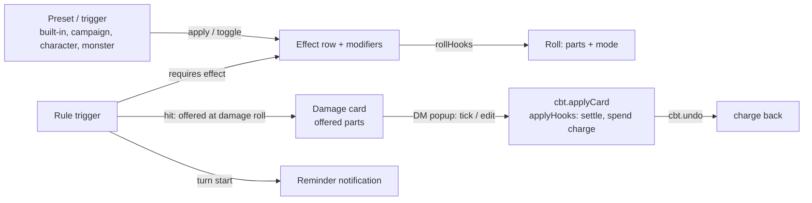
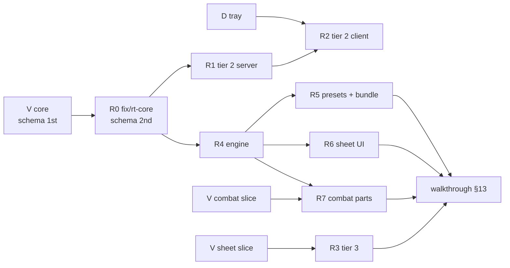

# Effect modifiers

> Five-minute read for §1–§7; §8 onwards is reference. Bullets over prose. See [AGENTS.md](../../AGENTS.md). Builds on [combat-extras](combat-extras.md) (CBTX, effects), [combat-tracker](combat-tracker.md) (CBT, cards, popup, apply, undo) and [character-sheet-full](character-sheet-full.md) (CHARX, sheet sections, features). Sprint 2: tier 1 built (#190, ADR-0038). **Sprint 3 revision** (DM [#203](../decisions-log.md), track R of [sprint-3](../agents/sprint-3.md)): tiers 2 and 3 in scope, plus **rule triggers** ([proposed ADR](../architecture/adr/proposed-rule-triggers.md)). Sprint-3 FRs: FR-MOD-32–52; changed: FR-MOD-01, -05, -12, -13, -14, -17, -18, -19, -24–28, -31.

## 1. Summary

- CBTX **effects** carry typed **modifiers**: bonus dice (Bless +1d4), flat bonuses (+2 damage), advantage / disadvantage, resistance / vulnerability / immunity, AC bonus. Applied by the server as roll-time riders through the `rollHooks` registry; lines name them ("+ 3 Bless"). *(Tier 1 built; tiers 2–3 sprint 3.)*
- **Presets** (Bless, Rage, …) ship as code data; the DM customises them; a player keeps character presets as **toggles**, optionally spending a sheet feature use (tier 3).
- **Rule triggers** (sprint 3): conditional riders as **data**, not code (ADR-0007). A trigger = owner + **requires** (an active effect) + **event** (hit, roll, turn start) + **filters** + **frequency** (each / once per turn / round / encounter / a feature's uses) + **effect** (a damage part, a roll part or mode, a reminder) with a small **formula** language (class level, proficiency, ability mods).
- Reference case, **Divine Fury** (Zealot barbarian): while Rage is on, the first creature Brakka hits on each of her turns with a weapon takes `1d6 + floor(level(barbarian) / 2)` radiant. The d6 is rolled with her damage and **offered** on the card; the DM's apply lands it on the first hit target and spends the turn's charge; Undo gives the charge back.
- Target-side facts (AC, resistances) and trigger parts never change HP by themselves: they **preset** the DM's attack popup; only the DM applies (#134, #136).



## 2. Scope

**Sprint 3 (#203): everything below is in scope.** Tier 1 is built (#190). The DM may cut by slice (§14.2, OQ-MOD-29).

- **Tier 1** *(built)*: `dice`, `flat` on attack, damage, save, check, initiative; effect rows carry them; presets (built-in, campaign, character); DM apply; owner toggles; server applies to every creature roll; lines; sheet tab **Active effects**.
- **Tier 2**: kinds `mode`, `defense`, flat `ac`; built-ins' tier-2 parts (Rage advantage + resistances, Shield of Faith, Reckless Attack, Dodge); mode known **before** the d20 is rolled; roll-control preview with one box per bonus die on top of dice-extras' **tray**; popup uses effective AC and presets the multiplier.
- **Tier 3**: a character preset spends a sheet feature use ("Rage 3 / long rest").
- **Rule triggers**: `rule-trigger` records on characters and monster definitions; events `hit`, `roll`, `turnStart`; formula grammar; once-per-window counters that Undo and Prev respect; six built-in trigger presets; offered parts on cards; DM override in the popup; reminders.
- "Start concentration" in the apply dialog (#190) stays as built.

## 3. Goals

- Bless, Rage, Shield of Faith, **Divine Fury** and **Sneak Attack** run without arithmetic: the right number lands in the roll or the apply, and everyone sees why.
- The server decides: modifiers and trigger parts come from committed rows at commit, never from the client ([ADR-0005](../architecture/adr/0005-server-authoritative-sync.md)). No post-commit writes ([ADR-0035](../architecture/adr/0035-combat-rule-hooks.md)).
- Once per turn means once: a second hit that turn gets no Divine Fury; Undo of the apply gives the charge back; Next starts a fresh turn; Prev returns to the old turn with its uses intact.
- The DM confirms every hit, multiplier and trigger part, and can force or drop one.
- No monster modifier, monster trigger name (unless the DM made it public), AC, secret effect, hidden creature or trigger bookkeeping reaches a player.
- Hard kill at any point → restart → effects, toggles, uses, offered parts, charges and lines intact.

## 4. Non-goals

- A rules engine with class or spell data: triggers are entered by the DM / owner or started from a preset; no automatic triggers from class levels or spells ([levelling](post-mvp/levelling.md), [compendium](post-mvp/compendium.md) may feed presets later, OQ-MOD-35).
- User code, scripts or plugins (ADR-0007): the formula grammar (§8.5) is a fixed whitelist.
- Changing derived values or overrides: modifiers and trigger parts are riders; an [ADR-0036](../architecture/adr/0036-full-sheet-derivation.md) override still decides the base.
- Automatic apply: resistances and trigger parts preset the DM's popup; damage is applied by the DM ([FR-CBT-34](combat-tracker.md#6-functional-requirements)).
- "Attacks against it have advantage"; post-roll choices (rerolls, Lucky, Uncanny Dodge); positional checks ("an ally within 5 ft"), weapon properties, creature types: the DM confirms them (`ask`, §6.3).
- Undo of MOD commands (apply, toggle, edit, put / delete trigger): corrected by the inverse. Rest buttons (OQ-CHARX-08).
- Modifiers or triggers on the free roll bar (`dice.roll`), on NPC-sheet definition rolls and on rolls that create combatants. Hit triggers out of combat (no hit without an apply).
- A live per-turn "charge left" indicator for players (later; the DM's popup shows it).

## 5. User stories

- **DM:** As the DM, I want my Baned goblin's attack to subtract the d4 by itself, and the popup to preset "Half" when Brakka is raging and the hit is slashing, so that I only confirm.
- **DM:** As the DM, I want Brakka's first hit each turn to carry "+ 6 radiant Divine Fury" in my popup, already ticked, and nothing on her second hit, so that I don't track who already used what.
- **DM:** As the DM, I want my hobgoblin's Martial Advantage offered on its card, unticked with "Check: an ally within 5 ft", so that I tick it when the positions fit.
- **Player:** As Brakka's player, I want a Rage switch showing 3 / 3 uses that also arms Divine Fury, so that raging is one click and the extra damage takes care of itself.
- **Player:** As Thorn's player, I want Sneak Attack offered whenever I attack with advantage, so that I never forget 3d6.

## 6. Functional requirements

All commands: rows + event-log entry + domain event in one transaction; IDs, time from `ctx`, dice from `ctx.dice` ([AGENTS §9.3](../../AGENTS.md#93-fixtures)). Failure → no change, event or log entry. **Creature** = a character (PC) or a monster combatant. Target ref as CBTX: `{combatantId}` \| `{characterId}`. Last column: slice / tier (§14.2). "T" = rule triggers.

| ID | Requirement | Tier |
|---|---|---|
| **Model** | | |
| FR-MOD-01 | **Modifier** = one typed entry (zod, `@shared/effect-modifiers/schemas.ts`), §8.1: `dice` (signed `NdM`, N 1–4, M ∈ 4/6/8/10/12, on a roll selector), `flat` (int −10…10 ≠ 0, on a roll selector or on `ac`), `mode` (advantage \| disadvantage, on a roll selector), `defense` (resistance \| vulnerability \| immunity, 1–13 damage types). ≤ 6 per effect or preset. `BUILT_TIER` gates kinds: a kind above it → `invalid`. *(Sprint 3: tier 2 sets `BUILT_TIER = 2`; tier 3 adds no kind.)* | 1, 2 |
| FR-MOD-02 | **Roll selector** `{roll: attack \| damage \| save \| check \| initiative, abilities?, via?}`. `abilities` (save, check only): matches a save / check of one of them; absent = every one. `via` (attack, damage only): `weapon` = attack rows (PC sheet and monster), `spell` = spell rows; absent = both. A skill check is a `check` of its ability. A death save is a `save` with no ability: only selectors without `abilities` match it. A concentration save is a `con` save. Healing rolls are never `damage`. Pure `matches(selector, rollSubject)` in `@shared`. | 1 |
| FR-MOD-03 | **Effect rows carry modifiers** (amends [FR-CBTX-03](combat-extras.md#6-functional-requirements)): `effect` gains `modifiers` (default `[]`) and `presetKey` (text \| null). Only `custom` effects carry modifiers; conditions and concentration rows never do (`invalid`). Every CBTX rule (expiry, Prev restore, undo restore, concentration end, End, hidden copy) moves the row, so its modifiers follow with no extra code. | 1 |
| FR-MOD-04 | **Active modifiers of a creature** = modifiers of its active effects (`endedAt` null): a PC → effects with `targetCharacterId` = the character (in or out of combat); a monster → effects with `targetCombatantId` = the combatant. Ordered by effect `seq`, then index ([FR-DICE-25](dice-roll-log.md#6-functional-requirements)). Pure `activeMods(effects, creature)` in `@shared`. | 1 |
| **Presets** | | |
| FR-MOD-05 | **Built-in presets**: code data in `@shared/effect-modifiers/presets.ts` (§8.3), own words, no rules text ([ADR-0018](../architecture/adr/0018-global-imported-content.md)): `{key, name, modifiers [{tier, modifier}], durationRounds?, concentration, note}`. **Tier-tagged**: a build ships each built-in with only the parts of the tiers it has built; a built-in with no part left is hidden. *(Sprint 3, pick OQ-MOD-27: `hunters-mark` becomes a **mark** with no modifiers, applied to the hunted creature with the ranger as source; the ranger's `hunters-mark` trigger adds the d6, FR-MOD-46. Marks are the only presets with 0 modifiers.)* Never stored, never sent. | 1, 2, T |
| FR-MOD-06 | **Campaign presets** (DM): `mod.putPreset {preset}` with `characterId` null; no `id` → create, with `id` → replace. A row whose `key` = a built-in key **customises** it; `mod.deletePreset` on it = back to the built-in (OQ-MOD-12). ≤ 40 per campaign (`conflict`). `EffectPresetSaved` / `EffectPresetDeleted`. | 1 |
| FR-MOD-07 | **Character presets**: `characterId` set; DM, or the owner while the sheet is not locked ([FR-CHARX-12](character-sheet-full.md#6-functional-requirements), `forbidden` "Locked by the DM"); ≤ 6 per character. "Start from" copies a built-in or campaign preset into the form. `ownerPlayerId` is a copy kept by MOD's definition-changed hook line ([FR-ENT-19](entities.md#6-functional-requirements)). | 1 |
| FR-MOD-08 | **Copy, not link**: applying or toggling copies the preset's modifiers into the effect row. `mod.setModifiers {effectId, modifiers}` (DM) edits an active `custom` effect's modifiers. `EffectModifiersSet`. | 1 |
| **Applying and toggling** | | |
| FR-MOD-09 | `mod.apply {targets [ref] 1–20, preset: {key} \| {presetId}, sourceCombatantId?, durationRounds? 1–100 \| null, linkConcentration?, startConcentration?, secret?}` (DM): per target one `custom` effect, label = preset name, `modifiers` copy, `presetKey` = the built-in key (also when customised), else the preset id, through CBTX's `checkLimits` / `insertEffect`. Duration per [FR-CBTX-05](combat-extras.md#6-functional-requirements) (dropped out of combat). Same `presetKey` already active → skipped. Character presets can't be applied to another creature (`invalid`). `PresetApplied`. | 1 |
| FR-MOD-10 | **Concentration**: `linkConcentration` links as FR-CBTX-10; `startConcentration: true` first sets the source's concentration (an active one ends `replaced`), then links, one transaction. | 1 |
| FR-MOD-11 | **Toggle**: `mod.toggle {characterId, presetId, on, force?}` (DM; owner) on a character preset. On: as FR-MOD-09, target = the character; `activeEffectId` = the new effect. Toggle state = `activeEffectId` names an active effect. Same state → success, no event. Off: ends that effect (`removed`). `EffectToggled {characterId, presetId, on, effectId}`. | 1 |
| FR-MOD-12 | **Uses**: a character preset may name `usesFeatureId` = a row of the character's sheet `features` with `usesMax` (CHARX §8.2). Toggle on spends one use through CHARX's `spendFeatureUse(env, characterId, rowId)` in the same transaction; none left → `conflict` "No Rage uses left". DM `force: true` → on without spending. Off never refunds. Uses reset only by the Features tab's Reset (no rest buttons). Row deleted or `usesMax` cleared → toggles without uses; the section says "Uses link broken". The preset form offers the character's feature rows with uses. | 3 |
| **Rolls** | | |
| FR-MOD-13 | **Roll seam** (OQ-MOD-08): `dice.evaluate` takes an optional `subject {creature, roll, ability?, via?, crit?, card?}` and runs the append-only `rollHooks` registry in the caller's transaction. *(Sprint 3, amends:)* a hook may also export **`modes(env, subject)`**, run **before** the base roll (tier 2, FR-MOD-17), and its `adjust` result may carry **`offered`** parts (T, FR-MOD-37) that are rolled but not added to the total. `card: true` = this damage roll belongs to a damage card (`cbt.attack`, `cbt.rollDamage`). No subject → as today. A hook error rolls back the command. | 1, 2, T |
| FR-MOD-14 | **MOD's hook**: active modifiers whose selector matches → parts (`dice` via `rollExtra`, doubled count on a crit's damage; `flat` value); tier 2: `mode` → `modes()`. **T:** the owner's enabled `roll` triggers add parts / modes (FR-MOD-43); on a `card` damage subject, the attacker's `hit` triggers are **offered** (FR-MOD-37). Result `{parts, modes, offered}`; every part's and offer's `rollId` goes into the caller's `rollIds`. | 1, 2, T |
| FR-MOD-15 | **Callers pass a subject**: `char.roll` (per kind; `toHit` / `spellToHit` → `attack`; `damage` / `spellDamage` → `damage`; `attack` / `spellAttack` → both), `cbt.attack` (`card: true` on its damage), `cbt.rollDamage` (`card: true`; `crit` from the card's natural 20), `cbt.rollAbility`, `cbt.rollInitiative`, `cbtx.rollConcentration` (`save`, `con`), `cbtx.rollDeathSave` (`save`). A PC combatant's subject is its character. **No subject:** `dice.roll`, definition rolls, the initiative / HP rolls of `cbt.start` and `cbtx.addCombatants`. | 1, T |
| FR-MOD-16 | **Totals**: outcome total = base + `modTotal` everywhere a total counts (card totals and hit preset, initiative, concentration vs DC, death save ≥ 10; naturals read the base d20 only). Rolled = base + `modTotal`; part rows are parts, never base; "DM set" only when the final differs. Partial cards: each part takes the mods active at its own commit. **Offered trigger parts are not in the card total** (they land per target at apply, FR-MOD-38). | 1, T |
| FR-MOD-17 | **Mode**: before the d20 is rolled, `dice.evaluate` asks every hook's `modes()`; final mode = the roller's mode (Shift / Ctrl) combined with every hint: any advantage and any disadvantage → normal; else the one present (5e). FR-DICE-04's rewrite then rolls two d20s. Physical: a manual entry whose d20 count doesn't fit the final mode → `conflict` "Effects changed — roll again". | 2 |
| FR-MOD-18 | **Physical dice**: tier 1 — the base roll is manual; bonus dice and offered trigger dice are rolled by the server, tagged `auto` ("+ 3 Bless (rolled for you)"). Tier 2 — the roll control (dice-extras' tray, OQ-MOD-34) asks one labelled group per bonus die and per offered trigger die, sent as `manualParts [{key, entry}]` (`key` = `e:<effectId>` \| `t:<triggerId>`; replaces the spec's `manualMods`); a group set that doesn't match the committed parts → `conflict` "Effects changed — roll again". | 1, 2, T |
| **Lines and visibility** | | |
| FR-MOD-19 | **Payload**: a roll payload item and the card's to-hit / damage parts carry optional `mods [{label \| null, value, expression?, auto?, rollId?}]` and `modes [label \| null]`; `total` includes them. **T:** the card's damage part gains `triggers [{triggerId, label, value, expression, rollId, type \| null, auto?}]` ≤ 4 (offered, not in `total`; the card's audience is the owner or the DM, so the label is always the trigger's name); a line part gains optional `type`. A part's label in **public lines** is public iff its effect is player-visible (FR-MOD-21) or its trigger is `public` (FR-MOD-47), else null "(DM)". `dmPayload.mods` names every part. Old rows parse without. | 1, T |
| FR-MOD-20 | **Line format** (`modSegments` in `@shared/effect-modifiers/line.ts`): "+ 3 Bless" / "− 2 Bane"; null label "(DM)"; modes "(adv: Rage)". Death saves keep their outcome after the total. **T:** a typed trigger part reads "+ 6 radiant (Divine Fury)"; an outcome line: "Brakka attacks Goblin: 17 — hit! 12 slashing + 6 radiant damage (Divine Fury)". | 1, T |
| FR-MOD-21 | **`effect` visibility** (amends FR-CBTX-31): DM full. Player: iff `targetCharacterId` ≠ null, `modifiers` and `presetKey` (built-in keys only) as today. | 1 |
| FR-MOD-22 | **`effect-preset` visibility**: DM full; player: rows with `ownerPlayerId` = the connection's player. | 1 |
| FR-MOD-23 | **Hidden and secret**: a hidden creature's rolls stay DM-only; a secret or hidden effect's part shows "(DM)"; monster AC and defense facts live only in `dmPayload` (#138). | 1 |
| **Target side** | | |
| FR-MOD-24 | **Effective AC** = stored AC + Σ `flat` on `ac` of the target's active effects. Popup shows "AC 17 (15 + 2 Shield of Faith)" and presets Hit vs it; `cbt.applyCard` (through MOD's `applyHooks` line, FR-MOD-38) writes the effective value to `targetAc` and the parts to `dmPayload.acMods`. Players never get AC. | 2 |
| FR-MOD-25 | **Defense preset**: for the card's `damageType`, the popup presets each target row's multiplier: immunity → None, resistance → Half, vulnerability → Double, both → Normal; hint "Half (Rage)". **T:** a typed trigger part gets its own multiplier preset from its `type` (radiant on a raging barbarian → Normal while the slashing row is Half); an untyped part follows its row. The DM can change any; the server applies the DM's choice; `dmPayload.defense {level, label}`. | 2, T |
| **Client** | | |
| FR-MOD-26 | **Sheet section** `mod.effects` (CHARX registry, tab **Active effects**, `order: 10`, `kinds: ["character"]`): **Active** (every active effect, rounds left, parts in words), **Toggles** (switches; tier 3: uses left "2 / 3"), **Presets** (owner unless locked, DM), "Effective AC 17" (tier 2), **Triggers** (T, FR-MOD-49). | 1, 2, 3, T |
| FR-MOD-27 | **Roll-control preview**: `useRollControl` gains optional `subject`; from the store it computes the final mode (tier 2), one manual group per bonus die and per trigger that would be offered, and lists "Bless +1d4 · Divine Fury 1d6+2 (on a hit)" in the Tooltip. Built on dice-extras' tray (OQ-MOD-34); callers pass `subject`. | 2, T |
| FR-MOD-28 | **DM entry points**: token menu **Apply effect ▸**, **Effect modifiers…** (as built) and **Rule triggers…** (T: a monster token → its definition's triggers; a PC token → that sheet's Triggers block); Creatures window `creatureActions` **Rule triggers…** (any monster definition). No new window. | 1, T |
| FR-MOD-29 | Controls disabled unless `live`; one intent in flight per control; lost in-flight intent → Toast "Connection lost — check effects before trying again"; reject → Toast. | 1 |
| **Robustness** | | |
| FR-MOD-30 | One transaction per command: effect rows, concentration, spent use, preset rows, rolls, offered parts, trigger uses, log entry, event-log row. No MOD state in server memory. | 1, T |
| FR-MOD-31 | Fixtures and bundles `effect-modifiers` and **`rule-triggers`** per §13; `fixtures:reset-load <bundle>` works from empty and is deterministic. | 1, T |
| **Rule triggers** (T) | | |
| FR-MOD-32 | **Rule trigger** = one `rule-trigger` row (§8.4) owned by a **character** (`characterId`) or a **monster definition** used in this campaign (`definitionId`, imported or custom): `name` 1–40, `enabled`, `public`, `rule`. Caps: ≤ 6 per character, ≤ 4 per definition, ≤ 40 per campaign (`conflict`; CON-44, §12). Data read by built-in code; no user code (ADR-0007). | T |
| FR-MOD-33 | **Rule** (strict zod JSON leaf, §8.4): `on` (event) + `requires?` + `when` (0–6 filters) + `every` (frequency) + `then` (effect). Only the combinations in §8.4's table parse; others → `invalid` naming the field. | T |
| FR-MOD-34 | **Formula** (§8.5): a hand-rolled parser + evaluator in `@shared/effect-modifiers/formula.ts`, pure, no dependency (pick OQ-MOD-21). Parsed at save (`invalid` "Unknown name ‘foo’ at 7"); evaluated when the trigger fires against the owner (FR-MOD-35) to a dice expression of FR-DICE-01 ("2d6+3"). | T |
| FR-MOD-35 | **Owner context**: character → `level` (Σ class levels), `level(<class>)` (case-insensitive match on `classes[].name`, else the legacy `className`; none → 0), `prof` (CHARX `proficiencyBonus`, override honoured), `str`…`cha` (ability modifiers). Definition → `cr` (rounded down), `prof` (by CR, FR-ENT-24), ability modifiers, `level` = 0. Missing scores → 0. | T |
| FR-MOD-36 | **Requires**: `requires.preset` = a built-in key or a preset id; met iff the owner has an active effect with that `presetKey` (a toggled character preset's effects carry the preset id, FR-MOD-11). Checked when the trigger fires; a part already offered or rolled stays (a rolled fact, like FR-MOD-16). | T |
| FR-MOD-37 | **`hit`: offered at the damage roll**. On a damage subject with `card: true`, MOD's hook takes the attacker's enabled `hit` triggers (a PC → its character's; a monster → its definition's) whose requires, **owner-side** filters (`via`, `ownTurn`, `crit`, hard `mode`) and frequency (window free, FR-MOD-42) pass; each is rolled via `rollExtra` (dice doubled when `crit`), added to the card's `damage.triggers` and recorded as a server-only `trigger_use` row `offered` (window = the encounter's turn at this commit). Not added to the damage total. > 4 → the rest are skipped (DM line notes "+ N triggers skipped"). | T |
| FR-MOD-38 | **Settled at apply**: `cbt.applyCard` runs the append-only **`applyHooks`** registry (new, combat-tracker, §9) per target before `hpRules.apply`. MOD's line reads the DM's assignment `targets[].triggers? [{triggerId, value?, multiplier?, force?}]` (each offered part on at most one target, that target `hit: true`, else `invalid`): the part's damage = floor((value ?? rolled) × (multiplier ?? row multiplier)); the target's `raw` = weapon raw + Σ its parts, one `hpRules.apply`. Each assigned `offered` row → `used` (+ target, `hpChangeId`); `every.feature` spends a use. A part whose window already has another `used` row, or whose feature has no use left → `conflict` "Divine Fury was already used this turn" unless `force: true` (recorded `forced`; DM line "DM ruled"). Unassigned offers stay `offered`. hp_change gains `triggerParts` (§8.2). | T |
| FR-MOD-39 | **Popup preview** (DM client, pure `settleTriggers(card, targets, triggers, store)` in `@shared`): each offered part sits as a chip on its **default target** = the first row (list order) marked Hit whose **target-side** filters pass (`targetMarked`: an active effect on it with that `presetKey` and `sourceCombatantId` = the owner's combatant; `targetHurt`: HP below max). Ticked iff a default target exists and (no soft filter, or any soft filter holds). Chip: "+ 6 radiant Divine Fury", tick, value edit, own multiplier (FR-MOD-25), target Select (other Hit rows), hints "Check: an ally within 5 ft", "No target passes", "Used this turn" (from a conflict). Apply sends the ticked chips. | T |
| FR-MOD-40 | **DM override**: untick → not applied, stays offered; value edit → DM line "+ 9 Martial Advantage (DM set; rolled 7)"; a `conflict` from FR-MOD-38 marks the chip "Used this turn" with a **Force** tick; forcing records `forced` and spends nothing new. Players see the result only (the value in the outcome line, label per FR-MOD-47). | T |
| FR-MOD-41 | **Undo** (amends [FR-CBT-35](combat-tracker.md#6-functional-requirements), [FR-CBTX-22](combat-extras.md#6-functional-requirements)): `cbt.undo` runs `applyHooks.revert` per undone row: its `used` trigger rows → `offered` (target, `hpChangeId` cleared), feature uses refunded via CHARX `refundFeatureUse`. The reopened card offers the part again; the charge is free again. Same transaction, before `NotificationReopened`. | T |
| FR-MOD-42 | **Windows, no reset writes** (pick OQ-MOD-22): `every` = `each` \| `turn` \| `round` \| `encounter` \| `{feature: rowId}`. Window key of a use: `t:<round>:<turnCombatantId>` / `r:<round>` / `e` within its encounter, per owner combatant. A charge is free iff no `used` row has the same trigger, owner combatant, encounter and key. **Next** and a new round make a new key (the "reset" is implicit, nothing written); **Prev** returns to the earlier turn's key with its uses intact; **Undo** flips the row (FR-MOD-41); **End** closes the encounter's keys. `feature` spends a CHARX use instead (reset by the Features tab's Reset). | T |
| FR-MOD-43 | **`roll`**: the owner's enabled `roll` triggers whose `roll` filter matches the subject (FR-MOD-02) add a **part** (formula, rolled like a `dice` modifier) or a **mode** (tier 2) to that roll, through MOD's hook, in the rolling command's transaction. `each` works anywhere; `turn` / `round` / `encounter` only while the owner is an active combatant of the started encounter (else no part); the use is `used` at once. Not undoable (rolls are facts). A `roll` part hits every target of that roll; a `hit` part one creature. | T |
| FR-MOD-44 | **`turnStart`**: MOD's `combatRuleHooks` line, `turnChanged` on **Next** only: for the new turn combatant's enabled `turnStart` triggers (requires, frequency) → `notify` kind `mod-trigger` (info, no action), text "Troll: Regeneration — regain 10 HP unless it took acid or fire damage" (formula value interpolated). Audience: monster → `dm`; PC → its owner (`dm` if none or hidden from them, #141). Never state changes (ADR-0016). | T |
| FR-MOD-45 | **Authoring**: `mod.putTrigger {trigger}` (no `id` → create; with `id` → replace) / `mod.deleteTrigger {triggerId}`. Character triggers: DM, or the owner while unlocked (pick OQ-MOD-23); definition triggers: DM. Validation: FR-MOD-33/34; `requires.preset` = a built-in key, a campaign preset id or that character's preset id; `every.feature` = that character's feature row with `usesMax`. `RuleTriggerSaved` / `RuleTriggerDeleted`. | T |
| FR-MOD-46 | **Built-in trigger presets** (`@shared/effect-modifiers/trigger-presets.ts`, code, own words, §8.6; pick OQ-MOD-24): Divine Fury, Sneak Attack, Hunter's Mark, Colossus Slayer, Martial Advantage, Regeneration. "Start from" copies one into the editor; owner-specific fields (requires, feature) are preselected by name ("Rage") and must be confirmed. Never stored, never sent. | T |
| FR-MOD-47 | **Visibility**: `rule-trigger` DM full; a player gets rows with `ownerPlayerId` = theirs (own characters'); definition triggers DM only; `ownerPlayerId` copy kept by MOD's definition-changed hook line (as FR-MOD-07). `trigger_use` rows are **server-only**: never a record type, never sent (popup data rides on the card). A trigger part's label in public lines: shown iff the trigger's `public` (default on for character triggers, off for definition triggers; pick OQ-MOD-26), else "(DM)"; values are public like any roll part (#190). | T |
| FR-MOD-48 | **Card text and stats**: card text adds offered parts "Brakka: 17 to hit, 12 slashing (+ 6 radiant Divine Fury on a hit)"; resolution per target `applied` includes parts; hp_change `triggerParts [{triggerId, name, value, multiplier, type, forced}]` (DM, stats #54). | T |
| FR-MOD-49 | **Triggers block** (in `mod.effects`): one row per trigger of the character: name, sentence ("Once per turn, on a weapon hit on your turn, while Rage is on: 1d6 + 2 radiant"), formula now ("= 1d6+2"), enabled Switch, "Uses link broken" / "Requires a missing preset" warnings. Owner unless locked, DM: New, Start from ▸, Edit, Delete. | T |
| FR-MOD-50 | **Trigger editor** (Dialog; also from FR-MOD-28 for definitions): event Select; requires Select (the owner's presets + built-ins + campaign presets); filter rows (kinds valid for the event); frequency Select (feature rows with uses for `feature`); effect: formula input with inline parse errors and live value for this owner, damage type Select, reminder text; public Switch; sentence preview. Kinds or events of unbuilt slices not offered. | T |
| FR-MOD-51 | **Crash safety**: offer ⇔ dice rows ⇔ card ⇔ `offered` rows; apply ⇔ HP ⇔ `used` rows ⇔ feature spend ⇔ lines ⇔ hp_change; undo ⇔ HP ⇔ rows back ⇔ refunds ⇔ card reopened; each all or nothing. Restart → identical snapshots and state digest. | T |
| FR-MOD-52 | **Determinism**: trigger evaluation order = owner's triggers by `seq`; offered parts in that order; window keys and formula results depend only on committed rows; seeded `ctx.dice` in tests and fixtures. | T |

### 6.1 Reference case: Divine Fury, end to end

```mermaid
sequenceDiagram
  participant B as Brakka's player
  participant S as Server
  participant D as DM popup
  B->>S: mod.toggle Rage on (spends 1 of 3 uses)
  B->>S: Attack + damage (cbt.attack)
  S->>S: rollHooks: Rage +2 part; Divine Fury requires Rage ✓, via weapon ✓, own turn ✓, window t:2:brakka free ✓ → roll 1d6 (+2), offered row
  S-->>D: card "17 to hit, 12 slashing (+ 6 radiant Divine Fury on a hit)"
  D->>S: applyCard Goblin hit, triggers [Divine Fury]
  S->>S: applyHooks: Goblin raw 12 + 6, offered → used, hpRules.apply 18
  B->>S: second attack, same turn
  S->>S: window t:2:brakka used → nothing offered
  D->>S: Undo (first apply)
  S->>S: used → offered; card reopened with the part
```

### 6.2 Presets in the model (§8.6 has the data)

| Preset | Event | Requires | Filters | Every | Effect |
|---|---|---|---|---|---|
| **Divine Fury** (Zealot) | hit | Rage | via weapon, own turn | turn | `1d6 + floor(level(barbarian) / 2)` radiant |
| **Sneak Attack** | hit | — | via weapon; mode ∈ {normal, adv}; soft: adv; ask "finesse or ranged; or an ally within 5 ft of the target" | turn | `(ceil(level(rogue) / 2))d6`, weapon type |
| **Hunter's Mark** | hit | — | via weapon; target marked `hunters-mark` by you | each | `1d6`, weapon type |
| **Colossus Slayer** | hit | — | via weapon; target hurt | turn | `1d8`, weapon type |
| **Martial Advantage** (monster) | hit | — | via weapon; ask "an ally within 5 ft of the target" | turn | `2d6`, weapon type |
| **Regeneration** (monster) | turnStart | — | — | each | remind "regain {10} HP unless it took acid or fire damage" |

### 6.3 What the model can't express (DM confirms with `ask`, a reminder, or by hand)

- **Positions and weapon properties**: allies within 5 ft, flanking, range, finesse / heavy (no position reasoning; attack rows have no properties, OQ-MOD-18) → `ask`.
- **Target facts the server doesn't hold**: creature type (Divine Smite vs undead, Favored Enemy), size, conditions on the target other than marks → `ask`.
- **Choices and rerolls after the roll**: Lucky, Great Weapon Fighting, Bardic Inspiration added after seeing the roll, Shield, Uncanny Dodge.
- **Effects other than parts / modes / reminders**: healing (Regeneration is a reminder), conditions or saves on hit (Stunning Strike, Trip Attack), spell-slot scaling (Divine Smite), resource choices (superiority dice).
- **Events not modelled**: taking damage (Relentless Rage, Hellish Rebuke), being attacked, end of turn, a creature dropping to 0.
- "First creature hit" across several cards in one turn is first **applied**, not first rolled; on one card, first Hit row in list order.

## 7. UI/UX notes

Per [visual-direction](../design/visual-direction.md): shadcn defaults, dark, dense; lucide icons; no custom styling. No new window ([play-shell](play-shell.md) unchanged).

- **Sheet, Active effects tab** (320 px): blocks Active, Toggles (tier 3 "2 / 3" after the name), Presets, **Triggers** (T), each collapsible. Trigger row: Switch + name, muted sentence under it, "= 1d6+2" Badge.
- **Modifier editor** (Dialog, presets and effects): kind / roll / ability / via / value rows, ≤ 6; kinds of unbuilt tiers not offered; sentence preview.
- **Trigger editor** (Dialog, ~480 px): sections **When** (event, requires), **Only if** (filter rows: Select + its fields, "soft" Checkbox where allowed), **How often** (frequency), **Then** (effect fields; formula Input monospace with an error line and "Brakka now: 1d6+2"), **Shown to players** Switch; sentence preview at the bottom; Save / Cancel.
- **Card and toast**: offered parts after the damage, muted: "(+ 6 radiant Divine Fury on a hit)".
- **Popup**: under each target row, chips for the parts assigned to it (Badge-style, tick + value Input + small multiplier ToggleGroup + target Select in a Popover); amber hint text for soft / ask; "Used this turn" + Force Checkbox after a conflict. Tier 2: AC cell "17" with a "+2" marker and Tooltip; multiplier hint "Half (Rage)".
- **Roll lines**: parts after the constant, labels muted; trigger parts typed "+ 6 radiant (Divine Fury)".
- **Roll control / tray** (tier 2, OQ-MOD-34): two d20s shown when the preview mode is adv / dis; one labelled group per bonus or trigger die; Tooltip lists the parts.
- **DM view**: everything for any PC; monster triggers via token menu / Creatures. **Player view**: own sheet's tab incl. own triggers; own cards' offered parts; public lines only.
- **States**: empty "No triggers yet — New or Start from a preset"; locked: presets and triggers read-only, toggles and switches work; disconnected: last state, controls disabled; error Toast.
- **Test IDs** (as built, plus): `mod-trigger` (+ `data-record-id`, `data-state` = `on` \| `off`), `mod-trigger-new`, `mod-trigger-from` (+ `data-value` = preset key), `mod-trigger-edit`, `mod-trigger-delete`, `mod-trigger-enabled`, `mod-trigger-value`, `mod-trigger-warning`; `mod-trig-editor-<event|requires|filter|filter-kind|filter-soft|every|feature|formula|formula-error|formula-value|type|text|public|preview|save>`; `mod-card-offer` (+ `data-record-id` = trigger id); `mod-popup-part` (+ `data-record-id` = trigger id, `data-state` = `on` \| `off`), `mod-popup-part-value`, `mod-popup-part-mult`, `mod-popup-part-target`, `mod-popup-part-hint`, `mod-popup-part-force`; `mod-log-part` (+ `data-value` = label or `dm`); `mod-toggle-uses`; `mod-ac`, `mod-popup-ac`, `mod-popup-defense`; `mod-tray-group` (+ `data-value` = part key); `mod-token-menu-triggers`, `mod-creature-triggers`.

### 7.1 Seams

| Seam | Owner | MOD uses | Entry / shape |
|---|---|---|---|
| Effect record | CBTX | `modifiers`, `presetKey`; `sourceCombatantId` read server-side for `targetMarked` | §8.2 |
| Roll pipeline | dice-roll-log | `rollHooks` (built) + `modes()` pre-roll (tier 2) + `offered` + `subject.card` (T) | §9 "Roll hook" |
| **Apply hooks** (new) | combat-tracker | `applyHooks` registry run by `cbt.applyCard` per target and by `cbt.undo` per row (T; tier-2 AC facts too) | §9 "Apply hook" |
| **Popup parts** (new) | combat-tracker (client) | `popupParts` registry: chips under target rows + extra apply input | §9 |
| Combat rule hooks | combat-tracker / CBTX | `turnChanged` line (reminders, FR-MOD-44) | ADR-0035 |
| Notification kind | notifications | `mod-trigger` (info) | protocol §23 |
| Sheet section, feature uses | CHARX | `sheetSections` line (built); `spendFeatureUse`, `refundFeatureUse` | FR-MOD-12, -38, -41 |
| Roll control / tray | dice-roll-log / dice-extras | preview groups, `manualParts` | OQ-MOD-34 |
| Trigger presets from data | compendium | may carry MOD `TriggerRule` (zod) | OQ-MOD-35 |

## 8. Data model

### 8.1 Modifier (JSON leaf, zod only)

| Kind | Fields | Example |
|---|---|---|
| `dice` | `on: RollSel`, `dice: "NdM"`, `sign: 1 \| -1` | Bless `{on: {roll: attack}, dice: "1d4", sign: 1}` |
| `flat` | `on: RollSel \| {roll: "ac"}`, `value` int −10…10 ≠ 0 | Rage `{on: {roll: damage, via: weapon}, value: 2}`; Shield of Faith `{on: {roll: ac}, value: 2}` |
| `mode` | `on: RollSel`, `mode: advantage \| disadvantage` | Rage `{on: {roll: check, abilities: [str]}, mode: advantage}` |
| `defense` | `types: DamageType[] 1–13`, `level: resistance \| vulnerability \| immunity` | Rage `{types: [bludgeoning, piercing, slashing], level: resistance}` |

`RollSel = {roll: attack | damage | save | check | initiative, abilities?, via?}` (FR-MOD-02). Refines ADR-0009 (ADR-0038).

### 8.2 Records

| Entity | Field | Type | Notes |
|---|---|---|---|
| Effect *(CBTX)* | + modifiers, presetKey | **JSON leaf** Modifier[] 0–6; text ≤ 40 \| null | Built |
| Effect preset (`effect-preset`) | as built | | `usesFeatureId` used from tier 3; `modifiers` 0–6 for marks only (FR-MOD-05) |
| **Rule trigger** (`rule-trigger`, table `rule_trigger`) | id, campaignId, seq | ID, ID, int | |
| | characterId, definitionId | ID → Entity (character) \| null, ID → creature definition \| null | Exactly one set |
| | ownerPlayerId | ID \| null | Copy (character triggers), FR-MOD-47 |
| | name | text 1–40 | Part label |
| | enabled, public | bool, bool | `public` default: character true, definition false |
| | rule | **JSON leaf** §8.4 | |
| | updatedAt | timestamp | `ctx.clock` (no `createdAt`: §12) |
| **Trigger use** (table `trigger_use`; **server-only**, no record type) | id, campaignId, encounterId, seq | ID ×3, int | |
| | triggerId, ownerCombatantId | ID, ID | Owner's combatant in that encounter |
| | window | text ≤ 48 | `t:<round>:<turnCombatantId>` \| `r:<round>` \| `e` \| `f` (feature) |
| | state | `offered` \| `used` | |
| | cardId, rollId, part | ID \| null, ID \| null, int \| null | Offer: card + index in `damage.triggers`; `roll` event: its roll |
| | targetId, hpChangeId, value, multiplier, forced | ID \| null ×2, int \| null, text \| null, bool | Set while `used` from an apply |
| | featureId | ID \| null | `every.feature` spent (refunded on undo) |
| | createdAt, updatedAt | timestamp | |
| Damage card payload *(CBT)* | damage + `triggers` | **JSON leaf** ≤ 4 offered parts | FR-MOD-19; within the kind's 4 KB cap (measured §12) |
| `applyCard` input *(CBT)* | targets[] + `triggers?` | `[{triggerId, value?, multiplier?, force?}]` ≤ 4 | FR-MOD-38 |
| Combat log entry *(CBT, `hp_change`)* | + triggerParts | **JSON leaf** ≤ 4, DM | FR-MOD-48; `targetAc` effective + line `dmPayload.acMods`, `defense` (tier 2) |
| Game-log payloads *(DICE / CBT)* | parts + `type?` | **JSON leaf**, optional | FR-MOD-19 |

- **Relations:** Rule trigger → Campaign; → Character (0..1, cascade; characters are never deleted); → creature definition (0..1; cascade on a custom definition's delete; imported definitions are global and stay); `requires` → preset (soft, by key / id); `every.feature` → sheet feature row (soft). Trigger use → trigger (cascade), encounter, combatant, card, hp_change (soft).
- **Derived:** active modifiers, parts per roll, final mode, effective AC, defense presets, toggle state, uses left, built-ins at the built tier, formula value per owner, charge free per window, popup defaults (`settleTriggers`).
- **Persisted runtime state:** effect rows, preset rows, trigger rows, trigger uses, spent feature uses, roll rows, cards. Editor drafts, popup ticks and edits: client memory (lost on reload; the card stays).
- **Constraints:** `rule_trigger` check exactly one of `characterId` / `definitionId`; index (`campaign_id`, `character_id`), (`campaign_id`, `definition_id`); `trigger_use` index (`trigger_id`, `owner_combatant_id`, `encounter_id`, `window`, `state`) and (`card_id`), (`hp_change_id`). Caps in commands.

### 8.3 Built-in presets (FR-MOD-05)

| Key | Name | Modifiers [tier] | Duration | Conc. | Note |
|---|---|---|---|---|---|
| `bless` | Bless | +1d4 attack [1]; +1d4 save [1] | 10 | ✓ | |
| `bane` | Bane | −1d4 attack [1]; −1d4 save [1] | 10 | ✓ | |
| `rage` | Rage | +2 damage (weapon) [1]; adv check + save (STR) [2]; resist bludgeoning, piercing, slashing [2] | 10 | — | Weapon damage includes ranged rows (OQ-MOD-18) |
| `hunters-mark` | Hunter's Mark | +1d6 damage (weapon) [1 only]; **mark** from T (none) | — | ✓ | T: apply to the hunted creature, source = the ranger (OQ-MOD-27) |
| `guidance` | Guidance | +1d4 check [1] | 1 | ✓ | Once: end it after the roll |
| `resistance` | Resistance | +1d4 save [1] | 1 | ✓ | Once: end it after the roll |
| `shield-of-faith` | Shield of Faith | +2 AC [2] | 100 | ✓ | |
| `reckless` | Reckless Attack | adv attack (weapon) [2] | 1 | — | Attacks against you: DM's call |
| `dodge` | Dodge | adv save (DEX) [2] | 1 | — | Attacks against you: DM's call |

### 8.4 Rule (`rule-trigger.rule`, JSON leaf, strict zod in `@shared/effect-modifiers/triggers.ts`)

```ts
type Rule = {
  on: "hit" | "roll" | "turnStart";
  requires?: { preset: string };                 // built-in key or preset id, ≤ 40
  when: Filter[];                                // 0–6
  every: "each" | "turn" | "round" | "encounter" | { feature: string };
  then:
    | { do: "damage"; formula: string; type: DamageType | null }   // hit; null = the attack's type
    | { do: "part"; formula: string }                               // roll
    | { do: "mode"; mode: "advantage" | "disadvantage" }            // roll (tier 2)
    | { do: "remind"; text: string /* 1–120 */; value?: string /* formula */ }; // turnStart
};
type Filter =
  | { if: "via"; via: "weapon" | "spell" }
  | { if: "roll"; on: RollSel }                  // roll: exactly one, required
  | { if: "ownTurn" }                            // the event happens on the owner's turn
  | { if: "crit" }                               // natural-20 card / crit damage
  | { if: "mode"; modes: ("normal" | "advantage" | "disadvantage")[]; soft?: true }
  | { if: "targetMarked"; preset: string }       // target-side (hit)
  | { if: "targetHurt" }                         // target-side (hit): HP < max before this apply
  | { if: "ask"; note: string /* 1–60 */ };      // soft: the DM confirms
```

| Event | Fires | Filters allowed | Effects | Frequency |
|---|---|---|---|---|
| `hit` | offered at a card's damage roll; settled at apply | via, ownTurn, crit, mode (hard / soft), targetMarked, targetHurt, ask | `damage` | any |
| `roll` | the owner's matching roll | roll (required), ownTurn, crit (damage only), mode (hard) | `part`, `mode` (tier 2) | any (FR-MOD-43) |
| `turnStart` | Next makes the owner's combatant the turn | ownTurn implied | `remind` | `each`, `round`, `encounter`, feature |

- **Hard** filters must hold or the trigger doesn't fire. **Soft** filters (`ask`, `mode` with `soft`) only decide the popup's tick: ticked iff any soft filter holds (`ask` never holds by itself; its note is shown).
- `feature` frequency: characters only (`invalid` on a definition).

### 8.5 Formula grammar (FR-MOD-34)

```
formula := sum                        ≤ 60 chars, ≤ 40 tokens, ≤ 3 dice terms
sum     := term (("+" | "-") term)*   the top level: dice terms only here, as addends
term    := dice | product
dice    := (INT | "(" expr ")") "d" ("4" | "6" | "8" | "10" | "12")
expr    := product (("+" | "-") product)*          no dice inside
product := unary (("*" unary) | ("/" INT≥1))*
unary   := "-" unary | atom
atom    := INT | var | call | "(" expr ")"
var     := level | prof | cr | str | dex | con | int | wis | cha
call    := floor(expr) | ceil(expr) | min(expr, expr) | max(expr, expr)
         | steps(expr, INT, …≤4) | level(CLASS)
CLASS   := letters, spaces, hyphens, ≤ 30; case-insensitive
```

- `/` is exact; `floor` / `ceil` round; anything still fractional rounds **down** (5e). `steps(x, 9, 16)` = how many thresholds ≤ x (Rage damage: `2 + steps(level(barbarian), 9, 16)`).
- Evaluates to Σ dice terms + one constant: each count clamped 0–20 (0 drops the term), constant −99…99, then printed as FR-DICE-01 ("2d6+1d8+3"). Crit doubles each count (hit, damage roll).
- Errors at save: unknown name, bad die size, dice inside a product or call, nested dice, `/0`, too long → `invalid` with the position. Identifiers are matched against the fixed list only (no property access, no `constructor` / `__proto__`).
- Examples: `1d6 + floor(level(barbarian) / 2)` → Brakka (Barbarian 5) "1d6+2"; `(ceil(level(rogue) / 2))d6` → Thorn (Rogue 5) "3d6"; `max(1, cha)`.

### 8.6 Built-in trigger presets (FR-MOD-46; own words)

| Key | Name | Rule (abridged §8.4) | Public | Note |
|---|---|---|---|---|
| `divine-fury` | Divine Fury | hit; requires Rage; via weapon, ownTurn; turn; damage `1d6 + floor(level(barbarian) / 2)` radiant | ✓ | Type editable (necrotic). Not in the SRD: name + numbers only (OQ-MOD-24) |
| `sneak-attack` | Sneak Attack | hit; via weapon; mode [normal, advantage]; soft mode [advantage]; ask "finesse or ranged; or an ally within 5 ft"; turn; damage `(ceil(level(rogue) / 2))d6` | ✓ | |
| `hunters-mark` | Hunter's Mark | hit; via weapon; targetMarked `hunters-mark`; each; damage `1d6` | ✓ | Pairs with the mark preset |
| `colossus-slayer` | Colossus Slayer | hit; via weapon; targetHurt; turn; damage `1d8` | ✓ | |
| `martial-advantage` | Martial Advantage | hit; via weapon; ask "an ally within 5 ft of the target"; turn; damage `2d6` | — | Monster (definition) |
| `regeneration` | Regeneration | turnStart; each; remind "regain {value} HP unless it took acid or fire damage", value `10` | — | Monster (definition) |

## 9. API & events

**REST:** none. Preset and trigger edits are WS intents for DM and owner alike (ADR-0036 precedent, OQ-MOD-15).

**WS intents** (strict zod; none optimistic)

| Intent | Who | Validation / ownership | Result |
|---|---|---|---|
| `mod.putPreset {preset}` / `mod.deletePreset {presetId}` | DM; owner (own, unlocked) | FR-MOD-01, -06, -07, -12 | `{presetId}` / — |
| `mod.apply {targets, preset, …}` | DM | FR-MOD-09, -10 | `{effectIds, skipped}` |
| `mod.toggle {characterId, presetId, on, force?}` | DM; owner | FR-MOD-11, -12; player `force` → `forbidden` | `{effectId \| null}` |
| `mod.setModifiers {effectId, modifiers}` | DM | FR-MOD-08 | — |
| `mod.putTrigger {trigger}` | DM; owner (own character, unlocked) | FR-MOD-32–35, -45; player on a definition or another's character → `forbidden` | `{triggerId}` |
| `mod.deleteTrigger {triggerId}` | as above | invisible → `not_found` | — |
| *Amended:* `cbt.applyCard` | DM | + `targets[].triggers?` (FR-MOD-38); conflict per FR-MOD-38 | as today |
| *Amended:* roll intents | as today | tier 2: `manualParts` (FR-MOD-18) | as today |

**Roll hook** (`rollHooks`, built; amended): `RollSubject` + `card?: boolean`; `RollHook` + optional `modes(env, subject) → RollModeHint[]` (pre-roll); `RollHookResult` + `offered: OfferedPart[]` (`{triggerId, label, public, value, expression, rollId, type, auto?}`; the caller puts them on the card, not in the total).

**Apply hook** (new, `src/server/features/combat-tracker/apply-hooks.ts`, **append-only**, created empty by `fix/rt-core`; AGENTS §9.9):

```ts
interface ApplyHook {
  id: string;
  // per target, before hpRules.apply: extra raw, line parts, DM facts (tier 2: acMods, defense)
  beforeTarget(env: CommandEnv, a: { card: DamageCardPayload; cardId: string; target: Combatant; input: ApplyTargetInput; hpChangeId: string }):
    { extraRaw: number; parts: LinePart[]; dm: Record<string, unknown>; changes: RecordChange[] };
  // per undone hp_change row, inside cbt.undo
  revert(env: CommandEnv, row: HpChangeRecord): RecordChange[];
}
export const applyHooks: readonly ApplyHook[] = [/* mod */];
```

**Popup parts** (new client registry, `src/client/dm/features/combat-tracker/popup-parts.ts`, **append-only**, created empty by `fix/rt-core`): `{id, Chips(props: {card, row, rows, store, value, onChange}), toInput(value) → Partial<ApplyTargetInput>}`; the popup renders each line under every target row and merges `toInput` into the apply intent.

**Record types:** `effect` (amended), `effect-preset`, **`rule-trigger`** (new, FR-MOD-47; registers in MOD's `index.ts`). `trigger_use`: none (server-only table).

**Domain events** (all logged; WS = generic record changes; `src/shared/events/effect-modifiers.ts`)

| Event | Changes | Visibility (player) | Undoable |
|---|---|---|---|
| `EffectPresetSaved` / `EffectPresetDeleted {presetId}` | `effect-preset` | owner: upsert / delete | no |
| `PresetApplied`, `EffectToggled`, `EffectModifiersSet` | as built; toggle + `creature-sheet` (use spent, tier 3) | per FR-CBTX-31 + FR-MOD-21; preset + sheet → owner | no |
| `RuleTriggerSaved {triggerId}` / `RuleTriggerDeleted {triggerId}` | `rule-trigger` | owner: upsert / delete; others nothing | no |
| *Existing:* roll events (`CharacterRolled`, `AttackRolled`, `DamageRolled`, …) | + bonus-die and offered-die rows in `rollIds`; payload parts; card `damage.triggers`; `creature-sheet` (feature spent by a `roll` trigger); `trigger_use` rows written (server-only, not in `changes`) | per FR-DICE-15 / FR-MOD-19 / FR-NOTE-06 | as today |
| *Existing:* `AttackApplied` | HP incl. trigger parts; `hp-change.triggerParts`; `creature-sheet` (feature spent); tier 2 `targetAc`, `acMods`, `defense` | unchanged for players (parts per FR-MOD-47) | as today |
| *Existing:* `CombatEntryUndone` | + `creature-sheet` (refund); `trigger_use` back to offered | as today | compensating |
| *Existing:* `TurnChanged` (Next) | + `mod-trigger` `NotificationCreated` after it | FR-NOTE-06 | no |
| *Existing:* owner change | + `effect-preset`, `rule-trigger` owner copies (hook) | old owner deletes, new owner upserts | no |

**Notification kind** `mod-trigger` (append-only kinds + client views): payload `{triggerName, creatureName, encounterId, text}` (player-safe), info (no action, no end rule; rows stay in History).

## 10. Permissions

| Action | DM | Owner player | Other player | Server check |
|---|---|---|---|---|
| Campaign presets; apply; edit effect modifiers | ✓ | ✗ | ✗ | role |
| Character presets: edit, delete | any | own, unless locked | ✗ | ownership + lock |
| Toggle a character preset | ✓ (`force` too) | own | ✗ | ownership |
| Character triggers: edit, delete, enable | any | own, unless locked (pick OQ-MOD-23) | ✗ | ownership + lock |
| Definition (monster) triggers | ✓ | ✗ | ✗ | role |
| Settle trigger parts (tick, edit, force) | ✓ | ✗ (own card shows offers) | ✗ | role (`cbt.applyCard`) |
| See trigger rows | all | own characters' | ✗ | FR-MOD-47 |
| See trigger uses, monster triggers, preset ids, AC, defense presets | ✓ | ✗ | ✗ | server-only / redaction / `dmPayload` |

## 11. Edge cases & failure modes

- **Player disconnect / reconnect:** toggles and editor disabled; a lost intent is not resent (FR-MOD-29); the snapshot shows what committed (triggers, cards with offered parts).
- **DM disconnect / reconnect:** players keep rolling; offers pile up on pending cards; the popup rebuilds its chips from the card + trigger rows + store on open (no client state needed).
- **Server crash:** FR-MOD-51. Between hit and apply: the card is pending with its offered parts and `offered` rows; after restart the DM applies once. A crash inside the apply leaves no `used` row, no HP change.
- **Undo:** FR-MOD-41 restores the charge and feature uses; the reopened card offers the same rolled part (same value). Undo never touches `roll`-event uses (facts) or toggles.
- **Prev / Next:** windows are keys (FR-MOD-42); Prev into a turn where Divine Fury was used keeps it used; a mistaken Next + Prev loses nothing; Next to the owner's next turn makes a fresh key.
- **Two cards in one turn:** both damage rolls happen before either apply → both carry the offer; the first apply uses the charge; the second apply with the part ticked → `conflict` "… already used this turn"; the DM unticks or forces (FR-MOD-40).
- **Requires lost between roll and apply** (Rage ended): the offered part stays and can be applied (it was rolled while raging, FR-MOD-36). The DM can untick it.
- **Miss / all rows Miss / Dismiss / End:** offered parts are not applied; rows stay `offered` (no charge spent); End closes the window.
- **Damage typed in without a damage roll** (to-hit-only card, FR-CBT-72): no offers exist; the DM adds the extra into the total.
- **Crit:** offered dice doubled (5e: extra damage dice double); flat parts don't.
- **Multi-target card:** each offered part lands on one target (default: the first Hit row passing target filters); `roll`-event parts are in the roll, so every target gets them.
- **Owner change / deleted preset / deleted feature row:** owner copies follow (hook); `requires` of a deleted preset never holds (Triggers block warns); a deleted feature row → "Uses link broken", the trigger doesn't fire until edited.
- **Definition triggers on many combatants:** each combatant has its own windows (`ownerCombatantId`).
- **Hidden attacker / target:** lines DM-only as today; trigger labels follow FR-MOD-47 only where a line is public.
- **Concurrent:** owner edits a trigger while the DM locks the sheet → `forbidden`; trigger edited between offer and apply → the offer settles as rolled.
- **Invalid / malicious input:** strict zod; formula whitelist (no names outside §8.5, no property access, length caps); caps; a player can't touch definitions, others' triggers, `force` or the apply.

## 12. Performance & bandwidth

**CON-44, measured** (throwaway probe on the `snapshot-size` realistic-heavy harness, max-length ASCII strings, 2026-10-16; baseline heavy DM **676,039 B** of 786,432 B):

| Added | Rows | DM bytes | Players |
|---|---|---|---|
| Tier 2: every preset 6 max tier-2 modifiers (16 rows) | — | +5,424 | own presets only |
| Tier 2: 12 modifier effects with 2 max tier-2 modifiers (vs tier 1) | — | +1,356 | PC effects |
| Card offered parts (1 max part on each of 30 cards; 163 B/part) | — | +4,880 | own cards |
| Log lines with a trigger part (30 of 100 entries; 164 B/line) | — | +4,928 | public lines |
| `rule-trigger` realistic heavy (2 per PC + 4 definitions; 873 B/row max, 548 B typical) | 16 | +13,961 | +1,777 (own) |
| **R total, realistic heavy** | | **+30,549 → 706,588 B** (79,844 B left) | max 288,786 of 524,288 B |
| `rule-trigger` at the old draft caps (76 rows) | 76 | +65,537 | — |
| `trigger_use` | server-only | **0** (616 B/row in the DB) | 0 |

- Worst card: 6 max mods + 4 max offered parts on the damage part = **2,400 B** ≤ the kind's 4 KB `payloadMaxBytes`.
- **Caps chosen from the measure:** ≤ 40 triggers per campaign (≈ +35 KB worst) → worst R ≈ 727 KB DM. `trigger_use` server-only (100 uses would have cost 62 KB). Rows sent without `createdAt` / notes.
- **The 100 KiB headroom guard** in `snapshot-size.test.ts` (ADR-0041 re-baseline, "fog + SCN headroom") has only **8 KB** left today; R realistic needs 30.5 KB → the guard fails (22.5 KB short), the 768 KiB ceiling holds. OQ-MOD-28.
- Hook cost: one indexed read of the creature's active effects and its triggers (≤ 20 + ≤ 6 rows) per roll; apply: one indexed `trigger_use` read per offered part.

## 13. Test plan

Isolated per worktree ([ADR-0008](../architecture/adr/0008-parallel-dev-isolation.md)): `bun test` on `:memory:`, port 0, seeded `ctx.ids` / `ctx.dice`; walkthrough on the `verify` profile; loop per [ADR-0017](../architecture/adr/0017-agent-verification-fixture-library.md). Tests named after FRs. Manual rolls where totals must be exact.

**Fixtures** (`fixtures/units/effect-modifiers/`; setups run as DM). Existing: `mod-presets`, `mod-bless`, `mod-bane`, `mod-rage` (tier 3: + Thorn's feature row "Rage" uses 2 and `usesFeatureId`; tier 2: `mod-presets` "Frost Ward", `mod-bane` Shield of Faith on Elite). New:

| Key | Requires | Contents |
|---|---|---|
| `char-brakka` | `player-1` | `char.create` (DM) "Brakka", owner `player-1`: classes Barbarian 5 (d12, subclass "Zealot"), STR 18, AC 14, HP 55, init +1; attack "Greataxe" +7 / 1d12+4 slashing; features "Rage" (uses 3, long), "Divine Fury"; token on `battlemap` owned by `player-1` |
| `trg-brakka` | `char-brakka` | Character preset "Rage" from `rage` with `usesFeatureId` → "Rage" (tier 3); trigger "Divine Fury" from `divine-fury`, requires that preset, radiant |
| `trg-thorn` | `char-thorn` | `char.edit` Thorn classes Rogue 5, DEX 16; trigger "Sneak Attack" from `sneak-attack` |
| `trg-monsters` | `combat-1` | Definition triggers: "Martial Advantage" on the Elite's definition (`public` off); "Regeneration" on the Wolf's definition |
| `trg-combat` | `combat-1`, `trg-brakka` | `cbtx.addCombatants` Brakka (binds her token); manual initiative 17 → order Wolf 18, Brakka 17, Mira 15, Goblin 12, Goblin 2 12, Thorn 10, Elite 8; still round 1, Wolf's turn |

- **Bundle `rule-triggers`** = `effect-modifiers` + `char-brakka` + `trg-brakka` + `trg-thorn` + `trg-monsters` + `trg-combat`. `PP_TEST_MODE=1` for the walkthrough. Built tiers decide fixture contents (FR-MOD-05).
- **Leak strings** (player frames): "Martial Advantage", "Regeneration" (DM-only reminders), any `rule-trigger` with `definitionId`, Thorn's trigger in `player-1` frames, Brakka's in `player-2` frames, any `trigger_use` / `ownerCombatantId` / `window` field anywhere, any `triggerParts`; plus the MOD / CBTX lists.

| Level | What | Fixtures |
|---|---|---|
| Unit | `FR-MOD-34 formula grammar`: accepts the §8.5 examples, `steps`, unary minus, whitespace, case; values for Brakka / Thorn / a CR 1/2 monster; **rejects** unknown name (with position), `1d7`, `1d(1d4)`, `2 * 1d6`, `floor(1d6)`, `x / 0`, `/ cha`, `__proto__`, `constructor`, `level.barbarian`, 61 chars, 4 dice terms, 41 tokens; clamps (count > 20, constant ±99, 0 dice dropped); crit doubling. `FR-MOD-33 rule schema`: event × filter × effect table, exactly one `roll` filter on `roll`, `feature` on definitions `invalid`, caps. `FR-MOD-39 settleTriggers`: first Hit row, target filters (`targetMarked` own source vs another's, `targetHurt`), soft tick table (adv / normal / ask only), no Hit row → unticked. `FR-MOD-42 windows`: key per every / turn / round / encounter. `FR-MOD-17` mode combine; `FR-MOD-24/25` effective AC, defense presets incl. per-part type; `FR-MOD-05` built-ins at tiers 1 / 2 / T (Hunter's Mark mark); `FR-MOD-20` typed part segments; `FR-MOD-47` visibility fns (owner / other / definition) | In-code |
| Integration | **`FR-MOD-42 once per turn`**: Brakka raging hits Goblin (offer → apply → used), second card same turn has no offer; two cards rolled before either apply → second apply `conflict`, `force` → `forced`, no second spend. **`FR-MOD-41 undo restores the charge`**: apply → undo → card reopened with the part, re-apply to Goblin 2 lands it; feature-frequency trigger refunds the CHARX use. **Turn-start reset**: Next × 7 to Brakka's next turn → offered again. **Prev**: used in Brakka's turn → Next → Prev → Brakka attacks → no offer; mistaken Next + Prev before attacking → offer. **`FR-MOD-36 requires-effect off`**: Rage off → no offer; Rage ended between roll and apply → part still applies. `FR-MOD-37` crit doubles the d6; `ownTurn` (opportunity attack on Wolf's turn → no Divine Fury; Sneak Attack yes, with its own window). `FR-MOD-38` raw = weapon + parts with multipliers (Half row, radiant part Normal), hp_change `triggerParts`, outcome line; invalid assignment (miss row, unknown trigger) → `invalid`. `FR-MOD-43` `roll` trigger part on `char.roll` out of combat (`each`) and none for `turn` out of combat. `FR-MOD-44` reminder on Next for Wolf (DM), none on Prev. `FR-MOD-45` owner put / delete; locked → `forbidden`; player on a definition → `forbidden`; caps `conflict`. `FR-MOD-47` owner change moves rows. Tier 2: `FR-MOD-17` Rage adv on Athletics (two d20s; manual one d20 → `conflict`); `FR-MOD-18` `manualParts` match / mismatch; `FR-MOD-24` AC + `acMods`; tier 3 `FR-MOD-12` uses 2 → 1 → 0 → `conflict`, `force`. **Crash**: `PP_TEST_CRASH cbt.applyCard:before-commit` / `after-commit` and `cbt.attack:after-commit` → offered / used / HP all or nothing. **Leak scan** per player over the suite. **CON-44**: heavy scenario + §12 rows ≤ 768 KiB (and the guard per OQ-MOD-28) | `rule-triggers` |
| E2E (thin) | DM + `player-1`: Brakka Rage on, Attack + damage → card shows the offer; DM applies to Goblin → line "+ N radiant (Divine Fury)" for both; second attack → no offer | `rule-triggers` |

**Browser walkthrough** — needs CBTX, CHARX sections, notifications, built tiers. `bun run build`; `fixtures:reset-load rule-triggers --profile verify`; `start --profile verify` (test agent's Herdr pane). Contexts **A** DM (`pw-dm`), **B** `player-1` (Mira, Brakka), **C** `player-2` (Thorn); B, C frames logged. Manual (physical) rolls where a number is checked. Evidence + teardown per AGENTS §9.6.

| # | DM (A) | Players (B, C) | Expected |
|---|---|---|---|
| 1 | Open Initiative | B: Brakka's sheet → Active effects; C: Thorn's | B: Triggers "Divine Fury … = 1d6+2", Toggles "Rage 3 / 3" off. C: "Sneak Attack … = 3d6". No leak string; B has no Thorn trigger, C none of Brakka's |
| 2 | Next (Brakka's turn) | B: Rage on | Rage chip for all; "2 / 3" |
| 3 | — | B: Greataxe **Attack + damage**, physical: d20 15, d12 8 | Card "22 to hit, 14 slashing (+ N radiant Divine Fury on a hit)" (14 = 8 + 4 + 2 Rage); offer tagged "rolled for you" |
| 4 | Popup: target Goblin, Hit → chip "+ N radiant Divine Fury" ticked; Apply | — | Goblin −(14 + N); line for A, B, C "… 14 slashing + N radiant damage (Divine Fury)" |
| 5 | Undo | — | Goblin HP back; card pending again with the chip; re-target Goblin 2, Apply → part on Goblin 2 |
| 6 | — | B: second Attack + damage | Card has **no** offer; DM applies to the Wolf → weapon damage only |
| 7 | Next until Brakka's turn in round 2 (downed goblins are skipped) | B: Attack + damage | Offer is back (turn-start reset); DM applies to the Wolf; then DM Next, Prev → B attacks again → no offer (same turn, used) |
| 8 | Elite row → Attack (slashing) vs Brakka | — | Popup: Brakka row preset Half "(Rage)" (tier 2); chip "Martial Advantage" **unticked**, hint "Check: an ally within 5 ft"; DM ticks, edits 7 → 9, Apply. A's line "+ 9 Martial Advantage (DM set; rolled …)"; B, C "+ 9 (DM)" — never "Martial Advantage" |
| 9 | Next to Thorn's turn | C: Shortsword Attack + damage with Shift (adv) | Card offer "Sneak Attack 3d6" → popup chip ticked (adv); Apply to the Wolf → line "(Sneak Attack)". C attacks again without Shift → no offer (used this turn) |
| 10 | Next to the Wolf's turn (round 3) | — | A: a reminder "Wolf: Regeneration — regain 10 HP …" per Wolf turn start since step 7, none after the Prev; B, C frames: none |
| 11 | Next (Brakka's turn, round 3) | B: Rage off; Brakka Attack + damage | No Divine Fury offer (requires off, on her own turn) |
| 12 | Hard-kill between a damage roll with an offer and its apply; restart | All rejoin | Card pending with the offer; apply lands it once; state digest equal before / after restart |
| 13 | End encounter | — | Pending cards dismissed; no leak string; no app console errors |

## 14. Dependencies

| On | What we need | Status |
|---|---|---|
| ADR-0005, 0007, 0009, 0016, 0018, 0021, 0022, 0035, 0036, 0037, 0038; #134, #136, #138, #151, #178, #190, #203 | Authority, no plugins, events, seams, in-tx rules, split attack, modifiers, dice lib removal | accepted |
| [Rule-triggers ADR](../architecture/adr/proposed-rule-triggers.md) | Where triggers run, model, counters, formula | **proposed** (gate 1) |
| [combat-tracker](combat-tracker.md) | Card `damage.triggers`; `applyCard` `targets[].triggers`; `applyHooks` + `popupParts` registries; undo revert; outcome line parts; hp_change `triggerParts` | complete; amendment (OQ-MOD-30) |
| [combat-extras](combat-extras.md) | `turnChanged` line; effect `sourceCombatantId` read; `hpRules.apply` with the summed raw (no change) | complete; amendment (OQ-MOD-31) |
| [character-sheet-full](character-sheet-full.md) | `spendFeatureUse`, `refundFeatureUse`; class names for `level(<class>)` | in revision (V); amendment (OQ-MOD-32) |
| [dice-roll-log](dice-roll-log.md) | `modes()` pre-roll, `offered`, `subject.card`, `manualParts`, typed parts | complete; amendment (OQ-MOD-33) |
| dice-extras (D, sprint 3) | Tray groups per bonus / trigger die, physical entries | new spec (OQ-MOD-34) |
| compendium (C, sprint 3) | Optional: entries carrying a MOD `TriggerRule` | new spec (OQ-MOD-35) |
| [notifications](notifications.md), [scenes-map](scenes-map.md), [entities](entities.md) | `mod-trigger` kind; token menu lines; definition-changed hook line; `creatureActions` line | complete; append-only |

### 14.1 Shared changes / amendments to other specs

Edited by their owners (or the orchestrator's assignee) at merge; MOD edits only this spec.

| Spec / path | Amendment | Slice | Kind |
|---|---|---|---|
| `src/server/db/` | Tables `rule_trigger`, `trigger_use` (+ indexes, check) | R0 | ★ shared; after V core (schema one at a time) |
| `src/shared/events/effect-modifiers.ts` + `index.ts` | `RuleTriggerSaved`, `RuleTriggerDeleted` | R0 | ★ |
| `src/shared/effect-modifiers/{triggers,formula,trigger-presets}.ts` | Rule zod, parser, presets | R0 / R4 / R5 | MOD-owned |
| dice-roll-log `roll-hooks.ts` (types), `evaluate.ts`, `src/shared/dice-roll-log/schemas.ts` | `subject.card`, `offered`, `modes()` pre-roll, part `type`, `manualParts` | R0 (types), R1 (pre-roll) | ★ lock |
| **New** `src/server/features/combat-tracker/apply-hooks.ts`; call sites in `hp.ts` (`applyCard`, `undo`) | `applyHooks` registry (append-only, AGENTS §9.9) | R0 | ★ CBT lock |
| **New** `src/client/dm/features/combat-tracker/popup-parts.ts`; popup render + intent merge | `popupParts` registry (append-only) | R0 | ★ CBT client lock |
| combat-tracker `src/shared/combat-tracker/{schemas,log-kinds}.ts`, `attack.ts`, `damage.ts` | Card `damage.triggers`, `applyCard` input, `hp_change.triggerParts`, typed line parts, `card: true` subjects, card text | R0 (schemas), R7 | lock; after V's combat slice if `hooks.ts` is touched (it isn't planned) |
| `src/server/features/combat-tracker/rule-hooks.ts` | MOD `turnChanged` line | R4 | append-only |
| `src/server/features/notifications/kinds.ts`, `src/client/{dm,player}/notification-views.ts` | `mod-trigger` | R4 | append-only |
| character-sheet `src/server/features/character-sheet/resources.ts` | `spendFeatureUse`, `refundFeatureUse` | R3 | CHARX folder: V → **R3** → D → P |
| `src/client/common/features/dice-roll-log/` | Preview, groups per bonus / trigger die, `manualParts` on top of D's tray | R2 | after D's tray |
| CBT popup (AC, defense, part multipliers), CHARX / CBT / CBTX roll buttons (`subject`) | Tier 2 client | R2 | CBT client lock; sheet buttons (CHARX folder order) |
| scenes-map token menu, entities `creatureActions`, definition-changed hook line | "Rule triggers…", owner copies | R6 / R4 | append-only |
| `src/server/features/index.ts`, `fixtures/bundles/index.ts`, `src/server/ws/testing/snapshot-size.ts` + test | registration; `rule-triggers`; heavy rows (16 triggers, card + line parts, tier-2 modifiers) | R0 / R5 | append-only / ★ |
| Docs (integrator) | data model (`rule_trigger`, `trigger_use`), protocol (intents, record type, events, `applyHooks` / `popupParts` §26, kind), glossary (OQ-MOD-37), AGENTS §9.9 | — | — |

### 14.2 Build split (sprint 3)

| Slice | Branch | Does | Shared files | Size |
|---|---|---|---|---|
| **R0 core** ★ | `fix/rt-core` | db tables; events; `rule-trigger` record + visibility; rule zod; `rollHooks` types (`card`, `offered`, `modes`); `applyHooks` + `popupParts` registries created empty and called; card / input / hp_change schema fields; snapshot-size heavy rows | db, `src/shared/events/`, dice-roll-log types, CBT `hp.ts` + schemas, popup shell, ws testing | M |
| **R1 tier 2 server** | `build/effect-modifiers` (d) | `BUILT_TIER = 2`; `mode` pre-roll in `evaluate.ts`; `defense`, `ac`; built-ins' tier-2 parts; MOD `applyHooks` line for effective AC + defense facts | dice-roll-log `evaluate.ts` (lock) | M |
| **R2 tier 2 client** | `fix/mod-roll-preview` | roll-control `subject`, preview, groups per die on D's tray, `manualParts`; popup AC + defense + part multiplier; buttons pass `subject` | `src/client/common/features/dice-roll-log/` (after D), CBT popup, CHARX / CBTX buttons | M |
| **R3 tier 3** | `build/effect-modifiers` (e) | `usesFeatureId`, `spendFeatureUse`, `refundFeatureUse`, uses left | CHARX `resources.ts` (after V's sheet slice) | S |
| **R4 trigger engine** | `build/rule-triggers` (a) | commands; formula; offers in MOD's roll hook; settle + undo in MOD's apply-hook line; `roll` triggers; reminders (rule-hooks line, kind) | registries (append-only) | L |
| **R5 presets + fixtures** | (b) | trigger presets, Hunter's Mark mark, fixtures + bundle `rule-triggers` | `fixtures/bundles/index.ts` | S |
| **R6 sheet UI** | (c) | Triggers block, editor, token menu / Creatures entries | MOD's own section files; registries | M |
| **R7 combat parts** | (d) | card text, popup chips (`popupParts` line), outcome lines, player card view | CBT `log-kinds.ts`, card view (lock) | M |



- Only R0 touches `src/server/db/`. R1 and R4 can run in parallel (different files: R1 `evaluate.ts`, R4 MOD folder + registries). R7 after V's combat slice (popup / combat files). Character-sheet folder: V → R3 → D → P (R6 lives in MOD's own client folder; its only CHARX touch is the existing section line).
- Cut order if the sprint runs long (OQ-MOD-29): reminders (FR-MOD-44) → `roll` triggers (FR-MOD-43) → R2's preview; the Divine Fury walkthrough needs R0, R3, R4, R5, R6, R7.

## 15. Open questions

Sprint-2 OQ-MOD-01–19 are decided (#190) and kept as written; OQ-MOD-01 (scope) and -03 (physical dice box) are **superseded by #203** (tiers 2–3 in scope; the box comes with R2 on D's tray). New ones for DM gate 1 of sprint 3; **bold** = suggested pick, not decided. Blocking ones (OQ-MOD-20–26, -28) need the gate; non-blocking seam questions (OQ-MOD-30–36, -38) are owned by the orchestrator's seams pass, OQ-MOD-37 by the integrator, OQ-MOD-27 / -29 default to the pick.

| ID | Question | Options (pick marked) | Blocking? | Affects |
|---|---|---|---|---|
| OQ-MOD-01 | Scope | ~~Decided (#190): tier 1 now~~ **Superseded (#203): tiers 1–3 + rule triggers in sprint 3** | — | all |
| OQ-MOD-02 | Timing | **Decided (#190): phase 1, built last** (after the P2a / P2b builds, §14.2). Rejected: after phase 2 | — | sprint-2 |
| OQ-MOD-03 | Physical dice and bonus dice | **Decided (#190): tier 1 — the server rolls the bonus die, tagged "rolled for you"**; an extra box per bonus die comes with tier 2 (later tier, not built). Rejected: the box from the start. *Sprint 3: the box lands with R2 on dice-extras' tray (FR-MOD-18)* | — | dice-roll-log |
| OQ-MOD-04 | Can a player buff other PCs? | **Decided (#190): no — the DM applies; the player concentrates** (OQ-CBTX-07). Rejected: players apply campaign presets to any PC | — | combat-extras |
| OQ-MOD-05 | Conditions apply 5e adv / dis automatically? | **Decided (#190): no — reminders, as #178; the DM can make a preset.** Rejected: built-in condition modifiers | — | combat-extras |
| OQ-MOD-06 | Who sees a PC effect's modifiers? | **Decided (#190): every player who receives the effect** (preset ids redacted, FR-MOD-21). Rejected: owner only | — | combat-extras FR-CBTX-31 |
| OQ-MOD-07 | Effect record: modifiers on it or beside it? | **Decided (#190, ADR accepted): on it, two columns.** Rejected: a side table | — | combat-extras |
| OQ-MOD-08 | Where modifiers apply | **Decided (#190, ADR accepted): `rollHooks` registry in dice-roll-log, run by `dice.evaluate` when a `subject` is passed.** Rejected: per-caller MOD helper; ADR-0035 hook point | — | dice-roll-log, ADR-0035 |
| OQ-MOD-09 | Section slot | **Decided (#190): `tab` "Active effects", after Notes per CHARX §7.1 as written; lists every effect.** Rejected: `main` | — | character-sheet-full |
| OQ-MOD-10 | Uses counter (tier 3) | **Decided (#190): link a sheet feature row** (later tier, not built). Rejected: own counter on the preset | — | character-sheet-full |
| OQ-MOD-11 | Target side (tier 2) | **Decided (#190): popup presets AC and multiplier; the DM confirms** (later tier, not built). Rejected: hint only | — | combat-tracker |
| OQ-MOD-12 | Editing a built-in preset | **Decided (#190): customise by key; Reset returns to the built-in.** Rejected: derive a copy | — | — |
| OQ-MOD-13 | Situational riders (Hunter's Mark vs another target, Rage on a ranged row) | **Decided (#190): none in tier 1; toggle per target or the DM edits the popup total.** Per-roll opt-out stays out of scope (§16). *Sprint 3: Hunter's Mark per target as a trigger (OQ-MOD-27)* | — | dice-roll-log |
| OQ-MOD-14 | CON-44 headroom | **Decided (#190): presets in the snapshot; the DM ceiling stays 768 KiB; the orchestrator measures one combined heavy-scenario run after the three cores** (M alone ≈ 744 KiB at the time). *Sprint 3: OQ-MOD-28*. Rejected: presets on demand; raising the ceiling | — | protocol CON-44, fog-of-war |
| OQ-MOD-15 | Preset transport | **Decided (#190): WS intents for DM and owner** (ADR-0036 precedent). Rejected: REST for campaign presets | — | protocol |
| OQ-MOD-16 | Glossary (integrator) | **Modifier**: redefine as a typed entry on an effect, applied as a roll-time rider (refines ADR-0009); **Instance**: its "modifiers" now means effects (with modifiers) on the creature, not per-instance stat edits; add **Preset**, **Toggle**, **Roll hook**; Effect gains "may carry modifiers". Integrator applies at merge | no | glossary |
| OQ-MOD-17 | Line format | **Decided (#190): optional `mods` / `modes` on payloads and on the nullable card parts + shared `modSegments`.** Rejected: a log entry per modifier | — | dice-roll-log, combat-tracker |
| OQ-MOD-18 | Melee / ranged tag on attack rows to scope Rage | **Decided (#190): later** (the DM edits totals). Rejected: `range` on attack rows now | — | character-sheet-full |
| OQ-MOD-19 | Token-less combatants: no token menu | **Decided (#190): accept — apply via the sheet (PCs) or later.** Rejected: an Initiative row-menu entry | — | combat-tracker |
| OQ-MOD-20 | **Where triggers run** | A. Everything at apply: roll the extra dice in `cbt.applyCard` — exact hit, but the player never rolls them and the popup can't show the number before apply · **B. Offered at the damage roll (roll hook), settled at apply (apply hook), both in-transaction** — the player rolls with their damage (physical, crit), the DM sees the exact number; a card can show a part that never lands · C. Post-commit listener on `AttackApplied` — contradicts ADR-0035 (crash gap) | yes (gate) | combat-tracker, dice-roll-log, ADR |
| OQ-MOD-21 | **Formula language** | **A. Hand-rolled grammar (§8.5), ~150 lines in `@shared`, no dependency** — smallest, whitelist by construction; we own the tests · B. `jsep` (MIT, ~10 KB min) + our own evaluator — a parser for free, still our whitelist · C. `expr-eval` (MIT, ~25 KB) — full evaluator; history of prototype-access issues, needs a sandbox review. (mathjs: removed for start-up, #151) | yes (gate; a dependency needs the DM) | — |
| OQ-MOD-22 | **Counters, resets, undo, Prev** | **A. Window keys + `trigger_use` rows (FR-MOD-42): no reset writes; Undo flips the row; Prev needs nothing** — one rule for turn / round / encounter; rows grow per encounter (server-only) · B. Counter columns reset by the `turnChanged` hook; Prev / Undo restore stored "before" values — more writes, Prev must undo resets · C. Charges on the effect row — no home for passive triggers (Sneak Attack) or per-combatant monster counters | yes | combat-tracker, combat-extras |
| OQ-MOD-23 | **Who authors triggers** | A. DM only — tight control, more DM work · **B. DM; the owner for their own character unless locked (as character presets)** — players maintain their features; the DM locks finished sheets · C. Owner proposes, DM approves (draft rows) — safest, needs an approval flow | yes | character-sheet-full |
| OQ-MOD-24 | **Which presets ship** | **A. The six of §8.6 (Divine Fury, Sneak Attack, Hunter's Mark, Colossus Slayer, Martial Advantage, Regeneration)** — covers the shapes; Divine Fury is not SRD (Xanathar's): name + numbers in own words only · B. A + the SRD class features at levels 1–5 — more typing for us, more to test · C. None; blank editor — the DM types Divine Fury | yes | compendium (later presets) |
| OQ-MOD-25 | **DM override in the popup** | **A. Chips per target: tick, value edit, own multiplier, target Select; Force after a "used" conflict** — full control in place · B. Parts folded into the damage total, DM edits the total — no new UI, the DM loses the breakdown and the charge stays spent · C. Trigger parts as a second card — two applies per hit | yes | combat-tracker |
| OQ-MOD-26 | **Trigger part labels for players** | A. Always named (as effects, #190) — leaks monster traits · **B. Per-trigger `public` switch, on for character triggers, off for monster triggers ("+ 9 (DM)")** — one switch; "(DM)" hints something extra happened (accepted for secret effects) · C. Never named — players lose "why" on their own features | yes | dice-roll-log, combat-tracker |
| OQ-MOD-27 | Hunter's Mark (amends #190's built-in) | **A. The built-in becomes a mark on the hunted creature (source = ranger); the ranger's trigger adds the d6 only against it** — correct 5e; campaigns that customised `hunters-mark` keep their copy until Reset · B. Keep the tier-1 version (+1d6 on every weapon hit) and add the trigger as a separate preset — no change, two ways to do one thing | no (default A) | — |
| OQ-MOD-28 | **CON-44: the 100 KiB DM headroom guard** (`snapshot-size.test.ts`, ADR-0041) has 8 KB left; R realistic needs 30.5 KB (§12) | **A. Spend from the guard; the orchestrator re-baselines it after one combined heavy run of the V and R cores (as #190)** — ceiling unchanged; less room for V · B. `rule-trigger` rows on demand (loaded with a sheet / the popup) — saves ~14 KB, needs an on-demand load path like ADR-0041 · C. Raise the 768 KiB ceiling — DM only, not suggested | yes | V (fog / vision), protocol CON-44 |
| OQ-MOD-29 | Cut order if the sprint runs long | **A. Keep all; cut reminders → `roll` triggers → R2 preview, in that order** · B. Triggers `hit` only from the start · C. Tier 2 client later | no | sprint plan |
| OQ-MOD-30 | combat-tracker | Card `damage.triggers`; `applyCard.targets[].triggers`; `applyHooks` / `popupParts` registries; undo revert before `NotificationReopened`; typed outcome parts; `hp_change.triggerParts`; conflict "… already used this turn" | no (seams) | combat-tracker |
| OQ-MOD-31 | combat-extras | MOD's `turnChanged` line (Next only); `targetMarked` reads `effect.sourceCombatantId` server-side (no redaction change); `hpRules.apply` gets the summed raw (FR-CBTX-15 absorbs it whole) | no (seams) | combat-extras |
| OQ-MOD-32 | character-sheet-full | `spendFeatureUse` + **`refundFeatureUse`** (undo, FR-MOD-41) in `resources.ts`; `level(<class>)` matches `classes[].name` case-insensitively (free text: "barbarian" ≠ "Barb" — the editor shows the value now); R3 after V's sheet slice | no (seams) | character-sheet-full |
| OQ-MOD-33 | dice-roll-log | `modes()` pre-roll phase; `subject.card`; `offered` parts in `rollIds`, not in `total`; part `type`; `manualParts` (keys `e:` / `t:`) | no (seams) | dice-roll-log |
| OQ-MOD-34 | **dice-extras** | Need from D's tray: (1) labelled extra groups (bonus dice, offered trigger dice) shown with the base dice; (2) a physical entry per group → `manualParts`; (3) two d20s when the preview mode is adv / dis; (4) server-rolled parts animated as "rolled for you" or not — D's call | no (seams) | dice-extras |
| OQ-MOD-35 | **compendium** | Class-feature / monster-trait entries may carry a `TriggerRule` (MOD's zod, `@shared/effect-modifiers/triggers.ts`) or a built-in preset key; "Add as trigger" copies it to a character / definition. MOD ships without C | no (seams) | compendium |
| OQ-MOD-36 | notifications | New kind `mod-trigger` (info, player-safe payload, leak test) | no | notifications |
| OQ-MOD-37 | Glossary (integrator) | Add **Rule trigger** (data rule: event, requires, filters, frequency, effect; ADR proposed), **Offered part** (a trigger part rolled with the damage, settled at apply), **Formula** (§8.5 grammar), **Trigger window** (turn / round / encounter key a charge belongs to), **Apply hook**; **Preset** gains "trigger presets"; **Rule hook** row: "not a rule trigger" | no | glossary |
| OQ-MOD-38 | entities | Definition triggers keyed by `definitionId` (imported = global, rows per campaign); a custom definition's delete cascades; Derive doesn't copy triggers | no | entities |

## 16. Out of scope

- Spell, class, item and feat data; triggers created from them automatically (compendium, levelling; OQ-MOD-35).
- Everything in §6.3; "attacks against it have advantage"; damage-taken and end-of-turn events.
- Condition automation (OQ-MOD-05), rest buttons, automatic resets other than window keys.
- Free roll bar, NPC-sheet definition rolls, combatant-creation rolls; hit triggers out of combat.
- Undo of MOD commands; trigger history UI; a player's live "charge left" indicator; stats over trigger parts beyond `triggerParts` ([stats](post-mvp/stats.md) can read them later).
