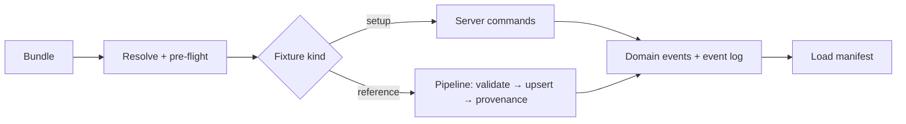

# Fixtures and import pipeline core

> Five-minute read. Bullets over prose. See [AGENTS.md](../../AGENTS.md).

## 1. Summary

- One command tears down a worktree's DB + asset dir and rebuilds a known state from **fixtures** ([ADR-0008](../architecture/adr/0008-parallel-dev-isolation.md), [ADR-0017](../architecture/adr/0017-agent-verification-fixture-library.md)).
- Fixtures are small units composed into named **bundles**. Setup fixtures are scripts of **server commands**; reference creatures go through the **import pipeline** core ([ADR-0015](../architecture/adr/0015-source-adapters-fixtures.md)).
- Pipeline core is fixed and minimal: validate normalised records → upsert by `(source, sourceKey)` → provenance. Real adapters are post-MVP.

## 2. Scope

- **Commands** (described functionally; names and invocation come from the AGENTS.md build conventions):
  - `reset`: empty the worktree's DB + asset dir, recreate the empty schema.
  - `load <bundle>`: apply a bundle on top of the current state.
  - `reset-and-load <bundle>`: both, one invocation.
  - `list` *(proposed)*: bundles, their fixtures, and each fixture's owning spec.
- **In-process loader** for `bun test`: fresh temp DB + asset dir, load a bundle, get handles back.
- **Fixture and bundle format**, dependency resolution, determinism, load manifest.
- **Import pipeline core**: batch contract, validation, upsert, provenance, read-only imported definitions.
- **`session-sim` bundle**: target contents (§8). Skeleton build ships the mechanism, the pipeline core, and the first three fixtures; later phases' builders add the rest.

**Build split**

| When | Who | Delivers |
|---|---|---|
| Skeleton (Foundation build) | skeleton builder | Commands, in-process loader, manifest, pipeline core (tested with a test-only record kind), `base` bundle, `session-sim` = `base` |
| Scenes phase | entities, assets-pipeline, scenes-map builders | `monster` kind registered with the pipeline; `enemy-*`, `player-1`, images, scenes, tokens |
| Combat phase | character-sheet, combat-tracker builders | `player-1` basics, `enemy-custom` (if not earlier), `encounter-1`; `mid-combat` bundle ([OQ-FIX-04](#15-open-questions)) |

## 3. Goals

- Empty → playable `session-sim` in one command, within the budget in [OQ-FIX-08](#15-open-questions).
- Same bundle → same state every time: same IDs, same player link URL.
- Fixtures can only create states the UI can reach (same commands, same validation, same domain events).
- A feature adds fixtures and bundles without changing the mechanism.
- Adding a content source later = writing one adapter; pipeline core unchanged.

## 4. Non-goals

- Real source adapters: Open5e, homebrew, Griffon's Saddlebag (→ [compendium](post-mvp/compendium.md)), 5etools (→ [compendium-expansion](post-mvp/compendium-expansion.md)), Obsidian (→ [obsidian-importer](post-mvp/obsidian-importer.md)). AI paste is not an adapter ([ADR-0015](../architecture/adr/0015-source-adapters-fixtures.md)).
- Fixtures in real play, seeding a game-night DB, backup/restore ([OQ-FIX-06](#15-open-questions), [feature tiers](../feature-tiers.md#5-dm-tools)).
- Any in-app UI: import screen, "reset to fixture" button.
- Character import (once-off scripts, way post-MVP). Generic adapter framework or mapping DSL.

## 5. User stories

**DM**
- As the DM at a phase gate, I want one command to put a worktree into `session-sim` so I can click through the demo script myself.
- As the DM, I want reset to refuse to touch anything not marked disposable, so my real campaign can never be wiped by a fixture command.

**Player**
- As a player (or a test agent playing one), I want the fixture player link to stay the same across resets, so my open tab or bookmark keeps working.

**Build / test agent**
- As a builder, I want `reset-and-load session-sim` and the URLs printed, so I can open DM and player contexts within seconds.
- As a builder, I want to add my feature's fixtures to a bundle without touching the loader.
- As a test author, I want a fresh, loaded temp DB per test file, isolated from other worktrees.

## 6. Functional requirements

| ID | Requirement | Notes |
|---|---|---|
| **Commands** | | |
| FR-FIX-01 | `reset` deletes the worktree's DB and asset dir contents (paths from env) and recreates the empty schema. Afterwards every table has zero rows and the asset dir is empty. | [ADR-0008](../architecture/adr/0008-parallel-dev-isolation.md) |
| FR-FIX-02 | `reset` and `load` refuse, exit non-zero and change nothing when: the data dir is not marked disposable, the DB/asset paths are unset, or a server is running on that DB. | Guard: [OQ-FIX-17](#15-open-questions); running server: [OQ-FIX-10](#15-open-questions) |
| FR-FIX-03 | `load <bundle>` applies the bundle's fixtures in resolved order. `reset-and-load <bundle>` = `reset` then `load`, one invocation. | |
| FR-FIX-04 | Before any write, `load` fails (non-zero, nothing written) on: unknown bundle or fixture key, missing dependency, dependency cycle, missing asset file, or an invalid reference record. | Pre-flight |
| FR-FIX-05 | If a step fails mid-load, the loader resets DB + asset dir to empty and exits non-zero. The error names bundle, fixture key, step index, command and the validation message. | [OQ-FIX-11](#15-open-questions) |
| FR-FIX-06 | Loading a bundle whose fixtures are all applied is a no-op (zero commands run). Loading a bundle that layers on applied fixtures runs only the missing ones. | Applied set from the manifest |
| FR-FIX-07 | `load` onto a non-empty DB with no `complete` manifest refuses with "reset first". | Covers crashed loads |
| FR-FIX-08 | Two `reset-and-load` runs of the same bundle produce identical record IDs, player link URLs, timestamps and row counts. | [OQ-FIX-12](#15-open-questions) |
| FR-FIX-09 | On success the loader writes a machine-readable **load manifest** to the worktree data dir and prints a summary: bundle, applied fixtures, handles (fixture key → record IDs), DM client URL, DM secret, player link URL(s), duration. | §8 |
| FR-FIX-10 | `reset-and-load session-sim` and the in-process load meet the time budget. | [OQ-FIX-08](#15-open-questions) |
| FR-FIX-11 | An in-process loader creates a fresh temp DB + asset dir, loads a bundle and returns the handles, without opening ports. Parallel test files and worktrees never share files. | For `bun test` |
| **Format and composition** | | |
| FR-FIX-12 | A fixture declares: key, kind (`setup` \| `reference`), required fixture keys, owning spec, and either ordered command steps (`setup`) or one import batch (`reference`), plus any asset files it uses. | Format: [OQ-FIX-02](#15-open-questions) |
| FR-FIX-13 | Setup steps call only registered server commands, through the same validation, domain events and event log as UI intents. The loader has no other write path to the DB. | [overview](../architecture/overview.md#cross-cutting-rules); runner: [OQ-FIX-09](#15-open-questions) |
| FR-FIX-14 | A step can reference records created by earlier fixtures by fixture key (e.g. "the campaign from `campaign`"). | Handles |
| FR-FIX-15 | A bundle declares a name, included bundles and fixture keys. Resolution flattens includes, dedupes, and orders by dependency, then by declaration order (deterministic). | |
| FR-FIX-16 | Adding a fixture or bundle needs no change to the loader or pipeline core. | Registry |
| FR-FIX-17 | Fixture assets are ingested through the asset store's own command, never copied into the asset dir directly. | [assets-pipeline](assets-pipeline.md) |
| **Import pipeline core** | | |
| FR-FIX-18 | The pipeline accepts an **import batch**: campaign, source descriptor (key, name, licence, attribution), records (kind, sourceKey, data). Each kind's data schema comes from a registry shared with [ADR-0009](../architecture/adr/0009-entity-content-model.md) (MVP: `monster`). Unknown kind → rejected. | |
| FR-FIX-19 | Every record is validated before any write. If any record is invalid, nothing is written and every error is returned with sourceKey and field path. | [OQ-FIX-16](#15-open-questions) |
| FR-FIX-20 | Upsert by `(campaign, source, sourceKey)`. Each record's outcome is `created`, `updated` (content hash changed) or `unchanged`, returned with its definition ID. Re-importing an identical batch gives all `unchanged`. | Scope: [OQ-FIX-14](#15-open-questions); update rule: [OQ-FIX-18](#15-open-questions) |
| FR-FIX-21 | Each imported definition stores provenance: source, sourceKey, licence, attribution, importedAt, contentHash. | [OQ-FIX-15](#15-open-questions) |
| FR-FIX-22 | Imported definitions are read-only: the pipeline is the only writer, and ordinary definition create/edit commands reject provenance fields or edits to imported definitions. | Enforced in [entities](entities.md); [OQ-FIX-19](#15-open-questions) |
| FR-FIX-23 | `created` and `updated` outcomes emit the entities spec's definition domain events (with provenance) and are logged. `unchanged` emits nothing. | [ADR-0016](../architecture/adr/0016-domain-events-pending-actions.md) |
| FR-FIX-24 | MVP exposes no HTTP or WS route for reset, load or the pipeline. A route-table test confirms it. | §10 |
| **Content** | | |
| FR-FIX-25 | `session-sim` contains the fixtures in the §8 target table that exist at the time. At skeleton: `campaign`, `dm-secret`, `player-1-link`. | |
| FR-FIX-26 | SRD fixtures are SRD 5.1 text only and carry its CC BY 4.0 attribution in provenance. No copyrighted art. Images are simple shapes per [ADR-0017](../architecture/adr/0017-agent-verification-fixture-library.md), each map ≤ 200 KB and each token ≤ 20 KB. | Committed vs generated: build phase |

## 7. UI/UX notes

- **Screens:** none in MVP. CLI plus in-process API only ([OQ-FIX-10](#15-open-questions) covers a dev-only route).
- **CLI states:** success summary (FR-FIX-09); refusal with a one-line reason (FR-FIX-02, FR-FIX-07); failure naming fixture + step (FR-FIX-05).
- **DM view:** after load, the DM client shows ordinary app state: the fixture campaign, player, scenes and so on. No fixture badge or special marking.
- **Player view:** opens the printed player link and sees the same state any player would. Nothing fixture-specific is visible or reachable.
- Styling N/A (no UI); any later dev UI follows [visual-direction](../design/visual-direction.md).

## 8. Data model

Fixtures, bundles and the manifest are **code/files, not DB records**. Only provenance lives in the DB.

| Entity | Field | Type | Notes |
|---|---|---|---|
| Fixture *(code)* | key | string | Stable, e.g. `player-1`. Unique |
| | kind | `setup` \| `reference` | |
| | requires | fixture key[] | |
| | ownerSpec | spec name | Who owns the record shape |
| | steps | ordered (command, input)[] | `setup` only. Inputs typed by the command's zod schema |
| | batch | import batch | `reference` only |
| | assets | file path[] | Inside the fixture folder |
| Bundle *(code)* | name | string | e.g. `base`, `session-sim` |
| | includes | bundle name[] | Layering |
| | fixtures | fixture key[] | |
| Import batch *(pipeline input)* | campaign | campaign ref | |
| | source | {key, name, licence, attribution, url?} | Fixtures use key `fixture` |
| | records | {kind, sourceKey, data}[] | `data` = per-kind schema (JSON leaf, [ADR-0009](../architecture/adr/0009-entity-content-model.md)); partial data allowed where the schema allows |
| Provenance *(fields on imported definition; table owned by [entities](entities.md))* | source | string | null = custom |
| | sourceKey | string | Unique with campaign + source |
| | licence, attribution | string | |
| | importedAt | timestamp | Fixed clock during fixture load |
| | contentHash | string | Hash of normalised `data`; drives `unchanged` |
| Load manifest *(file in worktree data dir)* | bundle, appliedFixtures | string, key[] | |
| | status | `loading` \| `complete` | Written `loading` before the first write |
| | handles | fixture key → record IDs | |
| | dmUrl, dmSecret, playerLinks | string | Dev-only known values |
| | startedAt, durationMs | timestamp, int | |

- **Relations:** imported definition → one campaign ([ADR-0004](../architecture/adr/0004-tenancy-auth-permissions.md)); unique `(campaign, source, sourceKey)`.
- **Derived values:** `readOnly = source != null`; outcome per record (from contentHash).
- **Persisted runtime state:** none owned here. Loaded state is ordinary app state and survives a crash like any other ([ADR-0006](../architecture/adr/0006-persistence.md)).

**`session-sim` target contents** (values *(proposed)*; record shapes follow the owning spec)

| Fixture | Kind | Contents | Shape owner | Added in |
|---|---|---|---|---|
| `campaign` | setup | "Fixture Campaign" | [campaign-management](campaign-management.md) | Skeleton |
| `dm-secret` | setup | Known dev DM secret | [campaign-management](campaign-management.md) ([OQ-FIX-13](#15-open-questions)) | Skeleton |
| `player-1-link` | setup | Player "Player 1" with a stable player link | [campaign-management](campaign-management.md) | Skeleton |
| `enemy-1` | reference | SRD goblin: AC 15, HP 7, init +2, scimitar +4 / 1d6+2, CR 1/4, 50 XP | [entities](entities.md) | Scenes |
| `enemy-2` | reference | SRD wolf: AC 13, HP 11, init +2, bite +4 / 2d4+2, CR 1/4, 50 XP | [entities](entities.md) | Scenes |
| `enemy-custom` | setup | Elite Goblin Warrior, derived from `enemy-1`: AC 16, HP 15, scimitar +5 / 1d6+3, CR 1/2, 100 XP | [entities](entities.md) / [combat-tracker](combat-tracker.md) (derive command) | Whichever ships the derive command |
| `player-1` | setup | Character "Mira", owned by Player 1: L1 fighter, AC 16, HP 12/12, init +2, shortsword +4 / 1d6+2 | [entities](entities.md) (kind), [character-sheet](character-sheet.md) (basics) | Scenes (entity), Combat (basics) |
| `images` | setup | Town map, battlemap (shapes on white, 20×14 cells at 70 px); tokens: Mira blue, goblin green, wolf grey, elite goblin dark green; shapes on circles | [assets-pipeline](assets-pipeline.md) | Scenes |
| `town` | setup | Active scene: town map, grid, Mira token | [scenes-map](scenes-map.md) | Scenes |
| `battlemap` | setup | Inactive scene: battlemap, grid, tokens Mira + goblin (visible), wolf + elite goblin (**hidden**) | [scenes-map](scenes-map.md) | Scenes |
| `encounter-1` | setup | Planned: goblin ×1, wolf ×1, Elite Goblin Warrior ×1, party = Mira | [combat-tracker](combat-tracker.md) | Combat |

- No item record: MVP entity kinds are character and monster only ([glossary](../glossary.md)). The stock shortsword is Mira's stored weapon attack ([ADR-0012](../architecture/adr/0012-character-derived-values.md)).
- Bundles: `base` = `campaign`, `dm-secret`, `player-1-link`. `session-sim` = `base` + all rows above. `mid-combat` layers on `session-sim` ([OQ-FIX-04](#15-open-questions)).

## 9. API & events

**REST (Hono RPC):** none in MVP (FR-FIX-24).

**WS intents:** none.

**Internal server command**

| Command | Caller (MVP) | Input | Output / errors |
|---|---|---|---|
| Import batch | Fixture loader only | Import batch (§8) | Per record: outcome + definition ID. Errors: unknown kind, validation errors (all of them, with sourceKey + path), campaign not found. All-or-nothing |

**Domain / WS events**

| Event | Payload | Visibility rule |
|---|---|---|
| Definition created / updated (owned by [entities](entities.md)) | Definition + provenance | As entities defines; expected DM-only for monster definitions in MVP. Provenance is never needed by player clients |
| Events from setup steps | As their owning specs define | As their owning specs define |

- No load-specific events. During CLI load no clients are connected (FR-FIX-02), but events are still committed to the event log, same as UI-driven changes.

## 10. Permissions

| Action | DM | Player | Server check |
|---|---|---|---|
| reset / load / reset-and-load | CLI on the host, disposable data only | Never | No network route (FR-FIX-24); disposable-data guard (FR-FIX-02) |
| Import batch | Via fixture loader (in-process, DM authority) | Never | Not routable in MVP |
| Edit an imported definition | No; derive a custom instead | No | Rejected by entities' edit command (FR-FIX-22) |

## 11. Edge cases & failure modes

- **Player disconnect / reconnect:** server is stopped during CLI load, so tabs disconnect. After restart, the stable player link (FR-FIX-08) reconnects and gets a fresh snapshot ([live-sync](live-sync.md)).
- **DM disconnect / reconnect:** same as players; the dev DM secret is unchanged across resets.
- **Server crash mid-action:** loader crash mid-load leaves manifest `loading` → `load` refuses (FR-FIX-07) and `reset-and-load` recovers. After a load, state is ordinary DB state ([ADR-0006](../architecture/adr/0006-persistence.md)).
- **Concurrent edits:** a second loader on the same data dir refuses (lock). Different worktrees never share paths ([ADR-0008](../architecture/adr/0008-parallel-dev-isolation.md)).
- **Invalid / malicious input:** a bad step fails command validation → wipe + error (FR-FIX-05). A bad reference record is rejected in pre-flight (FR-FIX-04). Fixtures are repo code, not user input.
- **Schema drift:** step inputs are typed against command schemas, so typecheck catches drift. The all-bundles test (§13) catches runtime drift.
- **Missing fixture image:** pre-flight error, nothing written (FR-FIX-04).
- **Reset pointed at a real DB:** refused by the disposable guard (FR-FIX-02).
- **Fixture needs a command that isn't built yet:** it isn't added to a bundle until that phase's builder adds it.

## 12. Performance & bandwidth

- `session-sim` at full size: 1 campaign, 1 player, 1 character, 3 definitions, 2 scenes, ~6 tokens, 1 encounter, ~6 images (≤ 0.5 MB total), ~30 domain events.
- **Budget (proposed, [OQ-FIX-08](#15-open-questions)):** CLI `reset-and-load session-sim` ≤ 3 s wall clock including process start. In-process load into a temp DB: `base` ≤ 200 ms, `session-sim` ≤ 1 s.
- Likely costs are schema creation and image derivatives. A cached empty-schema template DB is a build-phase option.
- No network bandwidth: everything is local.

## 13. Test plan

Isolated per worktree: every run uses its own temp DB + asset dir ([ADR-0008](../architecture/adr/0008-parallel-dev-isolation.md)). Agent build loop per [ADR-0017](../architecture/adr/0017-agent-verification-fixture-library.md).

| Level | What | Fixtures |
|---|---|---|
| Unit | Bundle resolution: includes, dedupe, order, cycle / unknown key / missing dep errors (FR-FIX-04, 15) | Test-only fixtures |
| Unit | Pipeline: valid batch; invalid batch rejected with all errors; unknown kind; created / updated / unchanged; provenance set; `readOnly` derived (FR-FIX-18–21) | Test-only record kind; `enemy-1`, `enemy-2` once `monster` is registered |
| Integration | Every bundle and every fixture (with deps) loads into a fresh temp DB (FR-FIX-16, 19 via all-bundles test) | All |
| Integration | Determinism: two `reset-and-load` runs → identical IDs, link URLs, row counts (FR-FIX-08). Idempotent and layered load (FR-FIX-06) | `base`, `session-sim` |
| Integration | Failure mid-load → empty DB + named error (FR-FIX-05). Missing asset → nothing written (FR-FIX-04). Crashed manifest → refuse (FR-FIX-07) | Test-only broken fixtures |
| Integration | Guards: non-disposable dir, running server, unset paths → refuse, nothing deleted (FR-FIX-02) | `base` |
| Integration | One event-log entry per mutating step; no direct DB writes (FR-FIX-13). Pipeline events (FR-FIX-23). No reset/load/import route (FR-FIX-24) | `session-sim` |
| Integration | Timing assertions against the budget (FR-FIX-10) | `base`, `session-sim` |
| E2E (thin) | Playwright: `reset-and-load session-sim`, DM + player contexts connect | `session-sim` |

**Browser walkthrough** (agent, per [ADR-0017](../architecture/adr/0017-agent-verification-fixture-library.md))

- **Bundle:** `session-sim`.
- **Setup:** run `reset-and-load session-sim`; read DM URL, DM secret and player link from the summary; start the app on the worktree's ports.
- **DM steps (context A):** open the DM URL and enter the DM secret → "Fixture Campaign" with player "Player 1".
  - *From Scenes:* town scene is active with Mira's token. The battlemap in the scene list shows the wolf and elite goblin translucent (hidden).
- **Player steps (context B, separate):** open the player link → joined as Player 1.
  - *From Scenes:* lands on the town scene. After the DM switches to the battlemap, sees Mira and the goblin only.
- **Reset round-trip:** stop the app, `reset-and-load session-sim` again, restart, reload both contexts.
- **Expected:** same campaign and the **same player link** still work, state is identical, there are no console errors, and the player client never receives hidden tokens or DM-only fields.

## 14. Dependencies

| On | What we need | Status |
|---|---|---|
| [ADR-0015](../architecture/adr/0015-source-adapters-fixtures.md) | Pipeline shape; re-import rule (open row) | accepted |
| [ADR-0017](../architecture/adr/0017-agent-verification-fixture-library.md) | Fixture library, build loop | accepted |
| [ADR-0009](../architecture/adr/0009-entity-content-model.md) | Shared creature schema for `monster` records | accepted |
| AGENTS.md build conventions | Command names, fixture folder layout, env names, disposable-data flag, ID/clock seam mechanism | drafting |
| [campaign-management](campaign-management.md) | Commands: create campaign, set DM secret, add player with stable link ([OQ-FIX-12](#15-open-questions), [OQ-FIX-13](#15-open-questions)) | open |
| [live-sync](live-sync.md) | Snapshot on reconnect after reset; event conventions | open |
| [entities](entities.md) | Definition table + provenance fields, read-only enforcement, definition events, `monster` kind registration | open |
| [assets-pipeline](assets-pipeline.md) | Ingest command for fixture images | open |
| [character-sheet](character-sheet.md), [scenes-map](scenes-map.md), [combat-tracker](combat-tracker.md) | Commands and record shapes their fixtures use | open |

## 15. Open questions

**Bold** option = suggested pick (not decided).

| ID | Question | Options (pick marked) | Blocking? | Affects |
|---|---|---|---|---|
| OQ-FIX-01 | ~~Fixtures through the adapter pipeline?~~ **Decided: setups are server-command scripts; only reference content uses the pipeline** ([ADR-0015](../architecture/adr/0015-source-adapters-fixtures.md)) | — | — | — |
| OQ-FIX-02 | Fixture format | **TypeScript modules: setup = ordered (command, typed input) steps; reference = import batch data.** Typecheck catches drift, but non-devs can't edit them / JSON command lists + schema: editable, but drift only shows at runtime / YAML: same as JSON, plus a parser | yes | all specs |
| OQ-FIX-03 | Fixture location and ownership | **One fixtures tree; each feature spec names the fixtures it adds** (exact layout in build conventions). One place to find everything / per-feature folders: co-located, but bundles span folders | no (owner: orchestrator, build conventions) | all specs |
| OQ-FIX-04 | Mid-combat fixtures (e.g. "round 2, enemy at half HP")? | **Yes, as a `mid-combat` bundle layered on `session-sim`, owned by combat-tracker.** Fast to reach combat states, but one more bundle to maintain / base state only | no (owner: combat-tracker) | combat-tracker, live-sync |
| OQ-FIX-05 | ~~Fixture images~~ **Decided: simple shapes on white (maps), shapes on circles (tokens); tiny committed files or deterministic generation** ([ADR-0017](../architecture/adr/0017-agent-verification-fixture-library.md)) | — | — | — |
| OQ-FIX-06 | ~~DM uses fixtures in real play?~~ **Decided: no. Fixtures are test data**; real content comes from the app or importers | — | — | — |
| OQ-FIX-07 | ~~Pipeline core in MVP?~~ **Decided: yes, minimal** ([ADR-0015](../architecture/adr/0015-source-adapters-fixtures.md#open)) | — | — | — |
| OQ-FIX-08 | Reset + load time budget | **CLI `reset-and-load session-sim` ≤ 3 s; in-process `base` ≤ 200 ms, `session-sim` ≤ 1 s.** Fast enough to reset per walkthrough and per test file, but may force a template DB and tiny images / ≤ 10 s CLI: easy, but slows the agent loop / per-suite only: no per-test isolation | yes | all specs (test plans) |
| OQ-FIX-09 | How the loader calls server commands | **In-process command layer with DM authority, no HTTP.** Fast with no ports, but skips transport and auth (covered by E2E) / over HTTP/WS against a running server: exercises transport, but slower and needs ports | yes | all specs, live-sync |
| OQ-FIX-10 | Load while the server is running? | **No in MVP: the CLI refuses; restart after load.** Simple and no stale clients, but needs a server restart per reset / dev-only route that loads, then drops all WS connections so clients resnapshot: faster E2E, but adds a guarded route | no (owner: spec-fixtures-adapters) | live-sync |
| OQ-FIX-11 | Failure mid-load | **Wipe to empty, non-zero exit, named error.** Reset is cheap and there's no partial state, but a failed layered load also loses the base / one outer transaction rollback: keeps the base, but fights per-command commits and after-commit listeners ([ADR-0016](../architecture/adr/0016-domain-events-pending-actions.md)) | no (owner: spec-fixtures-adapters) | — |
| OQ-FIX-12 | Deterministic IDs, link tokens and timestamps | **Seeded ID/token generator + fixed clock while loading; mechanism in build conventions** ([proposed ADR](../architecture/adr/proposed-deterministic-seams.md)). Stable links and handles, but every command must use the seam / random IDs, look up by name: no seam, but player links change on every reset | yes | campaign-management, all specs |
| OQ-FIX-13 | DM secret in fixtures (depends on [OQ-CAMP-03](campaign-management.md#15-open-questions)) | **Fixture sets a known dev secret via campaign-management's command; if CAMP picks env-only, the loader prints the env value instead.** Works either way / always env | no (owner: campaign-management) | campaign-management |
| OQ-FIX-14 | Upsert key scope for imported definitions | **`(campaign, source, sourceKey)`: imported definitions are campaign-scoped in MVP; a shared compendium is revisited under [ADR-0010](../architecture/adr/0010-compendium-design.md).** Fits [ADR-0004](../architecture/adr/0004-tenancy-auth-permissions.md), but duplicates SRD per campaign / global, campaign-less definitions: no duplication, but needs an ADR-0004 exception | yes | entities, post-mvp/compendium |
| OQ-FIX-15 | Where provenance lives | **Inline fields on the definition row.** One table, simple read-only check / separate source + provenance tables: normalised, but extra joins for nothing in MVP | no (owner: entities) | entities |
| OQ-FIX-16 | Batch with some invalid records | **Reject the whole batch, report every error.** Strict and right for fixtures / accept valid, report invalid: friendlier for messy real sources (revisit with [compendium](post-mvp/compendium.md)) | no (owner: spec-fixtures-adapters) | post-mvp/compendium |
| OQ-FIX-17 | How reset knows the data is disposable | **Explicit env flag marking the data dir disposable; reset refuses without it.** Can't wipe a real DB by accident / path heuristics: fragile / interactive confirm: breaks agents | no (owner: orchestrator, build conventions) | all specs |
| OQ-FIX-18 | Re-import of a changed fixture record ([ADR-0015](../architecture/adr/0015-source-adapters-fixtures.md#open) open row) | **Update the read-only definition in place; customs derived from it are unaffected.** Simple / version it: history, but more model | no (owner: DM via ADR-0015) | entities, post-mvp/compendium |
| OQ-FIX-19 | Shape owners in the §8 target table: confirm each, and say who ships the derive command for `enemy-custom` | **As listed; derive command in [entities](entities.md) if it ships a create-custom command, else [combat-tracker](combat-tracker.md).** Earliest phase that can build it | no (owner: entities, combat-tracker) | entities, character-sheet, scenes-map, combat-tracker, assets-pipeline |
| OQ-FIX-20 | Glossary: add **Fixture bundle** ("named, composable set of fixtures, e.g. `session-sim`") and **Load manifest** | **Add both** / keep informal | no (owner: integrator) | glossary |

## 16. Out of scope

- Real adapters and import UI → [compendium](post-mvp/compendium.md), [compendium-expansion](post-mvp/compendium-expansion.md), [obsidian-importer](post-mvp/obsidian-importer.md).
- Dice seeding → [dice-roll-log](dice-roll-log.md) ([ADR-0008](../architecture/adr/0008-parallel-dev-isolation.md) open item).
- Fixture record shapes → their owning specs (§8 table).
- Exact command names, folder layout, env names → AGENTS.md build conventions.
