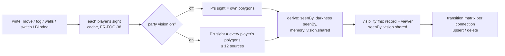

# Fog of war (FOG v2: freeform fog, dynamic vision, magical darkness)

> **FOG v2** (sprint 3, track V; DM decisions [#201](../decisions-log.md), [#202](../decisions-log.md)) replaces sprint 2's static cell fog. FR IDs are kept where the behaviour survives (text amended in place), retired IDs are struck through, new ones start at FR-FOG-26. One vision design across this spec, [scene-tools](scene-tools.md) (walls, SCN) and [character-sheet-full](character-sheet-full.md) (senses, CHARX); ADR: [ADR-0042](../architecture/adr/0042-dynamic-vision.md). **Sprint-3 gate 1 (DM, 2026-10-16):** every §15 pick decided (**#207**); DM snapshot ceiling 1 MiB, the 100 KiB guard dropped (**#208**, §12); new token state **Invisible** + sense **Sees invisible** (**#210**, FR-FOG-45–47, FR-CHARX-53). *Seams pass (orchestrator ruling, 2026-10-16):* View-as data on demand (FR-FOG-43, S1, re-measured §12), build order (S3), senses via compendium (S6), terms (S9), composable fixtures (S10), BL-09 (S11). *Review pass (rulings 2026-10-16, review-a A1–A29):* fixture darkness moved off Goblin and §13 recomputed from coordinates; darkness filtered per player (FR-FOG-44, OQ-FOG-32 B); darkness in the undo stack (OQ-FOG-44); senses ≤ 120 ft and ≤ 4 sources per player; V0 benchmark is an exit gate; build order V0 → V5 → V1 → (V4 ∥ V2) → V3.

> **Sprint 4 (track V, DM feedback [#243](../decisions-log.md) [0]–[3], [5]–[7]; scope #244).** Decided by the DM, not open: middle mouse pans in every tool; vision **999 ft by default**, reduced only by blinding effects; vision follows a token **while it is dragged**; a campaign **party vision** switch (off by default; on = every player sees the union of all players' sight, darkness and Invisible / Sees invisible included); a real **Ctrl+Z**; a **fog brush** (radius, grid-snapped unless Ctrl); the DM sees the plain map unless a fog tool is selected; **View as → Party**. Plus session-sim-7 glitches (darkvision not grey, Fit with the Game log, Konva layer count, Brakka's "No vision set"). New FR-FOG-48–57; amended in place: 07, 17, 20, 21, 26, 32, 33, 34, 36, 37, 43, 44; FR-FOG-17's "No vision set" hint now lists only stored 0 / 0 senses (absent = Normal). Supersedes OQ-FOG-20 (own characters only), OQ-FOG-26 (drop only) and OQ-FOG-35's senses numbers. ADR: [ADR-0047](../architecture/adr/0047-party-vision.md) (accepted at sprint-4 gate 1, #245; refines ADR-0042). Measured CON-44: §12 "Sprint 4". **Sprint-4 gate 1 (DM, 2026-10-17, #245):** every pick decided (G9–G20; OQ-FOG-46–56, 61; bulk-accept OQ-MAP-45 / -46). *Seams pass (S1–S12) and review pass (review-a A1–A25, rulings 2026-10-17):* `fog.sight` only on the active scene to token holders; DM drags preview as the owner; a hint phase in `move-guards.ts`; vision-model upgrade re-derive; inward polygon simplification (re-measured §12); map-rect cache key + re-derive on grid / map change; secret Blinded (OQ-FOG-61); FR-FOG-22, -25, -38, -40 also amended.

**Sprint 4 at a glance** (FR → slice → test; details in §6, §12–§14)

| FR | What | Slice | Named test / walk step |
|---|---|---|---|
| 32, 33, 38, 40 | 999 ft default, map edges, inward simplification, cache keys, upgrade re-derive | V6 | `FR-FOG-32 default`, `FR-FOG-33 inward simplification`, `FR-FOG-38 cache keys`, vision-model upgrade · 30 |
| 49–52, 43 | Party vision switch, party sight, shared `vision`, 12-source cap, View as Party | V6 (server), V10 (client) | party leak tests + convergence, CON-44 · 21, 24, 28 |
| 53, 54 | Sight preview while dragging (active scene, holders, owner's guards) | V8 | `FR-FOG-53 audience…`, `…DM drag as owner`, `…hint phase`, `…order`, `…no write on crash mid-drag (digest)` · 18–20, 22, 29 |
| 26, 55, 56, 57, 07, 17 | Brush, merge, redo, Ctrl+Z / Ctrl+Shift+Z | V9 | brush / redo integration, key bindings · 16, 17 |
| 48, 36, 21 | Blinded (secret too), blind reason, grey darkvision ring | V10 | `FR-FOG-48 …`, `FR-FOG-48 secret Blinded` · 23, 25 |
| 20, 22 + MAP 12, 29, 44 | DM plain map, middle-mouse pan, 4 Konva layers, Fit with the Game log | V7 | `FR-MAP-12 middle pan`, `FR-MAP-29 layers`, `FR-MAP-44 BL-01` · 14, 15, 26, 27 |

Built sprint-3 material below stays in place (collapsing it would mean moving ~300 lines of FR rows other specs link by anchor; not cheap, review A25).

## 1. Summary

- The DM draws **freeform fog** with rectangle, polygon and circle tools (grid snap unless **Ctrl** is held) in four modes: **Reveal**, **Fog**, **Explored**, **Darkness**. Sprint 2's cell mask stays as the base the shapes paint over, so existing scenes look the same.
- **Dynamic vision:** each player-owned token is a **vision source** with its creature's vision and darkvision radius; line of sight stops at walls and closed doors. Vision pierces Fog; a per-map **Explored** memory keeps seen areas visible (map, not records). **Magical darkness** blocks vision unless the character "sees through magical darkness"; standing in it without that gives the player a dark screen.
- **Invisible** (#210): a DM-only token toggle, distinct from Hidden. A player gets an invisible token only through a vision source that **sees invisible** and has it in sight; the party still sees invisible PCs.
- Hiding stays **server-side**, now **per player**: each fog subject carries a server-written `seenBy` copy, so visibility fns stay pure (record + viewer, [ADR-0021](../architecture/adr/0021-sync-protocol-conventions.md)). The server computes each player's vision polygons and sends them to that player only; walls never reach players.
- *(Sprint 4)* **Vision is 999 ft unless set lower**, bounded by walls and the map's edges; the **Blinded** condition removes a character's sight. **Party vision** (campaign switch): every player sees what any player sees, and gets the others' `vision` records to draw it. While a source token is dragged, the server returns its **sight at each previewed cell** (map only; records follow on the drop). The DM paints fog with a **brush**, undoes with **Ctrl+Z** / redoes with **Ctrl+Shift+Z**, and sees the plain map unless the Fog tool is picked.

## 2. Scope

- DM, per scene (any scene, prep or live): shape tools × modes; Reveal all, Fog all, Undo (shapes); Darkness add / move / delete / clear; per-map **Explored memory** on / off and **Forget explored**; **View as player** preview *(#207, OQ-FOG-31)*.
- Vision for every token with an owner: radius from the creature's senses (CHARX FR-CHARX-49), blocked by walls and non-open doors (SCN FR-SCN-37) *(#207, OQ-FOG-21 / -24)*, by darkness for sources without "sees through". Each player sees through **their own characters only** *(#207, OQ-FOG-20)*, **unless party vision is on** *(#243 [3], FR-FOG-50)*. *(Sprint 4)* DM: fog brush, Ctrl+Z / redo, party vision switch, View as → Party; both clients: sight preview while dragging a source.
- Server-side, per player: tokens, props, DM templates and doors outside a player's sight and not in revealed area never reach that player. Fog-hidden monsters stay hidden in combat until **any** player sees them *(#207, OQ-FOG-25)*.
- DM, per token: **Invisible** on / off (token menu, FR-FOG-45); drawn faded with an "Invisible" badge for the DM.
- Decided by the DM (#201, #202, #210), not open:

| Topic | DM decision |
|---|---|
| Shapes | Freeform shapes with drawing tools (rectangle, polygon, circle); vertices snap to the grid unless Ctrl is held |
| Vision | Each character has a vision / darkvision radius that pierces fog; recomputed as tokens move |
| Fog kinds | **Fog**: hides map and records until in a player's vision, returns when vision leaves. **Explored**: map visible, records hidden (RTS memory). **Magical darkness**: DM-placed ad hoc shapes that block all player vision |
| Explored toggle | Per map: Explored memory on / off for the whole map (on for dungeons, off for open spaces) |
| Darkness vs sheet | Sheet setting "sees through magical darkness". Without it, a character standing in darkness → that player's screen is **fully dark** (own tokens and the grid only). With it, the darkness shape is a **darker, more transparent overlay than Explored** |
| Scope | Vision (radius, darkvision, walls blocking sight) is in; dynamic lighting (light sources, colour, shadows) stays out |
| Invisible (#210) | Token state **Invisible**, distinct from Hidden, DM-only toggle, not coupled to the Invisible condition. Sheet sense **Sees invisible** (truesight, See Invisibility), DM-only to edit. A player gets an invisible token only if one of their sources sees invisible **and** has it inside its sight polygon; everyone else: filtered like a fog-hidden token. The party still sees invisible PCs (#196). Combat: hidden from players only while no player sees it (#207, OQ-FOG-25). DM: faded + "Invisible" badge |
| Pan (#243 [0]) | Middle mouse always pans the map, whatever tool is active (scenes-map FR-MAP-12) |
| Vision default (#243 [1]; #245 G13, G14, G15) | Vision 999 ft by default (absent = Normal); stored values incl. 0 are kept (Mira's 30 ft torch still limits her); input 0–995 + a "Normal" button. Reduced by the **Blinded** condition (no sight) and magical darkness; a **secret** Blinded counts, shown only as "You can't see" |
| Drag-time vision (#243 [2]; #245 G12) | Vision recomputed while a token is dragged: map sight only, monsters appear on the drop; per previewed cell ≤ 10 / s, server-computed; to the dragger, the owner when the DM drags, and every player holding the token while party vision is on (≤ 4 / s); never the DM |
| Party vision (#243 [3]; #245 G9–G11, G20) | One switch **per campaign**, off by default; on = every player sees the union of all players' vision, darkness, Invisible / Sees invisible included; each player's Explored memory grows from the party's sight and is kept when switched off; a blind player sees the party's sight (dark screen only when the whole party is blind); ≤ 12 party sources |
| Undo (#243 [5]; #245 G17) | Ctrl+Z for fog drawing: one stroke = one step, depth 50, redo (Ctrl+Shift+Z / Ctrl+Y) cleared by a new edit, survives reload (server stack) |
| Brush (#243 [6]; #245 G16) | Round brush; snapped = whole cells within the radius by the campaign's diagonal rule; Ctrl = smooth round stroke; radius 0–50 ft, step 5, default 10; modes Reveal / Fog / Explored (no Darkness brush) |
| DM view (#243 [7]; #245 G18, G19) | The DM sees the plain battlemap unless the Fog tool is selected (badges stay) + a Layers "Fog" switch, off by default; View as gains **Party vision**, also allowed while party vision is off (a preview of "on") |

## 3. Goals

- **Zero leakage per player, except §11's accepted list:** no player frame (snapshot, event, signal, ack) carries the id, name, position, image or any field of a record that player can't see, before or after a reconnect; nor another player's vision, explored memory or senses.
- A token move = one transaction, one event, one frame per connection; commit → player frame ≤ 1 s; vision work ≤ 10 ms typical, ≤ 30 ms at caps (V0 benchmark, an exit gate, §12).
- Fits CON-44 (measured, §12). Existing scenes, bundles and tests keep behaving. *(Sprint 4, review A4: no senses now means Normal 999 ft vision, #243 [1], so "no senses set → exactly sprint 2" no longer holds; stored 0 / 0 senses still do. Bundles keep their behaviour through the `vision-legacy` patch (§13); real databases get the one-time vision-model re-derive, FR-FOG-40.)*
- *(Sprint 4)* Zero leakage holds with party vision off, on and across the switch and a reconnect (only §11's added list); a sight preview never carries a record and never comes from a refused cell; a drag preview reaches the dragger ≤ 100 ms after the cell changes (typical).

## 4. Non-goals

- Dynamic lighting: light sources, bright / dim light, colour, shadows, per-token torches ([ADR-0007](../architecture/adr/0007-product-scope.md) as superseded in part by the dynamic-vision ADR). "Vision 30 ft" stands in for a carried light.
- Vision for tokens without an owner (monsters see nothing; the DM sees everything). Darkness attached to a moving token. One-way, terrain or windowed walls.
- Hiding map **pixels**: the map image still reaches players whole (OQ-FOG-09 stands); fog draws over it.
- Player fog tools. ~~Brush~~, ~~live vision while dragging~~, ~~redo~~ *(in since sprint 4, #243 [2], [5], [6])*.
- *(Sprint 4, #245)* Records revealed mid-drag (they appear on the drop); a darkness brush; effect-driven vision radii ("vision 10 ft" effects); party vision per scene.
- Invisibility as a rule: no link to the Invisible condition or effects, no attack advantage, no "sees invisible" on props, templates or doors (#210: a token toggle only).

## 5. User stories

**DM**
- As the DM, I want to trace a cave's fog with a few free polygon clicks (Ctrl) and let the party's torches and darkvision peel it back as they walk, so that I don't reveal rooms by hand.
- As the DM, I want to drop a 15 ft sphere of magical darkness mid-fight and move it, so that only the warlock with Devil's Sight sees the goblins inside.
- As the DM, I want to see what Player 2 sees, so that I trust the fog before the session.
- As the DM, I want to make the stalker invisible, so that only the character with truesight sees it while everyone still gets its Initiative row.
- *(Sprint 4)* As the DM, I want to pan with the middle mouse while the Fog tool is out, brush a winding river path clear in one stroke and take it back with Ctrl+Z.
- *(Sprint 4)* As the DM, I want to switch on party vision for a co-operative dungeon, and check it with View as → Party.

**Player**
- As a player, I want my torch to show 30 ft around Mira, the corridor I walked to stay remembered (but empty), and nothing I couldn't see.
- As a player with Devil's Sight, I want to see inside magical darkness, darker than the rest.
- *(Sprint 4)* As a player, I want the fog to peel back while I drag Mira to the corner, before I commit to the move.

## 6. Functional requirements

**Units.** Shape and wall coordinates are **grid units**: corner (i, j) = map point `(offsetX + i·cellSize, offsetY + j·cellSize)`; cell (col, row) has centre `(col + 0.5, row + 0.5)`. Numbers carry ≤ 2 decimals (1/100 cell); integers = grid corners. Stored in grid units, so content follows recalibration ([FR-MAP-10](scenes-map.md#6-functional-requirements)).

| ID | Requirement | Notes |
|---|---|---|
| **Model** | | |
| FR-FOG-01 | *(amended)* A scene's **fog layer** = a **base mask** (sprint 2's cell mask: `fill`, box, `runs`) + an ordered list of **fog shapes** painted over it. The **static state** of a point is the base mask value of the cell containing it (outside the box: `fill`), then every shape containing the point, in list order, overrides it: `reveal` → clear, `fog` → fog, `explored` → explored. Containment is boundary-inclusive; polygons even-odd. **No row = every point clear.** | Migration: OQ-FOG-27 |
| FR-FOG-02 | New scene fully fogged *(decided #196)*: fog's `created` line writes `{fill: fog, runs: "", shapes: [], darkness: [], explored: false}`; `duplicated` copies the source's row (shapes, darkness, setting), not its undo stack, explored memory or `visionStale`. | Unchanged otherwise |
| FR-FOG-03 | *(amended)* **Box** applies to the base mask only (≤ 513 × 513 cells, sprint-2 formula). ~~Each edit re-bases the mask~~ *(retired: shapes no longer touch the mask)*; `fog.setAll` writes `{fill, runs: ""}` over the current box. | |
| FR-FOG-04 | Run-length codec unchanged (`@shared/fog-of-war/mask.ts`); also encodes explored memory (FR-FOG-37). Bad sum → fully fogged + `error` log (fail closed). | |
| FR-FOG-26 | **Shapes** (zod, `@shared/fog-of-war/shapes.ts`): `rect [x0, y0, x1, y1]` (normalised), `polygon [x, y, …]` 3–64 vertices, simple (no crossing edges), area > 0, `circle [cx, cy, r]` r 0.5–60 cells. \|coord\| ≤ 1,024. Fog shape = `{op: reveal \| fog \| explored, <shape>}`; darkness = `{id, <shape>}`. Crossing / zero area → `invalid`. *(Sprint 4, brush, FR-FOG-55; **fog shapes only**, never darkness, OQ-FOG-52)* `stroke [r, x0, y0, x1, y1, …]`: a polyline of 1–256 points with radius r 0.5–10 cells; a point is inside iff its distance to the polyline ≤ r (a single point = a circle); `cells {box: [col0, row0, cols, rows], runs}`: whole cells (FR-FOG-04 codec, `"1"` = painted, box ≤ 128 × 128, ≤ 500 runs); a point is inside iff its cell is painted. Boundary-inclusive like the others. | |
| FR-FOG-27 | **Caps** *(OQ-FOG-35)*: ≤ 100 fog shapes and ≤ 20 darkness shapes per scene; the serialized `fog` row ≤ 16 KiB. Over → `conflict` "Fog too detailed — use Fog all or Reveal all to start over" / "Too many darkness areas". Nothing written. | §12 |
| FR-FOG-28 | **Magical darkness** = the row's `darkness` list (ids from `ctx.ids`): a union, independent of fog state; Fog all and Reveal all never touch it; Undo does (FR-FOG-07, *#207, OQ-FOG-44*). A point is **in darkness** iff inside any darkness shape. | |
| FR-FOG-44 | **Darkness per player** *(#207, OQ-FOG-32 B)*: each darkness shape carries a server-written **`seenBy`** = the players whose sight polygons meet its bounding box, or who have a cell centre inside its bounding box that is statically clear / explored or in their explored memory. Written by every re-derive of that player (≤ 20 shapes). The player's `fog` row lists only shapes with the viewer ∈ `seenBy`, never `seenBy` (DM wire: never either). A shape entering a player's set → `fog` upsert for that player only. *(Sprint 4)* Party vision on: "their sight polygons" = the party's (FR-FOG-50); memory stays the player's own row. | Review A5 |
| FR-FOG-29 | **Explored memory setting** per scene: `explored` on the fog row, default **off** (new and existing scenes), `fog.setExplored {sceneId, on}`. Off: memory neither grows nor draws; rows are kept. | OQ-FOG-35 |
| **Editing** (DM only; WS intents, [ADR-0021](../architecture/adr/0021-sync-protocol-conventions.md) D) | | |
| FR-FOG-05 | *(amended)* `fog.edit {sceneId, op: reveal \| fog \| explored, shape}` appends one fog shape. **Legacy forms** stay valid, so fixtures and tests behave as before: `op: hide` = `fog`; `{kind: rect, c0, r0, c1, r1}` (cells) = `rect [c0, r0, c1 + 1, r1 + 1]`; `{kind: polygon, points}` (grid corners) = that polygon. Same cells result: a cell's state is its centre's (FR-FOG-34). ~~No cell changes → no event~~ *(retired: every edit appends; sprint-2 bundles pass unchanged, V1 rewrites the sprint-2 no-op tests)*. | Raster retired |
| FR-FOG-06 | `fog.setAll {sceneId, fogged}`: base → `{fill: fog \| clear, runs: ""}`, `shapes: []`. Darkness, setting and explored memory untouched. Same value and no shapes → no-op. | |
| FR-FOG-07 | *(amended)* Undo `fog.undo {sceneId, expectedEditId}` restores **base + shapes + darkness** from before the latest `fog.edit` / `fog.setAll` / darkness intent (FR-FOG-30) *(darkness in the same stack: #207, OQ-FOG-44, as #196 "undo for scene editing")*; strict LIFO, ~~≤ 20~~ **≤ 50** *(sprint 4, OQ-FOG-53)*, persisted (survives reload, reconnect and restart), `expectedEditId` guard, ~~no redo~~ redo per FR-FOG-56. Undoing a darkness remove / clear restores the same ids. Pre-v2 rows (`prevShapes` / `prevDarkness` null): shapes → `[]`, darkness unchanged. The Explored setting and memory are not in the stack. One brush stroke = one edit = one step (FR-FOG-55). | Contract kept |
| FR-FOG-30 | **Darkness intents:** `fog.placeDarkness {sceneId, shape}` → `{darknessId, editId}`; `fog.moveDarkness {sceneId, darknessId, dx, dy}` (translate, grid units); `fog.removeDarkness {sceneId, darknessId}`; `fog.clearDarkness {sceneId}`; each writes an undo row (FR-FOG-07). Unknown id → `not_found`. | |
| FR-FOG-31 | `fog.forgetExplored {sceneId}` (DM, confirm): deletes every `fog-explored` row of the scene. | |
| FR-FOG-08 | *(amended)* Every fog command = one transaction: `fog` row (`rev` + 1) + undo row + the scene **re-derive** (FR-FOG-35) + one event-log entry; then one event (§9). IDs, time from `ctx` ([ADR-0022](../architecture/adr/0022-deterministic-seams.md)). | |
| FR-FOG-09 | Fog intents work on any scene; disabled in the UI while not `live`. A player sending any `fog.*` → `forbidden`. | Unchanged |
| **Vision** | | |
| FR-FOG-32 | **Vision source:** a token with `ownerPlayerId = P`, not `hidden`. Senses come from its definition's `statBlock.senses` (CHARX FR-CHARX-49; ~~absent = vision 0~~ *(sprint 4, #243 [1], OQ-FOG-51, decided #245)* **`senses` or `visionFt` absent = Normal = 999 ft**; a stored value, 0 included, is kept as typed; darkvision absent = 0; no see-through). Origin = footprint centre. Reach `r = max(visionFt, darkvisionFt) / 5` cells: ~~≤ 24~~ vision ≤ 999 ft = **199.8 cells**, darkvision ≤ 120 ft = 24 cells. A source whose creature is **Blinded** has no polygon (FR-FOG-48). Sources of P = **P's own tokens** on that scene *(#207, OQ-FOG-20)*, **at most 4** (oldest `seq` first; more are ignored with a `warn` log) *(OQ-FOG-35)*; while party vision is on, also **≤ 12 for the whole party** (FR-FOG-52). | Review A9, A28; s4 |
| FR-FOG-33 | **Sight polygon** per source (pure `sightPolygon(origin, r, occluders)`, `@shared/fog-of-war/vision.ts`, exact orientation tests on integer-scaled coordinates): the visibility polygon from the origin, bounded by a 64-gon of radius `r`, cut by **occluders** = walls + doors not open (SCN FR-SCN-37) *(#207, OQ-FOG-21 / -24)* + for a source **without** see-through, the edges of every darkness shape + *(sprint 4)* the **map rectangle's four edges** (sight never leaves the map; −42 % bytes at 999 ft, §12). **A source without see-through whose origin is in darkness has no polygon.** Two polygons per source: `see` (radius vision) and `dark` (radius darkvision); records use the larger *(#207, OQ-FOG-23)*; *(sprint 4)* `dark` is **omitted when darkvision ≤ vision** (it would lie inside `see`), so a Normal-vision source has one polygon. r = 0 → none. Polygons are rounded to 2 decimals once; *(sprint 4, review pass, measured §12)* then **simplified inward-only once**: a vertex is dropped only where the polygon shrinks (a convex vertex whose distance to the chord prev → next ≤ **0.05 cell**), repeated until none qualifies, so the result lies inside the exact polygon (fail closed: never sight past a wall; a sample point within 0.05 cell of the edge may go unseen). Needed because at 999 ft in a 2,000-wall field one player's record at 4 sources measured 64,752–92,672 B (over FR-FOG-39's 48 KiB bound); simplified 14,597–22,236 B, 0.11 ms per polygon. `seenBy`, the `vision` record, the drag preview (FR-FOG-53) and View as all use the rounded, simplified polygon. | Hand-rolled (OQ-FOG-29); review A2, A20 |
| FR-FOG-34 | **Visible to P** (pure `pointVisible(scene, P, pt)`): P not blind (FR-FOG-36) and either the point's static state is clear and it is not in darkness, or it lies in one of P's sight polygons (a see-through source's polygon includes darkness; another's stops at it). Explored counts as hidden for records. A **subject** is visible to P iff any **sample point** is: token = every footprint cell centre ([FR-MAP-14](scenes-map.md#6-functional-requirements)); prop, template = SCN's uncut cell centres; door = FR-SCN-36's sample points. An **owned** token is always visible to its owner (the owner is always in its `seenBy`, blind or not), and to every other non-blind player (party exemption, #196). An **unowned invisible** token follows FR-FOG-46 instead. *(Sprint 4)* While party vision is on, "P's sight polygons" and "P blind" read as the **party's** (FR-FOG-50). | Same cells as sprint 2 when no vision; review A19 |
| FR-FOG-35 | **Re-derive** (server, in the writing command's transaction): recompute the affected players' sources and polygons (cache, FR-FOG-38), the `seenBy` of affected subjects and darkness shapes (FR-FOG-44), P's explored row (FR-FOG-37) and `vision` record; list every flipped row in the command's event. Each sample point's static state is computed **once per re-derive**, not per player. Triggers below; token-changed hooks ([ADR-0028](../architecture/adr/0028-token-changed-hooks.md)) run for every token whose `tokenHiddenForPlayers` flips (FR-FOG-13). Writes that would re-derive **non-active** scenes for a campaign-wide reason (senses edit, player added) re-derive the active scene only and set `visionStale` on the others' fog rows; activating a stale scene re-derives it inside the activation transaction and clears the flag. | Table below; review A9 |
| FR-FOG-36 | **Blind:** P is blind on a scene iff P has ≥ 1 source there and no source has a polygon because each is either **Blinded** (FR-FOG-48, *sprint 4*) or has its origin in darkness without seeing through. *(Party vision on: FR-FOG-50's party-blind instead.)* Blind P receives **no fog subject** (token, prop, DM template, door) **but their own tokens** (party tokens too are dropped; combat rows stay party-level, FR-FOG-14) and draws the dark screen (FR-FOG-21); `vision {blind: true, see: [], dark: []}`. While blind, P's client draws no other placer's AoE templates, pings or laser over the dark map (they still arrive; own template placement still draws). Leaving darkness restores the view in the same event. | DM #201; review A24 |
| FR-FOG-37 | **Explored memory** (scene setting on, **active scene only**: moves and re-derives on a prep scene write `seenBy` and `vision` but never memory, so View-as testing grows nothing): every cell whose centre lies in one of P's polygons becomes explored for P; one `fog-explored` row per (scene, player) (box + runs, FR-FOG-04 codec), written in the same transaction as the move / re-derive, **never shrinks** *(per player, OQ-FOG-22)*. > 2,000 runs → memory stops growing, `warn` log (map pixels only, never records). Visible to its player; the DM loads it on demand (FR-FOG-43). *(Sprint 4)* Party vision on: every player's row grows from the **party's** polygons (OQ-FOG-47, decided #245), so a move writes up to one row per player; rows stay per player and are kept when the switch goes off. A drag preview (FR-FOG-53) never grows memory. | |
| FR-FOG-10 | *(amended)* **Copies:** each fog subject stores **`seenBy`** = ids of the campaign's players for whom FR-FOG-34 holds (server-only column, **never on the wire**) and **`fogged`**: unowned subject = `seenBy` empty, or **statically hidden** while the campaign has no players (an unowned invisible token: true while there are none, FR-FOG-46); owned token = statically hidden (sprint 2's value; its owner is always in `seenBy`). Statically hidden = no sample point is statically clear and outside darkness. Wire: DM when true; the owner on own tokens when true (as sprint 2, `visibility.ts`); other players never. Written by `derive` before every subject write (call sites as sprint 2: place, `placeTokenIn`, duplicate, move, size refresh, SCN prop / template writes) and by re-derive. Doors: `scene-structure.doorSeen {<n>: playerId[]}`; door `f` = seen by nobody. In an intent → `invalid`. Order (S4): guards → `derive` → one write → **re-derive dependants** → token-changed hooks. | ADR-0039 pattern, per player |
| FR-FOG-11 | *(amended)* **Fog-hidden for P** (pure, record + viewer): `fogHidden(type, record, playerId)` = P ∉ `seenBy` and not P's own token. `hidden` stays independent: hidden **or** fog-hidden → hidden for P. An intent or signal from P naming a token P **can't see** (hidden or fog-hidden: `map.checkMove`, `map.moveToken`, `map.drag`) → `not_found`, checked before ownership, so no existence oracle (V0, scenes-map). | `@shared/fog-of-war`; review A4 |
| FR-FOG-12 | *(amended)* Visibility via `hides(type, record, viewer)` (FR-FOG-24). Snapshot and events share the fn; per connection the transition matrix (FR-SYNC-19) turns a flip into `upsert` / `delete`; a `visible → visible` change whose wire data is identical for that connection is **dropped** (OQ-FOG-37, live-sync; built in V0, supersedes backlog BL-09, seams S11). The drop is **per change**: an event left with no changes for a connection still goes out (keeps `seq`); V0 runs the full e2e suite as its regression gate (the drop applies to every record type). | Per player; review A15 |
| FR-FOG-13 | Token-changed hooks on flips: fog commands, re-derive and the size refresh run them for every token whose **party-level** hidden (FR-FOG-14) flips; rows join the event. | Unchanged contract |
| FR-FOG-14 | *(amended meaning)* **Combat:** every combatant / effect hidden copy keeps using `tokenHiddenForPlayers(token)`, which now = `hidden` or **seen by no player** (`fogged`); V0 re-implements it from ADR-0039's "any `hides`" to `hidden || (fogged && unowned)` (OQ-FOG-36; owned tokens keep sprint 2's static `fogged`, so PC combatants in fog stay visible, #216). A monster seen by any player is a visible combatant for every player *(#207, OQ-FOG-25)*; no combat call site changes. Targeting stays DM-only (#134). | combat-tracker / -extras: no code change |
| FR-FOG-15 | *(amended)* **Signals** ([ADR-0033](../architecture/adr/0033-signal-audience.md)): `map.drag` position frames route to the DM plus the players who see **both** the stored token and the token at the previewed cell (FR-FOG-34 on cached polygons; a frame never names a token missing from P's store); an `end` frame to the players who see the stored token. DM-placed ephemeral `scn.template`: players for whom any uncut cell centre is visible. Needs `audience` → player-id lists (OQ-FOG-37). | Per player |
| FR-FOG-16 | Camera fit: no change (a player's content box uses its own store). | |
| FR-FOG-38 | **Vision cache** (server memory, never authoritative): `(sceneId, playerId)` → polygons + blind, keyed by fog `rev`, structure `rev` and the sources' `(tokenId, col, row, size, senses)`, *(sprint 4, review A8)* + the sources' Blinded bits + a **map-rect revision** (the scene's map size, `cellSize`, `offsetX / Y`: the map edges are occluders, FR-FOG-33) + the party-vision flag; LRU 256 entries; a miss recomputes from the DB. Entries computed inside a transaction are **written to the cache only after commit** (a rollback leaves no entry for a rev that never committed). Restart → empty cache, same results. | §12; review A6 |
| FR-FOG-39 | **`vision` record** (derived, not stored): one per (scene, player) with ≥ 1 source: `{id = sceneId:playerId, sceneId, playerId, blind, see: number[][], dark: number[][], inv?: number[]}`, flat coordinates, the rounded polygons of FR-FOG-33; `inv` = indices into `see ++ dark` of the polygons whose source sees invisible (FR-FOG-46; omitted when empty); ≤ 4 sources → ≤ 8 polygons (size at caps: §12). Snapshot computes it from the DB; commands list before / after when a source or occluder changes. Visible to that player; the DM loads it on demand (FR-FOG-43). *(Sprint 4)* + **`src: string[]`** = the source token id of each polygon of `see ++ dark` (the drag preview replaces one source's polygons, FR-FOG-54) and a server-only **`shared`** flag = party vision on at compute time: then the record is also visible to every other player of the campaign, **redacted without `inv`** (FR-FOG-51). | |
| FR-FOG-43 | **View-as data on demand** *(seams S1)*: `vision` and `fog-explored` are registered with **`dmWindow: "view-as"`** (scene scope): the DM snapshot carries **none** of them. Picking **View as P** on the viewed scene sends `sync.loadScene {sceneId, viewAs: P}` → `ack {records {vision, fog-explored}}` = P's rows on that scene only (through the scope gate and visibility fn, in hub frame order, as [ADR-0041](../architecture/adr/0041-active-scene-window.md)); P not in the campaign → `not_found`. Live events are unchanged (ADR-0041: they still reach the DM). The DM client keeps one loaded `(sceneId, playerId)` pair: View as off, another player or another viewed scene drops it (and loads the new pair); a snapshot resets it and reloads if View as is still on. Convergence (FR-SYNC-20) compares `view-as` types only for the loaded pair. One load in flight; reject → Toast, View as back to "DM". *(Sprint 4, #243 [7])* **`viewAs: "party"`** returns every player's `vision` and `fog-explored` rows on that scene (the loaded set is `(sceneId, "party")`; convergence compares all of them); the client draws the union of the polygons and of the memory rows (FR-FOG-20). While party vision is on, `viewAs: P` returns every player's `vision` (P draws the party's sight) and P's own `fog-explored`. | Lazy record types are campaign / global only (S1) |
| FR-FOG-40 | **Migration** *(#207, OQ-FOG-27)*: schema push adds the columns (`shapes`, `darkness` `[]`, `explored` false, `rev` 0; `seenBy` null). An idempotent **boot backfill** re-derives every scene whose subjects still have `seenBy = null` (FR-MAP-50's pattern): at feature start, **before the server listens**, one transaction per scene. Until then `seenBy = null` reads as hidden for every player (fail closed). ~~With no senses set, every player's view and the DM's equal sprint 2's~~ *(sprint 4: no senses now = Normal 999 ft, so this holds only for stored 0 / 0 senses, e.g. the `vision-legacy` patch)*: same cells, same tokens, same `fogged` (FR-FOG-10), same doors (FR-SCN-36's samples on integer doors = `doorCells`). Fixture units and FR-FOG-25's ripple stay as they are. **Vision-model upgrade** *(sprint 4, review A4)*: copies written under sprint 3's model (radii, no map edges, no simplification) are stale after V6. A one-time boot step keyed by a **vision-model version** (stored with the schema version; sprint 4 = 2) re-derives the **active** scene of every campaign before the server listens (one transaction per scene) and sets `visionStale` on every other scene (re-derived at activation, FR-FOG-35); same version on the next boot → no-op. Test: a sprint-3 DB fixture → per-player snapshots equal a fresh derive after the boot step; rerun no-op. | Neutral; review A8, A17; s4 A4 |
| **Invisible** (#210) | | |
| FR-FOG-45 | **Invisible token state:** token field `invisible` bool, default false (scenes-map's token row; column and wire redaction in V0, OQ-FOG-45). `fog.setInvisible {tokenId, invisible}` (DM only; a player → `forbidden`; token not in `ctx.campaignId` → `not_found`; same value → no-op) writes it, re-derives that token (`derive`, FR-FOG-10) and runs token-changed hooks on a party-level flip (FR-FOG-13), one transaction → `TokenInvisibleSet`. Any scene, prep or live. Independent of `hidden` (hidden **or** not seen → hidden for P, FR-FOG-11) and of the Invisible condition (no coupling, #210). Placement writes false; `map.duplicateToken` copies it. Wire: DM when true; **players never** get the key (a player who sees an invisible token draws an ordinary token). | V0 column, V2 command |
| FR-FOG-46 | **Seeing an invisible token** (pure, `@shared/fog-of-war/vision.ts`): an **unowned** token with `invisible` is visible to P iff P is not blind and one of its sample points (FR-FOG-34) lies inside the sight polygon of a source of P whose senses have **`seesInvisible`** (FR-CHARX-53); records use the larger polygon (FR-FOG-33). Statically clear area, Explored and memory **never** count. Walls, doors, darkness and the source cap apply unchanged (a source without see-through stops at darkness; a blind P sees nothing). **Owned** invisible tokens: FR-FOG-34's owner + party rule unchanged (the party still sees invisible PCs, #196, #210). Feeds `seenBy` and `fogged` (seen by nobody → `fogged`, also while the campaign has no players), so combat stays party-level (FR-FOG-14: every player gets the Initiative row once one player sees it, no position for the others), and `map.drag` audiences (FR-FOG-15) and can't-see `not_found` (FR-FOG-11) follow it with no separate path. | #210; leak tests §13 |
| **Client** | | |
| FR-FOG-17 | *(amended)* **Fog tool** (DM, `canvas-tools.ts` line, floating fog bar): **Mode** Reveal \| Fog \| Explored \| Darkness; **Shape** Rectangle \| Polygon \| Circle (defaults Reveal, Rectangle); Reveal all; Fog all… (AlertDialog as sprint 2); Undo (Tooltip "Undo: ‹reveal \| fog \| explored› ‹rectangle \| polygon \| circle \| all›" or "Undo: darkness ‹place \| move \| remove \| clear›"); Switch **Remember explored areas** (FR-FOG-29); DM-only hint **"No vision set for: ‹names›"** (`fog-no-vision`) listing the owned tokens on the viewed scene whose senses are all 0 (*sprint 4:* stored 0 / 0; absent senses read as Normal, FR-FOG-32, so session-sim-7's always-on "No vision set for: Brakka" goes, and `vision-brakka` gives her senses in session-sim-8, §13) (hidden when none); *(sprint 4)* Switch **Party vision** (`fog-party-vision`, campaign-wide, Tooltip "Every player sees what any player sees — all scenes", FR-FOG-49); Shape **Brush** + radius (FR-FOG-55); **Redo** (FR-FOG-56); **Forget explored…** (AlertDialog "Players lose the explored map of this scene."); **View as** Select (DM, Players + "DM", OQ-FOG-31; *(sprint 4)* + **"Party vision"**; picking a player or Party loads its rows, FR-FOG-43, with a spinner in the Select until the ack); in Darkness mode: **Clear darkness…**. Stage-level dispatch, Space + drag pans (sprint 2); *(sprint 4)* the middle mouse pans in every mode and shape, also mid-gesture without ending it (FR-MAP-12). **Keys** (fog tool active, focus not in a text field): **Ctrl+Z** = remove the polygon draft's last vertex while one is open, else Undo; **Ctrl+Shift+Z** / **Ctrl+Y** = Redo; Delete / Backspace as FR-FOG-42. | |
| FR-FOG-18 | *(amended)* **Rectangle:** left-drag corner to corner; corners snap to the nearest grid corner **unless Ctrl** is held (read on every move: free, rounded to 0.01). < 4 px = the cell under the press. Esc cancels. Release sends; the draft stays until the event or reject (Toast). | |
| FR-FOG-19 | *(amended)* **Polygon:** each click adds a vertex at the nearest grid corner, or **free with Ctrl**; < 4 px from the last ignored; crossing refused (Tooltip "Edges can't cross"); Enter / double-click / first vertex closes (≥ 3); Backspace; Esc; 64 max. | |
| FR-FOG-41 | **Circle:** press = centre (nearest grid corner, free with Ctrl), drag = radius in whole cells (label "15 ft"), free with Ctrl (label rounded to ft). < 4 px → 1 cell. Esc cancels. Darkness + Circle is the usual Darkness spell (15 ft). | |
| FR-FOG-42 | **Darkness editing** (Darkness mode): click a darkness shape selects it (outline handles); drag moves it (snapped by whole cells, free with Ctrl) → `fog.moveDarkness` on release; Delete / Backspace or its right-click menu **Remove** → `fog.removeDarkness`. Drawing starts only on empty space. | |
| FR-FOG-20 | *(amended)* **DM render** (`fog` layer, order 30; one cached Konva shape, no new Konva layer: the stage already warns at 8–9, session-sim-6): Fog ≈ 50 % (`fog.dm`), Explored ≈ 25 % (`fog.dm-explored`), darkness hatched (`fog.dm-darkness`), shapes' edges hairline. **View as P:** that player's render (FR-FOG-21) at 70 % over the DM view, from P's loaded `vision` + `fog-explored` (FR-FOG-43; the server's result, not a client recompute), tokens P can't see dimmed (FR-FOG-34 on those polygons, same pure fns). Fog badge (`fog-token-fogged`) = seen by no player. *(Sprint 4, #243 [7], OQ-FOG-54, decided #245)* **The fog layer draws only while the Fog tool is selected** (or the Layers popover's **Fog** switch, `scn-layer-toggle-fog`, default off, is on): otherwise the DM sees the plain battlemap, no fog, explored, darkness or View-as overlay (the View-as pick and its loaded rows are kept for when the tool comes back). Token badges (Fog, Invisible) stay: they are token overlays. **View as Party:** the union of every player's polygons and memory rows, rendered as FR-FOG-21 for a player who holds them all. | |
| FR-FOG-21 | *(amended)* **Player render** (same layer, under templates / tokens / labels; one cached shape): unseen **Fog** opaque (`fog.player`); **Explored** (static, or the player's memory) and not in sight: map dimmed (`fog.explored`), records absent; in sight: clear; beyond `see` but inside `dark`: dimmed + desaturated (`fog.darkvision`); **darkness** draws only where the point is statically clear or in sight (over Fog and Explored it never shows): without see-through opaque (`fog.darkness`), with see-through inside sight a darker, more transparent tint (`fog.darkness-seen`). **Blind:** the whole map dark, grid lines redrawn on top, own tokens only, chip "Magical darkness — you can't see" (`fog-blind`; *sprint 4:* "Blinded — you can't see" when any of P's sources is Blinded, `data-reason` = `darkness` \| `blinded`; *review A5, OQ-FOG-61, decided #245:* "You can't see", `data-reason=unknown`, when a **secret** Blinded is among the causes). Drawn from the snapshot + `vision` + `fog-explored` records. *(Sprint 4)* **Darkvision ring is grey** (session-sim-7: the red map art stayed red): inside a `dark` polygon and outside every `see` polygon, the client draws a **greyscale copy of the map image** (made once per map asset with an offscreen canvas `filter: grayscale(1)`, Konva's Grayscale filter where `filter` is missing) clipped to the ring, then `fog.darkvision` at 50 %; the fog layer stays one Konva layer. **Party vision:** the client draws the union of **every** `vision` record it holds for the scene (own + shared, FR-FOG-51), each with its own see-through rule (in a polygon and in darkness = seen through, as today). | Tokens: OQ-FOG-17 |
| FR-FOG-47 | **Invisible, client** (V3): DM token menu line **Invisible** (checkbox, scenes-map's token menu registry, FR-MAP-29) → `fog.setInvisible`. The DM draws an invisible token at ≈ 50 % opacity with badge "Invisible" (`fog-token-invisible`, token-overlays registry, FR-MAP-34), plus the Fog badge when seen by nobody. **View as P** dims an invisible token unless a sample point is inside one of the polygons `vision.inv` lists (FR-FOG-39). Player client: no change. | #210 |
| **Sprint 4** (#243) | | |
| FR-FOG-48 | **Blinded** (#243 [1], OQ-FOG-50, decided #245): a source whose creature has an active **`blinded`** condition effect (CBTX FR-CBTX-03; target = that character) has no polygon; a **`secret`** Blinded counts too (OQ-FOG-61, decided #245), but P's chip is the generic "You can't see", `data-reason=unknown`, no condition name; with party vision on, P's shared `vision` copy reads `blind: false` with no polygons, so no other player learns why (review A5). Fog reads active conditions server-side and adds a blinded bit per source to the cache key (FR-FOG-38). Re-derive trigger: an effect write that starts, ends or restores `blinded` on a character with a token on the active scene, through fog's line in R's append-only **`effectsChanged`** hook point (created by R0 `fix/rules4-core`, in or out of combat, in the causing transaction; seams S6, OQ-FOG-57), in that command's transaction; other scenes → `visionStale`. All of P's sources Blinded or dark-blind → blind (FR-FOG-36), chip "Blinded — you can't see". Monsters are never sources: Blinded on a monster changes nothing here. | Seams S6 (R0 hook) |
| FR-FOG-49 | **Party vision setting** (#243 [3], OQ-FOG-46, decided #245): table `fog_settings {campaignId PK, partyVision bool, updatedAt}`, no row = off; record **`fog-settings`** (campaign scope, id = campaignId, wire `{id, partyVision}`, every viewer full, in the snapshot). `fog.setPartyVision {on}` (DM; player → `forbidden`; same value → no-op, no event): one transaction = the row + a re-derive of the **active** scene for every player (subjects, darkness `seenBy`, memory, every `vision` before / after with its new `shared` flag) + `visionStale` on every other scene of the campaign (re-derived at activation, FR-FOG-35) + one event-log entry → **`PartyVisionSet {on}`**. Logged, not undoable; prep or live. | ADR-0047 |
| FR-FOG-50 | **Party sight** (pure, `@shared/fog-of-war/vision.ts`): while on, every player's sight on a scene = **every player's polygons** (no geometric union: a point is in sight iff any polygon holds it under that polygon's see-through rule, FR-FOG-34). **Party-blind** = ≥ 1 player has sources and no player has a polygon. Then: a fog subject's `seenBy` = every player iff any player sees it (owned tokens: the owner always, the rest unless party-blind); an unowned invisible token = every player iff any player's **Sees-invisible** polygon holds a sample point (FR-FOG-46, #243 [3]); `fogged` unchanged (seen by nobody); a Blinded or dark-blind player sees the party's sight, not the dark screen, unless party-blind (OQ-FOG-48, decided #245); memory (FR-FOG-37) and darkness filter (FR-FOG-44) as amended. A player with no source on the scene sees the party's sight too. Off: FR-FOG-32–47 unchanged. Written into `seenBy` at derive time, so visibility fns still read only record + viewer (ADR-0021). | Write-time union |
| FR-FOG-51 | **Shared `vision` records:** visibility = full iff `playerId = viewer`; else **redacted** `{id, sceneId, playerId, blind, see, dark, src}` (no `inv`, never `shared`) iff `shared` and the viewer is a player of the campaign; else hidden. `fog-explored` stays own-only; DM unchanged (FR-FOG-43). **Switch transitions** (one `PartyVisionSet`, per player P): off → on = `upsert` of every other player's `vision` on the active scene, `upsert` of every subject another player sees, P's memory row grown; on → off = `delete` of every other player's `vision` and of every subject P no longer sees by own sight (incl. invisible tokens seen only through another player's Sees invisible), memory kept. After the event P's store equals P's fresh snapshot (convergence test). **Reconnect:** the snapshot computes `vision` (with `shared` from `fog_settings`) and reads stored `seenBy`, so it carries the party's view while on, only P's own while off; the snapshot replaces the store, so nothing from before carries over. | Leak tests §13 |
| FR-FOG-52 | **Party source cap** (OQ-FOG-56, decided #245): while on, at most **12 sources for the whole party**: each player's sources in `seq` order (≤ 4, FR-FOG-32), taken round robin over players in campaign order; the rest give no sight (`warn` log). Bounds the full re-derive (the switch) at 12 polygons; bytes are bounded by FR-FOG-33's simplification (§12 review pass: 12 sources at caps 339,085–342,145 B per player, 24 sources 389,757–392,817 B, both under 512 KiB). Off: 4 per player. | §12 |
| FR-FOG-53 | **Sight preview, server** (#243 [2], OQ-FOG-49, decided #245): while a source token is dragged, `map.checkMove {tokenId, col, row}` (FR-SCN-38; sent per previewed cell, ≤ 10 / s, one in flight; *sprint 4* also by the DM for owned tokens, FR-MAP-39) runs the move guards' **hint phase** (review A3: a second dry-run phase in `move-guards.ts`, run only when **every** guard passed, whatever its registry position; a non-append shared edit in V8, §14): fog's hint member then returns **`{guard: "fog-sight", tokenId, see, dark}`** = that source's polygons (FR-FOG-33 / -48) with the token at `(col, row)`. A refused cell gets no sight hint, so the preview stays at the last legal cell (no peeking past a wall). **DM drags** (review A2): for the sight hint only, the guards run **as the token's owner** (player guards; the DM's move itself stays unguarded, ADR-0040), so a DM drag's preview also comes only from cells the owner could reach. Read-only: no `seenBy`, memory, `vision` record, log or `seq`; cached by `(tokenId, col, row, size, senses, blinded, fog rev, structure rev, map-rect rev)` in its own LRU (64), so drags never evict players' sight (FR-FOG-38). **Fan-out** (review A1): only when the token's scene is the **active** scene, the hub sends `{sceneId, tokenId, see, dark}` as signal **`fog.sight`** (from the sender) to the players in **`dragAudience(T)`** (players who hold T, FR-FOG-15) who are the token's **owner** when the sender isn't the owner (the DM drags Thorn), or, while party vision is on, **any** other such player; a party-blind player or one without T gets nothing; a prep-scene drag reaches no player. Rate: ≤ 4 / s per token per receiver; an excess frame is **dropped, not delayed**, and the hub discards any pending `fog.sight` for T when it handles T's `map.moveToken` or `map.drag end` (review A7), so no preview follows `TokenMoved`. Never to the DM. Not logged, persisted or in a snapshot. | Seam: one drag pipeline (§14) |
| FR-FOG-54 | **Sight preview, client:** while source T is dragged, the client draws T's polygons from the newest preview (dragger: the `fog-sight` hint of the newest `map.checkMove` ack; others: the newest `fog.sight` for T) **instead of** T's polygons in the `vision` record(s) (matched by `src`); everything else unchanged. **Records do not change mid-drag:** a monster in the previewed sight appears on the drop (OQ-FOG-49, decided #245); memory doesn't grow. **Lifetime** (review A6): the **dragger** keeps its preview until the drop's `ack` / `reject` or a cancel (Esc, snap-back), however long the pointer rests; a `vision` change for its player mid-drag (a door, a fog edit) keeps the preview and makes the probe re-send `map.checkMove` for the current cell. **Receivers** drop T's preview on `map.drag end` for T, the drop's `TokenMoved` for T, or **3 s after the last `map.drag` frame for T** (which repeats every 1 s at rest, FR-MAP-39), not after the last `fog.sight`. Both drop it on a snapshot or leaving `live`. | |
| FR-FOG-55 | **Brush** (#243 [6], OQ-FOG-52, decided #245; DM, Fog tool, Shape **Brush**, modes Reveal / Fog / Explored, not Darkness): radius Slider **0–50 ft, step 5, default 10 ft** (`fog-brush-radius`, kept per browser). **Snapped** (default): each cell the pointer visits with the left button down stamps every cell whose distance from it by the **campaign's diagonal rule** (`map-settings`, FR-MAP-22; 5/10/5 by default, review A13) ≤ the radius (0 ft = that cell, 5 ft = 3 × 3; mode `distance` of the shared **`src/shared/scenes-map/area.ts`**, built by M0, seams S2) → a `cells` shape. The `stroke` and `cells` containment tests (FR-FOG-26) also call `area.ts`, so one implementation serves fog and AoE. **Ctrl** held at the press → **free**: a round stroke of radius `max(0.5, ft / 5)` cells along the pointer path (points ≥ 0.25 cell apart, simplified to 0.05 cell before sending) → a `stroke` shape. The draft draws live for the DM; release sends **one** `fog.edit {sceneId, op, shape}` (one stroke = one undo step, OQ-FOG-53, decided #245). A stroke reaching 256 points (free) or the 128 × 128 box (snapped) is sent and a new one starts while the button stays down. Esc cancels the stroke; the middle mouse pans without ending it. Cursor: a ring of the radius; snapped, the cells it would stamp highlighted. | |
| FR-FOG-56 | **Redo** (#243 [5], OQ-FOG-53, decided #245): `fog.redo {sceneId, expectedEditId}` → `{editId}` (DM) re-applies the most recently undone edit; any new fog edit / setAll / darkness intent clears the redo list. Persisted like undo (`scene_fog_edit.undoneAt`, `nextShapes`, `nextDarkness`, `nextBase`); `expectedEditId` = that undone edit's id, else `conflict`; re-derive + one event `FogRedone {sceneId, editId, kind}`. Fog bar **Redo** (`fog-redo`, `data-depth`), Ctrl+Shift+Z / Ctrl+Y. | |
| FR-FOG-57 | **Brush on the server:** a `fog.edit` with a `cells` shape whose op equals the **last** shape's op, when that shape is also `cells` and the merged box stays ≤ 128 × 128 → the server **merges** the cells into it (union) instead of appending: same painter result, the 100-shape cap isn't spent per stroke; the undo row still holds `prevShapes`, so Undo takes back exactly that stroke. Otherwise append (FR-FOG-27 caps). A `stroke` / `cells` in `fog.placeDarkness` → `invalid`. | §12 |
| FR-FOG-22 | A gesture in progress is dropped when the client leaves `live`, the viewed scene changes or another tool is picked. *(Sprint 4)* A middle-mouse pan never drops it (FR-MAP-12). | Unchanged |
| **Lifecycle** | | |
| FR-FOG-23 | *(amended)* Scene delete: `deleting` lists the `fog` delete and every `fog-explored` / `vision` row of the scene; FK cascade removes rows and stack. Activation: a `visionStale` scene re-derives first, inside the activation transaction (FR-FOG-35); players get the new scene's `fog`, their `vision` and `fog-explored` in the resync snapshot. | |
| FR-FOG-24 | *(amended)* **Registries** (scenes-map's, append-only): `visibility-hooks.ts` members become `derive(read, obj) → {fogged, seenBy}`, `hides(type, record, viewer)`, `dragAudience(read, token, at) → playerId[]` (replaces `dragToDm`), new `rederive(env, change) → RecordChange[]` (dependants of a token / subject write, run after the write); `scene-hooks.ts` gains the member `activated(env, scene)` (run in the activation transaction; fog re-derives a `visionStale` scene, FR-FOG-35). Fog also appends a line to entities' definition-changed hooks (senses, FR-FOG-35). **V0 creates** `src/server/features/campaign-management/player-hooks.ts` (append-only, `added(env, player) → RecordChange[]`, called in the REST player-add transaction, [CAMP §9](campaign-management.md#9-api--events)); fog's line re-derives that player's membership (OQ-FOG-39). Both registries go on the AGENTS §9.9 list (integrator, at the gate). | Call sites in `fix/vision-core`; review A11 |
| FR-FOG-25 | Ripple unchanged: units / helpers that create scenes reveal them. ~~Nothing new to ripple (senses default to 0).~~ *(Sprint 4, review A4: senses now default to Normal 999 ft, so bundles that relied on "no senses = no sight" take the `vision-legacy` patch; concrete list in §13.)* | |

**Party vision filter** (FR-FOG-49–52; ADR [ADR-0047](../architecture/adr/0047-party-vision.md))

**Re-derive triggers** (FR-FOG-35)

| Write | Players | Subjects |
|---|---|---|
| Fog edit / setAll / undo; darkness place / move / remove / clear | all | every subject on the scene |
| SCN structure edit, door state (FR-SCN-39) | all | every subject on the scene |
| Vision source placed (incl. combat `placeTokenIn` / Start placing a PC token), moved, duplicated, deleted, resized, hidden / revealed, owner changed | old and new owner | every subject on the scene + the token itself; memory only on the active scene (FR-FOG-37) |
| Other subject written | all | that subject (`derive`) |
| Invisible set / cleared (`fog.setInvisible`, FR-FOG-45) | all | that token (`derive`); not a source change (an owned token keeps its vision) |
| Senses edit (definition-changed hook; incl. Sees invisible) | owners of that definition's tokens | the **active** scene; other scenes with such a token → `visionStale` (FR-FOG-35) |
| Player added (`player-hooks.ts`, OQ-FOG-39) | that player | the active scene; other scenes → `visionStale`. Player removal is out of scope (CAMP §2) |
| Scene activation (`scene-hooks.ts` `activated`) | all | only if `visionStale`; otherwise none: `seenBy` is kept on every scene |
| Scene duplicated | all | the copy's subjects, derived as they are copied (sprint-2 order: fog row first, then tokens and SCN rows), so the copy starts fresh (`visionStale` false); never active, so no player frame |
| Grid recalibration | — | ~~none: shapes, walls and memory are in grid units / cells~~ *(sprint 4, review A8)* every subject: the map edges (FR-FOG-33) move in grid units, so sight changes; `map.setGrid` / `map.setSceneMap` re-derive that scene in their transaction (active scene: all players; prep scene: `seenBy` only) |
| *(Sprint 4)* Any row above while party vision is on | **all** (a source's sight is everyone's) | as the row; memory of every player (FR-FOG-37) |
| *(Sprint 4)* Party vision switched (`fog.setPartyVision`, FR-FOG-49) | all | every subject on the **active** scene; other scenes → `visionStale` |
| *(Sprint 4)* `blinded` started / ended / restored on a character (fog's line in R0's `effectsChanged`, seams S6, FR-FOG-48) | that character's tokens' owners (all while party vision is on) | the active scene; other scenes → `visionStale` |
| *(Sprint 4)* `map.checkMove` sight preview (FR-FOG-53) | — | **none**: read-only, nothing written |

## 7. UI/UX notes

Per [visual-direction](../design/visual-direction.md): shadcn defaults, dark, the map is the hero; lucide `cloud-fog`, `moon` (Darkness), `eye` (View as). Colours are placeholder semantic tokens (`fog.player`, `fog.explored`, `fog.darkvision`, `fog.darkness`, `fog.darkness-seen`, `fog.dm*`) until theme-system (OQ-FOG-17).

- **Screens:** no window. Tool line + floating fog bar + the `fog` canvas layer + one overlay badge + the blind chip.
- **States:** empty = no row (clear) or fully fogged with no sources (black map, party tokens). Loading = scene loading. Error = Toast, draft removed. Disconnected = fog bar disabled, gestures dropped, last fog / vision drawn.
- **DM view:** everything; fog translucent; Explored lighter; darkness hatched with handles when selected; Ctrl shows a "Free" hint chip at the cursor while drawing; View as P overlay; invisible tokens faded with an "Invisible" badge (lucide `ghost`).
- **Player view:** FR-FOG-21. No fog controls. Party tokens over fog (unless blind). An invisible token the player sees (FR-FOG-46) looks like any other token.
- *(Sprint 4)* **DM view:** the plain battlemap until the Fog tool is picked (badges stay); fog bar gains Brush (lucide `brush`) with the radius Slider ("10 ft"), Redo (lucide `redo-2`), the **Party vision** Switch, and "Party vision" in View as. Brush cursor = a ring (free) or highlighted cells (snapped); "Free" chip while Ctrl is held. **Player view:** the fog peels back around a dragged own token as it moves (and around any party member's while party vision is on); monsters there appear on the drop. With party vision on: the whole party's sight, nothing else changes. Blinded: the dark screen with "Blinded — you can't see".
- *(Sprint 4)* **Darkvision ring:** greyscale map, dimmed; no colour survives (the red map art turns grey).
- **Test IDs:** `map-tool-fog` (rail), `fog-bar`, `fog-mode-<reveal|fog|explored|darkness>`, `fog-shape-<rect|polygon|circle>`, `fog-reveal-all`, `fog-fog-all`, `fog-fog-all-confirm`, `fog-undo` (`data-depth`), `fog-explored-toggle` (`data-state`), `fog-forget-explored`, `fog-forget-explored-confirm`, `fog-clear-darkness`, `fog-clear-darkness-confirm`, `fog-view-as` (`data-value` = playerId \| `dm`, `data-loading` while the FR-FOG-43 load is in flight), `fog-darkness-menu-remove`, `fog-token-menu-invisible` (`data-state`, DM token menu, FR-FOG-47), `fog-blind` (*s4:* `data-reason`), `fog-no-vision` (DM; text lists the names). *(Sprint 4)* `fog-shape-brush`, `fog-brush-radius` (`data-value` = ft), `fog-redo` (`data-depth`), `fog-party-vision` (`data-state`), `fog-view-as` `data-value` = `party`, `scn-layer-toggle-fog` (Layers popover). Konva (s4): `fog-layer` attr `visible` = `true` \| `false` (DM: false outside the Fog tool); `fog-vision` attrs `src` (flat token ids), `shared` (ids of other players whose records it drew), `preview` (token id of a drawn preview, else empty); `fog-brush-draft` (attrs `mode` = `snapped` \| `free`, `cells` or `points`, `r`); `fog-darkvision-grey` (attr `on`). Konva: layer `fog-layer`; shape `fog-mask` (attrs `shapes`, `darkness`, `fogged-cells`); `fog-darkness` (id = darkness id, attr `selected`); `fog-vision` (attrs `sources`, `blind`, `see`, `dark` = the record's flat polygons, so a walkthrough can assert where sight is cut); `fog-explored` (attr `cells`); `fog-draft`, `fog-draft-vertex` (id = index, attr `free`); badges `fog-token-fogged`, `fog-token-invisible` (id = token id).

## 8. Data model

JSON leaf fields per [ADR-0006](../architecture/adr/0006-persistence.md): `shapes`, `darkness`, `prevShapes`, `prevDarkness`, `seenBy`, `doorSeen`. Rows per campaign; time from `ctx.clock`.

| Entity | Field | Type | Notes |
|---|---|---|---|
| Fog (`scene_fog`) | sceneId (PK), campaignId; fill; col0, row0, cols, rows; runs; updatedAt | as sprint 2 | Base mask |
| | **shapes**; **darkness**; **explored**; **rev**; **visionStale** | **JSON** `{op, rect \| polygon \| circle}[]` ≤ 100; **JSON** `{id, seenBy, rect \| polygon \| circle}[]` ≤ 20 (`seenBy` server only, FR-FOG-44); bool; int; bool (FR-FOG-35) | Row ≤ 16 KiB on the DM wire |
| Fog edit (`scene_fog_edit`) | + **prevShapes**, **prevDarkness**; kinds + `reveal-shape`, `fog-shape`, `explored-shape`, `darkness-place`, `darkness-move`, `darkness-remove`, `darkness-clear` | **JSON** ×2 (null on pre-v2 rows); enum | Sprint-2 kinds stay valid |
| Explored memory *(new, `fog_explored`)* | sceneId + playerId (PK), campaignId; col0, row0, cols, rows; runs; updatedAt | ID → Scene (cascade), ID → Player (cascade), ID; int ×4; text ≤ 10 KB; timestamp | Wire id `sceneId:playerId` |
| Token *(scenes-map)*, Prop, AoE template *(SCN)* | **seenBy**; fogged | **JSON** playerId[] \| null (server only); bool | null = pre-v2 (backfill) |
| Token *(scenes-map, #210)* | **invisible** | bool, default false | FR-FOG-45; DM wire only |
| Scene structure *(SCN)* | **doorSeen** | **JSON** `{<n>: playerId[]}` | Server only |
| Creature `statBlock.senses` *(CHARX)* | visionFt, darkvisionFt, seesMagicalDarkness, **seesInvisible** | int 0–120 step 5 ×2, bool ×2 | JSON leaf, zod only; Sees invisible DM-only to edit (FR-CHARX-53) |
| Vision *(derived, no table)* | id, sceneId, playerId, blind, see, dark, inv; *(s4)* **src**, **shared** | computed; `src` string[] (token id per polygon); `shared` bool (server only) | FR-FOG-39, -51 |
| Fog settings *(s4, new, `fog_settings`)* | campaignId (PK); **partyVision**; updatedAt | ID → Campaign (cascade); bool, default false; timestamp | FR-FOG-49; no row = off |
| Fog edit *(s4)* | + **undoneAt**, **nextShapes**, **nextDarkness**, **nextBase** (`{fill, box, runs}`) | timestamp \| null; JSON ×3 \| null | FR-FOG-56; depth ≤ 50 |
| Fog shape kinds *(s4)* | `stroke`, `cells` | JSON in `shapes` (fog only) | FR-FOG-26, -55, -57 |
| Creature `statBlock.senses` *(s4)* | `visionFt` 0–995 (absent = Normal 999; stored 0 kept), `darkvisionFt` 0–120 | int step 5 | CHARX FR-CHARX-49 amended; no row rewrite |

- **Relations:** Scene 1—0..1 Fog; Scene 1—* Fog edit; Scene × Player 1—0..1 Explored memory; fog subjects → Scene; vision source = Token → Entity (senses), Player (owner).
- **Derived:** static state, darkness, sight polygons, blind, `seenBy` (subjects and darkness shapes; for invisible tokens per FR-FOG-46), `fogged`, `vision` (incl. `inv`), undo depth. Client only: draft, selection, View as + its loaded `(sceneId, playerId)` pair. *(Sprint 4)* Derived: party sight and party-blind (FR-FOG-50), the 12-source party set (FR-FOG-52), redo depth, sight previews (never stored). Client only: brush draft + radius (per browser), the newest preview per dragged token, the `(sceneId, "party")` View-as set, the greyscale map copy.
- **Persisted runtime state:** fog rows, undo stacks, explored memory, `seenBy` / `fogged` / `doorSeen` copies, committed together. The vision cache is memory only.

## 9. API & events

**REST:** none.

| WS intent (DM only) | Validation / ownership |
|---|---|
| `fog.edit {sceneId, op, shape}` → `{editId}` | Scene in `ctx.campaignId` (`not_found`); FR-FOG-26 zod (legacy forms FR-FOG-05); caps → `conflict` |
| `fog.setAll {sceneId, fogged}` → `{editId \| null}`; `fog.undo {sceneId, expectedEditId}` | As sprint 2 |
| `fog.placeDarkness {sceneId, shape}` → `{darknessId, editId}`; `fog.moveDarkness {sceneId, darknessId, dx, dy}`; `fog.removeDarkness {…, darknessId}`; `fog.clearDarkness {sceneId}` | Id on the scene, else `not_found`; caps; moved shape must stay within ±1,024 |
| `fog.setExplored {sceneId, on}`; `fog.forgetExplored {sceneId}` | Same value / no rows → no-op |
| `fog.setInvisible {tokenId, invisible}` → `{}` *(#210)* | Token in `ctx.campaignId` (`not_found`); same value → no-op (FR-FOG-45) |
| `sync.loadScene {sceneId, viewAs?}` *(live-sync's intent, extended in V0; seams S1)* → `ack {records}` | DM only, read-only; `viewAs` = a player of the campaign, else `not_found`; with `viewAs` the result is that player's `view-as` rows only (FR-FOG-43). *(s4)* `viewAs: "party"` → every player's rows (OQ-FOG-58, live-sync) |
| *(s4)* `fog.setPartyVision {on}` → `{}` | DM; same value → no-op (FR-FOG-49) |
| *(s4)* `fog.redo {sceneId, expectedEditId}` → `{editId}` | As `fog.undo`; nothing undone or a new edit since → `conflict` (FR-FOG-56) |
| *(s4)* `fog.edit` with `stroke` / `cells` | FR-FOG-26 zod; merge per FR-FOG-57 |
| *(s4)* `map.checkMove` (scenes-map) → `{ok, hints}` + hint `{guard: "fog-sight", tokenId, see, dark}` | Unchanged authorization (FR-FOG-11); sight only when `ok` and the token is a source (FR-FOG-53) |

| Signal *(s4)* | From | Audience | Rate |
|---|---|---|---|
| `fog.sight {sceneId, tokenId, see, dark}` | Server, on a `map.checkMove` that returned a sight hint (`from` = the sender) | Only when the token's scene is **active**, and only players in `dragAudience(T)` (who hold T): the owner if not the sender; while party vision is on, every such player; never the DM (review A1; OQ-FOG-58, live-sync) | ≤ 4 / s per token per receiver; excess dropped, never delayed; pending frame discarded on T's `moveToken` / `end` (review A7) |

| Record type | Scope | DM wire | Player visibility | Snapshot |
|---|---|---|---|---|
| `fog` | scene, `sceneOf = id`, **`dmWindow`** *(#207, OQ-FOG-30 B)* | `{id, campaignId, fill, box, runs, shapes, darkness, explored, undo}` (darkness without `seenBy`) | redacted: no `campaignId`, `undo`; `darkness` = only shapes with the viewer ∈ `seenBy` (FR-FOG-44), never `seenBy` | DM: active scene (+ `sync.loadScene`); player: active scene |
| `fog-explored` *(new)* | scene, **`dmWindow: "view-as"`** *(seams S1)* | `{id, sceneId, playerId, box, runs}` | full iff `playerId = viewer`, else hidden | player: own row, active scene; DM: none, `sync.loadScene {sceneId, viewAs}` (FR-FOG-43) |
| `vision` *(new, derived)* | scene, **`dmWindow: "view-as"`** | `{id, sceneId, playerId, blind, see, dark, inv?}` *(s4: + `src`)* | full iff `playerId = viewer`; *(s4)* redacted (no `inv`) to every other player iff `shared` (FR-FOG-51); else hidden | same; *(s4)* players: every player's row while party vision is on |
| `fog-settings` *(s4, new)* | campaign | `{id, partyVision}` | full | everyone |
| `token`, `scene-prop`, `aoe-template`, `scene-structure` | unchanged | + `fogged` (DM only); token + `invisible` (DM only, when true, #210) | `hidden` or fog-hidden for that player → hidden (invisible tokens per FR-FOG-46); doors filtered by `doorSeen`; never `seenBy`, `doorSeen`, `fogged`, `invisible` | unchanged |

| Change (per player P) | P | Other players |
|---|---|---|
| P's source moves; a monster enters P's sight | `token` upsert(s), `vision` upsert, `fog-explored` upsert | the moved token only (party exemption) |
| Monster leaves P's sight | `delete` | — |
| P becomes blind / sees again | `delete` / `upsert` of every visible fog subject but own tokens; `vision {blind}` | unchanged |
| `fog` edit | `fog` upsert + flips | same |
| Darkness edit | `fog` upsert only if P's filtered `darkness` changed (FR-FOG-44), + flips | per their filter |
| `map.drag` of a monster | frames only while P sees the stored token and the previewed cell | per their sight |
| Combatant / effect of a token seen by nobody → by someone | `upsert` (party-level) | `upsert` |
| DM sets Invisible on a monster in P's sight; P has no Sees-invisible source on it | `token` `delete` | per their sources (a Sees-invisible source with it in sight keeps it) |
| DM switches Sees invisible on for P's character with the invisible monster in its sight | `token` `upsert` | — (combatant `upsert` if nobody saw it before) |
| *(s4)* Party vision on; Q's source moves, a monster enters Q's sight | `vision` (Q's) upsert, `token` upsert, own `fog-explored` upsert | same for every player |
| *(s4)* Party vision switched on / off | others' `vision` upsert / delete; subjects others see upsert / not own-seen delete; `fog-settings` upsert | per their own sight |
| *(s4)* P drags own source (any party setting) | `map.checkMove` acks with `fog-sight`; no records | party on: `fog.sight` signals; off: nothing |
| *(s4)* DM drags P's source | `fog.sight` signals | party on: same; off: nothing |
| *(s4)* `blinded` starts on P's character (party off) | `vision {blind: true}`, deletes as FR-FOG-36 | — |

| Domain event (logged; not ADR-0016-undoable) | Payload | Changes |
|---|---|---|
| `FogEdited` / `FogUndone` | `{sceneId, editId, kind}` (`FogUndone` may undo a darkness edit) | `fog`; flipped subjects; `scene-structure`; `vision`; token-hook rows |
| `DarknessPlaced` / `DarknessMoved` / `DarknessRemoved` / `DarknessCleared` | `{sceneId, editId, darknessId?}` | same as `FogEdited` |
| `FogExploredSet` / `ExploredForgotten` | `{sceneId, on}` / `{sceneId}` | `fog` / `fog-explored` deletes |
| `TokenInvisibleSet` *(#210)* | `{sceneId, tokenId, invisible}` | `token` (per player: upsert / delete / nothing); token-hook rows (combatant copies) |
| `PartyVisionSet` *(s4)* | `{on}` | `fog-settings`; active scene re-derive (subjects, `vision`, `fog-explored`, `fog` if darkness `seenBy` changes, hook rows) |
| `FogRedone` *(s4)* | `{sceneId, editId, kind}` | same as `FogEdited` |
| CBTX effect events touching `blinded` on a character *(s4)* | unchanged | + re-derive rows (FR-FOG-48) |
| Token events, `StructureEdited`, `EntityUpdated` (senses), player added (CAMP, `player-hooks.ts`), `SceneActivated` (stale scene) | unchanged | + flipped subjects, `vision`, `fog-explored` (re-derive) |

## 10. Permissions

| Action | DM | Player | Server check |
|---|---|---|---|
| Fog shapes, darkness, Explored setting, Forget, Undo | ✓ any scene | ✗ | Default-DM intents |
| See fog layer | translucent, every scene; View as | own render, active scene | `fog` + scene gate |
| See records | all | in own sight or revealed (party tokens unless blind) | `seenBy` copy + `hides` |
| See vision / explored | one player's at a time, on demand (View as, FR-FOG-43) | own only | record visibility + `dmWindow` |
| Set Invisible on a token | ✓ any scene | ✗ | Default-DM intent (FR-FOG-45) |
| *(s4)* Party vision switch, brush, redo | ✓ | ✗ | Default-DM intents |
| *(s4)* See others' vision | View as (one player or Party, on demand) | while party vision is on, redacted | `vision.shared` |
| *(s4)* Sight preview of a dragged token | none | own token; the party's while party vision is on | `map.checkMove` auth (FR-FOG-11) + `fog.sight` audience |
| Edit senses | any creature | own character, unless locked; **Sees invisible: ✗** | CHARX FR-CHARX-49 / -53 |

## 11. Edge cases & failure modes

- **Player disconnect / reconnect:** banner, stale view. The reconnect snapshot carries current fog, own `vision` and `fog-explored`, and only records visible now; nothing seen meanwhile leaks into the old store (snapshot replaces it).
- **DM disconnect / reconnect:** fog bar disabled, gestures dropped; players unaffected; undo stack server-side; the window reloads the viewed scene (ADR-0041) and, if View as is on, that player's rows (FR-FOG-43).
- **Server crash mid-action:** one transaction per command (move + `seenBy` + explored + log): before commit nothing, after commit all. Cache lost, recomputed. `PP_TEST_CRASH map.moveToken:after-commit`, `fog.placeDarkness:before-commit` → `state:digest` equal to the expected state; per-player snapshots identical after restart.
- **Rollback after a re-derive** (a hook throws, internal error): nothing commits and the vision cache keeps no entry for that rev (FR-FOG-38); the next edit reuses the rev and recomputes.
- **Concurrent edits:** serialised; each derive reads committed state. A door closed while a player drags: the drop re-derives against it. Two DM tabs undoing → `conflict`.
- **Prep scenes after a senses edit / new player:** `visionStale` until activation, so the DM's Fog badges there may be stale until then (players never see a non-active scene); View as computes `vision` from the DB, so its polygons are current.
- **Source edge cases:** two own tokens → union; one in darkness without see-through, one outside → not blind, sight from the outside one only (the inside one has no polygon, FR-FOG-33); more than 4 own tokens → the oldest 4 count (FR-FOG-32); senses all 0 → no polygon (revealed area still visible); token hidden by the DM → no vision; owner removed → that player loses its vision in the same event.
- **Invisible edge cases (#210):** invisible + hidden → hidden wins (nobody); an invisible token in a revealed room is still unseen without a Sees-invisible source in reach (static clear never counts, FR-FOG-46); a Sees-invisible source in darkness without see-through has no polygon, so it sees nothing invisible; an owned invisible token is seen by its owner and the party as before and still gives vision; turning Invisible off re-derives by FR-FOG-34 in the same event. Crash: the toggle, its `seenBy` / `fogged` and hook rows commit together (`PP_TEST_CRASH fog.setInvisible:before-commit` → unchanged); a player reconnecting gets the token only if FR-FOG-46 holds now.
- *(Sprint 4)* **Disconnect mid-drag:** the drag is dropped (FR-MAP-28), previews cleared; nothing was written by a preview, so the reconnect snapshot is the committed state. Others' previews of that token end on the `end` signal or the 3 s timeout.
- *(Sprint 4)* **Drop refused** (ADR-0040 guard, e.g. a door closed mid-drag): `reject` → the token reverts, the preview is dropped, the committed `vision` draws again. Previews only ever came from cells the guards allowed at check time (for a DM drag: the owner's guards, review A2).
- *(Sprint 4)* **Hard kill mid-drag:** nothing persisted from the drag; `state:digest` before the drag = after restart; every client reconnects to the committed view (§13 step 29; named test `FR-FOG-53 no write on crash mid-drag (digest)`).
- *(Sprint 4, review A1)* **DM drags an owned token on a prep scene:** its `checkMove` still answers the DM (sight hint included), but no `fog.sight` leaves the hub: the scene isn't active. A player who doesn't hold T (fog-hidden, or blind) gets no `fog.sight` for T either.
- *(Sprint 4, review A5)* **Secret Blinded:** (OQ-FOG-61, decided #245) P loses sight with the generic chip; party vision on → P's shared copy is `blind: false`, no polygons; no player frame carries the word "Blinded" or the effect (CBTX FR-CBTX-31).
- *(Sprint 4, review A4)* **Upgrade from sprint 3:** the vision-model boot step re-derives each campaign's active scene before the server listens; prep scenes stay `visionStale` until activated (players never see them meanwhile). Crash during the boot step: one transaction per scene; the next boot finishes it (the version is written last).
- *(Sprint 4)* **Party vision switched while P is offline:** P's next snapshot follows the stored setting; no frame is replayed. Switched during a drag: the next `fog.sight` follows the new audience; previews already shown end with the drag.
- *(Sprint 4)* **Blinded while party vision is on:** P keeps the party's sight (OQ-FOG-48, decided #245); the dark screen only when the whole party is blind. **Crash:** the switch, its re-derive and stale flags commit together (`PP_TEST_CRASH fog.setPartyVision:before-commit` → unchanged; `:after-commit` → per-player snapshots as switched).
- *(Sprint 4)* **Brush / redo races:** two DM tabs: undo / redo carry `expectedEditId` → `conflict` for the second; a merged `cells` stroke (FR-FOG-57) is undone as one step. A stroke over the caps → `conflict` Toast, the draft removed.
- **Grid / map change:** shapes and memory are in grid units / cells and follow the grid; ~~subjects re-derive on the next edit or move~~ *(sprint 4, review A8)* the scene re-derives in the grid / map command's transaction, because the map edges bound sight; the cache key carries the map-rect revision, so a hit never returns a polygon from the old rectangle and a restart gives the same result (static state uses uncut cells, as sprint 2).
- **Invalid / malicious input:** player `fog.*` → `forbidden`; `seenBy` / `fogged` in any intent → `invalid`; zod caps; frame cap 64 KB; corrupt runs → fogged.
- **Accepted leaks** (the only exceptions to §3):
  - the map image (OQ-FOG-09); the active scene's fog shapes (not darkness: filtered per player, FR-FOG-44, OQ-FOG-32 B); a darkness shape whose bounding box meets P's view, also where the shape itself is out of sight; party tokens;
  - under OQ-FOG-25 B: a monster's Initiative row while only another player sees it (also an invisible monster seen only through another player's Sees invisible, #210), and the player combatant row's `tokenId` (CBT §9) for a token P can't see;
  - wall pieces inside one's own sight (polygon edges); ≤ 1 cell of the **first** wall a drag line crosses, and the "something blocks this line" oracle of `map.checkMove` (SCN FR-SCN-38);
  - events with no changes for P still reach P with their `cause` name (e.g. `TokenMoved`, `DarknessMoved` for an unseen move): a timing side channel.
  - *(sprint 4)* map geometry (wall pieces as polygon edges) seen from cells a source was **dragged over but not dropped on** (legal cells only, FR-FOG-53; a DM drag previews only cells the owner could reach, review A2; never a prep scene, review A1): a free peek without spending movement; records never;
  - *(sprint 4, party vision on)* the other players' sight polygons and `blind` flags, their source token ids (`src`; party tokens are visible anyway), and their drag previews (`fog.sight`). Never: their `inv`, memory rows or senses.

## 12. Performance & bandwidth

**Measured** on `main`'s realistic-heavy harness (`buildRealisticHeavy`, `snapshotSizes`, `snapshotTypeBytes`) with prototype FOG v2 rows in the spec's wire shapes and a real sight sweep against the typical scene's 150 walls (throwaway probe, not committed). Typical scene: 12 fog shapes (5 rect, 5 ten-vertex polygons, 2 circles, freeform coordinates) + 2 darkness shapes; PCs vision 30 ft / darkvision 60 ft.

**Ceilings (#208):** DM **1 MiB = 1,048,576 B** (was 768 KiB = 786,432 B; the DM's client normally runs on the server machine / LAN); players stay **512 KiB**. The "≥ 100 KiB DM headroom" guard (ADR-0041 re-baseline) is **dropped**: CON-44 tests assert under the ceiling plus each feature's own per-type bound (FOG's: §13 CON-44 row). **V0** changes `SNAPSHOT_CEILING` (`src/server/ws/hub.ts`) and protocol CON-44. "Left" below is against 1 MiB; measured bytes are unchanged.

| Item | Bytes | Kind |
|---|---|---|
| Heavy DM today | 676,045 (372,531 left of 1 MiB; was 110,387 of 786,432) | measured |
| `fog` row: today / v2 typical / v2 at the 16 KiB cap | 150 / 1,219 / 16,542 | measured |
| DM `fog` type, 30 scenes: today / v2 typical not windowed / **windowed** (active only) | 4,756 / 36,774 / **1,309** | measured |
| `vision` per player (1 PC, 2 polygons, 45–85 vertices) | 1,211–1,694 | measured |
| `fog-explored` per player after 10 steps (31–39 runs) | 204–218 | measured |
| `senses` on all 19 DM entity rows (seams re-run: 21 stat-block rows) | +1,349 (+1,491) | measured |
| Sight polygon at caps: 2,000 walls, r 12 cells / 300 walls, r 24 | 217 vertices, 2,559 B / 346, 4,017 B | measured |
| `fog-explored` per player at the 2,000-run cap | 4,436 | measured (seams) |
| **View-as load ack** (`sync.loadScene {viewAs}`, one player's `vision` + `fog-explored`): typical / at caps | **1,315–1,810 / 12,676** | measured (seams) |

**Seams re-run (S1, 2026-10-16):** same harness, throwaway probe (deleted), `vision` / `fog-explored` flagged `view-as` (FR-FOG-43). Heavy DM today on this branch: **676,038 B** (372,538 left of 1 MiB). Vision rows in the seams re-run are synthetic polygons at the sweep's vertex counts (949–1,408 B; the sprint-3 sweep measured 1,211–1,694, used for option C below).

| Option (OQ-FOG-30) | Heavy DM | Left of 1 MiB (#208) | Kind |
|---|---|---|---|
| ~~(A) `fog` not windowed, View-as data in the snapshot~~ | 720,091 | 328,485 (30 rows at cap: 1,168,928, 120,352 over) | measured (sprint 3) |
| **(B) `fog` windowed, View-as data on demand** *(seams S1; decided #207)* | **674,186** (−1,852 vs today) | **374,390** | measured (seams) |
| ~~(C) `fog` windowed, View-as data in the snapshot~~ | 684,626; 708,019 with every player's memory at the run cap | 363,950; 340,557 | measured |

- **S1 saves** 10,440 B typical and ≈ 33.8 KB with explored memory at its cap (6 players × 4,436 B + vision); the DM pays 1.3–1.8 KB per View-as pick instead. Worth it. With B, "no View as" (OQ-FOG-31 B) costs the same snapshot bytes: the preview no longer competes for CON-44.
- **Players:** 277,028–280,088 → 279,444–282,759 B (≥ 241,529 left of 512 KiB), measured (seams re-run; sprint 3: 279,625–283,126).
- **Review pass (2026-10-16): not re-measured**, no ruling changes the DM snapshot beyond arithmetic: darkness `seenBy` is never on a wire; own-token `fogged` (FR-FOG-10, sprint 2's value kept) adds ≤ 84 B (6 PC tokens × `,"fogged":true`). Players: filtered darkness only removes bytes; own-token `fogged` ≤ 14 B per owned token.
- **Sprint budget (seams S2, #208):** V's share is −1,852 B under B. The gate's combined figure with every sprint-3 pick is 712,310 B (336,266 left of 1 MiB; gate G3); the 100 KiB guard is dropped (#208). V0 re-measures in the heavy harness and lands the new ceiling.
- **Invisible (#210), arithmetic, not re-measured** (bytes change by < 0.1 %): DM `token` + `,"invisible":true` (17 B) per invisible token, none in the harness; players never get the key; `vision.inv` ≤ 8 small ints (≤ 25 B) per player with a Sees-invisible source; `senses.seesInvisible` + ≈ 22 B per DM stat-block row that sets it (absent = false, omitted). CPU: no new polygon; one extra flag test per invisible token sample.
- **Per move** (frames, measured): mover's player 5,042 B (token + `vision` + `fog-explored` + 5 newly seen tokens + 2 deletes); other players 658 B; DM 2,355 B with the identical-upsert drop (14,238 B without it, if 20 `seenBy`-only flips were resent): the drop is required (OQ-FOG-37). Moves stay drop-only (few/s).
- **CPU** (only a naive sweep is measured; the rest are **targets**): a naive O(n²) probe sweep took 0.6–3.9 ms per polygon on the typical scene and 105 ms at 2,000 walls. The build uses an angular sweep with radius culling. **Caps** = the true caps: 2,000 segments all within r = 24 cells (120 ft, FR-FOG-32), 100 fog + 20 darkness shapes, 200 tokens up to 16 cells each, 6 players × 4 sources.

| Target (V0 benchmark) | Typical | At caps |
|---|---|---|
| One sight polygon | ≤ 2 ms | ≤ 10 ms |
| A move (mover's polygons + sample tests + explored cells) | ≤ 10 ms | ≤ 30 ms |
| Full-scene re-derive (static state once per point, then per player) | ≤ 20 ms | ≤ 60 ms |
| `vision` record, one player at 4 sources | ≈ 1.2–1.7 KB | ≤ 48 KiB (frame cap 64 KB) |

  - **Exit gate:** V0 merges only when its benchmark meets the caps column. **Fallback**, in order: occluders pre-filtered to the segments within the source's radius before the sweep; the source cap (4) lowered. Still missing → V0 stops and the orchestrator takes it to the DM.
  - Senses edits and new players re-derive the active scene only (others on activation, FR-FOG-35), so no command re-derives 30 scenes in one transaction (was ≈ 30 × 60 ms).
  - `vision` at caps, **arithmetic** from the measured 346-vertex polygon (4,017 B): 4 sources × 2 polygons ≈ 32.1 KB; the View-as ack ≈ 36.6 KB with memory at its cap. V0 measures it in the benchmark.
- **Render:** one cached Konva shape for fog + vision + explored + darkness, redrawn on `fog` / `vision` / `fog-explored` change only; no new Konva layer. Review check: Chrome trace, DM pan on the `vision` bundle with View as on: median frame ≤ 20 ms.

### Sprint 4 (measured)

**Measured 2026-10-17** on this branch's realistic-heavy harness (`buildRealisticHeavy`, `snapshotSizes`; throwaway probe modelled on `con44.test.ts`, run with `bun test`, deleted, never committed). Sight polygons from the shipped `sightPolygons` against the battle scene's real occluders (150 walls + the doors not open = 158 segments; 20 × 14-cell map; the 6 PCs where the harness puts them). Bytes = UTF-8 JSON of the wire shape. "Arithmetic" rows multiply measured parts.

| Item | Bytes / time | Kind |
|---|---|---|
| Heavy today on this branch (no fog shapes in this probe): DM / players | 670,422 / 277,354–280,414 | measured |
| `vision` per player, 1 PC: sprint-3 senses (r 6 / 12, two polygons) | 1,168–1,827 (48–95 vertices) | measured |
| … **999 ft** (one polygon, `dark` omitted, FR-FOG-33), 64-gon bound only | 761–1,235 (63–106 v) | measured |
| … **999 ft + map-edge occluders** (FR-FOG-33, as built) | **609–720** (54–74 v) | measured |
| Players, party vision **off**, 999 ft | 277,747–280,802 (≥ 243,486 left of 512 KiB) | measured |
| Players, party vision **on** (own + 5 shared records, no `inv`) | **281,044–284,104** (+3,297; ≥ 240,184 left) | measured |
| DM snapshot | unchanged (view-as rows on demand); + `fog-settings` ≈ 50 B | measured + arithmetic |
| ~~View as Party ack, typical ≈ 5.7 KB~~ | superseded by the review-pass table below (5,920 B measured) | — |
| One polygon at r 199.8, caps: 2,000 random walls on 120 × 120 / 2,000-piece room grid | 880 v, 10,351 B, **1.44 ms** / 168 v, 1,447 B, 0.51 ms (one central origin; other origins are larger, below) | measured |
| One polygon, typical scene: r 24 / r 199.8 + edges | 0.15 ms / 0.17 ms | measured |
| ~~One player's `vision` at caps 41,551; party caps 526,660 / ≈ 405 KB; Party ack ≈ 151 KB~~ | **wrong**: built from one central polygon copied; superseded by the review-pass table below | — |
| Explored cells of one r 199.8 caps polygon (`polygonCells`, 880 v) | 274 cells, 7.07 ms | measured |

**Review pass (re-measured 2026-10-17, review A12):** same harness (`buildRealisticHeavy`, `snapshotFrames`, this branch at `0501768`), throwaway probe deleted. Caps = 2,000 random walls + map edges on 120 × 120, r 199.8, **each source at its own origin** (12 or 24 origins), records with `src`; frames = the real player snapshot frame with its `vision` list replaced by the computed records (own full, others redacted). "Simplified" = FR-FOG-33's inward-only pass at 0.05 cell.

| Item | Exact polygons | Simplified (FR-FOG-33) | Kind |
|---|---|---|---|
| One player's own `vision`, 4 sources at caps (bound 48 KiB = 49,152) | **64,752–92,672: over** | **14,597–22,236** | measured |
| Own `vision`, typical (1 PC, 999 ft + edges) | 656–767 (with `src`) | 491–677 | measured |
| Player snapshot, party on, typical | 281,337–284,397 | ≤ that | measured |
| Player snapshot, party on, caps, **12 sources** (FR-FOG-52) | 526,281–529,341: **up to 5,053 over** | **339,085–342,145** (≥ 182,143 left) | measured |
| Player snapshot, party on, caps, 24 sources (no party cap) | 735,057–738,117 | 389,757–392,817 (≥ 131,471 left) | measured |
| Party on, caps, 8 sources (alternative) | 426,081–429,141 | — | measured |
| **View as Party ack**, typical / caps (12 sources + 6 memory rows at the run cap) | 5,920 / 286,456 | — / **99,268** (bound 192 KiB) | measured |
| Simplification cost | — | 0.11 ms per caps polygon | measured |

- Plain Douglas–Peucker (not inward-only) measured smaller (8,807–12,791 B own record), but it can push an edge up to 0.05 cell past a wall; inward-only keeps sight fail-closed for ≈ 1.7× the bytes. Picked inward-only.
- With the simplification the party source cap (FR-FOG-52) is no longer needed for bytes (24 sources fit); it stays a pick for the switch's CPU (OQ-FOG-56).

**Drag traffic** (FR-FOG-53; `map.drag` itself unchanged)

| Frame | Bytes | Rate | Per receiver | Fan-out |
|---|---|---|---|---|
| `map.drag` (FR-MAP-39) | 243 | ≤ 20 / s | 4.9 KB/s | as today |
| `map.checkMove` ack with `fog-sight`, typical / caps (dragger only; *review pass*: simplified, caps over 24 origins) | ~~651 / 10,598~~ **372–558 / 2,717–6,865** | ≤ 10 / s, one in flight | **≤ 5.6 / ≤ 68.7 KB/s** | — |
| `fog.sight` to others (owner when the DM drags; party on: holders on the active scene), typical / caps | same as the ack | ≤ 4 / s per token, excess dropped | ≤ 2.2 / ≤ 27.5 KB/s | ×5 players: ≤ 11 / ≤ 137 KB/s |

- **Traffic budget** (review A12): per receiver ≤ 32 KB/s for `fog.sight` and ≤ 80 KB/s for the dragger's acks, both met at caps (measured above); the DM machine's uplink for previews ≤ 160 KB/s at caps (137 measured), ≈ 11 KB/s typical, the same order as the laser's 72 KB/s fan-out (scenes-map §12). V's traffic test (§13) asserts the rates and these per-frame sizes.
| Drop with party vision on: the mover's `vision` upsert | 591 | per move | 591 B | 3,546 B (6 players) |

- **Ordering:** the hub reads a connection's frames in order and answers each before the next (FR-SYNC-14): every `checkMove` ack and its `fog.sight` fan-out precede the drop's `TokenMoved`, which precedes `map.drag end`. Throttled `fog.sight` frames are **dropped, never held**, and a pending one for T is discarded on T's `moveToken` / `end` (review A7), so this holds. Receivers drop a preview on `TokenMoved` (it carries the committed `vision`), so the drop never flickers back.
- **CPU:** a preview is one polygon (≤ 0.2 ms typical, 1.44 ms at caps, + 0.11 ms simplification) through the vision cache; ≤ 10 / s per dragger → ≤ 15 ms/s at caps. A move with party vision on rasterises **only the moved source's** new polygon for memory (others' cells are already in every row) and ORs it into ≤ 6 rows. The party switch re-derives the whole active scene: 12 polygons + cells ≈ 12 × (1.44 + 7.07) ≈ 102 ms at caps (arithmetic) → own target ≤ 150 ms.
- **V core benchmark** (the sprint-3 exit gate, re-run): same targets at **r 199.8**, plus a move with party vision on at 12 sources (≤ 30 ms at caps) and the switch (≤ 150 ms at caps). Fallback, in order: memory rasterised from the moved source only (already the design); a coarser `polygonCells` (row bands); back to the DM.
- **Brush** (FR-FOG-55 / -57), measured on a 12-cell wiggly drag: free stroke 59 points → 19 after simplification = **197 B**; snapped 10 ft stroke (104 cells, box 17 × 8) = **84 B**. The 16 KiB row holds ≈ 83 free strokes; snapped strokes of one op merge into one shape. Each stroke = one `fog` upsert (≤ 16 KiB) to every connection, as any fog edit.
- **Render:** the greyscale map copy is made once per map asset (≤ 4096 px: one offscreen draw); the fog shape stays one cached Konva shape; a preview redraws that shape only (≤ 10 / s). Review check: Chrome trace on the dragging player's client, median frame ≤ 20 ms.

## 13. Test plan

Isolated per worktree: `bun test` on `:memory:`, temp asset dir, port 0; walkthrough on the `verify` profile ([ADR-0008](../architecture/adr/0008-parallel-dev-isolation.md), [ADR-0017](../architecture/adr/0017-agent-verification-fixture-library.md), [AGENTS §9.6](../../AGENTS.md#96-browser-verification-test-agents)). Tests named after FRs; setups run as DM. Sprint-2 fixtures `fog-ambush`, `fog-ambush-partial`, `fog-scn` and bundles `fog`, `fog-scn` stay and must pass unchanged (migration proof).

| Key | Contents | Requires |
|---|---|---|
| `vision-senses` (owner CHARX) | Patch, `char.edit {set: {senses}}` only *(seams S10)*: Mira: vision 30 ft, no darkvision ("torch"). Thorn: darkvision 60 ft, sees through magical darkness (Devil's Sight) | `char-mira`, `char-thorn` |
| `vision-crypt` | Patch on Goblin Ambush only (Fog all from `fog-ambush`): reveal rect `[0, 6, 3, 11]` (snapped); Explored polygon `[8.5, 0, 19.75, 0, 19.75, 4.5, 8.5, 4.5]` (free); darkness circle `[12.5, 9, 1.5]` (Goblin 2 inside, d 0.5; Goblin outside, d 2.5); one `scn.addWalls` freeform wall `[4.5, 3.25, 6.75, 5.5]`; `fog.setExplored` on. No token, sheet or other scene touched | `fog-ambush`, `scn-walls`, `goblin-2` |

- **Bundle `vision`** = `scenes` + `goblin-2` + `encounter-1` + `fog-ambush` + `scn-walls` + `vision-senses` + `vision-crypt`. Positions (cell → centre): Mira (2, 7) → (2.5, 7.5), Thorn (2, 9) → (2.5, 9.5), Goblin (12, 6) → (12.5, 6.5), Goblin 2 (12, 8) → (12.5, 8.5), Lurker (17, 11) → (17.5, 11.5) (visible flag, not a combatant); hidden: Wolf (14, 4), Elite (15, 8); walls x = 8, d1 (8, 5)–(8, 6) closed, d2 (8, 11)–(8, 12) locked. Mira r = 6 cells (`see`), Thorn r = 12 (`dark`). `session-sim` unchanged.
- **Checked geometry** (all expectations below follow from these):
  - Mira (7, 5) → (7.5, 5.5) with d1 open: Goblin d 5.10 < 6, the line crosses x = 8 at y 5.6 (d1); Goblin 2 d 5.83 but in darkness (no see-through) → not seen; Lurker d 11.7 → not seen. Cell (11, 6) (d 4.12, through d1, outside darkness and the Explored polygon) becomes Explored for P1.
  - Thorn (2, 9) with d1 open: lines to Goblin / Goblin 2 cross x = 8 at y 7.85 / 8.95 (wall) → not seen; the d1 wedge reaches only y ≈ 1.3–3.1 at x = 12.5, no token there.
  - Thorn at (11, 9) → (11.5, 9.5), in darkness (d 1.12), see-through: Goblin 2 d 1.41, Goblin d 3.16, Lurker d 6.32, no wall east of x = 8 → all three seen. Without see-through: blind.
  - Goblin dragged to (6, 2) → (6.5, 2.5): Mira at (2, 7) d 6.40 > 6; Thorn at (2, 9): the line meets the freeform wall at (5.5, 4.25); Thorn at (11, 9): the line crosses x = 8 at y 4.6 (wall) → seen by nobody.
  - Mira (2, 7) → (7, 5) crosses no wall (the freeform wall's line is met at x 6.96, past its end 6.75); → (10, 7) crosses x = 8 at (8, 7.5); → (6, 3) crosses the freeform wall at (5.625, 4.375).
  - *(#210)* Cell (1, 10) → (1.5, 10.5) is in the revealed nook (statically clear), d 3.16 from Mira (2, 7) (< 6) and d 1.41 from Thorn (2, 9) (< 12), no wall between: inside both polygons. Goblin 2 at (12, 8) is inside Thorn's polygon only when Thorn stands at (11, 9) with see-through (above).
- **Composition *(seams S10)*:** both units are patches that touch only V-owned fields (`statBlock.senses`; Goblin Ambush's fog row and one wall), so they compose with R's `trg-thorn`, C's `cmp-*`, P's `handouts-*`, D's `dicex-*` in the orchestrator's `session-sim-7`. Test: `vision` loaded after `trg-thorn` (and the reverse) leaves Thorn's Rogue 5 / Sneak Attack and senses both intact. Sprint-2 bundles `fog`, `fog-scn`, `scene-tools` pass unchanged.
- **Leak strings / properties** (each player's frames incl. acks and signals): ids, names, `col`/`row` of tokens that player can't see (Goblin's id while P can't see it, incl. in `map.checkMove` / `map.moveToken` rejects); "Goblin Lurker" (`player-1` always; `player-2` until Thorn stands east of the wall); `seenBy`, `doorSeen`, `walls` keys; `fogged` except on the viewer's own tokens; darkness shapes outside the viewer's filter (FR-FOG-44); another player's `vision` / `fog-explored` id; Thorn's `senses` in `player-1` frames and Mira's in `player-2`'s; while blind, any fog subject but own tokens; *(#210)* the `invisible` key in any player frame, and the id, name or position of an unowned invisible token in the frames of a player with no Sees-invisible source that has it in sight (even inside that player's polygon or in revealed area).

| Level | What | Fixtures |
|---|---|---|
| Unit | `FR-FOG-26 shapes` (zod, crossing, zero area, caps); `FR-FOG-01 static state` (painter order, boundary, base mask + shapes, legacy forms = sprint-2 cells for every `fog-ambush-partial` cell); `FR-FOG-33 sightPolygon` golden cases (empty room, wall shadow, ray through a wall endpoint, collinear wall, door open / closed, darkness occluder vs see-through, **origin in darkness without see-through → no polygon**, origin exactly on a wall (both sides seen, the wall still cuts beyond), origin on a darkness edge (= in darkness), r = 0, freeform decimals, rounded polygon = the one `seenBy` uses) + **property test** vs brute-force ray sampling + **benchmark = V0 exit gate** (150 / 2,000 walls at r 24, the §12 caps column, the `vision` record at 4 sources); `FR-FOG-34` samples (Large token one cell seen, door samples both sides, owner always in `seenBy` incl. blind); `FR-FOG-36 blind` matrix (one / two sources, see-through, one in / one out); `FR-FOG-37` memory union + cap; `FR-FOG-38` cache keys (each input invalidates) + **rollback then same-rev edit → no stale hit**; `FR-FOG-44` darkness filter (bbox meets polygon / clear cell / memory cell; none → dropped); `FR-FOG-46 invisible` matrix (unowned / owned × Sees-invisible source with it in sight / out of reach / behind a wall / in darkness without see-through × statically clear or not × blind; hidden + invisible → nobody; `fogged` with no players = true; `vision.inv` indices). Client: gestures per shape × snap / Ctrl, circle radius label, darkness select / move / remove, View as; render (painter, darkvision ring, darkness both ways and never over Fog / Explored, blind chip, no others' templates / pings / laser while blind); `FR-FOG-47` (menu line DM only, faded token + `fog-token-invisible`, View as dims by `inv`); `fog-no-vision` hint (names with senses 0, hidden when none, DM only) | In-code |
| Integration | Each command: rows + undo + log + one event, IDs from `ctx`, rollback → nothing. **Per-player leak tests** (`player-1`, `player-2`, snapshot + every frame, then again after `resync` at each state; coordinates as checked above): d1 open, Mira → (7, 5) (P1 gets Goblin and cell (11, 6) explored; P2 nothing); back to (2, 7) → P1 Goblin delete, (11, 6) kept; DM moves Thorn to (11, 9) with see-through (P2 gets Goblin 2, Goblin, Lurker) and with it switched off (P2 blind: deletes all but Thorn, Mira too); Mira at (7, 5) again, DM adds wall `[10, 5, 10, 8]` (crosses Mira → Goblin at (10, 6)) → P1 Goblin delete; wall removed, d1 closed → P1 Goblin delete; Fog all / Reveal all; `map.drag` of Goblin per player (frames only to players who see the stored token, FR-FOG-15); DM ephemeral template routing; `map.checkMove` / `map.moveToken` / `map.drag` from P1 naming Goblin while unseen → `not_found` (FR-FOG-11). Darkness filter (Mira (2, 7), Thorn (2, 9)): darkness `[17.5, 11.5, 1]` (box in static fog, outside every polygon and memory) → no `fog` upsert to P1 or P2 (event `cause` only); `[1.5, 8.5, 1]` over the nook → both. **Invisible leak tests (#210, FR-FOG-45 / -46):** DM moves Goblin to (1, 10) (revealed nook, inside Mira's and Thorn's polygons) → P1, P2 get it; `fog.setInvisible` on → one `TokenInvisibleSet`, P1 and P2 `delete` (static clear doesn't count; nobody sees invisible), DM row `invisible: true, fogged: true`; DM sets Thorn's Sees invisible (`char.edit`, FR-CHARX-53) → P2 `upsert`, P1 nothing, and no P1 frame names Goblin afterwards (snapshot + resync too); Mira (7, 5) with d1 open and Goblin back at (12, 6) invisible → P1 nothing; Mira's Sees invisible on → P1 `upsert`; with encounter-1 running, Goblin's combatant reaches P1 and P2 once P1 sees it and is hidden for both while nobody does (FR-FOG-14); `fog.setInvisible` from `player-1` → `forbidden`, same value → no-op (no event), duplicate copies `invisible`; P1 `map.checkMove` / `map.moveToken` naming the unseen invisible Goblin → `not_found`; `map.drag` of the invisible Goblin reaches only players who see it; `invisible` never on a player wire, including for P2 while it sees the Goblin; owned Mira set invisible → P1 and P2 unchanged (party rule). **Convergence** per player (FR-SYNC-20) with the identical-upsert drop; an event left empty for a connection still arrives (`seq` kept). `FR-FOG-14`: Goblin seen by P1 only → combatant reaches both; seen by nobody → hidden; Lurker is not a combatant. `FR-FOG-07`: darkness place → Undo removes it (same id back after undoing a remove); a pre-v2 undo row → shapes `[]`, darkness kept. `FR-FOG-37`: Mira moved on a non-active scene with Explored on → no `fog-explored` row. `FR-FOG-40 migration`: rows with `seenBy = null` from the `fog` and `fog-scn` bundles → backfill → per-player **and DM** snapshots byte-equal the pre-backfill sprint-2 filter (incl. own-token `fogged`, doors, a campaign with no players); before the backfill every subject is hidden for players; rerun no-op. `FR-FOG-35` stale: a senses edit re-derives the active scene only, marks the other; activating it re-derives in the activation event. Re-derive triggers table (one test per row, incl. `player-hooks.ts` `added`, `placeTokenIn`, duplicate, recalibration no-op). Crash hooks → digest; restart → identical per-player snapshots. `FR-FOG-43`: DM snapshot has no `vision` / `fog-explored`; `sync.loadScene {viewAs: player-1}` returns P1's rows only (none of P2's), `viewAs` of another campaign's player → `not_found`, a move committed before the read is in the ack and a later one follows as an event; convergence on the loaded pair; DM resync → reload. **CON-44 (#208):** heavy harness + v2 rows under OQ-FOG-30 B (§12): DM snapshot < 1 MiB, players < 512 KiB (no headroom guard); FOG's per-type bounds: DM `fog` ≤ 16 KiB (one active row at the cap), no `view-as` rows in the DM snapshot, a player's `vision` ≤ 48 KiB and `fog-explored` ≤ 6 KiB; the View-as ack at caps ≤ 48 KiB | `vision`, `fog` |
| E2E (thin) | `// e2e-bundle: vision`: the DM opens d1, `player-1` moves Mira to (7, 5) → Goblin appears for P1 only (`player-2` context: absent); reload P1 → still there; DM places darkness circle `[12.5, 6.5, 1.5]` over Goblin → gone for P1; Undo → back; DM sets Goblin Invisible → gone for P1 again (#210) | `vision` |

**Browser walkthrough.** `PP_TEST_MODE=1`; `bun run build`, `fixtures:reset-load vision --profile verify`, `start --profile verify` (Herdr pane). **A** DM, **B** `player-1` (Mira), **C** `player-2` (Thorn). Evidence and teardown per AGENTS §9.6; WS frames of B and C logged.

| # | DM (A) | Players (B, C) | Expected |
|---|---|---|---|
| 1 | View Goblin Ambush, Show to players | B, C open links | A: translucent fog, Explored corridor lighter, hatched darkness, freeform wall, all tokens; Fog badge on Goblin, Goblin 2, Lurker; no `fog-no-vision` hint. B: `fog-vision` `see` = one polygon, every vertex x ≤ 8 (cut at x = 8, shadow of the freeform wall), `dark` empty; nook clear, corridor dim and empty. C: `dark` = one polygon, every vertex with 0 ≤ y ≤ 14 has x ≤ 8, `see` empty; dimmed darkvision area |
| 2 | Fog tool: Fog + Polygon, Ctrl-click (15.3, 10.2), (18.6, 10.2), (18.6, 12.7), (15.3, 12.7), click the first vertex; Darkness + Circle, Ctrl-press at (16.4, 3.7), drag to radius 2.2 cells | — | Draft vertices off-grid (`free`); label "≈ 11 ft"; the polygon reaches B, C ≤ 1 s; the darkness reaches both (its box meets the static Explored polygon, FR-FOG-44) but draws nothing for them (over Explored, FR-FOG-21); Undo removes the darkness, Undo again the polygon (depth −2) |
| 3 | Structure → Wall, hold Ctrl: polyline (9.3, 1.2) → (11.7, 3.9) → (10.2, 5.6), double-click | — | Off-grid wall for A; B, C frames: no `walls` key |
| 4 | Open d1 | B drags Mira → (7, 5) | B: Goblin (12, 6) appears through the doorway; Goblin 2 stays hidden (in darkness); C: no Goblin frame. Cell (11, 6) turns Explored for B only (`fog-explored` `cells`) |
| 5 | — | B drags Mira back → (2, 7) | B: Goblin `delete` (d 10 > 6); (11, 6) stays dim (memory); C unchanged |
| 6 | Drag Goblin (12, 6) → (6, 2) | B drags Mira slowly toward (10, 7), then toward (6, 3), drops on (6, 3) | A: the x = 8 segment red + "through wall" (crossing at (8, 3.5)), drop accepted; Goblin at (6, 2) seen by nobody: B, C get no frame naming it. B: one red piece (8, 7)–(8, 8) while over (10, 7), then one piece ≈ (5.27, 4.02)–(5.98, 4.73) of the freeform wall; drop refused, Toast, cell flash (SCN) |
| 7 | Drag Thorn into the darkness (11, 9) | — | C: darkness as a darker see-through tint, Goblin 2 visible inside, Goblin Lurker (17, 11) appears in darkvision beyond it; B: only Thorn's move |
| 8 | *(#210)* Goblin 2's token menu → **Invisible**; then Thorn's sheet: Edit, switch **Sees invisible** on, Save | C opens Thorn's sheet in edit mode first | A: Goblin 2 faded with `fog-token-invisible`, Fog badge on. C: Goblin 2 `delete` (inside Thorn's sight, no Sees invisible), C's Sees invisible Switch disabled (DM only, FR-CHARX-53); after A's switch Goblin 2 `upsert` for C only. B: no Goblin 2 frame throughout. No `invisible` key in any B or C frame |
| 9 | Thorn's sheet: switch "Sees through magical darkness" off; then on again | — | Off: C's screen dark, grid + Thorn only, chip "Magical darkness — you can't see"; C frames: one `CharacterSheetEdited` with deletes for every other token, prop and door (Mira, Goblin 2 too). On: view restored in one event (Goblin 2 again, still invisible). B unaffected throughout |
| 10 | Start "Ambush at the Ford" | — | B, C Initiative: Goblin 2 (invisible, seen by C: the row reaches B too, no position for B) and party; Goblin (6, 2) absent (seen by nobody); Wolf, Elite hidden; Lurker is not a combatant |
| 11 | View as Player 1; Remember explored off, then on; Forget explored…; View as Player 2 | — | A's frames: one `sync.loadScene {viewAs}` ack per pick, with only that player's `vision` / `fog-explored`; A sees B's render overlaid (Goblin 2 dimmed); B's memory hidden then back; after Forget, B's cell (11, 6) fogged again (the static Explored polygon stays); then C's render (Goblin 2 not dimmed: Thorn's polygon is in `vision.inv`) |
| 12 | Place a darkness while B is dropped (Probes) | B back | B: banner, then current state; frames after resync carry no record B can't see |
| 13 | Hard-kill server; restart | All rejoin | Shapes, darkness, memory, undo depth, Goblin 2 invisible, per-player views as before; `state:digest` equal; no console errors |

### Sprint 4 tests (#243)

**Fixtures** (owner FOG; composable patches, seams S10; same isolation as above)

| Key | Contents | Requires |
|---|---|---|
| `vision-invisible` *(new)* | Patch: `fog.setInvisible {Goblin 2, true}`; `char.edit` Thorn `senses` = `{visionFt: 0, darkvisionFt: 60, seesMagicalDarkness: true, seesInvisible: true}` (DM) | `vision-senses`, `goblin-2` |
| `vision-legacy` *(new)* | Patch: Mira and Thorn `senses` = all 0 / false, so bundles written before the 999 ft default keep their exact sight (none). Added to `fog` (review A4 audit below) | `char-mira`, `char-thorn` |
| `vision-brakka` *(new)* | Patch on `char-brakka`: vision 30 ft, darkvision 60 ft (torch, like Mira). In **session-sim-8** (review A14), not session-sim-7: ends "No vision set for: Brakka" | `char-brakka` |
| `vision-senses` | Unchanged: Mira stored 30 / 0, Thorn stored 0 / 60: their sight is exactly sprint 3's under the new default (stored values are kept, FR-FOG-32) | — |

- **Bundle `vision-party`** *(new)* = `vision` + `vision-invisible`. Party vision **off** at load (default). Positions and walls as `vision` (above). Checked geometry, besides the sprint-3 rows: Thorn (2, 9) `dark` r 12 and no `see` (stored vision 0) → the darkvision ring covers his whole polygon (grey check); with party vision on, P1's sight = Mira's `see` r 6 ∪ Thorn's `dark` r 12; Thorn at (11, 9) (in darkness, see-through, Sees invisible) holds Goblin 2 (12, 8) at d 1.41, Goblin (12, 6) d 3.16, Lurker (17, 11) d 6.32 → with party vision on all three reach P1 too; off, P1 gets none of them (Mira at (2, 7): Goblin d 10.05 > 6).
- **Bundle audit for the 999 ft default** (review A4's list, checked against the `includes` in this branch's `fixtures/bundles/`): `fog` gets `vision-legacy`; it is inherited by `fog-scn`, `e2e/fog-of-war.e2e.ts` and the FR-FOG-40 byte-equal migration test. `vision`, `vision-party` and track M's map-tools bundle are safe (Mira and Thorn store explicit senses). `session-sim`, `scenes` and the combat bundles hold no fog rows on scenes with owned tokens in fog. **`session-sim-7` changes by itself**: Brakka has no senses, so she now sees Normal 999 ft and P1's view in sim-7 grows (her sight joins Mira's); V6 updates `session-sim-7.fixtures.test.ts` expectations; `vision-brakka` goes only into session-sim-8 (review A14). Side effect (review A24): `vision-legacy` makes `fog`'s DM fog bar show "No vision set for: Mira, Thorn"; `e2e/fog-of-war.e2e.ts` doesn't assert the hint (only `fog-of-war-vision.e2e.ts`, on `vision`, asserts it absent, and stays true).
- **Named tests** (FR first, then what):

| Level | What | Fixtures |
|---|---|---|
| Unit | `FR-FOG-33 inward simplification` (result inside the exact polygon on property-test scenes; every dropped vertex convex and ≤ 0.05 cell from its chord; a cell centre 0.04 cell inside the edge may go unseen, never one outside); `FR-FOG-38 cache keys` (map-rect revision, Blinded bit, party flag each invalidate; preview key includes token size); `FR-FOG-32 default` (no `senses` → 999 ft / 199.8 cells; stored 0 kept; darkvision ≤ 120); `FR-FOG-33 map edges` (a ray leaving the map stops on its edge; `dark` omitted when ≤ vision); `FR-FOG-50 party sight` (union = any polygon under its own see-through rule; party-blind matrix; invisible via any Sees-invisible polygon); `FR-FOG-52` round robin (13th source ignored, `warn`); `FR-FOG-26 stroke / cells` zod + containment (distance ≤ r boundary, single point = circle, cells box / run caps); `FR-FOG-57` merge (same op + last `cells` → one shape; different op / box over 128 → append); `FR-FOG-48` Blinded source → no polygon, blind reason. Client: `FR-FOG-55` brush stamps (0 / 5 / 10 ft by 5/10/5, free radius, simplification, 256-point split, Esc), Ctrl+Z / Ctrl+Shift+Z / Ctrl+Y bindings (draft vertex first, no action in a text field), `FR-FOG-54` preview replaces only T's polygons by `src`; the dragger keeps it through a 4 s rest and through a mid-drag `vision` change (and re-sends `checkMove` for the current cell); receivers drop it 3 s after the last `map.drag` for T, on `end` and on `TokenMoved`, `FR-FOG-20` DM layer hidden outside the Fog tool (and with the Layers switch on), `FR-FOG-21` grey ring (greyscale copy drawn, no hue left in the ring), View as Party union render | In-code |
| Integration | **Party leak tests** (`player-1`, `player-2`; snapshot + every frame incl. acks and signals, then again after `resync`): off: d1 open, Mira → (7, 5) → P1 Goblin, P2 nothing; `fog.setPartyVision on` → one `PartyVisionSet`, P2 gets Goblin + P1's `vision`, P1 gets P2's `vision` (no `inv`); **off** → P2 Goblin `delete` + P1's `vision` `delete`; P2 resync → no Goblin, no P1 `vision`; on, DM moves Thorn → (11, 9) → P1 gets Goblin 2 (invisible), Goblin, Lurker, and no P1 frame carries `invisible`, `inv`, `seesInvisible` or Thorn's `senses`; off again → P1 deletes all three; the switch from a player → `forbidden`; same value → no event; `PP_TEST_CRASH fog.setPartyVision:before-commit` / `:after-commit` → digest + per-player snapshots. **Convergence:** after each switch, each player's store = their fresh snapshot. **Party cap:** 6 players × 3 sources → 12 count, round robin. **Blinded** (`FR-FOG-48`, fog's `effectsChanged` line, S6): DM adds `blinded` to Mira → P1 `vision {blind: true}` + deletes (party off); on → P1 gets the party's sight back; Thorn blinded too → both blind; effect ended → own sight. `FR-FOG-48 secret Blinded` (OQ-FOG-61, decided #245): P1 gets `blind`, chip reason `unknown`; no P1 or P2 frame contains "Blinded" / "blinded" or the effect id; party on → P2's copy of P1's `vision` is `blind: false`, no polygons. **Sight preview** (`FR-FOG-53`): P1 `map.checkMove` Mira → (7, 5) with d1 open → ack hint `fog-sight` with the polygon reaching x > 8 and **no** Goblin upsert, no `seq`, no write (digest unchanged); → (9, 7) across the wall → `ok: false`, no sight hint; P2 gets no `fog.sight` (off) and gets it on; DM sends `checkMove` for Thorn → P2 gets `fog.sight`; the DM never receives `fog.sight`; > 4 / s → excess **dropped**; a hidden / unseen token → `not_found` (FR-FOG-11) with no sight. `FR-FOG-53 audience: active scene, holders only` (review A1): the DM drags an owned token on a **prep** scene → no player frame at all; party on, a party-blind player (or one whose store lacks T) gets no `fog.sight` for T. `FR-FOG-53 DM drag as owner` (review A2): the DM's `checkMove` for Thorn (2, 9) → (11, 9) across x = 8 returns `ok: true` but **no** sight hint for cells east of the wall; P2 gets no `fog.sight` for them. `FR-FOG-53 hint phase` (review A3): a test guard that refuses, registered **after** fog → no `fog-sight` hint. `FR-FOG-53 order` (review A7): a `fog.sight` throttled just before the drop never follows `TokenMoved` in any receiver's frames. `FR-FOG-53 no write on crash mid-drag (digest)`: `PP_TEST_CRASH` kill while `checkMove`s flow → digest equals the pre-drag digest. **Recalibration** (review A8): `map.setGrid` cell size / offset and `map.setSceneMap` → each player's `vision` equals a fresh snapshot's; a cache hit before and a restart after give the same polygons. **Vision-model upgrade** (`FR-FOG-40`, review A4): a DB built under sprint 3's model (radii ≤ 120, no edges) → boot step → per-player snapshots equal a fresh derive; stale flags on prep scenes; rerun no-op. **Brush / redo:** stroke + cells edits (rows, undo row, event); merge; undo restores the pre-stroke list; redo; new edit clears redo; depth 50 (51st drops the oldest); `expectedEditId` races → `conflict`; persisted across a restart. **View as Party:** `sync.loadScene {viewAs: "party"}` → both players' `vision` + `fog-explored`; a player sending it → `forbidden`. **Drag traffic (seams S12: V owns these for all three frames):** a scripted drag of 30 cells in 3 s → `map.drag` ≤ 20 / s, `map.checkMove` ≤ 10 / s with one in flight, `fog.sight` ≤ 4 / s per receiver, frame sizes within §12's figures; no `map.drag` field added. **CON-44 (§12 Sprint 4 + review pass):** heavy + 6 PCs at 999 ft: players < 512 KiB with party vision off and on; at caps (2,000 walls, a separate origin per source) with 12 and with 24 sources < 512 KiB; a player's shared `vision` type ≤ 192 KiB; own `vision` at 4 caps sources ≤ 48 KiB; **View as Party ack ≤ 192 KiB** at caps (review A12); DM unchanged < 1 MiB; benchmark exit gate at r 199.8 incl. the simplification (§12) | `vision-party`, `vision`, `fog`, `fog-scn` |
| E2E (thin) | `// e2e-bundle: vision-party`: DM Fog tool → middle-drag pans (camera `moved`, no shape drawn); brush Reveal stroke → P1 sees the cells; Ctrl+Z → gone; Party vision on → `player-2` context sees Mira's sight; P1 drags Mira toward the door → `fog-vision` `preview` set before the drop | `vision-party` |

- **Existing bundles:** `vision`, `fog`, `fog-scn`, `scene-tools`, `session-sim` keep passing (`fog` with `vision-legacy`); `session-sim-7` passes with its updated Brakka expectations (audit above); the sprint-3 tests above are unchanged under `vision`.
- **BL-01 e2e:** Fit's new framing (scenes-map FR-MAP-44) moves cells under the Game log in the specs BL-01 names (`scene-tools-props`, `scene-tools-settings`, `fog-of-war`, `combat2-polish`). The build adds one helper, `e2e/support` `mapPoint(page, col, row)`: it returns the cell centre on screen and, if a window covers it (`elementFromPoint` isn't the canvas), pans the map with a middle-mouse drag until it is clear; those specs click through it instead of fixed offsets. No spec changes its intent.

**Browser walkthrough (sprint 4).** `PP_TEST_MODE=1`; `bun run build`, `fixtures:reset-load vision-party --profile verify`, `start --profile verify` (Herdr pane). **A** DM (1440 × 900; 1280 × 720 for step 26), **B** `player-1` (Mira), **C** `player-2` (Thorn). WS frames of B and C logged (incl. acks and signals); evidence and teardown per AGENTS §9.6.

| # | DM (A) | Players (B, C) | Expected |
|---|---|---|---|
| 14 | Show Goblin Ambush; Select tool, then the Fog tool | B, C open | Select: plain map (`fog-layer` `visible=false`), Fog / Invisible badges on tokens. Fog tool: fog, Explored, darkness drawn |
| 15 | Middle-drag the map under each: Reveal + Rectangle, Fog + Polygon **with 2 vertices placed**, Explored + Circle, Darkness, Brush; then under Select, Ruler, Structure | — | The map pans every time (`data-camera="moved"`); no shape, ruler, wall or selection created; the polygon draft keeps its 2 vertices and closes after the pan; each middle press has `defaultPrevented = true` and `window.scrollX / scrollY` stay unchanged (no autoscroll) |
| 16 | Reveal + Brush, 10 ft, snapped: drag along row 2 from (14, 2) to (18, 2); then Fog + Brush **with Ctrl** back over (15.5, 2.3) → (17.5, 2.6) | — | Snapped: whole cells revealed (`fog-brush-draft` `mode=snapped`), B and C get one `fog` upsert per stroke; free: a round-edged fog stroke. `fog-undo` depth +2 |
| 17 | Ctrl+Z, Ctrl+Z, Ctrl+Shift+Z; reload the page; Ctrl+Y | — | First Ctrl+Z removes the free stroke, the second the snapped one, Ctrl+Shift+Z brings the snapped back; after the reload `fog-undo` / `fog-redo` depths are kept and Ctrl+Y re-applies the free stroke; a new stroke sets `fog-redo` depth 0 |
| 18 | Open d1 | B drags Mira slowly (2, 7) → (7, 5), holds, then drops | While held: B's `fog-vision` `preview` = Mira's id and the sight reaches through d1; **no** Goblin frame before the drop; drop → Goblin `upsert` ≤ 1 s, preview gone. C: no `fog.sight` frame |
| 19 | — | B drags Mira from (7, 5) toward (9, 7) (across the wall), drops | Sight stops changing at the last legal cell; red wall hint (SCN); drop refused, Toast, preview gone, committed sight back |
| 20 | Drag Thorn (2, 9) → (4, 10) slowly; then view Town (not active now) and drag Thorn (4, 5) → (7, 5) there | — | Goblin Ambush: C's view follows during the drag (`fog.sight` frames to C); B and A get none. Town (prep): no `fog.sight` or other frame reaches B or C (review A1) |
| 21 | Fog bar → **Party vision** on | — | One `PartyVisionSet` per client; B's view = Mira's ∪ Thorn's sight (Thorn's grey ring visible for B); C sees Mira's sight and the Goblin; B and C each hold the other's `vision` (no `inv`) |
| 22 | Drag Thorn into the darkness (11, 9) | B drags Mira a cell and back | During A's drag, B's and C's previews of Thorn stop at the last cell west of x = 8 (the owner's guards, review A2); on the drop (the DM moves through walls) the sight jumps to (11, 9). B: darker see-through tint inside the darkness, Goblin 2 (invisible), Goblin, Lurker appear via the party; B's frames carry no `invisible`, `inv`, `seesInvisible`. C's view follows B's drag (`fog.sight`) |
| 23 | Mira's sheet → Effects → Blinded; then Party vision off; then end Blinded | — | Party on: B keeps the party's sight. Off: B dark screen, chip "Blinded — you can't see" (`data-reason=blinded`), deletes for Goblin 2, Goblin, Lurker and C's `vision`; end Blinded → B's own sight back: Goblin again (d 5.10 through d1), Goblin 2 (darkness, invisible) and Lurker (d 11.7) stay hidden. Then a **secret** Blinded on Mira (OQ-FOG-61, decided #245): B's chip reads "You can't see" (`data-reason=unknown`), no B or C frame contains "Blinded"; Party vision on → C's copy of B's `vision` is `blind: false` with no polygons; end it |
| 24 | View as → Party vision; View as → Player 1; Select tool; Fog tool | — | Party: both players' sight overlaid, one ack with both players' rows; P1: B's render; Select: plain map; Fog tool again: View as P1 overlay back |
| 25 | Drag Thorn back to (2, 9) | C (party off) | C's darkvision ring is grey: the red map art at (4.5, 6.5) has no hue in C's view (`fog-darkvision-grey` `on=true`). Method: read the stage's composited pixel at that map point (`e2e/support` `canvasPixel(page, x, y)`: Konva `stage.toCanvas()` → `getImageData`); HSL saturation ≤ 0.05 (the same point in A's view: saturation > 0.5) |
| 26 | Close and reopen the Game log at 1440 × 900 and at 1280 × 720, press Fit each time | — | The map's top row sits below the top bar; Goblin Ambush's PCs inside the free area; no empty band taller than one cell above the dock; same for Town |
| 27 | — | — | No "stage has N layers" warning in any console; `stage.getLayers().length ≤ 4` (BL-07, FR-MAP-29) |
| 28 | Party vision on; C Probes → Drop connection | C back | C's snapshot carries B's `vision` (no `inv`) and the party's records only |
| 29 | `state:digest`; then B starts dragging Mira (preview showing) and the server is hard-killed; restart | All rejoin | B: banner, preview gone; digest after restart = before the drag; Party vision still on; every view = the committed state; no console errors |
| 30 | Party vision off. Mira's sheet → Edit → Vision **Normal**, Save; later back to 30 ft | B watches | Senses line "Vision normal"; B's `see` polygon now ends only at walls, closed doors and the map's edges (vertices on x = 0 / y = 0 / y = 14, none farther than the map); no `fog-no-vision` hint; back at 30 ft: the sprint-3 polygon again |

## 14. Dependencies

| On | What we need | Status |
|---|---|---|
| [scene-tools](scene-tools.md) | Freeform segments, walls + non-open doors as occluders (FR-SCN-37), door samples, `doorSeen`, structure edits re-derive (FR-SCN-39), `map.checkMove` wall hint (FR-SCN-38) | revised here |
| [character-sheet-full](character-sheet-full.md) | `statBlock.senses` + sheet UI (FR-CHARX-49–53, incl. Sees invisible) | revised here |
| [scenes-map](scenes-map.md) | Registry members + call sites (FR-FOG-24), `rederive` after token writes, `fogged` DM-only on the wire, `seenBy` column, `map.checkMove` (OQ-FOG-36); token `invisible` column, DM-only on the wire, token menu + overlay lines (OQ-FOG-45) | decided #207, #210 |
| [live-sync](live-sync.md) | Identical-upsert drop (FR-SYNC-19), per-player signal audience (FR-SYNC-28), derived record type, `fog` windowed, `dmWindow: "view-as"` + `sync.loadScene {viewAs}` (OQ-FOG-37, FR-FOG-43); CON-44 ceiling 1 MiB DM (#208) | decided #207, #208; ws in V0 (seams S3) |
| [combat-tracker](combat-tracker.md), [combat-extras](combat-extras.md) | Nothing in code under OQ-FOG-25 B; the meaning of `tokenHiddenForPlayers` changes (OQ-FOG-38); invisible monsters ride the same flag (FR-FOG-46) | decided #207 |
| [campaign-management](campaign-management.md) | V0 creates `player-hooks.ts` (`added`, called in the REST add transaction); fog's line in V2 (OQ-FOG-39). No edit to CAMP's route beyond the call site | settled, review A11 |
| [play-shell](play-shell.md) | Nothing: the dark screen covers the canvas only (OQ-FOG-40) | decided #207 |
| [entities](entities.md), compendium (track C) | `senses` in the creature core zod (V0); C's adapter fills `darkvisionFt` from SRD "darkvision N ft" (C1 after V0) | settled, seams S6 |
| [fixtures-adapters](fixtures-adapters.md) | Units `vision-senses`, `vision-crypt`, bundle `vision` | at merge |

**Shared changes** (builders report `shared change needed:` per AGENTS §9.9)

| Path | Change | Slice |
|---|---|---|
| ★ `src/server/db/` (schema lock) | `scene_fog` columns, `scene_fog_edit.prevShapes`, `fog_explored`, `seen_by` on `token` / `prop` / `aoe_template`, `scene_structure.door_seen`, `token.invisible` (#210) | V0 |
| ★ `src/server/ws/`, `src/shared/protocol/`, common store (ws lock; V0 first, then `fix/lazy-records`, nobody else, seams S3) | identical-upsert drop; `SignalAudience` player lists; derived record types; `fog` flagged `dmWindow`; `dmWindow: "view-as"` + `sync.loadScene {viewAs}` + the DM client's loaded pair (FR-FOG-43); leak / convergence helpers per player (incl. the View-as ack); CON-44: `SNAPSHOT_CEILING` in `hub.ts` → 1 MiB DM, players 512 KiB, headroom guard removed, per-type bounds (#208) | V0 |
| `src/server/features/scenes-map/` (MAP lock) | `visibility-hooks.ts` members + `rederive` call sites in every token write, `tokenHiddenForPlayers` = `hidden \|\| fogged`, `drag.ts` per-player audience, token wire without `seenBy`, `fogged` per FR-FOG-10, `invisible` DM-only (never on a player wire) and copied by `map.duplicateToken` (#210), `map.checkMove` + guard hints ([ADR-0040](../architecture/adr/0040-token-move-guards.md)), can't-see → `not_found` in `map.checkMove` / `moveToken` / `drag` (FR-FOG-11), `scene-hooks.ts` member `activated` + its call in scene activation | V0 |
| scene-tools folders (`src/shared/scene-tools/*`, `src/server/features/scene-tools/`) | decimal zod, scaled `blockingSegments` + `sightOccluders` + door sample points (geometry), structure commands calling fog's re-derive (no-op until V2), prop / template `seenBy` writes via `derive` (SCN §14 V0 row) | V0 |
| `src/server/features/campaign-management/player-hooks.ts` (new, append-only) | `added(env, player) → RecordChange[]`, called in the REST player-add transaction; listed in AGENTS §9.9 by the integrator at the gate | V0 (registry), V2 (fog's line) |
| `src/shared/entities/schemas.ts`, entities `definition-hooks.ts` | `senses` zod (incl. optional `seesInvisible`, #210); fog's hook line | V0 / V2 |
| `src/shared/events/fog-of-war.ts` | darkness / explored events, `TokenInvisibleSet` | V0 |
| Client token menu registry, `token-overlays.ts` (scenes-map's, append-only) | fog's **Invisible** menu line and `fog-token-invisible` badge (FR-FOG-47) | V3 |
| Record-type registry, feature list, `fixtures/bundles/index.ts` | `fog-explored`, `vision`; bundle `vision` | V0, V2 |
| Docs: `docs/protocol/`, `docs/data-model/` | in the **same merge** as the matching code (AGENTS §9.9): V0 = tables / columns, record types (`fog` shape + `dmWindow`, `fog-explored`, `vision`, `view-as` window), `map.checkMove`, audience lists, the drop, registries (§35 + `player-hooks.ts`), CON-44 row; V1 = fog / darkness / explored intents and events; V2 = re-derive changes on token / structure / sheet events, `fog.setInvisible` + `TokenInvisibleSet` | V0, V1, V2 |
| Docs: glossary (OQ-FOG-42), AGENTS §9.9 registry list | integrator after the gate | — |

**Build slices** (gate 1 "go", #207; order per seams S3 and review A10). Order: **V0 → V5 → V1 → (V4 ∥ V2) → V3**: V2 needs V5's `vision-senses` and `char.edit` `senses` key. ~~V6~~ dropped (OQ-FOG-25 decided B). Every intermediate `main` is neutral for players: no senses are set outside fixtures until V5, and no fixture sets them until V2's bundle; Invisible has no UI before V3 and no fixture sets it.

- **Schema:** V0 is the first sprint-3 schema core (V0 → R0 → P core → C1 → D style).
- **ws / protocol / common store:** V0, then `fix/lazy-records` (P's ADR); V needs nothing from it.
- **Canvas** (MapCanvas, layers, tools): V1 → V4 → V3, one at a time; no new Konva layer.
- **Character-sheet folder:** V5 first (V5 → R3 → R6 → C2 → D4 → P4 / C4, rulings X2).

| # | Branch | Contents | Shared files | Players see |
|---|---|---|---|---|
| V0 | `fix/vision-core` (L; schema + ws + MAP locks) | Schema + migration backfill, `@shared/fog-of-war/{shapes,vision}.ts` (sweep + **benchmark = exit gate**, §12), registry members + call sites (no-op lines), `player-hooks.ts`, ws changes (the `view-as` window and `sync.loadScene {viewAs}`, FR-FOG-43), `senses` zod (incl. `seesInvisible`), `token.invisible` column + DM-only wire (#210), record types registered empty, scene-tools shared parts, protocol + data-model docs, CON-44 at 1 MiB (#208), full e2e as regression gate | ★ db, ★ ws / protocol, scenes-map, scene-tools folders, campaign-management `player-hooks.ts`, entities schemas, events | nothing new |
| V1 | `build/fog-shapes` (M, canvas lock 1st) | Shape / darkness / explored intents, undo over shapes + darkness, static derive with darkness, tools (Ctrl, circle, darkness edit), DM + player static render | own folders; `canvas-tools.ts` line exists | DM's freeform fog + darkness (static) |
| V4 | `build/walls-freeform` (M, SCN; canvas lock 2nd) | Ctrl drawing + magnet, the wall guard's hint line (first crossing, FR-SCN-38), red highlight (player, DM); decimal zod, scaled guard and occluders land in V0 | scene-tools folders (`map.checkMove` itself lands in V0) | red wall highlight |
| V5 | `build/sheet-senses` (S, CHARX; sheet lock 1st; right after V0) | Senses UI incl. the DM-only **Sees invisible** switch (FR-CHARX-53), `char.edit` key, `vision-senses` | character-sheet folder lock | senses on own sheet |
| V2 | `build/vision-server` (L; after V5) | Sight + cache + re-derive triggers + stale scenes + explored writes + `vision` records (incl. `inv`) + darkness filter + per-player drag audience + definition / player hook lines + **`fog.setInvisible` and FR-FOG-46** (#210) + leak tests + `vision-crypt`, bundle `vision` | entities hook line, `player-hooks.ts` line, `fixtures/bundles/index.ts` | records by vision |
| V3 | `build/vision-client` (M, canvas lock 3rd) | Player vision render, darkvision ring, darkness overlay, blind screen, "No vision set" hint, View as (client loaded pair, FR-FOG-43), Invisible menu line + faded render + badge (FR-FOG-47), e2e, walkthrough | own folders; token menu + overlay lines | vision |

### Sprint 4: dependencies, seams, shared files, slices

| On | What we need | Status |
|---|---|---|
| [scenes-map](scenes-map.md) | Middle-mouse pan (FR-MAP-12), Fit framing (FR-MAP-44, BL-01), layer grouping (FR-MAP-29, BL-07), the drag pipeline incl. the DM's `checkMove` for owned tokens (FR-MAP-39 / -40) | revised here |
| [character-sheet-full](character-sheet-full.md) | `senses.visionFt` 0–995, absent = Normal (999); Senses line + "Normal" button (FR-CHARX-49 / -50) | revised here |
| [combat-extras](combat-extras.md), R's rules core | A server read of a character's active conditions + fog's line in R0's `effectsChanged` hook point so `blinded` re-derives (FR-FOG-48) | settled by seams S6 (OQ-FOG-57); V10 waits for R0 |
| [live-sync](live-sync.md) | `vision` shared visibility (record + viewer, no new rule); server-originated signal fan-out from an intent's result (`fog.sight`); `sync.loadScene {viewAs: "party"}`; per-type bound for the shared `vision` | **OQ-FOG-58** (ws lock: V core) |
| [scene-tools](scene-tools.md) | FR-SCN-38's `checkMove` probe moves from SCN's StructureLayer into scenes-map's drag pipeline (SCN keeps reading its hint pieces); the brush and M's freeform AoE share `src/shared/scenes-map/area.ts`; middle mouse never reaches SCN tools; V7 adds the Layers popover "Fog" switch before M1 touches the scene-tools client | settled by seams S1–S4 (OQ-FOG-59) |
| [compendium](compendium.md) | The Open5e adapter omits `visionFt` (Normal) instead of writing 0: one line made **in V6** (seams S5); C is told and rebases its `ADAPTER_VERSION` bump on it (S14) | settled by seams S5 (CHARX OQ-CHARX-30) |
| [play-shell](play-shell.md) | Nothing: middle mouse acts on the canvas only; the dark screen still covers the canvas only (OQ-FOG-40) | — |
| [fixtures-adapters](fixtures-adapters.md) | Units `vision-invisible`, `vision-legacy`, `vision-brakka`; bundle `vision-party`; `vision-legacy` in `fog`; `vision-brakka` in session-sim-8 (review A14) | at merge |

**Seams with track M** (settled by the orchestrator's seams ruling, S1–S4, S11, S12):
1. **One drag pipeline** (S1; scenes-map, FR-MAP-39): client drag state in `drag-preview.ts` (token id, start cell, current cell, pointer x / y) feeding `pointers.drag`; wire while dragging = `map.drag` (≤ 20 / s, keeps `x, y`, no new field) + **one `map.checkMove` per previewed cell** (≤ 10 / s, one in flight, newest wins), whose ack carries every hint: SCN wall pieces and FOG `fog-sight`. One probe (`src/client/common/features/scenes-map/drag-probe.ts`, moved from SCN's `wall-hint.ts`), consumers subscribe. V8 builds it; **M2's drag path is derived on each client from the drag state** (start → current cell, straight line, 5/10/5): 0 bytes, no wire field, no ack hint. Order V8 → M2.
2. **Middle mouse vs every tool** (S3): `MapCanvas` takes button 1 before tool dispatch (V7); tools never see it (`pressGoesToTool` stays button 0); middle is ignored while a left drag runs (OQ-MAP-45). M's tools need nothing.
3. **Area / coverage helper** (S2): one module **`src/shared/scenes-map/area.ts`**, built **first** by M0 `fix/area-geom` (lock-free, own file + goldens, hand-rolled): modes `half` (> 50 % exact area, a tied cell counting on one side only, #245 G28), `centre` (cell centre inside), `distance` (5/10/5 radius from a cell: the snapped brush); shapes circle, cone, line, square, polygon / free stroke. V9's brush imports it; it replaces V's earlier `@shared/scenes-map/coverage.ts`.
4. **Canvas order** (S4): single-holder files `MapCanvas.tsx`, `canvas-layers.ts` layout, `camera.ts`, `drag-preview.ts`, `TokensLayer.tsx`, `LabelsLayer.tsx`: **V7 → V8 → M2 → M5** (→ C-art, S14). After V7 merges, V9, V10 and M1 may run in parallel (append-only registries and own folders only); canvas content added by anyone fits V7's 4-layer scheme.
5. **BL-01 helper** (S11): V7 builds `e2e/support` `mapPoint`; M3 rebases on V7 if it touches the same `e2e/support` file.
6. **Drag traffic** (S12): rates as measured (§12); V owns the CON-44 / traffic tests for `map.drag`, `map.checkMove` and `fog.sight`; M adds nothing on the wire.

**Shared changes** (sprint 4; builders report `shared change needed:` per AGENTS §9.9)

| Path | Change | Slice |
|---|---|---|
| ★ `src/server/db/` (schema lock, **first** this sprint) | `fog_settings` table; `scene_fog_edit` `undoneAt`, `nextShapes`, `nextDarkness`, `nextBase` | V6 |
| ★ `src/server/ws/`, `src/shared/protocol/` (ws lock; nobody else while V6 is open) | server-originated signal fan-out from an intent result (`fog.sight`, audience = player list); `sync.loadScene {viewAs: "party"}` + the DM client's `(sceneId, "party")` set; per-type bound for shared `vision` in CON-44 tests | V6 |
| `src/shared/fog-of-war/` | `stroke` / `cells` zod (containment via `area.ts` once M0 lands, review A13); `reachCells` vision ≤ 999; map-edge occluders; `dark` omitted when ≤ vision; **inward-only simplification** (FR-FOG-33); party sight + party-blind; `vision` `src` | V6 |
| `src/server/features/scenes-map/scene-hooks.ts` + `map.setGrid` / `map.setSceneMap` (non-append: a new member, review A8) | member `mapChanged(env, scene) → RecordChange[]`, called in both commands' transactions; fog's line re-derives the scene | V6 |
| Fog boot (own folder) + schema version store | vision-model version 2 + the one-time re-derive (FR-FOG-40, review A4) | V6 |
| `src/shared/entities/schemas.ts` (entities-owned; granted V6 then R0, S5; C-search's `definitionOrder` edit may run in parallel, S14) | `senses.visionFt` optional, max 995 (absent = Normal 999) | V6 |
| `src/server/features/compendium/adapter/open5e.ts` (S5) | omit `visionFt` (one line) **and bump `ADAPTER_VERSION`**, so existing databases pick it up on the next compendium Update (C-art core bumps it again later); C rebases on it | V6 |
| `src/shared/events/fog-of-war.ts` | `PartyVisionSet`, `FogRedone` | V6 |
| Character-sheet folder (sheet lock: V before R this sprint) | Senses line "Vision normal" + "Normal" button + 0–995 input | V6 |
| `src/server/features/scenes-map/move-guards.ts` (**non-append** shared edit, review A3; MAP server lock for V8) | a second dry-run **hint phase** run only when every guard passed; `MoveGuardHint` widened to a tagged union (`{guard, segments}` \| `{guard: "fog-sight", tokenId, see, dark}`); `check` gains `as?: {role: "player", playerId}` so a DM drag's hint runs the owner's guards (review A2); then fog's hint line | V8 |
| scenes-map canvas, single holder (S4: V7 → V8 → M2 → M5 → C-art): `MapCanvas.tsx`, `canvas-layers.ts`, `layers.ts`, `camera.ts`, `drag-preview.ts`, `pointers.ts`, new `drag-probe.ts` | middle-mouse pan, layer grouping (BL-07), Fit (BL-01), the drag probe moved from SCN | V7, V8 |
| scene-tools client (Layers popover; `wall-hint.ts`, `StructureLayer.tsx`) | "Fog" switch (V7, before M1); read hint pieces from scenes-map's probe (V8) | V7, V8 |
| `src/shared/scenes-map/area.ts` (S2, built by M0) | imported by the brush, not edited | V9 |
| R0's `effectsChanged` hook point (S6; `combat-tracker/rule-hooks.ts` contract or the sibling file R names) | fog's `blinded` line | V10 (after R0) |
| `e2e/support/`, the BL-01 specs | `mapPoint` helper; those specs use it (V7); `canvasPixel` helper (V10) | V7, V10 |
| Record-type registry, `fixtures/bundles/index.ts`, `fixtures/bundles/fog.ts` | `fog-settings`; bundle `vision-party`; `vision-legacy` into `fog`; `session-sim-7.fixtures.test.ts` expectations for Brakka at Normal vision (review A4 / A14); `vision-brakka` goes to session-sim-8 (orchestrator's bundle) | V6 |
| Docs: `docs/protocol/`, `docs/data-model/` | same merge as the code: V6 = tables, record types, intents, events, signal, CON-44 row; V8 = `fog-sight` hint | V6, V8 |

**Build slices** (sprint 4; seams S4–S6; review A15). Order: **V6 → V7 → V8**, and **V9 → V10** after V7 (both edit `FogBar.tsx` and the fog render, so not in parallel with each other; either may run beside M1, which edits only registries and its own folders); V9 also needs M0's `area.ts`, V10 needs R0's `effectsChanged`. Canvas single-holder order V7 → V8 → M2 → M5. Schema: **V6 → R0 → Mc → C-art core**; ws / snapshot: V6 alone; sheet folder: V6 → R S4-1a → R S4-2. Proposed waves (orchestrator): V6 wave 1, V7 wave 2, V8 wave 3, V9 then V10 wave 4. Every intermediate `main` keeps players' views as before except the 999 ft default (V6), which the fixtures audit and the vision-model boot step absorb.

| # | Branch | Contents | Shared files | Players see | Walk (§13) |
|---|---|---|---|---|---|
| V6 | `fix/vision-s4-core` (L; schema + ws + sheet locks) | `fog_settings` + `fog-settings` record; `fog.setPartyVision` + party sight (FR-FOG-49–52) server-side with leak tests; 999 ft default + map edges + `dark` omission + inward simplification (FR-FOG-33); vision-model boot re-derive (FR-FOG-40); `mapChanged` re-derive + map-rect cache key (review A8); `vision` `src` / `shared`; `stroke` / `cells` zod; redo columns; `fog.sight` fan-out plumbing + `viewAs: "party"` (ws); sheet "Normal"; Open5e adapter omits `visionFt` + `ADAPTER_VERSION` bump (S5); fixtures audit (`vision-legacy` in `fog`, `vision-invisible`, bundle `vision-party`, sim-7 expectations; `vision-brakka` unit for sim-8); benchmark exit gate at r 199.8; CON-44 tests; protocol + data-model docs; full e2e | ★ db, ★ ws / protocol, `@shared/fog-of-war`, `scene-hooks.ts` member, entities schemas, Open5e adapter, events, sheet folder, registries | 999 ft vision; party vision (no UI yet) | 28 (switch set by intent), 30; server half of 21–23 via frames |
| V7 | `build/map-pan-plain` (S–M, canvas 1st) | Middle-mouse pan (FR-MAP-12), DM plain map outside the Fog tool + Layers "Fog" switch (FR-FOG-20; before M1 touches the scene-tools client, S4), Konva layer grouping (BL-07), Fit (BL-01) + `mapPoint` e2e helper | scenes-map canvas, `e2e/support`, BL-01 specs | — | 14, 15, 26, 27 |
| V8 | `build/vision-drag` (M, canvas 2nd; before M2) | Drag state in `drag-preview.ts` + drag probe moved into scenes-map (S1), DM `checkMove` for owned tokens, `move-guards.ts` hint phase + owner-as dry run (A2, A3), fog's `fog-sight` hint line, `fog.sight` audience (active scene, holders; drop-not-delay, A1, A7), client preview + lifetime (FR-FOG-53 / -54, A6) | `move-guards.ts` (non-append), canvas, SCN `wall-hint.ts` | sight while dragging | 18, 19, 20, 29 |
| V9 | `build/fog-brush` (M; after V7 and M0) | Brush (FR-FOG-55, `area.ts` `distance` + campaign diagonal rule; containment via `area.ts`, A13), merge (FR-FOG-57), redo + keys (FR-FOG-56, FR-FOG-17) | fog folders, `canvas-tools.ts` line, `FogBar.tsx` | brush results | 16, 17 |
| V10 | `build/party-vision` (M; after V9 and R0; renamed: it also carries the server Blinded line) | **Server:** Blinded (`effectsChanged` line, FR-FOG-48) incl. secret Blinded (OQ-FOG-61) with leak tests. **Client:** Party vision Switch, union render, View as Party, grey darkvision ring + `canvasPixel` helper, blind reason chip, e2e, the rest of the sprint-4 walkthrough | R0's hook point (S6), fog client + server folders, `FogBar.tsx`, `e2e/support` | party vision, Blinded, grey ring | 21–25, 28, full run 14–30 at the end |

## 15. Open questions

Sprint-2 rows OQ-FOG-01–19 were decided at gate 2 (#196) and stay in force except: **05 / 06** (cell mask, corner snap) superseded by #201 (freeform shapes, Ctrl); **14** (every footprint cell) restated as FR-FOG-34's samples (same cells); **03** (owned tokens visible to all) refined by FR-FOG-36 (blind); **04** (CON-44) continued by OQ-FOG-30 (ceiling raised by #208); **16 / 17** carry on below. Sprint-3 rows OQ-FOG-20–44 were decided at sprint-3 gate 1 (**#207**, "go" with every pick; 2026-10-16) unless a row says otherwise; OQ-FOG-45 was added by **#210**. Rejected options stay struck for the record.

| ID | Question | Decision (options kept) | Blocking? | Affects |
|---|---|---|---|---|
| OQ-FOG-20 | Whose vision does a player see through? | *(Superseded in part by #243 [3]: own characters stays the default; a campaign **party vision** switch adds the union, FR-FOG-49–52.)* **Decided (#207): A own characters only** (DM's wording; dark screen is per player). Rejected: ~~B shared party vision~~ (one `seenBy` per party; dark screen contradicts it), ~~C campaign switch~~ (both paths to build and test) | — | — |
| OQ-FOG-21 | Do walls block sight? | **Decided (#207): A yes, walls + doors not open** (vision polygon per source). Rejected: ~~B radius only~~ (vision leaks through walls), ~~C walls yes, doors never~~ | — | scene-tools |
| OQ-FOG-22 | Explored memory: per player or party; where; reset | **Decided (#207): A per player, cell rows `fog-explored` in the DB, DM "Forget explored" per scene; Fog all keeps it** (~210 B per player). Rejected: ~~B per party~~ (a player "remembers" rooms they never saw), ~~C client memory only~~ (lost on reload) | — | — |
| OQ-FOG-23 | Darkvision vs vision with no lighting model | **Decided (#207): B two radii; records use the larger; between them the map draws dimmed + desaturated**. Rejected: ~~A one "sight" radius~~, ~~C per-map light level~~ (a lighting model; ADR scope) | — | character-sheet-full |
| OQ-FOG-24 | Doors and sight | **Decided (#207): A closed / locked block sight, open don't; a door is seen from either side**. Rejected: ~~B doors never block sight~~ | — | scene-tools |
| OQ-FOG-25 | Vision-hidden combatant: Initiative, targets | **Decided (#207): B party-level: hidden only while no player sees the token; no combat change** (P2 may see a row for a goblin only P1 sees, without its position; invisible monsters the same, #210). Rejected: ~~A per player~~ (big amendments in two complete specs; V6 dropped), ~~C sticky once seen~~ | — | combat-tracker, combat-extras |
| OQ-FOG-26 | Vision update rate while dragging | *(Superseded by #243 [2]: vision follows the drag; how: OQ-FOG-49.)* ~~**Decided (#207, bulk): A on drop only**~~. Rejected: ~~B private live preview ≤ 10 Hz~~, ~~C client-side~~ (needs walls on players: leak) | — | scenes-map |
| OQ-FOG-27 | Migration from the cell mask | **Decided (#207, bulk): A keep the mask as the base layer, shapes paint over it; boot backfill fills `seenBy` once**. Rejected: ~~B masks to rectangles~~ (over the shape cap), ~~C to polygons~~ (union library) | — | fixtures |
| OQ-FOG-28 | Where per-player visibility is computed | **Decided (#207, bulk; ADR-0042): A server-written per-player `seenBy` copies + server vision polygons**. Rejected: ~~B in-memory per-player set~~ (breaks ADR-0021), ~~C client render + coarse server filter~~ (leaks positions) | — | live-sync |
| OQ-FOG-29 | Geometry dependency | *(Sprint 4: still none. Party vision draws and tests a list of polygons, the brush is a distance test and whole cells: no union or offsetting, ADR-0047.)* **Decided (#207, G2): A hand-rolled** sweep + point-in-shape, ~300 lines + property tests. Rejected: ~~B `visibility-polygon` 1.1.0~~, ~~C `martinez-polygon-clipping` / `polygon-clipping`~~ | — | — |
| OQ-FOG-30 | CON-44 (measured §12; options re-cut by seams S1) | **Decided (#207 bulk, #208 ceiling): B window `fog` to the active scene, View-as data on demand (FR-FOG-43): 674,186 B, 374,390 left of the new 1 MiB DM ceiling** (#208; guard dropped; V0 changes `SNAPSHOT_CEILING` + protocol CON-44). Rejected: ~~A not windowed~~ (over at caps), ~~C View-as data in the snapshot~~ | — | live-sync, ADR-0041 |
| OQ-FOG-31 | DM "View as player" (beyond #201 / #202) | **Decided (#207, G13): A in** (no snapshot cost; 1.3–1.8 KB per pick, ≈ 36.6 KB at caps). Rejected: ~~B out~~ | — | live-sync |
| OQ-FOG-43 | **Seam (S1):** how does the DM get other players' `vision` / `fog-explored` for View as? | **Settled by seams S1:** on demand, not in the snapshot; a scene-scope load (lazy record types are campaign / global only): `dmWindow: "view-as"` + `sync.loadScene {sceneId, viewAs}`, one player at a time (FR-FOG-43). Measured: saves 10,440 B typical, ≈ 33.8 KB at caps | no · settled | live-sync, ADR-0041 |
| OQ-FOG-32 | Darkness geometry to players | **Decided (#207, G11): B per-player filtered darkness (FR-FOG-44)**: a shape is sent only if its box meets the player's sight, clear / explored area or memory. Rejected: ~~A the whole `fog` row to every player~~ (every `fog.moveDarkness` would tell all players where an unseen caster is) | — | — |
| OQ-FOG-33 | "Explored" as a DM drawing mode | **Decided (#207, bulk): A yes**, a known-but-unseen area (map shown, contents hidden). Rejected: ~~B memory only~~ | — | — |
| OQ-FOG-35 | Numbers | *(Sprint 4, #243 [1]: vision stored 0–995 ft, absent = Normal 999 (OQ-FOG-51); darkvision stays 0–120; undo 50, OQ-FOG-53; party ≤ 12 sources, OQ-FOG-56.)* **Decided (#207, bulk): ≤ 100 fog + 20 darkness shapes, row ≤ 16 KiB, 64 vertices, circle ≤ 60 cells, Explored default off, senses 0–120 ft default 0, ≤ 4 sources per player, cache 256, move ≤ 30 ms at caps (V0 exit gate)** | — | character-sheet-full |
| OQ-FOG-44 | Is darkness in the fog undo stack? (#196 decided "undo for scene editing") | **Decided (#207, G12): A yes, same stack**: place / move / remove / clear are undoable, LIFO with fog edits. Rejected: ~~B Undo skips darkness~~ | — | — |
| OQ-FOG-36 | **scenes-map:** registry members `derive → {fogged, seenBy}`, `hides(…, viewer)`, `dragAudience`, `rederive`; `scene-hooks.ts` `activated`; `tokenHiddenForPlayers` re-implemented as `hidden \|\| fogged` (was "any `hides`"); `seenBy` column; `fogged` per FR-FOG-10; can't-see → `not_found` in `map.checkMove` / `moveToken` / `drag`; `map.checkMove` with guard hints | **Decided (#207, ADR-0042 accepted): accepted as FR-FOG-24 / FR-SCN-38** (one MAP-lock change in V0). Rejected: ~~ask scenes-map for another shape~~ | — | scenes-map, ADR-0039, ADR-0040 |
| OQ-FOG-37 | **live-sync:** FR-SYNC-19 drops `visible → visible` upserts with identical wire data per connection; FR-SYNC-28 audience may be a player list; derived record types; `fog` gets `dmWindow` | **Decided (#207, ADR-0042 accepted): accept** (V owns the ws lock). Rejected: ~~per-connection last-sent cache~~. Seams: V0 holds ws first, then `fix/lazy-records` (S3); the drop supersedes backlog BL-09 (S11), is per change (an empty event still goes out) and is gated by the full e2e suite (review A15); FR-FOG-43 adds the `view-as` window (S1) | — | live-sync, ADR-0033, ADR-0041 |
| OQ-FOG-38 | **combat-tracker / combat-extras:** `tokenHiddenForPlayers` = hidden or seen by nobody (OQ-FOG-25 B) | **Decided (#207): accept, note in both specs, no FR change**. Rejected: ~~per-player combat copies~~ (V6) | — | combat-tracker, combat-extras |
| OQ-FOG-39 | **campaign-management:** a new player must get `seenBy` membership | **Settled by review ruling A11:** V0 creates `player-hooks.ts` (append-only, `added(env, player) → RecordChange[]`, called in the REST add transaction; AGENTS §9.9 at the gate); fog's line re-derives the active scene for that player and marks the others stale (FR-FOG-35). No "deleted" trigger: player removal is out of scope (CAMP §2) | no · settled | campaign-management |
| OQ-FOG-40 | **play-shell:** does the dark screen cover windows? | **Decided (#207, bulk): A canvas only; sheet, Initiative, log stay usable**. Rejected: ~~B dim the whole shell~~ | — | play-shell |
| OQ-FOG-41 | **entities / compendium:** imported SRD monsters' darkvision | **Settled by seams S6:** `senses` lives in the creature core zod (V0); C's adapter fills `darkvisionFt` from SRD "darkvision N ft" (C1 runs after V0); blindsight / truesight stay text; a monster's see-through defaults false (the DM sets Devil's Sight on a custom definition's sheet). Matters only for player-owned tokens | no · settled | entities, compendium |
| OQ-FOG-42 | Glossary | **Settled by seams S9:** integrator adds after the gate; **Reveal** stays fog's word (P uses Share). Terms: **Fog** → "Areas of a scene hidden from players: freeform shapes over a base mask; pierced by vision"; add **Explored**, **Magical darkness**, **Vision source**, **Sight**, **Darkvision**, **Sees through magical darkness**, **Blind (dark screen)**, **Seen by** (server copy), **View as**; **Fog-hidden** → per player; *(#210)* **Invisible** (token state, not Hidden, not the condition), **Sees invisible** | no · owner: integrator (done at the sprint-3 merge) | glossary |
| OQ-FOG-17 | Fog colours | Placeholder tokens §7 until theme-system | no · owner: theme-system (post-MVP); V10 adds the s4 tokens as placeholders | visual-direction |
| OQ-FOG-45 | **scenes-map *(#210)*:** the Invisible token state needs a token field | **Settled by #210:** `invisible` bool column on scenes-map's token row (V0, MAP + schema locks), DM-only on the wire, never sent to players, copied by `map.duplicateToken`; the command `fog.setInvisible` lives in fog's folder (V2); the menu line and badge are fog's lines in scenes-map's append-only token menu and overlay registries (V3). No scenes-map FR change beyond the field | no · settled | scenes-map, protocol |

OQ-FOG-34 is retired (merged into SCN's OQ-SCN-22 while drafting).

**Sprint 4** (#243). Every DM question below was **decided at sprint-4 gate 1** (DM "go" with every bold pick, **#245**, 2026-10-17, gate items G9–G20, G4); rejected options are struck for the record. Seam and integrator rows stay settled.

| ID | Question | Decision (options kept) | Blocking? | Affects |
|---|---|---|---|---|
| OQ-FOG-46 | Party vision: per campaign or per scene? | **Decided (DM, sprint-4 gate 1, #245, G9): per campaign, one switch for every scene** (FR-FOG-49). Rejected: ~~per scene~~, ~~campaign default + per-scene override~~ | — | ADR-0047 |
| OQ-FOG-47 | Does party vision share Explored memory? | **Decided (DM, sprint-4 gate 1, #245, G10): each player's memory grows from the party's sight and is kept when switched off** (FR-FOG-37). Rejected: ~~own sight only~~, ~~one shared party memory row~~ | — | — |
| OQ-FOG-48 | Party vision and a blind player (Blinded or in darkness) | **Decided (DM, sprint-4 gate 1, #245, G11): they see the party's sight; the dark screen only when the whole party is blind** (FR-FOG-50). Rejected: ~~own blindness wins~~ | — | combat-extras |
| OQ-FOG-49 | Drag-time vision: what updates, how often, who sees it | **Decided (DM, sprint-4 gate 1, #245, G12): map sight only, monsters appear on the drop; per previewed cell ≤ 10 / s, one in flight, server-computed via `map.checkMove`; to the dragger, the token's owner when the DM drags, and while party vision is on every player who holds the token (≤ 4 / s), only on the active scene; never the DM** (FR-FOG-53 / -54). A DM drag's preview comes only from cells the owner could reach (review A2). Rejected: ~~sight drawn dim until the drop~~, ~~sight + monsters as a private preview~~, ~~every drag frame~~, ~~client-predicted~~ (walls on players), ~~dragger only~~ | — | scenes-map, live-sync |
| OQ-FOG-50 | What "blinding effect" reduces the 999 ft | **Decided (DM, sprint-4 gate 1, #245, G13): the Blinded condition (CBTX) → no sight, plus magical darkness as today** (FR-FOG-48). Rejected: ~~+ a "vision ≤ N ft" effect modifier~~, ~~magical darkness only~~ | — | combat-extras |
| OQ-FOG-51 | The 999 ft default vs stored values | **Decided (DM, sprint-4 gate 1, #245, G14): absent = Normal (999 ft, the sentinel: no stored `visionFt`); stored values kept, 0 included (Mira's 30 ft torch still limits her); input 0–995, step 5, plus a "Normal" button; the "No vision set" hint lists stored 0 / 0** (FR-FOG-32, FR-CHARX-49 / -50). The DM accepted that a stored radius reduces vision beyond [1]'s literal wording. Rejected: ~~absent or 0 = Normal~~, ~~drop the vision field~~ | — | character-sheet-full |
| OQ-FOG-52 | Fog brush: shape, snapping, units, modes | **Decided (DM, sprint-4 gate 1, #245, G16): round; snapped = whole cells within the radius by the campaign's diagonal rule; Ctrl = smooth round stroke; radius slider 0–50 ft, step 5, default 10; modes Reveal / Fog / Explored, no Darkness brush** (FR-FOG-55). Rejected: ~~round with only the centre snapped~~, ~~square cells~~, ~~radius in cells~~, ~~a Darkness brush~~ | — | `src/shared/scenes-map/area.ts` (S2) |
| OQ-FOG-53 | Ctrl+Z: grouping, depth, redo, reload | **Decided (DM, sprint-4 gate 1, #245, G17): one stroke = one step; depth 50; redo (Ctrl+Shift+Z / Ctrl+Y) cleared by a new edit; survives reload and restart (server stack)** (FR-FOG-07, -56). Rejected: ~~one step per 0.5 s~~, ~~per tool session~~, ~~depth 20 / 100~~, ~~no redo~~, ~~session only~~ | — | — |
| OQ-FOG-54 | What the DM sees without a fog tool | **Decided (DM, sprint-4 gate 1, #245, G18): the plain battlemap (fog layer hidden, badges stay) + a Layers popover "Fog" switch, off by default** (FR-FOG-20). Rejected: ~~faint fog ≈ 15 %~~, ~~hidden but darkness outlines kept~~ | — | scene-tools (Layers popover) |
| OQ-FOG-55 | View as → Party vision while party vision is off | **Decided (DM, sprint-4 gate 1, #245, G19): allowed, a preview of "on"** (FR-FOG-43). Rejected: ~~disabled unless on~~ | — | — |
| OQ-FOG-56 | Party source cap | **Decided (DM, sprint-4 gate 1, #245, G20): ≤ 12 sources for the party, round robin** (FR-FOG-52; 339,085–342,145 B per player at caps, measured §12). Rejected: ~~4 per player (24)~~, ~~8 for the party~~ | — | live-sync CON-44 |
| OQ-FOG-57 | **combat-extras / R:** Blinded must re-derive vision | **Settled by seams S6:** one append-only "effects / conditions changed on a creature" hook point (R's `effectsChanged`, in or out of combat, in the causing transaction), created by **R0** `fix/rules4-core` in the `combat-tracker/rule-hooks.ts` contract or a sibling file R names; V10 registers fog's `blinded` line there (R's trigger state registers too); V10 waits for R0. Rejected: ~~fog checks effects only at its own re-derives~~ (stale until the next move), ~~a DM token toggle~~ (two "blind" concepts) | no · settled | combat-extras, effect-modifiers |
| OQ-FOG-58 | **live-sync:** server-originated `fog.sight` signals; `viewAs: "party"`; shared-`vision` bound | **Decided with the party-vision ADR (DM, sprint-4 gate 1, #245, G4): an intent's result may carry `signals {name, payload, audience: playerId[]}`, sent right after the ack and stripped from it (same frame order); `sync.loadScene` accepts `viewAs: "party"`; CON-44 adds "a player's `vision` type ≤ 192 KiB" and "View-as-Party ack ≤ 192 KiB"**; built in V6 under the ws lock. Rejected: ~~the dragger's client re-broadcasts its ack~~ (forgeable previews), ~~a separate server push API~~ | — · owner: V6 | live-sync, ADR-0033, ADR-0041 |
| OQ-FOG-59 | **scene-tools / track M:** one drag pipeline, one coverage helper, middle mouse vs tools | **Settled by seams S1–S4:** V8 builds the pipeline (drag state in `drag-preview.ts`, `drag-probe.ts` moved from SCN's `wall-hint.ts`, one `checkMove` per cell carrying SCN + FOG hints); M2's path is client-derived (0 bytes); one helper `src/shared/scenes-map/area.ts` (modes `half` / `centre` / `distance`) built first by M0; `MapCanvas` takes button 1 before tool dispatch (V7); canvas order V7 → V8 → M2 → M5 (§14). Rejected: ~~each feature its own probe~~, ~~M owns the pipeline~~ | no · settled | scene-tools, scenes-map |
| OQ-FOG-60 | Glossary | Integrator: **Party vision** ("a campaign switch: every player sees what any player sees"), **Sight preview**, **Fog brush**, **Normal vision** (999 ft); **Blind (dark screen)** gains "or Blinded". *(Review A17)* Amend **Vision source** ("≤ 4 per player; ≤ 12 for the party while party vision is on") and **Sight** ("cut by walls, closed doors, darkness and the map's edges"); add **Konva layer group** ("one of the canvas's four drawing surfaces, `base` / `fog` / `objects` / `top`; registry layers render as groups inside them"), distinct from **Canvas layer** (registry slot) | no · owner: integrator (at the spec merge) | glossary |
| OQ-FOG-61 | **Secret Blinded** (review A5; combat-extras' goal: no secret effect reaches a player) | **Decided (DM, sprint-4 gate 1, #245, G15): it counts, with a generic chip "You can't see" (`data-reason=unknown`, no condition name), and no other player learns it: with party vision on that player's shared copy is a non-source (`blind: false`, no polygons)** (FR-FOG-48). Rejected: ~~a secret Blinded has no effect until revealed~~ | — | combat-extras |

## 16. Out of scope

- Dynamic lighting, light sources, colour, shadows; vision for unowned tokens; darkness attached to tokens; one-way / terrain walls; fogged map images (OQ-FOG-09).
- Layers, walls, doors, props, AoE templates themselves → [scene-tools](scene-tools.md); senses on the sheet → [character-sheet-full](character-sheet-full.md).
- *(Sprint 4)* Freeform AoE templates, drag paths, labels → track M (scene-tools, scenes-map); player / DM colours (BL-17); a darkness brush; vision-limiting effects other than Blinded (OQ-FOG-50 B).
