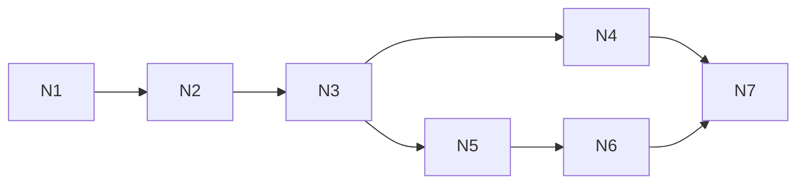

# Linked notes: test plan and build split

This page goes with [linked-notes](linked-notes.md). The rules live in that spec's §6 and §8.3; this page only says how to prove them and how to build them. Each worktree runs in isolation ([ADR-0008](../architecture/adr/0008-parallel-dev-isolation.md), [ADR-0017](../architecture/adr/0017-agent-verification-fixture-library.md)).

## 1. Test plan

### 1.1 Fixtures and bundle

The units live in `fixtures/units/linked-notes/`. Each is made through `notes.*` commands, with the named person as the actor.

| Key | Content |
|---|---|
| `notes-shared` | "Burnt Ledger" by `player-1`: links `[[Duke Varen]]` and `[[Quest log]]`, and has `2d6`. "Quest log" by the DM: links `[[Burnt Ledger]]`. "Duke Varen" by `player-2`: links `[[Burnt Ledger\|the ledger]]` |
| `notes-binned` | "Old rumours" by `player-2`, deleted by the DM (in the Recycle bin), body `Rumour: the Duke owes money` |
| `notes-second-campaign` | In `campaign-second`: "Burnt Ledger" with body `CANARY-OTHER` |

The bundle is **`notes`**: `base` + `player-2` + `campaign-second` + the three units. `fixtures:reset-load notes` prints the DM URL and both player links.

### 1.2 Tests

**Unit** (`src/shared/linked-notes/*.test.ts`, `src/server/features/linked-notes/collab.test.ts`):

- Title folding and live-title uniqueness; the "(restored)", "(restored 2)" names, shortened to 100 characters (FR-02, -05).
- `parseLinks`: `[[T]]`, `[[T\|l]]`, malformed links; `@Duke` alone is not a link (FR-07, -08).
- The rename rewrite, labels kept (FR-11).
- Applying a change at a version; a stale push gets `{accepted: false, updates}`; `clientId` binding (FR-14).
- The 48 KiB frame split and the 32 KiB limit (FR-21).

**Integration** (`src/server/features/linked-notes/*.test.ts`, over real sockets):

- `sync.load note` for the DM and players, binned notes included without bodies; create, rename, title clash, the 1,000 live cap (FR-01 to -03).
- **Recycle bin** (FR-04 to -06): delete → `open` / `push` get `not_found`, links to it go missing, search skips it, a new note may take its title; restore → text intact, links and backlinks resume, a clash renames; the 1,000-binned cap refuses a delete with the message; two restores at once → one, then a no-op ack.
- `ifMissing` create by two clients at once → one note (FR-10).
- Each accepted push is a stored row; folding every 100 changes; pruning to 1,000 rows / 1 MiB.
- **Crash** (FR-19): `PP_TEST_CRASH=notes.push:after-commit` → after the restart the change is there and clients resume; `before-commit` → never accepted, and the client resends it.
- A resync, or a scene activation, with a note open → the note re-opens and loses no change (FR-18).
- Backlinks refresh after a push, rename, delete or restore; sent only where a list changed (FR-12).
- `notes.here` on open, close and pruning (FR-16).
- Rename rewrite racing a push → both land; binned notes rewritten too (FR-11, -14).
- Campaign switch → close 4409 and the sessions are dropped (FR-20).
- Search results and a bench at the limits (FR-22). Nothing about notes in `event_log` (FR-24). A DB without the new tables boots.

**Campaign isolation** (`src/server/features/linked-notes/isolation.test.ts`):

- **Clients:** the DM, `player-1` (two tabs), `player-2` in the main campaign; a player in `campaign-second` after a switch; REST search with each token.
- **Script:** everyone opens Burnt Ledger and co-writes, with cursors; rename, delete, restore; switch campaigns and back; resync.
- **Checks:** no frame (snapshot, event, ack or signal) to a main-campaign client contains `CANARY-OTHER`, and none to the second campaign's clients contains a main-campaign title or body; another campaign's note ID → `not_found` on every intent and as a cursor target; search returns only the token's campaign; no frame carries a binned note's body; `leakScan` passes on every client; the captured server log has no title or body.

**E2E (thin)** (`e2e/linked-notes.e2e.ts`, bundle `notes`): two contexts type into Burnt Ledger at once and end up with the same text; a cursor tag and a who-is-here chip show; `@Du` + Enter inserts a Duke Varen chip; undo in one context reverts only its own text.

**Size:** `lazyLoadSizes` for `note` at the fixture and at both caps; the editor chunk in both bundles; `fsync` cost per push.

### 1.3 Browser walkthrough (test agent, three contexts)

Bundle `notes`, verify profile with `PP_TEST_MODE=1` (step 8 uses the drop-connection button). Contexts: `dm`, `player-1`, `player-2`. The server runs in the agent's Herdr pane (AGENTS §9.6).

| # | Who | Step | Expect |
|---|---|---|---|
| 1 | all | Open Notes | The same three notes for all; Recycle bin (1) |
| 2 | all | Open Burnt Ledger | The editor at once; three who-is-here chips; others' carets and selections in their colours |
| 3 | all | Type at once: DM line 1, P1 line 2, P2 line 3, ~20 characters each | All three texts match within 1 s, nothing lost or doubled |
| 4 | P1 | Ctrl+Z twice | Only P1's own typing goes |
| 5 | P2 | Type `@Qu`, press Enter; type `@Nobody`, press Esc; click the Duke Varen chip; go back, Alt+click it; then Backspace after a chip | A Quest log chip appears; `@Nobody` stays plain text; the click opens Duke Varen; Alt+click shows `[[Duke Varen]]`; Backspace removes the chip whole |
| 6 | DM | Rename "Quest log" to "Quest journal" | Everyone's chips in Burnt Ledger now read Quest journal |
| 7 | P1 | Delete Duke Varen while P2 has it open; open the Recycle bin; Restore | P2 sees the banner; Burnt Ledger's chip turns dotted; after Restore it's back for all, text intact, chip solid |
| 8 | P1 | Drop the connection for 5 s while typing, then reconnect | "Offline", then "Saved"; P1's text arrives and all texts match |
| 9 | agent, P2 | While P2 types, stop the server (Ctrl+C in its pane), wait 5 s, start it | Everyone shows "Offline", then reconnects; every character shown as "Saved" before the stop is there; P2's later typing arrives rebased |
| 10 | DM | Switch to `campaign-second`, then back | Players see "…is no longer available", then the wait screen (their links belong to the main campaign); the DM's Notes shows only the second campaign's Burnt Ledger. After switching back, players reconnect and the main notes are intact |

Evidence goes under `.verify/<run-id>/`, per AGENTS §9.6. Dice ("Note" label) and search are covered by the e2e and integration tests.

### 1.4 Session-sim-18

`session-sim-18` is `session-sim-17` plus the `notes` units (plus `player-2` and `campaign-second` if the sim lacks them). Its scan adds: `sync.load` answers for `note`, the raw `notes.*` signal frames, and a check that no frame crosses campaigns or carries a binned body. `upgrade:check` can then use sim-18 as its default (orchestrator, `scripts/`).

## 2. Build split

The slices are thin, one commit each. `fixtures:reset-load notes` works from N1 on.

| Slice | Branch | Does | Needs | Runs alongside | Shared-file hotspots (AGENTS §9.9) |
|---|---|---|---|---|---|
| N1 | `build/notes-core` | Three tables, the `note` lazy type, create / rename (title only) / delete / restore with both caps, fixtures and bundle, record isolation tests | — | — | `src/server/db/schema.ts`, `src/server/features/index.ts`, `fixtures/bundles/index.ts`, `docs/data-model/`, `docs/protocol/` |
| N2 | `build/notes-collab` | open / push / close, stored changes and folding, `clientId` binding, `notes.here`, the cursor signal and audience, crash tests, signal isolation tests, `fsync` measurement | N1 | — | `package.json` + `bun.lock` (all four `@codemirror/*` at once), signal registry, `docs/protocol/` |
| N3 | `build/notes-window` | The window in both clients: list, Recycle bin, the CodeMirror chunk with the collab client, carets, who-is-here chips, undo, offline typing, frame split, status and banners; **the first client slice, so it measures the editor chunk in both bundles**; e2e | N2 | — | `src/client/dm/windows.ts`, `src/client/player/windows.ts`, `size-table.ts`, golden window lists, `commands.ts` |
| N4 | `build/notes-search` | REST search with its isolation tests and bench, and the search box | N3 | N5, N6 | `src/server/app.ts` route mount (append) |
| N5 | `build/notes-links` | `parseLinks` and `note_link` rows, backlinks, chips (atomic, click vs Alt+click), the `@` / `[[` picker with Create note, create on click | N3 | N4 | `docs/protocol/` (`notes.backlinks`) |
| N6 | `build/notes-rename` | The rename rewrite as server changes, binned notes included | N5 | N4 | none |
| N8 | `build/notes-categories` | (#454) The `category` column and `notes.setCategory`; `category` on `notes.create`; + New's form, the picker's and missing chip's category step; category fold-outs, the Recent toggle, the taller Linked from box; fixtures get categories | — | N9 | `src/server/db/schema.ts` (add the column), `docs/protocol/`, `docs/data-model/` |
| N9 | `build/notes-token` | (#454) The player token menu (new append-only registry, like the DM's) and the Open / Create note entry in both clients | N8 for `category` on create (merge `main` when N8 lands) | N8 | `src/client/common/features/scenes-map/MapCanvas.tsx` (player right-click / long-press), new `src/client/player/features/scenes-map/token-menu.ts`, `src/client/dm/features/scenes-map/token-menu.ts` (append) |
| N7 | `fix/notes-sim` | `session-sim-18` and its scan additions | N4, N6 | — | `fixtures/bundles/` |

- **Hotspots to sequence:** `schema.ts` (N1 only), `package.json` (N2 only), the window registries (N3, append-only), `docs/protocol/` (N1, N2, N5: one at a time, in order).
