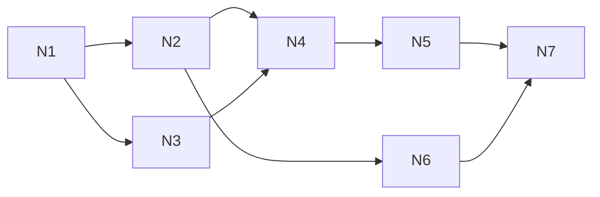

# Linked notes: test plan and build split

Companion to [linked-notes](linked-notes.md). Rules stay in the spec's §6 and §8.3; this page only says how to prove and build them. Isolated per worktree ([ADR-0008](../architecture/adr/0008-parallel-dev-isolation.md), [ADR-0017](../architecture/adr/0017-agent-verification-fixture-library.md)).

## 1. Test plan

### 1.1 Fixtures and bundle

Units in `fixtures/units/linked-notes/`, made through `notes.*` commands with the author as actor.

| Key | Content |
|---|---|
| `notes-shared` | Shared "Burnt Ledger" by `player-1`: body links `[[Duke Varen]]`, `[[Quest log]]`, has `2d6`; shared "Quest log" by the DM, links `[[Burnt Ledger]]` |
| `notes-private-p1` | `player-1` private "P1 CANARY-T1" (body `CANARY-B1`, links `[[Burnt Ledger]]`) and private "Duke Varen" |
| `notes-private-p2` | `player-2` private "P2 CANARY-T2" (body `CANARY-B2`, links `[[Quest log]]`) |
| `notes-private-dm` | DM private "DM CANARY-TD" (body `CANARY-BD`, links `[[Burnt Ledger]]`) |
| `notes-clash` | Shared "Duke Varen" by the DM, so `player-1` can read two notes with that title |

Bundle **`notes`** = `base` + `player-2` + all five units. `fixtures:reset-load notes` prints the DM URL and both player links.

### 1.2 Tests

| Level | What | Where |
|---|---|---|
| Unit | Title folding and clash set (FR-05); link parse `[[T]]`, `[[T\|l]]`, malformed; client resolution and chooser (FR-07–09); rename rewrite keeps labels (FR-11); collab apply at version, refusal over 32 KiB, epoch resume vs reload (FR-14, -16, -19) | `src/shared/linked-notes/*.test.ts`, `src/server/features/linked-notes/collab.test.ts` |
| Integration | Owner gate in `view()` for DM and players, flips as upsert / delete (FR-02, -04); `sync.load note` per viewer; caps and refusals (FR-06); save timer 2 s / 10 s with fake timers, crash before save loses ≤ 10 s (FR-17, `PP_TEST_CRASH=notes.saveBody:before-commit`); backlinks sent only on a changed list (FR-10); delete vs make-private byte-identical for others (FR-12); search sets and results (FR-23); nothing in `event_log` (FR-24); a DB without the tables boots (FR-25) | `src/server/features/linked-notes/*.test.ts` over real sockets |
| **Leak** (FR-26) | Clients: DM, `player-1` × 2 tabs, `player-2`, plus MCP calls and REST search. Script: load; each author edits their private note, renames it, shares and unshares it, deletes and recreates it; everyone co-writes "Burnt Ledger"; cursors; search for every canary; `resync`; a fresh connection at each step. Checks: **no raw frame** (snapshot, event, ack, signal) of any other client contains another author's `CANARY-*`; `leakScan` on every client (DM included); REST and MCP results contain no foreign canary; `event_log` rows hold no canary at all; captured server log has no title or body; per-connection `seq` and frame sizes for `player-2` are identical with and without `player-1`'s private edits | `src/server/features/linked-notes/leak.test.ts` (as `fog-of-war/leak.test.ts`) |
| E2E (thin) | Two contexts co-type in "Burnt Ledger" and converge; cursor tag visible; make private → the other sees the banner | `e2e/linked-notes.e2e.ts`, bundle `notes` |
| Size | `lazyLoadSizes` for `note` at the fixture and at the caps (spec §12); editor chunk size in both bundles | in the slices that add them |

### 1.3 Browser walkthrough (test agent, three contexts)

Bundle `notes`, verify profile with `PP_TEST_MODE=1` (step 7 uses the drop-connection button), contexts `dm`, `player-1`, `player-2`.

| # | Who | Step | Expect |
|---|---|---|---|
| 1 | all | Open Notes | DM: Burnt Ledger, Quest log, Duke Varen (shared), DM CANARY-TD. P1: those shared notes plus its two private ones. P2: shared plus P2 CANARY-T2. Nobody sees another's private notes |
| 2 | all | Open Burnt Ledger, Edit | Each sees the others' name chips, then carets in their colours |
| 3 | all | Type at once: DM line 1, P1 line 2, P2 line 3, ~20 characters each | All three bodies identical within 1 s; no character lost or doubled |
| 4 | P1 | Click `[[Duke Varen]]` | Chooser: Private, Shared |
| 5 | P2 | Click `[[Duke Varen]]` | Opens the shared one; no chooser |
| 6 | P2 | Type `[[Qu`: the list offers Quest log. Then type `[[New Lead]]`, Done, click it | A shared "New Lead" opens (OQ-03 pick); DM and P1 see it in the list |
| 7 | P1 | Drop P1's connection (test-mode button) for 5 s while typing, reconnect | P1's text arrives, rebased; all equal |
| 8 | P1 | Burnt Ledger is P1's: switch it to private while DM and P2 are in it | DM and P2: "This note is no longer available" + Copy my text; it leaves their lists |
| 9 | P2 | Search `CANARY` | Only P2 CANARY-T2 |
| 10 | DM | Roll `2d6` from Quest log | Game log line labelled "Note" |

Evidence per AGENTS §9.6 under `.verify/<run-id>/`.

### 1.4 Session-sim-18

`session-sim-18` = `session-sim-17` + the five `notes` units, with `player-2` added if the sim lacks one. Its leak scan adds:

- the first record type hidden from the DM, so the DM client is scanned too;
- lazy `sync.load` acks for `note` on every client;
- raw signal frames (`notes.updates`, `notes.cursor`, `notes.backlinks`, `notes.closed`) checked for foreign canaries;
- an `event_log` scan, which must find no note data.

`upgrade:check` can then default to sim-18 (orchestrator, `scripts/`).

## 2. Build split

Thin slices, one commit each, `fixtures:reset-load notes` working from the first.

| Slice | Branch | Does | Needs | Shared-file hotspots (AGENTS §9.9) |
|---|---|---|---|---|
| N1 | `build/notes-core` | Tables, `note` lazy type with `ownerOf`, owner gate in `records.ts`, create / rename / share / delete commands, caps, fixtures + bundle, **leak tests on records** | — | `src/server/ws/records.ts` + `testing/` (lock), `src/server/db/schema.ts`, `src/server/features/index.ts`, `fixtures/bundles/index.ts`, `docs/protocol/`, `docs/data-model/` |
| N2 | `build/notes-collab` | Sessions, open / push / close, save timer, epoch, `note_link`, backlinks signal, cursor signal + audience, crash test; leak tests on signals | N1 | `package.json` + `bun.lock` (all four `@codemirror/*`, one lock), signal registry |
| N3 | `build/notes-search` | REST search + its leak tests | N1 | `src/server/app.ts` route mount (append) |
| N4 | `build/notes-window` | Window in both clients: list, rendered read view, links, chooser, create-on-click, backlinks, search box; `[[…]]` hook in `MarkdownLite` | N2, N3 | `src/client/dm/windows.ts`, `src/client/player/windows.ts`, `size-table.ts`, golden window lists, `commands.ts`, `MarkdownLite.tsx` (compendium's file: orchestrator assigns) |
| N5 | `build/notes-editor` | CodeMirror chunk, collab client, carets, `[[` tooltip, offline typing, banners and Copy my text; **measures the chunk in both bundles**; e2e | N4 | none new |
| N6 | `build/notes-rename` | Rename rewrite through sessions (OQ-04 pick) | N2 | none |
| N7 | `fix/notes-sim` | `session-sim-18`, its leak-scan additions, MCP client drops `note` frames (agent-api, OQ-13) | N5, N6 | `fixtures/bundles/`, `src/mcp/client.ts` (assigned) |

- **At once:** N2 with N3; N6 with N4 and N5.
- **Hotspots to sequence:** `records.ts` (N1 only), `package.json` (N2 only), the window registries (N4, append-only), `MarkdownLite.tsx` (N4, by assignment).
