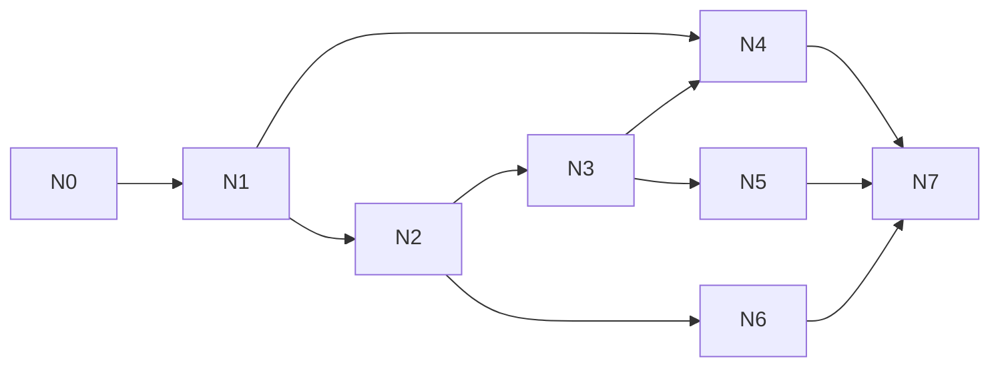

# Linked notes: test plan and build split

This page goes with [linked-notes](linked-notes.md). The rules live in that spec's §6 and §8.3; this page only says how to prove them and how to build them. Each worktree runs in isolation ([ADR-0008](../architecture/adr/0008-parallel-dev-isolation.md), [ADR-0017](../architecture/adr/0017-agent-verification-fixture-library.md)).

## 1. Test plan

### 1.1 Fixtures and bundle

The units live in `fixtures/units/linked-notes/`. Each is made through `notes.*` commands, with the note's author as the actor.

| Key | Content |
|---|---|
| `notes-shared` | Shared "Burnt Ledger" by `player-1`: links `[[Duke Varen]]` and `[[Quest log]]`, and has `2d6`. Shared "Quest log" by the DM: links `[[Burnt Ledger]]` |
| `notes-private-p1` | `player-1`'s private "P1 CANARY-T1" (body `CANARY-B1`, links `[[Burnt Ledger]]`) and private "Duke Varen" |
| `notes-private-p2` | `player-2`'s private "P2 CANARY-T2" (body `CANARY-B2`, links `[[Quest log]]`) |
| `notes-private-dm` | The DM's private "DM CANARY-TD" (body `CANARY-BD`, links `[[Burnt Ledger]]`) |
| `notes-clash` | A shared "Duke Varen" by the DM, so `player-1` can read two notes with that title |

The bundle is **`notes`**: `base` + `player-2` + all five units. `fixtures:reset-load notes` prints the DM URL and both player links.

### 1.2 Tests

**Unit** (`src/shared/linked-notes/*.test.ts`, `src/server/features/linked-notes/collab.test.ts`):

- Title folding and the two uniqueness sets (FR-05).
- Link parsing: `[[T]]`, `[[T\|l]]` and malformed links.
- Client-side link resolution and the chooser (FR-07 to -09).
- The rename rewrite keeps labels (FR-11).
- Applying a change at a version; a stale push gets `{accepted: false, updates}`; `clientId` binding (FR-14).
- The 48 KiB frame split and the 32 KiB limit (FR-19).

**Integration** (`src/server/features/linked-notes/*.test.ts`, over real sockets):

- The owner gate for the DM and for players. The `note` provider returns every campaign row (FR-02).
- `sync.load note` for each viewer.
- Share and copy-private (FR-04); limits and refusals (FR-06).
- Each accepted push is a stored row; folding every 100 changes; pruning to 1,000 rows / 1 MiB.
- **Crash** (FR-17):
  - `PP_TEST_CRASH=notes.push:after-commit` → after the restart the change is there and clients resume.
  - `before-commit` → the push was never accepted, and the client resends it.
- A resync, or a scene activation, with a note open → the note re-opens and loses no change (FR-16).
- Backlinks refresh after a push, rename, share, copy-private or delete, sent only where a list changed (FR-10).
- Campaign switch → close 4409 and the sessions are dropped (FR-18).
- Search sets and results (FR-23), plus a bench at the limits.
- Nothing about notes in `event_log` (FR-24).
- A DB without the new tables boots (FR-25).

**Leak** (`src/server/features/linked-notes/leak.test.ts`, like `fog-of-war/leak.test.ts`):

- **Clients:** the DM, `player-1` in two tabs, `player-2`; plus MCP calls and REST search.
- **Script:** load the bundle. Everyone opens Burnt Ledger and Quest log, so every link target is open. With the targets open, each author:
  1. edits their private note;
  2. adds and removes a `[[Burnt Ledger]]` link;
  3. renames it;
  4. shares a second private note and copies one to private;
  5. deletes it and creates it again.

  Then everyone co-writes Burnt Ledger, with cursors; searches for every canary; resyncs; and opens a fresh connection at each step.
- **Checks:**
  - No raw frame (snapshot, event, ack or signal) of any other client contains another author's `CANARY-*`.
  - `leakScan` passes on every client, the DM included.
  - Held `note` IDs ⊆ that client's readable IDs.
  - REST and MCP results contain no other author's canaries.
  - `event_log` contains no canary at all.
  - The captured server log contains no title or body.
  - `player-2`'s `seq` values and frame sizes are the same with and without `player-1`'s private edits.

**E2E (thin)** (`e2e/linked-notes.e2e.ts`, bundle `notes`): two contexts type into Burnt Ledger at once and end up with the same text; a cursor tag shows.

**Size:**

- `lazyLoadSizes` for `note`, at the fixture and at the limits (spec §12).
- The editor chunk in both bundles.
- `fsync` cost per push.

### 1.3 Browser walkthrough (test agent, three contexts)

Bundle `notes`, verify profile with `PP_TEST_MODE=1` (step 7 uses the drop-connection button). Contexts: `dm`, `player-1`, `player-2`.

| # | Who | Step | Expect |
|---|---|---|---|
| 1 | all | Open Notes | DM: the three shared notes and DM CANARY-TD. P1: the shared notes and its two private notes. P2: the shared notes and P2 CANARY-T2 |
| 2 | all | Open Burnt Ledger, press Edit | Each sees the others' name chips, then their carets in their colours |
| 3 | all | Type at the same time: DM on line 1, P1 on line 2, P2 on line 3, about 20 characters each | All three texts are the same within 1 s, with nothing lost or doubled |
| 4 | P1 | Click `[[Duke Varen]]` | A chooser: Private, Shared |
| 5 | P2 | Click `[[Duke Varen]]` | The shared note opens, with no chooser |
| 6 | P2 | Type `[[Qu` (the list offers Quest log), then type `[[New Lead]]`, press Done and click the link | A shared "New Lead" opens, and the DM and P1 see it in their lists |
| 7 | P1 | Drop the connection for 5 s while typing, then reconnect | P1's text arrives, rebased, and all three texts match |
| 8 | P1 | Make private on Burnt Ledger | P1 gets a private copy; DM and P2 keep the shared note open, unchanged |
| 9 | P2 | Search for `CANARY` | Only P2 CANARY-T2 |
| 10 | DM | Roll `2d6` from Quest log | The game log line is labelled "Note" |

Evidence goes under `.verify/<run-id>/`, per AGENTS §9.6.

### 1.4 Session-sim-18

`session-sim-18` is `session-sim-17` plus the five `notes` units (plus `player-2` if the sim lacks one). Its leak scan adds:

- the DM client, since `note` is the first type the DM can't see;
- the `sync.load` answers for `note`;
- the raw signal frames (`notes.updates`, `notes.cursor`, `notes.backlinks`, `notes.closed`);
- an `event_log` scan.

`upgrade:check` can then use sim-18 as its default (orchestrator, `scripts/`).

## 2. Build split

The slices are thin, one commit each. `fixtures:reset-load notes` works from N1 on.

| Slice | Branch | Does | Needs | Shared-file hotspots (AGENTS §9.9) |
|---|---|---|---|---|
| N0 | `fix/owner-gate` | `ownerOf` in `records.ts`; leak helper for held ⊆ readable; tests with a probe type | — | `src/server/ws/records.ts`, `src/server/ws/testing/convergence.ts`, live-sync §8, `docs/protocol/` |
| N1 | `build/notes-core` | All three tables, the `note` lazy type, create / rename / share / copy-private / delete, limits, fixtures and bundle, **record leak tests** | N0 | `src/server/db/schema.ts`, `src/server/features/index.ts`, `fixtures/bundles/index.ts`, `docs/data-model/`, `docs/protocol/` |
| N2 | `build/notes-collab` | open / push / close, stored changes and folding, `clientId` binding, link rows, backlinks, cursor signal and audience, crash tests, **signal leak tests**, `fsync` measurement | N1 | `package.json` + `bun.lock` (all four `@codemirror/*` at once), signal registry, `docs/protocol/` |
| N3 | `build/notes-window` | The window in both clients: list, rendered view, links, chooser, create-on-click, backlinks, copy-private; the `[[…]]` hook in `MarkdownLite` | N2 | `src/client/dm/windows.ts`, `src/client/player/windows.ts`, `size-table.ts`, golden window lists, `commands.ts`, `MarkdownLite.tsx` (compendium's file; the orchestrator assigns it) |
| N4 | `build/notes-search` | REST search with its leak tests and bench, then the search box | N1 (server), N3 (box) | `src/server/app.ts` route mount (append) |
| N5 | `build/notes-editor` | CodeMirror chunk, collab client, carets, the `[[` tooltip, offline typing, frame split, banners; **measures the chunk in both bundles**; e2e | N3 | none new |
| N6 | `build/notes-rename` | Rename rewrite as server changes (OQ-04's pick) | N2 | none |
| N7 | `fix/notes-sim` | `session-sim-18` and its leak-scan additions | N4, N5, N6 | `fixtures/bundles/` |

- **At the same time:**
  - N4's server part alongside N2.
  - N4's box, N5 and N6 together, after N3.
- **Hotspots to sequence:**
  - `records.ts` (N0 only).
  - `schema.ts` (N1 only).
  - `package.json` (N2 only).
  - The window registries (N3, append-only).
  - `MarkdownLite.tsx` (N3, by assignment).
