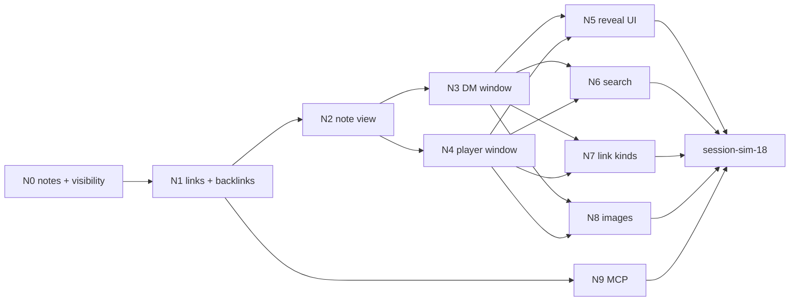

# Linked notes: test plan and build split

Companion to [linked-notes](linked-notes.md), which holds every rule (§6, §8.3) and the gate questions (§15). Nothing here adds a rule. Slices and walkthrough steps marked *(gate)* depend on a pick and go or stay with it.

## Test plan

Isolated per worktree ([ADR-0008](../architecture/adr/0008-parallel-dev-isolation.md)): `:memory:` per test file, port 0; walkthroughs on profile `verify`. Agent loop per [ADR-0017](../architecture/adr/0017-agent-verification-fixture-library.md).

### Fixtures

`fixtures/units/linked-notes/`, canonical campaign `Fixture Campaign`, `player-1`, `player-2`.

| Unit | Slice | Contents |
|---|---|---|
| `notes-1` | N0 | `Mayor Harbin` (Everyone; DM part holds `NOTES-CANARY-DMPART`; body has `[the ledger](NOTES-CANARY-MDTARGET.md)`); `Thieves' Den` (player-1 only; body holds `NOTES-CANARY-P1`); `The Traitor Duke` (hidden; body holds `NOTES-CANARY-HIDDEN`); `Ambush Prep` (hidden) |
| `notes-second` | N0 | In `campaign-second`: a note holding `NOTES-CANARY-SECOND` |
| `notes-links` | N1 | Mayor Harbin body: `[[The Traitor Duke]]`, an alias to it, `[[Thieves' Den]]`, unresolved `[[NOTES-CANARY-UNRESOLVED]]`, a dead link to a deleted note titled `Burnt NOTES-CANARY-DEAD`; DM part: link to Thieves' Den with alias `NOTES-CANARY-DMALIAS`; Ambush Prep links to Mayor Harbin |
| `notes-kinds` | N7 *(gate)* | Links: `[[pc:Mira]]`, a custom creature named `NOTES-CANARY-CREATURE`, a shared homebrew, an imported spell, an unshared homebrew `NOTES-CANARY-HOMEBREW` |
| `notes-images` | N8 *(gate)* | `notes-map` on Thieves' Den; `notes-secret` on The Traitor Duke |

**Bundle `linked-notes`** = `base` + `player-2` + `images` + `char-mira` + `char-thorn` + `campaign-second` + the units merged so far; each slice adds its unit.

### Levels

| Level | What | Fixtures |
|---|---|---|
| Unit | Resolve + compile (aliases, placeholders, 100 links, markdown targets, malformed tokens, `contentTag` stable across another note's reveal, words of `publicText` = rendered words); visibility fns; whitelist keys exact; token parser fuzz; sentinel renderer with table, quote, list, bold; draft and seen stores | In-code |
| Integration | Leak table below; convergence with the loaded set (FR-SYNC-38); `previewAs` bytes = load after a real reveal; `conflict`; binding; restart → identical loads; crash hooks + `state:digest`; `upgrade:check` | `linked-notes` |
| CON-44 | `con44.test.ts`: the four types in no snapshot on heavy harness + 500 notes, DM and players byte-identical; `lazyLoadSizes` for §12 | heavy + direct rows |
| E2E (thin) | `e2e/linked-notes.e2e.ts`: DM writes a link and reveals, player-1 reads and follows, player-2 sees nothing | `linked-notes` |

### Leak tests

`src/server/features/linked-notes/leak.test.ts`, real sockets, like `party-board/leak.test.ts` and `fog-of-war/leak.test.ts`. Every row runs per player, on snapshot, all event frames, all acks, before and after reconnect and restart. **Scan:** `c.raw()` for each canary and hidden title, in **literal and `fold()`ed form**, plus `leakScan` (it reads only `sync.load` acks, so search and backlink acks rely on the raw scan). **player-1** has Thieves' Den revealed; **player-2** doesn't.

| Test `FR-NOTES-nn leak:` | Slice | player-1 | player-2 |
|---|---|---|---|
| title, id | N0 | Has Den's; never the Duke's | Neither, in any frame |
| body | N0 | Den's `publicText`; no hidden canary | No canary |
| DM part, DM alias | N0, N1 | No canary after the note is revealed | Same |
| timestamps, `rev` | N0 | No `createdAt` / `updatedAt` / `rev` key on a note record | Same |
| audience | N0 | `players`, no player IDs | No record |
| error wording | N0 | `notes.save` on hidden / visible / unknown → identical `forbidden` | Same |
| `sync.load` | N0 | Hidden IDs absent; `note-dm` `forbidden` / `invalid` per FR-NOTES-15 | Same |
| quiet | N0 | DM-part and hidden-note edits → `expectNoFrame`, `seq` unmoved | Same; plus every edit to Den |
| reveal walk | N0 | Hidden → player-1 → all → hide | Nothing until all; delete on hide |
| hide = delete | N0 | Whole frames byte-equal apart from `seq` and IDs | Same |
| markdown target, malformed | N0 | `NOTES-CANARY-MDTARGET` never; no `[[` in any frame | Same |
| event log | N0 | Payloads hold no canary (DB read) | n/a |
| campaign scope | N0 | No `NOTES-CANARY-SECOND` | Same |
| link target | N1 | Span for Den; none for the Duke, dead or unresolved | No Den span; `(unknown)` shows |
| display text | N1 | Frame = expected string per spec §7.2 | Same |
| hidden vs deleted | N1 | Same bytes in `publicText`; no `NOTES-CANARY-DEAD`, `-UNRESOLVED` | Same |
| backlinks, count, snippet | N1 | Den lists Mayor Harbin via body only, count exact; snippet from `publicText`, no `dmPart` key | On Den's ID → `[]`, bytes = an unknown ID's |
| flip: gain | N1 | Reveal Duke to player-1: span appears, no body resent | No frame |
| flip: loss | N1 | Hide Duke from player-1: span goes; text falls back | No frame |
| hidden target quiet | N1 | Hidden target renamed, deleted, revealed to player-2 → source reader `expectNoFrame`, `seq` unmoved | Same, mirrored |
| hidden → renamed → revealed | N1 | Only the new title arrives; old title never | Same |
| binding | N1 | Creating `NOTES-CANARY-UNRESOLVED`'s note → no frame | Same |
| preview | N1 | `previewAs` is DM only; bytes = load after a real reveal | Same |
| dice label | N2 | Tray request from Den carries label "Note"; no title | n/a |
| notification *(gate)* | N5 | Generic text, Den's `noteId`, no title; null after hide; survives reconnect as "no longer have" | No row |
| search hit vs miss | N6 | Finds Den; hidden title → bytes = nonsense query | Den's title → bytes = nonsense query |
| search through a mention | N6 | A target's title doesn't hit the note mentioning it | Same |
| search counts, snippet | N6 | Only visible; from `publicText`; fold-form scan clean | Same |
| search set | N6 | Cache fill touches visible notes only (spy on the word fn) | Same |
| recap, game log | N6 | `recap.query` body has no canary; roll from a note has no note text | Same |
| kinds *(gate)* | N7 | Span for Mira and the shared homebrew; none for `NOTES-CANARY-CREATURE`, `-HOMEBREW`; unshare and character delete flip live | Same |
| attachments *(gate)* | N8 | `notes-map` ID; never `notes-secret` | Neither |
| MCP *(gate)* | N9 | `note_get` runs as DM; `note_update` refuses a revealed note; no tool reachable with a link token | Same |

### Browser walkthrough

Test agent; `fixtures:reset-load linked-notes --profile verify`, built client, own Herdr pane per AGENTS §9.6. **A** DM, **B** `player-1`, **C** `player-2`. Throughout, B's and C's WS frames are scanned for canaries. Evidence under `.verify/<run-id>/`; teardown per AGENTS §9.6.

| # | DM (A) | Players (B, C) | Expected |
|---|---|---|---|
| 1 | Open Notes | B, C open Notes | A: 4 notes + badges. B: Mayor Harbin, Thieves' Den. C: Mayor Harbin. No other count |
| 2 | Read Mayor Harbin | B, C read it | A: all links, ○ marks, struck dead link. B: Den is a link, Duke `(unknown)`. C: Den and Duke `(unknown)`. As spec §7.2 |
| 3 | New note "Old Pier": type `[[Tra`, pick The Traitor Duke, add `\|the dock`, Save | — | Suggestions work; note hidden; "Hidden from players". B, C: no frame |
| 4 | In Old Pier write `[[Harbour Master]]`, Save, click it | — | Dotted link; click creates the note; the link is live, no players' frame |
| 5 | Preview Old Pier as Player 2 *(gate)* | — | Band shown; text as C reads it after step 6 |
| 6 | Reveal… Chosen: Player 2, "Tell them" | C: toast, Open | Dialog lists "the dock" under What they'll read. C reads; B: no frame |
| 7 | Reveal The Traitor Duke to Player 1 | B has Mayor Harbin open | B's `(unknown)` becomes a live link, no reload. C unchanged |
| 8 | Edit the DM part of Mayor Harbin, Save | B, C watch | No frame; no Updated mark |
| 9 | Edit its body, Save | B, C | Live update; Updated mark clears on read *(gate)* |
| 10 | Hide Old Pier | C has it open | C: "This note isn't available"; notification says "A note you no longer have" |
| 11 | Reveal Ambush Prep to Player 1; delete it; check Mayor Harbin's backlinks | B has Ambush Prep open | B: same words as C in step 10. A: backlink gone; confirm showed the count |
| 12 | Hide Thieves' Den while B is dropped | B reconnects | B's Den gone; open view "isn't available"; list reloaded |
| 13 | — | B searches "Traitor", "xyzzy"; C searches "Traitor", "Thieves" | B finds the Duke, nothing for xyzzy. C: all empty, same look. Palette matches |
| 14 | Type in a note; reload the tab | — | "Unsaved draft · Restore · Discard"; Restore brings the text back |
| 15 | `state:digest` for a baseline; type; send Save with the crash hook `notes.save:after-commit`; restart | B, C rejoin | Save committed, digest differs only by that note; draft cleared after reload |
| 16 | Type; drop A's connection; type more; hard-kill server; restart; `:before-commit` hook on Save | B, C rejoin | A's banner + "Saved on this browser"; text intact; digest = baseline; Save works on return |
| 17 | Reveal with `notes.reveal:after-commit` crash; restart | Gainer rejoins | Note visible, toast row there, digest consistent; `:before-commit`: nothing visible |
| 18 | Two A tabs edit one note; save both | — | Second gets "Changed elsewhere" + Keep mine / Take theirs; nothing lost. Reveal in the same tab raises no banner |
| 19 | Switch campaign to Second Campaign; back | B, C wait, rejoin | A sees only that campaign's note; nothing crosses; views reload |
| 20 | *(gate)* Click pc, creature and compendium links; unshare the homebrew | B | A opens each; B's name goes plain on unshare, live |
| 21 | *(gate)* Attach `notes-map` to Old Pier; reveal to B; hide | B sees the image; C never | "Used in" lists the note; delete refused until removed |
| 22 | *(gate)* `bun run mcp:call note_get`, `note_update` on hidden and on revealed | — | Hidden updates, result names audience; revealed refused; no reveal tool |
| 23 | *(gate, if kept)* Pop out a note | B too | Own window, same load; "isn't available" on hide |

### Test IDs

`notes-window`, `notes-list`, `notes-list-toggle`, `notes-row` (+ `data-record-id`), `notes-filter`, `notes-search`, `notes-new`, `notes-state`, `notes-edit`, `notes-editor-body`, `notes-editor-dm`, `notes-save`, `notes-counter`, `notes-draft`, `notes-draft-restore`, `notes-draft-discard`, `notes-conflict`, `notes-conflict-keep`, `notes-conflict-theirs`, `notes-reveal-open`, `notes-reveal-dialog`, `notes-reveal-will-read`, `notes-reveal-that-too`, `notes-preview-as`, `notes-link` (+ `data-record-id` when it has a target), `notes-link-suggest`, `notes-back`, `notes-forward`, `notes-backlinks`, `notes-backlink-row`, `notes-dm-part`, `notes-unavailable`.

## Build split

Starts after the DM's gate; OQ-13 (the verb) fixes names before N0. Upgrade guards already merged (#424). `check` before commit, CI in the background (AGENTS §9.4.1). Hotspots per AGENTS §9.9.

| Slice | Branch | Delivers | Hotspots (shared) | Runs at once with |
|---|---|---|---|---|
| N0 | `fix/notes-core` | `note` table, `note` / `note-body` / `note-dm`, resolve + compile, create / save / delete / reveal, visibility, `notes-1`, `notes-second`, bundle, N0's leak rows, CON-44 test. No UI | `db/schema.ts`, `src/shared/events/linked-notes.ts` + index, `features/index.ts`, `fixtures/bundles/index.ts`, `docs/data-model/`, `docs/protocol/` | Alone in the schema lane |
| N1 | `fix/notes-links` | `note_link`, derived `note-links`, flips, binding, `notes.backlinks`, `notes.previewAs`, `notes-links`, N1's leak rows. No UI | `db/schema.ts`, docs | Alone in the schema lane |
| N2 | `build/notes-view` | Shared read-only note view in `@ui`: sentinels + `MarkdownLite` seam (proved on table, quote, list, bold), dice label, back / forward, backlinks panel, "isn't available". `notes.window` base def + **pending size rows and golden entries for both clients**, so N3 and N4 only fill their own lines. Component tests, no window yet | `compendium/MarkdownLite.tsx`, `markdown.ts` (assignment), `size-table.ts`, golden lists, replay-harness sets | N9 |
| N3 | `build/notes-dm-window` | DM list, editor, `[[` suggestions, draft, conflict, DM link rendering, delete | `dm/windows.ts`, its line in `size-table.ts` | **N4**, N9 |
| N4 | `build/notes-player-window` | Player list, read-only view, New / Updated *(gate)* | `player/windows.ts`, its line in `size-table.ts` | **N3**, N9 |
| N5 | `build/notes-reveal` | Reveal dialog, state line, Preview *(gate)*, toast + `note-revealed` kind + views + scrub *(gate)* | `notifications/kinds.ts`, `dm/` + `player/notification-views.ts` | N6, N7, N8, N9 |
| N6 | `build/notes-search` | Word cache, `notes.search`, boxes in both windows, palette, bench, N6's leak rows | `play-shell/commands.ts`, `scripts/` bench list | N5, N7, N8, N9 |
| N7 | `build/notes-link-kinds` *(gate)* | Character, creature, compendium targets; entry and entity-delete hooks; `notes-kinds` | `compendium/` entry commands + new hook file, `entities/` delete command (assignment) | N5, N6, N8, N9 |
| N8 | `build/notes-images` *(gate)* | Images in editor and view, `assetUses` kind, `notes-images` | `assets-pipeline/manage.ts`, `shared/assets-pipeline/manage.ts` (assignment) | N5, N6, N7, N9 |
| N9 | `build/notes-mcp` *(gate)* | Five tools, `src/mcp/tools/notes.ts`, walkthrough 22 | `src/mcp/server.ts` one line | Anything after N1 |

**Why these can truly run at once:** N3 and N4 share only N2's finished view and touch different client folders; N2 reserved their table rows. N5–N8 touch the note header, the list pane, the link rows and the attach control respectively; the second to land merges `main` and re-runs goldens if needed. Nothing the player window needs is built in a DM slice.

Then `session-sim-18`, then a playtest script for the DM (sprint 15 item 4b).

### session-sim-18: what the leak scan must add

Bundle `session-sim-18` = `session-sim-17` + the units that stayed.
- Scan every player frame and ack, literal and folded, for all canaries, and for the IDs of notes **never visible to that player**, read from the DB at each step, not a fixed list.
- Scan `recap.query` bodies, palette search acks and compendium REST bodies for canaries.
- Probes per player at each step: search a hidden title vs nonsense, compare bytes; `notes.backlinks` and `sync.load` on a hidden ID vs a random one; a forged `notes.save`.
- A reveal → hide cycle during the running fight, with a roll from the note; a DM-part edit with `expectNoFrame` for players.
- Hard kill mid-save and mid-reveal: `state:digest` matches the commit, DM draft restored.
- The DM's snapshot and every player's stay at the pre-notes size, plus `note-revealed` rows.
