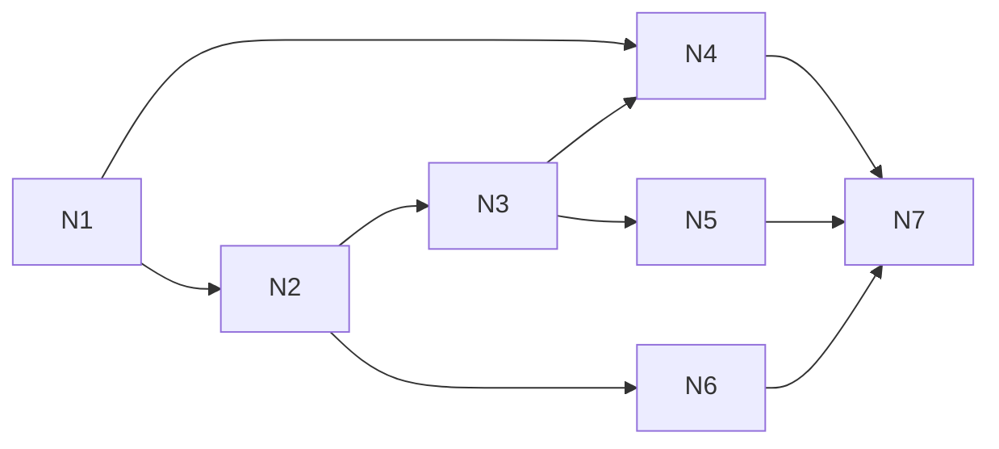

# Linked notes: test plan and build split

This page goes with [linked-notes](linked-notes.md). The rules live in that spec's §6 and §8.3; this page only says how to prove them and how to build them. Each worktree runs in isolation ([ADR-0008](../architecture/adr/0008-parallel-dev-isolation.md), [ADR-0017](../architecture/adr/0017-agent-verification-fixture-library.md)).

## 1. Test plan

### 1.1 Fixtures and bundle

The units live in `fixtures/units/linked-notes/`. Each is made through `notes.*` commands, with the named person as the actor.

| Key | Content |
|---|---|
| `notes-shared` | "Burnt Ledger" by `player-1`: links `[[Duke Varen]]` and `@Quest log`, and has `2d6`. "Quest log" by the DM: links `[[Burnt Ledger]]`. "Duke Varen" by `player-2`: `@Burnt Ledger's ink` |
| `notes-deleted` | "Old rumours" by `player-2`, deleted by the DM (in Recently deleted) |
| `notes-second-campaign` | In `campaign-second`: "Burnt Ledger" with body `CANARY-OTHER` |

The bundle is **`notes`**: `base` + `player-2` + `campaign-second` + the three units. `fixtures:reset-load notes` prints the DM URL and both player links.

### 1.2 Tests

**Unit** (`src/shared/linked-notes/*.test.ts`, `src/server/features/linked-notes/collab.test.ts`):

- Title folding and uniqueness (FR-02).
- `parseLinks`: `[[T]]`, `[[T\|l]]`, malformed links; `@` at a boundary, longest title, `'s`, trailing punctuation, `mira@x.com`, no match → one word (FR-05, -06).
- The rename rewrite in both forms, labels kept, `@New` → `[[New]]` where a longer title would match (FR-09).
- Applying a change at a version; a stale push gets `{accepted: false, updates}`; `clientId` binding (FR-13).
- The 48 KiB frame split and the 32 KiB limit (FR-20).

**Integration** (`src/server/features/linked-notes/*.test.ts`, over real sockets):

- `sync.load note` for the DM and players; create, rename, delete, restore, title clash, limits (FR-01 to -04).
- `ifMissing` create by two clients at once → one note (FR-07).
- Each accepted push is a stored row; folding every 100 changes; pruning to 1,000 rows / 1 MiB.
- **Crash** (FR-18): `PP_TEST_CRASH=notes.push:after-commit` → after the restart the change is there and clients resume; `before-commit` → never accepted, and the client resends it.
- A resync, or a scene activation, with a note open → the note re-opens and loses no change (FR-17).
- Backlinks refresh after a push, rename, delete or restore, in both link forms; creating "Burnt Ledger's" re-resolves an `@` link; sent only where a list changed (FR-10).
- `notes.here` on open, close and pruning (FR-15).
- Rename rewrite racing a push → both land (FR-09, -13).
- Purge after 7 days with the fixed clock (FR-04).
- Campaign switch → close 4409 and the sessions are dropped (FR-19).
- Search results and a bench at the limits (FR-21). Nothing about notes in `event_log` (FR-23). A DB without the new tables boots.

**Campaign isolation** (`src/server/features/linked-notes/isolation.test.ts`):

- **Clients:** the DM, `player-1` (two tabs), `player-2` in the main campaign; a player in `campaign-second` after a switch; REST search with each token.
- **Script:** everyone opens Burnt Ledger and co-writes, with cursors; rename, delete, restore; switch campaigns and back; resync.
- **Checks:** no frame (snapshot, event, ack or signal) to a main-campaign client contains `CANARY-OTHER`, and none to the second campaign's clients contains a main-campaign title or body; another campaign's note ID → `not_found` on every intent and as a cursor target; search returns only the token's campaign; `leakScan` passes on every client; the captured server log has no title or body.

**E2E (thin)** (`e2e/linked-notes.e2e.ts`, bundle `notes`): two contexts type into Burnt Ledger at once and end up with the same text; a cursor tag and a who-is-here chip show; undo in one context reverts only its own text.

**Size:** `lazyLoadSizes` for `note` at the fixture and at the limits; the editor chunk in both bundles; `fsync` cost per push.

### 1.3 Browser walkthrough (test agent, three contexts)

Bundle `notes`, verify profile with `PP_TEST_MODE=1` (step 8 uses the drop-connection button). Contexts: `dm`, `player-1`, `player-2`.

| # | Who | Step | Expect |
|---|---|---|---|
| 1 | all | Open Notes | The same three notes for all; Recently deleted (1) |
| 2 | all | Open Burnt Ledger | The editor straight away; three chips; others' carets in their colours |
| 3 | all | Type at once: DM line 1, P1 line 2, P2 line 3, ~20 characters each | All three texts match within 1 s, nothing lost or doubled |
| 4 | P1 | Ctrl+Z twice | Only P1's own typing goes |
| 5 | P2 | Type `@Qu`, pick Quest log; then click the `Duke Varen` link; then Alt+click it | The link shows; the click opens Duke Varen; Alt+click shows `[[Duke Varen]]` with the caret inside |
| 6 | DM | Rename "Quest log" to "Quest journal" | Everyone's Burnt Ledger now reads `@Quest journal` |
| 7 | P1 | Type `[[New Lead]]`, click it | "New Lead" opens; it appears in everyone's list |
| 8 | P1 | Drop the connection for 5 s while typing, then reconnect | "Offline", then "Saved"; P1's text arrives and all texts match |
| 9 | DM | Delete Burnt Ledger while P1 and P2 have it open; P2 presses Restore | Both see the banner; after Restore it's back for all, text intact |
| 10 | P2 | Roll `2d6` from Burnt Ledger; search `ledger` | The game log line says "Note"; Burnt Ledger is the hit |

Evidence goes under `.verify/<run-id>/`, per AGENTS §9.6.

### 1.4 Session-sim-18

`session-sim-18` is `session-sim-17` plus the `notes` units (plus `player-2` and `campaign-second` if the sim lacks them). Its scan adds: `sync.load` answers for `note`, the raw `notes.*` signal frames, and a check that no frame crosses campaigns. `upgrade:check` can then use sim-18 as its default (orchestrator, `scripts/`).

## 2. Build split

The slices are thin, one commit each. `fixtures:reset-load notes` works from N1 on.

| Slice | Branch | Does | Needs | Shared-file hotspots (AGENTS §9.9) |
|---|---|---|---|---|
| N1 | `build/notes-core` | Three tables, the `note` lazy type, create / rename (title only) / delete / restore / purge, limits, fixtures and bundle, isolation tests for records | — | `src/server/db/schema.ts`, `src/server/features/index.ts`, `fixtures/bundles/index.ts`, `docs/data-model/`, `docs/protocol/` |
| N2 | `build/notes-collab` | open / push / close, stored changes and folding, `clientId` binding, `parseLinks` and link rows, backlinks, `notes.here`, cursor signal and audience, crash tests, signal isolation tests, `fsync` measurement | N1 | `package.json` + `bun.lock` (all four `@codemirror/*` at once), signal registry, `docs/protocol/` |
| N3 | `build/notes-window` | The window in both clients: list, Recently deleted, the CodeMirror chunk with the collab client, carets, chips, undo, offline typing, frame split, status and banners; **measures the chunk in both bundles**; e2e | N2 | `src/client/dm/windows.ts`, `src/client/player/windows.ts`, `size-table.ts`, golden window lists, `commands.ts` |
| N4 | `build/notes-search` | REST search with its isolation tests and bench, then the search box | N1 (server), N3 (box) | `src/server/app.ts` route mount (append) |
| N5 | `build/notes-links` | Live preview: link and die widgets, click vs Alt+click, `[[` / `@` lists, create on click, backlinks list | N3 | none new |
| N6 | `build/notes-rename` | Rename rewrite in both forms, as server changes | N2 | none |
| N7 | `fix/notes-sim` | `session-sim-18` and its scan additions | N4, N5, N6 | `fixtures/bundles/` |

- **At the same time:** N4's server part alongside N2; N4's box, N5 and N6 together after N3.
- **Hotspots to sequence:** `schema.ts` (N1 only), `package.json` (N2 only), the window registries (N3, append-only).
