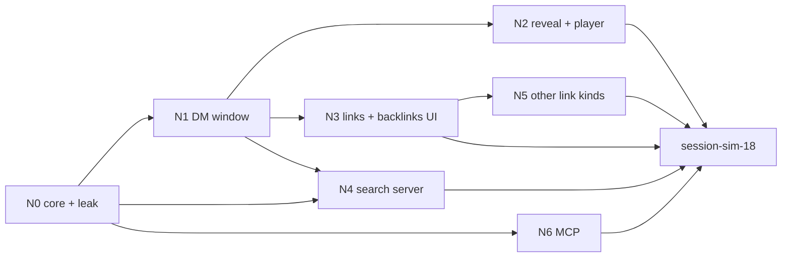

# Linked notes

> **For the DM's gate.** Twelve questions wait for you in [§15](#15-open-questions) (`Blocking? = yes`). This spec is written against the bold picks; anything that rests on one is marked *(pick OQ-NOTES-nn)* and is not decided. Five-minute read: §1, [§7.2](#72-what-a-player-sees-when-a-note-mentions-something-hidden), [§8.3](#83-field-visibility), §15. The rest is reference for builders.

## 1. Summary

- DM-written **notes** with **wikilinks** and **backlinks**, in one Notes window, that the DM can **reveal** to everyone or chosen players, searchable by what each viewer may read.
- A hidden note is not just out of sight: no frame, ack, count, ID, error or search result lets a player infer it. Every field has a rule ([§8.3](#83-field-visibility)) and a leak test per player ([§13](#13-test-plan)).
- 0 B in every snapshot: all note data loads on open ([ADR-0045](../architecture/adr/0045-lazy-record-types.md)).

## 2. Scope

- Notes (title, body, DM part *(pick OQ-NOTES-08)*, tags, up to 10 images); create, edit, delete.
- Wikilinks by stable ID to notes; to characters, creatures and compendium entries *(pick OQ-NOTES-05)*. Backlinks. Dead and unresolved links.
- Reveal / Hide per note: nobody, everyone, or chosen players *(pick OQ-NOTES-11)*. A toast, New / Updated marks, Preview as a player.
- Search in the window and in the Command palette *(picks OQ-NOTES-09, -12)*.
- MCP tools *(pick OQ-NOTES-07)*.

## 3. Goals

- The DM writes `[[`, picks a note, and it links; renaming the target never breaks it.
- The DM sees at a glance who can read a note, and exactly how each player will read it, before revealing.
- Reveal reaches a player ≤ 1 s after commit; a player without access gets no frame at all.
- A half-typed note survives a dropped connection, a server crash and a reload.
- The real campaign upgrades itself: new tables only, empty, clean boot ([§12](#12-performance--bandwidth)).

## 4. Non-goals

- Version history or undo of notes; note folders; graph view; typed relations (room left, OQ-NOTES-01).
- Player-written notes in this slice *(pick OQ-NOTES-10)*.
- Showing a note over players' screens ("present"): handouts do that ([party-board](party-board.md)). A note is read, not presented.
- Replacing handouts. A handout stays the thing you hand over; a note is the DM's world record.

## 5. User stories

**DM**
- As the DM, I want to write notes that link to each other, so that my world stops living in Obsidian.
- As the DM, I want to see every note linking here, so that I can find what I wrote about a place during play.
- As the DM, I want to reveal the Mayor's note without revealing the traitor it mentions.
- As the DM, I want to know what each player can see without opening their screen.

**Player**
- As a player, I want every note I've been given in one list, marked New until I read it.
- As a player, I want to follow links and search what I've been given, and never to stumble on what I haven't.

## 6. Functional requirements

Test names start with the FR ID (`FR-NOTES-08 …`). Leak tests: [§13](#13-test-plan).

| ID | Requirement | Notes |
|---|---|---|
| **Records and commands** | | |
| FR-NOTES-01 | Tables `note`, `note_link`; record types `note`, `note-body`, `note-links`, `note-dm` ([§8](#8-data-model)), all campaign scope and **lazy**, in no snapshot for any viewer. | CON-44 |
| FR-NOTES-02 | **Input** (strict zod): title clean, 1–120 chars; body and DM part clean text; tags 0–8, each 1–30 chars; `imageAssetIds` 0–10, unique, each via `assets.require`; ≤ 100 links per note. Title + body + DM part ≤ **60,000 B JSON-encoded** (≈ 55,000 plain English characters), so a save frame stays under the 64 KiB limit ([FR-SYNC-12](live-sync.md#6-functional-requirements), `MAX_CLIENT_FRAME_BYTES`). Over → `invalid`. Private-use characters stripped. | Caps: OQ-NOTES-16 |
| FR-NOTES-03 | `notes.create {title, rawBody?, rawDm?, tags?, imageAssetIds?}` (DM): new note is hidden. ≤ 2,000 per campaign. Title unique per campaign by `fold` → else `conflict` naming the note. Binds unresolved links of that title (FR-NOTES-12). | Players can't create, so `conflict` can't leak |
| FR-NOTES-04 | `notes.save {noteId, baseRev, title, rawBody, rawDm, tags, imageAssetIds}` (DM): full replace in one transaction: row, link rows, event log. Same values → `ack`, no event. `baseRev` ≠ `rev` → `conflict {rev}`, nothing written. | Multi-tab, [§11](#11-edge-cases--failure-modes) |
| FR-NOTES-05 | **Compile** (pure, `@shared/linked-notes/compile`): `rawBody` → `publicText` + link spans. In `publicText` a link is its alias, or the fixed text `(unknown)` when it has none *(pick OQ-NOTES-04)*. `contentTag` = first 8 hex of SHA-256 of title + `publicText` + images: changes only when public content does. | Bytes never depend on any other note's state |
| FR-NOTES-06 | `notes.delete {noteId}` (DM): removes the row and its own links. Links pointing at it stay, marked dead, keeping `lastTitle` for the DM *(pick OQ-NOTES-03)*. Notifications stay. Unknown → `not_found`. | |
| FR-NOTES-07 | `notes.reveal {noteId, revealedTo {mode: none\|all\|players, playerIds}, notify = true}` (DM). IDs must be the campaign's players → else `invalid`. Same audience → `ack`, no event. **Never cascades:** linked notes keep their own state. | |
| FR-NOTES-08 | **Visibility** (pure, `@shared/linked-notes/visibility`, record + viewer only): DM full; player sees `note`, `note-body`, `note-links` iff `mode = all` or they're in `playerIds`, else **hidden**. The visible `note` is a **whitelist** ([§8.3](#83-field-visibility)), never a denylist. `note-dm` is `audience: dm`. | [FR-SYNC-18](live-sync.md#6-functional-requirements), -19 |
| FR-NOTES-09 | **Quiet:** every note event sets `quietWhenUnchanged`. An edit a player can't see (hidden note, DM part, tags, reveal to someone else) sends that player **no frame and no `seq` step**. | Hub drops identical upserts; verified in `records.ts`, `hub.ts` |
| FR-NOTES-10 | **Link visibility:** a player receives a link span only if it's in the body part, and the source is visible, and the target is visible by kind: note → FR-NOTES-08; character → always (name only, [ADR-0024](../architecture/adr/0024-definition-visibility.md)); creature → never ([ADR-0024](../architecture/adr/0024-definition-visibility.md)); compendium → `entryVisibleTo`; dead or unresolved → never. No span means the text stays as `publicText` has it; nothing in the frame says a link was there. | *(pick OQ-NOTES-04, -05)* |
| FR-NOTES-11 | **Flips:** reveal, hide, delete or rename of a target lists `note-links` of every source note in the same event. Bodies aren't resent, so the frame stays small ([§12](#12-performance--bandwidth)). | Convergence |
| FR-NOTES-12 | **Unresolved:** `[[Title]]` with no match stays unresolved (DM: a create-on-click link; players: as hidden). `notes.create` of that title binds it in the same transaction; `publicText` is unchanged, so players get nothing. | Obsidian-style |
| FR-NOTES-13 | `notes.backlinks {noteId}` (DM, player; read-only): DM gets every source, marking DM-part links. Player gets only sources that are visible to them, via a body-part link, and only if the target is visible to them. Hidden or unknown `noteId` → `{backlinks: []}`, never a reject. No count is stored or sent apart from the list. | |
| FR-NOTES-14 | `notes.search {q, limit ≤ 50}` (DM, player; read-only) with the [shared matcher](../glossary.md) (`searchTier`, FR-CMP-32 / -33) over a per-note word cache *(pick OQ-NOTES-12)*. DM text: title, raw body, DM part, tags. Player text: title + `publicText` minus `(unknown)`, of notes visible to them only *(pick OQ-NOTES-09)*. Filter first, match after: a hidden note isn't in the set a player's search runs over. Ranking uses tiers only, no corpus statistics. Result `{results [{noteId, title, snippet ≤ 160}]}`; miss → `{results: []}`. | Tier order, no BM25 |
| FR-NOTES-15 | **Same answer for hidden and unknown:** role check comes before any lookup, so a player's write intent → `forbidden` with the same message for a hidden, visible or unknown ID. Reads and `sync.load` return absent rows, not errors ([FR-SYNC-32](live-sync.md#6-functional-requirements)). `sync.load note-dm` by a player → `forbidden` whatever the IDs. Test: frames byte-identical apart from `intentId`. | |
| FR-NOTES-16 | Notification kind `note-revealed` (info), one row per gaining player, in the command's transaction; none if `notify` is false, none to losers or the DM. Row text is generic ("The DM revealed a note"), payload `{noteId}`: **the title never sits in the row**, the view reads it from the header. Hidden later → "A note you no longer have", no Open. | Differs from `handout-shared`, which keeps its title |
| FR-NOTES-17 | `notes.previewAs {noteId, playerId}` (DM; read-only): `note`, `note-body`, `note-links` as that player would load them, through the same fns. Test: bytes equal that player's own load. | [§7](#7-uiux-notes) |
| FR-NOTES-18 | **No other path:** recap, stats, game log and every other feature read no note table. `Send to game log` isn't offered on notes in this slice. Event log payloads hold IDs, `rev`, flags and counts only, never title, text, tags or alias. | [§8.3](#83-field-visibility) |
| FR-NOTES-19 | **Images:** `assetUses` gains kind `note`, so "Used in" lists notes and delete clears them. A player learns an asset ID only through a visible `note-body` ([ADR-0023](../architecture/adr/0023-asset-access-by-capability-id.md)). IDs already seen stay valid after Hide, as handouts; the Reveal dialog says so. | Shared change, §14 |
| FR-NOTES-20 | **MCP** *(pick OQ-NOTES-07)*: tools `notes_list`, `note_get`, `notes_search` (read) and `note_create`, `note_update` (write, ask first, [FR-AGENT-15](agent-api.md#6-functional-requirements)) over `sync.load` and the intents above ([ADR-0072](../architecture/adr/0072-agent-mcp-server.md) D4). No reveal tool: only the DM's hand shows a secret to players. | No new route |
| **Window (DM)** | | |
| FR-NOTES-30 | One window type `notes.window` "Notes", both clients, launcher + key *(proposed `J`, OQ-NOTES-15)*: list on the left, note on the right; below 560 px wide the list folds behind a toggle. Close resets to the list and clears the back stack ([FR-SHELL-200](play-shell.md#6-functional-requirements)); minimise keeps; drafts survive both. | Sizes §7 |
| FR-NOTES-31 | **List:** search box, filter All · Hidden · Revealed, New note. Row: title, reveal Badge ("Hidden" muted / "Everyone" / player names), dead-link mark. By title. Empty: "No notes yet". | |
| FR-NOTES-32 | **Note header** always shows the state in words: "Hidden from players" or "Visible to: Player 1". Actions: Edit, Reveal…, Preview as ▾, Delete (inline confirm naming how many notes link here). | At a glance |
| FR-NOTES-33 | **Editor:** plain text box for body, a second for the DM part under a "DM only" label, title, tags, images (`FR-ASSET-20` attach control). `[[` opens a suggestion list (shared matcher; ↑ ↓ Enter; `\|` adds an alias). The editor shows `[[Title]]`; the title ⇄ ID map is taken at edit start, so a rename during editing keeps the link. While revealed: "Saving updates what Player 1 sees". Live counter from 80 % of the limit. | *(pick OQ-NOTES-06)* |
| FR-NOTES-34 | **Following:** click follows in place, with back / forward in the window. Note → that note; unresolved → create with that title (DM); character → sheet (a player: own only; another's name stays plain); creature → stat block (DM); compendium → its window. Middle-click isn't special: one window, one note. | Windows have one instance today (`MAIN_INSTANCE`) |
| FR-NOTES-35 | **DM's rendering of a link:** live link; eye-off mark + Tooltip when some reader of this note can't see the target ("Player 2 reads: (unknown)"); dead: struck-through `lastTitle` "(deleted)" with Remove; unresolved: dotted, "create". | |
| FR-NOTES-36 | **Backlinks:** a "Linked from (n)" panel under the note, title + snippet per row, click follows; refreshes on any received `note` / `note-links` change (debounced 300 ms). DM rows tag "DM part". | |
| FR-NOTES-37 | **Reveal dialog:** radio Hidden / Everyone / Chosen players (as the handout Share dialog), checkbox "Tell them" (`notify`), and **What they'll read**: every link the audience can't see, with its rendering, each with "Reveal that too" (a separate intent). Hint on images. Two clicks minimum; no one-click reveal. | |
| FR-NOTES-38 | **Preview as ▾** a player: renders FR-NOTES-17's answer with the player's component, under a "Preview: Player 2" band. Read-only. | |
| FR-NOTES-39 | **Draft:** the editor writes `pp.notes.draft.v1.<campaignId>.<noteId \| new-id>` to `localStorage` 500 ms after typing stops (≤ 10 drafts, oldest dropped; a failed write shows "Not saved on this browser"). Save clears it after the `ack`. On open with a draft: "Unsaved draft · Restore · Discard". | Half-typed note, §11 |
| FR-NOTES-40 | **Edit conflict:** `rev` moves while editing → banner "Changed elsewhere" at once, and on Save the `conflict` keeps the draft and offers Keep mine (saves on the new `rev`), Take theirs, or Compare. Never overwrites silently. | |
| **Player** | | |
| FR-NOTES-41 | Player window: list, search, viewer, links, back / forward, backlinks. No edit, reveal, tag, DM part or preview control is rendered, and none has a player intent. Row marks **New** / **Updated** from `pp.notes.v1.<campaignId>.<playerId>` `{seen {noteId: contentTag}}`. Empty: "Nothing yet". Sorted by title (no creation order). | |
| FR-NOTES-42 | A note that goes hidden or is deleted while open: "This note isn't available", same words for both. Same for a stale notification's or a palette result's Open. | |
| **Shared** | | |
| FR-NOTES-43 | Palette: search provider group "Notes" (both clients, `notes.search`, ≥ 2 characters, debounced); commands Open Notes, New note (DM) ([ADR-0067](../architecture/adr/0067-command-registry.md)). | |
| FR-NOTES-44 | Fixtures and bundle per §13; `fixtures:reset-load linked-notes` works from empty and is deterministic. | |

## 7. UI/UX notes

Per [visual-direction](../design/visual-direction.md) and the Gilt & Stone kit ([kit-parity](post-mvp/kit-parity.md)): window frame, list rows, Badge, Button, Input and Tooltip as they are; prose through `MarkdownLite` (React text nodes, never HTML). No new token or custom style; a `/* KIT: notes */` paint block only if the kit review asks for one. Screenshot baselines refresh with the slice that adds the window (AGENTS §9.4.1).

### 7.1 Window rows ([ADR-0025](../architecture/adr/0025-play-shell-windows.md), [ADR-0060](../architecture/adr/0060-one-window-placer.md), [ADR-0064](../architecture/adr/0064-window-memory.md))

| Kind | Clients | Default | Useful | Min | Useful-size criterion |
|---|---|---|---|---|---|
| `notes.window` | DM | 720 × 600 | 440 × 400 | 340 × 360 | Header + state line, 8 body lines, list toggle |
| `notes.window` | player | 600 × 560 | 440 × 400 | 340 × 360 | Same |

Launcher window, not default-open, not protected: the placer's ladder while untouched, remembered once moved. `restoreOpen` default (it shows the list without a target).

```text
DM, 720 × 600
┌ Notes ──────────────────────────────────────────────────┐
│ [Search…]                │ Mayor Harbin                  │
│ All · Hidden · Revealed  │ Visible to: Player 1          │
│ + New note               │ Edit Reveal… Preview as ▾ Del │
│──────────────────────────│───────────────────────────────│
│ Mayor Harbin    Player 1 │ Ask Duke Varen○ about the     │
│ The Duke          Hidden │ letter from the old sailor○.  │
│ Thieves' Den    Everyone │ ── DM only ────────────────── │
│                          │ He is lying about the ledger. │
│                          │ ── Linked from (2) ────────── │
│                          │ Thieves' Den: "…see the Mayor"│
└──────────────────────────┴───────────────────────────────┘
○ = some reader of this note can't see the target
```

### 7.2 What a player sees when a note mentions something hidden

The DM writes: `Ask [[Duke Varen]] about [[Duke Varen|the old sailor]]. Beware [[creature:Elite Goblin]]. See [[Burnt Ledger]].` Player 1 may see Duke Varen. Player 2 may not. Burnt Ledger was deleted. Elite Goblin is a creature, which players never receive.

| Reader | **Option B: alias or `(unknown)`** (pick) | Option A: always `(unknown)` | Option C: drop it |
|---|---|---|---|
| DM | Ask <u>Duke Varen</u>○ about <u>the old sailor</u>○. Beware <u>Elite Goblin</u>○. See ~~Burnt Ledger~~ (deleted). | same | same |
| Player 1 | Ask <u>Duke Varen</u> about <u>the old sailor</u>. Beware (unknown). See (unknown). | Ask <u>Duke Varen</u> about <u>the old sailor</u>. Beware (unknown). See (unknown). | Ask <u>Duke Varen</u> about <u>the old sailor</u>. Beware . See . |
| Player 2 | Ask (unknown) about the old sailor. Beware (unknown). See (unknown). | Ask (unknown) about (unknown). Beware (unknown). See (unknown). | Ask  about . Beware . See . |

| Target | Player without access, option B | In the frame |
|---|---|---|
| Hidden note | `(unknown)`, or the alias as plain words | `publicText` only. No span, ID or title |
| Hidden creature | Same | Same; identical to a hidden note |
| Deleted note | Same; **indistinguishable from hidden** | Same |

- The frame holds no more than the screen: an aliased hidden link is plain words, with no marker that a link was there.
- An alias is the DM's own wording, so it can give things away. The Reveal dialog lists every alias of a link the audience can't see ([FR-NOTES-37](#6-functional-requirements)).
- `(unknown)` tells a reader that something unnamed is mentioned. That's the one thing B and A allow; only C hides it, and C breaks sentences.

### 7.3 States and views

- **States:** empty (FR-NOTES-31, -41); loading (skeleton while `useLazyRecords` loads); error (load reject → Retry); not available (FR-NOTES-42); disconnected (banner per [FR-SYNC-24](live-sync.md#6-functional-requirements); viewing stays; editor stays typeable, Save disabled, "Saved on this browser").
- **DM view:** every note; state line; all controls; DM part; Preview as.
- **Player view:** only notes visible to them, read-only; no state line beyond "Shared with you" / "Everyone"; never a count of anything else.
- **Test IDs:** `notes-window`, `notes-list`, `notes-row` (+ `data-record-id`), `notes-filter`, `notes-search`, `notes-new`, `notes-state`, `notes-edit`, `notes-editor-body`, `notes-editor-dm`, `notes-save`, `notes-counter`, `notes-draft`, `notes-conflict`, `notes-reveal-open`, `notes-reveal-dialog`, `notes-reveal-will-read`, `notes-preview-as`, `notes-link` (+ `data-record-id` when it has a target), `notes-link-suggest`, `notes-backlinks`, `notes-backlink-row`, `notes-dm-part`, `notes-unavailable`.

## 8. Data model

### 8.1 Tables (new, additive; start empty)

| Entity | Field | Type | Notes |
|---|---|---|---|
| `note` | id, campaignId (FK cascade) | id | `ctx.ids` |
| | title, titleFold | string | Unique (campaignId, titleFold), a plain column, no expression index |
| | rawBody, rawDm | string | Canonical text: `[[n:<id>]]`, `[[n:<id>\|alias]]`, `[[pc:<id>]]`, `[[creature:<id>]]`, `[[cmp:<id>]]`, `[[?Title]]` |
| | publicText | string | Compiled from rawBody (FR-NOTES-05) |
| | imageAssetIds, tags | **JSON leaf** | |
| | revealedTo | **JSON leaf** `{mode, playerIds}` | Default none |
| | contentTag, rev | string, int | `rev` bumps on every write; DM only |
| | createdAt, updatedAt | timestamp | `ctx.clock`; DM only |
| `note_link` *(server only)* | id, campaignId, sourceId (FK cascade) | id | One row per link; never a record type |
| | part | `body` \| `dm` | |
| | targetKind, targetId | `note\|character\|creature\|compendium`, id \| null | Null = unresolved |
| | unresolved, lastTitle | string \| null | `lastTitle`: DM copy, shown once dead |
| | aliased, at, len | bool, int, int | Span in `publicText` |

- **Relations:** note → campaign; link → source note; link → target (no FK: a target may go, the row stays dead). Index (campaignId, targetKind, targetId) for backlinks.
- **Derived values:** backlinks; search word cache (per note, server memory, rebuilt on first search, updated on each write); dead state (target gone).
- **Persisted runtime state:** none beyond the tables. Drafts and seen maps are browser-only.

### 8.2 Record types

| Type | Lazy | Wire (player) | Wire (DM) |
|---|---|---|---|
| `note` | `all` | Whitelist: `id, campaignId, title, audience (all\|players), contentTag, imageCount` | Row minus raw text |
| `note-body` | `ids` | `id, campaignId, publicText, imageAssetIds` | Same |
| `note-links` | `ids`, derived | `id, campaignId, links [{at, len, kind, targetId, aliased, name?}]`, only spans passing FR-NOTES-10 | All links with `part`, `state`, `lastTitle` |
| `note-dm` | `ids`, `audience: dm` | Never | `id, campaignId, rawBody, rawDm, rev` |

- **Why raw text lives in `note-dm`:** the type a player can load holds no raw text at all, so a redaction bug can't send an ID or alias of a hidden target.
- `note-links` is computed by joining `note_link` to each target's current reveal, so no copy can go stale. The per-link audience is server-only and stripped on the wire. *Builder check:* `derived` with `lazy` together; the registry allows it on reading, no type does it yet.
- A span with `aliased: false` covers `(unknown)` in `publicText`: the client shows the target's name there. `name?` carries a compendium or character name; a note target's title comes from its `note` header.

### 8.3 Field visibility

| Field | DM | Player **with** access | Player **without** | Enforced by |
|---|---|---|---|---|
| Note ID | ✓ | ✓ | Never, in any frame | FR-NOTES-08 |
| Title | ✓ | ✓ | Never | FR-NOTES-08, -10 |
| Body text | Raw + compiled | `publicText` only | Never | Type split |
| Link target ID | ✓ | Only if target visible to them | Never | FR-NOTES-10 |
| Link display text | Title or alias | Title / alias if visible; else alias as plain words or `(unknown)` | Never | FR-NOTES-05 |
| Alias of a hidden target | ✓ | Plain words in `publicText` *(pick OQ-NOTES-04)* | Never | FR-NOTES-05 |
| DM part, its links | ✓ | Never, even when the note is revealed | Never | `note-dm` audience; FR-NOTES-10, -13 |
| Backlinks, count | All | Visible sources only; count = list length | `[]` | FR-NOTES-13 |
| Search results, count, snippet | All | Visible notes; from `publicText` | Same bytes as a miss | FR-NOTES-14 |
| Attachments (asset IDs) | ✓ | ✓ via `note-body` | Never | FR-NOTES-19 |
| Image count | ✓ | ✓ | Never | Whitelist |
| Tags | ✓ | **Never** (not searched either) | Never | Whitelist, FR-NOTES-14 |
| createdAt, updatedAt, reveal time | ✓ | **Never**; players get no server timestamp | Never | Whitelist |
| `rev` | ✓ | **Never**; `contentTag` replaces it (no edit count) | Never | Whitelist |
| Author | No field: only the DM writes | — | — | Event log `actorRole` is DM-side |
| Audience | Full, with IDs | `all` / `players`, no IDs (as [FR-PARTY-07](party-board.md#6-functional-requirements)) | Never | Whitelist |
| Total note count | ✓ | Own visible rows only | Same | FR-NOTES-08 |
| Event log entry | DB only | No client path: `readEventLog` has no non-test caller (checked). `cause.name` only on a frame already carrying a visible change | None | FR-NOTES-09, -18 |
| Notification | Own view | Own row, generic text, `noteId` of a note they gained | No row | FR-NOTES-16 |
| Session recap | No note data | No note data: `compose.ts` reads `game_log_entry`, `roll` and `session-recap` rows only (checked) | Same | FR-NOTES-18 |
| Game log | No post in this slice | Same | Same | FR-NOTES-18 |
| MCP | DM caller, full; results go to the model provider ([OQ-AGENT-12](agent-api.md#15-open-questions)) | No player path (DM secret only) | Same | [ADR-0072](../architecture/adr/0072-agent-mcp-server.md) |
| Error wording | Names the note | Same `forbidden` / empty for any ID | Same | FR-NOTES-15 |
| Draft, seen map | DM browser only | Own browser; `contentTag`s of notes they saw | Nothing | FR-NOTES-39, -41 |

### 8.4 Room left, not built

| Later | How the model leaves room |
|---|---|
| Quest log | A quest row holds a `noteId` for its text and adds status; `note_link.targetKind` gains `quest`; the same reveal rule applies. |
| In-game calendar | A nullable `note.gameDate` added later, with its own field rule; nothing here assumes real-world dates. |
| Session timeline | Entries point at notes by ID. Notes store no session, so [ADR-0013](../architecture/adr/0013-session-journal-scope.md) stands. |
| NPC directory | A nullable `ownerPlayerId` added later; player notes get their own title namespace, so a uniqueness `conflict` can't reveal a hidden DM note. |
| Journal sections | The body / DM-part split generalises to a `note_section` table, each with its own reveal; `note_link.part` already scopes a link to a part. |
| Map pins | A pin row on a scene holds a `noteId`; a pin is visible iff its note is; backlinks gain "pinned on". |
| Obsidian import | `[[Title]]` input and unresolved links are the import format; a thin importer calls `notes.create` / `notes.save`, then bindings resolve. |
| Typed relations, graph | `note_link` gains a nullable `relType` (ADR-0011 option C's other half). |

## 9. API & events

**REST (Hono RPC):** none. Everything is WS, including reads, so no new route takes a player credential.

**WS intents (client → server)**

| Intent | Who | Validation / ownership |
|---|---|---|
| `notes.create` / `notes.save` / `notes.delete` / `notes.reveal` | DM | FR-NOTES-02–07; roles before lookup |
| `notes.previewAs {noteId, playerId}` | DM | Read-only; the player must be the campaign's |
| `notes.search {q ≤ 200 chars, limit}` / `notes.backlinks {noteId}` | DM, player | Read-only: no bus, write, log or `seq` (as `recap.query`) |
| `sync.load` `note`, `note-body`, `note-links` | DM, player | [FR-SYNC-31](live-sync.md) |
| `sync.load` `note-dm` | DM | Player → `forbidden` |

**WS events (server → client).** Generic record changes (no named events); per [FR-SYNC-19](live-sync.md#6-functional-requirements): hidden→visible upsert, visible→hidden delete, visible→visible upsert unless identical, hidden→hidden nothing. All `quietWhenUnchanged`.

| Domain event (logged; payload) | Changes | Visibility rule per connection |
|---|---|---|
| `NoteCreated` (yes; `noteId`) | `note`, `note-body`, `note-links`, `note-dm`; bound sources' `note-links` | DM only: a new note is hidden |
| `NoteSaved` (yes; `noteId, rev, publicChanged`) | `note`, `note-dm`; `note-body` and `note-links` if public content or links changed; sources' `note-links` on a rename | DM all. Player with access: public changes only, none for a DM-part or tag edit. Others: no frame |
| `NoteDeleted` (yes; `noteId`) | Deletes own four; sources' `note-links` upserted, spans gone | DM all. Player with access: `delete`s, plus sources they can see. Others: no frame |
| `NoteRevealed` (yes; `noteId, mode, playerCount`) | `note`, `note-body`, `note-links`; sources' `note-links`; `note-revealed` rows | Gainers: upserts + own notification. Losers: deletes. Unchanged access: nothing, or the header if `audience` flipped. Others: no frame |

Not undoable. No signal. Reads answer with `ack` to the sender only. Protocol and data-model docs change with the code in N0 (AGENTS §9.9).

## 10. Permissions

| Action | DM | Player | Server check |
|---|---|---|---|
| Create, save, delete, reveal | ✓ | — | Intent roles `[dm]`, before lookup |
| Read a note, follow a link | All | Visible only | FR-NOTES-08, -10 |
| Backlinks, search | All | Visible only | FR-NOTES-13, -14, filter first |
| Read the DM part, tags, timestamps | ✓ | — | `audience: dm`; whitelist |
| Preview as a player | ✓ | — | Intent roles |
| MCP tools | ✓ (DM secret) | — | [ADR-0072](../architecture/adr/0072-agent-mcp-server.md) |

## 11. Edge cases & failure modes

- **Player disconnect / reconnect:** snapshot purges every lazy row ([FR-SYNC-37](live-sync.md)); open views reload. A note hidden while away is absent → "isn't available". Toasts while away follow [notifications](notifications.md).
- **DM disconnect (half-typed note):** typing continues; the draft keeps saving to the browser; Save disabled; "Saved on this browser". Back live: Save works on the same `baseRev`. A Save in flight at the drop is never resent ([FR-SYNC-05](live-sync.md#6-functional-requirements)): after reload, `rev` = base + 1 and equal text → draft cleared, else the draft stays and Save asks.
- **Server crash mid-save:** one transaction (row, links, log): all or nothing. Before commit: nothing, draft still there. After commit: in the next load, and the Save clears the draft per above. Hooks `notes.save:before-commit` / `:after-commit` (`PP_TEST_CRASH`).
- **Browser crash or reload while typing:** up to 500 ms lost; "Unsaved draft · Restore · Discard".
- **Multiple DM tabs:** live events update every tab's viewer; an editor shows "Changed elsewhere" and FR-NOTES-40 applies. Two tabs on one note share a draft key; a `storage` listener shows "Also open in another tab".
- **Concurrent edits, reveal during edit:** commits serialise; a reveal bumps `rev`, so a stale editor gets the banner, and Keep mine doesn't change the audience.
- **Target renamed:** links are by ID, nothing rewrites. **Target deleted:** dead, per §7.2. **Source and target both revealed, then target hidden:** `note-links` upsert drops the span; the player's screen falls back to `publicText`.
- **Hide after a player read it:** bytes already seen stay in that browser's memory until the delete lands; images stay fetchable (accepted, ADR-0023).
- **Campaign switch or second campaign:** scope gate; no note crosses. Campaign delete: FK cascade. Links to another campaign's IDs resolve as unresolved.
- **Invalid or malicious input:** zod; React text nodes only, no HTML path; forged tokens in a save resolve only within the campaign; `sync.load` of guessed IDs returns nothing; oversize → `invalid`, or `1009` above 64 KiB, which the client counter prevents.

## 12. Performance & bandwidth

**CON-44 (decided by measurement, N0's test re-measures on the heavy harness).** Latest documented heavy snapshot: DM ≈ 707 KB of 1.5 MiB, players ≈ 290 KB of 512 KiB (`SNAPSHOT_CEILING`, [protocol](../protocol/README.md); read from docs, not re-run: this phase starts no server). Record sizes below are measured JSON with 36-character IDs.

| At 500 notes, 100 revealed, 2 KB average public text | If in the snapshot | As lazy (this spec) |
|---|---|---|
| DM headers (378 B typical) | +189 KB | **0 B**; 189 KB when Notes opens |
| DM headers at the cap (2,000 × 907 B max) | +1.8 MB: **over 1.5 MiB alone** | **0 B**; 1.8 MB ack, under the 4 MiB limit |
| DM bodies | +1 MB: 1.9 MB total, **over** | **0 B**; loaded per note |
| Player headers (198 B typical, 100 notes) | +20 KB | **0 B**; 20 KB on open |
| Player bodies | +200 KB: ≈ 510 KB total, **at the ceiling** | **0 B**; loaded per note |

- **Decision: all four types lazy; 0 B in every snapshot.** `note-revealed` rows sit in the existing 100-row notification window, smaller than the damage cards that fill it.
- **Worst load:** one `note-body` chunk of 50 × 60 KB = 3 MB (< 4 MiB). Normal use loads one.
- **Reveal frame:** per source link row 572 B at 5 links, 9.4 KB at the 100-link cap. A note linked from 200 revealed notes of 5 links each ≈ 115 KB. Bodies aren't resent (FR-NOTES-11).
- **Search (measured, real `searchTier`, 2 words):**

| Notes × chars | Cache all words (first search) | One note's write | One search |
|---|---|---|---|
| 500 × 2,000 | 63 ms | 0.12 ms | 0.5 ms |
| 2,000 × 2,000 | 235 ms | 0.14 ms | 1.6 ms |
| 2,000 × 20,000 | 1.7 s | 0.8 ms | 4.7 ms |

  The compendium's `buildTextIndex` was 455 ms to rebuild at 2,000 × 2,000, on every write if dropped as FR-CMP-34 does: right for a fixed set, wrong for notes edited during play. N4 adds a bench.
- **FTS5 and schema push (probed: drizzle-kit 0.31.11, Bun 1.3.14, SQLite 3.53 with FTS5, scratch DBs):** not safe in the main DB. Details in [the proposed ADR](../architecture/adr/proposed-no-virtual-tables-under-push.md).
  - An FTS5 table is 6 `table` rows in `sqlite_master`; push emits `DROP TABLE` for all 6 and reports data loss **even when empty**, since the shadow tables hold rows. `pushSchema` then throws `SchemaPushError`: **the server refuses to start**.
  - With a new table in the same change, drizzle-kit asks a rename question → "Interactive prompts require a TTY" (the crash BL-172 covers).
  - Past the refusal the drops would still fail (`no such table: note_fts_data`). External-content FTS with triggers: same drops. `pushSQLiteSchema` has no table filter.
  - An `ATTACH`ed sidecar file is invisible to push (0 statements, query works): the option-table alternative.
- **Upgrade on the real campaign (probed the same way):** `note` + `note_link` on a populated DB: 5 statements, all `CREATE`, no warning, no prompt; existing rows kept; new tables empty; next boot 0 statements. Follows #416 (adds only). `pushSchema` backs up first (`VACUUM INTO`). BL-173's check covers it once merged.

## 13. Test plan

Isolated per worktree ([ADR-0008](../architecture/adr/0008-parallel-dev-isolation.md)): `:memory:` per test file, port 0; walkthroughs on profile `verify`. Agent loop per [ADR-0017](../architecture/adr/0017-agent-verification-fixture-library.md).

**Fixtures** (`fixtures/units/linked-notes/`, canonical campaign `Fixture Campaign`, `player-1`, `player-2`; canaries are strings a scan looks for):

| Unit | Contents |
|---|---|
| `notes-1` | `Mayor Harbin` (Everyone; DM part canary `NOTES-CANARY-DMPART`, tag `NOTES-CANARY-TAG`); `Thieves' Den` (player-1 only, title and body canary `NOTES-CANARY-P1`); `The Traitor Duke` (hidden, `NOTES-CANARY-HIDDEN`); `Ambush Prep` (hidden, body links to Mayor Harbin) |
| `notes-links` | Mayor Harbin body: `[[The Traitor Duke]]`, an alias to it, `[[Thieves' Den]]`, `[[creature:…]]`, `[[pc:Mira]]`, `[[cmp:…]]`, unresolved `[[Burnt Ledger Draft]]`; `Burnt Ledger` created then deleted, leaving a dead link; a DM-part link Mayor Harbin → Thieves' Den |
| `notes-images` | `notes-map` on Thieves' Den; `notes-secret` on The Traitor Duke |
| `notes-second` | In `campaign-second`: a note canary `NOTES-CANARY-SECOND` |

**Bundle `linked-notes`** = `base` + `player-2` + `images` + `char-mira` + `char-thorn` + `campaign-second` + an elite custom creature + the four units.

| Level | What | Fixtures |
|---|---|---|
| Unit | Compile (aliases, placeholders, 100 links, `contentTag` stable across another note's reveal); visibility fns; whitelist keys exact; token parser fuzz; draft and seen stores | In-code |
| Integration | Leak table below; convergence with the loaded set (FR-SYNC-38); `previewAs` bytes = player load; `conflict`; restart → identical loads; crash hooks + `state:digest`; additive boot on a populated DB | `linked-notes` |
| CON-44 | `con44.test.ts`: the four types in no snapshot on heavy harness + 500 notes, DM and players byte-identical; `lazyLoadSizes` for §12 | heavy + direct rows |
| E2E (thin) | `e2e/linked-notes.e2e.ts`: DM writes a link and reveals, player-1 reads and follows, player-2 sees nothing | `linked-notes` |

**Leak tests** (`src/server/features/linked-notes/leak.test.ts`, real sockets, like [`party-board/leak.test.ts`](../../src/server/features/party-board/leak.test.ts) and `fog-of-war/leak.test.ts`). Every row runs per player, on snapshot, all event frames, all acks, before and after reconnect and restart; `c.raw()` scan + `leakScan` (it reads only `sync.load` acks, so search and backlink acks rely on the raw scan). **player-1** has Thieves' Den revealed; **player-2** doesn't.

| Test `FR-NOTES-nn leak:` | player-1 | player-2 |
|---|---|---|
| title | Has Den; no `NOTES-CANARY-HIDDEN` | No `NOTES-CANARY-P1`, no hidden canary |
| id | Has Den's ID; never the Duke's | Neither ID in any frame |
| body | Den's `publicText` | No canary |
| link target | Span for Den; none for the Duke, creature, dead or unresolved | No Den span; Mayor Harbin shows `(unknown)` |
| display text | Frame = expected string per §7.2 | Frame = expected string per §7.2; no raw `[[` in any frame |
| hidden vs deleted vs creature | Same bytes in `publicText` for each | Same |
| DM part | No canary after revealing the note; its link not in backlinks | Same |
| backlinks + count | Den lists Mayor Harbin via body only, count exact | `notes.backlinks` on Den's ID → `[]`, bytes = an unknown ID's |
| search hit vs miss | Finds Den; hidden title → bytes = nonsense query | Den's title → bytes = nonsense query |
| search through a mention | Target's title doesn't hit the note that mentions it | Same |
| search counts, snippet | Only visible; snippet from `publicText` | Same |
| attachments | `notes-map` ID; never `notes-secret` | Neither |
| tags | None, in any frame or search | Same |
| timestamps, `rev` | No `createdAt` / `updatedAt` / `rev` key on any note record | Same |
| audience | `players`, no player IDs | No record |
| error wording | `notes.save` on hidden / visible / unknown → identical `forbidden` | Same |
| `sync.load` | Hidden IDs absent; `note-dm` `forbidden` | Same |
| quiet | DM-part, tag and hidden-note edits → `expectNoFrame`, `seq` unmoved | Same; plus every edit to Den |
| reveal walk | Hidden → player-1 → all → hide: frames per FR-NOTES-11 | Nothing until all; delete on hide |
| flip | Reveal Duke to player-1: span appears, no body resent | No frame |
| notification | Row has generic text, Den's `noteId`, no title | No row |
| recap, game log | `recap.query` body has no canary; game log has no note text | Same |
| event log | Payloads hold no canary (DB read) | n/a |
| campaign scope | No `NOTES-CANARY-SECOND` | Same |
| MCP | `note_get` runs as DM; no tool reachable with a link token (`src/mcp` test) | Same |

**Browser walkthrough** (test agent; `fixtures:reset-load linked-notes --profile verify`, built client, own Herdr pane per AGENTS §9.6). **A** DM, **B** `player-1`, **C** `player-2`. Throughout, B's and C's WS frames are scanned for canaries.

| # | DM (A) | Players (B, C) | Expected |
|---|---|---|---|
| 1 | Open Notes | B, C open Notes | A: 4 notes + badges. B: Mayor Harbin, Thieves' Den. C: Mayor Harbin. No count elsewhere |
| 2 | Read Mayor Harbin | B, C read it | A: all links, ○ marks, struck dead link. B: Den is a link, Duke `(unknown)`. C: Den and Duke `(unknown)`. Same as §7.2 |
| 3 | New note "Old Pier": type `[[Tra`, pick The Traitor Duke, add `\|the dock`, Save | — | Suggestion list works; note hidden; "Hidden from players". B, C: no frame |
| 4 | Preview as Player 2 | — | Same text as C's own view of that note once revealed; band shown |
| 5 | Reveal… Chosen: Player 2, "Tell them" | C: toast, Open | Dialog lists what they'll read. C reads; B: no frame |
| 6 | Reveal The Traitor Duke to Player 1 | B's open note | B's `(unknown)` becomes a live link with no reload. C unchanged |
| 7 | Edit the DM part of Mayor Harbin, Save | B, C watch | No frame to B or C; no Updated mark |
| 8 | Edit its body, Save | B, C | Live update; Updated mark clears on read |
| 9 | Hide Old Pier | C has it open | C: "This note isn't available" |
| 10 | Reveal Ambush Prep to Player 1; then delete it; check Mayor Harbin's backlinks | B has Ambush Prep open | B: the same words as C in step 9. A: backlink gone; the delete confirm showed how many notes link there |
| 11 | — | B searches "Traitor" then "xyzzy"; C searches "Traitor", "Thieves" | B finds the Duke (revealed in 6), nothing for xyzzy. C: both empty, same look. Palette matches |
| 12 | Type in a note; drop A's connection; type more; hard-kill server; restart | B, C rejoin | A's banner + "Saved on this browser"; text intact; Save works on return; `state:digest` matches |
| 13 | Two A tabs edit one note; save both | — | Second gets "Changed elsewhere" + Keep mine / Take theirs; nothing lost |
| 14 | Upload-free attach of `notes-map` to Old Pier; reveal to B; hide | B sees image; C never | Assets window "Used in" lists the note |
| 15 | MCP: `bun run mcp:call note_get`, `note_update` on the verify profile | B sees the update if visible | Tool works; `state:digest` changes; no reveal tool listed |

Evidence under `.verify/<run-id>/`; teardown per AGENTS §9.6.

## 14. Dependencies

| On | What we need | Status |
|---|---|---|
| `fix/upgrade-guards` (sprint 15 item 1) | Merged before build: BL-172, BL-173 prove the additive boot | In progress |
| [live-sync](live-sync.md) | `lazy`, `sync.load`, `quietWhenUnchanged`, `derived` with `lazy` (confirm) | Built |
| [assets-pipeline](assets-pipeline.md) | `assetUses` kind `note` (shared change, N1) | Needs assignment |
| [notifications](notifications.md) | Kind + views registries | Append only |
| [play-shell](play-shell.md) | Window + size rows, palette entries, key `J` | Append only; key via integrator |
| [compendium](compendium.md) | `entryVisibleTo` importable from `linked-notes`; open-at-entry | Built; cross-feature import to confirm in N5 |
| [entities](entities.md) | Character and creature targets, by [ADR-0024](../architecture/adr/0024-definition-visibility.md)'s rules | Built |
| [agent-api](agent-api.md) | Add the five tools to its §9 (orchestrator, not this branch) | Needs assignment |
| Glossary, [world-builder](post-mvp/world-builder.md) | OQ-NOTES-13; world-builder's "SQLite FTS" pick is overtaken by §12 | Integrator |
| [ADR-0011](../architecture/adr/0011-cross-references.md) | Folded from [proposed-cross-reference-decision](../architecture/adr/proposed-cross-reference-decision.md) at acceptance | Gate |

### Build split

Thin slices; each ends green with its own tests. `check` before commit, CI in the background (AGENTS §9.4.1). Hotspot paths per AGENTS §9.9.



| Slice | Branch | Delivers | Hotspots (shared) | Runs with |
|---|---|---|---|---|
| N0 | `fix/notes-core` | Tables, four record types, create / save / delete / reveal, compile, visibility, `notes.backlinks`, `notes.previewAs`, `note-revealed` kind, units + bundle, **all leak tests except search**, CON-44 test, docs | `src/server/db/schema.ts`, `src/shared/events/linked-notes.ts` (new file + index), `src/server/features/index.ts`, `notifications/kinds.ts`, `fixtures/bundles/index.ts`, `docs/data-model/`, `docs/protocol/` | Alone in the schema lane |
| N1 | `build/notes-window` | DM window: list, viewer, editor, draft, conflict, images | `dm/windows.ts`, `size-table.ts`, golden window lists, replay-harness sets, `assets-pipeline/manage.ts` (`assetUses`), `ASSET_USE_KINDS` | N6 |
| N2 | `build/notes-reveal` | Reveal dialog, state line, Preview as, player window, seen marks, notification views | `player/windows.ts`, `size-table.ts`, `dm/` + `player/notification-views.ts` | N3, N4, N6 |
| N3 | `build/notes-links` | `[[` suggestions, following, back / forward, dead and unresolved links, backlinks panel | `MarkdownLite` / `markdown.ts` seam (compendium's files: a small span overlay, or a wrapper) | N2, N4, N6 |
| N4 | `build/notes-search` | Word cache, `notes.search`, search leak tests, window search box, palette provider, bench | `play-shell/commands.ts`, `scripts/` bench list | N2, N3, N6 |
| N5 | `build/notes-link-kinds` | Character, creature, compendium targets *(gate)* | Compendium read import | N2, N4, N6 |
| N6 | `build/notes-mcp` | Five tools, `src/mcp/tools/notes.ts`, walkthrough 15 *(gate)* | `src/mcp/server.ts` one line; agent-api docs | Anything after N0 |

Then `session-sim-18`, then a playtest script for the DM (sprint 15 item 4b).

**session-sim-18: what the leak scan must add.** Bundle `session-sim-18` = `session-sim-17` + the four units.
- Scan every player frame and ack for all canaries, and for every hidden note's ID, read from the DB at each step, not a fixed list.
- Scan `recap.query` bodies, palette search acks and compendium REST bodies for canaries.
- Probes per player at each step: search a hidden title vs nonsense, and compare bytes; `notes.backlinks` and `sync.load` on a hidden ID vs a random one; a forged `notes.save`.
- A reveal → hide cycle during the running fight; a DM-part edit with `expectNoFrame` for players.
- Hard kill mid-save: `state:digest` byte-identical, DM draft restored. The DM's snapshot and every player's stay at the pre-notes size.

## 15. Open questions

**Bold** option = suggested pick (not decided). OQ-NOTES-01–05 mirror the [proposed cross-reference ADR](../architecture/adr/proposed-cross-reference-decision.md).

| ID | Question | Options (pick marked) | Blocking? | Affects |
|---|---|---|---|---|
| OQ-NOTES-01 | ADR-0011: cross-reference model | A. Explicit relations table: queryable, but no links inside prose · B. Inline references only: natural, but backlinks need an index · **C. Both: inline links indexed as untyped mentions in one table, typed relations added later; only the mention half is built now** (one query surface; the index is rebuilt on save) | yes | ADR-0011, world-builder, obsidian-importer |
| OQ-NOTES-02 | Link target | **Stable ID; display = target's title at render, or an alias** (rename-safe) · By title, Obsidian-style (rename breaks links) · ID + stored display copy (a copy to refresh, and one that can leak) | yes | ADR-0011 |
| OQ-NOTES-03 | Target deleted | **Dangling: DM sees the struck last title + Remove; players see what hidden shows** (nothing edited, no trace) · Rewrite sources to plain text (edits notes you didn't touch, can't undo) · Tombstone row, restorable (a trash feature to build) · Block delete while linked (annoying mid-prep) | yes | ADR-0011 |
| OQ-NOTES-04 | **What a player sees when a note mentions something hidden** ([§7.2](#72-what-a-player-sees-when-a-note-mentions-something-hidden)) | **B. Alias as plain words, else `(unknown)`** (reads well; a careless alias says what it says, so the dialog lists them) · A. Always `(unknown)` (tightest; prose stutters, and aliases are wasted) · C. Drop it (no trace; broken sentences) | yes | ADR-0011, all later link kinds |
| OQ-NOTES-05 | May notes link compendium entries, characters, creatures? | **Yes, all three by ID; shown only if the reader may read the target** (creatures: never to players, as ADR-0024) · Notes only for now (simplest; drops the DM's "see Fireball") · Compendium through a clone only (needless copies) | yes | ADR-0011, compendium, entities |
| OQ-NOTES-06 | Rich-text format | **Markdown-lite + wikilinks in a plain text box, on the existing `MarkdownLite`** (no dependency, Obsidian-friendly, agent-friendly; no live formatting) · Same text in CodeMirror (live preview; a new dependency needing your OK; can follow later, storage unchanged) · Structured editor JSON (true WYSIWYG; big dependency; poor Obsidian and MCP fit) | yes | N1, N3, importer |
| OQ-NOTES-07 | Notes in the MCP tools in this slice? | **Yes: read + create + update, no reveal tool** (prep from Claude Code; only your hand shows secrets to players; note text goes to the model provider, as other DM data) · Read only (safest, but no drafting) · None yet (smallest; N6 waits) | yes | agent-api, N6 |
| OQ-NOTES-08 | Player-visible parts of a note | Whole-note only (simplest; secrets need a second note) · **Body + one DM part, stored apart** (the common case; a parser bug can't leak it; journal sections later become a `note_section` table) · Inline `:::dm` sections now (flexible; one parser bug from a leak, and needs B's tests anyway) | yes | §8, journal sections |
| OQ-NOTES-09 | Who may search what | **DM everything; players the title and on-screen text of notes visible to them** (useful, and proven by byte-equal probes) · Players titles only (less to test, much less useful) · DM only (no player search surface) | yes | §6, §13 |
| OQ-NOTES-10 | Can players write notes in this slice? | **No** (one author; no title-namespace or moderation work; NPC directory adds it) · Private player notes now (a second visibility path before the first is proven) · Shared party notes now (tier B) | yes | §4, NPC directory |
| OQ-NOTES-11 | Reveal granularity | **Per player: nobody / everyone / chosen** (same as handouts; same filter and tests) · All or nothing (slightly simpler; loses "tell only the rogue") | yes | §6 |
| OQ-NOTES-12 | Search engine | **Shared matcher in memory with a per-note word cache** (same results as every other search; no schema risk; 1.6 ms at 2,000 notes; cold start 235 ms) · FTS5 in an attached sidecar file (survives push; a second DB for backups, reset and digest; other matching; ranking statistics could reflect hidden notes) · FTS5 in the main DB with `push.ts` taught to ignore it (**refused at boot today**, §12; a shared-core change with a rename-prompt risk on every later table) | yes | [proposed ADR](../architecture/adr/proposed-no-virtual-tables-under-push.md), world-builder |
| OQ-NOTES-13 | Glossary: add **Note**, **Wikilink**, **Backlink**, **Mention**, **Alias**, **DM part**; and the verb. The glossary says "reveal stays fog's word" and handouts **Share**, but sprint 15 and the brief say reveal | **Reveal / Hide for notes** (the DM's word; "share" already means two things) · Share / Unshare, as handouts | no · integrator | Glossary |
| OQ-NOTES-14 | Prefix `NOTES` is free but sits next to notifications' `NOTE` (`FR-NOTE-`, `note.dismiss`, `note-history-*`) | **Keep `NOTES`, feature folder `linked-notes`** · Use `LNOTE` everywhere | no · integrator | IDs, grep |
| OQ-NOTES-15 | Shortcut | **`J`** ("journal"; L I D C B R P S N are taken; `N` is Next turn) · no key | no · integrator (play-shell §7) | Key table |
| OQ-NOTES-16 | Caps | **2,000 notes, 60,000 B per note, 100 links, 8 tags** · Other numbers (the 60,000 B can't pass 64 KiB without a split save) | no · DM | §6, §12 |
| OQ-NOTES-17 | Saving | **Explicit Save + browser draft** (each Save is a deliberate change players may see) · Autosave to the server (no button; players would watch half-typed text in a revealed note) | no · spec-linked-notes | §6 |

## 16. Out of scope

- Build later, room left per [§8.4](#84-room-left-not-built): quest log, calendar, session timeline ([campaign-manager](post-mvp/campaign-manager.md)), NPC directory, journal sections, map pins ([scene-tools](scene-tools.md)), [Obsidian import](post-mvp/obsidian-importer.md).
- World-builder's other entity kinds, location ↔ scene ([world-builder](post-mvp/world-builder.md)). Handouts stay in [party-board](party-board.md).
