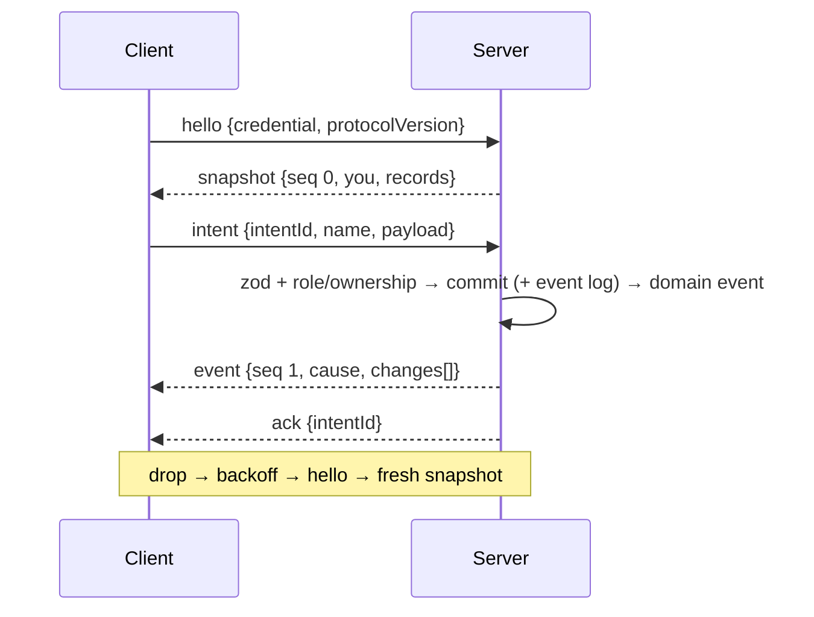

# Live sync, reconnect, visibility

> Five-minute read. Bullets over prose. See [AGENTS.md](../../AGENTS.md).

## 1. Summary

- Cross-cutting: how every feature's state reaches clients live.
- Server-authoritative intents → validate → mutate + commit → domain event → **visibility filter** → per-record WS events ([ADR-0005](../architecture/adr/0005-server-authoritative-sync.md), [ADR-0016](../architecture/adr/0016-domain-events-pending-actions.md)).
- Reconnect = snapshot. State survives a server crash ([ADR-0006](../architecture/adr/0006-persistence.md)).
- Built first, in the Phase 2 skeleton. Other specs plug in via the conventions in [§9](#9-api--events).

## 2. Scope

- WS connection lifecycle: connect, `hello` auth (DM secret / player link), heartbeat, disconnect, auto-reconnect.
- Intent envelope and WS event envelope (shared zod schemas).
- Visibility filter contract every feature plugs into (record-type registry).
- Snapshot on connect/reconnect; server-triggered resync on scope change.
- Broadcaster as a domain event bus listener; event log write hook ([ADR-0016](../architecture/adr/0016-domain-events-pending-actions.md)).
- Transient **signals** (ping, laser) that skip persistence and the event log. *(proposed, OQ-SYNC-11)*
- Presence: DM sees which players are online. *(proposed, OQ-SYNC-10)*
- Client connection state + reconnect banner. *(proposed)*
- Multi-client test harness reused by all specs.
- Test-mode **sync probe** record to verify the pipeline before any feature exists. *(proposed, OQ-SYNC-12)*

## 3. Goals

Numbers are proposals; confirm with the DM (OQ-SYNC-13).

- **Zero leakage:** no DM-only record or field ever appears in a player connection's frames.
- **Convergence:** a player's state after live events equals a fresh snapshot.
- **Reconnect:** client shows the drop ≤ 20 s after a silent network loss (immediately on a clean close); state is live again ≤ 2 s after the server is reachable.
- **Crash-safe:** after a hard kill + restart on the same DB, every committed change is present for every client.
- **Plug-in cost:** a feature adds a record type, its intents and its visibility rule without touching hub, broadcaster or client sync code.

## 4. Non-goals

- Event replay or catch-up from the event log on reconnect ([ADR-0005](../architecture/adr/0005-server-authoritative-sync.md)).
- Offline play, local-first sync, client-side conflict resolution.
- Field-level diffs / patches (upserts carry the whole filtered record).
- Multi-server, horizontal scale, external brokers.
- Auth model, link format, DM login UI ([campaign-management](campaign-management.md)).
- Per-feature visibility rules (each feature spec owns its own).

## 5. User stories

**DM**
- As the DM, I want every change I make to show up for players within a second, so I don't narrate around lag.
- As the DM, I want hidden things to stay hidden, even if a player opens dev tools.
- As the DM, I want to see which players are connected, so I know when to start.
- As the DM, I want a server crash or laptop sleep to cost a restart, not the session.

**Player**
- As a player, I want my view to recover on its own after Wi-Fi drops, without reloading.
- As a player, I want to know when I'm disconnected, so I don't act on a stale map.
- As a player, I want a reload to bring me back exactly where the table is.

## 6. Functional requirements

| ID | Requirement | Notes |
|---|---|---|
| **Connection** | | |
| FR-SYNC-01 | One WS endpoint. Client must send `hello` within 5 s of open, else server closes with `4408`. | |
| FR-SYNC-02 | `hello.credential` resolves to a **connection context** `{connId, campaignId, role, playerId?}`. Invalid → close `4401` with no other frame sent. | Resolver from [campaign-management](campaign-management.md) (OQ-SYNC-09) |
| FR-SYNC-03 | Context is fixed for the connection's life. Auth and filtering use only the context; `campaignId` / `playerId` / role in payloads are never trusted. | |
| FR-SYNC-04 | Several live connections per player (or DM) are allowed; each gets the same filtered stream. | Two tabs / two laptops |
| FR-SYNC-05 | Heartbeat: client sends `ping` every 10 s; server answers `pong`. Server closes a connection silent for 30 s. Client treats 20 s without `pong` as dropped. | Also keeps the tunnel from idling |
| FR-SYNC-06 | Client auto-reconnects: backoff 0.5 s doubling to 5 s cap, ±20 % jitter, forever. Stops only on `4401` / `4403`. | |
| **Snapshot** | | |
| FR-SYNC-07 | After a valid `hello`, server sends exactly one `snapshot` (seq 0) before any `event` on that connection. | |
| FR-SYNC-08 | Snapshot = every registered record type's provider output, passed through the visibility filter for this context. DM: whole campaign. Player: campaign-scoped records + scene-scoped records of the active scene. | OQ-SYNC-03 |
| FR-SYNC-09 | Changes committed while a snapshot is built arrive as events after it: none lost, none duplicated. | Snapshot read is one read transaction |
| FR-SYNC-10 | Client replaces its whole record store with the snapshot (records missing from it are removed) and drops any optimistic state. | |
| FR-SYNC-11 | Client `resync` → fresh snapshot. Server can resync any set of connections (hub API, §9). | Used on active-scene switch, campaign switch, fixture load |
| FR-SYNC-12 | Snapshot carries `you` (campaignId, role, playerId), `bootId` and `protocolVersion`. Client with a different `protocolVersion` reloads the page once. | Stale bundle after server update |
| **Intents** | | |
| FR-SYNC-13 | Intent envelope validated by zod; dispatched by `name` to a registered handler. Unknown name → `reject unknown_intent`; bad payload → `reject invalid` with zod issues. | |
| FR-SYNC-14 | Handlers declare allowed roles (**default: DM only**) and, if players are allowed, an ownership check. Failure → `reject forbidden`, no state change, no event. | [ADR-0004](../architecture/adr/0004-tenancy-auth-permissions.md) |
| FR-SYNC-15 | Every intent gets exactly one `ack` or `reject`, sent only to its connection, keyed by `intentId`. Events caused by the intent reach the sender **before** its `ack`. | |
| FR-SYNC-16 | Events are produced only after the DB transaction commits. A failed or rolled-back intent produces no event. | [ADR-0006](../architecture/adr/0006-persistence.md) |
| FR-SYNC-17 | Client never resends intents in flight at disconnect. | Prevents double damage; user redoes the action |
| FR-SYNC-18 | Limits per connection: inbound frame > 64 KB → close `1009`; > 20 intents/s sustained (burst 40) → `reject rate_limited`; malformed JSON → `reject invalid`, connection stays open. | |
| FR-SYNC-19 | Intents sent via REST (Hono RPC) run the same command and produce the same events; REST callers get their result in the HTTP response, not an `ack`. | OQ-SYNC-04 |
| **Events and visibility** | | |
| FR-SYNC-20 | Broadcaster is a domain event bus listener. Per domain event it sends each connection **at most one** `event` message holding that connection's filtered changes; nothing if none survive. | |
| FR-SYNC-21 | Each change is `{type, id, op: upsert \| delete, data?}`; `upsert` carries the whole filtered record. | OQ-SYNC-07 |
| FR-SYNC-22 | Visibility is a per-record-type function `(record, ctx) → full \| redacted record \| hidden`. DM context always gets `full`. Unregistered type → `hidden` for players. | Default deny. OQ-SYNC-01 |
| FR-SYNC-23 | Transitions per connection, from the change's before/after: hidden→visible = `upsert`; visible→hidden = `delete`; visible→visible = `upsert`; hidden→hidden = nothing. | Reveal = appear (OQ-SYNC-06) |
| FR-SYNC-24 | Snapshot and events use the same filter. For any sequence of changes, a player's store after applying events equals a fresh snapshot. | Convergence |
| FR-SYNC-25 | Players receive scene-scoped changes only for the active scene. Switching the active scene resyncs all player connections. | |
| FR-SYNC-26 | `event` messages carry a per-connection `seq` (1, 2, … after each snapshot). Client seeing a gap or reorder sends `resync`. Server closes (`4000`) a connection whose send buffer overflows instead of dropping frames. | OQ-SYNC-05 |
| FR-SYNC-27 | **Signals:** transient domain events (no state change) are broadcast through the same filter, not persisted, not logged, not in snapshots, no `seq`. Limit 30/s per connection; excess dropped silently. | OQ-SYNC-11 |
| FR-SYNC-28 | Every non-transient domain event is appended to the event log **in the same transaction** as its state change, unless its spec marks the type non-logged. | [ADR-0016](../architecture/adr/0016-domain-events-pending-actions.md) |
| FR-SYNC-29 | A listener failure never rolls back the commit. A broadcaster failure for one connection closes it with `4000` (forces resync). | |
| **Presence and UI** | | |
| FR-SYNC-30 | DM receives a presence record per player: online + connection count. Updated ≤ 1 s after connect / clean close, ≤ 30 s after a silent drop. Not persisted; not sent to players. | OQ-SYNC-10 |
| FR-SYNC-31 | Client exposes connection state `connecting \| live \| reconnecting \| rejected`. While not `live`, intent-sending controls are disabled; an attempt shows "Not connected". | |
| FR-SYNC-32 | Reconnecting banner appears after 1 s not live (no flicker); after 60 s it adds "Server unreachable — check with your DM". | |
| **Crash and test seams** | | |
| FR-SYNC-33 | Hub, broadcaster and presence hold no play state. After restart on the same DB, reconnecting clients' snapshots contain every change committed before the kill. | |
| FR-SYNC-34 | Test mode only: **sync probe** record type with intents `probe.set` (DM), `probe.setHidden` (DM), `probe.edit` (player, own probe only) and a small probe panel + "drop connection" button in both clients. Absent outside test mode. | OQ-SYNC-12 |
| FR-SYNC-35 | Clock, IDs and timers (heartbeat, backoff) are injectable for tests. | [ADR-0008](../architecture/adr/0008-parallel-dev-isolation.md) |

## 7. UI/UX notes

Per [visual-direction](../design/visual-direction.md): shadcn Badge, Tooltip, Alert, Toast; semantic tokens only. Host placement belongs to [play-shell](play-shell.md); this spec supplies state and components.

- **Screens:** none of its own. Components: connection indicator, reconnect banner, rejected screen, DM presence list, test-mode probe panel.
- **States:**
  - `connecting` (first load, before snapshot): play page shows a loading skeleton, no stale data.
  - `live`: indicator only (dot + Tooltip "Connected").
  - `reconnecting`: last known state stays visible; banner "Reconnecting…" after 1 s; intent controls disabled.
  - `rejected`: full-page Alert. Player: "This link isn't valid. Ask your DM for a new one." DM: back to DM login.
  - Empty / error: N/A beyond the above (no content of its own).
- **DM view:** indicator; presence list (player name, online/offline dot, "2 tabs" if > 1 connection). Probe panel in test mode shows all probes, hidden ones translucent, with edit + hide/reveal.
- **Player view:** indicator and banner only; no presence. Probe panel in test mode shows visible probes; edit only on own probe.

## 8. Data model

| Entity | Field | Type | Notes |
|---|---|---|---|
| Connection *(in-memory)* | connId | string | Server-generated |
| | campaignId, role, playerId | id, `dm`\|`player`, id \| null | From credential; immutable |
| | phase | `awaiting-hello` \| `snapshotting` \| `live` | |
| | seq | int | Last `event` seq sent |
| | lastInboundAt | timestamp | Heartbeat |
| | rate buckets | counters | Intents, signals |
| Presence *(in-memory, derived)* | playerId, online, connections | id, bool, int | From live connections |
| Record change *(inside a domain event)* | type, id, before, after | string, id, record \| null, record \| null | Create: before null. Delete: after null |
| Record type registration *(code)* | type, scope, schema, visibility, snapshot | string, `campaign`\|`scene`, zod, fn, fn | Scene-scoped records carry `sceneId` |
| Intent handler registration *(code)* | name, schema, roles, authorize, execute | | `roles` default `[dm]` |
| Event log entry *(persisted)* | id | int, monotonic | Append-only |
| | campaignId, type, at | id, string, timestamp | |
| | payload | **JSON leaf** | zod schema per domain event type |
| | actorRole, actorPlayerId, intentId | | Who caused it |
| | undo fields | — | Owned by [combat-tracker](combat-tracker.md) per [ADR-0016](../architecture/adr/0016-domain-events-pending-actions.md) |
| Sync probe *(persisted, test mode)* | id, campaignId, text, hidden, ownerPlayerId | id, id, string, bool, id \| null | Visibility: hidden → DM only |

- **Relations:** connection → campaign, player ([campaign-management](campaign-management.md)). Event log entry → campaign. Scene-scoped records → scene ([scenes-map](scenes-map.md)).
- **Derived values:** presence; each connection's visible view (filter output); active scene id (cached, rebuilt from DB at boot).
- **Persisted runtime state:** event log, probes. Connections and presence are deliberately not persisted: they don't matter to play and rebuild from reconnects ([ADR-0006](../architecture/adr/0006-persistence.md)).
- **No per-record version fields:** the server serialises writes and upserts carry the whole record.

## 9. API & events

**REST (Hono RPC)**

| Method | Path | Who | Purpose |
|---|---|---|---|
| GET | WS upgrade endpoint (path set by build conventions) | anyone; auth in `hello` | Open the socket |

Other specs' REST commands follow FR-SYNC-19.

**WS messages (client → server)**

| Message | Who | Validation / ownership |
|---|---|---|
| `hello {credential, protocolVersion}` | DM, player | Credential resolver (OQ-SYNC-09); first frame only |
| `intent {intentId, name, payload}` | DM, player | zod envelope + handler schema; handler roles + ownership (FR-SYNC-13/14) |
| `resync {}` | DM, player | Live connection only |
| `ping {}` | DM, player | None |
| `probe.set {id?, text}` *(test mode)* | DM | — |
| `probe.setHidden {id, hidden}` *(test mode)* | DM | — |
| `probe.edit {id, text}` *(test mode)* | player | `probe.ownerPlayerId == ctx.playerId` and not hidden |

**WS messages (server → client)**

| Message | Payload | Visibility rule |
|---|---|---|
| `snapshot` | `seq 0`, `you`, `bootId`, `protocolVersion`, `records: {type: Record[]}` | Per record type's filter; players get campaign + active scene scope |
| `event` | `seq`, `cause {name, intentId?}`, `changes[]` | Per change, type's filter + FR-SYNC-23. `intentId` only on the sender's copy. Not sent if no change survives |
| `signal` | `name`, `data` | Signal type's filter (e.g. scenes-map ping) |
| `ack` | `intentId`, `result?` | Sender only |
| `reject` | `intentId?`, `code`, `message`, `issues?` | Sender only |
| `pong` | — | Sender only |
| record `presence` (via `event`) | `playerId`, `online`, `connections` | DM only |
| record `probe` (via `snapshot`/`event`) | probe fields | DM: all. Player: `hidden == false` |

Reject codes: `invalid`, `unknown_intent`, `forbidden`, `not_found`, `conflict`, `rate_limited`, `internal`.

**Close codes**

| Code | Meaning | Client does |
|---|---|---|
| 1001 | Server shutting down | Reconnect |
| 1009 | Frame too large | Reconnect |
| 4000 | Resync required (overflow, broadcaster error) | Reconnect |
| 4401 | Credential invalid | Stop → `rejected` |
| 4403 | Player removed ([campaign-management](campaign-management.md)) | Stop → `rejected` |
| 4408 | No `hello` in time | Reconnect |

**Server-side hub API (for other specs)**

- `resync(selector)` — fresh snapshot to matching connections (e.g. all players of a campaign).
- `disconnect(selector, code)` — close matching connections.
- `connections(campaignId)` — read-only list (presence, tests).

**Plug-in conventions (every feature spec)**

- Register each **record type**: `type`, `scope` (`campaign` | `scene`), zod schema, `visibility(record, ctx)`, bounded `snapshot(ctx)` provider.
- Visibility reads only the record and the context (OQ-SYNC-08). Store visibility-relevant flags on the record.
- Register each **intent**: name (`<feature>.<verb>`), schema, roles, ownership check. List in §9 with who/ownership.
- Domain events list their `changes` (before/after per record). Any record whose visibility changes must be in `changes`.
- In §9, list per domain event: logged or not, transient (signal) or not, undoable or not. Event names must not themselves reveal secrets.
- Snapshot providers must bound their output (e.g. game log last N — [dice-roll-log](dice-roll-log.md) OQ-DICE-04).

## 10. Permissions

| Action | DM | Player | Server check |
|---|---|---|---|
| Open WS + `hello` | ✓ | ✓ | Credential resolves to a context |
| Receive full records | ✓ | — | `role == dm` skips filter |
| Receive filtered records | — | ✓ | Type's visibility fn; scene scope = active scene |
| Send any intent | ✓ (if handler allows DM) | only handlers listing `player` | Roles + ownership (FR-SYNC-14) |
| `resync`, `ping` | ✓ | ✓ | Live connection |
| See presence | ✓ | — | Presence visibility = DM only |
| Probe intents *(test mode)* | set, setHidden | edit own | `ownerPlayerId == ctx.playerId` |

- Every handler and provider is scoped to `ctx.campaignId`; records from another campaign are never read or sent.

## 11. Edge cases & failure modes

- **Player disconnect / reconnect:** stale state stays visible, banner, controls disabled; reconnect → fresh snapshot. In-flight intents not resent; if committed, they show in the snapshot. Flapping = backoff + one snapshot per reconnect.
- **DM disconnect / reconnect:** same as player; players unaffected (state is in the DB, not the DM client).
- **Tunnel restart / laptop sleep:** clients keep retrying; after 60 s the banner says to check with the DM. A new tunnel URL needs re-shared links ([campaign-management](campaign-management.md) OQ-CAMP-01).
- **Server crash mid-action:** open transaction rolls back → no event, no log entry, no `ack`; snapshot after restart shows true state. Crash after commit, before broadcast: change is in the snapshot.
- **Stale client after DM hides something:** live `delete`; snapshot omits it on reconnect.
- **Scope changes** (active scene switch, campaign switch, fixture load into a running server): the owning spec calls `resync`. Removed player still connected: `disconnect(player, 4403)`.
- **Concurrent edits:** serialised transactions; last commit wins; upserts carry full post-state. A double-click is two intents; features guard non-idempotent actions (e.g. damage card already applied → `conflict`).
- **Invalid / malicious input:** zod rejects; oversize frame closes; rate limit rejects; spoofed ids ignored; unknown types hidden from players.

## 12. Performance & bandwidth

- **Scale:** 1 DM + up to 6 players, one process, one campaign live.
- **Event rate:** drop-only token moves in MVP ([scenes-map](scenes-map.md) OQ-MAP-04); intents ≤ 20/s per connection; signals ≤ 30/s, clients throttle laser to ~20 Hz.
- **Event latency:** commit → frame sent < 50 ms locally (proposed).
- **Snapshot budget:** ≤ 512 KB JSON per connection for a `session-sim`-sized campaign; built + sent < 200 ms locally (proposed). Assets are URLs, never bytes ([assets-pipeline](assets-pipeline.md)).
- **Batching:** one `event` message per domain event per connection (all its changes together, applied atomically). No further coalescing in MVP.
- **Tunnel:** heartbeat every 10 s keeps cloudflared from idling the socket; JSON frames only, no compression in MVP.

## 13. Test plan

Isolated per worktree ([ADR-0008](../architecture/adr/0008-parallel-dev-isolation.md)): each run uses a fresh temp DB, asset dir and ports. Agent build loop per [ADR-0017](../architecture/adr/0017-agent-verification-fixture-library.md).

**Fixtures added (this spec)**
- `player-2`: second player with a stable player link (per-player filtering needs two).
- `sync-probes`: three probes — `public` (DM-owned, visible), `secret` (hidden, text contains marker `SECRET-PROBE`), `mine` (owned by `player-1`).
- **Bundle `sync-probe`** = `session-sim` base (campaign, DM secret, `player-1`) + `player-2` + `sync-probes`.

**Multi-client harness (shared, reused by all specs):** in-process server on a temp DB and random port; `connect(dm | player-N)` returns a client running the real client store reducer, with `nextEvent()`, `expectNoFrame(ms)`, `store`, raw frame log; `restartServer()` keeps the DB; fake clock.

| Level | What | Fixtures |
|---|---|---|
| Unit | Envelope schemas (valid/invalid); transition matrix (FR-SYNC-23); default deny; scope gate; rate limiter; backoff schedule (fake clock); client reducer (snapshot replace, upsert/delete, seq gap → resync) | In-code |
| Integration | Hello timeout/invalid → 4408/4401, no data frame; snapshot-before-event and race (FR-SYNC-09); role + ownership rejects with no event; events-before-ack; rollback → no event, no log entry; event log row per committed event; convergence (random change sequence → store == snapshot) per player; **leak scan**: no player frame ever contains `SECRET-PROBE`; heartbeat drop + presence; overflow → 4000; `restartServer()` → identical snapshots | `sync-probe` |
| E2E (thin) | Playwright, DM + `player-1` in separate contexts: reveal/hide probe, reload player, server restart → state intact | `sync-probe` |

**Browser walkthrough** (agent, per [ADR-0017](../architecture/adr/0017-agent-verification-fixture-library.md))

Setup: reset + load bundle `sync-probe`; start the app on this worktree's ports. Contexts: **A** = DM client, **B** = `player-1` link, **C** = `player-2` link — all separate browser contexts.

| # | DM steps (A) | Player steps (B, C) | Expected |
|---|---|---|---|
| 1 | Log in as DM | — | Indicator "Connected"; presence: both players offline; probe panel shows 3 probes, `secret` translucent |
| 2 | — | B opens link; C opens link | Both connected; DM presence shows both online ≤ 1 s. B sees `public` + `mine`; C sees `public` only |
| 3 | Edit `public` text | — | B and C show new text without reload |
| 4 | Reveal `secret`; then hide it again | — | Appears for B and C; then disappears |
| 5 | — | B edits `mine` | DM and B show new text; C never sees `mine` |
| 6 | — | Reload B | Loading skeleton → same state; DM presence may blink, ends online |
| 7 | — | B: "drop connection" (or context offline) | B banner "Reconnecting…", controls disabled |
| 8 | While B is down: edit `public`, reveal `secret` | B back online | B reconnects alone, shows both changes, no reload |
| 9 | Hard-kill the server process | — | A, B, C show "Reconnecting…" |
| 10 | Restart the server on the same DB | — | All reconnect alone; probe texts and hidden state identical to before step 9; presence repopulates |
| 11 | — | New context D opens a mangled player link | "Link isn't valid" screen; WS frames show only the close |

Throughout: inspect B's and C's WS frames — `SECRET-PROBE` appears only while `secret` is revealed (steps 4, 8 onward), never while hidden.

## 14. Dependencies

| On | What we need | Status |
|---|---|---|
| [campaign-management](campaign-management.md) | Credential resolver → context (OQ-SYNC-09); DM login and player link pages; calls `resync` on campaign switch and `disconnect` on player removal | open |
| [fixtures-adapters](fixtures-adapters.md) | Bundle composition (`sync-probe` on `session-sim`); `player-2` fixture; resync after load into a running server | open |
| [play-shell](play-shell.md) | Hosts indicator, banner, presence list | open |
| [scenes-map](scenes-map.md) | Active scene id for scope; triggers player resync on switch; ping/laser as signals (OQ-MAP-07) | open |
| [ADR-0016](../architecture/adr/0016-domain-events-pending-actions.md) | Bus with post-commit listeners; event log in the commit transaction | accepted (core) |
| Build conventions (AGENTS.md, drafting) | Reset + load bundle command, WS path, test-mode flag, ports | open |
| All feature specs | Register record types, intents, visibility per §9 conventions | — |

## 15. Open questions

**Bold** option = suggested pick (not decided). Cross-cutting picks also in [proposed ADR](../architecture/adr/proposed-sync-protocol-conventions.md).

| ID | Question | Options (pick marked) | Blocking? | Affects |
|---|---|---|---|---|
| OQ-SYNC-01 | Visibility filter granularity | **Per-record drop + per-field redaction, one fn per record type** (flexible, one code path) / per-record only (simpler; HP bands need separate records) / separate player projections (duplicated logic) | yes | all specs |
| OQ-SYNC-02 | Optimistic UI policy | **Only for intents a spec marks optimistic (e.g. own token move); server wins, reject reverts** (snappy where it matters) / never optimistic (simplest, laggier over tunnel) | no — owner: spec-live-sync | scenes-map, character-sheet |
| OQ-SYNC-03 | Snapshot scope | **DM: whole campaign; player: campaign-scoped + active scene; scene switch resyncs players** (simple, bounded for players) / per-connection viewed scene (smaller DM snapshot, more state) / whole campaign for all (filter must know scene state) | yes | all specs, scenes-map |
| OQ-SYNC-04 | Intents over WS, REST, or both | **Live-play intents over WS; CRUD/uploads via Hono RPC; same command layer** (fits stack) / everything over WS (one path, awkward for uploads) | yes | all specs |
| OQ-SYNC-05 | Detecting missed events without replay | **Per-connection seq; gap → resync; server closes on overflow** (cheap safety net) / none (TCP order suffices, silent drop risk) | no — owner: spec-live-sync | all specs |
| OQ-SYNC-06 | Reveal semantics | **Reveal = `upsert` (appears), hide = `delete`, via FR-SYNC-23** (no special client code) / dedicated reveal event (per-feature handling) | no — owner: spec-live-sync | dice-roll-log, scenes-map, post-mvp/scene-tools |
| OQ-SYNC-07 | WS event shape | **Generic record changes `{type, id, op, data}` + `cause`; one client reducer** (features add no sync code) / named per-feature events (expressive, N reducers) | yes | all specs |
| OQ-SYNC-08 | What may a visibility fn read? | **Record + context only; flags denormalised onto records** (pure, testable) / may read related records (no denormalisation; reveal must list every dependent) | no — owner: spec-live-sync | scenes-map, combat-tracker (OQ-MAP-11) |
| OQ-SYNC-09 | WS auth handshake: what `hello.credential` carries | **First-frame `hello` with a credential campaign-management resolves synchronously to a context** (no token in WS URL logs) / query string token / cookie. Link format and DM login stay with campaign-management | yes | campaign-management |
| OQ-SYNC-10 | Presence in MVP? | **Yes: DM-only, in-memory** (tiny; proves connect in walkthroughs) / defer (less UI) | no — owner: spec-live-sync | play-shell |
| OQ-SYNC-11 | Ephemeral pointers (ping, laser) | **Signals: transient domain events, not persisted/logged/snapshotted** (play state unaffected, so within ADR-0006) / persist them (needless writes) | no — owner: scenes-map | scenes-map (OQ-MAP-07) |
| OQ-SYNC-12 | Test-mode sync probe record + panel | **Yes, test mode only** (proves filter end-to-end in Phase 2) / no (no visibility proof until Scenes) | no — owner: spec-live-sync | fixtures-adapters |
| OQ-SYNC-13 | Numeric targets (§3, §12): reconnect, latency, snapshot size | **As proposed** / DM sets other numbers | no — owner: DM | vision |
| OQ-SYNC-14 | Glossary: add **signal** (transient WS message, not persisted), **presence**, **resync** (server- or client-triggered fresh snapshot), **record change** | **Add all four** / reuse existing terms only | no — owner: integrator | glossary |

## 16. Out of scope

- Event replay / history scrubbing; offline play.
- Multi-DM or co-DM.
- Player-ready indicator → [scene-tools](post-mvp/scene-tools.md).
- DM "view as player" (tier C) → [play-shell](play-shell.md); the filter makes it feasible later.
- Link revocation / rotation (tier F).
- Per-feature visibility rules, snapshot depths → each feature spec.
