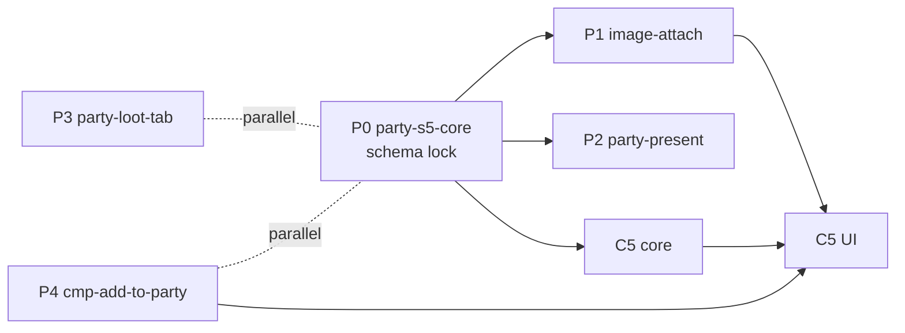

# Party board

> Five-minute read. Bullets over prose. See [AGENTS.md](../../AGENTS.md). DM gate 1 decided every DM question (#207, 2026-10-16; snapshot ceilings #208) ([§15](#15-open-questions)). Seams pass applied (orchestrator ruling 2026-10-16, S1, S3, S7–S10). Review rulings applied (2026-10-16, P1–P4, L1–L3): cut options for inventory / split, `DiceText` context, unshare vs images already seen, loaded-set checks; lazy-type FRs live in [live-sync's sprint 3 revision block](live-sync.md) (FR-SYNC-30–38).
>
> **Sprint 5 revision (track P, DM [#250](../decisions-log.md) [4] [5] [11] [12], [#251](../decisions-log.md)):** Party Loot moves into a **Loot** tab right of Inventory and the "Coin: open Party loot" button goes [4]; the DM can **present** a shared handout: it opens over everything on chosen players' screens [5]; the handout editor gets **direct upload, drop and clipboard paste** through ASSET's image attach control [11] [12]. New FRs FR-PARTY-29–40; amended FR-PARTY-05, -06, -11, -15, -27. DM questions in [§15](#15-open-questions) (OQ-PARTY-18–23, **bold** = pick, not decided). CON-44 measured with a throwaway probe on `session-sim-8` + the realistic-heavy harness (deleted).

### Sprint 5 at a glance

| FR | What | Slice ([§14.2](#142-sprint-5-build-split)) | Named test ([§13](#13-test-plan)) |
|---|---|---|---|
| FR-PARTY-29, -30 | Loot tab right of Inventory; Coin button gone; `openPartyTab` | P3 `build/party-loot-tab` | `FR-PARTY-29 Loot tab right of Inventory`, `FR-PARTY-29 no Coin button`, `FR-PARTY-30 open on a tab` |
| FR-PARTY-31–35 | `handout-present` rows, present / close commands, access loss closes | P0 core | `FR-PARTY-32 present to one player`, `… to all`, `FR-PARTY-35 leak`, `FR-PARTY-35 reconnect` |
| FR-PARTY-36–38 | Player popup over everything; DM controls | P2 `build/party-present` | `FR-PARTY-36 popup on connect`, `FR-PARTY-37 close`, walkthrough S5-4–S5-7 |
| FR-PARTY-39 | Editor: upload, drop, paste via the attach control | P1 `build/image-attach` | `FR-PARTY-39 paste adds an image`, walkthrough S5-2–S5-3 |
| FR-PARTY-40 | Fixtures `handout-attachment`, `handout-present-1`, bundle `party-s5` | P0 core | `party-s5 loads from empty` |

## 1. Summary

- A **Party** window, both clients, replacing Miro for the table: **handouts** the DM shares with everyone or chosen players, and a **party inventory** that items move in and out of (DM [#203](../decisions-log.md): "party board + handouts"; tier A in [feature tiers §4](../feature-tiers.md#4-notes-handouts-world-and-party)).
- A **handout** = title + plain text + 0–10 images (assets pipeline, capability IDs per [ADR-0023](../architecture/adr/0023-asset-access-by-capability-id.md)). The DM prepares it unshared, then **shares** it with everyone or chosen players, and can **unshare** it. A player it isn't shared with never receives its ID, title, text or image IDs.
- The **gold ledger** is [party-loot](party-loot.md) evolved, not replaced: item moves join the same log, plus a DM **split** of the party pot.
- Board data **loads when the window opens** ([ADR-0045](../architecture/adr/0045-lazy-record-types.md) lazy record types, the one on-demand path per seams S1): measured +0 B on every snapshot for handouts and items ([§12](#12-performance--bandwidth)).
- *(S5)* The Party window has three tabs: Handouts, Inventory, **Loot** (party-loot's pot, wallets, forms and log). The DM can **present** a shared handout: it opens over everything on the chosen players' screens until each closes it, also on a later connect. Handout images can be uploaded, dropped or pasted straight into the editor.

## 2. Scope

- Record types `handout` (header) and `handout-body`, one table; `party-item`. All campaign scope, **lazy** (OQ-PARTY-03).
- Intents `party.createHandout`, `party.updateHandout`, `party.shareHandout`, `party.deleteHandout` (DM); `party.addItem`, `party.editItem`, `party.removeItem` (DM); `party.moveItem` (DM, player); `loot.split` (DM).
- Notification kind `handout-shared` (info). Item adds reuse LOOT's `loot-received`.
- Party-loot evolves: `loot-entry` kind `item` (+ `qty`), `loot.split`, item rows in `loot.log` (OQ-PARTY-05, OQ-PARTY-16).
- Windows `party.board` "Party" (tabs Handouts, Inventory) and `party.handout` (viewer), both clients (OQ-PARTY-08).
- Fixtures + bundle `party-board`.
- All four slices are in sprint 3 (#207, G5). If the sprint runs late, cut slice 4 (party inventory + moves) first, then slice 3 (split); handouts always ship (#203's ask).
- *(S5)* Record type `handout-present` (in the snapshot, own rows only); intents `party.presentHandout`, `party.closePresent`; `party.shareHandout` gains `present`. Loot tab in `party.board`; `loot.log` window retired ([party-loot](party-loot.md) FR-LOOT-21). Editor images via the image attach control ([ASSET FR-ASSET-20–27](assets-pipeline.md#6-functional-requirements)). Fixtures `handout-attachment`, `handout-present-1`, bundle `party-s5`.
- *(S5, not in)* Presenting to the DM's own screen, a present timer, presenting unshared handouts, inline images in the body text (OQ-PARTY-21), player uploads ([OQ-ASSET-02](assets-pipeline.md#15-open-questions)).

## 3. Goals

- The DM shares a prepared handout with one player in ≤ 3 clicks; the player sees a toast and can open it ≤ 1 s after commit.
- No leak: a socket of a player the handout isn't shared with never carries its ID, title, text or image asset IDs: snapshot, events, load results, notifications; before and after reconnect. *(S5)* Also never another player's `handout-present` row.
- *(S5)* The DM presents a shared handout to one player in ≤ 3 clicks; it is on that player's screen ≤ 1 s after commit, or right after their next connect.
- Items and coin move between the party and characters in ≤ 10 s, each move logged, conserved and crash-safe (one transaction).
- CON-44 (#208): PARTY adds +1,100 B to the heavy DM snapshot and to every player snapshot (seams S2 budget). Tests assert the ceilings (DM 1 MiB, player 512 KiB) plus PARTY's own bound: the lazy types add 0 B (§12).

## 4. Non-goals

- PDF handouts (OQ-PARTY-02), rich text / markdown, handout folders, DM reordering, handouts authored by players.
- Player pins, annotations, comments; shared party notes (tier B, OQ-PARTY-07).
- Item entities / compendium links on items (OQ-PARTY-13), weight, item value, selling helpers.
- Coin conversion ("making change"), player-initiated splits (OQ-PARTY-06).
- Undo (combat only, [ADR-0016](../architecture/adr/0016-domain-events-pending-actions.md)): corrections are edits, unshares and reverse moves.

## 5. User stories

**DM**
- As the DM, I want to prepare the mayor's letter before the session and share it with everyone when they open it, so nobody waits for me to paste it into Miro.
- As the DM, I want to give the rogue alone a thieves'-guild map, and unshare it if I shared it by mistake.
- As the DM, I want to put 10 torches and 2 potions into the party inventory and split 30 gp between the PCs in one step.
- *(S5)* As the DM, I want to throw the ransom note up on the rogue's screen when they find it, not hope they open their Party window.
- *(S5)* As the DM, I want to paste a screenshot straight into a handout, without saving it to a file first.

**Player**
- As a player, I want a toast and a list of every handout I've been given, marked New until I read it, and still there after a reload.
- As a player, I want to take a potion from the party inventory onto my sheet, or give my spare bolts back, without asking the DM.
- *(S5)* As a player, I want the party's coin under the same Party window as its items.

## 6. Functional requirements

`env` = `CommandEnv`; campaign = `env.actor.campaignId`; IDs and time from `env.ctx` ([ADR-0022](../architecture/adr/0022-deterministic-seams.md)). "Clean text" = trimmed, control characters removed (body keeps `\n` and `\t`; `\r\n` → `\n`). Every command is one transaction with its event-log row and notifications ([ADR-0027](../architecture/adr/0027-notification-creation.md)). Terms per seams S9: **Share / Unshare** for handouts; "reveal" stays fog's word.

### 6.1 Handouts

| ID | Requirement | Notes |
|---|---|---|
| FR-PARTY-01 | Table `handout` (§8). Two record types read from it: `handout` (header: no body) and `handout-body` (`{id = handoutId, campaignId, body, rev, sharedWith}`). Both campaign scope, **lazy**: never in a snapshot, loaded with `sync.load` ([ADR-0045](../architecture/adr/0045-lazy-record-types.md)): `handout` lazy `"all"`, `handout-body` lazy `"ids"`. ≤ 200 handouts per campaign; the 201st create → `conflict` "Handout limit reached (200)". | OQ-PARTY-03 |
| FR-PARTY-02 | Handout input (strict zod, create and update): `title` clean, 1–80 chars; `body` clean, 0–10 000 chars; `imageAssetIds` 0–10, unique, each checked with `assets.require` (other campaign / unknown → `not_found`). | ADR-0023 |
| FR-PARTY-03 | `party.createHandout {title, body, imageAssetIds}` (DM): row with `sharedWith {mode: none, playerIds: []}`, `rev` 1, `sharedAt` null. Emits `HandoutCreated` (changes: header, body). Result `{handoutId}`. No notification. | |
| FR-PARTY-04 | `party.updateHandout {handoutId, title, body, imageAssetIds}` (DM): full replacement. Unknown / other campaign → `not_found`. Same values → `ack`, no write, no event. Else `rev` + 1, `updatedAt`; emits `HandoutUpdated` (changes: header; body only if `body` changed). No notification; clients mark it Updated (FR-PARTY-13). | |
| FR-PARTY-05 | `party.shareHandout {handoutId, sharedWith}` (DM; share and unshare). `sharedWith = {mode: none \| all \| players, playerIds}`; `players` needs 1–20 unique ids, each a player of the campaign (else `not_found`); `none` / `all` need `[]` (else `invalid`). `mode: none` = **unshare**. Same as stored → `ack`, no event. Else update; `sharedAt` = now iff some player newly gains access (FR-PARTY-06); emits `HandoutShared {handoutId, before, after}` (changes: header, body). `all` covers players added later. *(S5: optional `present: boolean`, FR-PARTY-33; losers' present rows closed, FR-PARTY-35.)* | OQ-PARTY-01 |
| FR-PARTY-06 | Notification `handout-shared` (owner PARTY, info, no action, payload `{handoutId}`, text "New handout: ‹title›", cut to 280). Gainers G = players who see it after and not before (`all` = every player of the campaign at commit). `none` → `all`: one notification, audience `all`. Otherwise one per player in G, audience `player`. G empty → none. Unshare, update, delete → none. *(S5: unchanged with `present`; the player client hides this toast while the present popup shows the same handout, FR-PARTY-36.)* | [FR-NOTE-02/04](notifications.md#6-functional-requirements) |
| FR-PARTY-07 | Visibility `handout` and `handout-body`: DM full. Player **hidden** unless `sharedWith.mode = all` or their id ∈ `sharedWith.playerIds`. Visible header is **redacted**: `sharedWith` → `{mode: all \| players}` (no ids). Visible body drops `sharedWith`. So a share change is an upsert to gainers and a delete to losers (record-change rule). | [ADR-0021](../architecture/adr/0021-sync-protocol-conventions.md) B, OQ-PARTY-10 |
| FR-PARTY-08 | `party.deleteHandout {handoutId}` (DM): deletes the row; emits `HandoutDeleted` (changes: header, body → null). Its notifications stay. `not_found` as FR-PARTY-04. | |
| FR-PARTY-09 | Unshare / delete on an open view: the delete arrives, the row leaves the list, an open viewer shows "No longer shared" (`party-handout-gone`), no error toast. A notification's "Open" whose body load (FR-PARTY-10) comes back without the id opens the viewer on the same message. Unshare does **not** revoke images already seen: under ADR-0023 the image **asset IDs** stay valid capabilities (and fetched bytes stay cached); only the handout's rows leave the player. The Share dialog says so (FR-PARTY-16). | ADR-0023 |
| FR-PARTY-10 | Client loading: opening `party.board` loads `handout` (all visible) via `useLazyRecords`; opening a handout loads its `handout-body` by id unless the id is in the type's **loaded set** (`isLoaded`, [FR-SYNC-35](live-sync.md)); presence in the store never counts (live upserts don't mark loaded; a snapshot purges lazy rows, FR-SYNC-37). A load that comes back without the id → FR-PARTY-09's message. After any snapshot (reconnect, resync) an open board / viewer reloads. While loading: skeleton rows; load reject → inline "Couldn't load — Retry". | ADR-0045; FR-SYNC-35–37 |

### 6.2 Party window and viewer

| ID | Requirement | Notes |
|---|---|---|
| FR-PARTY-11 | Window `party.board` "Party", both clients, closed by default, anchor `top-left` (dx 56, clear of the tool rail, as `loot.log`), 440×560, min 340×360, `minOpenH` 400, launcher "Party". Tabs **Handouts**, **Inventory** *(S5: + **Loot**, FR-PARTY-29)*; tab choice per browser with the layout. ~~A "Coin: open Party loot" link opens `loot.log`.~~ *(S5: removed, FR-PARTY-29.)* Launcher `activity` dot ([FR-SHELL-38](play-shell.md#6-functional-requirements)) when a handout arrives or is updated while minimised. Passes the registry-driven layout tests (seams S8): fits at 1280×720, opens at an edge clear of the default-open windows at 1280×720 / 1440×900 / 1600×900. | OQ-PARTY-08 |
| FR-PARTY-12 | DM Handouts tab: "New handout" Button; list of every handout, newest `seq` first. Row: thumb of the first image (if any), title, share Badge ("Not shared" muted / "Everyone" / player names), Updated time. Click → opens `party.handout` on it. Row menu: Edit, Share…, **Unshare** (while shared; = `sharedWith {mode: none}`), Delete (inline confirm). Empty: "No handouts yet". | |
| FR-PARTY-13 | Player Handouts tab: visible handouts, newest `sharedAt` first. Row: thumb, title, "Shared with you" / "Everyone", **New** Badge while `rev` > the browser's seen rev. Opening it marks it seen. Seen map: `localStorage` `pp.party.v1.<campaignId>.<playerId>` = `{seen: {handoutId: rev}}` (zod, ≤ 500 entries, oldest dropped); invalid / unavailable → memory only, console warning (as FR-SHELL-17). Empty: "No handouts yet". | OQ-PARTY-09 |
| FR-PARTY-14 | Window `party.handout` "Handout", both clients, closed by default, anchor `top-right`, 640×560, min 360×320, `minOpenH` 400 (opens on top rather than shrinking to a slot; images need the room), no launcher: the selected handout (client state, never sent). Title, images in order (`display` derivative, fit to width; click toggles 100 %), then the body as plain text with line breaks kept (never HTML). Once dice-extras' `DiceText` (`src/client/common/features/dice-extras/DiceText.tsx`, D1) is on `main`, the body's text runs render through it (clickable notation) with roll context `{label: ‹handout title›, category: other}` and no actor (the roller is whoever clicks); until then plain text. PARTY adds no parser (seams S7). DM extras: share Badge, Edit, Share…, Unshare Buttons. Same layout tests as FR-PARTY-11. | OQ-PARTY-12 |
| FR-PARTY-15 | DM editor (in `party.handout`, Edit or New): title Input, body Textarea with a counter, images strip (add via the asset picker, [FR-ASSET-17](assets-pipeline.md#6-functional-requirements); *(S5: and upload, drop, paste, FR-PARTY-39)*; remove; move left / right), Save / Cancel. Save disabled while invalid (FR-PARTY-02 mirrored), unchanged, not `live` or in flight. `reject` → inline message, values kept. Lost intent → Toast "Connection lost — check the handout before saving again". A remote change to the open handout keeps the draft and shows "Changed in another tab". | as FR-LOOT-17 |
| FR-PARTY-16 | DM Share… dialog: radio **Not shared / Everyone / Chosen players**, a checkbox per player (name, online dot) under Chosen; "Share" disabled while Chosen has none ticked, unchanged, not `live` or in flight. Hint under the radios (`party-share-hint`): "Unsharing hides the handout, but players keep images they've already seen" (FR-PARTY-09). A one-click **Share with everyone** Button sits next to it in the viewer. | |

### 6.3 Party inventory

| ID | Requirement | Notes |
|---|---|---|
| FR-PARTY-17 | Table `party-item` (§8), record type `party-item` campaign scope, **lazy** `"all"`, visibility: DM full, player full (own campaign, scope gate), as LOOT-10. ≤ 60 rows per campaign. | OQ-PARTY-04 |
| FR-PARTY-18 | Item input (strict zod): `name` clean 1–60, `qty` int 1–9 999, `notes` clean 0–120 (same bounds as the sheet's `items`, [CHARX §8](character-sheet-full.md#8-data-model)). **Merge key** = (`name` trimmed, case-insensitive; `notes` exact). | |
| FR-PARTY-19 | `party.addItem {name, qty, notes}` (DM): merge into the party row with the same key (qty sum > 9 999 → `conflict`) or insert (61st row → `conflict` "Party inventory is full (60)"). Writes a `loot-entry` kind `item` `world → party` (FR-PARTY-23) and a `loot-received` notification "Party loot: ‹name› ׋qty›" (all). Emits `PartyItemAdded` (changes: party-item, loot-entry). Result `{itemId}`. | amends FR-LOOT-13 |
| FR-PARTY-20 | `party.editItem {itemId, name, qty, notes}` (DM): full replacement, no log row, no notification; a key clash with another row → `conflict` "Same item exists — move or remove one". Same values → `ack`, no event. Emits `PartyItemEdited {itemId, before, after}`. | |
| FR-PARTY-21 | `party.removeItem {itemId, qty}` (DM; sold / used up): `qty` ≥ 1; more than the row holds → `conflict` "Only ‹n› left"; row qty − `qty`, row deleted at 0. Writes `loot-entry` kind `item` `party → world`. Emits `PartyItemRemoved`. | |
| FR-PARTY-22 | `party.moveItem {from, to, qty, itemId?, rowId?}` (strict). Ends `party` \| `character` (+ `characterId`, a character of the campaign, else `not_found`), `from ≠ to`. From `party` needs `itemId`; from a character needs `rowId` of that sheet's `items` (else `not_found` "Item is gone"). `qty` ≥ 1; more than the source holds at commit → `conflict` "Only ‹n› left". The source row is reduced (deleted at 0, incl. an equipped sheet row); the target merges by key or appends (sheet: `equipped: false`). Caps: party 60 rows, sheet 80 rows ([FR-CHARX-16](character-sheet-full.md#6-functional-requirements)), qty 9 999 → `conflict` naming the full side. Writes `loot-entry` kind `item`. Emits `ItemMoved {entryId, from, to, name, qty}` (changes: party-item, each changed `creature-sheet`, loot-entry). Sheet writes go through CHARX's `sheet-items.ts` helper and touch only the sheet's `items` (seams S8). | OQ-PARTY-17 |
| FR-PARTY-23 | Authorization (as [FR-LOOT-07](party-loot.md#6-functional-requirements)): DM any move. Player: own character → `party` or another character; `party` → own character. Else `forbidden`. Own = `ownerPlayerId` at commit. **Sheet lock and draft status don't block** a move. | OQ-PARTY-11 |
| FR-PARTY-24 | Inventory tab: rows sorted by name: name, qty, notes. Everyone: **Take** (to one of the viewer's own characters; picker if > 1; qty Input) and **Give…** (source = one of the viewer's own characters' sheet items; target = Party or another character). DM: Add form (name, qty, notes; Enter submits), row Edit, Remove (qty), and Move to any character. Locks, reject and lost-intent rules as FR-LOOT-16. Player with no character → Take / Give hidden. Empty: "Party inventory is empty". | |

### 6.4 Gold ledger (party-loot evolved)

| ID | Requirement | Notes |
|---|---|---|
| FR-PARTY-25 | `loot-entry` gains kind `item`: `text` = item name (1–60), `qty` 1–9 999 (null on other kinds, on the wire only when set), coins all 0, ends as FR-PARTY-19/21/22. Pot and wallet sums are unaffected (coins 0). `loot.edit` on an item row → `conflict` "Item moves can't be edited — move it back". `loot.log` renders "‹from› → ‹to›: ‹name› ׋qty›" ("Party", "Outside the party"). | OQ-PARTY-05 |
| FR-PARTY-26 | `loot.split {characterIds, cp?, sp?, ep?, gp?, pp?}` (DM; player → `forbidden`): 1–10 unique characters of the campaign (`not_found`); each coin int 0…999 999. Share per coin = ⌊coin / n⌋, the remainder stays in the pot; all shares 0 → `invalid` "Nothing to split". One `move` row `party → character` (text "Split") per character, in list order. No balance check (#150). Emits `CoinSplit {entryIds, characterIds, shares}` (changes: entries, `party-pot`, each `wallet`). No notification. | OQ-PARTY-06 |
| FR-PARTY-27 | `loot.log` *(S5: the Loot tab, FR-PARTY-29)* DM "Split…" Button: coin Inputs prefilled with the pot's positive coins; a checkbox per character (approved characters ticked); preview "Each gets ‹coins›, ‹coins› stays in the pot"; Split disabled while invalid, not `live` or in flight. | |

### 6.5 Fixtures

| ID | Requirement | Notes |
|---|---|---|
| FR-PARTY-28 | Fixtures `handout-images`, `handouts-1`, `party-items-1`, `party-second` and bundle `party-board` (§13). Units are **patches** (seams S10): they add PARTY rows and change shared characters only through `party.moveItem` (one `items` row on Thorn); never replace a sheet or touch another field. `fixtures:reset-load party-board` works from empty and is deterministic ([FR-FIX-08](fixtures-adapters.md#6-functional-requirements)); the units also load on `session-sim` with the other sprint-3 units (`session-sim-7`, orchestrator). | ADR-0017 |

### 6.6 Sprint 5: Loot tab, present, uploads

"Can see" = FR-PARTY-07's rule at commit. **Present** = open a shared handout on players' screens (term: OQ-PARTY-23).

| ID | Requirement | Notes |
|---|---|---|
| FR-PARTY-29 | **Loot tab** [4]: `party.board` tabs are **Handouts, Inventory, Loot**, in that order. Loot renders party-loot's body unchanged (pot, wallets, DM add form, Move form, DM Split…, log; [FR-LOOT-21](party-loot.md#6-functional-requirements)) in the tab's scroll area. The "Coin: open Party loot" button (`party-loot-link`) is **removed**. Tab memory (FR-PARTY-11) accepts `loot`; an unknown stored value → Handouts. Window default stays **440×560** (seams S4: ≤ 440 wide so Compendium + Party sit side by side at 1440×900); no new window. | Amends FR-PARTY-11, -27 |
| FR-PARTY-30 | Client helper `openPartyTab(tab)` (`@ui/features/party-board`): stores the tab (as a click would), then opens, restores or focuses `party.board` as a feature open (`by: "feature"`, FR-SHELL-40). Callers: LOOT's `loot-received` "Open" and the sheet's wallet link ([FR-LOOT-22, -23](party-loot.md#6-functional-requirements)). | |
| FR-PARTY-31 | Table `handout_present` (§8), record type `handout-present` `{id, campaignId, handoutId, playerId, presentedAt}`, campaign scope, **in the snapshot** (not lazy: it must reach a player who never opens the board). **At most one row per player** (unique `(campaignId, playerId)`), so ≤ 20 per campaign. Visibility: DM full; player full iff `playerId` = the viewer's, else **hidden**. | OQ-PARTY-20; §12 |
| FR-PARTY-32 | `party.presentHandout {handoutId, to}` (DM; strict), `to = {mode: all} \| {mode: players, playerIds}` (1–20 unique). Handout of the campaign, else `not_found`. Targets T: `all` = every player who can see it; `players` = the ids, each a player of the campaign (`not_found`) who can see it, else `conflict` "‹name› can't see this handout — share it first". T empty → `conflict` "Share it first". Per target: delete their current row (any handout), insert a new row (new id from `ctx.ids`, `presentedAt` = now). Emits `HandoutPresented {handoutId, playerIds}` (changes: deletes + upserts). No notification (the popup is the alert). Result `{presentIds}`. | [5] |
| FR-PARTY-33 | **Share and present in one step**: `party.shareHandout` gains optional `present: boolean` (default false). `true`: after the share, same transaction, FR-PARTY-32 for the **gainers only** (G, FR-PARTY-06: players who see it after and not before), so a player who already had it and closed it is never popped again (review #23). G empty (incl. an unchanged share) → no present, no event; re-showing to anyone is "Open on screens…" (FR-PARTY-38 b). `mode: none` + `present` → `invalid`. Event order: `HandoutShared` (if the share changed), notifications (FR-PARTY-06), `HandoutPresented`. | Amends FR-PARTY-05 |
| FR-PARTY-34 | `party.closePresent {presentId} \| {handoutId}` (strict). `presentId`: player → own row only (other → `not_found`); DM → any row of the campaign. `handoutId`: DM only ("Close on all screens"; player → `forbidden`), every row of that handout. Nothing left to close → `ack`, no event (two devices closing at once). Else delete; emits `HandoutPresentClosed {handoutId, playerIds, by: dm \| player}`. | |
| FR-PARTY-35 | **Access loss closes presents**: `party.shareHandout` deletes the rows of players who lose access, and `party.deleteHandout` every row of the handout, in the same transaction (changes ride on `HandoutShared` / `HandoutDeleted`). Invariant (tested after every command): a `handout-present` row exists only for a player who can see its handout. So a player never holds a present for a handout they can't see, before or after a reconnect. | No leak |
| FR-PARTY-36 | **Player popup** [5] (player client, mounted by one line in the player client root, not a window; granted by seams S4): while the store holds the viewer's own `handout-present` row (from a live event, or from the snapshot of a page load / reconnect), a **modal Dialog over every window** shows that handout: title; images (`display`, fit inside 90 vw × 75 vh; > 1 image → Prev / Next + "‹n› / ‹N›"); then the body (FR-PARTY-14 rendering, `DiceText`) in a scroll area; text-only → title + body. Content loads through FR-PARTY-10 (header + body by id); skeleton while loading; reject → "Couldn't load — Retry"; load without the id → closes silently. Opening marks the handout seen (FR-PARTY-13). While it shows, the client hides a `handout-shared` toast for the same handout ([FR-NOTE-26](notifications.md#6-functional-requirements) `hideToast`). It sits in [FR-SHELL-01](play-shell.md#6-functional-requirements)'s dialog layer (over windows, chrome and toasts); only the dice layer (topmost, no input) is above it. A new row (re-present, another handout) swaps the content; the row's delete closes it. | OQ-PARTY-18, -19 |
| FR-PARTY-37 | **Closing** (player): **Close**, Esc or a click outside → hides at once and sends `party.closePresent {presentId}`. **Open in Party** → opens `party.handout` on it (FR-PARTY-14), then the same close. Not `live` or intent lost → hidden for this page until the next snapshot; if the row is still there, it shows again (the close never reached the server). Close is per player, all their tabs / devices (the row is gone). | OQ-PARTY-19 |
| FR-PARTY-38 | **DM controls**: (a) Share… dialog (FR-PARTY-16) checkbox **"Also open it on the screens of players who newly get it"** (`party-share-present`, unticked by default; hidden for Not shared), with the gainers named under it ("Opens on: Thorn"; "Nobody new" disables it; `party-share-present-names`) → `present: true`. (b) Row menu and viewer **Open on screens…** (shared handouts only) → dialog: radio **Everyone it's shared with** (default) / **Chosen players**, a checkbox per player who can see it (name, online dot), **Open** disabled while Chosen has none ticked, not `live` or in flight → `party.presentHandout`. (c) Badge **"On screen: ‹n›"** on the row and in the viewer while n > 0 (Tooltip: player names). (d) Viewer **Close on all screens** (n > 0) → `party.closePresent {handoutId}`. The DM's own client never pops anything. Reject → inline; lost intent → Toast "Connection lost — check the handout before trying again". | OQ-PARTY-20 |
| FR-PARTY-39 | **Editor uploads** [11] [12]: the editor's images strip hosts ASSET's **image attach control** ([FR-ASSET-20–27](assets-pipeline.md#6-functional-requirements)) with `max = 10`, `count` = images in the draft, `owner = "party-editor"`, paste target = the whole editor (title Input and body Textarea included), drop target = the editor. Upload, drop and paste add **attachments** (FR-ASSET-24) to the end of the strip, in order; "From library" keeps the picker. Save unchanged (`assets.require` per id, FR-PARTY-02). A pasted image never changes the text (OQ-PARTY-21). Dedupe is the caller's (seams S5): an id already in the strip (same bytes → same id) is not added again (handout ids stay unique, FR-PARTY-02); hint "Already in this handout" (`party-editor-duplicate`). | Amends FR-PARTY-15 |
| FR-PARTY-40 | Fixtures `handout-attachment` (an attachment-only image in a new unshared handout h6) and `handout-present-1` (h2 presented to player-1), bundle **`party-s5`** (§13). Patches only (seams S10); `fixtures:reset-load party-s5` works from empty and is deterministic. | ADR-0017 |

## 7. UI/UX notes

Per [visual-direction](../design/visual-direction.md): shadcn Tabs, Input, Textarea, Button, Badge, Dialog, RadioGroup, Checkbox, ScrollArea, Toast, Skeleton. Dark only. No custom styling.

- **States:** empty texts per FR-PARTY-12/13/24; loading = Skeleton rows (FR-PARTY-10); load error = inline Retry; disconnected = last view + reconnect banner, every form and action disabled; unshared = "No longer shared".
- **DM view:** every handout incl. unshared prep; editor, Share…, Unshare, Delete; inventory with Add / Edit / Remove / Move; `loot.log` gains Split… and item rows. The DM's own `all` notifications toast (as loot).
- **Player view:** only handouts shared with them, New / Updated marks, read-only viewer; inventory with Take / Give…; `loot.log` shows item rows. Toast per handout shared with them, none on unshare or edit.
- **Test IDs** (AGENTS §9.5, prefix `party-`): `party-board`, `party-tab` + `data-value`, `party-loot-link`, `party-handout-list`, `party-handout-empty`, `party-handout-row` + `data-record-id` + `data-shared` (`none|all|players`) + `data-new`, `party-handout-new`, `party-handout-menu`, `party-handout-unshare`, `party-handout-delete`, `party-handout-delete-confirm`, `party-handout-view` + `data-record-id`, `party-handout-title`, `party-handout-body`, `party-handout-image` + `data-record-id` (asset id), `party-handout-gone`, `party-handout-loading`, `party-handout-retry`, `party-handout-edit`, `party-editor-title`, `party-editor-body`, `party-editor-add-image`, `party-editor-image` + `data-record-id`, `party-editor-save`, `party-editor-cancel`, `party-editor-error`, `party-share-open`, `party-share-everyone`, `party-share-mode` + `data-value`, `party-share-player` + `data-record-id`, `party-share-submit`, `party-share-error`, `party-share-hint`, `party-item-list`, `party-item-empty`, `party-item-row` + `data-record-id`, `party-item-take`, `party-item-give`, `party-item-qty`, `party-item-target` + `data-value`, `party-item-source` + `data-record-id`, `party-item-submit`, `party-item-error`, `party-item-add-name`, `party-item-add-qty`, `party-item-add-notes`, `party-item-add-submit`, `party-item-edit`, `party-item-remove`, `party-item-target-option`, `party-item-cancel`, `party-item-add-error`, `party-item-edit-name` / `-qty` / `-notes`, `party-item-name`, `party-item-count`, `data-character-id` on sources (P4 build, #234); in `loot.log`: `loot-split-open`, `loot-split-coin` + `data-value`, `loot-split-character` + `data-record-id`, `loot-split-preview`, `loot-split-submit`, `loot-split-error`; `loot-entry` gains `data-kind="item"`.
- *(S5)* **Loot tab:** `party-tab` `data-value="loot"`; LOOT's `loot-*` IDs inside it, unchanged; `party-loot-link` gone (a test asserts its absence).
- *(S5)* **Present, DM:** Share dialog checkbox; "Open on screens…" in the row menu and viewer; "On screen: 2" Badge (muted while 0 is never shown); "Close on all screens". **Player:** the popup is a shadcn Dialog (modal, centred, max 90 vw × 90 vh), title in the header, Close focused, "Open in Party" secondary. No popup on the DM client.
- *(S5)* **Editor:** the attach control sits at the end of the images strip ("Upload", "From library", hint "or drop / paste an image"); progress and errors under the strip (ASSET §7). States as FR-PARTY-15.
- *(S5)* **Test IDs:** `party-share-present`, `party-share-present-names`, `party-present-open` (row menu / viewer) + `data-record-id`, `party-present-dialog`, `party-present-mode` + `data-value` (`all|players`), `party-present-player` + `data-record-id`, `party-present-submit`, `party-present-error`, `party-present-count` + `data-value` (n), `party-present-close-all`; player popup `party-present-popup` + `data-record-id` (handout id) + `data-present-id`, `party-present-title`, `party-present-image` + `data-record-id` (asset id), `party-present-prev`, `party-present-next`, `party-present-page`, `party-present-body`, `party-present-loading`, `party-present-retry`, `party-present-close`, `party-present-open-board`. Editor: ASSET's `asset-attach*` with `data-owner="party-editor"`, plus `party-editor-duplicate` (seams S5).

## 8. Data model

| Entity | Field | Type | Notes |
|---|---|---|---|
| Handout (`handout`) | id, campaignId, seq | ID, ID → Campaign, int | `env.ctx.ids`; seq = DB order |
| | title | text 1–80 | Plain text |
| | body | text 0–10 000 | Only in `handout-body` |
| | imageAssetIds | **JSON leaf**, 0–10 asset IDs | Each via `assets.require` |
| | sharedWith | **JSON leaf** `{mode: none \| all \| players, playerIds: ID[] ≤ 20}` | The only visibility input (FR-PARTY-07); `none` = unshared |
| | rev | int ≥ 1 | +1 per content update (New / Updated marks) |
| | createdAt, updatedAt, sharedAt | timestamp ×2, timestamp \| null | `sharedAt` set when someone gains access |
| Party item (`party-item`) | id, campaignId, seq | ID, ID, int | ≤ 60 per campaign |
| | name, qty, notes | text 1–60, int 1–9 999, text 0–120 | Merge key (name ci, notes) |
| | createdAt, updatedAt | timestamp ×2 | |
| Loot entry (`loot-entry`, LOOT-owned) | kind | + `item` | FR-PARTY-25 |
| | qty | int 1–9 999 \| null | New column; item rows only |
| *(S5)* Handout present (`handout-present`) | id, campaignId | ID (`env.ctx.ids`, new per present), ID → Campaign | FR-PARTY-31 |
| | handoutId | ID → Handout (cascade delete) | Can see it, FR-PARTY-35 |
| | playerId | ID → Player | **Unique `(campaignId, playerId)`**: one open present per player |
| | presentedAt | timestamp | `env.ctx.clock`; order of the DM's "On screen" names |

- **Relations:** campaign 1–n handout, 1–n party item. Handout → assets by ID (no FK, assets have no delete). `sharedWith.playerIds` → players (no delete in MVP, OQ-CAMP-08). A move's sheet side lives in CHARX's `creature-sheet.items` JSON leaf.
- **Derived values:** player share label, New / Updated marks (client, localStorage seen revs), split shares and preview, item-row text (`@shared/party-board`).
- **Persisted runtime state:** none beyond rows. Seen revs are browser-only (never sent). Indexes: `handout (campaignId, seq)`, `party_item (campaignId, seq)`.
- **Later (additive):** `party_item.itemRef` (OQ-PARTY-13), `handout.folder`, player pins.
- *(S5)* **Relations:** handout 1–n present (≤ 1 per player); player 1–0..1 present. **Derived:** "On screen: n" and names (DM client, from the rows); the player popup's content (lazy handout loads). **Persisted runtime state:** present rows until closed (by the player, the DM, or access loss). Index: unique `handout_present (campaignId, playerId)`, plus `(handoutId)`. Attachments are `asset` rows with `listed = false` ([ASSET §8](assets-pipeline.md#8-data-model)); handouts reference them like any asset.

## 9. API & events

**REST:** none (images upload through the existing DM asset upload).

**Record types** (campaign scope)

| Type | Data | DM | Player | Snapshot |
|---|---|---|---|---|
| `handout` | `{id, campaignId, seq, title, imageAssetIds, sharedWith, rev, createdAt, updatedAt, sharedAt}` | full | FR-PARTY-07: hidden, or redacted `sharedWith {mode}` | **lazy `"all"`**; `sync.load` |
| `handout-body` | `{id, campaignId, body, rev, sharedWith}` | full | hidden, or full minus `sharedWith` | **lazy `"ids"`**; `sync.load {ids}` |
| `party-item` | `{id, campaignId, seq, name, qty, notes, createdAt, updatedAt}` | full | full | **lazy `"all"`**; `sync.load` |
| `loot-entry` (LOOT) | + kind `item`, `qty` | full | full | unchanged window 100 |
| *(S5)* `handout-present` | `{id, campaignId, handoutId, playerId, presentedAt}` | full | own row only (FR-PARTY-31) | **yes** (≤ 20 DM, ≤ 1 player) |

**WS intents** (none optimistic)

| Intent | Who | Validation / ownership | Result |
|---|---|---|---|
| `party.createHandout {title, body, imageAssetIds}` | DM | FR-PARTY-02; cap → `conflict` | `{handoutId}` |
| `party.updateHandout {handoutId, title, body, imageAssetIds}` | DM | FR-PARTY-02; `not_found` | — |
| `party.shareHandout {handoutId, sharedWith}` | DM | FR-PARTY-05 (share and unshare) | — |
| `party.deleteHandout {handoutId}` | DM | `not_found` | — |
| `party.addItem {name, qty, notes}` | DM | FR-PARTY-18; caps → `conflict` | `{itemId}` |
| `party.editItem {itemId, name, qty, notes}` | DM | FR-PARTY-18, 20 | — |
| `party.removeItem {itemId, qty}` | DM | FR-PARTY-21 | `{entryId}` |
| `party.moveItem {from, to, qty, itemId?, rowId?}` | DM, player | FR-PARTY-22, 23 | `{entryId}` |
| `loot.split {characterIds, cp?…pp?}` | DM | FR-PARTY-26 | `{entryIds}` |
| `sync.load {type, ids?}` (ADR-0045) | DM, player | lazy types only; `invalid` / `forbidden` per [FR-SYNC-31](live-sync.md) | `{records}` |
| *(S5)* `party.shareHandout {…, present?}` | DM | FR-PARTY-33 | — |
| *(S5)* `party.presentHandout {handoutId, to}` | DM | FR-PARTY-32 | `{presentIds}` |
| *(S5)* `party.closePresent {presentId} \| {handoutId}` | player (own `presentId`), DM | FR-PARTY-34 | — |

Players sending a DM-only intent → `forbidden`, no change.

**WS events** (domain events; generic record changes; all logged; none undoable or transient)

| Event | Payload | Changes | Visibility rule |
|---|---|---|---|
| `HandoutCreated` | `{handoutId}` | handout, handout-body | FR-PARTY-07: DM only (unshared) |
| `HandoutUpdated` | `{handoutId, rev}` | handout; handout-body if body changed | FR-PARTY-07: DM + players it is shared with |
| `HandoutShared` | `{handoutId, before, after}` (`sharedWith` values; also on unshare) | handout, handout-body | FR-PARTY-07 per side: gainers upsert, losers delete, others nothing. Payload reaches clients only as filtered record changes |
| `HandoutDeleted` | `{handoutId}` | handout, handout-body → null | DM + players it was shared with (delete) |
| `NotificationCreated` (`handout-shared`) | per NOTE | notification | FR-NOTE-06: audience `all` or the gainer only |
| `PartyItemAdded` / `PartyItemEdited` / `PartyItemRemoved` | `{itemId, …}` | party-item; loot-entry (add, remove) | DM + every player of the campaign |
| `NotificationCreated` (`loot-received`, item add) | per NOTE | notification | all |
| `ItemMoved` | `{entryId, from, to, name, qty}` | party-item, creature-sheet(s), loot-entry | party-item, loot-entry: everyone; creature-sheet: CHARX's fn (owner + DM full; others summary) |
| `CoinSplit` | `{entryIds, characterIds, shares}` | loot-entries, party-pot, wallets | everyone (LOOT-10) |
| *(S5)* `HandoutPresented` | `{handoutId, playerIds}` | handout-present (each target's old row deleted, new row upserted) | FR-PARTY-31: DM all; each target only their own rows; other players at most an empty-change frame (cause name only, as every event; payload never on the wire) |
| *(S5)* `HandoutPresentClosed` | `{handoutId, playerIds, by}` | handout-present → null | DM; each closed player their own delete |
| *(S5)* `HandoutShared` / `HandoutDeleted` | unchanged | + handout-present deletes for losers (FR-PARTY-35) | as above, per row |

- Each event is its own `event` frame, before the sender's `ack` ([FR-SYNC-14](live-sync.md#6-functional-requirements)). Notifications follow their command's event in the same transaction.

## 10. Permissions

| Action | DM | Player | Server check |
|---|---|---|---|
| Create / edit / share / unshare / delete handout | ✓ | ✗ | role (`forbidden`); campaign (`not_found`) |
| See a handout (list, body, images) | all | `all` or listed | FR-PARTY-07, every path |
| Add / edit / remove party item; split pot | ✓ | ✗ | role |
| Move item: own character → party / other character; party → own | ✓ | ✓ | FR-PARTY-23 at commit |
| Move item: any other | ✓ | ✗ | `forbidden` |
| See party inventory, item log | all | own campaign | scope gate |
| *(S5)* Present a handout / close all its presents | ✓ | ✗ | role (`forbidden`); targets can see it (`conflict`) |
| *(S5)* Close a present | any | own row only | `not_found` for another player's row |
| *(S5)* See presents | all rows | own row only | FR-PARTY-31 |
| *(S5)* Upload / paste handout images | ✓ | ✗ (no editor) | DM upload route ([FR-ASSET-01](assets-pipeline.md#6-functional-requirements)); `assets.require` at save |

## 11. Edge cases & failure modes

- **Player disconnect / reconnect:** lazy rows aren't in the snapshot, and the snapshot purges any lazy rows still in the store (FR-SYNC-37); an open board / viewer reloads (FR-PARTY-10) and gets only what is visible now: a handout unshared while away is simply absent (no delete needed), and a notification's Open for it shows "No longer shared". Missed shares show on the bell (`handout-shared`), no per-item toasts. Seen marks are local and survive.
- **DM disconnect / reconnect:** players unaffected, can keep moving items. DM forms disabled; a lost intent → toast (FR-PARTY-15/24); the reconnect load shows whether it committed.
- **Server crash mid-action:** each command commits with its event-log row, loot entry and notifications or not at all; a move's party row and sheet row change together. After a restart, loads equal the pre-crash state (digest identical).
- **Unshare while open:** delete arrives → "No longer shared" (FR-PARTY-09). Image asset IDs the player already received stay valid (ADR-0023); the Share dialog tells the DM. Unshare racing a body load: the load runs in frame order, so it either predates the unshare (then the delete follows) or omits the id.
- **Concurrency:** commands serialise. Two players taking the last potion → the second gets `not_found` "Item is gone" (row deleted at 0), or `conflict` "Only ‹n› left" if some remain (FR-PARTY-22). DM edits a party row while a player takes from it → whichever commits first; the other rechecks at commit. A sheet row deleted by its owner before a give → `not_found` "Item is gone". Two DM tabs editing a handout → last write wins, the other tab's editor keeps its draft with a hint.
- **Share edge:** sharing with `players` that equals every current player is still `players` (a player added later doesn't get it); the dialog says so. Share to `all` from `players` notifies only the new gainers.
- **Notifications after unshare:** a recipient's history row keeps "New handout: ‹title›" (already seen; OQ-PARTY-15); its Open shows "No longer shared".
- **Campaign switch:** `4409`; the next snapshot and loads are the new campaign's only.
- *(S5)* **Present, player offline / joining later:** the row waits; the popup opens right after their next connect's snapshot, on whichever device connects first, until they close it (OQ-PARTY-19). A player added to the campaign after the present has no row (presents target players at commit). Closing on one device closes it on all (row deleted).
- *(S5)* **Present vs unshare / delete / re-share:** losers' rows go in the same transaction (FR-PARTY-35), so the popup closes with the handout rows; nothing reopens after a reconnect. Present racing an unshare: commands serialise; whichever commits second sees the other's state (`conflict` "share it first", or the row deleted).
- *(S5)* **Present while the popup shows another handout:** one row per player, so the new present replaces the old (FR-PARTY-32); the popup swaps content. Two DM tabs presenting at once: last write wins.
- *(S5)* **Present, crash:** the row commits with its event-log row or not at all; after a restart the snapshot carries the open rows and the popups reopen.
- *(S5)* **Upload, crash or disconnect mid-upload:** ASSET FR-ASSET-07 / -26 (no row without files; the editor keeps its draft; a finished upload adds its image even if the WS dropped meanwhile; Save waits for `live`). An uploaded image that is never saved stays as an unreferenced attachment (no delete, [OQ-ASSET-05](assets-pipeline.md#15-open-questions)).
- **Invalid / malicious input:** over-long fields, control characters, foreign or unknown asset / player / character ids, `rowId` of another sheet, qty 0 / negative / fractional, strict-key violations → `invalid` / `not_found`. Body rendered as text, never HTML (`DiceText` renders text runs only). Inbound frames > 64 KB closed by live-sync: a 10 000-char body is ≤ 30 KB even at 3 B per char.

## 12. Performance & bandwidth

**CON-44, measured** (throwaway probe on the realistic-heavy harness, `session-sim` + `buildRealisticHeavy`, max-length ASCII; frame bytes as `snapshotSizes`; probe deleted). Board: 30 handouts (20 text, 10 with 3 images; 20 shared with all, 5 with player-1, 5 unshared), 60–100 party items.

| Variant | Heavy DM (base 676,050 B) | Player-1 (25 visible) | Other players (20 visible) |
|---|---|---|---|
| **Lazy (decided, #207)**: handout, handout-body, party-item off the snapshot; `loot-entry.qty` | **+1,100 B** (100 item rows, worst) → 677,150 B, 371,426 B under the 1 MiB ceiling (#208) | +1,100 B | +1,100 B |
| Headers in snapshot (3 images) | +12,932 | +9,912 | +7,632 |
| Headers in snapshot (10 images) | +14,682 | +10,787 | +7,632 |
| + bodies inline at 2,000 / 4,000 / 10,000 chars | +73,322 / +133,322 / +313,352 | +60,237 / +110,237 / +260,262 | +47,892 / +87,892 / +207,912 |
| + 100 max party items in snapshot | +39,915 | +39,915 | +39,915 |

- Seams pass: **no re-measure needed** for PARTY. The rulings change no snapshot byte of ours (lazy types stay off the snapshot; `loot-entry.qty` unchanged). Seams S2 books PARTY at +1,100 B. Gate 1 (#208): ceilings DM **1 MiB** (1,048,576 B), player **512 KiB**; the "≥ 100 KiB DM headroom" guard is dropped. Sprint 3 with every pick measures 712,310 B heavy DM (336,266 B left). PARTY's CON-44 tests assert both ceilings plus PARTY's own bound: `handout`, `handout-body`, `party-item` absent from every snapshot and `loot-entry` growth ≤ 1,100 B at the 100-row window. Putting `name` + `qty` in a nested object instead of reusing `text` cost +9,000 B; rejected.
- **Load results** (`sync.load` ack, DM view; measured before the rename, plus 4 B per row for `reveal` → `sharedWith`, computed): 30 headers 16,832 B; 100 headers 55,962 B; 200 (cap) ≈ 112 KB; 60 items (cap) 24,005 B. One body ≤ 10,111 B ASCII, ≤ 30,111 B worst UTF-8. All far below the 4 MiB frame limit.
- Tunnel: a share sends one header (~450 B) + body (≤ 30 KB) per gainer; images are fetched by players as `display` derivatives (1–3 MB each, cached forever). 6 players × 3 images at 10 Mbit/s ≈ 5–15 s for the first view, as a map.
- Rates: human-paced (a few shares / moves per session). Grouped `SUM` for pot / wallets unchanged.

**Sprint 5, measured** (throwaway probe: `session-sim-8` on Goblin Ambush + `buildRealisticHeavy`, max-length ASCII, IDs at full length; frame bytes as `snapshotSizes`; probe deleted). Base: DM **678,650 B**, players 279,699–285,721 B. Sprint-4 worst DM (rules data, 3-byte names) 863 KB.

| What | DM snapshot | Each player snapshot | Per event |
|---|---|---|---|
| `handout-present`, 6 players each with an open row | **+1,517 B** | **+267 B** (own row; 0 B with none) | `HandoutPresented`: 462 B to a target, 2,157 B to the DM for 6 targets; `HandoutPresentClosed`: 210 B |
| `handout-present` at the 20-row cap | +5,017 B | +267 B | — |
| Loot tab (FR-PARTY-29), Add to party ([CMP FR-CMP-40](compendium.md#6-functional-requirements)) | 0 B (same records) | 0 B | unchanged (`party.addItem`) |
| Attachments (uploads / pastes, [FR-ASSET-24](assets-pipeline.md#6-functional-requirements)) | 0 B | 0 B | upload response 341 B, DM only |

- Worst case with every S5 PARTY row: 863 KB + 5 KB ≈ 868 KB DM; all sprint-5 tracks together ≈ 940 KB of 1 MiB, players ≈ 357 KB of 512 KiB (seams S14; P's share unchanged); players + 267 B. Images never in a snapshot; the popup fetches the `display` derivative as the viewer does (§12 above). CON-44 tests assert `handout-present` ≤ 1 row per player frame and the DM growth ≤ 5,100 B at the cap.

## 13. Test plan

Isolated per worktree ([ADR-0008](../architecture/adr/0008-parallel-dev-isolation.md)); loop per [ADR-0017](../architecture/adr/0017-agent-verification-fixture-library.md). `bun test` on `:memory:`, port 0. Tests named after FRs.

**Fixtures** (`fixtures/units/party-board/`; setups as DM through PARTY commands, fixed clock; patches only, seams S10)

| Key | Requires | Contents | Side effects |
|---|---|---|---|
| `handout-images` | `campaign` | Ingests committed SVGs `fixtures/assets/handouts/thieves-map.svg`, `wanted-poster.svg` (assets used by no scene or token) | 2 assets |
| `handouts-1` | `handout-images`, `player-2`, `images` | h1 "Mayor's Letter" (text, 3 lines) → all. h2 "PARTY-P1-ONLY Thieves' Map" (thieves-map + text) → players [player-1]. h3 "Secret Orders" body "PARTY-SECRET-3" → unshared. h4 "Old Bounty" body "PARTY-UNSHARED-4" → all, then unshared. h5 "Ship Manifest" body "PARTY-PREP-5" → unshared. `wanted-poster` stays unused (walkthrough step 3) | 3 `handout-shared`: h1 all, h2 player-1, h4 all (row and h4's id stay after the unshare, OQ-PARTY-15) |
| `party-items-1` | `char-mira-full`, `char-thorn`, `loot-wallets` | add Potion of healing ×2, Torch ×10, Rope (50 ft) ×1; move Torch ×2 party → Thorn (appends one row to Thorn's `items`; no other sheet field) | 3 `loot-received`; 4 item log rows |
| `party-second` | `campaign-second` | Activate Second; "SECOND-CAMPAIGN-HANDOUT" → all; item "SECOND-CAMPAIGN-ITEM"; re-activate Fixture Campaign | notifications in Second |

- **Bundle `party-board`** = `base` + `player-2` + `images` + `char-mira` + `char-thorn` + `char-mira-full` + `campaign-second` + `loot-1` + `loot-wallets` + `handout-images` + `handouts-1` + `party-items-1` + `party-second`. Pot 5 pp, 30 gp (LOOT).

| Level | What | Fixtures |
|---|---|---|
| Unit | zod: title / body clean + bounds, 10 001 chars, 11 images, duplicate ids, `sharedWith` shapes (`none` with ids, `players` empty, 21 ids) → `invalid`; item bounds, merge key (case, notes); split shares + remainder, "Nothing to split". Visibility fns: `FR-PARTY-07` DM full / gainer redacted / not shared → hidden for both types, `all` covers a later player. Gainers set G for every transition (none→all, none→players, players→all, all→players, →none). Notification text cut. Client: list order DM / player, New / Updated from seen revs (bad storage → memory), share label, item-row text, split preview, Take / Give options per role, form locks, lost-intent toasts. **Layout** (seams S8): `party.board` and `party.handout` pass the existing registry-driven tests in both `windows.test.ts` (FR-SHELL-08 fit at 1280×720 / 1600×900; #162 edge + clear of default-open windows, or `minOpenH`) | in-code |
| Integration | Commands: each FR-PARTY-03…08, 19…23, 26 incl. no-op `ack`, `not_found` across campaigns, caps (`conflict`), events before `ack`, notification in the same tx (`notify` forced to throw → nothing written). **Leak tests** (`FR-PARTY-07 leak`): player-2's frames (snapshot, every event, `sync.load` acks for `handout`, `handout-body` by h2/h3 ids) never contain "PARTY-P1-ONLY", "PARTY-SECRET-3", "PARTY-UNSHARED-4", "PARTY-PREP-5", h2 / h3 / h5 ids or the thieves-map / wanted-poster asset ids (h4's id and title do reach them, in the pre-unshare notification) — **before and after a reconnect**, and after share-to-player-1 → share-all → unshare (player-2 got upsert then delete; a fresh reconnect + load has nothing). Second-campaign strings never in Fixture Campaign frames. Unshare: player-1 receives deletes for header and body. Moves: authorization matrix, merge both ways, row deleted at 0 incl. equipped, caps per side, sheet + party + log in one tx (crash hook `party.moveItem:before-commit` → nothing changed), conservation of item qty (Σ party + Σ sheets + Σ world ends). **Compose** (S10): PARTY units loaded on `session-sim` change only Thorn's `items` among sheet fields (every other `creature-sheet` field byte-identical). Convergence with the loaded set (FR-SYNC-38 helper). **CON-44** (#208, heavy harness + `party-board` units): DM ≤ 1 MiB, every player ≤ 512 KiB; `handout`, `handout-body`, `party-item` absent from every snapshot; `loot-entry` growth ≤ 1,100 B. **Stale store** (`FR-PARTY-10 loaded set`): player-1 loads h2's body, disconnects; DM unshares h2; on reconnect the store holds no `handout-body` h2 (FR-SYNC-37) and a notification Open for h2 loads and shows "No longer shared". Restart on the same DB → identical loads. Two loads → identical IDs | `party-board` |
| E2E (thin) | DM shares h5 "Ship Manifest" with player-1 → player-1 toast + opens it; player-2's board has no h5; player-1 takes a potion → Mira's Inventory tab shows it | `party-board` |

**Browser walkthrough** — `PP_TEST_MODE=1`; `bun run build`; `fixtures:reset-load party-board --profile verify`; `start --profile verify` in the test agent's pane. Contexts **A** DM (`pw-dm`), **B** `player-1` / Mira (`pw-player-1`), **C** `player-2` / Thorn (`pw-player-2`). Every change ≤ 1 s. Leak scan = search C's WS frames and DOM for the listed strings / ids.

| # | DM (A) | Players (B, C) | Expected |
|---|---|---|---|
| 1 | Open Party | — | Handouts h5, h4, h3, h2, h1 with shares Not shared, Not shared, Not shared, Player 1, Everyone. Inventory: Potion ×2, Rope ×1, Torch ×8. Board at the left edge, clear of Initiative and the log (when Initiative is minimised, a full-size free slot at the right edge wins, shared placement rule #193; #229) |
| 2 | — | B, C open Party | B: h2, h1 (New). C: h1 only. Leak scan C: "PARTY-P1-ONLY", "PARTY-SECRET-3", "PARTY-UNSHARED-4", "PARTY-PREP-5", thieves-map and wanted-poster ids absent |
| 3 | New handout "Wanted Poster", add image wanted-poster, text "Reward 50 gp", Save | — | Row "Not shared" in A only; nothing in B, C (frames) |
| 4 | Share… → Chosen: Player 1 | B | B: toast "New handout: Wanted Poster", row New; open → viewer shows image + text. C: no toast, no row; leak scan C clean (title, id, asset id) |
| 5 | Share with everyone | C | C: toast + row. B: no second toast |
| 6 | Share… shows the hint "players keep images they've already seen"; Cancel. Unshare (row menu) while B and C have the viewer open on it | B, C | Both viewers "No longer shared"; rows gone. Bell history rows stay. Their Open → "No longer shared" |
| 7 | Inventory: Add "Healer's kit" ×1 | — | Row in A, B, C; toast "Party loot: Healer's kit ×1"; `loot.log` row "Outside the party → Party: Healer's kit ×1" |
| 8 | — | B: Take Potion ×1 to Mira | Party Potion ×1; Mira's sheet Inventory shows Potion of healing ×1; log row |
| 9 | — | B: Give… Bolts ×5 from Mira → Party; C: Take shows Thorn only, Give lists only Thorn's items | Party gains Bolts ×5; Mira's Bolts ×15 |
| 10 | Party loot → Split… Mira + Thorn, prefilled 5 pp, 30 gp | — | Preview "Each gets 2 pp, 15 gp; 1 pp stays"; after Split: pot 1 pp; Mira +2 pp 15 gp; Thorn +2 pp 15 gp |
| 11 | — | B reloads with Party open | Skeleton, then the same lists; New marks as before reload |
| 12 | Hard-kill + restart the server | — | All rejoin; open boards reload; lists, inventory, log, pot identical to step 11; leak scan C again clean; no console errors |
| 13 | Switch to Second Campaign, then back | B, C rejoin | A: only "SECOND-CAMPAIGN-HANDOUT" / "SECOND-CAMPAIGN-ITEM"; then step-12 state |

Teardown: stop the server, then `fixtures:reset --profile verify`.

### 13.1 Sprint 5 (track P: PARTY, LOOT, ASSET, CMP)

**Fixtures** (patches, seams S10)

| Key | Requires | Contents | Side effects |
|---|---|---|---|
| `handout-attachment` | `handouts-1` | Ingests `fixtures/assets/handouts/ransom-note.svg` as an **attachment** (`listed: false`, [FR-ASSET-24](assets-pipeline.md#6-functional-requirements)); creates h6 "Ransom Note" body "PARTY-ATTACH-6" with that image, **unshared** | 1 unlisted asset; no notification |
| `handout-present-1` | `handouts-1` | Presents h2 "Thieves' Map" to player-1 (`party.presentHandout`, players [player-1]) | 1 `handout-present` row (player-1) |

- **Bundle `party-s5`** (P0) = `party-board` + `cmp-srd-mini` (SRD Potion of Healing, Bag of Holding, Longsword) + `handout-attachment` + `handout-present-1`. Also added to `session-sim-9` by the orchestrator.
- **Bundle `party-cmp`** (P4; existing units only, so P4 doesn't wait on P0, review #19) = `party-board` + `cmp-srd-mini`.

| Level | Named tests | Fixtures |
|---|---|---|
| Unit | `FR-PARTY-29 Loot tab right of Inventory` (tab order Handouts, Inventory, Loot; stored `loot` restored; unknown value → Handouts); `FR-PARTY-29 no Coin button` (`party-loot-link` absent in both clients); `FR-PARTY-30 open on a tab` (closed / minimised / open board → open, tab Loot, `by: "feature"`); zod for `presentHandout` / `closePresent` / `present` flag (`none` + present → invalid, 21 ids, both keys); popup logic: row → load → show; row replaced → swap; row deleted → close; load without id → close + intent; local hide until next snapshot; `hideToast` called for the matching `handout-shared` | in-code |
| Integration | `FR-PARTY-32 present to one player` (row for player-1 only; player-2's frame: no `handout-present` row, no h2 id); `FR-PARTY-32 present to all` (`all` = players who can see it: h2 → player-1 only; h1 → every player); not shared with a target → `conflict`, nothing written; second present replaces the first (delete + upsert, one row per player); `FR-PARTY-33 share and present` (one tx, event order; gainers only: player-1 has h2 and closed it, share h2 → player-1 + player-2 with `present` → a row for player-2 only; unchanged share + present → no row, no event); `FR-PARTY-34 close` (own / other player's `not_found` / DM any / by handout / twice → `ack` no event); **`FR-PARTY-35 leak`**: share h5 with player-1 + present, then share h5 → all + present, then unshare: player-2's frames (snapshot, events, loads) never hold player-1's row, and after the unshare nobody holds a row; the invariant holds after every command in the suite; **`FR-PARTY-35 reconnect`**: player-1 disconnects, DM presents h2 to player-1 → on reconnect the snapshot holds the row; DM unshares h2 while player-1 is offline → the reconnect snapshot has no row and no h2 id; player-2 before and after reconnect: no h2 / h3 / h5 / h6 ids, no "PARTY-ATTACH-6", no attachment asset id; crash hook `party.presentHandout:after-commit` → restart → row present, popup data loads; `FR-PARTY-39 paste adds an image` (DOM test: paste event with a PNG File into the body Textarea → one upload, strip +1, text unchanged; text + image on the clipboard → text pasted, no upload; pasting an image already in the strip → same id, not added, "Already in this handout"); **CON-44** (`party-s5` + heavy): DM ≤ 1 MiB, players ≤ 512 KiB, `handout-present` ≤ 1 row per player frame, DM growth ≤ 5,100 B at 20 rows | `party-s5` |
| E2E (thin) | DM opens on screens h1 for player-1 → player-1's popup over the map, Close → gone; player-2 no popup; Party → Loot tab shows the pot | `party-s5` |

**Browser walkthrough S5** — `PP_TEST_MODE=1`; `bun run build`; `fixtures:reset-load party-s5 --profile verify`; `start --profile verify` in the test agent's pane. Contexts **A** DM (`pw-dm`), **B** `player-1` / Mira, **C** `player-2` / Thorn, at 1280×720. Paste = a synthetic `paste` event carrying a PNG `File` (helper in `e2e/support/`; clipboard reads are blocked in the harness). Leak scan = C's WS frames + DOM. **Real-clipboard check (P1, review #18):** in Chrome, Firefox and Edge on the DM machine (real OS clipboard, not the synthetic event): "Copy image" on a web page, paste into the body → the image is attached and no URL lands in the text; record the result per browser in the report (a browser that can't be run is listed as not checked).

| # | DM (A) | Players (B, C) | Expected |
|---|---|---|---|
| S5-1 | Log in, open Party | B opens link | B: popup "Thieves' Map" over every window at once (`handout-present-1`, a present waiting for a later connect); A: h2 row Badge "On screen: 1". B: Close → popup gone; A: Badge gone |
| S5-2 | New handout "Smuggler's Route"; in the editor click **Upload**, choose a PNG (the step-1 screenshot); then drop `fixtures/assets/handouts/wanted-poster.svg` on the editor | — | Progress, "Processing…", strip 1 image; **From library** does not list the PNG (attachment). The dropped poster is already in the library: same asset id, strip 2 |
| S5-3 | Paste a PNG into the body Textarea; type "Meet at the docks" | — | Strip 3 images, text exactly "Meet at the docks"; paste text-only → text, no upload; drop an `.txt` file → "Unsupported file type", nothing added. Save |
| S5-4 | Share… → Chosen: Player 1, tick **Also open it on the screens of players who newly get it** ("Opens on: Player 1"), Share | B, C | B: popup "Smuggler's Route" over the map and windows, 3 images (Next / Prev, "1 / 3"), text below; no extra toast. C: nothing (no toast, no row); leak scan C clean (title, handout id, all three asset ids) |
| S5-5 | — | B: **Open in Party** | Popup closes; `party.handout` viewer opens on it; A: no "On screen" Badge |
| S5-6 | Viewer: **Open on screens…** → Everyone it's shared with → Open; then **Close on all screens** | B | B: popup appears, then closes with the DM's click |
| S5-7 | Open on screens… again (B) | B reloads before closing it | After reload the popup is there again; Close; reload → no popup |
| S5-8 | Party → **Loot** tab | B, C open Party → Loot | Tabs Handouts, Inventory, Loot (Loot rightmost); pot 5 pp, 30 gp; no "Coin: open Party loot" button; no `loot.log` window kind and no launcher entry for it (whatever its label); DM Add "Silver dagger" 50 gp → toast "Open" opens Party on Loot |
| S5-9 | Compendium → Items → Potion of Healing → **Add to party**, qty 2 (P4 walks this step on its own bundle `party-cmp`, review #19) | — | Toast "Party loot: Potion of Healing ×2" in A, B, C; Inventory: Potion of healing ×4 (merged, case-insensitive); Loot tab row "Outside the party → Party: Potion of Healing ×2". B, C: no Add to party button |
| S5-10 | Hard-kill + restart; reload A | B, C reload | Strip images, inventory, loot as before; no popup (all closed); leak scan C clean; no console errors |

Teardown: stop the server, then `fixtures:reset --profile verify`.

## 14. Dependencies

| On | What we need | Status |
|---|---|---|
| [ADR-0045](../architecture/adr/0045-lazy-record-types.md) lazy record types | `lazy` flag (`"all"` / `"ids"`), `sync.load`, `useLazyRecords` / `isLoaded`, snapshot purge, loaded-set convergence + leak scan: [live-sync FR-SYNC-30–38](live-sync.md) (revision block, ruling L2) | accepted (#207); built by `fix/lazy-records` |
| [party-loot](party-loot.md) | kind `item` + `qty`, `loot.split`, item rows, `loot-received` from `party.addItem` | complete; evolved here by assignment (seams S8) |
| [character-sheet-full](character-sheet-full.md) | `sheet-items.ts` helper for `creature-sheet.items` writes from moves; CHARX visibility on the sheet change | complete; helper accepted (seams S8) |
| dice-extras (D1) | `DiceText` for handout bodies | sprint 3; optional, plain text until on `main` (seams S7) |
| [assets-pipeline](assets-pipeline.md), [notifications](notifications.md), [play-shell](play-shell.md), [live-sync](live-sync.md), [fixtures-adapters](fixtures-adapters.md) | `assets.require`, picker, `display`/`thumb`; `notify`, kind + view registries; window registry, `activity`, `minOpenH`; record changes upsert/delete on visibility flips; bundles | complete |
| *(S5)* [assets-pipeline](assets-pipeline.md) FR-ASSET-20–27 | Image attach control, attachments (`listed = false`) | this track (P1, P0) |
| *(S5)* [party-loot](party-loot.md) FR-LOOT-21–24 | Loot body as a tab; `loot.log` retired | this track (P3) |
| *(S5)* [play-shell](play-shell.md) (track W) | Popup mount line in the player client root; popup in the dialog layer (FR-SHELL-01, W lists it), under the dice layer; `loot.log` removed from both registries by P3; Party window stays 440×560 | settled by seams S4 |
| *(S5)* [notifications](notifications.md) | `hideToast` (FR-NOTE-26, built) | complete; no NOTE change |
| New npm dependency | none (*S5*: Clipboard, File, DataTransfer and drag-and-drop are browser APIs; `sharp` already rasterises) | — |

### 14.1 Build split (AGENTS §9.9 shared files per slice)

Sprint locks (seams S3, gate 1 build plan): ws / protocol / common store V0 → `fix/lazy-records`; schema V0 → R0 → **P core** → C1 → D2; character-sheet folder V5 → R3 → R6 → C2 → D4 → **P4** / C4 (P4 and C4 in arrival order). Order inside P: core → handouts ∥ gold → inventory.

| # | Branch | Contents | Shared files touched |
|---|---|---|---|
| 0 | `fix/lazy-records` (ADR-0045; after V0, before P core and C2) | FR-SYNC-30–38: `lazy` flag (`"all"` / `"ids"`, campaign + global scope), `sync.load`, client loaded set + `useLazyRecords` / `isLoaded`, snapshot purge, convergence / leak-scan helpers | `src/server/ws/`, `src/shared/protocol/`, existing `src/client/common/` store files, `src/server/ws/testing/`; protocol docs |
| 1 | `build/party-core` (schema lock after R0, before C1) | Tables `handout`, `party_item`; `loot_entry.qty` + kind `item`; events; `@shared/party-board` zod + pure fns; record-type registrations; fixtures units + bundle; CON-44 re-measure in the heavy harness | `src/server/db/`, `src/shared/events/party-board.ts` + `party-loot.ts` (`CoinSplit`, kind), record-type registry lines, `src/server/features/index.ts` line, `fixtures/bundles/index.ts` line; data-model + protocol docs |
| 2 | `build/party-handouts` (∥ 3) | Handout commands, `handout-shared` kind + views, `party.board` (Handouts tab) + `party.handout` windows; `DiceText` import if D1 is on `main` | `kinds.ts` line, both `notification-views.ts` lines, both `windows.ts` lines |
| 3 | `build/party-gold` (∥ 2) | `loot.split`, Split… dialog, item-row rendering in `loot.log`, `loot.edit` item `conflict` | party-loot server + client folders (LOOT-owned; by assignment, seams S8) |
| 4 | `build/party-inventory` (after 3; char-sheet folder lock after D4, arrival order with C4; first to cut if late, G5) | Item commands, CHARX `sheet-items.ts`, Inventory tab | new file in `src/server/features/character-sheet/` (CHARX-owned), party-loot `add` helper for item rows |

### 14.2 Sprint 5 build split

Schema order (seams S1): two lanes run in parallel, lane 1 **P0** → C5 core (`fix/cmpimg-core`), lane 2 R0 → K0; **merge order P0 → R0 → C5 core → K core** (a later merger rebases schema lines and docs). P0 owns only `handout_present` and `asset.listed`. P3 and P4 touch no schema and start at once in Phase B.

| # | Branch | Contents | Shared files touched (AGENTS §9.9) |
|---|---|---|---|
| P0 | `build/party-s5-core` (lane 1, merges first, S1) | Table `handout_present`; column `asset.listed` (default true); events `HandoutPresented`, `HandoutPresentClosed`, `AssetListed`, `AssetIngested.listed`; `@shared/party-board` + `@shared/assets-pipeline` zod; record type `handout-present`; `asset` provider listed-only; commands FR-PARTY-32–35, FR-ASSET-24–26 (upload route `listed` field, fixture `ingestStep` option); fixtures + bundle `party-s5`; leak, reconnect, crash, CON-44 tests; its rows added to `snapshot-size.test.ts`'s worst case (S14). The upload `listed` field stays inside the assets feature route; no `app.ts` line (if one is ever needed, after D12, S11) | `src/server/db/` (schema), `src/shared/events/party-board.ts`, `src/shared/events/assets-pipeline.ts`, record-type registry line, `fixtures/bundles/index.ts` line; data-model + protocol docs (integrator assigns) |
| P1 | `build/image-attach` (after P0; **C5 UI starts after P1, P4 and C5 core**, S5) | ASSET FR-ASSET-20–23, -27: `ImageAttach`, paste / drop, uploader context; `AssetPicker` + `upload.ts` move from `@dm` to `@ui/features/assets-pipeline/` (feature-owned); `asset.test` hosts the control; PARTY FR-PARTY-39 in the editor | New files in `src/client/common/features/assets-pipeline/` (feature-owned); **DM client root: one provider line** (granted, append-style, S4; not a W1 frame file, so no wait on W1; rebase if W1 merged first) |
| P2 | `build/party-present` (after P0; ∥ P1, P3, P4) | FR-PARTY-36–38: player popup + mount, DM Share checkbox, Open on screens…, badges, Close on all screens; e2e + walkthrough S5-1, S5-4–S5-7 | **Player client root: one mount line** (granted as P1's, S4); party-board client folders |
| P3 | `build/party-loot-tab` (no schema; starts at once) | FR-PARTY-29, -30; LOOT FR-LOOT-21–24: Loot tab, Coin button gone, `openPartyTab`, `loot-received` Open, sheet wallet link | **Both `windows.ts`: delete LOOT's own `loot.log` line** (S4: the owning feature may delete its own line from an append-only registry; integrator records the rule in AGENTS §9.9); `src/client/common/features/character-sheet/MoreTabs.tsx` one call (granted, S4); **docs** (written at merge by whoever the integrator assigns, AGENTS §9.9, review #20): protocol §18 default-layout list (`loot.log` mention), §23 `loot-received` Open, §29 window paragraph + registry lines, §50 `party.board` row ("as `loot.log`"), §55 client heading; data-model §41 item-rows note |
| P4 | `build/cmp-add-to-party` (no schema; starts at once; **merges before C5 UI**, S5) | CMP FR-CMP-40–42; bundle `party-cmp` (`party-board` + `cmp-srd-mini`, existing units; no dependency on P0, review #19), its tests and walkthrough step S5-9 | DM compendium entry actions (`EntryActions.tsx` + new `AddToParty.tsx`; C5 UI next, one holder at a time) |

- Walkthrough S5 runs once P0–P4 are on `main` (each slice walks its own steps first: P1 S5-2–S5-3, P2 S5-1, S5-4–S5-7, P3 S5-8, P4 S5-9).

## 15. Open questions

DM gate 1 decided every DM question (#207, 2026-10-16; gate rows G4, G5, G26–G29 and the P bulk-accept). Rejected options kept for the record. Seam / integrator rows stay as settled. *(S5)* OQ-PARTY-18–21 are open for sprint-5 DM gate 1: **bold** = the spec's pick, built as written unless the DM says otherwise.

| ID | Question | Options (pick marked) | Blocking? | Affects |
|---|---|---|---|---|
| OQ-PARTY-01 | Handout share model vs entity visibility | **Decided (#207, G26):** handout-own `sharedWith` {none / all / chosen players} + its own visibility fn; shape exported from `@shared` for later reuse (world-builder NPCs). Terms Share / Unshare per seams S9. Rejected: reuse entity visibility (fixed per kind; needs a share field on entities and a handout entity kind), `hidden` boolean like tokens (no chosen players) | — | entities, post-mvp/world-builder |
| OQ-PARTY-02 | Content types; where files live | **Decided (#207, G26):** text + 0–10 images via the assets pipeline (capability IDs, ADR-0023); PDF out (DM exports pages as images). Rejected: PDF served as an original with the browser viewer (breaks "originals never served", script risk), PDF rasterised at ingest (new dependency) | — | assets-pipeline |
| OQ-PARTY-03 | Snapshot cost (CON-44, measured §12) | **Decided (#207, G4): lazy types + `sync.load`** ([ADR-0045](../architecture/adr/0045-lazy-record-types.md), the one on-demand path, also for C `imported-entity` and R `rule-trigger`); +1.1 KB DM. Ceilings per #208 (§12). Rejected: headers + items in the snapshot with bodies on demand (+37–80 KB DM), feature `party.load` command (re-implements the filter; ruled out by S1) | — | live-sync, compendium, effect-modifiers |
| OQ-PARTY-04 | Party inventory vs per-character inventory; transfer | **Decided (#207, G27): in.** Own `party-item` rows; moves write the sheet's `items` in the same tx, merge by name + notes, logged as loot entries. Slice 4 is first in the sprint cut order if late (G5). Rejected: items only as loot-log text, wait for item entities, out of sprint 3 | — | character-sheet-full, party-loot |
| OQ-PARTY-05 | Gold ledger vs party-loot | **Decided (#207, G28): evolve party-loot** (same log + kind `item` + DM `loot.split`). Slice 3 is second in the cut order (G5); if cut, item-row rendering and the `loot.edit` item conflict (FR-PARTY-25) move into slice 4. Rejected: separate ledger table (two sources of truth), out of sprint 3 | — | party-loot |
| OQ-PARTY-06 | Split rules | **Decided (#207, G28):** DM only; ⌊coin / n⌋ per denomination, remainder stays in the pot; no conversion. Rejected: players may split (breaks FR-LOOT-07), convert to gp first (making change is a LOOT non-goal) | — | party-loot |
| OQ-PARTY-07 | Shared party notes (tier B) | **Decided (#207, G29): out of sprint 3.** Rejected: one player-editable plain-text doc, last write wins (+1 slice) | — | — |
| OQ-PARTY-08 | Where it opens | **Decided (#207, P bulk-accept):** `party.board` (Handouts, Inventory; 440×560, left edge) + viewer `party.handout` (640×560, right edge, opens on top), both clients; `loot.log` stays. Rejected: board absorbs loot as a third tab, one window per part | — | play-shell, party-loot |
| OQ-PARTY-09 | What players can do | **Decided (#207, P bulk-accept):** read only + per-browser New / Updated marks; DM order (newest shared first). Rejected: per-player pins (server record), annotations (→ party notes, tier B) | — | — |
| OQ-PARTY-10 | Do recipients of a chosen-players handout see who else got it? | **Decided (#207, P bulk-accept):** no ("Shared with you"). Rejected: yes, names | — | — |
| OQ-PARTY-11 | Do sheet lock / draft block item moves? | **No: a move is a logged game action, as coin** / lock blocks player moves in and out | no · owner: spec-party-board | character-sheet-full |
| OQ-PARTY-12 | dice-extras: clickable notation in handout bodies | Settled by seams S7: body text runs render through D1's `DiceText` once it is on `main`, plain text until then; PARTY adds no parser; context `{label: handout title, category: other}`, no actor (FR-PARTY-14, ruling P2) | no · settled | dice-extras |
| OQ-PARTY-13 | compendium: items referencing compendium entries | **Later: nullable `party_item.itemRef` (additive)** / now (needs C's item data first) | no · owner: spec-compendium | compendium, post-mvp/world-builder |
| OQ-PARTY-14 | Glossary | **Add Party board, Handout, Share / Unshare (handouts; "reveal" stays fog's, seams S9), Party inventory, Item move, Split; amend Party loot (item rows)** | no · owner: integrator | glossary |
| OQ-PARTY-15 | Notification title after unshare | **Decided (#207, P bulk-accept):** keep "New handout: ‹title›" in the recipient's history (already seen); unshare doesn't revoke images a player already saw (the Share dialog says so). Rejected: generic "New handout" text | — | notifications |
| OQ-PARTY-16 | party-loot owns the table, `loot.log` and FR-LOOT-07/13 | Settled by seams S8: P slices edit party-loot's folders by orchestrator assignment; integrator adds a revision note to party-loot at merge | no · settled | party-loot |
| OQ-PARTY-17 | character-sheet-full: who writes `items` on a move | Settled by seams S8: CHARX helper `sheet-items.ts` (validate, merge, caps), built under the char-sheet lock (S3: after D4, arrival order with C4); no sheet UI change in sprint 3 | no · settled | character-sheet-full |
| OQ-PARTY-18 | *(S5, DM)* "Force open" [5]: what appears on the player's screen? | **A: a popup over every window (image large, title, text below; Close / Open in Party)** — reads as "forced open", one click to dismiss; covers the map until closed / B: open the `party.handout` window on it, in front — reuses the viewer, but it can land beside other windows and be missed | yes (gate) | play-shell |
| OQ-PARTY-19 | *(S5, DM)* Who closes it, and what about players who are offline or reconnect? | **A: each player closes their own (Close, Esc, click outside); it waits for an offline player and opens at their next connect until closed; the DM can "Close on all screens"** — nobody misses it; a long-absent player sees it late / B: live only — players offline at the time just get the toast and bell; no server state for later / C: A plus auto-close after 30 s — less clutter, but a player away from the keyboard misses it | yes (gate) | — |
| OQ-PARTY-20 | *(S5, DM)* Targeting: how does the DM pick who gets it? | **A: "Also open it on the screens of players who newly get it" tick in Share… (gainers only, named in the dialog), plus "Open on screens…" on a shared handout: everyone it's shared with, or ticked players** — one step when sharing, re-show later to anyone who can see it / B: only the Share… tick — fewest controls, no re-show without re-sharing / C: always everyone it's shared with — no per-player choice. *Mechanism (not a DM choice):* own `handout-present` rows, one per player, in the snapshot (measured +267 B per player, +1,517 B DM at 6); rejected a notification kind (pending rows would need NOTE changes to stay off the DM bell and the pending summary) and a handout column (lazy headers aren't in the snapshot) | yes (gate) | notifications |
| OQ-PARTY-21 | *(S5, DM)* Pasting an image into the handout text [12] | **A: the image joins the handout's images (end of the strip); the text is unchanged** — no format change, works with today's plain-text body / B: an inline image at the cursor (`` in the body) — images where the DM wants them, but a new body format, renderer and asset-ID rules in text / C: an attachment chip in the text — as B, plus chip UI. Same pick for the compendium homebrew text (track C); [OQ-ASSET-13](assets-pipeline.md#15-open-questions) | yes (gate) | assets-pipeline, compendium |
| OQ-PARTY-22 | *(S5)* **play-shell (track W)**: (a) one mount line for the player popup and one provider line for the DM uploader in the client roots; (b) the popup is a modal Dialog in FR-SHELL-01's dialog layer (over windows, chrome, toasts), under the dice layer; (c) removing `loot.log` from both window registries (append-only); (d) Party window default size with the Loot tab (440×560 today; the loot body was 440×472) | **Settled by seams S4:** (a) P1 and P2 each add one line to their client root, granted append-style, no wait on W1; (b) dialog layer, above windows and toasts, under the dice layer (W lists it in FR-SHELL-01); (c) the owning feature deletes its own line: P3 removes `loot.log` from both `windows.ts`; (d) Party stays 440×560 | no · settled | play-shell |
| OQ-PARTY-23 | Glossary | **Add "Present (handout)": open a shared handout on chosen players' screens until each closes it ("show" stays the scenes' word, "Show to players"); amend "Party board" (+ Loot tab)**. Settled by seams S12 (integrator adds Present, Attachment, Asset library at the gate merge) | no · settled | glossary |

## 16. Out of scope

- See §4. PDF (OQ-PARTY-02), party notes (OQ-PARTY-07), player pins / annotations (OQ-PARTY-09), item references (OQ-PARTY-13), a "Give" button on the sheet's own Inventory tab (later, via CHARX), handout folders and reordering, load-older for the loot log (LOOT).
- *(S5)* Presenting to the DM's own screen or to players who can't see the handout; a present queue (one per player, the newest wins); inline images in text (OQ-PARTY-21 B / C); player uploads.
