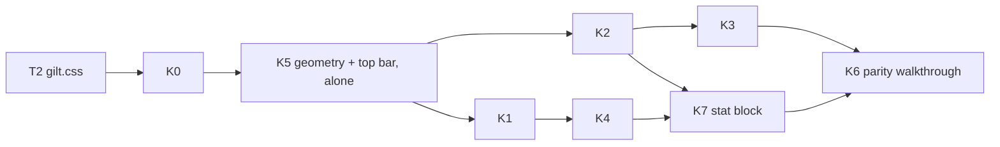

# Kit parity

> **Goal (DM, 2026-10-26, [#355](../../decisions-log.md)):** "get to that mockup". The source of truth is the kit page [gilt-stone.html](../../design/art/kit/gilt-stone.html). Open it in a browser and compare it with `.verify/t2/pairs/*.png`. The concept art (`.verify/t2/a-gilt-stone-01.png`) is inspiration, not binding.
> **Decided (DM + orchestrator, 2026-10-26):** OQ-KIT-01 A (the launcher moves into the top bar; [ADR](../../architecture/adr/0070-launcher-in-top-bar.md) accepted), -02 **B** (kit 40-px log rows; `dice.log` 40 px taller), -03 A, -04 **B** (a rollable DM stat-block window now, §6.11), -05 to -11 A. All geometry changes land together in slice K5 (§7.3).
> **Model:** the printed-sheet amendment, [character-sheet-full §6.2](../character-sheet-full.md#62-printed-sheet-layout) (FR-CHARX-105–120). Every layout change is a **markup change in every theme**. Simple Dark draws the new rows with its plain tokens, and Gilt & Stone styles them through `data-slot` names. [ADR-0069](../../architecture/adr/0069-theme-switch.md) holds: no theme logic in components, and themes never change geometry. Sizes change only through the size table (§7.3).

## 1. Summary

- [theme-system](theme-system.md) T0–T2 repaint today's markup. The DM finds the result "very far off": the gap is the structure inside windows, not the paint.
- This spec redesigns the rows, cards and bars that differ from the kit: Game log rows, Initiative rows, the top bar, notices, the damage-card popup, dialogs, the compendium list and stat block, Party status, and the sheet header. It also adds a few shared **kit parts** (medallion, result box, HP bar) that they all reuse.
- One new DM-only window: the **stat block** (`ent.statblock`), the kit's "Goblin" card, with roll buttons that use today's combat and dice intents (§6.11).
- Client only: 0 bytes on the wire, no new intents, no visibility change.

## 2. Scope

- Markup and layout for every area in §6 (both clients, both themes). Each area also gets `data-slot` hooks, plus the `gilt.css` block that styles them (§7.4).
- Kit parts: `Medallion`, `ResultBox`, `HpBar` (new files under `src/client/common/components/kit/`), and `data-variant` on Button and the ToggleGroup items (BL-127).
- Geometry (decided, §7.3): the launcher moves into the top bar (OQ-KIT-01 A), `dice.log` grows 40 px for the kit's 40-px rows (OQ-KIT-02 B), and `ent.statblock` gets its size-table row.
- A final **parity walkthrough** that compares each kit section with the app side by side (slice K6).

## 3. Goals

- Someone holding the kit page next to the app recognises every piece: the same rows, cards, bars and hierarchy.
- Nothing is lost. Every control stays reachable, every test ID keeps its meaning, and players never see more.
- The test load stays lean (DM #354): DOM tests per FR, at most one thin e2e per slice, and one walkthrough per slice.

## 4. Non-goals

- New behaviour the kit only illustrates:
  - Auto-advance turns (kit Initiative footer).
  - A chat "Send" in the Game log.
  - The "Session 14" title meta: sessions are not stored ([ADR-0013](../../architecture/adr/0013-session-journal-scope.md)).
- The kit page's type-pairing switch (Old book is decided, FR-THEME-16).
- Character sheet body: done by FR-CHARX-105–120. Only the sheet **header** is in scope here (§6.9).
- The map canvas, tokens and 3D dice (OQ-THEME-09).
- Bigger windows "because the kit is roomier". Sizes are kept unless §7.3 says otherwise.
- Players opening a stat block: `ent.statblock` is DM-only (§6.11).

## 5. User stories

**DM**
- As the DM, I want the table to look like the kit, so the session feels like a CRPG and not a dashboard.
- As the DM, I want each Initiative row to show at a glance whose turn it is, their HP and their initiative, with the many controls one hover away.
- As the DM, I want each Game log row to show who rolled, what they rolled and a big result, with the dice maths on hover.
- As the DM, I want a monster's stat block open beside the map, with Attack / Damage buttons, like the kit's Goblin card.

**Player**
- As a player, I want the same clean rows and big numbers on my screen. I see nothing I couldn't see before.
- As a player, I want my turn announced like the kit's "Mira's turn" card.

## 6. Functional requirements

### 6.0 Gap table (kit vs app)

T2 = what `gilt.css` (theme T2) already fixed. Markup = what this spec changes. ✓ = already at parity.

| Area (kit section) | Kit | App today | T2 fixed | Needs markup | Owner spec |
|---|---|---|---|---|---|
| Top bar (At the table) | Campaign title left · launcher centred · "● Live · 3 players" + DM chip right | Switcher Select + "New campaign" + "Rename" left; "0/2 online", "Connected", Pause, search, chip right; launcher **at the bottom** | Stone buttons, bar paint | Title + menu, one status pill; launcher in the centre zone (OQ-KIT-01 A) | [play-shell](../play-shell.md), [campaign-management](../campaign-management.md), [live-sync](../live-sync.md) |
| Launcher | Stone icon + label buttons; open = gold glow; minimised = gem diamond | Same buttons; open bar, minimised ring | Stone look | Moves into the top bar (FR-KIT-14); markers by CSS | play-shell |
| Tool rail | Rail framed like a window (double rule, corners) | 1 px rule, no corners | Tools, active gem | None (gilt.css frame on `map-tool-rail`) | [scenes-map](../scenes-map.md) |
| Goblin stat block | Card: italic type line, AC/HP/Speed row, 6-column abilities, attack rows | No stat-block window; compendium `StatBlock` is a plain read-only view | Paint | Compendium stat block as the kit card; new DM window `ent.statblock` with roll buttons (§6.11, OQ-KIT-04 B) | [compendium](../compendium.md), [entities](../entities.md), combat-tracker |
| Initiative | Round line; rows = medallion, name, HP bar + "x / y", **large bare init**, one status icon; turn = red wash + gem; footer "Next turn" | Header with 6 buttons, "Combatant / Init" strip, rows with grip, chips, AC/HP text, band chip, moved ft, init input box, attack + ⋯ | Frame, fonts | Row grid, header/footer, hover actions | [combat-tracker](../combat-tracker.md), [combat-extras](../combat-extras.md) |
| Game log | Rows = medallion, "Name · action", time, **large boxed result** coloured by outcome | One inline line: name — label: dice faces + mods = small boxed total, "physical" chip, category chip | Boxed totals, colours | Row grid, details move to hover, copy rule | [dice-roll-log](../dice-roll-log.md) |
| Roll popup (3D dice) | (Not in kit; shell UI) | Plain dark panel, inline totals | — (unthemed, T2 #8) | Totals as result boxes; frame by CSS | [dice-extras](../dice-extras.md) |
| Notices: toast stack | Card = medallion, bold who + text, small second line, inline stone actions; turn card with gems; "+2 more" pill | Stripe + icon + text + ✕, action under the text; no turn card (DM); single rule | Frame, stone action, gem ✕ | Card row, turn card, pill | [notifications](../notifications.md), combat-tracker (turn alert) |
| Damage card | Window: result lines with big boxes; target chips; Full/Half/Double + Miss + "Apply 16" | 440 px popup: title, To hit / Damage inputs, per-target rows with multipliers, Dismiss / Later / Apply | Frame, no corners | Title bar + gem, result-box inputs, compact target rows | combat-tracker |
| Character sheet | Square framed portrait, name, line, chips, Edit top-right | Round 44 px initial, picker Select right, a second row with brain icon + Lock / Edit | Body (CHARX print sheet) | Header only | [character-sheet-full](../character-sheet-full.md) |
| Buttons, inputs, chips | Stone buttons, gem check, switch, field, chips | Same components | ✓ (T2) | `data-variant` (BL-127) | shared UI |
| Menus / select | Highlight = left gold bar on a warm fill | Full gold outline box (T2 #6) | Panel | None (CSS) | shared UI |
| Dialog & popover | Dialog = small window: title bar + gem close, body, framed buttons ("Keep fighting") | Title inside a padded body, small ✕ floating top-right, ghost Cancel | Frame | Header becomes a title bar; copy of End-encounter buttons | shared UI, combat-tracker |
| Compendium (table) | Table: header row, zebra, right-aligned numbers | List of buttons: name + muted line + source chip | Paint | Table rows (0 B, OQ-KIT-05) | compendium |
| More pieces (card) | Card = medallion, name, sub line, AC mini shield, HP bar | Party status = one-line rows; Creatures = icon tile rows | Paint | Party status cards, medallions | [party-board](../party-board.md), entities |
| Slider · collapsible · alert · skeleton | As kit | Same | ✓ (the hue slider range was fixed in T2, `2cd30178`) | None | theme-system |
| Type, Palette | Old book, kit `:root` | Same | ✓ | — | theme-system |
| Preferences, launcher "⋯" menu | (Uses kit menu / section look) | Section headings muted small text | Paint | None (CSS: headings in label type) | play-shell |

### 6.1 Cross-cutting

| ID | Requirement | Test |
|---|---|---|
| FR-KIT-01 | **One markup for every theme.** Each new layout renders the same DOM under Simple Dark and Gilt & Stone. Simple Dark draws it with today's tokens (border, card, muted, rounded). No component reads the theme. | `FR-KIT-01 same DOM per theme` (render each area under both `data-theme` values, compare the DOM) |
| FR-KIT-02 | **Test IDs kept.** Every existing `data-testid` keeps its meaning and stays on an element with the same role. Where this spec moves a control into a menu or a hover group, the ID moves with it. New IDs follow AGENTS §9.5 (owning spec's prefix; kit parts `kit-`). | existing tests pass (selectors may add a "hover / open menu" step; listed per slice) |
| FR-KIT-03 | **Nothing dropped.** Every control and value shown today stays reachable: visible, in the row's or window's ⋯ menu, or in the hover group / Tooltip named in its FR. Hover groups also show on keyboard focus-within, on the current-turn row, and under `(hover: none)` (as `dice-log-actions` today). | `FR-KIT-03 reachable` per area (each control's ID present after hover / focus / menu open) |
| FR-KIT-04 | **Visibility and wire unchanged.** Players see exactly the fields they see today, drawn differently (e.g. a monster's band, never its HP numbers). No snapshot field, intent or event is added; 0 B. Every new value is derived on the client from data it already holds (§8). | `FR-KIT-04 player rows show no new fields` (player renders vs a DM-only fixture) |
| FR-KIT-05 | **Kit parts** (new, `src/client/common/components/kit/`): **`Medallion`**: a round portrait. It shows the image asset thumbnail if there is one, else the first letter of the name on a colour. Sizes `sm` 22 / `md` 28 / `lg` 34 px; `kit-medallion`, `data-slot="kit-medallion"`, `data-size`. **`ResultBox`**: a boxed number. `outcome` = `plain` \| `crit` \| `fumble` \| `damage` \| `heal`; `held` shows "…" and no outcome (FR-DICE-40); focusable when it has a Tooltip; `kit-result`, `data-slot="kit-result"`, `data-outcome`. **`HpBar`**: a thin bar plus "cur / max", or a band word when only the band is known; colour from the meaning tokens `hp.*` (not themed, FR-THEME-09); `kit-hpbar`, `data-slot="kit-hpbar"`, `data-band`. | `FR-KIT-05 medallion`, `… result box`, `… hp bar` |
| FR-KIT-06 | **Variants as data** (BL-127): Button carries `data-variant` (`default` \| `outline` \| `ghost` \| `secondary` \| `destructive` \| `link`) and `data-size`; ToggleGroup items carry `data-variant` (`segmented` \| `tool`). Themes stop reading Tailwind classes. | `FR-KIT-06 variant attributes` |
| FR-KIT-07 | **Theme hooks:** each new part carries the `data-slot` names in §7.4. `gilt.css` styles them; Simple Dark needs no stylesheet. | `FR-KIT-07 slots present` |

### 6.2 Top bar and launcher

| ID | Requirement | Test |
|---|---|---|
| FR-KIT-10 | **Three zones** in the 48 px bar (`TOP_BAR_H` unchanged): left = title (`ui-topbar-left`), centre = the launcher (OQ-KIT-01 A), right = status, DM items (Pause, search), identity chip (`ui-topbar-right`, order unchanged). | `FR-KIT-10 bar zones` |
| FR-KIT-11 | **DM title:** the campaign switcher's trigger (`camp-campaign-switcher`) shows the campaign name in title type with a chevron, with no box. Its menu lists the campaigns (`camp-campaign-option`), then a separator, then **New campaign…** and **Rename…** (Rename only with an active campaign). Both open today's dialogs (`camp-campaign-new`, `camp-campaign-rename`), whose trigger IDs move onto the items. The switch confirm (`camp-switch-dialog`) is unchanged. | `FR-KIT-11 campaign menu` |
| FR-KIT-12 | **Player title:** the campaign name in title type (`camp-joined-campaign-name`), then "· playing as Player 1" in small muted text (`camp-joined-player-name`). `camp-player-joined` stays the wrapper. | `FR-KIT-12 player title` |
| FR-KIT-13 | **One status pill** `ui-topbar-status`, a group of two parts. (1) `sync-connection-status`: a dot plus "Live", "Reconnecting…", etc. "Connected" reads "Live". (2) DM only, `ui-presence-badge`: "· 0 / 2 online"; click and Tooltip are unchanged. `data-state` values are unchanged. | `FR-KIT-13 status pill` |
| FR-KIT-14 | **Launcher in the top bar** (OQ-KIT-01 A, [ADR](../../architecture/adr/0070-launcher-in-top-bar.md)): the launcher sits in the centre zone. Its fit width is the gap between the left and right zones (≥ 8 px each side); FR-SHELL-43's label-drop and "⋯" rules are unchanged, and the "⋯" menu opens downward. The bottom reservation `LAUNCHER_CLEAR` becomes the 12 px edge gap. The work area, default layouts, bands, the player toast corner and the goldens are recomputed in K5 (§7.3). | `FR-SHELL-43` tests, `FR-SHELL-62 golden layouts` (regenerated) |
| FR-KIT-15 | **Launcher buttons** keep their DOM (`ui-launcher-button`, `data-state`, `[data-marker]`, badge, activity dot). The kit's open glow and minimised gem diamond are CSS on `[data-state]` / `[data-marker]`. | existing |

### 6.3 Initiative (DM and player)

Row grid (both clients): `turn marker · medallion (lg) · name block · init number · status · actions (DM, hover)`. Rows are ≈ 46 px, about the same as today's two-line rows.

| ID | Requirement | Test |
|---|---|---|
| FR-KIT-20 | **DM header:** one line, centred: the encounter name (muted) and "Round N" (`cbt-init-round`, number in number type). On the right is a window menu ⋯ (`cbt-init-menu`, new) holding **Add…** (`cbtx-init-add`), **Summon…** (`cbt-init-summon`) and **End encounter…** (`cbt-init-end`, destructive item, same confirm dialog). The empty state is unchanged. | `FR-KIT-20 header menu` |
| FR-KIT-21 | **Pending list** (`cbt-init-pending-list`) stays under the header. Each card row is one compact line (Sword icon + text), with the same IDs and click. | existing |
| FR-KIT-22 | **Footer**, pinned under the list (`cbt-init-footer`, new). Round ≥ 1: **Prev** (`cbt-init-prev`, small), **Undo** (`cbt-init-undo`, icon button, Tooltip = undo text) and **Next turn** (`cbt-init-next`, primary, right). Round 0: **Roll monsters** (`cbt-init-roll-monsters`, while shown today) and **Start** (`cbt-init-next`); the start reason (`cbt-init-start-reason`) sits above them. | `FR-KIT-22 footer` |
| FR-KIT-23 | **Rows:** the "Combatant / Init" strip is removed (aria-hidden today). Each `cbt-init-row` uses the row grid. The current turn gets a red wash and a gem diamond on the row's left edge (`TurnMarker`, aria "Current turn" kept). The grip (`cbtx-init-row-grip`) shows on hover / focus only. | `FR-KIT-23 row grid` |
| FR-KIT-24 | **Medallion:** the combatant's portrait (`imageAssetId`), else its initial on its token's creature-type colour (token record; `creature.*` tokens), else the neutral muted colour. | `FR-KIT-24 medallion source` |
| FR-KIT-25 | **Name block, line 1:** the name (`cbt-init-row-name`) with its marks (mode, hidden, skip) and the owner / side chips, as today's `NameLine`. **Line 2:** `HpBar` + "cur / max" (`cbt-init-row-hp`), temp "+N" (`cbtx-init-row-temp`), then "AC n" and moved feet (`cbt-init-row-moved`) as a muted tail. When the tail doesn't fit, `NameLine`'s fitting moves it into the row Tooltip (`cbt-init-row-tip`, new, on the name). The band (`cbt-init-row-band`) becomes the bar's `data-band` for the DM. | `FR-KIT-25 hp line`, `… tail folds` |
| FR-KIT-26 | **Player HP line:** PCs and the player's own companions show `HpBar` with numbers, from the character record or companion data the player already holds (Party status shows the same values, [ADR-0063](../../architecture/adr/0063-party-hp-visibility.md)). Monsters show the band word only (`cbt-init-row-band`), never a bar length. Hidden combatants are never sent (unchanged). | `FR-KIT-26 player hp`, FR-KIT-04 |
| FR-KIT-27 | **Init number:** a set value is a large bare number (`cbt-init-row-init`). The DM clicks it, or presses Enter on it, to edit it as today's input (same ID, commit on blur / Enter). An unset value shows today's input + Roll button (`cbt-init-row-roll`). Companions acting after their owner keep the read-only text. | `FR-KIT-27 init edit` |
| FR-KIT-28 | **Status:** effects render as icon chips (icon + rounds, label in the Tooltip). The first one shows, then "+N" (today's fold IDs `cbtx-init-row-effect`, `…-more`). Chip menus (Edit… / End) and the concentration chip (`cbtx-conc-chip`, blue) are unchanged. | `FR-KIT-28 status icons` |
| FR-KIT-29 | **Row actions** (DM): Attack (`cbt-init-row-attack`) and ⋯ (`cbt-init-row-menu`) form a hover group (FR-KIT-03), always shown on the current-turn row. The menu's items and order are unchanged, plus **Stat block** for non-PC rows (FR-KIT-101, added by K7). Death items and companion lines (`cbt-init-companion`) keep their place. Companion lines and removed rows (`data-removed`, Restore) use the grid at medallion `sm`. | `FR-KIT-29 hover actions` |
| FR-KIT-30 | **Player body:** a centred "Round N" (`cbt-init-round`) and the hint (`cbt-init-hint`), then rows on the same grid without grip or actions. A companion row the player owns stays clickable (opens its card). | `FR-KIT-30 player rows` |
| FR-KIT-31 | "↓ N more" (`cbt-init-more`), the below-fold logic, drag reorder, the drop line and every intent are unchanged. | existing |

> **K12 note (2026-10-27, `build/kit-round3-combat`, round-2 gap 6; DM #363):** amends FR-KIT-29 / -30. **Companion groups are flat child rows** under the owner (both clients): an `after-owner` row sits flush under its owner (the list gap closed, the shared edge square, no `ml-3` indent; `data-indent` kept), an in-turn line has no nested rule; both put the `sm` medallion at the end of an `lg` medallion's slot (`init-child-medallion`), so the child's name and bar start in the owner's name column. The in-turn line's "cur / max" is the kit bar with its numbers on a short fixed 40-px track (the line stays one row, FR-CBT-142); another player's companion still shows only its band. The DM's after-owner number (its owner's) is right-aligned in the init column like the large numbers. Gilt & Stone: a faint rule between owner and child.

> **K12 re-test note (2026-10-27, walkthrough 4; amends FR-KIT-28 and, in the status cell, FR-CBTX-54):** the status cell is one fixed 56-px column (narrow list: as wide as its chips, as before). It shows up to **two** icon pieces (orchestrator ruling; FR-CBTX-54 note): concentration + the first trigger, or two triggers, else (no concentration) a trigger or nothing + the first effect; other effects and a third piece go into "+N" (its menu names a trigger by its state line), which rides on the second piece's corner; with two pieces or a "+N" the rounds / uses go into the Tooltips. So every initiative number lines up. **Child rows** (after-owner) amend FR-CBTX-57 for themselves: the name never wraps (it truncates, full text in a Tooltip, only when it and its marks don't fit the whole line); the side chips (owner dot, Ally) sit beside it or on the next line; the `sm` medallion sits on the name's line (`self-start`; `data-child` on the name line). **Damage card** (FR-KIT-64): a long target name takes the line's free width first: " · AC n" steps aside (`data-ac-folded`, the chip's Tooltip reads "Name · AC n") and comes back when the line has room for it; only a longer name truncates.

### 6.4 Game log and roll popup

Row grid: `medallion (md, 28) · what · time · result boxes · actions (hover)`, one line, 40 px as in the kit (OQ-KIT-02 B; the window grows 40 px, §7.3).

| ID | Requirement | Test |
|---|---|---|
| FR-KIT-40 | **Row:** each `dice-log-entry` (all attributes kept) uses the row grid. The hidden icon (`dice-log-entry-hidden`, DM) sits before the name. Superseded / undone styling and the rerolled button (`dice-log-rerolled`) are kept. | `FR-KIT-40 row grid` |
| FR-KIT-41 | **Medallion:** *(amended, fix/log-portraits, fix/log-creature-portraits)* the actor's portrait, matched by `actorName` (case-insensitive) in records this client already holds, so a player learns no new image (ADR-0023): the player character of that name, else a combatant, else a token of that name (each only as visible to this viewer), else a monster definition (the DM's client); else the first letter of `actorName`, on the actor's name colour (FR-DICE-60) when the line is coloured, else neutral. The DM, hidden or removed creatures and renamed actors keep the letter. | `FR-KIT-41 medallion colour`; `FR-KIT-41 actor portrait` |
| FR-KIT-42 | **What:** the actor's name (`dice-log-entry-actor`, coloured as today), then " · " and the **action text** from `rowAction(entry)`, a new pure function in `src/shared/dice-roll-log/`. `roll` items give their labels joined with " + " (else the expression); other kinds (`cbt.attack`, `cbt.hp`, `gem.*`, …) give their line text without the actor. One line, ellipsis. | `FR-KIT-42 row action text` (unit, each kind) |
| FR-KIT-43 | **Time:** "HH:MM" local time from `e.at` (`dice-log-entry-time`, new), hidden while the row is < 360 px wide (container query). | `FR-KIT-43 time` |
| FR-KIT-44 | **Results:** one `ResultBox` per payload item total (`dice-log-entry-total`, `data-record-id` = roll id), at most 2, then "+N" with the rest in the Tooltip. **Outcome:** a d20 natural 20 → `crit`; a natural 1 → `fumble`; a damage part or category Damage → `damage`; category Healing → `heal`; else `plain`. Held numbers show "…" and no outcome until they land (FR-DICE-40). The "physical" chip stays after the boxes. | `FR-KIT-44 outcome`, `… held` |
| FR-KIT-45 | **Details on hover:** the dice faces, modifiers, "= total", damage type, natural text and category move into the entry Tooltip (today's `tooltipOf` plus the inline segments, in that order). Hover or focus on the row text or a result box opens it, with the shared delay. | `FR-KIT-45 tooltip content` |
| FR-KIT-46 | **Copy:** copying selected rows puts each row's `lineText` on the clipboard, one per line, so copied text is exactly today's (amends FR-DICE-93; OQ-KIT-06). *(K1, 2026-10-27, orchestrator ruling: each row also keeps its full line in an `sr-only` span, so screen readers and text filters read it; copy still goes through the handler.)* | `FR-KIT-46 copy` |
| FR-KIT-47 | **Bottom pin holds:** if the list was pinned at the bottom, it re-pins after an `<html>` attribute change (theme switch) and after web fonts load (T2 deviation 2). | `FR-KIT-47 repin on theme` |
| FR-KIT-48 | **Entry actions** (`dice-log-actions`) keep their hover group. The roll bar keeps every control and ID; only its Roll button is `primary`. The empty / loading states and the "N new" pill are unchanged. | existing |
| FR-KIT-49 | **Roll popup** (`dicex-popup`): each row (`dicex-popup-row`) starts with the actor `Medallion` (`sm`), and each total (`dicex-popup-total`) is a `ResultBox` (`sm`) with FR-KIT-44's outcome. Natural, physical and offered tags stay as text after it. The rest of the popup is unchanged; its frame is CSS. | `FR-KIT-49 popup totals` |

> **K8 note (2026-10-27, `build/kit-polish-log`, K6 gaps 1, 2, 8; #360):** amends FR-KIT-42 / -44 / -48. **Combat rows:** `cbt.attack` reads "Longbow attack vs Goblin" (no attack name, a companion's line for players: "attacks Goblin"; a damage-only miss adds "— miss"), with a to-hit box (`crit` on a critical hit, `fumble` = dim on a miss, else `plain`) and, on a hit with damage, a `damage` box; `cbt.hp` reads "Goblin takes damage" / "Goblin heals" (sourced: "damages Mira" / "heals Mira") with its amount boxed (`damage` / `heal`). The public " — Overkill!" callout stays in the text; the maths, AC and hit words are the Tooltip's line, and the copy is unchanged (FR-KIT-46). These boxes carry no `data-record-id` (no roll record). **Damage part:** in an `attack` entry the runs after the to-hit are `damage` (an "attack + damage" roll's damage has no category of its own); the roll popup (FR-KIT-49) still reads per item, so its damage total there stays as before (dice-extras' file; follow-up). **Roll bar:** Category and Roll as are the shared Select: the trigger keeps `dice-roll-category` / `dice-roll-actor` and carries `data-value` (the roller = ""), items `dice-roll-category-option` / `dice-roll-actor-option` + `data-value`, Roll as keeps its Characters / Tokens / Combatants sections and the stale "(gone)" item.

> **K12 note (2026-10-27, `build/kit-round3-combat`, round-2 gap 1 + minor; DM #363):** amends FR-KIT-40 / -44. **One right column:** the row's right group is `actions · time · result boxes · chips`: the entry actions (on some rows only) lead it, and from a 360-px row the box slot and the chip slot each hold an invisible ghost (two "00" boxes, a "physical" chip, in the theme's own type), so time, boxes and chips line up on every row with or without a chip or a second box (boxes right-aligned in their slot; below 360 px no ghosts, every pixel for the text). The "physical" chip stays (#363); "undone" / "rerolled" share its slot. Row text is the kit's 15 px in the unchanged 40-px row.

> **K12 re-test note (2026-10-27, walkthrough `.verify/20261027-k12-round3-combat/`):** a row with 3+ results keeps the column: its "+N" (`dice-log-entry-more`) sits on the second box's top-right corner (absolute, inside the box slot), not as a flex item after it (was 19 px left).

### 6.5 Notices (toasts, turn card, damage-card toast)

| ID | Requirement | Test |
|---|---|---|
| FR-KIT-55 | **Card row** for `note-toast` and the alert toasts (`ui-toast`): `medallion or icon · text block · actions · close`. The medallion shows the initial of the player in `byPlayerId`, on that player's colour; otherwise the kind's icon at the same size. The stripe (`note-stripe`) stays as the left edge. | `FR-KIT-55 card row` |
| FR-KIT-56 | **Text block:** line 1 = the text (`note-text`), with the causing player's name in bold when it starts the text. Line 2 = small muted relative time from `createdAt` ("just now", "2 min ago"; `note-time`, new). | `FR-KIT-56 text block` |
| FR-KIT-57 | **Actions inline:** the action button (`note-toast-action`, small stone) sits right of the text and wraps below it only when the card is too narrow. The close (`note-toast-close`) is the gem. | `FR-KIT-57 inline action` |
| FR-KIT-58 | **Pending summary** (`note-toast-pending-summary`) uses the same row. "+N more" (`note-toast-more`) is a centred pill (also inside the summary row, as today). | `FR-KIT-58 summary row` |
| FR-KIT-59 | **Turn card:** the player's turn alert Toast ("Your turn — Mira", FR-SHELL-22) renders as a turn card: centred title-type text between two gem marks, no close (it times out as today); `cbt-turn-card`, new. DM turn card: OQ-KIT-03. | `FR-KIT-59 turn card` |
| FR-KIT-60 | Stack width (320), placement, folding, timers and every notification rule are unchanged ([notifications](../notifications.md)). | existing |

### 6.6 Damage-card popup (DM) and player card view

| ID | Requirement | Test |
|---|---|---|
| FR-KIT-62 | **Title bar:** `cbt-popup-drag` becomes a window-style title bar: "{attacker} — {attack}" in title type and a gem close on the right. The gem is **Later** (it takes `cbt-popup-later`; same action), so the footer no longer shows Later. `cbt-popup-step` sits in the bar. | `FR-KIT-62 title bar` |
| FR-KIT-63 | **Result lines:** "To hit" and "Damage, <type>" lines each end in a large boxed value. The box is the existing input (`cbt-popup-tohit`, `cbt-popup-damage`, `cbt-popup-damage-part`) drawn as a `ResultBox`-styled input (`data-outcome`: natural 20 → `crit`, damage → `damage`). The labels' dice ("[17] +4") stay small after the label. Ruled and waiting states are unchanged. | `FR-KIT-63 result lines` |
| FR-KIT-64 | **Targets:** each `cbt-popup-target-row` is one compact line: `Medallion` (`sm`) + "Name · AC n" chip, the multiplier segmented control (`cbt-popup-target-mult`, labels unchanged), then the preview (`cbt-popup-target-preview`). Remove (`cbt-popup-target-remove`) shows on hover / focus; part chips and `popupParts` chips wrap to a second line. Add target is unchanged. | `FR-KIT-64 target rows` |
| FR-KIT-65 | **Footer:** Dismiss (`cbt-popup-dismiss`, ghost) left; the card actions (`cbt-card-actions`) in the middle; Apply (`cbt-popup-apply`) or Apply hit (`cbt-popup-apply-hit`) primary on the right. | `FR-KIT-65 footer` |
| FR-KIT-66 | **Player card view** (toast / History): the maxed-damage and outcome lines (`cbt-card-maxed`, `cbt-card-outcome`) show totals as `ResultBox` (`sm`). Popup width (440) and drag are unchanged. | `FR-KIT-66 player card` |

> **K8 note (2026-10-27, `build/kit-polish-log`, K6 gap 7; #360):** amends FR-KIT-63–65. No summary line under the title bar (the card's text repeats the lines; the mode reads "adv" / "dis" after the to-hit dice, `cbt-popup-mode`). The to-hit label is the kit's "Mira · Longbow attack" (the ruled line too); labels are body type (`data-slot="card-label"`). The damage box has a neutral border and a red number (gilt: the kit's deep red rule, as the log's damage boxes). Target rows never wrap: "Goblin · AC 15" chip (a long name truncates), Hit, multiplier, then the preview without the name ("7 → 3"); Remove's slot takes no room until hover / focus. Apply reads "Apply N" = the card's damage (base + extra parts, as typed) while a row is a Hit, else "Apply"; per-target multipliers stay in the previews (OQ-KIT-11 A).

> **K12 note (2026-10-27, `build/kit-round3-combat`, round-2 gap 8; DM #363):** amends FR-KIT-63 / -64. **Add target:** with a target row listed, the "Add target…" field hides behind a small "+" icon button that carries `cbt-popup-target-add` (a click opens the field with its list, focused; closing the list or a pick folds it back); with no target the field shows as before. **Hit box:** the to-hit box's outcome is `hit` while there is a target row and every row is a Hit (`cardToHitOutcome`): the number in the meaning green, the border neutral (Gilt & Stone: the kit's green rule, `.res.crit`); a natural 20 / 1 keeps `crit` / `fumble`.

### 6.7 Dialogs

| ID | Requirement | Test |
|---|---|---|
| FR-KIT-70 | **Title bar:** `DialogHeader` (`dialog-header`) renders flush to the top of `DialogContent` as a bar: the title (`dialog-title`, title type) on the left, the built-in close (`dialog-close`) vertically centred on the right, and a rule under it. The description and the content sit in a padded body (`dialog-body`, new); the footer (`dialog-footer`) is right-aligned. `max-w-md` is unchanged. | `FR-KIT-70 dialog bar` |
| FR-KIT-71 | Every Dialog in both clients has a `DialogHeader` with a `DialogTitle` (also Radix's a11y rule); a test lists any that don't. | `FR-KIT-71 every dialog titled` |
| FR-KIT-72 | **End encounter** (`cbt-init-end`, `cbt-enc-end`): the title stays `End “name”?`. Buttons: **Keep fighting** (outline) and **End encounter** (destructive, `…-end-confirm`). | `FR-KIT-72 end copy` |

> **K0 note (2026-10-26, `fix/kit-parts`, orchestrator ruling after the K0 walkthrough):** the title bar holds only the title and the close; anything else a `DialogHeader` holds (a description, also one a caller wraps in a component) renders under the bar, in the body. **FR-KIT-71 exemptions:** the compendium image lightbox (`cmp-lightbox`) stays a chrome-less image viewer: a screen-reader-only title, no bar, and its size equals the pre-K0 one (a caller's padding / gap on `DialogContent` replaces the body's, so no band is added). Raw Radix overlays that are not dialogs in the kit's sense stay outside the Dialog parts: the pause card preview, the command palette and its shortcut sheet (listed in the `FR-KIT-71` test). The player's present popup (`party-present-popup`) moved onto the Dialog parts (title bar + close gem; test IDs and Close kept).

### 6.8 Compendium and stat block

| ID | Requirement | Test |
|---|---|---|
| FR-KIT-76 | **Results as a table:** a sticky header row (Name · Details · Source) over rows. Each `cmp-result` row has the name (`cmp-result-name`, name type), the details line (`r.line`, e.g. "CR 1/4 · Small humanoid") and the source chip. Rows are zebra-striped with a hover tint; numbers use tabular figures. Group rows (`cmp-group-toggle`) are expandable rows with a count. Drag, keyboard and every state ID are unchanged. 0 B (OQ-KIT-05). | `FR-KIT-76 table rows` |
| FR-KIT-77 | **Stat block card** (`cmp-statblock-*`): an italic type line ("Small humanoid (goblinoid), neutral evil"); one ruled row "AC n · HP n (formula) · Speed n ft" (`-core`); a 6-column ability grid with label, score and modifier (`-scores`, `-score`); then each section's entries as name + muted line rows (`-section`). It stays read-only; a monster entry gains **Open at the table** (FR-KIT-101), which opens the rollable window. It shares its markup and slots with `ent.statblock`. | `FR-KIT-77 stat block card` |

### 6.9 Party status, Creatures, sheet header

| ID | Requirement | Test |
|---|---|---|
| FR-KIT-82 | **Party status card** (`party-summary-row`, all attributes kept). Line 1: `Medallion` (`lg`, portrait or initial on the player colour; this replaces the separate colour dot), the name (`party-summary-name`, name type), the turn and hidden marks, and the AC mini shield on the right (`party-summary-ac`). Line 2: the level / class / species line from the character record (left out if absent). Line 3: `HpBar` + "cur / max" (`party-summary-hp`), temp, death badge, effect icons. Click / Enter opens the sheet as today. | `FR-KIT-82 party card` |
| FR-KIT-83 | Companion rows (`party-companion-row`) keep one line, with a `Medallion` (`sm`). | `FR-KIT-83 companion row` |
| FR-KIT-84 | **Creatures rows** (`ent-list-row`): the portrait tile becomes a `Medallion` (`lg`): the portrait asset, else the initial on the creature-type colour for monsters, or on the owner's colour for characters. Badges and actions are unchanged. | `FR-KIT-84 creature medallion` |
| FR-KIT-85 | **Sheet header** (amends FR-CHARX header layout, not behaviour): a square framed portrait, 56 px (`char-sheet-portrait`, image or initial). The name (`char-sheet-name`, name type) **is** the picker when the picker is shown: the native select (`char-sheet-picker`) is styled as the name with a chevron. The level line (`char-sheet-level`). A chips line holds the badges and the header-slot sections (effect chips, brain menu `cbtx-sheet-effects-menu`). Derive / Approve / Lock / Edit (small) sit top-right. The separate `charx-header-line` row goes; its parts move as stated. The compact fallback (FR-CHARX-48) still moves badges and picker into `charx-header-rest`. | `FR-KIT-85 sheet header`, existing CHARX tests |

> **K11 note (2026-10-27, `build/kit-sheet`, DM #361):** amends FR-KIT-85 (header) and, through [character-sheet-full §6.2](../character-sheet-full.md#62-printed-sheet-layout), the sheet body; layout is markup for every theme, Gilt & Stone paints it in one `/* KIT: sheet */` block. **Header:** a grid of portrait, name column and actions. The portrait is the kit's 64 px (84 px once the sheet is ≥ 560 px), the initial in name type; the owner's colour goes in as `--portrait` / `--portrait-ink` (`data-slot="sheet-portrait-initial"`, `data-colour` = `player` \| `none`) so Gilt & Stone draws a deep fill of it with a cream serif initial (no player colour: the kit's blue). The name is name type 21 px (32 px wide), two lines before it truncates; the level line is 14 px (16 px wide) and adds the background once wide ("Level 5 Ranger · Wood Elf · Outlander"). Derive / Approve / Lock / Edit are 24-px small buttons top-right, a column when narrow and a row when wide; the DM's **Public rolls** menu (`charx-public-menu`, eye icon, `data-on` while a per-roll override is set) sits beside them and holds Main's public switches (Initiative only while its button shows, Checks, Saves, Skills; same test IDs and per-roll overrides). The Actions tab's Attack / Damage switches stay in the Attacks box. The chips line (badges as kit chips, `data-slot="sheet-chip"`, 13 px; the `header` sections flattened into it, their chip rows wrapping) spans the row under the portrait when narrow and sits under the name when wide. **Compact fallback:** only the chips line scrolls into `charx-header-rest`; the name stays the picker (the select laid over it) and the actions stay pinned, so no boxed select shows anywhere. The picker's open list is still the browser's own (the native `select` stays: 23 e2e specs pick a sheet with `selectOption`). **Pinned part:** a sheet open at load measured its header in the fallback fonts and stayed compact for good; it measures again once `document.fonts` is ready. **Tabs:** kit tab size (15 px label type, the marker inside), 22-px ‹ › arrows; each tab opens at its top (the tabs share one scrolling box, so Main could open mid-way, the HP control at the top: the DM's "missing stat row"; `overflow-anchor: none` too). Test IDs kept; new: `charx-public-menu`, `charx-public-rolls`, `charx-hp-control`, `cbtx-temp-open`. **Walkthrough fixes (same day):** Derive to customise is a 24-px icon button (label in its `aria-label` and Tooltip, `charx-derive` kept); names wrap at whole words only (balanced, the picker's chevron after the last word); the level line wraps between parts, a later part keeping its "·"; "Initiative set" is the Initiative value's Tooltip and screen-reader text (`char-sheet-init-locked`), no caption; an NPC's HP max is a plain box; the Initiative button's label and value start at the top as Speed / Prof; while the strip overflows both tab arrows are drawn, the one at an end disabled (no empty slot); the chips line flattens the `header` sections and their chip rows (the effects menu wraps with the chips); a disabled Damage is an outline button.

> **K13 note (2026-10-27, `build/kit-round3-sheet`, DM #363, round-2 gaps 3, 4, 5, 9 and §5):** markup for every theme, Gilt & Stone paints in one `/* KIT: round 3 */` block. **Wide sheet (gap 3):** at ≥ 560 px Main also shows the kit's Attacks, Spells (slot pips) and Limited uses boxes across both columns under the abilities + Skills grid, in the kit's row look ([character-sheet-full §6.2](../character-sheet-full.md#62-printed-sheet-layout) K13 note); narrow Main and the Actions tab unchanged. **Narrow sheet (gap 9, amends FR-KIT-85):** the actions float top-right inside the name column; the level line is one unit beside them when it fits, else under them at the column's width (DM at 320: "Level 1 Fighter · Human" under Lock / Edit, one line); a line longer than the column still wraps between parts. The tab strip fades (28-px mask) at an end with hidden tabs instead of cutting a word. The effects menu comes last in the chips line, beside the last chip, and takes no room of its own, so it never wraps alone. **Compendium (gap 4, amends FR-KIT-76 and §7.3's "± 4 px"):** the kit's 30-px rows, 14-px body type in every cell (the details keep tabular figures, not the number face); the name keeps its weight only and its whole text is in a Tooltip. **Top bar (gap 5, amends FR-KIT-13 / -15's look):** the identity chip is the kit's framed stone chip (30 px, outline; dot, name, gear inside); the status group is plain muted text, no pill (*builder pick:* the presence copy "· 0/2 online" stays; the kit's "3 players" would drop the total); the launcher badge is the red gem with its count (`data-slot="launcher-badge"`). **Party Manager (§5):** New pet… is the kit's small button, never squeezed. Test IDs, sizes and behaviour kept; new: `charx-main-actions`, `data-scope="main"`, `charx-box` `uses`.

### 6.10 Geometry and walkthrough

| ID | Requirement | Test |
|---|---|---|
| FR-KIT-92 | **Sizes:** every `defaultSize`, `usefulSize` and `minSize` stays as today, except the §7.3 changes: the work area (launcher in the top bar), `dice.log` +40 px tall, and the new `ent.statblock` row. The size-table test, goldens and replay cells match §7.3. The theme-geometry e2e still finds every window rect equal across themes. | `FR-SHELL-85 size table`, `FR-SHELL-62 golden layouts`, `theme-geometry.e2e.ts` |
| FR-KIT-93 | **Narrow:** at the minimum sizes (Initiative 320 / player 240, Game log 300, Party Manager 340, sheet 280) nothing overflows sideways; names truncate with an ellipsis. | `FR-KIT-93 min widths` (DOM, fixed widths) |
| FR-KIT-94 | **Parity walkthrough** (slice K6): each kit section next to the app at 1440 × 900, both clients. It produces a report row per section: match, accepted ruling, or a new BL item. | walkthrough |

> **K10 note (2026-10-27, `build/kit-polish-chrome`, K6 gaps 5, 8, 11, 12 and §5; #360; gap 10 moved to K11):** chrome and controls, every theme unless stated. **Window titles** (gap 5): Gilt & Stone draws the title face 17 / 14 larger through its own `@font-face` `size-adjust` (the same file), because gilt.css may not set a font size (FR-THEME-05); the 32 px bar, its 14 px type and every rect are unchanged. **Tool rail** (gap 12): every rail button (tools, Fit, the DM's Layers / Grid / Lock) is the kit's 38 px with a 20 px icon (`RAIL_TOOL`); the rail is 48 px wide and still ends 12 px inside `RAIL_CLEAR`. **Pause** (gap 11, amends FR-SHELL-129's widths): an icon button like search, 40 px at every width (`pauseSlotWidth`), ghost while running, `secondary` (on) while paused; "Pause" / "Paused · m:ss" sit in its Tooltip, its accessible name and an `sr-only` span. **Selects** (gap 8): Roll requests' Roll (grouped: Skills / Saves / Checks / Other), the tray's Category and Roll as, the macro form's Category and the reminder editor's roll Category are the shared Select, as K8's roll bar: the trigger keeps its test ID and carries `data-value`, items are `<id>-option` + `data-value`. `SelectGroup` / `SelectLabel` join `overlays.tsx` (`select-group`, `select-label`). "Show DC" already was the shared check (gilt: the kit's 2-px well under its gem tick). Left native: the sheet picker (FR-KIT-85 styles it as the name), the character-sheet selects (K11) and the test-mode probe / test-send forms. **Players** (§5): the party line's stats spaced apart without "·" (labels `party-line-label`, gilt label type); the loopback warning is a default Alert (the kit's ruled box) with the warning colour on its icon only. **Preferences** (§5, gilt only): section headings in label type, gold; the colour field framed (gold rule between black hairlines), the preview chips ruled. **Creatures** (§5): every row action is one even row of 24 px icon buttons (`creature-actions`); "Sheet" is an icon with its Tooltip ("Sheet of <name>" accessible name). *Ruling (builder pick):* names are **not** cut to one line: FR-ENT-42 (whole names, sim-10) and FR-KIT-84 ("actions unchanged", so no hover-only actions) both bind; the narrower actions give the name about 35 px more, so typical names sit on one line and a longer one still wraps to a second, never "…".

> **K10 note (2026-10-27, walkthrough side finding, orchestrator):** one **popover layer** (`components/ui/layers.ts` `POPOVER_Z` 950): Popover, DropdownMenu (and the launcher's ⋯ menu), Select lists and Tooltips draw above the toast stack (900), below the overlay layer (1000: palette, pause card), the present popup and the dice layer. Dialogs stay at z-50, under the toasts (FR-NOTE-50); the damage-card popup (z-40) is unchanged.

### 6.11 Stat-block window (DM only, OQ-KIT-04 B)

The kit's "Goblin" card as a window you can roll from. The window is new; every roll goes through today's intents, and no new intent is added.

| ID | Requirement | Test |
|---|---|---|
| FR-KIT-100 | **Window type `ent.statblock`** "Stat block", **DM registry only** (`src/client/dm/windows.ts`, append). Code lives in `src/client/dm/features/entities/statblock/`. `defaultOpen: false`, `restoreOpen: false` (a reload leaves it closed). Launcher entry "Stat block" at order 31 (after Creatures); a click on it while closed shows the last creature, or the empty state. Sizes per §7.3. | `FR-KIT-100 statblock registered` (DM yes, player no) |
| FR-KIT-101 | **Openers** (each opens with `by: "user"` and brings the window to front, restoring it if minimised): (1) Initiative row ⋯ → **Stat block** (`cbt-init-row-statblock`), on monster rows; (2) the DM token menu's **Stat block** (FR-CMP-22, amended), for every monster token, imported or custom; (3) token **double-click** on a monster token, via a new `tokenDoubleClick` line after the companion entry (an owned companion still opens its card); (4) the compendium's monster entry: **Open at the table** (`cmp-statblock-open`, in `cmp-entry-actions`). | `FR-KIT-101 openers` |
| FR-KIT-102 | **One reused window** (`ent.statblock:main`). Opening another creature replaces the content. The window title stays "Stat block"; the creature's name heads the body. | `FR-KIT-102 reused` |
| FR-KIT-103 | **Card** (kit "Goblin"; same markup and slots as FR-KIT-77), top to bottom: the name (`ent-statblock-name`, name type) and an "In combat" chip while bound (`ent-statblock-combat`); the type line (`ent-statblock-type`: size, type, alignment when known); one ruled row (`ent-statblock-core`) "AC n · HP · Speed n ft" (HP = `HpBar` + cur / max while bound to a combatant, else max and formula); a six-column ability grid (`ent-statblock-ability` + `data-value` = `str` … `cha`: label, score, signed modifier); attack rows (`ent-statblock-attack` + `data-record-id` = attack id: name, "+4 · 1d6+2 slashing", then **Attack** / **Damage** / **Attack + damage** buttons `ent-statblock-roll-attack` / `-damage` / `-both`); traits and other actions (`ent-statblock-section`, collapsible) when the definition or its compendium entry has them; a footer link, **Open NPC sheet** (`ent-statblock-sheet`, custom definitions) or **Compendium entry** (`ent-statblock-compendium`, imported ones). Empty: `ent-statblock-empty` "Pick a creature: Initiative ⋯, a token, or the compendium". | `FR-KIT-103 card` |
| FR-KIT-104 | **Binding:** opened from an Initiative row, or from a token bound to a combatant of the running encounter, the window is **bound** to that combatant; otherwise it is bound to the **definition**. When the combatant leaves the fight or the encounter ends, the window falls back to the definition (the chip goes, rolls become plain). HP updates live from the store. | `FR-KIT-104 binding` |
| FR-KIT-105 | *(Sprint 15, #385 / ADR-0073: two buttons, **Attack** and **Damage**; a click stages the Dice tray, Alt+click rolls at once; Attack + damage retired, built `fix/tray-buttons`.)* **Attack buttons, routed like the Initiative row's Attack ▸ and the companion card** (FR-CBT-74, FR-CHARX-64), reusing the row's attack pick. **Bound:** Attack → `cbt.attack {attackerId, attackId, rolls: "toHit"}`; Damage → `cbt.rollDamage {attackerId, attackId}` (a natural-20 crit per FR-CBT-74); Attack + damage → `cbt.attack {attackerId, attackId}`. The damage card opens in the DM popup as today. **Definition:** plain `dice.roll`, labelled "<name> — <attack> attack / damage", category `attack` / `damage`. Attack + damage sends the to-hit roll, then the damage roll (two entries, no card). The shared roll control applies (Shift / Ctrl, Alt to stage, physical-dice popover, the DM public switch per category). Disabled while not `live` or in flight (FR-CBT-29). **No new intent.** | `FR-KIT-105 attack routing` (stub `send`: names + payloads, bound vs definition) |
| FR-KIT-106 | **Checks and saves:** each ability's modifier is its Check button (`ent-statblock-roll-check`) and a "Save +n" under it is its Save button (`ent-statblock-roll-save`), both with `data-value` = ability. Bound → `cbt.rollAbility {combatantId, kind, ability}` (as Initiative ⋯ Check ▸ / Save ▸); definition → `dice.roll` (categories `ability-check` / `saving-throw`). A definition without abilities shows no grid. | `FR-KIT-106 ability rolls` |
| FR-KIT-107 | **Visibility:** DM only. Players have no window type, launcher entry, token-menu or compendium opener, and receive nothing new; the player bundle contains no `statblock` module (import-boundary test). Data: the DM's definitions in the snapshot for scene creatures; a compendium-opened monster uses the compendium's existing on-demand definition fetch. 0 B. | `FR-KIT-107 dm only`, boundary test |
| FR-KIT-108 | *(DM report, 2026-10-31.)* **Every search field clears with one click:** a × at the field's right end (hint "Clear search") while it holds text, none while empty or disabled; a click empties it and keeps the focus in it. Shared component `SearchInput` (`components/ui/search-input.tsx`), test ID = the field's + `-clear`. Fields: Creatures, Compendium, Rules, 5etools books, images (`AssetPicker`), the creature lookup (encounters, summons, pets, add to combat), Add target, the palette. Not "Add tag" and other fields that enter a value rather than search. | `FR-KIT-108`, `e2e/search-clear.e2e.ts` |
| FR-KIT-109 | *(DM, 2026-10-31.)* **Esc clears a search field too:** in every FR-KIT-108 field, Esc with text empties it, keeps the focus and does nothing else (no dialog, list or palette closes; the map keeps its selection). With the field empty, Esc does what it did: a second Esc closes the host dialog or the palette. Add target: clear, then its list, then the popup (Esc used to close the list and the popup together). Generalises FR-ASSET-45's Esc, amends FR-SHELL-180. `useEscapeClears` in `search-input.tsx`. | `FR-KIT-109`, `e2e/search-clear.e2e.ts` |

> **K7 note (2026-10-27, `build/kit-statblock`, orchestrator ruling after the K7 walkthrough, F1):** amends FR-KIT-105 / -106's **definition** rolls. [ADR-0024](../../architecture/adr/0024-definition-visibility.md) and FR-CHARX-22 win over "the DM public switch per category": a DM `dice.roll` as a creature definition (`actor.entityId` of a monster, custom or imported: the stat block out of a fight, the compendium) is **always DM-only** (`public: false`), since the definition's name can leak a hidden or renamed creature. The window sends `public: false` on every definition roll (the DM's switch and category presets don't apply); a real-socket leak test covers it. **Server enforcement not adopted** (orchestrator ruling B, 2026-10-27): forcing it in `dice.roll` would change dice-roll-log's public monster rolls by design (DICE §13 `rolls-1` e1); followed up as BL-135. **Bound** rolls (an in-fight combatant) keep combat's rules. Also (F2): the card is compact so §7.3's useful 300 × 360 holds two attack rows with their buttons (the modifier beside the score as the kit's "8 −1", a small Save line, tighter gaps).

> **K7 note (2026-10-27, `build/kit-statblock`, orchestrator ruling A after the branch gates):** amends FR-KIT-100. `ent.statblock` has **no launcher entry**: one more button overflowed the top-bar launcher in test mode (Notifications into "⋯") and moved the theme-dependent label fit (the notifications, minimise-notes, useful-size and theme-geometry gates). Instead the DM's command palette has **Stat block** (`ent.statblock.open`), which opens the window with the last creature, else the empty state, as the launcher click did. The DM launcher labels show from 1434 px as before (FR-SHELL-161).

> **Pick: one reused window** (FR-KIT-102) over one window per creature. It has a single size-table row and a single placement, and the kit shows one card. To compare two creatures, use the compendium.

> **F3 note (2026-10-28, `fix/s14-kit`, sprint 14 fix pack, DM #366; BL-138, BL-139, BL-141 = K6c §3 gaps 1–10 and "also").** Every theme unless stated; Gilt & Stone paints in its `/* KIT: sprint 14 F3 … */` block (no geometry, ADR-0069).
> - **Notice stack with no clear spot** (gap 1): the compact one-line summary, [FR-NOTE-79](../notifications.md#6-functional-requirements) (pick over docking under the top bar's right: that is Initiative's header).
> - **Child rows** (gap 2): the Ally / Enemy chip of a child row is its icon (the word in its Tooltip), so it and the owner dot fit beside the name and the row is two lines (name, bar); the player's "After Mira" ends the bar line (was a line of its own). Names stay whole (FR-CBTX-57): with no room beside a long name the chips still step to the next line (K12 re-test note). *(Walkthrough F3 step 3, 2026-10-28.)* (3a) over a chip or mark with its own Tooltip (Ally, owner dot, "After Mira") the pointer stays with it, so its Tooltip wins over the row's folded-tail Tooltip (FR-KIT-25) on hover too. (3b, ADR-0069) an Initiative HP line's "cur / max" is a 52-px column (holds "102 / 102" in every theme's figures: 50 px Simple Dark, 46 Gilt) and the player's "After Mira" a 56-px one, not `7ch` of the theme's font; the list's track is measured from drawn widths rounded up. Same track, row heights and fit in both themes (Fire Elemental 102 / 102 at DM 1440 was 68 px in Simple Dark vs 50 in Gilt).
> - **Log to-hit on a hit** (gap 3, amends FR-KIT-44): a `cbt.attack` to-hit that hit (not a crit) is the green box, as the damage card's (K12).
> - **Wide sheet** (gaps 4, 6): list boxes' labels (Attacks, Spells, Features, Limited uses) are the Skills box's centred heading band; the Attack / Damage switches are in the header's Public rolls menu (BL-139, every tab); the wide Spells box: pip row, then one muted ability · attack · DC line, no "Spellcasting" label, no level heading for a single level. Death-save pips unchanged (ruling kept).
> - **Compendium** (gap 8): names and head in regular weight (markup, every theme: a theme sets no font metric, FR-THEME-05); gilt: the head a gold rule on the window surface (no band). **Section labels** (gaps 9, 10): Recap, Party Manager Loot and Roll requests headings carry `section-label` (gilt: Preferences' gold label type). **Menus** ("also"): the token menu is headed by the token's name; shortcut hints only where a shortcut exists (Duplicate's Ctrl+D already shows; no other token action has one).
> - **Not changed (rulings):** gap 5 (attack property chips): the attack row holds no range or properties, so a chip needs a data-model field (follow-up); gap 7 (stat block 300 × 440): the size table is play-shell's shared file and §7.3's useful 300 × 360 sits above the suggested 320 (follow-up, shared change); damage card 440 vs 330: FR-KIT-66 keeps 440 (the kit's card has target chips and one multiplier row: a redesign, DM call).

## 7. UI/UX notes

Per [visual-direction](../../design/visual-direction.md): the kit page is binding for Gilt & Stone. Simple Dark uses shadcn tokens only (no new styling).

### 7.1 Screens (DM view / player view)

- **DM:** the top bar (§6.2), Initiative with hover actions (§6.3), the Game log (§6.4), the top-centre notices and the damage popup (§6.5–6.6), dialogs (§6.7), the Compendium, Creatures and Party Manager windows (§6.8–6.9), and the stat-block window (§6.11).
- **Player:** the same top bar (title, status, chip), the player Initiative (§6.3, FR-KIT-26/30), the Game log, bottom-right notices with the turn card, the player card view, the sheet header, and Party status.
- **States:** empty, loading and error keep today's components and copy. While disconnected, the windows stay usable as today, and the status pill reads "Reconnecting…".

### 7.2 Layout sketch (Initiative row, Game log row)

```figure
 Initiative row (DM, ≈ 46 px)                          hover ──┐
 {accent:◆}{dim:┃}( M ) Mira {dim:◎ Ally}                18   {note:◌}  {dim:⚔ ⋯}
     {dim:┃}       {ok:██████████}{dim:░░} 38 / 44  +5   {dim:AC 16 · 0/30 ft}

 Game log row (40 px)
 ( M ) {strong:Mira} · Longbow attack vs Goblin        21:14  {ok:[ 29 ]} {warn:[ 16 ]}
```

### 7.3 Window geometry

The size table is authoritative ([play-shell §7](../play-shell.md#7-uiux-notes), protocol §18 / §24). This spec keeps sizes except where stated.

**Where the geometry lands:** the launcher move and the `dice.log` height land together in **K5**, which runs right after K0 and alone. That means one golden and replay regeneration, and K1's 40-px rows land in the taller log. K7 adds `ent.statblock` later and regenerates the goldens for its own kind in its branch, as any new window does (FR-SHELL-61).

| Window | Today (default @ 1280×720 / ×800 / 1440×900 / 1600×900; useful; min) | After | Note for the placer, goldens and harness |
|---|---|---|---|
| **Work area** | y 60 … vh − 76 (launcher bar at the bottom) | y 60 … **vh − 12** | Launcher in the top bar (FR-KIT-14). Player toast corner bottom (`LAUNCHER_CLEAR + STACK_GAP`) 72 → **20**: the corner rects move down 52 px; the DM top-centre box is unchanged |
| `dice.log` DM ★ | 690×160 / 690×160 / 1150×240 / 1150×240; useful 460×160; min 300×160 | **690×200 / 690×200 / 1150×280 / 1150×280; useful 460×200**; min unchanged | Kit 40-px rows (OQ-KIT-02 B). Useful criterion "**2** entries + roll bar" (2.6 rows show) |
| `dice.log` player ★ | 510×160 / 510×160 / 850×280 / 850×280; useful 460×160 | **510×200 / 510×200 / 850×320 / 850×320; useful 460×200** | Same |
| Default layout: `dice.log` (x, y) | DM 68, 484 / 564 / 584 / 584; player 68, 484 / 564 / 544 / 544 | DM **68, 508 / 588 / 608 / 608**; player **68, 508 / 588 / 568 / 568** | y = vh − 12 − h. DM Initiative grows to the log's top − 12 (596 at 900 high; at 1280 to the work area's bottom as today) |
| Bands (FR-SHELL-79) | DM 412 / 492 / 512 / 512; player 412 / 492 / 472 / 472 | DM **436 / 516 / 536 / 536**; player **436 / 516 / 496 / 496** | +24 everywhere (+64 work area − 40 log). Useful sizes are unchanged (all fit); `note.history`'s band cap follows `BANDS` |
| `ent.statblock` DM (new) | — | **300×440** all four; useful **300×360** (`minOpenH` 360); min **280×240** | `top-left`, `dx` 56 (as the companion card); auto-placed per FR-SHELL-45 / -61; may be auto-minimised; no keep-out. Criterion: name, type line, core row, abilities, 2 attack rows with their buttons |
| `cbt.initiative` DM / player | 400×500 / 280×400 | **unchanged** | Rows ≈ 46 px (today ≈ 50); the useful criteria still hold (the footer replaces the header's button row) |
| `party.board` | 600×560 (440 mid-fight) / 340×360 | **unchanged** | Criterion "tab labels whole + 4 rows" becomes "+ 3 cards" (≈ 64 px cards) |
| `cmp.compendium`, `ent.creatures`, `char.sheet`, `shell.prefs` | — | **unchanged** | Row heights within ±4 px of today |
| Dialogs, damage popup (440), toast stack (320), roll popup (448) | not windows | **unchanged** | — |

- **K5 regenerates**, all at once with the diff reviewed:
  - `SIZE_TABLE` and `BANDS` (`size-table.ts`);
  - §7's sprint-5 default-layout table in play-shell (integrator, at merge);
  - `windows.golden.json` and `windows.memory.golden.json` (both clients, `UPDATE_GOLDEN=1`);
  - `replay-cells.generated.ts` (`UPDATE_CELLS=1`) and `replay.failing.json`.
- **Re-run after K5:** `useful-size.e2e.ts`, with the new `dice.log` criterion.

### 7.4 Theme hooks (`data-slot`) and what gilt.css adds

| Area | New `data-slot` names | gilt.css adds |
|---|---|---|
| Kit parts | `kit-medallion`, `kit-result`, `kit-hpbar` | Gold-ringed medallion; result box per `data-outcome` (gold / green crit / red damage / dim fumble), number type 19 px; bar inset |
| Top bar | `topbar-title`, `topbar-status` | Title type 19 px; status pill with a glowing dot; launcher open glow, minimised gem diamond (`[data-marker]`) |
| Tool rail | (uses `map-tool-rail` test ID) | Window frame: double rule + 4 corners (pseudo-elements, no layout) |
| Initiative | `init-header`, `init-row`, `init-number`, `init-status`, `init-footer`, `init-actions` | Turn wash + gem diamond; large number type 24 px; row panel-lo fill |
| Game log | `log-row`, `log-what`, `log-time` | Row rule, muted action text, dim time |
| Notices | `toast-card`, `toast-text`, `toast-actions`, `turn-card` | Double rule (T2 #9); turn card gems; pill |
| Damage popup | `card-bar`, `card-line`, `card-target`, `card-footer` | Window title bar + gem; target chips |
| Dialog | `dialog-body` (+ existing `dialog-header`) | Header as a window title bar; bigger gem (T2 #7); framed `outline` buttons in `dialog-footer` |
| Menus / select | (existing) | Highlight = left gold bar on a warm fill (T2 #6) |
| Compendium, stat-block window | `cmp-table`, `cmp-row`, `statblock`, `statblock-core`, `statblock-abilities`, `statblock-attack` | Table head in label type; zebra; stat block rules, ability labels in label type, small stone roll buttons |
| Party / Creatures | `party-card` | Card gradient, AC mini shield |
| Sheet header | `sheet-portrait`, `sheet-name` | Framed square portrait; name in name type |
| Others (no markup) | — | Preferences headings in label type; window titles' slight emboss |

> **K0 note (2026-10-26, `fix/kit-parts`, orchestrator ruling):** the HP bar also carries `kit-hpbar-track` (the 5 px track) and `kit-hpbar-fill` (its `hp.*` fill), so a theme styles the track without structural selectors; gilt.css paints the track only, never the fill. Also `data-variant` on Switch (`default` in `controls.tsx`, `tool` in `menus.tsx`) and on DropdownMenuItem (`default` \| `destructive`), beside FR-KIT-06's Button and ToggleGroup.

## 8. Data model

No server data, no new client store. 0 B.

- **Derived (client):**
  - `rowAction(entry)` (FR-KIT-42) and `resultOutcome(item, category)` (FR-KIT-44), pure functions in `src/shared/dice-roll-log/`.
  - `medallionOf(name, imageAssetId?, colour?)`.
  - The relative time from `createdAt` (FR-KIT-56).
  - "HH:MM" from `e.at` (FR-KIT-43).
- **Read, already on the client:**
  - token `creatureType` (FR-KIT-24 / -84);
  - the character record's level, class and species (FR-KIT-82);
  - the player colour of `byPlayerId` (FR-KIT-55);
  - the DM's creature definitions and combatants (FR-KIT-103 / -104).
- **Client-only state:** the stat-block window's creature (`{combatantId}` or `{definitionId}`), in memory; it is lost on reload (`restoreOpen: false`).

## 9. API & events

None. No REST, intents or events change. The stat-block window sends existing intents only: `cbt.attack`, `cbt.rollDamage`, `cbt.rollAbility`, `dice.roll` (FR-KIT-105 / -106).

## 10. Permissions

Unchanged. Every control keeps its server check; hover groups and menus change placement only.

| Action | DM | Player | Server check |
|---|---|---|---|
| Any control moved by this spec | as today | as today | as today |
| Open the stat-block window, roll from it | ✓ | ✗ (no window type) | the existing intents' DM checks |

## 11. Edge cases & failure modes

- **Disconnect / reconnect / server crash:** no new state. Rows re-render from the store as today, and the status pill shows the connection state (FR-KIT-13).
- **Theme switch mid-session:** the DOM is identical (FR-KIT-01). The log re-pins (FR-KIT-47), and the launcher refits (FR-THEME-07).
- **Long names / narrow windows:** ellipsis, with the full text in the Tooltip (FR-KIT-93).
- **Held or hidden rolls:** no number or outcome leaks before landing (FR-KIT-44). Hidden entries stay DM-only, as today.
- **Touch / no hover:** hover groups stay visible (FR-KIT-03).
- **Reduced motion:** no new animation. The turn card appears without motion.
- **Stat block:** if its combatant is removed or the encounter ends, it falls back to the definition (FR-KIT-104). A deleted definition or a failed fetch shows the empty state with the error line. A reconnect re-reads it from the store.

## 12. Performance & bandwidth

- 0 B on the wire. The kit parts are under 4 KB of JS; no new dependency.
- Tooltip contents are built on open, not per row. Initiative rows with 20 combatants and the log's 100 rows must render within today's budget (`bench`: none new; the existing DM snapshot bench is unaffected).

## 13. Test plan (lean, DM #354)

Isolated per worktree ([ADR-0008](../../architecture/adr/0008-parallel-dev-isolation.md)); loop per [ADR-0017](../../architecture/adr/0017-agent-verification-fixture-library.md). No session-sim per slice. One heavy run at a time.

| Level | What | Fixtures |
|---|---|---|
| Unit / DOM | One test per FR, named `FR-KIT-NN …` (§6 Test column); pure: `rowAction`, `resultOutcome`, medallion source; DM vs player renders for FR-KIT-04 / -26 | in-code view models |
| Existing | Every area's current tests stay green; a selector that now needs a hover / menu step is updated in the same slice and listed in its commit | — |
| Geometry | Only where sizes change. **K5:** `FR-SHELL-85 size table` (new `dice.log` rows, `BANDS`), `FR-SHELL-62 golden layouts` regenerated, replay re-run, `useful-size.e2e.ts`, `theme-geometry.e2e.ts`. **K7:** the `ent.statblock` row + its per-kind goldens, `FR-SHELL-61 every user-opened kind` | registry |
| E2E (thin, ≤ 1 per slice) | K1 `kit-log.e2e.ts` (roll → row with medallion, time, box; hover → dice), K2 `kit-initiative.e2e.ts` (Next turn in the footer, hover ⋯ → Damage / heal), K3 `kit-notices.e2e.ts` (player approve toast inline action; damage popup Apply), K5 `theme-geometry` + `useful-size`, K7 `kit-statblock.e2e.ts` (Initiative ⋯ → Stat block → Attack + damage → the damage popup opens; the player page has no stat block) | bundle `kit-parity` |

- **Bundle `kit-parity`** (new, composes existing units only; no new record type). It is `theme-gilt` (`base` + `char-mira` + a round-3 combat with 6 combatants + a goblin stat block) plus:
  - a crit attack + damage entry, a hidden DM roll and a held roll in the Game log;
  - a pending damage card;
  - a pending player request (toast);
  - a concentration effect on Mira and a prone effect on the Dire Wolf;
  - SRD monsters for the compendium table.
- **Walkthrough per slice** (test agent, verify profile, both themes, 1440 × 900 DM + `player-1`): one screenshot pair per kit piece the slice touches (`kit-<piece>.png` from the kit page vs `app-<piece>-<theme>.png`). The report rates each pair match / ruling / gap.
- **K7 walkthrough:** the stat block opened from each of its four openers; Attack and Damage *(#385; was also Attack + damage)* bound (card in the popup) and unbound (plain log entries); a player page has no opener. Pair: kit "Goblin" card vs the app, both themes.
- **K6 parity walkthrough:** every kit section (At the table, Notices, Damage card, Character sheet, Controls: buttons, inputs & chips, menus, dialog & popover, Compendium, More pieces, Type, Palette) side by side. It ends with a gap list for the DM.

## 14. Dependencies

| On | What we need | Status |
|---|---|---|
| [theme-system](theme-system.md) T2 `build/theme-gilt` | `gilt.css` exists (the paint layer); T3 `fix/theme-default` (Gilt & Stone default, "Simple Dark") is independent | T2 merging (#355) |
| [play-shell](../play-shell.md) | Launcher in the top bar and the new work area ([ADR](../../architecture/adr/0070-launcher-in-top-bar.md), accepted); `dice.log` sizes, bands, default layouts and criteria (§7.3); the `ent.statblock` row | decided (OQ-KIT-01, -02); integrator amends play-shell §7 at merge |
| [dice-roll-log](../dice-roll-log.md) | FR-DICE-20 line layout → row layout; FR-DICE-93 copy via handler (OQ-KIT-06 A) | decided |
| [combat-tracker](../combat-tracker.md) | Initiative header/footer/rows; End-encounter copy; damage popup layout; the Stat block row-menu item; attack routing reused (FR-CBT-74) | via this spec |
| [entities](../entities.md), [scenes-map](../scenes-map.md) | `ent.statblock` window; a `tokenDoubleClick` line (FR-MAP-29, append) | via this spec |
| [notifications](../notifications.md) | Card row, relative time, turn card (OQ-KIT-03) | via this spec |
| [compendium](../compendium.md) | Table rows (OQ-KIT-05 A), stat block card, "Open at the table"; FR-CMP-22's token entry now opens `ent.statblock` | via this spec |
| [character-sheet-full](../character-sheet-full.md) | Header (FR-KIT-85) on top of FR-CHARX-48 | via this spec |
| [campaign-management](../campaign-management.md), [live-sync](../live-sync.md) | Switcher as a menu (FR-KIT-11), status pill text "Live" (FR-KIT-13) | via this spec |
| Shared UI (AGENTS §9.9) | `overlays.tsx` (dialog bar), `button.tsx` / `menus.tsx` / `controls.tsx` (`data-variant`), `gilt.css` | orchestrator (K0; OQ-KIT-10) |

**Build slices** (one commit series each; at most **2 builders at once**, DM #354):

| # | Branch | Does | Folders | After |
|---|---|---|---|---|
| K0 | `fix/kit-parts` | Kit parts; `data-variant` (BL-127); dialog title bar (FR-KIT-70/71); gilt.css: parts, dialog, menus, hue-slider fix | `components/kit/` (new), ★ `components/ui/*`, ★ `themes/gilt.css` | T2 |
| K5 | `build/kit-topbar` | **All geometry, once:** launcher in the top bar, work area, `dice.log` +40, bands, toast corner; goldens + replay regenerated. Also top bar zones, campaign menu, status pill (§6.2) | `play-shell/` (★ frame, `Launcher.tsx`, `geometry.ts`, `toast-region.ts`, `size-table.ts`, goldens, replay cells), `campaign-management/CampaignBar.tsx`, `live-sync/ConnectionStatus.tsx` | K0; **runs alone** |
| K1 | `build/kit-log` | Game log 40-px rows, copy, re-pin; roll popup totals (§6.4) | `common/features/dice-roll-log/`, `dice-extras/RollPopup.tsx`, `src/shared/dice-roll-log/` | K5 |
| K2 | `build/kit-initiative` | DM + player Initiative (§6.3); End-encounter copy (FR-KIT-72) | `*/features/combat-tracker/initiative-window.tsx`, `common/features/combat-tracker/parts.tsx`, `combat-extras/parts.tsx` | K5 (beside K1) |
| K3 | `build/kit-notices` | Toast cards, summary, turn card; damage popup + player card view (§6.5–6.6) | `common/features/notifications/`, `dm/features/combat-tracker/attack-popup.tsx`, `player/.../card-view.tsx`, `turn-alert-runtime.tsx` | K2 |
| K4 | `build/kit-library` | Compendium table + stat block card; Party status cards; Creatures medallions; sheet header (§6.8–6.9) | `compendium/`, `party-board/`, `dm/features/entities/` (rows), `character-sheet/SheetView.tsx` | K1 (beside K3) |
| K7 | `build/kit-statblock` | `ent.statblock` window, openers, routing (§6.11); its size row + per-kind goldens | `dm/features/entities/statblock/` (new), append lines: `dm/windows.ts`, `size-table.ts`, `token-menu.ts` (double-click), Initiative row menu, `cmp` entry actions + token entry | K0, K2 (row menu) and K4 (card markup); beside K3 or after it |
| K6 | `test/kit-parity` | Parity walkthrough (FR-KIT-94) incl. the stat block; BL items for the gaps left | `.verify/` only | all |

Each slice appends its own `/* KIT: <area> */` block to `gilt.css` (OQ-KIT-10).



## 15. Open questions

All decided 2026-10-26 (DM: 01–04; orchestrator: 05–11).

| ID | Question | Options (pick marked) | Blocking? | Affects |
|---|---|---|---|---|
| OQ-KIT-01 | **Launcher place.** The kit centres the launcher in the 48 px top bar; play-shell keeps it bottom-centre (and visual-direction lists a "bottom action bar" motif) | **Decided (DM): A**, move it into the top bar (FR-KIT-14; the [ADR](../../architecture/adr/0070-launcher-in-top-bar.md) is accepted and the integrator numbers it) · ~~B: keep it at the bottom~~ · ~~C: B now, A later~~ | decided | play-shell, notifications (player corner) |
| OQ-KIT-02 | Game log rows: the kit's ≈ 40-px rows show fewer entries in today's 160-px log | ~~A: 30-px rows, sizes kept~~ · **Decided (DM): B**, kit 40-px rows; `dice.log` +40 px tall everywhere, landing in K5 with the launcher move (§7.3) · ~~C: container query~~ | decided | play-shell size table, dice-roll-log |
| OQ-KIT-03 | DM turn card ("Mira's turn" in the kit's DM stack) | **Decided (DM): A**, a client-derived card at the top of the DM stack for 4 s on each turn change (0 B, from the combat state) · ~~B: players only~~ · ~~C: none~~ | decided | notifications, combat-tracker |
| OQ-KIT-04 | The kit's "Goblin" stat-block window at the table (with Attack / Damage buttons) | ~~A: compendium card now, window later~~ · **Decided (DM): B**, a rollable DM window `ent.statblock` now (§6.11, slice K7) | decided | entities, compendium, combat-tracker, scenes-map |
| OQ-KIT-05 | Compendium table columns | **Decided: A**, Name · Details · Source from today's fields (0 B) · ~~B: CR / AC / HP columns~~ | decided | compendium |
| OQ-KIT-06 | FR-DICE-93 (a row's text = its copied line) no longer holds once details move to hover | **Decided: A**, a copy handler writes `lineText` per selected row · ~~B: hidden full line~~. *(K1, 2026-10-27, orchestrator ruling: A stands for copy; the row also keeps an `sr-only` full line for screen readers and text filters, never the copy source.)* | decided | dice-roll-log |
| OQ-KIT-07 | Initiative AC and movement: the kit shows neither | **Decided: A**, a muted tail on the HP line, into the row Tooltip when it doesn't fit · ~~B: always in the Tooltip~~ | decided | combat-tracker |
| OQ-KIT-08 | End encounter, Add…, Summon…: the kit header has no buttons | **Decided: A**, a window ⋯ menu · ~~B: header text button~~ | decided | combat-tracker |
| OQ-KIT-09 | Glossary: **Medallion** ("a round portrait: image, else initial on a colour") and **Result box** ("a boxed roll total coloured by outcome") | **Decided: A**, add (integrator, at merge) · ~~B: specs only~~ | decided | glossary |
| OQ-KIT-10 | `gilt.css` is a shared file; several slices add to it | **Decided: A**, append-only `/* KIT: <area> */` blocks, one per slice · ~~B: one final gilt slice~~ | decided | orchestrator, AGENTS §9.9 |
| OQ-KIT-11 | Damage card targets: the kit has target chips plus one Full / Half / Double for all; the app has a multiplier per target | **Decided: A**, keep per-target rows in the kit look · ~~B: single multiplier~~ | decided | combat-tracker |

## 16. Out of scope

- Auto-advance and chat: later feature specs. More than one stat-block window at once (FR-KIT-102).
- Portrait art in medallions beyond today's assets (the concept art's painted faces).
- The portrait strip motif (visual-direction); the "bottom action bar" motif is retired by OQ-KIT-01 A.
- Map canvas, token art and 3D dice looks ([theme-system](theme-system.md) OQ-THEME-09).
