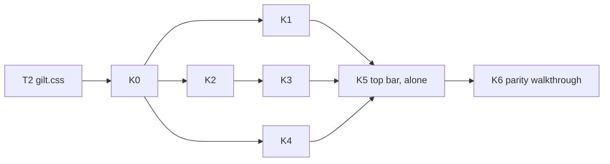

# Kit parity

> **Goal (DM, 2026-10-26, [#355](../../decisions-log.md)):** "get to that mockup". The source of truth is the kit page [gilt-stone.html](../../design/art/kit/gilt-stone.html). Open it in a browser and compare it with `.verify/t2/pairs/*.png`. The concept art (`.verify/t2/a-gilt-stone-01.png`) is inspiration, not binding.
> **Model:** the printed-sheet amendment, [character-sheet-full §6.2](../character-sheet-full.md#62-printed-sheet-layout) (FR-CHARX-105–120). Every layout change is a **markup change in every theme**. Simple Dark draws the new rows with its plain tokens, and Gilt & Stone styles them through `data-slot` names. [ADR-0069](../../architecture/adr/0069-theme-switch.md) holds: no theme logic in components, and themes never change geometry. Sizes change only through the size table (§7.3).

## 1. Summary

- [theme-system](theme-system.md) T0–T2 repaint today's markup. The DM finds the result "very far off": the gap is the structure inside windows, not the paint.
- This spec redesigns the rows, cards and bars that differ from the kit: Game log rows, Initiative rows, the top bar, notices, the damage-card popup, dialogs, the compendium list and stat block, Party status, and the sheet header. It also adds a few shared **kit parts** (medallion, result box, HP bar) that they all reuse.
- Client only: 0 bytes on the wire, no new intents, no visibility change.

## 2. Scope

- Markup and layout for every area in §6 (both clients, both themes). Each area also gets `data-slot` hooks, plus the `gilt.css` block that styles them (§7.4).
- Kit parts: `Medallion`, `ResultBox`, `HpBar` (new files under `src/client/common/components/kit/`), and `data-variant` on Button and the ToggleGroup items (BL-127).
- Three geometry decisions: the launcher's place (OQ-KIT-01), the Game log row height (OQ-KIT-02), and whether any default or minimum size changes (§7.3).
- A final **parity walkthrough** that compares each kit section with the app side by side (slice K6).

## 3. Goals

- Someone holding the kit page next to the app recognises every piece: the same rows, cards, bars and hierarchy.
- Nothing is lost. Every control stays reachable, every test ID keeps its meaning, and players never see more.
- The test load stays lean (DM #354): DOM tests per FR, at most one thin e2e per slice, and one walkthrough per slice.

## 4. Non-goals

- New behaviour the kit only illustrates:
  - Auto-advance turns (kit Initiative footer).
  - A chat "Send" in the Game log.
  - The "Session 14" title meta: sessions are not stored ([ADR-0013](../../architecture/adr/0013-session-journal-scope.md)).
  - A rollable stat-block window (OQ-KIT-04).
- The kit page's type-pairing switch (Old book is decided, FR-THEME-16).
- Character sheet body: done by FR-CHARX-105–120. Only the sheet **header** is in scope here (§6.9).
- The map canvas, tokens and 3D dice (OQ-THEME-09).
- Bigger windows "because the kit is roomier". Sizes are kept unless §7.3 says otherwise.

## 5. User stories

**DM**
- As the DM, I want the table to look like the kit, so the session feels like a CRPG and not a dashboard.
- As the DM, I want each Initiative row to show at a glance whose turn it is, their HP and their initiative, with the many controls one hover away.
- As the DM, I want each Game log row to show who rolled, what they rolled and a big result, with the dice maths on hover.

**Player**
- As a player, I want the same clean rows and big numbers on my screen. I see nothing I couldn't see before.
- As a player, I want my turn announced like the kit's "Mira's turn" card.

## 6. Functional requirements

### 6.0 Gap table (kit vs app)

T2 = what `gilt.css` (theme T2) already fixed. Markup = what this spec changes. ✓ = already at parity.

| Area (kit section) | Kit | App today | T2 fixed | Needs markup | Owner spec |
|---|---|---|---|---|---|
| Top bar (At the table) | Campaign title left · launcher centred · "● Live · 3 players" + DM chip right | Switcher Select + "New campaign" + "Rename" left; "0/2 online", "Connected", Pause, search, chip right; launcher **at the bottom** | Stone buttons, bar paint | Title + menu, one status pill; launcher place (OQ-KIT-01) | [play-shell](../play-shell.md), [campaign-management](../campaign-management.md), [live-sync](../live-sync.md) |
| Launcher | Stone icon + label buttons; open = gold glow; minimised = gem diamond | Same buttons; open bar, minimised ring | Stone look | Only if OQ-KIT-01 A (move); markers by CSS | play-shell |
| Tool rail | Rail framed like a window (double rule, corners) | 1 px rule, no corners | Tools, active gem | None (gilt.css frame on `map-tool-rail`) | [scenes-map](../scenes-map.md) |
| Goblin stat block | Card: italic type line, AC/HP/Speed row, 6-column abilities, attack rows | No stat-block window; compendium `StatBlock` is a plain read-only view | Paint | Compendium stat block as the kit card; window → OQ-KIT-04 | [compendium](../compendium.md), [entities](../entities.md) |
| Initiative | Round line; rows = medallion, name, HP bar + "x / y", **large bare init**, one status icon; turn = red wash + gem; footer "Next turn" | Header with 6 buttons, "Combatant / Init" strip, rows with grip, chips, AC/HP text, band chip, moved ft, init input box, attack + ⋯ | Frame, fonts | Row grid, header/footer, hover actions | [combat-tracker](../combat-tracker.md), [combat-extras](../combat-extras.md) |
| Game log | Rows = medallion, "Name · action", time, **large boxed result** coloured by outcome | One inline line: name — label: dice faces + mods = small boxed total, "physical" chip, category chip | Boxed totals, colours | Row grid, details move to hover, copy rule | [dice-roll-log](../dice-roll-log.md) |
| Roll popup (3D dice) | (Not in kit; shell UI) | Plain dark panel, inline totals | — (unthemed, T2 #8) | Totals as result boxes; frame by CSS | [dice-extras](../dice-extras.md) |
| Notices: toast stack | Card = medallion, bold who + text, small second line, inline stone actions; turn card with gems; "+2 more" pill | Stripe + icon + text + ✕, action under the text; no turn card (DM); single rule | Frame, stone action, gem ✕ | Card row, turn card, pill | [notifications](../notifications.md), combat-tracker (turn alert) |
| Damage card | Window: result lines with big boxes; target chips; Full/Half/Double + Miss + "Apply 16" | 440 px popup: title, To hit / Damage inputs, per-target rows with multipliers, Dismiss / Later / Apply | Frame, no corners | Title bar + gem, result-box inputs, compact target rows | combat-tracker |
| Character sheet | Square framed portrait, name, line, chips, Edit top-right | Round 44 px initial, picker Select right, a second row with brain icon + Lock / Edit | Body (CHARX print sheet) | Header only | [character-sheet-full](../character-sheet-full.md) |
| Buttons, inputs, chips | Stone buttons, gem check, switch, field, chips | Same components | ✓ (T2) | `data-variant` (BL-127) | shared UI |
| Menus / select | Highlight = left gold bar on a warm fill | Full gold outline box (T2 #6) | Panel | None (CSS) | shared UI |
| Dialog & popover | Dialog = small window: title bar + gem close, body, framed buttons ("Keep fighting") | Title inside a padded body, small ✕ floating top-right, ghost Cancel | Frame | Header becomes a title bar; copy of End-encounter buttons | shared UI, combat-tracker |
| Compendium (table) | Table: header row, zebra, right-aligned numbers | List of buttons: name + muted line + source chip | Paint | Table rows (0 B, OQ-KIT-05) | compendium |
| More pieces (card) | Card = medallion, name, sub line, AC mini shield, HP bar | Party status = one-line rows; Creatures = icon tile rows | Paint | Party status cards, medallions | [party-board](../party-board.md), entities |
| Slider · collapsible · alert · skeleton | As kit | Same | ✓, except the hue slider range (T2 FAIL) | None (T2 follow-up in gilt.css) | theme-system |
| Type, Palette | Old book, kit `:root` | Same | ✓ | — | theme-system |
| Preferences, launcher "⋯" menu | (Uses kit menu / section look) | Section headings muted small text | Paint | None (CSS: headings in label type) | play-shell |

### 6.1 Cross-cutting

| ID | Requirement | Test |
|---|---|---|
| FR-KIT-01 | **One markup for every theme.** Each new layout renders the same DOM under Simple Dark and Gilt & Stone. Simple Dark draws it with today's tokens (border, card, muted, rounded). No component reads the theme. | `FR-KIT-01 same DOM per theme` (render each area under both `data-theme` values, compare the DOM) |
| FR-KIT-02 | **Test IDs kept.** Every existing `data-testid` keeps its meaning and stays on an element with the same role. Where this spec moves a control into a menu or a hover group, the ID moves with it. New IDs follow AGENTS §9.5 (owning spec's prefix; kit parts `kit-`). | existing tests pass (selectors may add a "hover / open menu" step; listed per slice) |
| FR-KIT-03 | **Nothing dropped.** Every control and value shown today stays reachable: visible, in the row's or window's ⋯ menu, or in the hover group / Tooltip named in its FR. Hover groups also show on keyboard focus-within, on the current-turn row, and under `(hover: none)` (as `dice-log-actions` today). | `FR-KIT-03 reachable` per area (each control's ID present after hover / focus / menu open) |
| FR-KIT-04 | **Visibility and wire unchanged.** Players see exactly the fields they see today, drawn differently (e.g. a monster's band, never its HP numbers). No snapshot field, intent or event is added; 0 B. Every new value is derived on the client from data it already holds (§8). | `FR-KIT-04 player rows show no new fields` (player renders vs a DM-only fixture) |
| FR-KIT-05 | **Kit parts** (new, `src/client/common/components/kit/`): **`Medallion`**: a round portrait. It shows the image asset thumbnail if there is one, else the first letter of the name on a colour. Sizes `sm` 22 / `md` 28 / `lg` 34 px; `kit-medallion`, `data-slot="kit-medallion"`, `data-size`. **`ResultBox`**: a boxed number. `outcome` = `plain` \| `crit` \| `fumble` \| `damage` \| `heal`; `held` shows "…" and no outcome (FR-DICE-40); focusable when it has a Tooltip; `kit-result`, `data-slot="kit-result"`, `data-outcome`. **`HpBar`**: a thin bar plus "cur / max", or a band word when only the band is known; colour from the meaning tokens `hp.*` (not themed, FR-THEME-09); `kit-hpbar`, `data-slot="kit-hpbar"`, `data-band`. | `FR-KIT-05 medallion`, `… result box`, `… hp bar` |
| FR-KIT-06 | **Variants as data** (BL-127): Button carries `data-variant` (`default` \| `outline` \| `ghost` \| `secondary` \| `destructive` \| `link`) and `data-size`; ToggleGroup items carry `data-variant` (`segmented` \| `tool`). Themes stop reading Tailwind classes. | `FR-KIT-06 variant attributes` |
| FR-KIT-07 | **Theme hooks:** each new part carries the `data-slot` names in §7.4. `gilt.css` styles them; Simple Dark needs no stylesheet. | `FR-KIT-07 slots present` |

### 6.2 Top bar and launcher

| ID | Requirement | Test |
|---|---|---|
| FR-KIT-10 | **Three zones** in the 48 px bar (`TOP_BAR_H` unchanged): left = title (`ui-topbar-left`), centre = the launcher if OQ-KIT-01 A, else empty, right = status, DM items (Pause, search), identity chip (`ui-topbar-right`, order unchanged). | `FR-KIT-10 bar zones` |
| FR-KIT-11 | **DM title:** the campaign switcher's trigger (`camp-campaign-switcher`) shows the campaign name in title type with a chevron, with no box. Its menu lists the campaigns (`camp-campaign-option`), then a separator, then **New campaign…** and **Rename…** (Rename only with an active campaign). Both open today's dialogs (`camp-campaign-new`, `camp-campaign-rename`), whose trigger IDs move onto the items. The switch confirm (`camp-switch-dialog`) is unchanged. | `FR-KIT-11 campaign menu` |
| FR-KIT-12 | **Player title:** the campaign name in title type (`camp-joined-campaign-name`), then "· playing as Player 1" in small muted text (`camp-joined-player-name`). `camp-player-joined` stays the wrapper. | `FR-KIT-12 player title` |
| FR-KIT-13 | **One status pill** `ui-topbar-status`, a group of two parts. (1) `sync-connection-status`: a dot plus "Live", "Reconnecting…", etc. "Connected" reads "Live". (2) DM only, `ui-presence-badge`: "· 0 / 2 online"; click and Tooltip are unchanged. `data-state` values are unchanged. | `FR-KIT-13 status pill` |
| FR-KIT-14 | **Launcher placement** per OQ-KIT-01. **If A:** the launcher sits in the centre zone. Its fit width is the gap between the left and right zones (≥ 8 px each side); FR-SHELL-43's label-drop and "⋯" rules are unchanged. The "⋯" menu opens downward. The bottom reservation `LAUNCHER_CLEAR` becomes the 12 px edge gap; the work area, default layouts, bands, the player toast corner and the goldens are recomputed (§7.3, [proposed ADR](../../architecture/adr/proposed-launcher-in-top-bar.md)). **If B:** the launcher stays bottom-centre, unchanged. | `FR-SHELL-43` tests, `FR-SHELL-62 golden layouts` (regenerated if A) |
| FR-KIT-15 | **Launcher buttons** keep their DOM (`ui-launcher-button`, `data-state`, `[data-marker]`, badge, activity dot). The kit's open glow and minimised gem diamond are CSS on `[data-state]` / `[data-marker]`. | existing |

### 6.3 Initiative (DM and player)

Row grid (both clients): `turn marker · medallion (lg) · name block · init number · status · actions (DM, hover)`. Rows are ≈ 46 px, about the same as today's two-line rows.

| ID | Requirement | Test |
|---|---|---|
| FR-KIT-20 | **DM header:** one line, centred: the encounter name (muted) and "Round N" (`cbt-init-round`, number in number type). On the right is a window menu ⋯ (`cbt-init-menu`, new) holding **Add…** (`cbtx-init-add`), **Summon…** (`cbt-init-summon`) and **End encounter…** (`cbt-init-end`, destructive item, same confirm dialog). The empty state is unchanged. | `FR-KIT-20 header menu` |
| FR-KIT-21 | **Pending list** (`cbt-init-pending-list`) stays under the header. Each card row is one compact line (Sword icon + text), with the same IDs and click. | existing |
| FR-KIT-22 | **Footer**, pinned under the list (`cbt-init-footer`, new). Round ≥ 1: **Prev** (`cbt-init-prev`, small), **Undo** (`cbt-init-undo`, icon button, Tooltip = undo text) and **Next turn** (`cbt-init-next`, primary, right). Round 0: **Roll monsters** (`cbt-init-roll-monsters`, while shown today) and **Start** (`cbt-init-next`); the start reason (`cbt-init-start-reason`) sits above them. | `FR-KIT-22 footer` |
| FR-KIT-23 | **Rows:** the "Combatant / Init" strip is removed (aria-hidden today). Each `cbt-init-row` uses the row grid. The current turn gets a red wash and a gem diamond on the row's left edge (`TurnMarker`, aria "Current turn" kept). The grip (`cbtx-init-row-grip`) shows on hover / focus only. | `FR-KIT-23 row grid` |
| FR-KIT-24 | **Medallion:** the combatant's portrait (`imageAssetId`), else its initial on its token's creature-type colour (token record; `creature.*` tokens), else the neutral muted colour. | `FR-KIT-24 medallion source` |
| FR-KIT-25 | **Name block, line 1:** the name (`cbt-init-row-name`) with its marks (mode, hidden, skip) and the owner / side chips, as today's `NameLine`. **Line 2:** `HpBar` + "cur / max" (`cbt-init-row-hp`), temp "+N" (`cbtx-init-row-temp`), then "AC n" and moved feet (`cbt-init-row-moved`) as a muted tail. When the tail doesn't fit, `NameLine`'s fitting moves it into the row Tooltip (`cbt-init-row-tip`, new, on the name). The band (`cbt-init-row-band`) becomes the bar's `data-band` for the DM. | `FR-KIT-25 hp line`, `… tail folds` |
| FR-KIT-26 | **Player HP line:** PCs and the player's own companions show `HpBar` with numbers, from the character record or companion data the player already holds (Party status shows the same values, [ADR-0063](../../architecture/adr/0063-party-hp-visibility.md)). Monsters show the band word only (`cbt-init-row-band`), never a bar length. Hidden combatants are never sent (unchanged). | `FR-KIT-26 player hp`, FR-KIT-04 |
| FR-KIT-27 | **Init number:** a set value is a large bare number (`cbt-init-row-init`). The DM clicks it, or presses Enter on it, to edit it as today's input (same ID, commit on blur / Enter). An unset value shows today's input + Roll button (`cbt-init-row-roll`). Companions acting after their owner keep the read-only text. | `FR-KIT-27 init edit` |
| FR-KIT-28 | **Status:** effects render as icon chips (icon + rounds, label in the Tooltip). The first one shows, then "+N" (today's fold IDs `cbtx-init-row-effect`, `…-more`). Chip menus (Edit… / End) and the concentration chip (`cbtx-conc-chip`, blue) are unchanged. | `FR-KIT-28 status icons` |
| FR-KIT-29 | **Row actions** (DM): Attack (`cbt-init-row-attack`) and ⋯ (`cbt-init-row-menu`) form a hover group (FR-KIT-03), always shown on the current-turn row. The menu's items and order are unchanged. Death items and companion lines (`cbt-init-companion`) keep their place. Companion lines and removed rows (`data-removed`, Restore) use the grid at medallion `sm`. | `FR-KIT-29 hover actions` |
| FR-KIT-30 | **Player body:** a centred "Round N" (`cbt-init-round`) and the hint (`cbt-init-hint`), then rows on the same grid without grip or actions. A companion row the player owns stays clickable (opens its card). | `FR-KIT-30 player rows` |
| FR-KIT-31 | "↓ N more" (`cbt-init-more`), the below-fold logic, drag reorder, the drop line and every intent are unchanged. | existing |

### 6.4 Game log and roll popup

Row grid: `medallion (md) · what · time · result boxes · actions (hover)`, one line, ≈ 30 px (OQ-KIT-02).

| ID | Requirement | Test |
|---|---|---|
| FR-KIT-40 | **Row:** each `dice-log-entry` (all attributes kept) uses the row grid. The hidden icon (`dice-log-entry-hidden`, DM) sits before the name. Superseded / undone styling and the rerolled button (`dice-log-rerolled`) are kept. | `FR-KIT-40 row grid` |
| FR-KIT-41 | **Medallion:** the first letter of `actorName`, on the actor's name colour (FR-DICE-60) when the line is coloured, else neutral. | `FR-KIT-41 medallion colour` |
| FR-KIT-42 | **What:** the actor's name (`dice-log-entry-actor`, coloured as today), then " · " and the **action text** from `rowAction(entry)`, a new pure function in `src/shared/dice-roll-log/`. `roll` items give their labels joined with " + " (else the expression); other kinds (`cbt.attack`, `cbt.hp`, `gem.*`, …) give their line text without the actor. One line, ellipsis. | `FR-KIT-42 row action text` (unit, each kind) |
| FR-KIT-43 | **Time:** "HH:MM" local time from `e.at` (`dice-log-entry-time`, new), hidden while the row is < 360 px wide (container query). | `FR-KIT-43 time` |
| FR-KIT-44 | **Results:** one `ResultBox` per payload item total (`dice-log-entry-total`, `data-record-id` = roll id), at most 2, then "+N" with the rest in the Tooltip. **Outcome:** a d20 natural 20 → `crit`; a natural 1 → `fumble`; a damage part or category Damage → `damage`; category Healing → `heal`; else `plain`. Held numbers show "…" and no outcome until they land (FR-DICE-40). The "physical" chip stays after the boxes. | `FR-KIT-44 outcome`, `… held` |
| FR-KIT-45 | **Details on hover:** the dice faces, modifiers, "= total", damage type, natural text and category move into the entry Tooltip (today's `tooltipOf` plus the inline segments, in that order). Hover or focus on the row text or a result box opens it, with the shared delay. | `FR-KIT-45 tooltip content` |
| FR-KIT-46 | **Copy:** copying selected rows puts each row's `lineText` on the clipboard, one per line, so copied text is exactly today's (amends FR-DICE-93; OQ-KIT-06). | `FR-KIT-46 copy` |
| FR-KIT-47 | **Bottom pin holds:** if the list was pinned at the bottom, it re-pins after an `<html>` attribute change (theme switch) and after web fonts load (T2 deviation 2). | `FR-KIT-47 repin on theme` |
| FR-KIT-48 | **Entry actions** (`dice-log-actions`) keep their hover group. The roll bar keeps every control and ID; only its Roll button is `primary`. The empty / loading states and the "N new" pill are unchanged. | existing |
| FR-KIT-49 | **Roll popup** (`dicex-popup`): each row (`dicex-popup-row`) starts with the actor `Medallion` (`sm`), and each total (`dicex-popup-total`) is a `ResultBox` (`sm`) with FR-KIT-44's outcome. Natural, physical and offered tags stay as text after it. The rest of the popup is unchanged; its frame is CSS. | `FR-KIT-49 popup totals` |

### 6.5 Notices (toasts, turn card, damage-card toast)

| ID | Requirement | Test |
|---|---|---|
| FR-KIT-55 | **Card row** for `note-toast` and the alert toasts (`ui-toast`): `medallion or icon · text block · actions · close`. The medallion shows the initial of the player in `byPlayerId`, on that player's colour; otherwise the kind's icon at the same size. The stripe (`note-stripe`) stays as the left edge. | `FR-KIT-55 card row` |
| FR-KIT-56 | **Text block:** line 1 = the text (`note-text`), with the causing player's name in bold when it starts the text. Line 2 = small muted relative time from `createdAt` ("just now", "2 min ago"; `note-time`, new). | `FR-KIT-56 text block` |
| FR-KIT-57 | **Actions inline:** the action button (`note-toast-action`, small stone) sits right of the text and wraps below it only when the card is too narrow. The close (`note-toast-close`) is the gem. | `FR-KIT-57 inline action` |
| FR-KIT-58 | **Pending summary** (`note-toast-pending-summary`) uses the same row. "+N more" (`note-toast-more`) is a centred pill (also inside the summary row, as today). | `FR-KIT-58 summary row` |
| FR-KIT-59 | **Turn card:** the player's turn alert Toast ("Your turn — Mira", FR-SHELL-22) renders as a turn card: centred title-type text between two gem marks, no close (it times out as today); `cbt-turn-card`, new. DM turn card: OQ-KIT-03. | `FR-KIT-59 turn card` |
| FR-KIT-60 | Stack width (320), placement, folding, timers and every notification rule are unchanged ([notifications](../notifications.md)). | existing |

### 6.6 Damage-card popup (DM) and player card view

| ID | Requirement | Test |
|---|---|---|
| FR-KIT-62 | **Title bar:** `cbt-popup-drag` becomes a window-style title bar: "{attacker} — {attack}" in title type and a gem close on the right. The gem is **Later** (it takes `cbt-popup-later`; same action), so the footer no longer shows Later. `cbt-popup-step` sits in the bar. | `FR-KIT-62 title bar` |
| FR-KIT-63 | **Result lines:** "To hit" and "Damage, <type>" lines each end in a large boxed value. The box is the existing input (`cbt-popup-tohit`, `cbt-popup-damage`, `cbt-popup-damage-part`) drawn as a `ResultBox`-styled input (`data-outcome`: natural 20 → `crit`, damage → `damage`). The labels' dice ("[17] +4") stay small after the label. Ruled and waiting states are unchanged. | `FR-KIT-63 result lines` |
| FR-KIT-64 | **Targets:** each `cbt-popup-target-row` is one compact line: `Medallion` (`sm`) + "Name · AC n" chip, the multiplier segmented control (`cbt-popup-target-mult`, labels unchanged), then the preview (`cbt-popup-target-preview`). Remove (`cbt-popup-target-remove`) shows on hover / focus; part chips and `popupParts` chips wrap to a second line. Add target is unchanged. | `FR-KIT-64 target rows` |
| FR-KIT-65 | **Footer:** Dismiss (`cbt-popup-dismiss`, ghost) left; the card actions (`cbt-card-actions`) in the middle; Apply (`cbt-popup-apply`) or Apply hit (`cbt-popup-apply-hit`) primary on the right. | `FR-KIT-65 footer` |
| FR-KIT-66 | **Player card view** (toast / History): the maxed-damage and outcome lines (`cbt-card-maxed`, `cbt-card-outcome`) show totals as `ResultBox` (`sm`). Popup width (440) and drag are unchanged. | `FR-KIT-66 player card` |

### 6.7 Dialogs

| ID | Requirement | Test |
|---|---|---|
| FR-KIT-70 | **Title bar:** `DialogHeader` (`dialog-header`) renders flush to the top of `DialogContent` as a bar: the title (`dialog-title`, title type) on the left, the built-in close (`dialog-close`) vertically centred on the right, and a rule under it. The description and the content sit in a padded body (`dialog-body`, new); the footer (`dialog-footer`) is right-aligned. `max-w-md` is unchanged. | `FR-KIT-70 dialog bar` |
| FR-KIT-71 | Every Dialog in both clients has a `DialogHeader` with a `DialogTitle` (also Radix's a11y rule); a test lists any that don't. | `FR-KIT-71 every dialog titled` |
| FR-KIT-72 | **End encounter** (`cbt-init-end`, `cbt-enc-end`): the title stays `End “name”?`. Buttons: **Keep fighting** (outline) and **End encounter** (destructive, `…-end-confirm`). | `FR-KIT-72 end copy` |

### 6.8 Compendium and stat block

| ID | Requirement | Test |
|---|---|---|
| FR-KIT-76 | **Results as a table:** a sticky header row (Name · Details · Source) over rows. Each `cmp-result` row has the name (`cmp-result-name`, name type), the details line (`r.line`, e.g. "CR 1/4 · Small humanoid") and the source chip. Rows are zebra-striped with a hover tint; numbers use tabular figures. Group rows (`cmp-group-toggle`) are expandable rows with a count. Drag, keyboard and every state ID are unchanged. 0 B (OQ-KIT-05). | `FR-KIT-76 table rows` |
| FR-KIT-77 | **Stat block card** (`cmp-statblock-*`): an italic type line ("Small humanoid (goblinoid), neutral evil"); one ruled row "AC n · HP n (formula) · Speed n ft" (`-core`); a 6-column ability grid with label, score and modifier (`-scores`, `-score`); then each section's entries as name + muted line rows (`-section`). It is read-only (no new roll buttons, OQ-KIT-04). | `FR-KIT-77 stat block card` |

### 6.9 Party status, Creatures, sheet header

| ID | Requirement | Test |
|---|---|---|
| FR-KIT-82 | **Party status card** (`party-summary-row`, all attributes kept). Line 1: `Medallion` (`lg`, portrait or initial on the player colour; this replaces the separate colour dot), the name (`party-summary-name`, name type), the turn and hidden marks, and the AC mini shield on the right (`party-summary-ac`). Line 2: the level / class / species line from the character record (left out if absent). Line 3: `HpBar` + "cur / max" (`party-summary-hp`), temp, death badge, effect icons. Click / Enter opens the sheet as today. | `FR-KIT-82 party card` |
| FR-KIT-83 | Companion rows (`party-companion-row`) keep one line, with a `Medallion` (`sm`). | `FR-KIT-83 companion row` |
| FR-KIT-84 | **Creatures rows** (`ent-list-row`): the portrait tile becomes a `Medallion` (`lg`): the portrait asset, else the initial on the creature-type colour for monsters, or on the owner's colour for characters. Badges and actions are unchanged. | `FR-KIT-84 creature medallion` |
| FR-KIT-85 | **Sheet header** (amends FR-CHARX header layout, not behaviour): a square framed portrait, 56 px (`char-sheet-portrait`, image or initial). The name (`char-sheet-name`, name type) **is** the picker when the picker is shown: the native select (`char-sheet-picker`) is styled as the name with a chevron. The level line (`char-sheet-level`). A chips line holds the badges and the header-slot sections (effect chips, brain menu `cbtx-sheet-effects-menu`). Derive / Approve / Lock / Edit (small) sit top-right. The separate `charx-header-line` row goes; its parts move as stated. The compact fallback (FR-CHARX-48) still moves badges and picker into `charx-header-rest`. | `FR-KIT-85 sheet header`, existing CHARX tests |

### 6.10 Geometry and walkthrough

| ID | Requirement | Test |
|---|---|---|
| FR-KIT-92 | **Sizes:** every `defaultSize`, `usefulSize` and `minSize` stays as today (§7.3), except what OQ-KIT-01 A changes (work area and default layouts). The `dice.log` useful criterion changes per OQ-KIT-02. The theme-geometry e2e still finds every window rect equal across themes. | `FR-SHELL-85 size table`, `theme-geometry.e2e.ts` |
| FR-KIT-93 | **Narrow:** at the minimum sizes (Initiative 320 / player 240, Game log 300, Party Manager 340, sheet 280) nothing overflows sideways; names truncate with an ellipsis. | `FR-KIT-93 min widths` (DOM, fixed widths) |
| FR-KIT-94 | **Parity walkthrough** (slice K6): each kit section next to the app at 1440 × 900, both clients. It produces a report row per section: match, accepted ruling, or a new BL item. | walkthrough |

## 7. UI/UX notes

Per [visual-direction](../../design/visual-direction.md): the kit page is binding for Gilt & Stone. Simple Dark uses shadcn tokens only (no new styling).

### 7.1 Screens (DM view / player view)

- **DM:** the top bar (§6.2), Initiative with hover actions (§6.3), the Game log (§6.4), the top-centre notices and the damage popup (§6.5–6.6), dialogs (§6.7), and the Compendium, Creatures and Party Manager windows (§6.8–6.9).
- **Player:** the same top bar (title, status, chip), the player Initiative (§6.3, FR-KIT-26/30), the Game log, bottom-right notices with the turn card, the player card view, the sheet header, and Party status.
- **States:** empty, loading and error keep today's components and copy. While disconnected, the windows stay usable as today, and the status pill reads "Reconnecting…".

### 7.2 Layout sketch (Initiative row, Game log row)

```figure
 Initiative row (DM, ≈ 46 px)                          hover ──┐
 {accent:◆}{dim:┃}( M ) Mira {dim:◎ Ally}                18   {note:◌}  {dim:⚔ ⋯}
     {dim:┃}       {ok:██████████}{dim:░░} 38 / 44  +5   {dim:AC 16 · 0/30 ft}

 Game log row (≈ 30 px)
 ( M ) {strong:Mira} · Longbow attack vs Goblin        21:14  {ok:[ 29 ]} {warn:[ 16 ]}
```

### 7.3 Window geometry

The size table is authoritative ([play-shell §7](../play-shell.md#7-uiux-notes), protocol §18 / §24). This spec prefers keeping sizes.

| Window | Default / min today | After | Note for the placer, goldens and harness |
|---|---|---|---|
| `cbt.initiative` DM / player | 400×500 / 320×240 · 280×400 / 240×200 | **unchanged** | Rows ≈ 46 px (today ≈ 50); useful criteria "header, controls, 4 rows" / "header + 4 rows" still hold (footer replaces the header button row) |
| `dice.log` DM / player | 690×160 … 1150×240 / 300×160 | **unchanged** (OQ-KIT-02 A) | Useful 460×160 criterion becomes "**2** entries + roll bar" (30-px rows); sizes, goldens and harness are unchanged |
| `party.board` | 600×560 (440 mid-fight) / 340×360 | **unchanged** | Criterion "tab labels whole + 4 rows" becomes "+ 3 cards" (≈ 64 px cards) |
| `cmp.compendium`, `ent.creatures`, `char.sheet`, `shell.prefs` | — | **unchanged** | Row heights within ±4 px of today |
| Dialogs, damage popup (440), toast stack (320), roll popup (448) | not windows | **unchanged** | — |
| **All windows, if OQ-KIT-01 A** | usable y 60 … vh − 76 | y 60 … **vh − 12** | The sprint-5 default layouts move the Game log down 64, so the bands above it (FR-SHELL-79) are recomputed (+64 where the useful sizes don't cap them). The player toast corner's bottom (`LAUNCHER_CLEAR + STACK_GAP`) goes from 72 to 20. Goldens (`windows.golden.json`, `windows.memory.golden.json`, both clients) regenerate once (`UPDATE_GOLDEN=1`, diff reviewed); the replay cells and `replay.failing.json` re-run; `useful-size.e2e.ts` is unchanged |

### 7.4 Theme hooks (`data-slot`) and what gilt.css adds

| Area | New `data-slot` names | gilt.css adds |
|---|---|---|
| Kit parts | `kit-medallion`, `kit-result`, `kit-hpbar` | Gold-ringed medallion; result box per `data-outcome` (gold / green crit / red damage / dim fumble), number type 19 px; bar inset |
| Top bar | `topbar-title`, `topbar-status` | Title type 19 px; status pill with a glowing dot; launcher open glow, minimised gem diamond (`[data-marker]`) |
| Tool rail | (uses `map-tool-rail` test ID) | Window frame: double rule + 4 corners (pseudo-elements, no layout) |
| Initiative | `init-header`, `init-row`, `init-number`, `init-status`, `init-footer`, `init-actions` | Turn wash + gem diamond; large number type 24 px; row panel-lo fill |
| Game log | `log-row`, `log-what`, `log-time` | Row rule, muted action text, dim time |
| Notices | `toast-card`, `toast-text`, `toast-actions`, `turn-card` | Double rule (T2 #9); turn card gems; pill |
| Damage popup | `card-bar`, `card-line`, `card-target`, `card-footer` | Window title bar + gem; target chips |
| Dialog | `dialog-body` (+ existing `dialog-header`) | Header as a window title bar; bigger gem (T2 #7); framed `outline` buttons in `dialog-footer` |
| Menus / select | (existing) | Highlight = left gold bar on a warm fill (T2 #6) |
| Compendium | `cmp-table`, `cmp-row`, `statblock`, `statblock-abilities` | Table head in label type; zebra; stat block rules |
| Party / Creatures | `party-card` | Card gradient, AC mini shield |
| Sheet header | `sheet-portrait`, `sheet-name` | Framed square portrait; name in name type |
| Others (no markup) | — | Hue slider range shows the spectrum (T2 FAIL); Preferences headings in label type; window titles' slight emboss |

## 8. Data model

No server data, no new client store. 0 B.

- **Derived (client):**
  - `rowAction(entry)` (FR-KIT-42) and `resultOutcome(item, category)` (FR-KIT-44), pure functions in `src/shared/dice-roll-log/`.
  - `medallionOf(name, imageAssetId?, colour?)`.
  - The relative time from `createdAt` (FR-KIT-56).
  - "HH:MM" from `e.at` (FR-KIT-43).
- **Read, already on the client:**
  - token `creatureType` (FR-KIT-24 / -84);
  - the character record's level, class and species (FR-KIT-82);
  - the player colour of `byPlayerId` (FR-KIT-55).

## 9. API & events

None. No REST, intents or events change.

## 10. Permissions

Unchanged. Every control keeps its server check; hover groups and menus change placement only.

| Action | DM | Player | Server check |
|---|---|---|---|
| Any control moved by this spec | as today | as today | as today |

## 11. Edge cases & failure modes

- **Disconnect / reconnect / server crash:** no new state. Rows re-render from the store as today, and the status pill shows the connection state (FR-KIT-13).
- **Theme switch mid-session:** the DOM is identical (FR-KIT-01). The log re-pins (FR-KIT-47), and the launcher refits (FR-THEME-07).
- **Long names / narrow windows:** ellipsis, with the full text in the Tooltip (FR-KIT-93).
- **Held or hidden rolls:** no number or outcome leaks before landing (FR-KIT-44). Hidden entries stay DM-only, as today.
- **Touch / no hover:** hover groups stay visible (FR-KIT-03).
- **Reduced motion:** no new animation. The turn card appears without motion.

## 12. Performance & bandwidth

- 0 B on the wire. The kit parts are under 4 KB of JS; no new dependency.
- Tooltip contents are built on open, not per row. Initiative rows with 20 combatants and the log's 100 rows must render within today's budget (`bench`: none new; the existing DM snapshot bench is unaffected).

## 13. Test plan (lean, DM #354)

Isolated per worktree ([ADR-0008](../../architecture/adr/0008-parallel-dev-isolation.md)); loop per [ADR-0017](../../architecture/adr/0017-agent-verification-fixture-library.md). No session-sim per slice. One heavy run at a time.

| Level | What | Fixtures |
|---|---|---|
| Unit / DOM | One test per FR, named `FR-KIT-NN …` (§6 Test column); pure: `rowAction`, `resultOutcome`, medallion source; DM vs player renders for FR-KIT-04 / -26 | in-code view models |
| Existing | Every area's current tests stay green; a selector that now needs a hover / menu step is updated in the same slice and listed in its commit | — |
| Geometry | Only K5 (if OQ-KIT-01 A): `FR-SHELL-62 golden layouts` regenerated, replay re-run, `theme-geometry.e2e.ts` | registry |
| E2E (thin, ≤ 1 per slice) | K1 `kit-log.e2e.ts` (roll → row with medallion, time, box; hover → dice), K2 `kit-initiative.e2e.ts` (Next turn in the footer, hover ⋯ → Damage / heal), K3 `kit-notices.e2e.ts` (player approve toast inline action; damage popup Apply), K5 `theme-geometry` | bundle `kit-parity` |

- **Bundle `kit-parity`** (new, composes existing units only; no new record type). It is `theme-gilt` (`base` + `char-mira` + a round-3 combat with 6 combatants + a goblin stat block) plus:
  - a crit attack + damage entry, a hidden DM roll and a held roll in the Game log;
  - a pending damage card;
  - a pending player request (toast);
  - a concentration effect on Mira and a prone effect on the Dire Wolf;
  - SRD monsters for the compendium table.
- **Walkthrough per slice** (test agent, verify profile, both themes, 1440 × 900 DM + `player-1`): one screenshot pair per kit piece the slice touches (`kit-<piece>.png` from the kit page vs `app-<piece>-<theme>.png`). The report rates each pair match / ruling / gap.
- **K6 parity walkthrough:** every kit section (At the table, Notices, Damage card, Character sheet, Controls: buttons, inputs & chips, menus, dialog & popover, Compendium, More pieces, Type, Palette) side by side. It ends with a gap list for the DM.

## 14. Dependencies

| On | What we need | Status |
|---|---|---|
| [theme-system](theme-system.md) T2 `build/theme-gilt` | `gilt.css` exists (the paint layer); T3 `fix/theme-default` (Gilt & Stone default, "Simple Dark") is independent | T2 merging (#355) |
| [play-shell](../play-shell.md) | Launcher placement and work area (OQ-KIT-01, [proposed ADR](../../architecture/adr/proposed-launcher-in-top-bar.md)); size-table criteria for `dice.log` and `party.board` (§7.3) | open → OQ-KIT-01, -02 |
| [dice-roll-log](../dice-roll-log.md) | FR-DICE-20 line layout → row layout; FR-DICE-93 copy via handler (OQ-KIT-06) | open → OQ-KIT-06 |
| [combat-tracker](../combat-tracker.md) | Initiative header/footer/rows; End-encounter copy; damage popup layout | via this spec |
| [notifications](../notifications.md) | Card row, relative time, turn card (OQ-KIT-03) | via this spec |
| [compendium](../compendium.md) | Table rows (OQ-KIT-05), stat block card | via this spec |
| [character-sheet-full](../character-sheet-full.md) | Header (FR-KIT-85) on top of FR-CHARX-48 | via this spec |
| [campaign-management](../campaign-management.md), [live-sync](../live-sync.md) | Switcher as a menu (FR-KIT-11), status pill text "Live" (FR-KIT-13) | via this spec |
| Shared UI (AGENTS §9.9) | `overlays.tsx` (dialog bar), `button.tsx` / `menus.tsx` / `controls.tsx` (`data-variant`), `gilt.css` | orchestrator (K0; OQ-KIT-10) |

**Build slices** (one commit series each; at most **2 builders at once**, DM #354):

| # | Branch | Does | Folders | After |
|---|---|---|---|---|
| K0 | `fix/kit-parts` | Kit parts; `data-variant` (BL-127); dialog title bar (FR-KIT-70/71); gilt.css: parts, dialog, menus, hue-slider fix | `components/kit/` (new), ★ `components/ui/*`, ★ `themes/gilt.css` | T2 |
| K1 | `build/kit-log` | Game log rows, copy, re-pin; roll popup totals (§6.4) | `common/features/dice-roll-log/`, `dice-extras/RollPopup.tsx`, `src/shared/dice-roll-log/` | K0 |
| K2 | `build/kit-initiative` | DM + player Initiative (§6.3); End-encounter copy (FR-KIT-72) | `*/features/combat-tracker/initiative-window.tsx`, `common/features/combat-tracker/parts.tsx`, `combat-extras/parts.tsx` | K0 (beside K1) |
| K3 | `build/kit-notices` | Toast cards, summary, turn card; damage popup + player card view (§6.5–6.6) | `common/features/notifications/`, `dm/features/combat-tracker/attack-popup.tsx`, `player/.../card-view.tsx`, `turn-alert-runtime.tsx` | K2 |
| K4 | `build/kit-library` | Compendium table + stat block; Party status cards; Creatures medallions; sheet header (§6.8–6.9) | `compendium/`, `party-board/`, `dm/features/entities/`, `character-sheet/SheetView.tsx` | K0 (beside K3) |
| K5 | `build/kit-topbar` | Top bar zones, campaign menu, status pill; launcher move if OQ-KIT-01 A, with goldens + replay regenerated | `play-shell/` (★ frame, `Launcher.tsx`, `geometry.ts`, `toast-region.ts`), `campaign-management/CampaignBar.tsx`, `live-sync/ConnectionStatus.tsx` | K1–K4 merged; **runs alone** (golden regen) |
| K6 | `test/kit-parity` | Parity walkthrough (FR-KIT-94); BL items for the gaps left | `.verify/` only | K5 |

Each slice appends its own `/* KIT: <area> */` block to `gilt.css` (OQ-KIT-10).



## 15. Open questions

**Bold** option = suggested pick (not decided).

| ID | Question | Options (pick marked) | Blocking? | Affects |
|---|---|---|---|---|
| OQ-KIT-01 | **Launcher place.** The kit centres the launcher in the 48 px top bar; play-shell keeps it bottom-centre (and visual-direction lists a "bottom action bar" motif) | **A: move it into the top bar**, as the kit and concept art show (+64 px of map height; more buttons go to "⋯" at 1280; every default layout and golden regenerates once, K5) · B: keep it at the bottom; the top bar takes only the title and status changes · C: B now, A as a later slice | yes (K5 only) | play-shell, notifications (player corner), [proposed ADR](../../architecture/adr/proposed-launcher-in-top-bar.md) |
| OQ-KIT-02 | Game log rows: the kit's ≈ 40-px rows show fewer entries in today's 160-px log | **A: 30-px rows (medallion 28, box 22 px high), sizes kept, useful criterion "2 entries"** · B: kit 40-px rows, `dice.log` +40 px tall everywhere (bands shrink, goldens regenerate) · C: container query: kit rows when the list is ≥ 200 px tall, else today's inline line | no | play-shell size table, dice-roll-log |
| OQ-KIT-03 | DM turn card ("Mira's turn" in the kit's DM stack) | **A: client-derived card at the top of the DM stack for 4 s on each turn change** (0 B, from the combat state) · B: players only (their existing turn alert) · C: none | no (owner: DM) | notifications, combat-tracker |
| OQ-KIT-04 | The kit's "Goblin" stat-block window at the table (with Attack / Damage buttons) | **A: the compendium stat block takes the kit card now; a rollable stat-block window is a later feature spec** · B: a new DM window `ent.statblock` (from an Initiative row / token menu) with roll buttons in this track | no (owner: DM) | entities, compendium, combat-tracker |
| OQ-KIT-05 | Compendium table columns | **A: Name · Details · Source from today's fields (0 B)** · B: real CR / AC / HP columns for monsters (+≈ 24 B per search row) | no | compendium |
| OQ-KIT-06 | FR-DICE-93 (a row's text = its copied line) no longer holds once details move to hover | **A: a copy handler writes `lineText` per selected row** · B: the full line stays in the DOM, visually hidden | no | dice-roll-log |
| OQ-KIT-07 | Initiative AC and movement: the kit shows neither | **A: muted tail on the HP line, into the row Tooltip when it doesn't fit** · B: always in the Tooltip | no | combat-tracker |
| OQ-KIT-08 | End encounter, Add…, Summon…: the kit header has no buttons | **A: a window ⋯ menu** · B: keep End encounter as a small header text button | no | combat-tracker |
| OQ-KIT-09 | Glossary: **Medallion** ("a round portrait: image, else initial on a colour") and **Result box** ("a boxed roll total coloured by outcome") | **A: add** · B: describe in specs only | no | glossary |
| OQ-KIT-10 | `gilt.css` is a shared file; several slices add to it | **A: append-only `/* KIT: <area> */` blocks, one per slice** · B: one final gilt slice after K5 | no | orchestrator, AGENTS §9.9 |
| OQ-KIT-11 | Damage card targets: the kit has target chips plus one Full / Half / Double for all; the app has a multiplier per target | **A: keep per-target rows, kit look** · B: the kit's single multiplier (a behaviour change) | no | combat-tracker |

## 16. Out of scope

- A rollable stat-block window (OQ-KIT-04 B), auto-advance, chat: later feature specs.
- Portrait art in medallions beyond today's assets (the concept art's painted faces).
- The bottom action bar and portrait strip motifs (visual-direction), if OQ-KIT-01 goes B or C.
- Map canvas, token art and 3D dice looks ([theme-system](theme-system.md) OQ-THEME-09).
