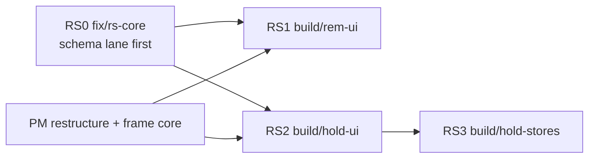

# Strongholds

> Five-minute read for §1–§7. Bullets over prose. See [AGENTS.md](../../AGENTS.md). Sprint 9, track RS: **BL-73** as the DM wrote it ([backlog](../agents/backlog.md), [#338](../decisions-log.md)); scope is decided, not open. DM questions are framed in [§15](#15-open-questions) with a **bold** pick. Companion spec: [reminders](reminders.md). Cross-cutting design: proposed ADRs [record families](../architecture/adr/proposed-s9-rs-record-families.md) and [Stores holder](../architecture/adr/proposed-s9-rs-stores-holder.md). Licence ([ADR-0018](../architecture/adr/0018-global-imported-content.md)): we borrow the **structure** of 2024 bastions (staff per facility, orders, defenders), **never** their catalogue (facility names, effects, order lists, events): nothing of it ships in code, fixtures or UI text (FR-HOLD-40).

### At a glance

| FR | What | Slice ([§14](#14-dependencies)) | Named test ([§13](#13-test-plan)) |
|---|---|---|---|
| FR-HOLD-01–10 | Record, inputs, caps, DM-only rows, visibility, leak rule | RS0 `fix/rs-core` | `FR-HOLD-08 visibility per player`, `FR-HOLD-10 leak scan` |
| FR-HOLD-11–20 | Commands (create, update, facilities, staff, remove, delete), events | RS0 | `FR-HOLD-17 removing a facility removes its reminders`, `FR-HOLD-19 delete moves Stores to the party` |
| FR-HOLD-21 | Stores = a holder in the loot ledger ([LOOT FR-LOOT-30–39](party-loot.md#6-functional-requirements)) | RS0 server, RS3 UI | `FR-LOOT-34 Move to party from Stores` |
| FR-HOLD-22–34 | Strongholds tab list, Stronghold window and its tabs | RS2 `build/hold-ui`, RS3 `build/hold-stores` | `FR-HOLD-22 list per viewer`, `FR-HOLD-25 facilities tab` |
| FR-HOLD-35–40 | Fixtures, bundle, CON-44, reconnect, crash, licence | RS0 | `reminders-strongholds loads from empty`, `FR-HOLD-37 CON-44`, `FR-HOLD-39 crash` |

## 1. Summary

- A **stronghold** is the party's base (a keep, a ship, a guildhall): the DM tracks it in one record and shows players what they should know. Several per campaign.
- Parts: **Staff** (name, role, wage, notes, optional "works in" facility), **Facilities** (planned / building / built / replaced, cost, build days, upkeep, income dice, effect text, current order, "replaces"), **Defenders** (a count), linked **Reminders**, **Stores** (one per stronghold, a holder in the loot / inventory ledger, so Move to party is the existing form) and **Notes**. **Any row can be DM-only.**
- A Party Manager **Strongholds** tab lists them; each opens a **Stronghold** window. Removing a facility or a stronghold removes its reminders (with a confirm).
- **Not in** (BL-73): income reports or automation, bastion turns, facility levels, events tables.

## 2. Scope

- Record type `stronghold` (campaign scope, **lazy `"all"`**): one record per stronghold with its facilities and staff inside (JSON leaves), redacted per viewer.
- Intents `hold.create`, `hold.update`, `hold.saveFacility`, `hold.removeFacility`, `hold.saveStaff`, `hold.removeStaff`, `hold.moveRow`, `hold.delete` (DM). Events `StrongholdCreated`, `StrongholdUpdated`, `FacilityRemoved`, `StrongholdDeleted`.
- Stores: a new holder kind `stores` in the coin ledger and the item ledger ([LOOT FR-LOOT-30–39](party-loot.md#6-functional-requirements)).
- Strongholds tab content (hosted by [PARTY FR-PARTY-71–78](party-board.md#611-sprint-9-reminders-and-strongholds-tabs-track-rs)); window `hold.stronghold` (registered per [SHELL FR-SHELL-170–172](play-shell.md#6-functional-requirements)).
- Fixtures + bundle `reminders-strongholds` (shared with REM).

## 3. Goals

- The DM sets up a stronghold with 6 facilities and 8 staff in one sitting; a player opens it in ≤ 2 clicks and sees exactly the rows the DM shows.
- Moving the Stores' coin or items to the party uses the existing Move form and logs like any move (≤ 10 s).
- No leak: a DM-only stronghold, facility, staff row, defenders count or note never reaches a player: snapshot, frames, `sync.load` acks, loot-ledger rows; before and after a reconnect; and a DM-only edit sends players no frame at all.
- CON-44: 0 B for the stronghold record in every snapshot (lazy); Stores adds ≤ 10 KB worst (measured, §12).

## 4. Non-goals

- Income reports, automatic upkeep / wage payment, build countdowns, bastion turns, facility levels, events tables, order outcomes (BL-73).
- A facility or order catalogue (licence, ADR-0018); players editing a stronghold (OQ-HOLD-08).
- A map or floor plan of the stronghold; staff as creatures / tokens.

## 5. User stories

**DM**
- As the DM, I want the keep's facilities with their state and upkeep on one screen, so I can answer "what does it cost us?" mid-session.
- As the DM, I want to prepare a hidden vault and a spy on the staff, and show the stronghold to the players only when they win it.
- As the DM, I want the keep's stores to be real inventory, so "take the arrows from the stores" is the normal Move.

**Player**
- As a player, I want to see our keep's staff, facilities and what each one is doing, and roll a facility's income dice when the DM asks.
- As a player, I want to take 20 arrows from the keep's stores onto my sheet.

## 6. Functional requirements

`env` = `CommandEnv`; campaign = `env.actor.campaignId`; IDs and time from `env.ctx`. Every command is one transaction with its event-log row. "Clean" = trimmed, control characters removed (notes and effect keep `\n`). "gp" = a whole number of gold pieces, plain (OQ-HOLD-03 **A**).

### 6.1 Record, inputs, visibility

| ID | Requirement | Notes |
|---|---|---|
| FR-HOLD-01 | Table `stronghold` (§8), record type `stronghold`, campaign scope, **lazy `"all"`** ([ADR-0045](../architecture/adr/0045-lazy-record-types.md)): one record per stronghold; `facilities` and `staff` are **JSON leaves** inside it (stable element ids from `ctx.ids`). | proposed ADR record families |
| FR-HOLD-02 | Caps: ≤ **8** strongholds per campaign (OQ-HOLD-01 **A**), ≤ **24** facilities and ≤ **40** staff each. Over → `conflict` "‹What› limit reached (‹n›)". | §12 measured |
| FR-HOLD-03 | Header input: `name` clean 1–60, unique per campaign (case-insensitive; else `conflict` "A stronghold with that name exists"); `defenders` int 0–9 999; `notes` clean 0–4 000; flags `dmOnly`, `defendersDmOnly`, `notesDmOnly`. | |
| FR-HOLD-04 | Facility input (strict): `name` clean 1–60; `state` `planned` \| `building` \| `built` \| `replaced`; `cost` gp 0–999 999 \| null; `buildDays` 0–999 \| null; `upkeep` gp 0–99 999 \| null; `incomeDice` canonical notation ([FR-DICE-01](dice-roll-log.md#6-functional-requirements)) \| null; `effect` clean 0–600; `order` clean 0–80 (the current order, free text); `replacesId` another facility of the same stronghold \| null (itself → `invalid`; unknown → `not_found`); `dmOnly`. No rule links state and "replaces" (BL-73: no automation). | |
| FR-HOLD-05 | Staff input (strict): `name` clean 1–60; `role` clean 0–40; `wage` gp 0–99 999 \| null; `notes` clean 0–200; `facilityId` ("works in") a facility of the same stronghold \| null; `dmOnly`. | |
| FR-HOLD-06 | **Defaults** (OQ-HOLD-02 **A**): a new stronghold starts **DM-only** ("Not shown to players") until the DM shows it; new facilities, staff, defenders and notes start **visible** (shown whenever the stronghold is). | OQ-HOLD-02 |
| FR-HOLD-07 | **DM-only rows** (BL-73 "any row DM-only"): the stronghold itself, each facility, each staff member, the defenders count and the notes each carry their own flag. Stores follow the stronghold ([FR-LOOT-32](party-loot.md#6-functional-requirements)); a reminder linked to a DM-only stronghold or facility is hidden with it ([FR-REM-06](reminders.md#6-functional-requirements)). | |
| FR-HOLD-08 | Visibility fn `stronghold` (pure, reads only the record): **DM full**. **Player hidden** if `dmOnly`. Otherwise **redacted**: facilities and staff with `dmOnly` removed; `defenders` omitted if `defendersDmOnly`; `notes` omitted if `notesDmOnly`; every `*DmOnly` / `dmOnly` key removed; a visible facility's `replacesId` and a visible staff member's `facilityId` that point at a removed facility → `null`. So nothing about a DM-only row (name, id, count) reaches a player. Showing / hiding is an upsert to players / a delete (record-change rule). | ADR-0021 B |
| FR-HOLD-09 | Every HOLD event is **`quietWhenUnchanged`** ([#276](../decisions-log.md)): an edit of a DM-only row leaves the player's redacted record identical, so players get **no frame** (not even an empty one that would hint at activity). | |
| FR-HOLD-10 | **Leak rule** (tests): with the bundle, no player's snapshot, frame, `sync.load` ack or loot-ledger row contains "HOLD-SECRET-VAULT", "HOLD-SECRET-SPY", "HOLD-SECRET-TOWER", "HOLD-SECRET-ITEM", "HOLD-SECRET-NOTES" or the DM-only rows' ids; before and after a reconnect; after a DM-only edit; and after a show → hide round trip (after the hide). | |

### 6.2 Commands (DM only, OQ-HOLD-08 **A**; a player → `forbidden`)

| ID | Requirement | Notes |
|---|---|---|
| FR-HOLD-11 | `hold.create {name}`: row with FR-HOLD-06 defaults, empty lists, `defenders` 0. Emits `StrongholdCreated {strongholdId}`. Result `{strongholdId}`. | |
| FR-HOLD-12 | `hold.update {strongholdId, name?, dmOnly?, defenders?, defendersDmOnly?, notes?, notesDmOnly?}` (patch, ≥ 1 field). Same values → `ack`, no event. Emits `StrongholdUpdated {strongholdId, part: "header"}`. A `dmOnly` flip also, in the same transaction: rewrites `linkHidden` on its reminders (FR-REM-06), `storesHidden` on its Stores' loot entries and items, and the `stores-coin` row ([FR-LOOT-32](party-loot.md#6-functional-requirements)); all ride on this event's changes. | |
| FR-HOLD-13 | `hold.saveFacility {strongholdId, facility: {id?, …FR-HOLD-04}}`: no `id` → append (new id); with `id` → replace that element (`not_found` "Facility is gone"). A `dmOnly` flip rewrites `linkHidden` on reminders linked to it. Emits `StrongholdUpdated {part: "facility", facilityId}`. Result `{facilityId}`. | |
| FR-HOLD-14 | `hold.saveStaff {strongholdId, staff: {id?, …FR-HOLD-05}}`: as FR-HOLD-13 for staff. Result `{staffId}`. | |
| FR-HOLD-15 | `hold.moveRow {strongholdId, list: facilities \| staff, id, index}`: moves the element (index clamped). Same place → `ack`, no event. | DM's order |
| FR-HOLD-16 | `hold.removeStaff {strongholdId, staffId}`: removes it. Emits `StrongholdUpdated {part: "staff"}`. | |
| FR-HOLD-17 | `hold.removeFacility {strongholdId, facilityId}`: removes it; in the same transaction **deletes every reminder linked to it** ([FR-REM-11](reminders.md#6-functional-requirements)), sets staff `facilityId` and other facilities' `replacesId` that pointed at it to null. Emits `FacilityRemoved {strongholdId, facilityId, reminderIds}`. The client confirm (AlertDialog) names it: "Remove Steam Rooms? Its 1 reminder is removed too." | BL-73 |
| FR-HOLD-18 | Unknown stronghold or one of another campaign → `not_found`. Strict keys; ids of elements are server-made (a client-sent id on create → `invalid`). | |
| FR-HOLD-19 | `hold.delete {strongholdId}`: in one transaction (a) deletes its linked reminders; (b) **moves its Stores to the party** (OQ-HOLD-06 **B**): each Stores item → party inventory (merge by key) and the Stores coin balance → party pot, as logged loot entries ([FR-LOOT-38](party-loot.md#6-functional-requirements)); party inventory full → `conflict` "Party inventory is full (60) — move or remove items first", nothing changes; (c) deletes the row. Emits `StrongholdDeleted {strongholdId, reminderIds, entryIds}`. The confirm names all three: "Delete Greystone Keep? 3 reminders are removed; its Stores (2 items, 120 gp) move to the party." | BL-73 |
| FR-HOLD-20 | **No notifications** for any HOLD command (no mechanics, no alerts). All events logged; none undoable. | ADR-0016 |
| FR-HOLD-21 | **Stores**: every stronghold has exactly one Stores (no row of its own; it exists while the stronghold exists): a holder kind `stores` in the coin and item ledgers, so Move to party, Take and Give are the existing forms ([LOOT FR-LOOT-30–39](party-loot.md#6-functional-requirements)). Capacity ≤ 60 item rows, coin unbounded (OQ-HOLD-05 **A**). | BL-73 |

### 6.3 Strongholds tab and Stronghold window (client)

| ID | Requirement | Notes |
|---|---|---|
| FR-HOLD-22 | **Strongholds tab** content (hosted by [FR-PARTY-73](party-board.md#611-sprint-9-reminders-and-strongholds-tabs-track-rs)): one row per stronghold the viewer receives, by name: name, "DM only" Badge (DM), a state summary ("3 built · 1 building · 1 planned", visible facilities only), Defenders count (if visible), **Open**. DM: header **New stronghold** (name Input inline), row menu Rename, Show to players / Hide from players, Delete… (FR-HOLD-19's confirm). Empty: DM "No strongholds yet"; players never see an empty tab (FR-PARTY-72). | |
| FR-HOLD-23 | **Window** `hold.stronghold` "Stronghold" (both clients; [FR-SHELL-170](play-shell.md#6-functional-requirements)): one window showing the selected stronghold (client state, kept per browser with the layout, as `party.handout`). Open from the tab's Open, a reminder's link icon ([FR-REM-18](reminders.md#6-functional-requirements)) or a loot-log Stores name; opening another stronghold swaps the content. Loads with `useLazyRecords("stronghold")`; a stronghold that is gone or hidden → "This stronghold isn't available" (`hold-gone`), no error toast. | |
| FR-HOLD-24 | **Header**: name; DM "DM only" Badge + Switch "Shown to players"; Defenders chip "Defenders 12" (DM: click to edit, eye-off toggle; players: hidden when DM-only); DM menu Rename, Delete…; an "All strongholds" link (`openPartyTab("strongholds")`, [FR-PARTY-75](party-board.md#611-sprint-9-reminders-and-strongholds-tabs-track-rs)). **Tabs**: Facilities, Staff, Stores, Reminders, Notes (tab per browser); hidden tabs stay mounted (as [FR-PARTY-50](party-board.md#69-sprint-7-bl-48-copy-and-tabs-track-fu)). | |
| FR-HOLD-25 | **Facilities tab**: rows in the DM's order: name + state Badge (planned muted, building amber, built green, replaced struck), a figures line ("Cost 500 gp · 20 days · Upkeep 5 gp", empty parts left out), **Income** roll button (FR-HOLD-33), "Order: Craft: arrows", effect text (3 lines, "More" expands), "Replaces Old Bathhouse" / "Replaced by Steam Rooms", the staff who work there (names), DM eye-off on DM-only rows. DM: **Add facility**, row menu Edit, Make reminder (FR-HOLD-29), Move up / down, Remove… (FR-HOLD-17 confirm). Footer totals (FR-HOLD-31). | |
| FR-HOLD-26 | **Facility editor** (Dialog, DM): FR-HOLD-04 fields; State Select; Replaces Select (other facilities); Order Input with suggestions (FR-HOLD-32); Income dice with live check; DM only Switch. Save disabled while invalid, unchanged, not `live` or in flight; reject → inline; lost intent → Toast "Connection lost — check the stronghold before saving again". | |
| FR-HOLD-27 | **Staff tab**: rows in the DM's order: name, role, wage ("2 gp"), "works in ‹facility›", notes (muted); DM eye-off. DM: Add staff, Edit (Dialog, FR-HOLD-05 fields, Works in Select), Move up / down, Remove (inline confirm). Footer: wages total (FR-HOLD-31). | |
| FR-HOLD-28 | **Stores tab**: the Stores coin strip and item list, with LOOT's existing forms preset to this Stores ([FR-LOOT-34](party-loot.md#6-functional-requirements)): **Move to party** (coin Move form, From = this Stores, To = Party pot), item **Take** / **Give…**, DM **Add to Stores** (items) and DM coin in / out (Outside the party ↔ Stores). Same locks, rejects and lost-intent rules as FR-LOOT-16 / FR-PARTY-24. | BL-73 |
| FR-HOLD-29 | **Reminders tab**: the reminders linked to this stronghold ([FR-REM-25](reminders.md#6-functional-requirements)'s rows), grouped by facility ("Whole stronghold" first), each showing its target (Party / character name); only reminders the viewer receives. DM: **Add reminder** (REM editor prefilled: link = this stronghold, source "‹Stronghold›") and on a facility **Make reminder** (prefilled: text = the facility's effect cut to 500, source "‹Stronghold›: ‹Facility›", link = the facility, target Party). | |
| FR-HOLD-30 | **Notes tab**: the notes as plain text (line breaks kept); DM: Textarea with counter, "DM only" Switch, Save (same locks as FR-HOLD-26). Players: hidden tab when the notes are DM-only or empty. | |
| FR-HOLD-31 | **Totals** (plain numbers, OQ-HOLD-03 **A**): "Upkeep 15 gp · Wages 6 gp" over the rows the viewer receives (DM: all, with "incl. DM only" when any hidden row counts). No link to the ledger: paying is a normal Move / Subtract. | |
| FR-HOLD-32 | **Order suggestions** (OQ-HOLD-04 **B**): the Order Input lists distinct `order` texts already used in this campaign's strongholds (client, from loaded records, ≤ 20, by use); no built-in list. | licence |
| FR-HOLD-33 | **Income dice**: a facility's `incomeDice` renders as a roll button on the **macros' roll path** ([FR-DICEX-68](dice-extras.md#6-functional-requirements); label "‹Facility› income", category `other`, roll as "DM" / "Me"); the result is only a roll in the Game log (no income automation, BL-73). | |
| FR-HOLD-34 | **Live and states**: rows re-render from upserts (another DM tab, a hide, a removal); a facility removed while its editor is open → "This facility was removed", Save disabled; disconnected → last view, actions disabled; loading → skeleton; load error → Retry. Names and text wrap, never cut (W4 rule). | |

### 6.4 Fixtures, CON-44, failure, licence

| ID | Requirement | Notes |
|---|---|---|
| FR-HOLD-35 | Fixture units (`fixtures/units/strongholds/`, as DM through HOLD / LOOT / REM commands; fixed clock; patches only): **`hold-greystone`**: "Greystone Keep", shown to players; defenders 12; notes "Rebuilt after the siege."; facilities Forge Hall (built, upkeep 5, income `2d6`, order "Craft: arrows"), Herb Beds (building, cost 500, 20 days), Map Room (planned, cost 1 000, 30 days), Old Bathhouse (replaced), Steam Rooms (built, upkeep 3, replaces Old Bathhouse), **HOLD-SECRET-VAULT** (built, DM-only); staff Brenna (smith, 2 gp, works in Forge Hall), Tobin (gardener, 1 gp, Herb Beds), **HOLD-SECRET-SPY** (DM-only, 5 gp). **`hold-greystone-reminders`**: a party reminder linked to Steam Rooms ("Steam Rooms: advantage on the first CON save after a long rest", source "Greystone Keep: Steam Rooms") and one linked to the vault ("REM-SECRET-VAULT …", hidden with it). **`hold-greystone-stores`**: Stores Rope ×2, Arrows ×40, 120 gp (Outside the party → Stores). **`hold-tower-secret`**: "HOLD-SECRET-TOWER" (DM-only by default), notes "HOLD-SECRET-NOTES", one facility, Stores "HOLD-SECRET-ITEM" ×1 and 10 gp. **`hold-tower-move`**: 5 gp Tower Stores → Party pot (players see "Outside the party → Party pot"). Every name and text is invented (FR-HOLD-40). | ADR-0017 |
| FR-HOLD-36 | Bundle **`reminders-strongholds`** ([REM FR-REM-28](reminders.md#6-functional-requirements)); `rs-e2e` alias for e2e. **`session-sim-13`** appends `hold-greystone`, `hold-greystone-reminders`, `hold-greystone-stores`, `hold-tower-secret` (session-sim-12-safe: new rows only; Stores coin comes from Outside the party, so the party pot, wallets and sheets are unchanged); **not** `hold-tower-move` (it changes the pot). | |
| FR-HOLD-37 | **CON-44** (measured, §12): `stronghold` absent from every snapshot (0 B); `stores-coin` and the loot-entry growth bounded as LOOT §12; tests assert both ceilings (DM 1.5 MiB, players 512 KiB) and the worst DM `sync.load` ack ≤ 380 KB at the caps. | |
| FR-HOLD-38 | **Reconnect**: the snapshot purges lazy rows; an open tab / window reloads and shows only what is visible now (a stronghold hidden while away → "This stronghold isn't available"). | FR-SYNC-37 |
| FR-HOLD-39 | **Crash**: every command is one transaction; `hold.delete` (reminders, Stores moves, row) commits whole or not at all (`PP_TEST_CRASH=hold.delete:before-commit` → everything still there; `:after-commit` → all gone, pot and inventory conserved, digest after restart identical to the committed state). | #163 |
| FR-HOLD-40 | **Licence** ([ADR-0018](../architecture/adr/0018-global-imported-content.md)): no facility, order, event or bastion text from any published book in code, fixtures, placeholders or tests; states are generic words; orders are free text (FR-HOLD-32). A review check greps the fixtures for the 2024 bastion facility names. | BL-73 |

## 7. UI/UX notes

Per [visual-direction](../design/visual-direction.md): shadcn Tabs, Button, Badge, Dialog, AlertDialog, Input, Textarea, Select, Switch, Tooltip, ScrollArea, Skeleton. No custom styling.

- **DM view:** every stronghold; DM-only rows with eye-off and the "DM only" Badge; Add / Edit / Remove / Move everywhere; Show to players switch in the header.
- **Player view:** only shown strongholds, without DM-only rows; read-only, except Stores moves (OQ-LOOT-21) and roll buttons.
- **States:** skeleton while loading; Retry on error; "This stronghold isn't available" when gone / hidden; disconnected = last view, actions disabled; empty lists "No facilities yet" / "No staff yet" / "Stores are empty" (DM adds; players see the text only).
- **Window layout:** header line (name, DM badge, Defenders chip, menu), then the five tabs; content scrolls under the tab strip.
- **Test IDs** (prefix `hold-`): `hold-list`, `hold-list-empty`, `hold-row` + `data-record-id` + `data-dm-only`, `hold-row-open`, `hold-new`, `hold-new-name`, `hold-row-menu`, `hold-rename`, `hold-show` + `data-value`, `hold-delete`, `hold-delete-confirm`, `hold-delete-summary`; window `hold-window` + `data-record-id`, `hold-gone`, `hold-name`, `hold-defenders` + `data-value`, `hold-defenders-edit`, `hold-tab` + `data-value` (`facilities|staff|stores|reminders|notes`); `hold-facility` + `data-record-id` + `data-state` + `data-dm-only`, `hold-facility-figures`, `hold-facility-income`, `hold-facility-order`, `hold-facility-effect`, `hold-facility-replaces`, `hold-facility-staff`, `hold-facility-menu`, `hold-facility-edit`, `hold-facility-make-reminder`, `hold-facility-up` / `-down`, `hold-facility-remove`, `hold-facility-remove-confirm`, `hold-facility-add`; editor `hold-facility-form` + field IDs `hold-facility-form-<field>`, `hold-facility-form-save`, `hold-facility-form-error`, `hold-facility-form-gone`; `hold-staff` + `data-record-id` + `data-dm-only`, `hold-staff-add`, `hold-staff-edit`, `hold-staff-remove`, `hold-staff-form-<field>`; `hold-totals`; `hold-stores` (wraps LOOT / PARTY IDs, `data-record-id` = stronghold id); `hold-reminders`, `hold-reminders-add`; `hold-notes`, `hold-notes-edit`, `hold-notes-dm-only`, `hold-notes-save`; `hold-loading`, `hold-retry`.

## 8. Data model

| Entity | Field | Type | Notes |
|---|---|---|---|
| Stronghold (`stronghold`) | id, campaignId, seq | ID, ID → Campaign, int | `ctx.ids`; ≤ 8 per campaign |
| | name | text 1–60 | Unique per campaign (case-insensitive) |
| | dmOnly | bool | Default true (FR-HOLD-06) |
| | defenders, defendersDmOnly | int 0–9 999, bool | |
| | notes, notesDmOnly | text 0–4 000, bool | |
| | facilities | **JSON leaf**, ≤ 24 × `{id, name, state, cost, buildDays, upkeep, incomeDice, effect, order, replacesId, dmOnly}` | FR-HOLD-04; array order = DM's order |
| | staff | **JSON leaf**, ≤ 40 × `{id, name, role, wage, notes, facilityId, dmOnly}` | FR-HOLD-05 |
| | createdAt, updatedAt | timestamp ×2 | |
| Stores | — | no table | The stronghold's holder in `loot_entry` ends and `party_item.stronghold_id` ([LOOT §8](party-loot.md#8-data-model)) |

- **Relations:** campaign 1–n stronghold; stronghold 1–n reminders (by id, [REM §8](reminders.md#8-data-model)); stronghold 1–1 Stores (ledger rows by `strongholdId`).
- **Derived:** state summary, totals, "replaced by", staff per facility, order suggestions (client); `stores-coin` (server, LOOT).
- **Persisted runtime state:** rows only. Index `(campaignId, seq)`, unique `(campaignId, lower(name))`.

## 9. API & events

**REST:** none.

**Record types**

| Type | Scope | DM | Player | Snapshot |
|---|---|---|---|---|
| `stronghold` | campaign | full | FR-HOLD-08: hidden, or redacted (DM-only rows / fields removed) | **lazy `"all"`** |
| `stores-coin` (LOOT, derived) | campaign | full | hidden while its stronghold is DM-only | yes (≤ 8 rows) |

**WS intents** (DM only; none optimistic)

| Intent | Validation | Result |
|---|---|---|
| `hold.create {name}` | FR-HOLD-02, -03 | `{strongholdId}` |
| `hold.update {strongholdId, …}` | FR-HOLD-03, -12 | — |
| `hold.saveFacility {strongholdId, facility}` | FR-HOLD-04, -13 | `{facilityId}` |
| `hold.saveStaff {strongholdId, staff}` | FR-HOLD-05, -14 | `{staffId}` |
| `hold.moveRow {strongholdId, list, id, index}` | FR-HOLD-15 | — |
| `hold.removeStaff {strongholdId, staffId}` | FR-HOLD-16 | — |
| `hold.removeFacility {strongholdId, facilityId}` | FR-HOLD-17 | — |
| `hold.delete {strongholdId}` | FR-HOLD-19 | — |

**WS events** (all logged; none undoable; all `quietWhenUnchanged`)

| Event | Payload | Changes | Visibility rule |
|---|---|---|---|
| `StrongholdCreated` | `{strongholdId}` | stronghold | FR-HOLD-08 (new = DM-only: DM only) |
| `StrongholdUpdated` | `{strongholdId, part, facilityId?, staffId?}` | stronghold; on a `dmOnly` flip + reminders (`linkHidden`), Stores loot entries / items (`storesHidden`), `stores-coin` | per row: players get the redacted change or nothing (FR-HOLD-09) |
| `FacilityRemoved` | `{strongholdId, facilityId, reminderIds}` | stronghold, reminder deletes | per row |
| `StrongholdDeleted` | `{strongholdId, reminderIds, entryIds}` | stronghold → null, reminder deletes, Stores moves (loot entries, party-item, `party-pot`, `stores-coin` → null) | per row (LOOT FR-LOOT-32 redaction for entries) |

## 10. Permissions

| Action | DM | Player | Server check |
|---|---|---|---|
| See a stronghold | all | shown ones, redacted | FR-HOLD-08 |
| Create / edit / remove / delete, show / hide | ✓ | ✗ | role (`forbidden`) |
| Roll income dice | as DM | as "Me" | `dice.roll` rules |
| Move coin / items with the Stores | any | per [OQ-LOOT-21](party-loot.md#15-open-questions) (A: as the party pot) | LOOT FR-LOOT-33 at commit |

## 11. Edge cases & failure modes

- **Player disconnect / reconnect:** FR-HOLD-38; Stores rows come back with the next `party-item` load and the snapshot's `stores-coin` / loot window.
- **DM disconnect / reconnect:** players unaffected (they can still move with visible Stores); DM forms disabled; a lost intent → Toast.
- **Server crash mid-action:** FR-HOLD-39.
- **Concurrent edits:** commands serialise per element: two DM tabs editing different facilities both land; the same facility → last write wins, the other editor shows "Changed in another tab" and keeps its draft; remove vs edit → `not_found` "Facility is gone". A player moving from the Stores while the DM deletes the stronghold → whichever commits first; the other gets `not_found` "Stores are gone".
- **Show / hide round trip:** players get the record (and its Stores, reminders, ledger names) on show, deletes / redactions on hide, in one event.
- **Delete with a full party inventory:** `conflict` (FR-HOLD-19), nothing changes; the confirm stays open with the message.
- **Invalid / malicious input:** over-long text, > caps, a `replacesId` / `facilityId` of another stronghold, self-replace, bad notation, client-sent element ids on create, strict-key violations → `invalid` / `not_found` / `conflict`. Text rendered as text, never HTML.
- **Campaign switch:** `4409`; next snapshot and loads are the new campaign's only.

## 12. Performance & bandwidth

**Measured** (throwaway probe on `session-sim` + `buildRealisticHeavy`, frames as `snapshotSizes`, max-length ASCII, 36-char ids; probe deleted). Base heavy: DM **691,581 B**, players 286,190–289,445 B; last sprint's DM worst (table tools at caps) ≈ 1.15 MB.

| What | Realistic (2 strongholds × 6 facilities, 8 staff) | Cap (8 × 24 facilities, 40 staff, max text) |
|---|---|---|
| **Snapshot, lazy (pick)** | **0 B** | **0 B** |
| Snapshot if not lazy (rejected) | DM +9,387 B | DM **+377,703 B** |
| `sync.load` ack | DM 9,474 B; player 8,970 B | DM 377,790 B; player 370,174 B (nothing hidden) |
| One record | 4,685 B | 47,210 B |
| `StrongholdUpdated` frame (whole record) | DM 4,900 B; player 4,648 B | DM 47,425 B; player 46,473 B |
| Stores in the snapshot (`stores-coin`, LOOT) | 2 rows: DM +508 B, player +480 B | 10 rows: DM +2,476 B, player +2,336 B |
| Loot window with Stores ends (LOOT) | — | all 100 rows: DM +7,500 B, player +5,500 B |

- Worst DM with every RS row: ≈ 1.15 MB + 2.5 KB + 7.5 KB ≈ **1.16 MB** of 1.5 MiB; worst player + 7.8 KB.
- Rejected: one record per facility / staff row ([proposed ADR](../architecture/adr/proposed-s9-rs-record-families.md)): 1,243 B per facility edit and 669 B per staff edit at the caps (vs 47 KB), but it needs copy flags on every row for the stronghold's and the target facility's visibility; edits are DM prep, human-paced, and a DM-only edit costs players 0 B (FR-HOLD-09). Over the tunnel the realistic edit is ≈ 5 KB per viewer.

## 13. Test plan

Isolated per worktree ([ADR-0008](../architecture/adr/0008-parallel-dev-isolation.md)); loop per [ADR-0017](../architecture/adr/0017-agent-verification-fixture-library.md). Bundle `reminders-strongholds` ([REM §13](reminders.md#13-test-plan)); units FR-HOLD-35.

| Level | What | Fixtures |
|---|---|---|
| Unit | zod bounds (`FR-HOLD-04 facility input`, `FR-HOLD-05 staff input`: caps, self-replace, bad notation); visibility fn (`FR-HOLD-08 visibility per player`: hidden stronghold; vault and spy removed; Brenna's `facilityId` kept, a staff pointer at the vault nulled; defenders / notes flags); client: state summary, totals over visible rows, order suggestions, confirm texts (`FR-HOLD-17` / `-19` counts) | — |
| Integration | Commands: create / update / save / move / remove incl. no-op `ack`, caps, `forbidden` for players, `not_found` across campaigns. **`FR-HOLD-17 removing a facility removes its reminders`** (Steam Rooms → its reminder deleted, Old Bathhouse no longer replaced, one `FacilityRemoved`, players get the reminder delete). **`FR-HOLD-19 delete moves Stores to the party`** (Tower: HOLD-SECRET-ITEM → party inventory, 10 gp → pot, reminders gone, entries logged; full party inventory → `conflict`, nothing written). `FR-HOLD-12 show and hide` (players gain / lose record, Stores, reminders, ledger names in one event). **`FR-HOLD-09 DM-only edit sends players nothing`** (real socket: no frame). **`FR-HOLD-10 leak scan`** (per player: snapshot, frames, `sync.load` acks for `stronghold`, `reminder`, `party-item`; loot window rows; before / after reconnect; after a show → hide). `FR-HOLD-37 CON-44` (both ceilings; 0 B for `stronghold`; DM load ≤ 380 KB at the caps). `FR-HOLD-38 reconnect`. `FR-HOLD-39 crash` (`PP_TEST_CRASH=hold.delete:before-commit` / `:after-commit`, digest compare). `FR-HOLD-40 licence check` (fixtures contain none of the listed catalogue names) | `reminders-strongholds` |
| E2E (thin) | DM opens Greystone Keep → player-1 opens it from the Strongholds tab (no vault / spy); player-1 moves 20 gp Stores → Party pot with Move to party; the pot updates for both | `rs-e2e` |

**Browser walkthrough RS-H** (test agent; `bun run build`; `fixtures:reset-load reminders-strongholds --profile verify`; `start --profile verify` in its pane). Contexts **A** DM, **B** player-1 (Mira), **C** player-2 (Thorn). Every change ≤ 1 s. Leak scan = B's and C's WS frames + DOM for "HOLD-SECRET-*" and "REM-SECRET-VAULT".

| # | DM (A) | Players (B, C) | Expected |
|---|---|---|---|
| H1 | Party Manager → Strongholds | — | Greystone Keep; HOLD-SECRET-TOWER with "DM only" |
| H2 | — | B, C → Strongholds | Greystone Keep only; leak scan clean |
| H3 | Open Greystone Keep | — | Facilities: 6 rows (built ×3 incl. vault eye-off, building, planned, replaced struck); Steam Rooms "Replaces Old Bathhouse"; Forge Hall shows Brenna; totals "Upkeep 8 gp · Wages 8 gp (incl. DM only)" |
| H4 | — | B opens it | 5 facilities, 2 staff, Defenders 12, notes, "Upkeep 8 gp · Wages 3 gp"; no vault, no spy; leak scan clean |
| H5 | Edit Forge Hall order → "Craft: shields" (suggestions list "Craft: arrows"); then edit the vault's effect | B, C | B, C see the new order; the vault edit sends B, C **no frame** |
| H6 | — | B clicks Forge Hall "Income 2d6" | A Game-log roll "Forge Hall income" as Mira's player ("Me") |
| H7 | — | B: Stores tab → Move to party 50 gp; Take Arrows ×20 to Mira | Stores 70 gp, Arrows ×20; pot +50 gp; Mira's sheet Arrows ×20; log rows "Greystone Keep Stores → Party pot: 50 gp", "… → Mira: Arrows ×20" |
| H8 | Remove facility Steam Rooms (confirm names 1 reminder) | B, C | The linked party reminder leaves every Reminders tab; Old Bathhouse no longer "replaced by" |
| H9 | Staff Tobin → DM only | B, C | Tobin leaves their Staff tab; their wages total reads 2 gp |
| H10 | Show HOLD-SECRET-TOWER to players, then hide it again | B, C | Appears (tab row, Stores 10 gp + item, log row "HOLD-SECRET-TOWER Stores → Party pot: 5 gp" instead of "Outside the party → …"), then leaves; after the hide, new frames and the DOM are clean again |
| H11 | — | B reloads with the Stronghold window open | Window reopens on Greystone Keep; same content |
| H12 | Hard-kill + restart the server | — | All rejoin; stronghold, Stores, pot, log identical to H11; leak scans clean; no console errors |
| H13 | Delete HOLD-SECRET-TOWER (confirm: 0 reminders; Stores 1 item, 5 gp to the party) | B, C | Party inventory gains HOLD-SECRET-ITEM ×1, pot +5 gp; B, C's new log rows read "Outside the party → Party …" and their frames carry no "HOLD-SECRET-TOWER" (the item's name is now party inventory, as confirmed) |

Teardown: stop the server, then `fixtures:reset --profile verify`.

## 14. Dependencies

| On | What we need | Status |
|---|---|---|
| [party-loot](party-loot.md) FR-LOOT-30–39 | `stores` holder in coin + item ledgers, redaction, Move form options | this track (RS0 server, RS3 UI) |
| [reminders](reminders.md) | Linked reminders, `linkHidden`, removal with the source | this track |
| [party-board](party-board.md) (PM restructure first) | Strongholds tab slot | PM, then RS2 |
| [play-shell](play-shell.md) (PM frame core first) | `hold.stronghold` registration, size-table row, window memory | PM, then RS2 |
| [dice-extras](dice-extras.md) | `RollButton` (income dice) | built |
| [ADR-0045](../architecture/adr/0045-lazy-record-types.md) | lazy `"all"` | built |
| New npm dependency | **none** | — |

### Build split (RS track; AGENTS §9.9 shared files per slice)

| # | Branch | Contents | Shared files touched |
|---|---|---|---|
| RS0 | `fix/rs-core` (**schema lane first** this sprint) | Tables `reminder`, `stronghold`; `party_item.stronghold_id` + `stores_hidden`; `loot_entry` stores ends + `stores_hidden`; zod `@shared/reminders`, `@shared/strongholds`, LOOT / PARTY schema changes; record types `reminder`, `stronghold` (lazy), `stores-coin` (derived); all REM / HOLD commands; LOOT / PARTY command changes for `stores`; entities hook line; fixtures units + bundle `reminders-strongholds`, `rs-e2e`, `session-sim-13` lines; leak, reconnect, crash, CON-44 tests. Server only (tests stand in for a walkthrough) | `src/server/db/` (schema), `src/shared/events/` (`reminders.ts`, `strongholds.ts`, `party-loot.ts` `Endpoint`), record-type registry lines, `src/server/features/index.ts` line, `src/server/features/entities/definition-hooks.ts` line, `fixtures/bundles/index.ts` lines; party-loot / party-board server + shared folders (by assignment); docs: data model, protocol (§26 unchanged: no new registry) |
| RS1 | `build/rem-ui` (after RS0 + PM's Party Manager restructure; ∥ RS2) | REM tab content, editor, roll path; CHARX section; CBTX read-only line; walkthrough RS-R | `src/client/common/features/reminders/` (new); party-board tab list (one entry); `sheet-sections.ts` (one line, append); `src/client/common/features/combat-extras/sheet-sections.tsx` (CBTX-owned, by assignment) |
| RS2 | `build/hold-ui` (after RS0 + PM's frame core and restructure; ∥ RS1) | Strongholds tab, `hold.stronghold` window: header, Facilities, Staff, Reminders, Notes tabs; walkthrough RS-H steps H1–H6, H8–H12 | `src/client/common/features/strongholds/` (new); party-board tab list (one entry; second of RS1 / RS2 rebases); both `windows.ts` (one line each, append); play-shell size-table row, goldens, harness sets (append rows, PM's contract) |
| RS3 | `build/hold-stores` (after RS2) | Stores tab; LOOT Move form / log `stores` options; Inventory filter; walkthrough H7, H10, H13 | party-loot + party-board client folders (by assignment; FX's party-loot items, if any, after RS3) |

- Parallel: RS1 ∥ RS2; RS3 after RS2. RS0 first in the sprint's schema lane (SP's recap record, if any, after it).

## 15. Open questions

**Bold** = suggested pick (not decided). DM questions first.

| ID | Question | Options (pick marked) | Blocking? | Affects |
|---|---|---|---|---|
| OQ-HOLD-01 | **DM:** several strongholds per campaign? | **A. Yes, up to 8** (a list in the tab) / B. Exactly one per campaign. *Tradeoff:* A costs a list row; B saves one click but a party that gets a ship and a keep breaks it | yes | FR-HOLD-02 |
| OQ-HOLD-02 | **DM:** what do players see by default? | **A. A new stronghold is DM-only until you show it; once shown, every row is visible unless you mark it DM-only** / B. Everything visible from creation / C. Stronghold visible, but each new row DM-only until shown. *Tradeoff:* A keeps prep secret with one switch; C means many clicks to reveal | yes | FR-HOLD-06 |
| OQ-HOLD-03 | **DM:** wages / upkeep: plain numbers or tied to the ledger's coins? | **A. Plain gp numbers with totals; paying is a normal Move / Subtract** / B. A "Pay upkeep" button writing a ledger entry from the Stores. *Tradeoff:* A has no automation (BL-73 "not in"); B is the start of income automation | yes | FR-HOLD-31 |
| OQ-HOLD-04 | **DM:** facility order: free text or from a list? | A. Free text / **B. Free text with suggestions from orders already used in this campaign** / C. A fixed list (the 2024 orders: licence check vs ADR-0018). *Tradeoff:* B is quick to re-enter with no catalogue to licence | no · owner: DM gate | FR-HOLD-32 |
| OQ-HOLD-05 | **DM:** Stores capacity and coin | **A. Items ≤ 60 rows (as the party inventory) plus coin** / B. Items only / C. No cap. *Tradeoff:* A reuses the ledger's caps and forms; coin is where gold from the keep naturally sits | no · owner: DM gate | FR-HOLD-21 |
| OQ-HOLD-06 | **DM:** deleting a stronghold whose Stores aren't empty | A. Refuse until emptied / **B. Move everything to the party in the same step (the confirm says what)** / C. Write it off (gone). *Tradeoff:* B is one step and conserves coin and items; A is safest but tedious | no · owner: DM gate | FR-HOLD-19 |
| OQ-HOLD-07 | **DM (with PM):** Strongholds as a Party Manager tab or its own launcher window? Party Manager tabs: Party status, Handouts, Inventory, Loot, Reminders, Strongholds = **6 tabs at 550 px** (≈ 540 px of labels by estimate; PM's layout test measures) | **A. 6th tab; players see it only while they can see a stronghold; below the fit the strip scrolls (FR-PARTY-46)** / B. Own launcher window "Strongholds" (the list), Party Manager keeps 5 tabs / C. The tab only when a campaign "Strongholds" switch is on ([ADR-0058](../architecture/adr/0058-feature-switches.md), off by default). *Tradeoff:* A keeps party things in one window as BL-73 says; B costs a launcher slot; C hides it for campaigns that don't use it but needs feature traces on reminders and the ledger | yes | party-board, play-shell |
| OQ-HOLD-08 | **DM:** who edits a stronghold? | **A. DM only; players read, roll income dice and move with the Stores** / B. Players may also edit orders and staff notes. *Tradeoff:* A keeps one writer; B needs per-field rights | no · owner: DM gate | FR-HOLD-18 |
| OQ-HOLD-09 | **PM (seams):** the Stronghold window under window memory: registered after PM's frame core with a size-table row (default 480 × 560, useful 400 × 400, min 340 × 360) | **A. As [FR-SHELL-170–172](play-shell.md#6-functional-requirements); PM's placer places it the first time, then window memory** | no · owner: orchestrator | play-shell |
| OQ-HOLD-10 | **Glossary:** add **Stronghold**, **Facility**, **Staff**, **Defenders**, **Stores** (definitions as §1) | **Add** | no · owner: integrator | glossary |
| OQ-HOLD-11 | Single record vs one record per row (measured §12) | **Single record with JSON leaves, redacted inside** / per-row records with copy flags. In the proposed ADR | no · owner: DM gate (ADR) | live-sync |

## 16. Out of scope

- Income reports or automation, upkeep / wage payment, build countdowns, bastion turns, facility levels, events tables (BL-73).
- Any published facility / order / event catalogue (ADR-0018); hirelings as creatures or tokens; stronghold maps.
- Player editing (OQ-HOLD-08 B); per-item DM-only Stores rows (Stores follow the stronghold).
